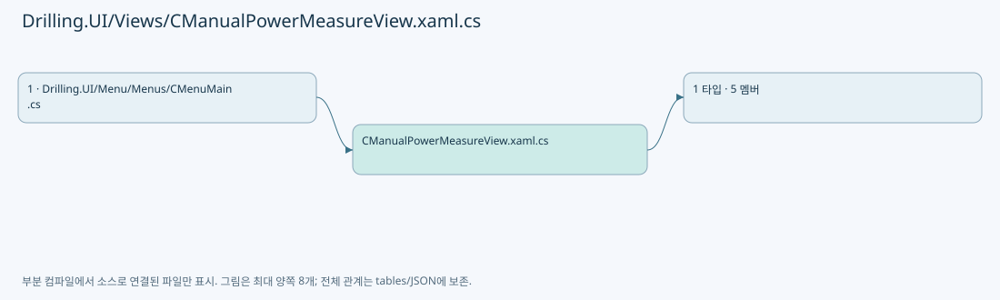
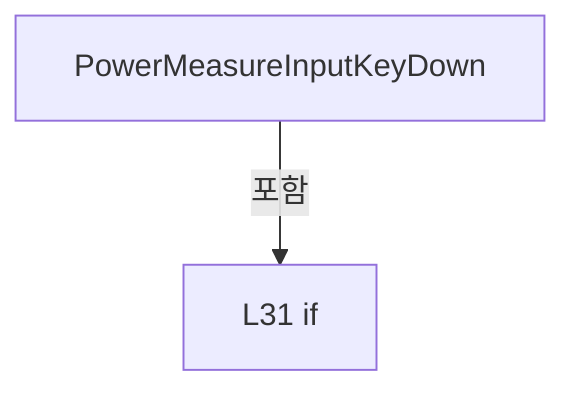
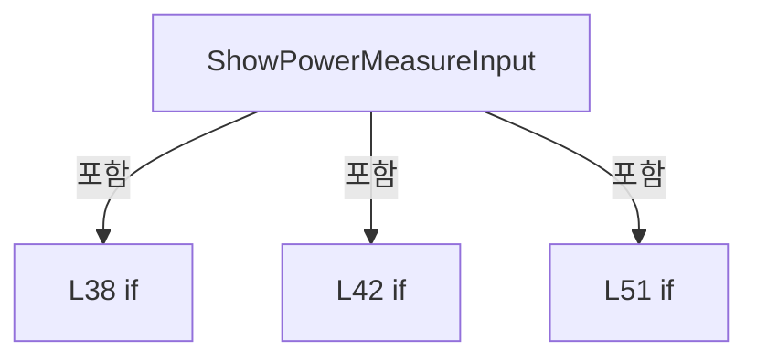
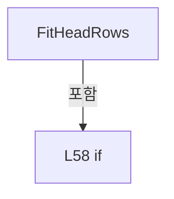

# Drilling.UI/Views/CManualPowerMeasureView.xaml.cs

| 항목 | 내용 |
| --- | --- |
| 원본 저장소 | https://github.com/kjuws10-rgb/A3Drilling.git |
| 원본 Commit | 5aee8e58439c9b455cae7c9593c9be986c3e682e |
| 원본 SHA256 | df6f5ea261a763f08f0b7ad8e614a52a38d078be2ec4e93404c38082c96ca7b5 |
| 파일 분류 | code |
| 원본 크기/행 | 2,302 bytes / 61 physical lines |
| 인코딩 | utf-8-sig |
| 검토 범위 | 구문/부분 의미 분석에서 추출한 사실. 동작·물리 단위·실장비 합격을 보증하지 않습니다. |
| 원본 링크 | [고정 Commit 원본](https://github.com/kjuws10-rgb/A3Drilling/blob/5aee8e58439c9b455cae7c9593c9be986c3e682e/Drilling.UI/Views/CManualPowerMeasureView.xaml.cs) |

## 파일의 역할과 읽는 순서

WPF 화면·사용자 명령·표시 상태를 구성합니다. XAML 이벤트와 코드 비하인드, RootView의 조립 경로를 함께 추적합니다.

## 네임스페이스·타입·상속

| 타입 | 구분 | 원본 범위 | 선언/상속 |
| --- | --- | --- | --- |
| CManualPowerMeasureView | ClassDeclaration | 10–61 | CManualPowerMeasureView: UserControl |

## 멤버 빠른 목록

| 이름 | 종류 | 범위 | 서명 |
| --- | --- | --- | --- |
| .ctor | ConstructorDeclaration | L12–21 | Drilling.UI.Views.CManualPowerMeasureView.CManualPowerMeasureView() |
| OpenPowerMeasureInput | MethodDeclaration | L23–27 | void Drilling.UI.Views.CManualPowerMeasureView.OpenPowerMeasureInput(object, MouseButtonEventArgs) |
| PowerMeasureInputKeyDown | MethodDeclaration | L29–34 | void Drilling.UI.Views.CManualPowerMeasureView.PowerMeasureInputKeyDown(object, KeyEventArgs) |
| ShowPowerMeasureInput | MethodDeclaration | L36–54 | void Drilling.UI.Views.CManualPowerMeasureView.ShowPowerMeasureInput(object) |
| FitHeadRows | MethodDeclaration | L56–60 | void Drilling.UI.Views.CManualPowerMeasureView.FitHeadRows(object, RoutedEventArgs) |

## 멤버별 상세 계약·호출·처리 해설

### ConstructorDeclaration `.ctor` · L12–21

[Drilling.UI/Views/CManualPowerMeasureView.xaml.cs:12–21](https://github.com/kjuws10-rgb/A3Drilling/blob/5aee8e58439c9b455cae7c9593c9be986c3e682e/Drilling.UI/Views/CManualPowerMeasureView.xaml.cs#L12-L21)

| 항목 | 실제 추출 값 |
| --- | --- |
| 서명 | Drilling.UI.Views.CManualPowerMeasureView.CManualPowerMeasureView() |
| 접근/수식자 | Public / public |
| 반환/값 타입 | void |
| 소속 타입 | NamedType:Drilling.UI.Views.CManualPowerMeasureView |

정적 호출자로 확인된 위치:

| 호출 파일/행 | 호출 표현식 | 런타임 분기 가능 |
| --- | --- | --- |
| [Drilling.UI/Menu/Menus/CMenuMain.cs:2307–2307](https://github.com/kjuws10-rgb/A3Drilling/blob/5aee8e58439c9b455cae7c9593c9be986c3e682e/Drilling.UI/Menu/Menus/CMenuMain.cs#L2307-L2307) | new Drilling.UI.Views.CManualPowerMeasureView | False |

호출하는 대상과 해석 범위:

| 원본 행 | 표현식 | 분석 상태 | 대상/소스 위치 |
| --- | --- | --- | --- |
| 14 | InitializeComponent | unresolved | None |

본문의 실제 연산·분기·예외·반환 순서(원문 위치 순):

| 원본 행 | 종류 | 주석 해설 |
| --- | --- | --- |
| 14 | call | 함수·델리게이트 또는 객체 생성자를 호출합니다: InitializeComponent() |
| 15 | compound-assignment-or-event-subscription | 복합 대입 또는 이벤트 구독/해지 표현입니다: DataContextChanged += (_, _) => { var visibility = DataContext is CManualPowerMeasurePanel { IsReadOnly: true } ? Visibility.Visible : Visibility.Collapsed; AutoToleranceColumn.Visibility = visibility; AutoAttemptsColumn.Visibilit |
| 17 | conditional-expression | 조건에 따라 결과식을 선택합니다: DataContext is CManualPowerMeasurePanel { IsReadOnly: true } ? Visibility.Visible : Visibility.Collapsed |
| 17 | local-declaration | 지역 변수를 선언합니다: var visibility = DataContext is CManualPowerMeasurePanel { IsReadOnly: true } ? Visibility.Visible : Visibility.Collapsed; |
| 17 | variable-initializer | 변수의 초기값을 지정합니다: visibility = DataContext is CManualPowerMeasurePanel { IsReadOnly: true } ? Visibility.Visible : Visibility.Collapsed |
| 18 | assignment | 값을 대상에 대입합니다: AutoToleranceColumn.Visibility = visibility |
| 19 | assignment | 값을 대상에 대입합니다: AutoAttemptsColumn.Visibility = visibility |

변경 전 점검: 입력/반환 타입, 위 호출자, 예외/취소 경로, 공유 상태와 저장·전송 소비자를 함께 확인합니다. 값의 단위나 물리 방향을 이름만으로 확정하지 않습니다.

### MethodDeclaration `OpenPowerMeasureInput` · L23–27

[Drilling.UI/Views/CManualPowerMeasureView.xaml.cs:23–27](https://github.com/kjuws10-rgb/A3Drilling/blob/5aee8e58439c9b455cae7c9593c9be986c3e682e/Drilling.UI/Views/CManualPowerMeasureView.xaml.cs#L23-L27)

| 항목 | 실제 추출 값 |
| --- | --- |
| 서명 | void Drilling.UI.Views.CManualPowerMeasureView.OpenPowerMeasureInput(object, MouseButtonEventArgs) |
| 접근/수식자 | Private / private |
| 반환/값 타입 | void |
| 소속 타입 | NamedType:Drilling.UI.Views.CManualPowerMeasureView |

입력 계약:

| 이름 | 타입 | 전달 | 선택/기본값 |
| --- | --- | --- | --- |
| sender | object | None | False /  |
| e | MouseButtonEventArgs | None | False /  |

현재 부분 분석에서 직접 연결된 호출자는 없습니다. XAML/이벤트/인터페이스·델리게이트·외부 진입을 추가 확인해야 하며, 미사용으로 판정한 것이 아닙니다.

호출하는 대상과 해석 범위:

| 원본 행 | 표현식 | 분석 상태 | 대상/소스 위치 |
| --- | --- | --- | --- |
| 26 | ShowPowerMeasureInput | resolved | void Drilling.UI.Views.CManualPowerMeasureView.ShowPowerMeasureInput(object) · Drilling.UI/Views/CManualPowerMeasureView.xaml.cs:36 |

본문의 실제 연산·분기·예외·반환 순서(원문 위치 순):

| 원본 행 | 종류 | 주석 해설 |
| --- | --- | --- |
| 25 | assignment | 값을 대상에 대입합니다: e.Handled = true |
| 26 | call | 함수·델리게이트 또는 객체 생성자를 호출합니다: ShowPowerMeasureInput(sender) |

변경 전 점검: 입력/반환 타입, 위 호출자, 예외/취소 경로, 공유 상태와 저장·전송 소비자를 함께 확인합니다. 값의 단위나 물리 방향을 이름만으로 확정하지 않습니다.

### MethodDeclaration `PowerMeasureInputKeyDown` · L29–34

[Drilling.UI/Views/CManualPowerMeasureView.xaml.cs:29–34](https://github.com/kjuws10-rgb/A3Drilling/blob/5aee8e58439c9b455cae7c9593c9be986c3e682e/Drilling.UI/Views/CManualPowerMeasureView.xaml.cs#L29-L34)

| 항목 | 실제 추출 값 |
| --- | --- |
| 서명 | void Drilling.UI.Views.CManualPowerMeasureView.PowerMeasureInputKeyDown(object, KeyEventArgs) |
| 접근/수식자 | Private / private |
| 반환/값 타입 | void |
| 소속 타입 | NamedType:Drilling.UI.Views.CManualPowerMeasureView |

입력 계약:

| 이름 | 타입 | 전달 | 선택/기본값 |
| --- | --- | --- | --- |
| sender | object | None | False /  |
| e | KeyEventArgs | None | False /  |

현재 부분 분석에서 직접 연결된 호출자는 없습니다. XAML/이벤트/인터페이스·델리게이트·외부 진입을 추가 확인해야 하며, 미사용으로 판정한 것이 아닙니다.

호출하는 대상과 해석 범위:

| 원본 행 | 표현식 | 분석 상태 | 대상/소스 위치 |
| --- | --- | --- | --- |
| 33 | ShowPowerMeasureInput | resolved | void Drilling.UI.Views.CManualPowerMeasureView.ShowPowerMeasureInput(object) · Drilling.UI/Views/CManualPowerMeasureView.xaml.cs:36 |

본문의 실제 연산·분기·예외·반환 순서(원문 위치 순):

| 원본 행 | 종류 | 주석 해설 |
| --- | --- | --- |
| 31 | if | 조건에 따라 분기합니다: if (e.Key is not (Key.Enter or Key.Space)) |
| 31 | return | 호출자에게 값 또는 제어를 반환합니다: return; |
| 32 | assignment | 값을 대상에 대입합니다: e.Handled = true |
| 33 | call | 함수·델리게이트 또는 객체 생성자를 호출합니다: ShowPowerMeasureInput(sender) |

제어 구문의 포함 구조(실제 실행 순서/CFG가 아닌 구문 탐색 그림):

변경 전 점검: 입력/반환 타입, 위 호출자, 예외/취소 경로, 공유 상태와 저장·전송 소비자를 함께 확인합니다. 값의 단위나 물리 방향을 이름만으로 확정하지 않습니다.

### MethodDeclaration `ShowPowerMeasureInput` · L36–54

[Drilling.UI/Views/CManualPowerMeasureView.xaml.cs:36–54](https://github.com/kjuws10-rgb/A3Drilling/blob/5aee8e58439c9b455cae7c9593c9be986c3e682e/Drilling.UI/Views/CManualPowerMeasureView.xaml.cs#L36-L54)

| 항목 | 실제 추출 값 |
| --- | --- |
| 서명 | void Drilling.UI.Views.CManualPowerMeasureView.ShowPowerMeasureInput(object) |
| 접근/수식자 | Private / private |
| 반환/값 타입 | void |
| 소속 타입 | NamedType:Drilling.UI.Views.CManualPowerMeasureView |

입력 계약:

| 이름 | 타입 | 전달 | 선택/기본값 |
| --- | --- | --- | --- |
| sender | object | None | False /  |

정적 호출자로 확인된 위치:

| 호출 파일/행 | 호출 표현식 | 런타임 분기 가능 |
| --- | --- | --- |
| [Drilling.UI/Views/CManualPowerMeasureView.xaml.cs:26–26](https://github.com/kjuws10-rgb/A3Drilling/blob/5aee8e58439c9b455cae7c9593c9be986c3e682e/Drilling.UI/Views/CManualPowerMeasureView.xaml.cs#L26-L26) | ShowPowerMeasureInput | False |
| [Drilling.UI/Views/CManualPowerMeasureView.xaml.cs:33–33](https://github.com/kjuws10-rgb/A3Drilling/blob/5aee8e58439c9b455cae7c9593c9be986c3e682e/Drilling.UI/Views/CManualPowerMeasureView.xaml.cs#L33-L33) | ShowPowerMeasureInput | False |

호출하는 대상과 해석 범위:

| 원본 행 | 표현식 | 분석 상태 | 대상/소스 위치 |
| --- | --- | --- | --- |
| 41 | textBox.GetBindingExpression | unresolved | None |
| 43 | nameof | unresolved | None |
| 45 | new CValueInputDialog | candidate | OverloadResolutionFailure |
| 49 | Window.GetWindow | unresolved | None |
| 51 | dialog.ShowDialog | unresolved | None |
| 52 | textBox.SetCurrentValue | unresolved | None |
| 53 | binding.UpdateSource | unresolved | None |

본문의 실제 연산·분기·예외·반환 순서(원문 위치 순):

| 원본 행 | 종류 | 주석 해설 |
| --- | --- | --- |
| 38 | if | 조건에 따라 분기합니다: if (sender is not TextBox { DataContext: CPowerMeasureRow row } textBox &#124;&#124; DataContext is not CManualPowerMeasurePanel { CanEdit: true } panel) |
| 39 | return | 호출자에게 값 또는 제어를 반환합니다: return; |
| 41 | call | 함수·델리게이트 또는 객체 생성자를 호출합니다: textBox.GetBindingExpression(TextBox.TextProperty) |
| 41 | local-declaration | 지역 변수를 선언합니다: var binding = textBox.GetBindingExpression(TextBox.TextProperty); |
| 41 | variable-initializer | 변수의 초기값을 지정합니다: binding = textBox.GetBindingExpression(TextBox.TextProperty) |
| 42 | if | 조건에 따라 분기합니다: if (binding is null) |
| 42 | return | 호출자에게 값 또는 제어를 반환합니다: return; |
| 43 | call | 함수·델리게이트 또는 객체 생성자를 호출합니다: nameof(CPowerMeasureRow.Target) |
| 43 | local-declaration | 지역 변수를 선언합니다: var isPower = binding.ParentBinding.Path.Path == nameof(CPowerMeasureRow.Target); |
| 43 | variable-initializer | 변수의 초기값을 지정합니다: isPower = binding.ParentBinding.Path.Path == nameof(CPowerMeasureRow.Target) |
| 44 | assignment | 값을 대상에 대입합니다: panel.SelectedHead = row |
| 45 | call | 함수·델리게이트 또는 객체 생성자를 호출합니다: new CValueInputDialog($"{row.HeadName} · {textBox.Tag}", textBox.Text, isPower ? EN_RECIPE_DATA_TYPE.Double : EN_RECIPE_DATA_TYPE.Int, 0, isPower ? double.MaxValue : int.MaxValue) { Owner = Window.GetWindow(this) } |
| 45 | local-declaration | 지역 변수를 선언합니다: var dialog = new CValueInputDialog($"{row.HeadName} · {textBox.Tag}", textBox.Text, isPower ? EN_RECIPE_DATA_TYPE.Double : EN_RECIPE_DATA_TYPE.Int, 0, isPower ? double.MaxValue : int.MaxValue) { Owner = Window.GetWindow(this) }; |
| 45 | variable-initializer | 변수의 초기값을 지정합니다: dialog = new CValueInputDialog($"{row.HeadName} · {textBox.Tag}", textBox.Text, isPower ? EN_RECIPE_DATA_TYPE.Double : EN_RECIPE_DATA_TYPE.Int, 0, isPower ? double.MaxValue : int.MaxValue) { Owner = Window.GetWindow(this) } |
| 46 | conditional-expression | 조건에 따라 결과식을 선택합니다: isPower ? EN_RECIPE_DATA_TYPE.Double : EN_RECIPE_DATA_TYPE.Int |
| 47 | conditional-expression | 조건에 따라 결과식을 선택합니다: isPower ? double.MaxValue : int.MaxValue |
| 49 | assignment | 값을 대상에 대입합니다: Owner = Window.GetWindow(this) |
| 49 | call | 함수·델리게이트 또는 객체 생성자를 호출합니다: Window.GetWindow(this) |
| 51 | call | 함수·델리게이트 또는 객체 생성자를 호출합니다: dialog.ShowDialog() |
| 51 | if | 조건에 따라 분기합니다: if (dialog.ShowDialog() != true &#124;&#124; !panel.CanEdit) |
| 51 | return | 호출자에게 값 또는 제어를 반환합니다: return; |
| 52 | call | 함수·델리게이트 또는 객체 생성자를 호출합니다: textBox.SetCurrentValue(TextBox.TextProperty, dialog.ResultValue) |
| 53 | call | 함수·델리게이트 또는 객체 생성자를 호출합니다: binding.UpdateSource() |

제어 구문의 포함 구조(실제 실행 순서/CFG가 아닌 구문 탐색 그림):

변경 전 점검: 입력/반환 타입, 위 호출자, 예외/취소 경로, 공유 상태와 저장·전송 소비자를 함께 확인합니다. 값의 단위나 물리 방향을 이름만으로 확정하지 않습니다.

### MethodDeclaration `FitHeadRows` · L56–60

[Drilling.UI/Views/CManualPowerMeasureView.xaml.cs:56–60](https://github.com/kjuws10-rgb/A3Drilling/blob/5aee8e58439c9b455cae7c9593c9be986c3e682e/Drilling.UI/Views/CManualPowerMeasureView.xaml.cs#L56-L60)

| 항목 | 실제 추출 값 |
| --- | --- |
| 서명 | void Drilling.UI.Views.CManualPowerMeasureView.FitHeadRows(object, RoutedEventArgs) |
| 접근/수식자 | Private / private |
| 반환/값 타입 | void |
| 소속 타입 | NamedType:Drilling.UI.Views.CManualPowerMeasureView |

입력 계약:

| 이름 | 타입 | 전달 | 선택/기본값 |
| --- | --- | --- | --- |
| sender | object | None | False /  |
| e | RoutedEventArgs | None | False /  |

현재 부분 분석에서 직접 연결된 호출자는 없습니다. XAML/이벤트/인터페이스·델리게이트·외부 진입을 추가 확인해야 하며, 미사용으로 판정한 것이 아닙니다.

호출하는 대상과 해석 범위:

| 원본 행 | 표현식 | 분석 상태 | 대상/소스 위치 |
| --- | --- | --- | --- |
| 59 | Math.Clamp | candidate | OverloadResolutionFailure |
| 59 | Math.Floor | candidate | OverloadResolutionFailure |

본문의 실제 연산·분기·예외·반환 순서(원문 위치 순):

| 원본 행 | 종류 | 주석 해설 |
| --- | --- | --- |
| 58 | if | 조건에 따라 분기합니다: if (sender is not DataGrid grid &#124;&#124; grid.ActualHeight <= grid.ColumnHeaderHeight) |
| 58 | return | 호출자에게 값 또는 제어를 반환합니다: return; |
| 59 | assignment | 값을 대상에 대입합니다: grid.RowHeight = Math.Clamp(Math.Floor((grid.ActualHeight - grid.ColumnHeaderHeight - 3) / 8), 20, 36) |
| 59 | call | 함수·델리게이트 또는 객체 생성자를 호출합니다: Math.Clamp(Math.Floor((grid.ActualHeight - grid.ColumnHeaderHeight - 3) / 8), 20, 36) |
| 59 | call | 함수·델리게이트 또는 객체 생성자를 호출합니다: Math.Floor((grid.ActualHeight - grid.ColumnHeaderHeight - 3) / 8) |

제어 구문의 포함 구조(실제 실행 순서/CFG가 아닌 구문 탐색 그림):

변경 전 점검: 입력/반환 타입, 위 호출자, 예외/취소 경로, 공유 상태와 저장·전송 소비자를 함께 확인합니다. 값의 단위나 물리 방향을 이름만으로 확정하지 않습니다.

## 구문·바인딩 한계

전체 WPF/벤더 SDK/프로젝트별 빌드 조건을 로드한 정식 빌드가 아닙니다. `resolved`는 이 부분 컴파일에서의 심볼 연결이며 virtual/interface/delegate/이벤트/Reflection/XAML의 실제 런타임 구현을 확정하지 않습니다. `candidate`와 `unresolved`는 후속 확인 대상으로 남깁니다.

## 원문 전체 주석 해설본

[원본 모든 행과 행별 해설 보기](../../../annotated/Drilling.UI/Views/CManualPowerMeasureView.xaml.cs.annotated.txt)

원본을 빠뜨리거나 임의로 줄이지 않았습니다. `L000001 |` 표시는 원본 행 번호, `// 해설`은 별도 설명입니다. 실행용 소스가 아닌 문서입니다.

## 수정·재검증 체크

- 원본 Commit과 현재 작업 파일 SHA가 같은지 먼저 확인합니다. 다르면 이 문서를 과거 버전 자료로 취급합니다.
- 선언·직접 호출·이벤트/인터페이스 경계·설정 소비를 함께 확인합니다. 정적 연결의 빈 곳을 정상 경로로 추정하지 않습니다.
- 저장 형식/단위/식별자·재시도·취소·예외·롤백에 영향을 주는 변경은 상세 해설장과 호출자를 다시 검토합니다.
- 도구의 구문 추출과 별도 정적 추적 해설, 실제 빌드·시뮬레이션·실장비 검증 결과를 분리합니다.
