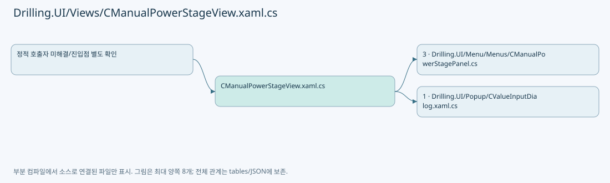
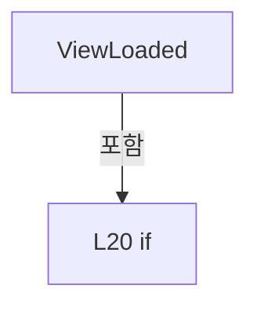
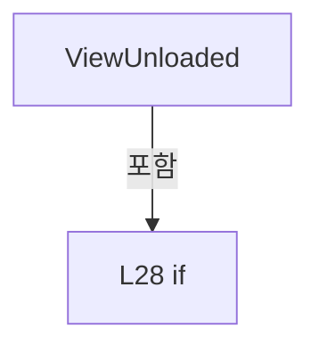
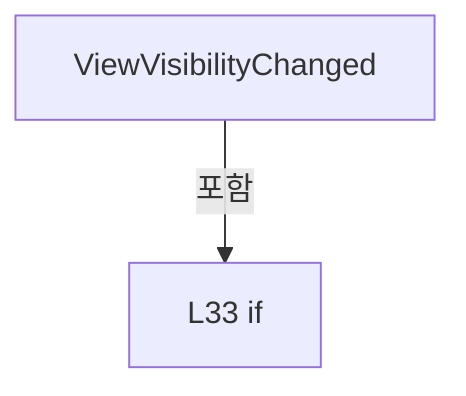
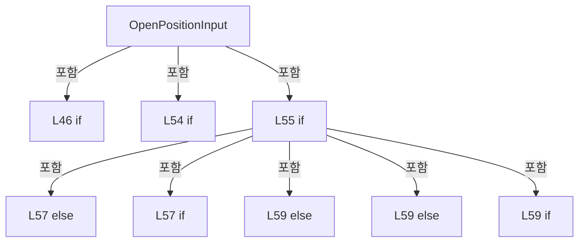
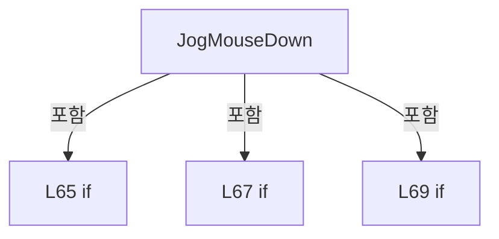
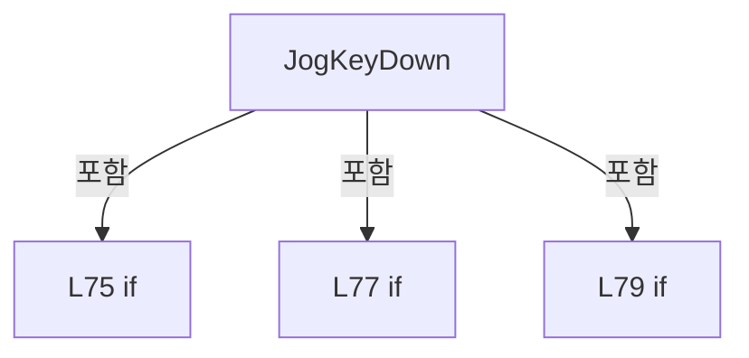
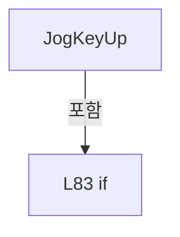
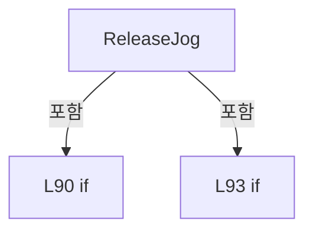

# Drilling.UI/Views/CManualPowerStageView.xaml.cs

| 항목 | 내용 |
| --- | --- |
| 원본 저장소 | https://github.com/kjuws10-rgb/A3Drilling.git |
| 원본 Commit | 5aee8e58439c9b455cae7c9593c9be986c3e682e |
| 원본 SHA256 | 9e448e7e3ffacf4ad1ef776fae61f375601b38828f1c4e59694386aa0aa2e452 |
| 파일 분류 | code |
| 원본 크기/행 | 4,272 bytes / 95 physical lines |
| 인코딩 | utf-8-sig |
| 검토 범위 | 구문/부분 의미 분석에서 추출한 사실. 동작·물리 단위·실장비 합격을 보증하지 않습니다. |
| 원본 링크 | [고정 Commit 원본](https://github.com/kjuws10-rgb/A3Drilling/blob/5aee8e58439c9b455cae7c9593c9be986c3e682e/Drilling.UI/Views/CManualPowerStageView.xaml.cs) |

## 파일의 역할과 읽는 순서

WPF 화면·사용자 명령·표시 상태를 구성합니다. XAML 이벤트와 코드 비하인드, RootView의 조립 경로를 함께 추적합니다.

## 네임스페이스·타입·상속

| 타입 | 구분 | 원본 범위 | 선언/상속 |
| --- | --- | --- | --- |
| CManualPowerStageView | ClassDeclaration | 10–95 | CManualPowerStageView: UserControl |

## 멤버 빠른 목록

| 이름 | 종류 | 범위 | 서명 |
| --- | --- | --- | --- |
| _window | FieldDeclaration | L12–12 | Window? Drilling.UI.Views.CManualPowerStageView._window |
| _heldJog | FieldDeclaration | L13–13 | Button? Drilling.UI.Views.CManualPowerStageView._heldJog |
| Panel | PropertyDeclaration | L14–14 | Drilling.UI.Menu.Menus.CManualPowerStagePanel? Drilling.UI.Views.CManualPowerStageView.Panel |
| .ctor | ConstructorDeclaration | L15–15 | Drilling.UI.Views.CManualPowerStageView.CManualPowerStageView() |
| ViewLoaded | MethodDeclaration | L17–22 | void Drilling.UI.Views.CManualPowerStageView.ViewLoaded(object, RoutedEventArgs) |
| ViewUnloaded | MethodDeclaration | L23–30 | void Drilling.UI.Views.CManualPowerStageView.ViewUnloaded(object, RoutedEventArgs) |
| ViewVisibilityChanged | MethodDeclaration | L31–35 | void Drilling.UI.Views.CManualPowerStageView.ViewVisibilityChanged(object, DependencyPropertyChangedEventArgs) |
| ViewDataContextChanged | MethodDeclaration | L36–41 | void Drilling.UI.Views.CManualPowerStageView.ViewDataContextChanged(object, DependencyPropertyChangedEventArgs) |
| WindowDeactivated | MethodDeclaration | L42–42 | void Drilling.UI.Views.CManualPowerStageView.WindowDeactivated(object?, System.EventArgs) |
| OpenPositionInput | MethodDeclaration | L44–60 | void Drilling.UI.Views.CManualPowerStageView.OpenPositionInput(object, RoutedEventArgs) |
| JogMouseDown | MethodDeclaration | L62–70 | void Drilling.UI.Views.CManualPowerStageView.JogMouseDown(object, MouseButtonEventArgs) |
| JogMouseUp | MethodDeclaration | L71–71 | void Drilling.UI.Views.CManualPowerStageView.JogMouseUp(object, MouseButtonEventArgs) |
| JogLostCapture | MethodDeclaration | L72–72 | void Drilling.UI.Views.CManualPowerStageView.JogLostCapture(object, MouseEventArgs) |
| JogKeyDown | MethodDeclaration | L73–80 | void Drilling.UI.Views.CManualPowerStageView.JogKeyDown(object, KeyEventArgs) |
| JogKeyUp | MethodDeclaration | L81–85 | void Drilling.UI.Views.CManualPowerStageView.JogKeyUp(object, KeyEventArgs) |
| JogLostKeyboardFocus | MethodDeclaration | L86–86 | void Drilling.UI.Views.CManualPowerStageView.JogLostKeyboardFocus(object, KeyboardFocusChangedEventArgs) |
| ReleaseJog | MethodDeclaration | L87–94 | void Drilling.UI.Views.CManualPowerStageView.ReleaseJog() |

## 멤버별 상세 계약·호출·처리 해설

### FieldDeclaration `_window` · L12–12

[Drilling.UI/Views/CManualPowerStageView.xaml.cs:12–12](https://github.com/kjuws10-rgb/A3Drilling/blob/5aee8e58439c9b455cae7c9593c9be986c3e682e/Drilling.UI/Views/CManualPowerStageView.xaml.cs#L12-L12)

| 항목 | 실제 추출 값 |
| --- | --- |
| 서명 | Window? Drilling.UI.Views.CManualPowerStageView._window |
| 접근/수식자 | Private / private |
| 반환/값 타입 | Window? |
| 소속 타입 | NamedType:Drilling.UI.Views.CManualPowerStageView |

현재 부분 분석에서 직접 연결된 호출자는 없습니다. XAML/이벤트/인터페이스·델리게이트·외부 진입을 추가 확인해야 하며, 미사용으로 판정한 것이 아닙니다.

변경 전 점검: 입력/반환 타입, 위 호출자, 예외/취소 경로, 공유 상태와 저장·전송 소비자를 함께 확인합니다. 값의 단위나 물리 방향을 이름만으로 확정하지 않습니다.

### FieldDeclaration `_heldJog` · L13–13

[Drilling.UI/Views/CManualPowerStageView.xaml.cs:13–13](https://github.com/kjuws10-rgb/A3Drilling/blob/5aee8e58439c9b455cae7c9593c9be986c3e682e/Drilling.UI/Views/CManualPowerStageView.xaml.cs#L13-L13)

| 항목 | 실제 추출 값 |
| --- | --- |
| 서명 | Button? Drilling.UI.Views.CManualPowerStageView._heldJog |
| 접근/수식자 | Private / private |
| 반환/값 타입 | Button? |
| 소속 타입 | NamedType:Drilling.UI.Views.CManualPowerStageView |

현재 부분 분석에서 직접 연결된 호출자는 없습니다. XAML/이벤트/인터페이스·델리게이트·외부 진입을 추가 확인해야 하며, 미사용으로 판정한 것이 아닙니다.

변경 전 점검: 입력/반환 타입, 위 호출자, 예외/취소 경로, 공유 상태와 저장·전송 소비자를 함께 확인합니다. 값의 단위나 물리 방향을 이름만으로 확정하지 않습니다.

### PropertyDeclaration `Panel` · L14–14

[Drilling.UI/Views/CManualPowerStageView.xaml.cs:14–14](https://github.com/kjuws10-rgb/A3Drilling/blob/5aee8e58439c9b455cae7c9593c9be986c3e682e/Drilling.UI/Views/CManualPowerStageView.xaml.cs#L14-L14)

| 항목 | 실제 추출 값 |
| --- | --- |
| 서명 | Drilling.UI.Menu.Menus.CManualPowerStagePanel? Drilling.UI.Views.CManualPowerStageView.Panel |
| 접근/수식자 | Private / private |
| 반환/값 타입 | Drilling.UI.Menu.Menus.CManualPowerStagePanel? |
| 소속 타입 | NamedType:Drilling.UI.Views.CManualPowerStageView |

현재 부분 분석에서 직접 연결된 호출자는 없습니다. XAML/이벤트/인터페이스·델리게이트·외부 진입을 추가 확인해야 하며, 미사용으로 판정한 것이 아닙니다.

변경 전 점검: 입력/반환 타입, 위 호출자, 예외/취소 경로, 공유 상태와 저장·전송 소비자를 함께 확인합니다. 값의 단위나 물리 방향을 이름만으로 확정하지 않습니다.

### ConstructorDeclaration `.ctor` · L15–15

[Drilling.UI/Views/CManualPowerStageView.xaml.cs:15–15](https://github.com/kjuws10-rgb/A3Drilling/blob/5aee8e58439c9b455cae7c9593c9be986c3e682e/Drilling.UI/Views/CManualPowerStageView.xaml.cs#L15-L15)

| 항목 | 실제 추출 값 |
| --- | --- |
| 서명 | Drilling.UI.Views.CManualPowerStageView.CManualPowerStageView() |
| 접근/수식자 | Public / public |
| 반환/값 타입 | void |
| 소속 타입 | NamedType:Drilling.UI.Views.CManualPowerStageView |

현재 부분 분석에서 직접 연결된 호출자는 없습니다. XAML/이벤트/인터페이스·델리게이트·외부 진입을 추가 확인해야 하며, 미사용으로 판정한 것이 아닙니다.

호출하는 대상과 해석 범위:

| 원본 행 | 표현식 | 분석 상태 | 대상/소스 위치 |
| --- | --- | --- | --- |
| 15 | InitializeComponent | unresolved | None |

본문의 실제 연산·분기·예외·반환 순서(원문 위치 순):

| 원본 행 | 종류 | 주석 해설 |
| --- | --- | --- |
| 15 | call | 함수·델리게이트 또는 객체 생성자를 호출합니다: InitializeComponent() |

변경 전 점검: 입력/반환 타입, 위 호출자, 예외/취소 경로, 공유 상태와 저장·전송 소비자를 함께 확인합니다. 값의 단위나 물리 방향을 이름만으로 확정하지 않습니다.

### MethodDeclaration `ViewLoaded` · L17–22

[Drilling.UI/Views/CManualPowerStageView.xaml.cs:17–22](https://github.com/kjuws10-rgb/A3Drilling/blob/5aee8e58439c9b455cae7c9593c9be986c3e682e/Drilling.UI/Views/CManualPowerStageView.xaml.cs#L17-L22)

| 항목 | 실제 추출 값 |
| --- | --- |
| 서명 | void Drilling.UI.Views.CManualPowerStageView.ViewLoaded(object, RoutedEventArgs) |
| 접근/수식자 | Private / private |
| 반환/값 타입 | void |
| 소속 타입 | NamedType:Drilling.UI.Views.CManualPowerStageView |

입력 계약:

| 이름 | 타입 | 전달 | 선택/기본값 |
| --- | --- | --- | --- |
| sender | object | None | False /  |
| e | RoutedEventArgs | None | False /  |

현재 부분 분석에서 직접 연결된 호출자는 없습니다. XAML/이벤트/인터페이스·델리게이트·외부 진입을 추가 확인해야 하며, 미사용으로 판정한 것이 아닙니다.

호출하는 대상과 해석 범위:

| 원본 행 | 표현식 | 분석 상태 | 대상/소스 위치 |
| --- | --- | --- | --- |
| 19 | Window.GetWindow | unresolved | None |
| 21 | .SetViewActive | candidate | OverloadResolutionFailure |

본문의 실제 연산·분기·예외·반환 순서(원문 위치 순):

| 원본 행 | 종류 | 주석 해설 |
| --- | --- | --- |
| 19 | assignment | 값을 대상에 대입합니다: _window = Window.GetWindow(this) |
| 19 | call | 함수·델리게이트 또는 객체 생성자를 호출합니다: Window.GetWindow(this) |
| 20 | compound-assignment-or-event-subscription | 복합 대입 또는 이벤트 구독/해지 표현입니다: _window.Deactivated += WindowDeactivated |
| 20 | if | 조건에 따라 분기합니다: if (_window is not null) |
| 21 | call | 함수·델리게이트 또는 객체 생성자를 호출합니다: .SetViewActive(this, IsVisible) |

제어 구문의 포함 구조(실제 실행 순서/CFG가 아닌 구문 탐색 그림):

변경 전 점검: 입력/반환 타입, 위 호출자, 예외/취소 경로, 공유 상태와 저장·전송 소비자를 함께 확인합니다. 값의 단위나 물리 방향을 이름만으로 확정하지 않습니다.

### MethodDeclaration `ViewUnloaded` · L23–30

[Drilling.UI/Views/CManualPowerStageView.xaml.cs:23–30](https://github.com/kjuws10-rgb/A3Drilling/blob/5aee8e58439c9b455cae7c9593c9be986c3e682e/Drilling.UI/Views/CManualPowerStageView.xaml.cs#L23-L30)

| 항목 | 실제 추출 값 |
| --- | --- |
| 서명 | void Drilling.UI.Views.CManualPowerStageView.ViewUnloaded(object, RoutedEventArgs) |
| 접근/수식자 | Private / private |
| 반환/값 타입 | void |
| 소속 타입 | NamedType:Drilling.UI.Views.CManualPowerStageView |

입력 계약:

| 이름 | 타입 | 전달 | 선택/기본값 |
| --- | --- | --- | --- |
| sender | object | None | False /  |
| e | RoutedEventArgs | None | False /  |

현재 부분 분석에서 직접 연결된 호출자는 없습니다. XAML/이벤트/인터페이스·델리게이트·외부 진입을 추가 확인해야 하며, 미사용으로 판정한 것이 아닙니다.

호출하는 대상과 해석 범위:

| 원본 행 | 표현식 | 분석 상태 | 대상/소스 위치 |
| --- | --- | --- | --- |
| 27 | ReleaseJog | resolved | void Drilling.UI.Views.CManualPowerStageView.ReleaseJog() · Drilling.UI/Views/CManualPowerStageView.xaml.cs:87 |
| 27 | .SetViewActive | resolved | void Drilling.UI.Menu.Menus.CManualPowerStagePanel.SetViewActive(object, bool) · Drilling.UI/Menu/Menus/CManualPowerStagePanel.cs:135 |

본문의 실제 연산·분기·예외·반환 순서(원문 위치 순):

| 원본 행 | 종류 | 주석 해설 |
| --- | --- | --- |
| 27 | call | 함수·델리게이트 또는 객체 생성자를 호출합니다: ReleaseJog() |
| 27 | call | 함수·델리게이트 또는 객체 생성자를 호출합니다: .SetViewActive(this, false) |
| 28 | compound-assignment-or-event-subscription | 복합 대입 또는 이벤트 구독/해지 표현입니다: _window.Deactivated -= WindowDeactivated |
| 28 | if | 조건에 따라 분기합니다: if (_window is not null) |
| 29 | assignment | 값을 대상에 대입합니다: _window = null |

제어 구문의 포함 구조(실제 실행 순서/CFG가 아닌 구문 탐색 그림):

변경 전 점검: 입력/반환 타입, 위 호출자, 예외/취소 경로, 공유 상태와 저장·전송 소비자를 함께 확인합니다. 값의 단위나 물리 방향을 이름만으로 확정하지 않습니다.

### MethodDeclaration `ViewVisibilityChanged` · L31–35

[Drilling.UI/Views/CManualPowerStageView.xaml.cs:31–35](https://github.com/kjuws10-rgb/A3Drilling/blob/5aee8e58439c9b455cae7c9593c9be986c3e682e/Drilling.UI/Views/CManualPowerStageView.xaml.cs#L31-L35)

| 항목 | 실제 추출 값 |
| --- | --- |
| 서명 | void Drilling.UI.Views.CManualPowerStageView.ViewVisibilityChanged(object, DependencyPropertyChangedEventArgs) |
| 접근/수식자 | Private / private |
| 반환/값 타입 | void |
| 소속 타입 | NamedType:Drilling.UI.Views.CManualPowerStageView |

입력 계약:

| 이름 | 타입 | 전달 | 선택/기본값 |
| --- | --- | --- | --- |
| sender | object | None | False /  |
| e | DependencyPropertyChangedEventArgs | None | False /  |

현재 부분 분석에서 직접 연결된 호출자는 없습니다. XAML/이벤트/인터페이스·델리게이트·외부 진입을 추가 확인해야 하며, 미사용으로 판정한 것이 아닙니다.

호출하는 대상과 해석 범위:

| 원본 행 | 표현식 | 분석 상태 | 대상/소스 위치 |
| --- | --- | --- | --- |
| 33 | ReleaseJog | resolved | void Drilling.UI.Views.CManualPowerStageView.ReleaseJog() · Drilling.UI/Views/CManualPowerStageView.xaml.cs:87 |
| 34 | .SetViewActive | candidate | OverloadResolutionFailure |

본문의 실제 연산·분기·예외·반환 순서(원문 위치 순):

| 원본 행 | 종류 | 주석 해설 |
| --- | --- | --- |
| 33 | call | 함수·델리게이트 또는 객체 생성자를 호출합니다: ReleaseJog() |
| 33 | if | 조건에 따라 분기합니다: if (!IsVisible) |
| 34 | call | 함수·델리게이트 또는 객체 생성자를 호출합니다: .SetViewActive(this, IsLoaded && IsVisible) |

제어 구문의 포함 구조(실제 실행 순서/CFG가 아닌 구문 탐색 그림):

변경 전 점검: 입력/반환 타입, 위 호출자, 예외/취소 경로, 공유 상태와 저장·전송 소비자를 함께 확인합니다. 값의 단위나 물리 방향을 이름만으로 확정하지 않습니다.

### MethodDeclaration `ViewDataContextChanged` · L36–41

[Drilling.UI/Views/CManualPowerStageView.xaml.cs:36–41](https://github.com/kjuws10-rgb/A3Drilling/blob/5aee8e58439c9b455cae7c9593c9be986c3e682e/Drilling.UI/Views/CManualPowerStageView.xaml.cs#L36-L41)

| 항목 | 실제 추출 값 |
| --- | --- |
| 서명 | void Drilling.UI.Views.CManualPowerStageView.ViewDataContextChanged(object, DependencyPropertyChangedEventArgs) |
| 접근/수식자 | Private / private |
| 반환/값 타입 | void |
| 소속 타입 | NamedType:Drilling.UI.Views.CManualPowerStageView |

입력 계약:

| 이름 | 타입 | 전달 | 선택/기본값 |
| --- | --- | --- | --- |
| sender | object | None | False /  |
| e | DependencyPropertyChangedEventArgs | None | False /  |

현재 부분 분석에서 직접 연결된 호출자는 없습니다. XAML/이벤트/인터페이스·델리게이트·외부 진입을 추가 확인해야 하며, 미사용으로 판정한 것이 아닙니다.

호출하는 대상과 해석 범위:

| 원본 행 | 표현식 | 분석 상태 | 대상/소스 위치 |
| --- | --- | --- | --- |
| 38 | ReleaseJog | resolved | void Drilling.UI.Views.CManualPowerStageView.ReleaseJog() · Drilling.UI/Views/CManualPowerStageView.xaml.cs:87 |
| 39 | .SetViewActive | resolved | void Drilling.UI.Menu.Menus.CManualPowerStagePanel.SetViewActive(object, bool) · Drilling.UI/Menu/Menus/CManualPowerStagePanel.cs:135 |
| 40 | .SetViewActive | candidate | OverloadResolutionFailure |

본문의 실제 연산·분기·예외·반환 순서(원문 위치 순):

| 원본 행 | 종류 | 주석 해설 |
| --- | --- | --- |
| 38 | call | 함수·델리게이트 또는 객체 생성자를 호출합니다: ReleaseJog() |
| 39 | call | 함수·델리게이트 또는 객체 생성자를 호출합니다: .SetViewActive(this, false) |
| 40 | call | 함수·델리게이트 또는 객체 생성자를 호출합니다: .SetViewActive(this, IsLoaded && IsVisible) |

변경 전 점검: 입력/반환 타입, 위 호출자, 예외/취소 경로, 공유 상태와 저장·전송 소비자를 함께 확인합니다. 값의 단위나 물리 방향을 이름만으로 확정하지 않습니다.

### MethodDeclaration `WindowDeactivated` · L42–42

[Drilling.UI/Views/CManualPowerStageView.xaml.cs:42–42](https://github.com/kjuws10-rgb/A3Drilling/blob/5aee8e58439c9b455cae7c9593c9be986c3e682e/Drilling.UI/Views/CManualPowerStageView.xaml.cs#L42-L42)

| 항목 | 실제 추출 값 |
| --- | --- |
| 서명 | void Drilling.UI.Views.CManualPowerStageView.WindowDeactivated(object?, System.EventArgs) |
| 접근/수식자 | Private / private |
| 반환/값 타입 | void |
| 소속 타입 | NamedType:Drilling.UI.Views.CManualPowerStageView |

입력 계약:

| 이름 | 타입 | 전달 | 선택/기본값 |
| --- | --- | --- | --- |
| sender | object? | None | False /  |
| e | System.EventArgs | None | False /  |

현재 부분 분석에서 직접 연결된 호출자는 없습니다. XAML/이벤트/인터페이스·델리게이트·외부 진입을 추가 확인해야 하며, 미사용으로 판정한 것이 아닙니다.

호출하는 대상과 해석 범위:

| 원본 행 | 표현식 | 분석 상태 | 대상/소스 위치 |
| --- | --- | --- | --- |
| 42 | ReleaseJog | resolved | void Drilling.UI.Views.CManualPowerStageView.ReleaseJog() · Drilling.UI/Views/CManualPowerStageView.xaml.cs:87 |

본문의 실제 연산·분기·예외·반환 순서(원문 위치 순):

| 원본 행 | 종류 | 주석 해설 |
| --- | --- | --- |
| 42 | call | 함수·델리게이트 또는 객체 생성자를 호출합니다: ReleaseJog() |

변경 전 점검: 입력/반환 타입, 위 호출자, 예외/취소 경로, 공유 상태와 저장·전송 소비자를 함께 확인합니다. 값의 단위나 물리 방향을 이름만으로 확정하지 않습니다.

### MethodDeclaration `OpenPositionInput` · L44–60

[Drilling.UI/Views/CManualPowerStageView.xaml.cs:44–60](https://github.com/kjuws10-rgb/A3Drilling/blob/5aee8e58439c9b455cae7c9593c9be986c3e682e/Drilling.UI/Views/CManualPowerStageView.xaml.cs#L44-L60)

| 항목 | 실제 추출 값 |
| --- | --- |
| 서명 | void Drilling.UI.Views.CManualPowerStageView.OpenPositionInput(object, RoutedEventArgs) |
| 접근/수식자 | Private / private |
| 반환/값 타입 | void |
| 소속 타입 | NamedType:Drilling.UI.Views.CManualPowerStageView |

입력 계약:

| 이름 | 타입 | 전달 | 선택/기본값 |
| --- | --- | --- | --- |
| sender | object | None | False /  |
| e | RoutedEventArgs | None | False /  |

현재 부분 분석에서 직접 연결된 호출자는 없습니다. XAML/이벤트/인터페이스·델리게이트·외부 진입을 추가 확인해야 하며, 미사용으로 판정한 것이 아닙니다.

호출하는 대상과 해석 범위:

| 원본 행 | 표현식 | 분석 상태 | 대상/소스 위치 |
| --- | --- | --- | --- |
| 47 | .ToString | unresolved | None |
| 51 | new CValueInputDialog | resolved | Drilling.UI.Popup.CValueInputDialog.CValueInputDialog(string, string, Drilling.Common.Managers.EN_RECIPE_DATA_TYPE, double, double) · Drilling.UI/Popup/CValueInputDialog.xaml.cs:13 |
| 53 | Window.GetWindow | unresolved | None |
| 54 | dialog.ShowDialog | unresolved | None |

본문의 실제 연산·분기·예외·반환 순서(원문 위치 순):

| 원본 행 | 종류 | 주석 해설 |
| --- | --- | --- |
| 46 | if | 조건에 따라 분기합니다: if (sender is not Button { DataContext: CManualPowerStageAxis axis } button &#124;&#124; Panel is not { CanEdit: true }) |
| 46 | return | 호출자에게 값 또는 제어를 반환합니다: return; |
| 47 | call | 함수·델리게이트 또는 객체 생성자를 호출합니다: .ToString() |
| 47 | local-declaration | 지역 변수를 선언합니다: var tag = button.Tag?.ToString(); |
| 47 | variable-initializer | 변수의 초기값을 지정합니다: tag = button.Tag?.ToString() |
| 48 | local-declaration | 지역 변수를 선언합니다: var relative = tag is "REL" or "REL_SPEED"; |
| 48 | variable-initializer | 변수의 초기값을 지정합니다: relative = tag is "REL" or "REL_SPEED" |
| 49 | local-declaration | 지역 변수를 선언합니다: var speed = tag is "ABS_SPEED" or "REL_SPEED"; |
| 49 | variable-initializer | 변수의 초기값을 지정합니다: speed = tag is "ABS_SPEED" or "REL_SPEED" |
| 50 | conditional-expression | 조건에 따라 결과식을 선택합니다: speed ? (relative ? axis.RelativeSpeed : axis.AbsoluteSpeed) : (relative ? axis.Relative : axis.Absolute) |
| 50 | conditional-expression | 조건에 따라 결과식을 선택합니다: relative ? axis.RelativeSpeed : axis.AbsoluteSpeed |
| 50 | conditional-expression | 조건에 따라 결과식을 선택합니다: relative ? axis.Relative : axis.Absolute |
| 50 | local-declaration | 지역 변수를 선언합니다: var current = speed ? (relative ? axis.RelativeSpeed : axis.AbsoluteSpeed) : (relative ? axis.Relative : axis.Absolute); |
| 50 | variable-initializer | 변수의 초기값을 지정합니다: current = speed ? (relative ? axis.RelativeSpeed : axis.AbsoluteSpeed) : (relative ? axis.Relative : axis.Absolute) |
| 51 | conditional-expression | 조건에 따라 결과식을 선택합니다: relative ? "REL" : "ABS" |
| 51 | conditional-expression | 조건에 따라 결과식을 선택합니다: speed ? "Speed (mm/sec)" : "(mm)" |
| 51 | call | 함수·델리게이트 또는 객체 생성자를 호출합니다: new CValueInputDialog($"{axis.Name} {(relative ? "REL" : "ABS")} {(speed ? "Speed (mm/sec)" : "(mm)")}", current, EN_RECIPE_DATA_TYPE.Double, speed ? double.Epsilon : -double.MaxValue, double.MaxValue) { Owner = Window.G… |
| 51 | local-declaration | 지역 변수를 선언합니다: var dialog = new CValueInputDialog($"{axis.Name} {(relative ? "REL" : "ABS")} {(speed ? "Speed (mm/sec)" : "(mm)")}", current, EN_RECIPE_DATA_TYPE.Double, speed ? double.Epsilon : -double.MaxValue, double.MaxValue) { Owner = Windo |
| 51 | variable-initializer | 변수의 초기값을 지정합니다: dialog = new CValueInputDialog($"{axis.Name} {(relative ? "REL" : "ABS")} {(speed ? "Speed (mm/sec)" : "(mm)")}", current, EN_RECIPE_DATA_TYPE.Double, speed ? double.Epsilon : -double.MaxValue, double.MaxValue) { Owner = Window.Ge |
| 52 | conditional-expression | 조건에 따라 결과식을 선택합니다: speed ? double.Epsilon : -double.MaxValue |
| 53 | assignment | 값을 대상에 대입합니다: Owner = Window.GetWindow(this) |
| 53 | call | 함수·델리게이트 또는 객체 생성자를 호출합니다: Window.GetWindow(this) |
| 54 | call | 함수·델리게이트 또는 객체 생성자를 호출합니다: dialog.ShowDialog() |
| 54 | if | 조건에 따라 분기합니다: if (dialog.ShowDialog() != true &#124;&#124; Panel?.CanEdit != true) |
| 54 | return | 호출자에게 값 또는 제어를 반환합니다: return; |
| 55 | if | 조건에 따라 분기합니다: if (speed) |
| 57 | assignment | 값을 대상에 대입합니다: axis.RelativeSpeed = dialog.ResultValue |
| 57 | assignment | 값을 대상에 대입합니다: axis.AbsoluteSpeed = dialog.ResultValue |
| 57 | else | 앞 조건이 거짓인 경로입니다: else |
| 57 | if | 조건에 따라 분기합니다: if (relative) |
| 59 | assignment | 값을 대상에 대입합니다: axis.Relative = dialog.ResultValue |
| 59 | assignment | 값을 대상에 대입합니다: axis.Absolute = dialog.ResultValue |
| 59 | else | 앞 조건이 거짓인 경로입니다: else |
| 59 | else | 앞 조건이 거짓인 경로입니다: else |
| 59 | if | 조건에 따라 분기합니다: if (relative) |

제어 구문의 포함 구조(실제 실행 순서/CFG가 아닌 구문 탐색 그림):

변경 전 점검: 입력/반환 타입, 위 호출자, 예외/취소 경로, 공유 상태와 저장·전송 소비자를 함께 확인합니다. 값의 단위나 물리 방향을 이름만으로 확정하지 않습니다.

### MethodDeclaration `JogMouseDown` · L62–70

[Drilling.UI/Views/CManualPowerStageView.xaml.cs:62–70](https://github.com/kjuws10-rgb/A3Drilling/blob/5aee8e58439c9b455cae7c9593c9be986c3e682e/Drilling.UI/Views/CManualPowerStageView.xaml.cs#L62-L70)

| 항목 | 실제 추출 값 |
| --- | --- |
| 서명 | void Drilling.UI.Views.CManualPowerStageView.JogMouseDown(object, MouseButtonEventArgs) |
| 접근/수식자 | Private / private |
| 반환/값 타입 | void |
| 소속 타입 | NamedType:Drilling.UI.Views.CManualPowerStageView |

입력 계약:

| 이름 | 타입 | 전달 | 선택/기본값 |
| --- | --- | --- | --- |
| sender | object | None | False /  |
| e | MouseButtonEventArgs | None | False /  |

현재 부분 분석에서 직접 연결된 호출자는 없습니다. XAML/이벤트/인터페이스·델리게이트·외부 진입을 추가 확인해야 하며, 미사용으로 판정한 것이 아닙니다.

호출하는 대상과 해석 범위:

| 원본 행 | 표현식 | 분석 상태 | 대상/소스 위치 |
| --- | --- | --- | --- |
| 66 | button.Focus | unresolved | None |
| 67 | button.CaptureMouse | unresolved | None |
| 69 | Panel.StartJog | candidate | OverloadResolutionFailure |
| 69 | .ToString | unresolved | None |
| 69 | ReleaseJog | resolved | void Drilling.UI.Views.CManualPowerStageView.ReleaseJog() · Drilling.UI/Views/CManualPowerStageView.xaml.cs:87 |

본문의 실제 연산·분기·예외·반환 순서(원문 위치 순):

| 원본 행 | 종류 | 주석 해설 |
| --- | --- | --- |
| 64 | assignment | 값을 대상에 대입합니다: e.Handled = true |
| 65 | if | 조건에 따라 분기합니다: if (sender is not Button button &#124;&#124; _heldJog is not null &#124;&#124; Panel?.CanJog != true) |
| 65 | return | 호출자에게 값 또는 제어를 반환합니다: return; |
| 66 | call | 함수·델리게이트 또는 객체 생성자를 호출합니다: button.Focus() |
| 67 | call | 함수·델리게이트 또는 객체 생성자를 호출합니다: button.CaptureMouse() |
| 67 | if | 조건에 따라 분기합니다: if (!button.CaptureMouse()) |
| 67 | return | 호출자에게 값 또는 제어를 반환합니다: return; |
| 68 | assignment | 값을 대상에 대입합니다: _heldJog = button |
| 69 | call | 함수·델리게이트 또는 객체 생성자를 호출합니다: Panel.StartJog(button.Tag?.ToString() ?? "") |
| 69 | call | 함수·델리게이트 또는 객체 생성자를 호출합니다: .ToString() |
| 69 | call | 함수·델리게이트 또는 객체 생성자를 호출합니다: ReleaseJog() |
| 69 | if | 조건에 따라 분기합니다: if (Panel.StartJog(button.Tag?.ToString() ?? "") != true) |

제어 구문의 포함 구조(실제 실행 순서/CFG가 아닌 구문 탐색 그림):

변경 전 점검: 입력/반환 타입, 위 호출자, 예외/취소 경로, 공유 상태와 저장·전송 소비자를 함께 확인합니다. 값의 단위나 물리 방향을 이름만으로 확정하지 않습니다.

### MethodDeclaration `JogMouseUp` · L71–71

[Drilling.UI/Views/CManualPowerStageView.xaml.cs:71–71](https://github.com/kjuws10-rgb/A3Drilling/blob/5aee8e58439c9b455cae7c9593c9be986c3e682e/Drilling.UI/Views/CManualPowerStageView.xaml.cs#L71-L71)

| 항목 | 실제 추출 값 |
| --- | --- |
| 서명 | void Drilling.UI.Views.CManualPowerStageView.JogMouseUp(object, MouseButtonEventArgs) |
| 접근/수식자 | Private / private |
| 반환/값 타입 | void |
| 소속 타입 | NamedType:Drilling.UI.Views.CManualPowerStageView |

입력 계약:

| 이름 | 타입 | 전달 | 선택/기본값 |
| --- | --- | --- | --- |
| sender | object | None | False /  |
| e | MouseButtonEventArgs | None | False /  |

현재 부분 분석에서 직접 연결된 호출자는 없습니다. XAML/이벤트/인터페이스·델리게이트·외부 진입을 추가 확인해야 하며, 미사용으로 판정한 것이 아닙니다.

호출하는 대상과 해석 범위:

| 원본 행 | 표현식 | 분석 상태 | 대상/소스 위치 |
| --- | --- | --- | --- |
| 71 | ReleaseJog | resolved | void Drilling.UI.Views.CManualPowerStageView.ReleaseJog() · Drilling.UI/Views/CManualPowerStageView.xaml.cs:87 |

본문의 실제 연산·분기·예외·반환 순서(원문 위치 순):

| 원본 행 | 종류 | 주석 해설 |
| --- | --- | --- |
| 71 | assignment | 값을 대상에 대입합니다: e.Handled = true |
| 71 | call | 함수·델리게이트 또는 객체 생성자를 호출합니다: ReleaseJog() |

변경 전 점검: 입력/반환 타입, 위 호출자, 예외/취소 경로, 공유 상태와 저장·전송 소비자를 함께 확인합니다. 값의 단위나 물리 방향을 이름만으로 확정하지 않습니다.

### MethodDeclaration `JogLostCapture` · L72–72

[Drilling.UI/Views/CManualPowerStageView.xaml.cs:72–72](https://github.com/kjuws10-rgb/A3Drilling/blob/5aee8e58439c9b455cae7c9593c9be986c3e682e/Drilling.UI/Views/CManualPowerStageView.xaml.cs#L72-L72)

| 항목 | 실제 추출 값 |
| --- | --- |
| 서명 | void Drilling.UI.Views.CManualPowerStageView.JogLostCapture(object, MouseEventArgs) |
| 접근/수식자 | Private / private |
| 반환/값 타입 | void |
| 소속 타입 | NamedType:Drilling.UI.Views.CManualPowerStageView |

입력 계약:

| 이름 | 타입 | 전달 | 선택/기본값 |
| --- | --- | --- | --- |
| sender | object | None | False /  |
| e | MouseEventArgs | None | False /  |

현재 부분 분석에서 직접 연결된 호출자는 없습니다. XAML/이벤트/인터페이스·델리게이트·외부 진입을 추가 확인해야 하며, 미사용으로 판정한 것이 아닙니다.

호출하는 대상과 해석 범위:

| 원본 행 | 표현식 | 분석 상태 | 대상/소스 위치 |
| --- | --- | --- | --- |
| 72 | ReleaseJog | resolved | void Drilling.UI.Views.CManualPowerStageView.ReleaseJog() · Drilling.UI/Views/CManualPowerStageView.xaml.cs:87 |

본문의 실제 연산·분기·예외·반환 순서(원문 위치 순):

| 원본 행 | 종류 | 주석 해설 |
| --- | --- | --- |
| 72 | call | 함수·델리게이트 또는 객체 생성자를 호출합니다: ReleaseJog() |

변경 전 점검: 입력/반환 타입, 위 호출자, 예외/취소 경로, 공유 상태와 저장·전송 소비자를 함께 확인합니다. 값의 단위나 물리 방향을 이름만으로 확정하지 않습니다.

### MethodDeclaration `JogKeyDown` · L73–80

[Drilling.UI/Views/CManualPowerStageView.xaml.cs:73–80](https://github.com/kjuws10-rgb/A3Drilling/blob/5aee8e58439c9b455cae7c9593c9be986c3e682e/Drilling.UI/Views/CManualPowerStageView.xaml.cs#L73-L80)

| 항목 | 실제 추출 값 |
| --- | --- |
| 서명 | void Drilling.UI.Views.CManualPowerStageView.JogKeyDown(object, KeyEventArgs) |
| 접근/수식자 | Private / private |
| 반환/값 타입 | void |
| 소속 타입 | NamedType:Drilling.UI.Views.CManualPowerStageView |

입력 계약:

| 이름 | 타입 | 전달 | 선택/기본값 |
| --- | --- | --- | --- |
| sender | object | None | False /  |
| e | KeyEventArgs | None | False /  |

현재 부분 분석에서 직접 연결된 호출자는 없습니다. XAML/이벤트/인터페이스·델리게이트·외부 진입을 추가 확인해야 하며, 미사용으로 판정한 것이 아닙니다.

호출하는 대상과 해석 범위:

| 원본 행 | 표현식 | 분석 상태 | 대상/소스 위치 |
| --- | --- | --- | --- |
| 79 | Panel.StartJog | candidate | OverloadResolutionFailure |
| 79 | .ToString | unresolved | None |
| 79 | ReleaseJog | resolved | void Drilling.UI.Views.CManualPowerStageView.ReleaseJog() · Drilling.UI/Views/CManualPowerStageView.xaml.cs:87 |

본문의 실제 연산·분기·예외·반환 순서(원문 위치 순):

| 원본 행 | 종류 | 주석 해설 |
| --- | --- | --- |
| 75 | if | 조건에 따라 분기합니다: if (e.Key is not (Key.Space or Key.Enter)) |
| 75 | return | 호출자에게 값 또는 제어를 반환합니다: return; |
| 76 | assignment | 값을 대상에 대입합니다: e.Handled = true |
| 77 | if | 조건에 따라 분기합니다: if (e.IsRepeat &#124;&#124; _heldJog is not null &#124;&#124; sender is not Button button &#124;&#124; Panel?.CanJog != true) |
| 77 | return | 호출자에게 값 또는 제어를 반환합니다: return; |
| 78 | assignment | 값을 대상에 대입합니다: _heldJog = button |
| 79 | call | 함수·델리게이트 또는 객체 생성자를 호출합니다: Panel.StartJog(button.Tag?.ToString() ?? "") |
| 79 | call | 함수·델리게이트 또는 객체 생성자를 호출합니다: .ToString() |
| 79 | call | 함수·델리게이트 또는 객체 생성자를 호출합니다: ReleaseJog() |
| 79 | if | 조건에 따라 분기합니다: if (Panel.StartJog(button.Tag?.ToString() ?? "") != true) |

제어 구문의 포함 구조(실제 실행 순서/CFG가 아닌 구문 탐색 그림):

변경 전 점검: 입력/반환 타입, 위 호출자, 예외/취소 경로, 공유 상태와 저장·전송 소비자를 함께 확인합니다. 값의 단위나 물리 방향을 이름만으로 확정하지 않습니다.

### MethodDeclaration `JogKeyUp` · L81–85

[Drilling.UI/Views/CManualPowerStageView.xaml.cs:81–85](https://github.com/kjuws10-rgb/A3Drilling/blob/5aee8e58439c9b455cae7c9593c9be986c3e682e/Drilling.UI/Views/CManualPowerStageView.xaml.cs#L81-L85)

| 항목 | 실제 추출 값 |
| --- | --- |
| 서명 | void Drilling.UI.Views.CManualPowerStageView.JogKeyUp(object, KeyEventArgs) |
| 접근/수식자 | Private / private |
| 반환/값 타입 | void |
| 소속 타입 | NamedType:Drilling.UI.Views.CManualPowerStageView |

입력 계약:

| 이름 | 타입 | 전달 | 선택/기본값 |
| --- | --- | --- | --- |
| sender | object | None | False /  |
| e | KeyEventArgs | None | False /  |

현재 부분 분석에서 직접 연결된 호출자는 없습니다. XAML/이벤트/인터페이스·델리게이트·외부 진입을 추가 확인해야 하며, 미사용으로 판정한 것이 아닙니다.

호출하는 대상과 해석 범위:

| 원본 행 | 표현식 | 분석 상태 | 대상/소스 위치 |
| --- | --- | --- | --- |
| 84 | ReleaseJog | resolved | void Drilling.UI.Views.CManualPowerStageView.ReleaseJog() · Drilling.UI/Views/CManualPowerStageView.xaml.cs:87 |

본문의 실제 연산·분기·예외·반환 순서(원문 위치 순):

| 원본 행 | 종류 | 주석 해설 |
| --- | --- | --- |
| 83 | if | 조건에 따라 분기합니다: if (e.Key is not (Key.Space or Key.Enter)) |
| 83 | return | 호출자에게 값 또는 제어를 반환합니다: return; |
| 84 | assignment | 값을 대상에 대입합니다: e.Handled = true |
| 84 | call | 함수·델리게이트 또는 객체 생성자를 호출합니다: ReleaseJog() |

제어 구문의 포함 구조(실제 실행 순서/CFG가 아닌 구문 탐색 그림):

변경 전 점검: 입력/반환 타입, 위 호출자, 예외/취소 경로, 공유 상태와 저장·전송 소비자를 함께 확인합니다. 값의 단위나 물리 방향을 이름만으로 확정하지 않습니다.

### MethodDeclaration `JogLostKeyboardFocus` · L86–86

[Drilling.UI/Views/CManualPowerStageView.xaml.cs:86–86](https://github.com/kjuws10-rgb/A3Drilling/blob/5aee8e58439c9b455cae7c9593c9be986c3e682e/Drilling.UI/Views/CManualPowerStageView.xaml.cs#L86-L86)

| 항목 | 실제 추출 값 |
| --- | --- |
| 서명 | void Drilling.UI.Views.CManualPowerStageView.JogLostKeyboardFocus(object, KeyboardFocusChangedEventArgs) |
| 접근/수식자 | Private / private |
| 반환/값 타입 | void |
| 소속 타입 | NamedType:Drilling.UI.Views.CManualPowerStageView |

입력 계약:

| 이름 | 타입 | 전달 | 선택/기본값 |
| --- | --- | --- | --- |
| sender | object | None | False /  |
| e | KeyboardFocusChangedEventArgs | None | False /  |

현재 부분 분석에서 직접 연결된 호출자는 없습니다. XAML/이벤트/인터페이스·델리게이트·외부 진입을 추가 확인해야 하며, 미사용으로 판정한 것이 아닙니다.

호출하는 대상과 해석 범위:

| 원본 행 | 표현식 | 분석 상태 | 대상/소스 위치 |
| --- | --- | --- | --- |
| 86 | ReleaseJog | resolved | void Drilling.UI.Views.CManualPowerStageView.ReleaseJog() · Drilling.UI/Views/CManualPowerStageView.xaml.cs:87 |

본문의 실제 연산·분기·예외·반환 순서(원문 위치 순):

| 원본 행 | 종류 | 주석 해설 |
| --- | --- | --- |
| 86 | call | 함수·델리게이트 또는 객체 생성자를 호출합니다: ReleaseJog() |

변경 전 점검: 입력/반환 타입, 위 호출자, 예외/취소 경로, 공유 상태와 저장·전송 소비자를 함께 확인합니다. 값의 단위나 물리 방향을 이름만으로 확정하지 않습니다.

### MethodDeclaration `ReleaseJog` · L87–94

[Drilling.UI/Views/CManualPowerStageView.xaml.cs:87–94](https://github.com/kjuws10-rgb/A3Drilling/blob/5aee8e58439c9b455cae7c9593c9be986c3e682e/Drilling.UI/Views/CManualPowerStageView.xaml.cs#L87-L94)

| 항목 | 실제 추출 값 |
| --- | --- |
| 서명 | void Drilling.UI.Views.CManualPowerStageView.ReleaseJog() |
| 접근/수식자 | Private / private |
| 반환/값 타입 | void |
| 소속 타입 | NamedType:Drilling.UI.Views.CManualPowerStageView |

정적 호출자로 확인된 위치:

| 호출 파일/행 | 호출 표현식 | 런타임 분기 가능 |
| --- | --- | --- |
| [Drilling.UI/Views/CManualPowerStageView.xaml.cs:27–27](https://github.com/kjuws10-rgb/A3Drilling/blob/5aee8e58439c9b455cae7c9593c9be986c3e682e/Drilling.UI/Views/CManualPowerStageView.xaml.cs#L27-L27) | ReleaseJog | False |
| [Drilling.UI/Views/CManualPowerStageView.xaml.cs:33–33](https://github.com/kjuws10-rgb/A3Drilling/blob/5aee8e58439c9b455cae7c9593c9be986c3e682e/Drilling.UI/Views/CManualPowerStageView.xaml.cs#L33-L33) | ReleaseJog | False |
| [Drilling.UI/Views/CManualPowerStageView.xaml.cs:38–38](https://github.com/kjuws10-rgb/A3Drilling/blob/5aee8e58439c9b455cae7c9593c9be986c3e682e/Drilling.UI/Views/CManualPowerStageView.xaml.cs#L38-L38) | ReleaseJog | False |
| [Drilling.UI/Views/CManualPowerStageView.xaml.cs:42–42](https://github.com/kjuws10-rgb/A3Drilling/blob/5aee8e58439c9b455cae7c9593c9be986c3e682e/Drilling.UI/Views/CManualPowerStageView.xaml.cs#L42-L42) | ReleaseJog | False |
| [Drilling.UI/Views/CManualPowerStageView.xaml.cs:69–69](https://github.com/kjuws10-rgb/A3Drilling/blob/5aee8e58439c9b455cae7c9593c9be986c3e682e/Drilling.UI/Views/CManualPowerStageView.xaml.cs#L69-L69) | ReleaseJog | False |
| [Drilling.UI/Views/CManualPowerStageView.xaml.cs:71–71](https://github.com/kjuws10-rgb/A3Drilling/blob/5aee8e58439c9b455cae7c9593c9be986c3e682e/Drilling.UI/Views/CManualPowerStageView.xaml.cs#L71-L71) | ReleaseJog | False |
| [Drilling.UI/Views/CManualPowerStageView.xaml.cs:72–72](https://github.com/kjuws10-rgb/A3Drilling/blob/5aee8e58439c9b455cae7c9593c9be986c3e682e/Drilling.UI/Views/CManualPowerStageView.xaml.cs#L72-L72) | ReleaseJog | False |
| [Drilling.UI/Views/CManualPowerStageView.xaml.cs:79–79](https://github.com/kjuws10-rgb/A3Drilling/blob/5aee8e58439c9b455cae7c9593c9be986c3e682e/Drilling.UI/Views/CManualPowerStageView.xaml.cs#L79-L79) | ReleaseJog | False |
| [Drilling.UI/Views/CManualPowerStageView.xaml.cs:84–84](https://github.com/kjuws10-rgb/A3Drilling/blob/5aee8e58439c9b455cae7c9593c9be986c3e682e/Drilling.UI/Views/CManualPowerStageView.xaml.cs#L84-L84) | ReleaseJog | False |
| [Drilling.UI/Views/CManualPowerStageView.xaml.cs:86–86](https://github.com/kjuws10-rgb/A3Drilling/blob/5aee8e58439c9b455cae7c9593c9be986c3e682e/Drilling.UI/Views/CManualPowerStageView.xaml.cs#L86-L86) | ReleaseJog | False |

호출하는 대상과 해석 범위:

| 원본 행 | 표현식 | 분석 상태 | 대상/소스 위치 |
| --- | --- | --- | --- |
| 92 | .Stop | resolved | void Drilling.UI.Menu.Menus.CManualPowerStagePanel.Stop(bool) · Drilling.UI/Menu/Menus/CManualPowerStagePanel.cs:250 |
| 93 | button.ReleaseMouseCapture | unresolved | None |

본문의 실제 연산·분기·예외·반환 순서(원문 위치 순):

| 원본 행 | 종류 | 주석 해설 |
| --- | --- | --- |
| 89 | local-declaration | 지역 변수를 선언합니다: var button = _heldJog; |
| 89 | variable-initializer | 변수의 초기값을 지정합니다: button = _heldJog |
| 90 | if | 조건에 따라 분기합니다: if (button is null) |
| 90 | return | 호출자에게 값 또는 제어를 반환합니다: return; |
| 91 | assignment | 값을 대상에 대입합니다: _heldJog = null |
| 92 | call | 함수·델리게이트 또는 객체 생성자를 호출합니다: .Stop() |
| 93 | call | 함수·델리게이트 또는 객체 생성자를 호출합니다: button.ReleaseMouseCapture() |
| 93 | if | 조건에 따라 분기합니다: if (button.IsMouseCaptured) |

제어 구문의 포함 구조(실제 실행 순서/CFG가 아닌 구문 탐색 그림):

변경 전 점검: 입력/반환 타입, 위 호출자, 예외/취소 경로, 공유 상태와 저장·전송 소비자를 함께 확인합니다. 값의 단위나 물리 방향을 이름만으로 확정하지 않습니다.

## 구문·바인딩 한계

전체 WPF/벤더 SDK/프로젝트별 빌드 조건을 로드한 정식 빌드가 아닙니다. `resolved`는 이 부분 컴파일에서의 심볼 연결이며 virtual/interface/delegate/이벤트/Reflection/XAML의 실제 런타임 구현을 확정하지 않습니다. `candidate`와 `unresolved`는 후속 확인 대상으로 남깁니다.

## 원문 전체 주석 해설본

[원본 모든 행과 행별 해설 보기](../../../annotated/Drilling.UI/Views/CManualPowerStageView.xaml.cs.annotated.txt)

원본을 빠뜨리거나 임의로 줄이지 않았습니다. `L000001 |` 표시는 원본 행 번호, `// 해설`은 별도 설명입니다. 실행용 소스가 아닌 문서입니다.

## 수정·재검증 체크

- 원본 Commit과 현재 작업 파일 SHA가 같은지 먼저 확인합니다. 다르면 이 문서를 과거 버전 자료로 취급합니다.
- 선언·직접 호출·이벤트/인터페이스 경계·설정 소비를 함께 확인합니다. 정적 연결의 빈 곳을 정상 경로로 추정하지 않습니다.
- 저장 형식/단위/식별자·재시도·취소·예외·롤백에 영향을 주는 변경은 상세 해설장과 호출자를 다시 검토합니다.
- 도구의 구문 추출과 별도 정적 추적 해설, 실제 빌드·시뮬레이션·실장비 검증 결과를 분리합니다.
