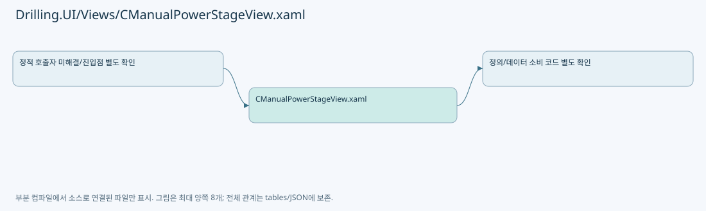

# Drilling.UI/Views/CManualPowerStageView.xaml

| 항목 | 내용 |
| --- | --- |
| 원본 저장소 | https://github.com/kjuws10-rgb/A3Drilling.git |
| 원본 Commit | 28764c91d521777b8ee068dd7aaf2d3902ce9fe2 |
| 원본 SHA256 | 5aa3f6b52d2641f21ed1116201833ad91216c30e4f74f9eb2fbe41bb82c2060b |
| 파일 분류 | code |
| 원본 크기/행 | 14,324 bytes / 159 physical lines |
| 인코딩 | utf-8-sig |
| 검토 범위 | 구문/부분 의미 분석에서 추출한 사실. 동작·물리 단위·실장비 합격을 보증하지 않습니다. |
| 원본 링크 | [고정 Commit 원본](https://github.com/kjuws10-rgb/A3Drilling/blob/28764c91d521777b8ee068dd7aaf2d3902ce9fe2/Drilling.UI/Views/CManualPowerStageView.xaml) |

## 파일의 역할과 읽는 순서

WPF 화면·사용자 명령·표시 상태를 구성합니다. XAML 이벤트와 코드 비하인드, RootView의 조립 경로를 함께 추적합니다.

## 화면 구성과 코드 비하인드 연결

| 항목 | 추출 값 |
| --- | --- |
| 코드 비하인드 후보 | Drilling.UI/Views/CManualPowerStageView.xaml.cs |
| 이름 있는 요소 | ButtonBorder, StageMotionContent |
| 이벤트 개수 | 14 |
| Binding 표현 개수 | 27 |

이름 있는 요소는 WPF가 필드를 생성할 수 있는 XAML 선언입니다. 문서 추출기는 WPF 생성 코드를 만들거나 로드하지 않으므로 C# 원문 멤버 수에 합산하지 않습니다.

| 요소 이름 | 원본 범위 |
| --- | --- |
| ButtonBorder | L27–27 |
| StageMotionContent | L54–54 |

| 이벤트 | 핸들러 이름 | 원본 범위 | 해석 |
| --- | --- | --- | --- |
| Loaded | ViewLoaded | L4–4 | 코드 비하인드/이벤트 라우팅에서 실제 연결 확인 필요 |
| Unloaded | ViewUnloaded | L4–4 | 코드 비하인드/이벤트 라우팅에서 실제 연결 확인 필요 |
| IsVisibleChanged | ViewVisibilityChanged | L4–4 | 코드 비하인드/이벤트 라우팅에서 실제 연결 확인 필요 |
| DataContextChanged | ViewDataContextChanged | L5–5 | 코드 비하인드/이벤트 라우팅에서 실제 연결 확인 필요 |
| PreviewMouseLeftButtonDown | JogMouseDown | L46–46 | 코드 비하인드/이벤트 라우팅에서 실제 연결 확인 필요 |
| PreviewMouseLeftButtonUp | JogMouseUp | L47–47 | 코드 비하인드/이벤트 라우팅에서 실제 연결 확인 필요 |
| LostMouseCapture | JogLostCapture | L48–48 | 코드 비하인드/이벤트 라우팅에서 실제 연결 확인 필요 |
| PreviewKeyDown | JogKeyDown | L49–49 | 코드 비하인드/이벤트 라우팅에서 실제 연결 확인 필요 |
| PreviewKeyUp | JogKeyUp | L50–50 | 코드 비하인드/이벤트 라우팅에서 실제 연결 확인 필요 |
| LostKeyboardFocus | JogLostKeyboardFocus | L51–51 | 코드 비하인드/이벤트 라우팅에서 실제 연결 확인 필요 |
| Click | OpenPositionInput | L112–112 | 코드 비하인드/이벤트 라우팅에서 실제 연결 확인 필요 |
| Click | OpenPositionInput | L114–114 | 코드 비하인드/이벤트 라우팅에서 실제 연결 확인 필요 |
| Click | OpenPositionInput | L131–131 | 코드 비하인드/이벤트 라우팅에서 실제 연결 확인 필요 |
| Click | OpenPositionInput | L133–133 | 코드 비하인드/이벤트 라우팅에서 실제 연결 확인 필요 |

| Binding 표현 | 원본 범위 |
| --- | --- |
| {Binding CanJog} | L45–45 |
| {Binding ModeBackground} | L59–59 |
| {Binding ModeBackground} | L59–59 |
| {Binding Mode} | L60–60 |
| {Binding StatusText} | L64–64 |
| {Binding Axes} | L65–65 |
| {Binding Name} | L81–81 |
| {Binding Position} | L84–84 |
| {Binding PositionMessage} | L88–88 |
| {Binding Speed} | L91–91 |
| {Binding SpeedMessage} | L95–95 |
| {Binding Axes} | L109–109 |
| {Binding Name} | L111–111 |
| {Binding Absolute} | L112–112 |
| {Binding DataContext.CanEdit, RelativeSource={RelativeSource AncestorType=UserControl}} | L113–113 |
| {Binding AbsoluteSpeed} | L114–114 |
| {Binding DataContext.CanEdit, RelativeSource={RelativeSource AncestorType=UserControl}} | L115–115 |
| {Binding AbsoluteCommand} | L116–116 |
| {Binding Axes} | L128–128 |
| {Binding Name} | L130–130 |
| {Binding Relative} | L131–131 |
| {Binding DataContext.CanEdit, RelativeSource={RelativeSource AncestorType=UserControl}} | L132–132 |
| {Binding RelativeSpeed} | L133–133 |
| {Binding DataContext.CanEdit, RelativeSource={RelativeSource AncestorType=UserControl}} | L134–134 |
| {Binding RelativeCommand} | L135–135 |
| {Binding CanJog} | L144–144 |
| {Binding StopCommand} | L157–157 |

## 원문 전체 주석 해설본

[원본 모든 행과 행별 해설 보기](../../../annotated/Drilling.UI/Views/CManualPowerStageView.xaml.annotated.txt)

원본을 빠뜨리거나 임의로 줄이지 않았습니다. `L000001 |` 표시는 원본 행 번호, `// 해설`은 별도 설명입니다. 실행용 소스가 아닌 문서입니다.

## 수정·재검증 체크

- 원본 Commit과 현재 작업 파일 SHA가 같은지 먼저 확인합니다. 다르면 이 문서를 과거 버전 자료로 취급합니다.
- 선언·직접 호출·이벤트/인터페이스 경계·설정 소비를 함께 확인합니다. 정적 연결의 빈 곳을 정상 경로로 추정하지 않습니다.
- 저장 형식/단위/식별자·재시도·취소·예외·롤백에 영향을 주는 변경은 상세 해설장과 호출자를 다시 검토합니다.
- 도구의 구문 추출과 별도 정적 추적 해설, 실제 빌드·시뮬레이션·실장비 검증 결과를 분리합니다.
