# Drilling.UI/Views/CManualView.xaml.cs

| 항목 | 내용 |
| --- | --- |
| 원본 저장소 | https://github.com/kjuws10-rgb/A3Drilling.git |
| 원본 Commit | 5aee8e58439c9b455cae7c9593c9be986c3e682e |
| 원본 SHA256 | ab605fcdeeab4496960f7bad74eec9a3fe5c5dc60dcd24b36a6cb262d6ad2636 |
| 파일 분류 | code |
| 원본 크기/행 | 6,181 bytes / 154 physical lines |
| 인코딩 | utf-8-sig |
| 검토 범위 | 구문/부분 의미 분석에서 추출한 사실. 동작·물리 단위·실장비 합격을 보증하지 않습니다. |
| 원본 링크 | [고정 Commit 원본](https://github.com/kjuws10-rgb/A3Drilling/blob/5aee8e58439c9b455cae7c9593c9be986c3e682e/Drilling.UI/Views/CManualView.xaml.cs) |

## 파일의 역할과 읽는 순서

WPF 화면·사용자 명령·표시 상태를 구성합니다. XAML 이벤트와 코드 비하인드, RootView의 조립 경로를 함께 추적합니다.

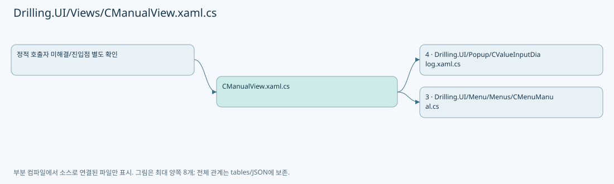

## 네임스페이스·타입·상속

| 타입 | 구분 | 원본 범위 | 선언/상속 |
| --- | --- | --- | --- |
| CManualView | ClassDeclaration | 9–154 | CManualView: UserControl |

## 멤버 빠른 목록

| 이름 | 종류 | 범위 | 서명 |
| --- | --- | --- | --- |
| .ctor | ConstructorDeclaration | L11–26 | Drilling.UI.Views.CManualView.CManualView() |
| _motionWindow | FieldDeclaration | L28–28 | Window? Drilling.UI.Views.CManualView._motionWindow |
| _jogButton | FieldDeclaration | L29–29 | Button? Drilling.UI.Views.CManualView._jogButton |
| _jogAxis | FieldDeclaration | L30–30 | Drilling.UI.Menu.Menus.CManualMotionAxis? Drilling.UI.Views.CManualView._jogAxis |
| OpenShiftOffsetDialog | MethodDeclaration | L32–36 | void Drilling.UI.Views.CManualView.OpenShiftOffsetDialog(object, RoutedEventArgs) |
| FitManualParameterRows | MethodDeclaration | L38–46 | void Drilling.UI.Views.CManualView.FitManualParameterRows(object, RoutedEventArgs) |
| JogPressed | MethodDeclaration | L48–56 | void Drilling.UI.Views.CManualView.JogPressed(object, MouseButtonEventArgs) |
| JogReleased | MethodDeclaration | L57–57 | void Drilling.UI.Views.CManualView.JogReleased(object, MouseButtonEventArgs) |
| JogCaptureLost | MethodDeclaration | L58–58 | void Drilling.UI.Views.CManualView.JogCaptureLost(object, MouseEventArgs) |
| MotionWindowDeactivated | MethodDeclaration | L59–65 | void Drilling.UI.Views.CManualView.MotionWindowDeactivated(object?, System.EventArgs) |
| MotionVisibilityChanged | MethodDeclaration | L66–69 | void Drilling.UI.Views.CManualView.MotionVisibilityChanged(object, DependencyPropertyChangedEventArgs) |
| CancelPendingMotion | MethodDeclaration | L70–73 | void Drilling.UI.Views.CManualView.CancelPendingMotion() |
| ReleaseJog | MethodDeclaration | L74–82 | void Drilling.UI.Views.CManualView.ReleaseJog() |
| OpenTextInput | MethodDeclaration | L84–99 | void Drilling.UI.Views.CManualView.OpenTextInput(object, MouseButtonEventArgs) |
| OpenManualParameterInput | MethodDeclaration | L102–113 | void Drilling.UI.Views.CManualView.OpenManualParameterInput(object, RoutedEventArgs) |
| OpenCommandStateInput | MethodDeclaration | L115–127 | void Drilling.UI.Views.CManualView.OpenCommandStateInput(object, RoutedEventArgs) |
| OpenStageTargetInput | MethodDeclaration | L129–140 | void Drilling.UI.Views.CManualView.OpenStageTargetInput(object, RoutedEventArgs) |
| OpenStageSpeedInput | MethodDeclaration | L142–153 | void Drilling.UI.Views.CManualView.OpenStageSpeedInput(object, RoutedEventArgs) |

## 멤버별 상세 계약·호출·처리 해설

### ConstructorDeclaration `.ctor` · L11–26

[Drilling.UI/Views/CManualView.xaml.cs:11–26](https://github.com/kjuws10-rgb/A3Drilling/blob/5aee8e58439c9b455cae7c9593c9be986c3e682e/Drilling.UI/Views/CManualView.xaml.cs#L11-L26)

| 항목 | 실제 추출 값 |
| --- | --- |
| 서명 | Drilling.UI.Views.CManualView.CManualView() |
| 접근/수식자 | Public / public |
| 반환/값 타입 | void |
| 소속 타입 | NamedType:Drilling.UI.Views.CManualView |

현재 부분 분석에서 직접 연결된 호출자는 없습니다. XAML/이벤트/인터페이스·델리게이트·외부 진입을 추가 확인해야 하며, 미사용으로 판정한 것이 아닙니다.

호출하는 대상과 해석 범위:

| 원본 행 | 표현식 | 분석 상태 | 대상/소스 위치 |
| --- | --- | --- | --- |
| 13 | InitializeComponent | unresolved | None |
| 16 | Window.GetWindow | unresolved | None |
| 21 | ReleaseJog | resolved | void Drilling.UI.Views.CManualView.ReleaseJog() · Drilling.UI/Views/CManualView.xaml.cs:74 |
| 22 | CancelPendingMotion | resolved | void Drilling.UI.Views.CManualView.CancelPendingMotion() · Drilling.UI/Views/CManualView.xaml.cs:70 |

본문의 실제 연산·분기·예외·반환 순서(원문 위치 순):

| 원본 행 | 종류 | 주석 해설 |
| --- | --- | --- |
| 13 | call | 함수·델리게이트 또는 객체 생성자를 호출합니다: InitializeComponent() |
| 14 | compound-assignment-or-event-subscription | 복합 대입 또는 이벤트 구독/해지 표현입니다: Loaded += (_, _) => { _motionWindow = Window.GetWindow(this); if (_motionWindow is not null) _motionWindow.Deactivated += MotionWindowDeactivated; } |
| 16 | assignment | 값을 대상에 대입합니다: _motionWindow = Window.GetWindow(this) |
| 16 | call | 함수·델리게이트 또는 객체 생성자를 호출합니다: Window.GetWindow(this) |
| 17 | compound-assignment-or-event-subscription | 복합 대입 또는 이벤트 구독/해지 표현입니다: _motionWindow.Deactivated += MotionWindowDeactivated |
| 17 | if | 조건에 따라 분기합니다: if (_motionWindow is not null) |
| 19 | compound-assignment-or-event-subscription | 복합 대입 또는 이벤트 구독/해지 표현입니다: Unloaded += (_, _) => { ReleaseJog(); CancelPendingMotion(); if (_motionWindow is not null) _motionWindow.Deactivated -= MotionWindowDeactivated; _motionWindow = null; } |
| 21 | call | 함수·델리게이트 또는 객체 생성자를 호출합니다: ReleaseJog() |
| 22 | call | 함수·델리게이트 또는 객체 생성자를 호출합니다: CancelPendingMotion() |
| 23 | compound-assignment-or-event-subscription | 복합 대입 또는 이벤트 구독/해지 표현입니다: _motionWindow.Deactivated -= MotionWindowDeactivated |
| 23 | if | 조건에 따라 분기합니다: if (_motionWindow is not null) |
| 24 | assignment | 값을 대상에 대입합니다: _motionWindow = null |

제어 구문의 포함 구조(실제 실행 순서/CFG가 아닌 구문 탐색 그림):

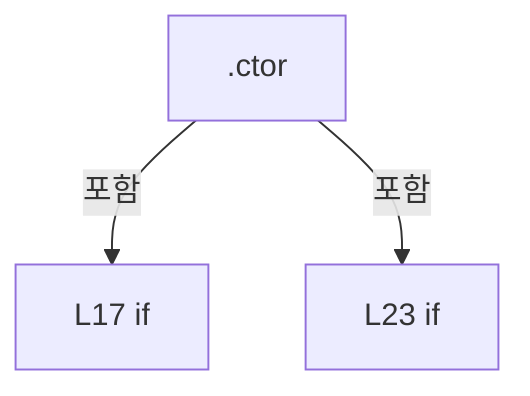

변경 전 점검: 입력/반환 타입, 위 호출자, 예외/취소 경로, 공유 상태와 저장·전송 소비자를 함께 확인합니다. 값의 단위나 물리 방향을 이름만으로 확정하지 않습니다.

### FieldDeclaration `_motionWindow` · L28–28

[Drilling.UI/Views/CManualView.xaml.cs:28–28](https://github.com/kjuws10-rgb/A3Drilling/blob/5aee8e58439c9b455cae7c9593c9be986c3e682e/Drilling.UI/Views/CManualView.xaml.cs#L28-L28)

| 항목 | 실제 추출 값 |
| --- | --- |
| 서명 | Window? Drilling.UI.Views.CManualView._motionWindow |
| 접근/수식자 | Private / private |
| 반환/값 타입 | Window? |
| 소속 타입 | NamedType:Drilling.UI.Views.CManualView |

현재 부분 분석에서 직접 연결된 호출자는 없습니다. XAML/이벤트/인터페이스·델리게이트·외부 진입을 추가 확인해야 하며, 미사용으로 판정한 것이 아닙니다.

변경 전 점검: 입력/반환 타입, 위 호출자, 예외/취소 경로, 공유 상태와 저장·전송 소비자를 함께 확인합니다. 값의 단위나 물리 방향을 이름만으로 확정하지 않습니다.

### FieldDeclaration `_jogButton` · L29–29

[Drilling.UI/Views/CManualView.xaml.cs:29–29](https://github.com/kjuws10-rgb/A3Drilling/blob/5aee8e58439c9b455cae7c9593c9be986c3e682e/Drilling.UI/Views/CManualView.xaml.cs#L29-L29)

| 항목 | 실제 추출 값 |
| --- | --- |
| 서명 | Button? Drilling.UI.Views.CManualView._jogButton |
| 접근/수식자 | Private / private |
| 반환/값 타입 | Button? |
| 소속 타입 | NamedType:Drilling.UI.Views.CManualView |

현재 부분 분석에서 직접 연결된 호출자는 없습니다. XAML/이벤트/인터페이스·델리게이트·외부 진입을 추가 확인해야 하며, 미사용으로 판정한 것이 아닙니다.

변경 전 점검: 입력/반환 타입, 위 호출자, 예외/취소 경로, 공유 상태와 저장·전송 소비자를 함께 확인합니다. 값의 단위나 물리 방향을 이름만으로 확정하지 않습니다.

### FieldDeclaration `_jogAxis` · L30–30

[Drilling.UI/Views/CManualView.xaml.cs:30–30](https://github.com/kjuws10-rgb/A3Drilling/blob/5aee8e58439c9b455cae7c9593c9be986c3e682e/Drilling.UI/Views/CManualView.xaml.cs#L30-L30)

| 항목 | 실제 추출 값 |
| --- | --- |
| 서명 | Drilling.UI.Menu.Menus.CManualMotionAxis? Drilling.UI.Views.CManualView._jogAxis |
| 접근/수식자 | Private / private |
| 반환/값 타입 | Drilling.UI.Menu.Menus.CManualMotionAxis? |
| 소속 타입 | NamedType:Drilling.UI.Views.CManualView |

현재 부분 분석에서 직접 연결된 호출자는 없습니다. XAML/이벤트/인터페이스·델리게이트·외부 진입을 추가 확인해야 하며, 미사용으로 판정한 것이 아닙니다.

변경 전 점검: 입력/반환 타입, 위 호출자, 예외/취소 경로, 공유 상태와 저장·전송 소비자를 함께 확인합니다. 값의 단위나 물리 방향을 이름만으로 확정하지 않습니다.

### MethodDeclaration `OpenShiftOffsetDialog` · L32–36

[Drilling.UI/Views/CManualView.xaml.cs:32–36](https://github.com/kjuws10-rgb/A3Drilling/blob/5aee8e58439c9b455cae7c9593c9be986c3e682e/Drilling.UI/Views/CManualView.xaml.cs#L32-L36)

| 항목 | 실제 추출 값 |
| --- | --- |
| 서명 | void Drilling.UI.Views.CManualView.OpenShiftOffsetDialog(object, RoutedEventArgs) |
| 접근/수식자 | Private / private, async |
| 반환/값 타입 | void |
| 소속 타입 | NamedType:Drilling.UI.Views.CManualView |

입력 계약:

| 이름 | 타입 | 전달 | 선택/기본값 |
| --- | --- | --- | --- |
| sender | object | None | False /  |
| e | RoutedEventArgs | None | False /  |

현재 부분 분석에서 직접 연결된 호출자는 없습니다. XAML/이벤트/인터페이스·델리게이트·외부 진입을 추가 확인해야 하며, 미사용으로 판정한 것이 아닙니다.

호출하는 대상과 해석 범위:

| 원본 행 | 표현식 | 분석 상태 | 대상/소스 위치 |
| --- | --- | --- | --- |
| 35 | root.OpenShiftOffsetDialog | candidate | OverloadResolutionFailure |
| 35 | Window.GetWindow | unresolved | None |

본문의 실제 연산·분기·예외·반환 순서(원문 위치 순):

| 원본 행 | 종류 | 주석 해설 |
| --- | --- | --- |
| 34 | if | 조건에 따라 분기합니다: if (DataContext is not CRootView root) |
| 34 | return | 호출자에게 값 또는 제어를 반환합니다: return; |
| 35 | await | 비동기 완료를 기다립니다: await root.OpenShiftOffsetDialog(Window.GetWindow(this)) |
| 35 | call | 함수·델리게이트 또는 객체 생성자를 호출합니다: root.OpenShiftOffsetDialog(Window.GetWindow(this)) |
| 35 | call | 함수·델리게이트 또는 객체 생성자를 호출합니다: Window.GetWindow(this) |

제어 구문의 포함 구조(실제 실행 순서/CFG가 아닌 구문 탐색 그림):

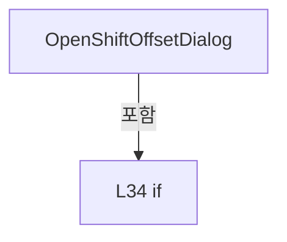

변경 전 점검: 입력/반환 타입, 위 호출자, 예외/취소 경로, 공유 상태와 저장·전송 소비자를 함께 확인합니다. 값의 단위나 물리 방향을 이름만으로 확정하지 않습니다.

### MethodDeclaration `FitManualParameterRows` · L38–46

[Drilling.UI/Views/CManualView.xaml.cs:38–46](https://github.com/kjuws10-rgb/A3Drilling/blob/5aee8e58439c9b455cae7c9593c9be986c3e682e/Drilling.UI/Views/CManualView.xaml.cs#L38-L46)

| 항목 | 실제 추출 값 |
| --- | --- |
| 서명 | void Drilling.UI.Views.CManualView.FitManualParameterRows(object, RoutedEventArgs) |
| 접근/수식자 | Private / private |
| 반환/값 타입 | void |
| 소속 타입 | NamedType:Drilling.UI.Views.CManualView |

입력 계약:

| 이름 | 타입 | 전달 | 선택/기본값 |
| --- | --- | --- | --- |
| sender | object | None | False /  |
| e | RoutedEventArgs | None | False /  |

현재 부분 분석에서 직접 연결된 호출자는 없습니다. XAML/이벤트/인터페이스·델리게이트·외부 진입을 추가 확인해야 하며, 미사용으로 판정한 것이 아닙니다.

호출하는 대상과 해석 범위:

| 원본 행 | 표현식 | 분석 상태 | 대상/소스 위치 |
| --- | --- | --- | --- |
| 41 | double.IsFinite | candidate | OverloadResolutionFailure |
| 44 | Math.Max | candidate | OverloadResolutionFailure |
| 44 | Math.Floor | candidate | OverloadResolutionFailure |
| 45 | Math.Abs | candidate | OverloadResolutionFailure |

본문의 실제 연산·분기·예외·반환 순서(원문 위치 순):

| 원본 행 | 종류 | 주석 해설 |
| --- | --- | --- |
| 40 | if | 조건에 따라 분기합니다: if (sender is not DataGrid grid &#124;&#124; grid.Items.Count == 0 &#124;&#124; grid.ActualHeight <= 0 &#124;&#124; !double.IsFinite(grid.ColumnHeaderHeight)) |
| 41 | call | 함수·델리게이트 또는 객체 생성자를 호출합니다: double.IsFinite(grid.ColumnHeaderHeight) |
| 41 | return | 호출자에게 값 또는 제어를 반환합니다: return; |
| 42 | local-declaration | 지역 변수를 선언합니다: var availableHeight = grid.ActualHeight - grid.ColumnHeaderHeight - grid.BorderThickness.Top - grid.BorderThickness.Bottom - 2.0; |
| 42 | variable-initializer | 변수의 초기값을 지정합니다: availableHeight = grid.ActualHeight - grid.ColumnHeaderHeight - grid.BorderThickness.Top - grid.BorderThickness.Bottom - 2.0 |
| 44 | call | 함수·델리게이트 또는 객체 생성자를 호출합니다: Math.Max(18.0, Math.Floor(availableHeight / grid.Items.Count * 10.0) / 10.0) |
| 44 | call | 함수·델리게이트 또는 객체 생성자를 호출합니다: Math.Floor(availableHeight / grid.Items.Count * 10.0) |
| 44 | local-declaration | 지역 변수를 선언합니다: var rowHeight = Math.Max(18.0, Math.Floor(availableHeight / grid.Items.Count * 10.0) / 10.0); |
| 44 | variable-initializer | 변수의 초기값을 지정합니다: rowHeight = Math.Max(18.0, Math.Floor(availableHeight / grid.Items.Count * 10.0) / 10.0) |
| 45 | assignment | 값을 대상에 대입합니다: grid.RowHeight = rowHeight |
| 45 | call | 함수·델리게이트 또는 객체 생성자를 호출합니다: Math.Abs(grid.RowHeight - rowHeight) |
| 45 | if | 조건에 따라 분기합니다: if (Math.Abs(grid.RowHeight - rowHeight) > 0.01) |

제어 구문의 포함 구조(실제 실행 순서/CFG가 아닌 구문 탐색 그림):

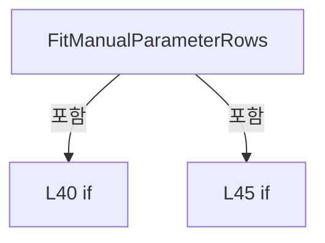

변경 전 점검: 입력/반환 타입, 위 호출자, 예외/취소 경로, 공유 상태와 저장·전송 소비자를 함께 확인합니다. 값의 단위나 물리 방향을 이름만으로 확정하지 않습니다.

### MethodDeclaration `JogPressed` · L48–56

[Drilling.UI/Views/CManualView.xaml.cs:48–56](https://github.com/kjuws10-rgb/A3Drilling/blob/5aee8e58439c9b455cae7c9593c9be986c3e682e/Drilling.UI/Views/CManualView.xaml.cs#L48-L56)

| 항목 | 실제 추출 값 |
| --- | --- |
| 서명 | void Drilling.UI.Views.CManualView.JogPressed(object, MouseButtonEventArgs) |
| 접근/수식자 | Private / private, async |
| 반환/값 타입 | void |
| 소속 타입 | NamedType:Drilling.UI.Views.CManualView |

입력 계약:

| 이름 | 타입 | 전달 | 선택/기본값 |
| --- | --- | --- | --- |
| sender | object | None | False /  |
| e | MouseButtonEventArgs | None | False /  |

현재 부분 분석에서 직접 연결된 호출자는 없습니다. XAML/이벤트/인터페이스·델리게이트·외부 진입을 추가 확인해야 하며, 미사용으로 판정한 것이 아닙니다.

호출하는 대상과 해석 범위:

| 원본 행 | 표현식 | 분석 상태 | 대상/소스 위치 |
| --- | --- | --- | --- |
| 54 | button.CaptureMouse | unresolved | None |
| 54 | ReleaseJog | resolved | void Drilling.UI.Views.CManualView.ReleaseJog() · Drilling.UI/Views/CManualView.xaml.cs:74 |
| 55 | axis.StartJog | resolved | System.Threading.Tasks.Task Drilling.UI.Menu.Menus.CManualMotionAxis.StartJog(int) · Drilling.UI/Menu/Menus/CMenuManual.cs:8765 |
| 55 | .ToString | unresolved | None |

본문의 실제 연산·분기·예외·반환 순서(원문 위치 순):

| 원본 행 | 종류 | 주석 해설 |
| --- | --- | --- |
| 50 | assignment | 값을 대상에 대입합니다: e.Handled = true |
| 51 | if | 조건에 따라 분기합니다: if (_jogButton is not null &#124;&#124; sender is not Button { DataContext: CManualMotionAxis axis } button &#124;&#124; !axis.CanMove) |
| 51 | return | 호출자에게 값 또는 제어를 반환합니다: return; |
| 52 | assignment | 값을 대상에 대입합니다: _jogButton = button |
| 53 | assignment | 값을 대상에 대입합니다: _jogAxis = axis |
| 54 | call | 함수·델리게이트 또는 객체 생성자를 호출합니다: button.CaptureMouse() |
| 54 | call | 함수·델리게이트 또는 객체 생성자를 호출합니다: ReleaseJog() |
| 54 | if | 조건에 따라 분기합니다: if (!button.CaptureMouse()) |
| 54 | return | 호출자에게 값 또는 제어를 반환합니다: return; |
| 55 | await | 비동기 완료를 기다립니다: await axis.StartJog(button.Tag?.ToString() == "-" ? -1 : 1) |
| 55 | call | 함수·델리게이트 또는 객체 생성자를 호출합니다: axis.StartJog(button.Tag?.ToString() == "-" ? -1 : 1) |
| 55 | call | 함수·델리게이트 또는 객체 생성자를 호출합니다: .ToString() |
| 55 | conditional-expression | 조건에 따라 결과식을 선택합니다: button.Tag?.ToString() == "-" ? -1 : 1 |

제어 구문의 포함 구조(실제 실행 순서/CFG가 아닌 구문 탐색 그림):

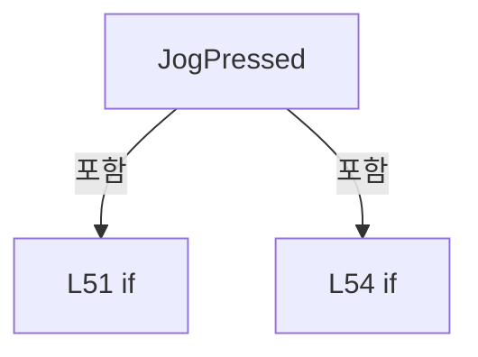

변경 전 점검: 입력/반환 타입, 위 호출자, 예외/취소 경로, 공유 상태와 저장·전송 소비자를 함께 확인합니다. 값의 단위나 물리 방향을 이름만으로 확정하지 않습니다.

### MethodDeclaration `JogReleased` · L57–57

[Drilling.UI/Views/CManualView.xaml.cs:57–57](https://github.com/kjuws10-rgb/A3Drilling/blob/5aee8e58439c9b455cae7c9593c9be986c3e682e/Drilling.UI/Views/CManualView.xaml.cs#L57-L57)

| 항목 | 실제 추출 값 |
| --- | --- |
| 서명 | void Drilling.UI.Views.CManualView.JogReleased(object, MouseButtonEventArgs) |
| 접근/수식자 | Private / private |
| 반환/값 타입 | void |
| 소속 타입 | NamedType:Drilling.UI.Views.CManualView |

입력 계약:

| 이름 | 타입 | 전달 | 선택/기본값 |
| --- | --- | --- | --- |
| sender | object | None | False /  |
| e | MouseButtonEventArgs | None | False /  |

현재 부분 분석에서 직접 연결된 호출자는 없습니다. XAML/이벤트/인터페이스·델리게이트·외부 진입을 추가 확인해야 하며, 미사용으로 판정한 것이 아닙니다.

호출하는 대상과 해석 범위:

| 원본 행 | 표현식 | 분석 상태 | 대상/소스 위치 |
| --- | --- | --- | --- |
| 57 | ReleaseJog | resolved | void Drilling.UI.Views.CManualView.ReleaseJog() · Drilling.UI/Views/CManualView.xaml.cs:74 |

본문의 실제 연산·분기·예외·반환 순서(원문 위치 순):

| 원본 행 | 종류 | 주석 해설 |
| --- | --- | --- |
| 57 | assignment | 값을 대상에 대입합니다: e.Handled = true |
| 57 | call | 함수·델리게이트 또는 객체 생성자를 호출합니다: ReleaseJog() |

변경 전 점검: 입력/반환 타입, 위 호출자, 예외/취소 경로, 공유 상태와 저장·전송 소비자를 함께 확인합니다. 값의 단위나 물리 방향을 이름만으로 확정하지 않습니다.

### MethodDeclaration `JogCaptureLost` · L58–58

[Drilling.UI/Views/CManualView.xaml.cs:58–58](https://github.com/kjuws10-rgb/A3Drilling/blob/5aee8e58439c9b455cae7c9593c9be986c3e682e/Drilling.UI/Views/CManualView.xaml.cs#L58-L58)

| 항목 | 실제 추출 값 |
| --- | --- |
| 서명 | void Drilling.UI.Views.CManualView.JogCaptureLost(object, MouseEventArgs) |
| 접근/수식자 | Private / private |
| 반환/값 타입 | void |
| 소속 타입 | NamedType:Drilling.UI.Views.CManualView |

입력 계약:

| 이름 | 타입 | 전달 | 선택/기본값 |
| --- | --- | --- | --- |
| sender | object | None | False /  |
| e | MouseEventArgs | None | False /  |

현재 부분 분석에서 직접 연결된 호출자는 없습니다. XAML/이벤트/인터페이스·델리게이트·외부 진입을 추가 확인해야 하며, 미사용으로 판정한 것이 아닙니다.

호출하는 대상과 해석 범위:

| 원본 행 | 표현식 | 분석 상태 | 대상/소스 위치 |
| --- | --- | --- | --- |
| 58 | ReleaseJog | resolved | void Drilling.UI.Views.CManualView.ReleaseJog() · Drilling.UI/Views/CManualView.xaml.cs:74 |

본문의 실제 연산·분기·예외·반환 순서(원문 위치 순):

| 원본 행 | 종류 | 주석 해설 |
| --- | --- | --- |
| 58 | call | 함수·델리게이트 또는 객체 생성자를 호출합니다: ReleaseJog() |

변경 전 점검: 입력/반환 타입, 위 호출자, 예외/취소 경로, 공유 상태와 저장·전송 소비자를 함께 확인합니다. 값의 단위나 물리 방향을 이름만으로 확정하지 않습니다.

### MethodDeclaration `MotionWindowDeactivated` · L59–65

[Drilling.UI/Views/CManualView.xaml.cs:59–65](https://github.com/kjuws10-rgb/A3Drilling/blob/5aee8e58439c9b455cae7c9593c9be986c3e682e/Drilling.UI/Views/CManualView.xaml.cs#L59-L65)

| 항목 | 실제 추출 값 |
| --- | --- |
| 서명 | void Drilling.UI.Views.CManualView.MotionWindowDeactivated(object?, System.EventArgs) |
| 접근/수식자 | Private / private |
| 반환/값 타입 | void |
| 소속 타입 | NamedType:Drilling.UI.Views.CManualView |

입력 계약:

| 이름 | 타입 | 전달 | 선택/기본값 |
| --- | --- | --- | --- |
| sender | object? | None | False /  |
| e | System.EventArgs | None | False /  |

현재 부분 분석에서 직접 연결된 호출자는 없습니다. XAML/이벤트/인터페이스·델리게이트·외부 진입을 추가 확인해야 하며, 미사용으로 판정한 것이 아닙니다.

호출하는 대상과 해석 범위:

| 원본 행 | 표현식 | 분석 상태 | 대상/소스 위치 |
| --- | --- | --- | --- |
| 61 | ReleaseJog | resolved | void Drilling.UI.Views.CManualView.ReleaseJog() · Drilling.UI/Views/CManualView.xaml.cs:74 |
| 64 | CancelPendingMotion | resolved | void Drilling.UI.Views.CManualView.CancelPendingMotion() · Drilling.UI/Views/CManualView.xaml.cs:70 |

본문의 실제 연산·분기·예외·반환 순서(원문 위치 순):

| 원본 행 | 종류 | 주석 해설 |
| --- | --- | --- |
| 61 | call | 함수·델리게이트 또는 객체 생성자를 호출합니다: ReleaseJog() |
| 64 | call | 함수·델리게이트 또는 객체 생성자를 호출합니다: CancelPendingMotion() |
| 64 | if | 조건에 따라 분기합니다: if (ManualMotionPanel?.Tag is not CManualMotionPanel { IsConfirmationOpen: true }) |

제어 구문의 포함 구조(실제 실행 순서/CFG가 아닌 구문 탐색 그림):

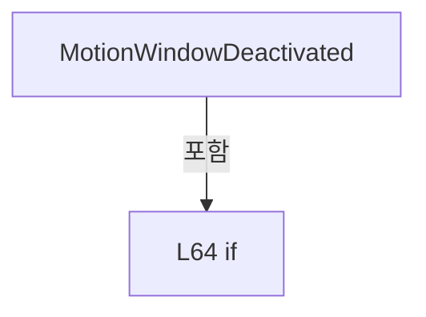

변경 전 점검: 입력/반환 타입, 위 호출자, 예외/취소 경로, 공유 상태와 저장·전송 소비자를 함께 확인합니다. 값의 단위나 물리 방향을 이름만으로 확정하지 않습니다.

### MethodDeclaration `MotionVisibilityChanged` · L66–69

[Drilling.UI/Views/CManualView.xaml.cs:66–69](https://github.com/kjuws10-rgb/A3Drilling/blob/5aee8e58439c9b455cae7c9593c9be986c3e682e/Drilling.UI/Views/CManualView.xaml.cs#L66-L69)

| 항목 | 실제 추출 값 |
| --- | --- |
| 서명 | void Drilling.UI.Views.CManualView.MotionVisibilityChanged(object, DependencyPropertyChangedEventArgs) |
| 접근/수식자 | Private / private |
| 반환/값 타입 | void |
| 소속 타입 | NamedType:Drilling.UI.Views.CManualView |

입력 계약:

| 이름 | 타입 | 전달 | 선택/기본값 |
| --- | --- | --- | --- |
| sender | object | None | False /  |
| e | DependencyPropertyChangedEventArgs | None | False /  |

현재 부분 분석에서 직접 연결된 호출자는 없습니다. XAML/이벤트/인터페이스·델리게이트·외부 진입을 추가 확인해야 하며, 미사용으로 판정한 것이 아닙니다.

호출하는 대상과 해석 범위:

| 원본 행 | 표현식 | 분석 상태 | 대상/소스 위치 |
| --- | --- | --- | --- |
| 68 | ReleaseJog | resolved | void Drilling.UI.Views.CManualView.ReleaseJog() · Drilling.UI/Views/CManualView.xaml.cs:74 |
| 68 | CancelPendingMotion | resolved | void Drilling.UI.Views.CManualView.CancelPendingMotion() · Drilling.UI/Views/CManualView.xaml.cs:70 |

본문의 실제 연산·분기·예외·반환 순서(원문 위치 순):

| 원본 행 | 종류 | 주석 해설 |
| --- | --- | --- |
| 68 | call | 함수·델리게이트 또는 객체 생성자를 호출합니다: ReleaseJog() |
| 68 | call | 함수·델리게이트 또는 객체 생성자를 호출합니다: CancelPendingMotion() |
| 68 | if | 조건에 따라 분기합니다: if (e.NewValue is false) |

제어 구문의 포함 구조(실제 실행 순서/CFG가 아닌 구문 탐색 그림):

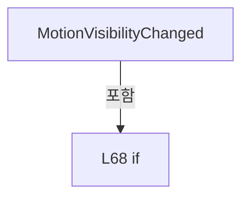

변경 전 점검: 입력/반환 타입, 위 호출자, 예외/취소 경로, 공유 상태와 저장·전송 소비자를 함께 확인합니다. 값의 단위나 물리 방향을 이름만으로 확정하지 않습니다.

### MethodDeclaration `CancelPendingMotion` · L70–73

[Drilling.UI/Views/CManualView.xaml.cs:70–73](https://github.com/kjuws10-rgb/A3Drilling/blob/5aee8e58439c9b455cae7c9593c9be986c3e682e/Drilling.UI/Views/CManualView.xaml.cs#L70-L73)

| 항목 | 실제 추출 값 |
| --- | --- |
| 서명 | void Drilling.UI.Views.CManualView.CancelPendingMotion() |
| 접근/수식자 | Private / private |
| 반환/값 타입 | void |
| 소속 타입 | NamedType:Drilling.UI.Views.CManualView |

정적 호출자로 확인된 위치:

| 호출 파일/행 | 호출 표현식 | 런타임 분기 가능 |
| --- | --- | --- |
| [Drilling.UI/Views/CManualView.xaml.cs:22–22](https://github.com/kjuws10-rgb/A3Drilling/blob/5aee8e58439c9b455cae7c9593c9be986c3e682e/Drilling.UI/Views/CManualView.xaml.cs#L22-L22) | CancelPendingMotion | False |
| [Drilling.UI/Views/CManualView.xaml.cs:64–64](https://github.com/kjuws10-rgb/A3Drilling/blob/5aee8e58439c9b455cae7c9593c9be986c3e682e/Drilling.UI/Views/CManualView.xaml.cs#L64-L64) | CancelPendingMotion | False |
| [Drilling.UI/Views/CManualView.xaml.cs:68–68](https://github.com/kjuws10-rgb/A3Drilling/blob/5aee8e58439c9b455cae7c9593c9be986c3e682e/Drilling.UI/Views/CManualView.xaml.cs#L68-L68) | CancelPendingMotion | False |

호출하는 대상과 해석 범위:

| 원본 행 | 표현식 | 분석 상태 | 대상/소스 위치 |
| --- | --- | --- | --- |
| 72 | panel.CancelPendingAndStopJog | resolved | System.Threading.Tasks.Task Drilling.UI.Menu.Menus.CManualMotionPanel.CancelPendingAndStopJog() · Drilling.UI/Menu/Menus/CMenuManual.cs:8740 |

본문의 실제 연산·분기·예외·반환 순서(원문 위치 순):

| 원본 행 | 종류 | 주석 해설 |
| --- | --- | --- |
| 72 | assignment | 값을 대상에 대입합니다: _ = panel.CancelPendingAndStopJog() |
| 72 | call | 함수·델리게이트 또는 객체 생성자를 호출합니다: panel.CancelPendingAndStopJog() |
| 72 | if | 조건에 따라 분기합니다: if (ManualMotionPanel?.Tag is CManualMotionPanel panel) |

제어 구문의 포함 구조(실제 실행 순서/CFG가 아닌 구문 탐색 그림):

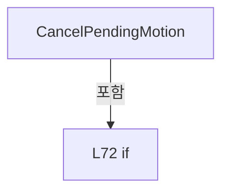

변경 전 점검: 입력/반환 타입, 위 호출자, 예외/취소 경로, 공유 상태와 저장·전송 소비자를 함께 확인합니다. 값의 단위나 물리 방향을 이름만으로 확정하지 않습니다.

### MethodDeclaration `ReleaseJog` · L74–82

[Drilling.UI/Views/CManualView.xaml.cs:74–82](https://github.com/kjuws10-rgb/A3Drilling/blob/5aee8e58439c9b455cae7c9593c9be986c3e682e/Drilling.UI/Views/CManualView.xaml.cs#L74-L82)

| 항목 | 실제 추출 값 |
| --- | --- |
| 서명 | void Drilling.UI.Views.CManualView.ReleaseJog() |
| 접근/수식자 | Private / private |
| 반환/값 타입 | void |
| 소속 타입 | NamedType:Drilling.UI.Views.CManualView |

정적 호출자로 확인된 위치:

| 호출 파일/행 | 호출 표현식 | 런타임 분기 가능 |
| --- | --- | --- |
| [Drilling.UI/Views/CManualView.xaml.cs:21–21](https://github.com/kjuws10-rgb/A3Drilling/blob/5aee8e58439c9b455cae7c9593c9be986c3e682e/Drilling.UI/Views/CManualView.xaml.cs#L21-L21) | ReleaseJog | False |
| [Drilling.UI/Views/CManualView.xaml.cs:54–54](https://github.com/kjuws10-rgb/A3Drilling/blob/5aee8e58439c9b455cae7c9593c9be986c3e682e/Drilling.UI/Views/CManualView.xaml.cs#L54-L54) | ReleaseJog | False |
| [Drilling.UI/Views/CManualView.xaml.cs:57–57](https://github.com/kjuws10-rgb/A3Drilling/blob/5aee8e58439c9b455cae7c9593c9be986c3e682e/Drilling.UI/Views/CManualView.xaml.cs#L57-L57) | ReleaseJog | False |
| [Drilling.UI/Views/CManualView.xaml.cs:58–58](https://github.com/kjuws10-rgb/A3Drilling/blob/5aee8e58439c9b455cae7c9593c9be986c3e682e/Drilling.UI/Views/CManualView.xaml.cs#L58-L58) | ReleaseJog | False |
| [Drilling.UI/Views/CManualView.xaml.cs:61–61](https://github.com/kjuws10-rgb/A3Drilling/blob/5aee8e58439c9b455cae7c9593c9be986c3e682e/Drilling.UI/Views/CManualView.xaml.cs#L61-L61) | ReleaseJog | False |
| [Drilling.UI/Views/CManualView.xaml.cs:68–68](https://github.com/kjuws10-rgb/A3Drilling/blob/5aee8e58439c9b455cae7c9593c9be986c3e682e/Drilling.UI/Views/CManualView.xaml.cs#L68-L68) | ReleaseJog | False |

호출하는 대상과 해석 범위:

| 원본 행 | 표현식 | 분석 상태 | 대상/소스 위치 |
| --- | --- | --- | --- |
| 80 | axis.StopJog | resolved | System.Threading.Tasks.Task Drilling.UI.Menu.Menus.CManualMotionAxis.StopJog() · Drilling.UI/Menu/Menus/CMenuManual.cs:8766 |
| 81 | button.ReleaseMouseCapture | unresolved | None |

본문의 실제 연산·분기·예외·반환 순서(원문 위치 순):

| 원본 행 | 종류 | 주석 해설 |
| --- | --- | --- |
| 76 | local-declaration | 지역 변수를 선언합니다: var axis = _jogAxis; |
| 76 | variable-initializer | 변수의 초기값을 지정합니다: axis = _jogAxis |
| 77 | local-declaration | 지역 변수를 선언합니다: var button = _jogButton; |
| 77 | variable-initializer | 변수의 초기값을 지정합니다: button = _jogButton |
| 78 | assignment | 값을 대상에 대입합니다: _jogAxis = null |
| 79 | assignment | 값을 대상에 대입합니다: _jogButton = null |
| 80 | assignment | 값을 대상에 대입합니다: _ = axis.StopJog() |
| 80 | call | 함수·델리게이트 또는 객체 생성자를 호출합니다: axis.StopJog() |
| 80 | if | 조건에 따라 분기합니다: if (axis is not null) |
| 81 | call | 함수·델리게이트 또는 객체 생성자를 호출합니다: button.ReleaseMouseCapture() |
| 81 | if | 조건에 따라 분기합니다: if (button?.IsMouseCaptured == true) |

제어 구문의 포함 구조(실제 실행 순서/CFG가 아닌 구문 탐색 그림):

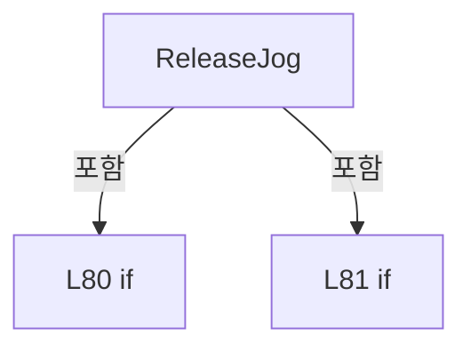

변경 전 점검: 입력/반환 타입, 위 호출자, 예외/취소 경로, 공유 상태와 저장·전송 소비자를 함께 확인합니다. 값의 단위나 물리 방향을 이름만으로 확정하지 않습니다.

### MethodDeclaration `OpenTextInput` · L84–99

[Drilling.UI/Views/CManualView.xaml.cs:84–99](https://github.com/kjuws10-rgb/A3Drilling/blob/5aee8e58439c9b455cae7c9593c9be986c3e682e/Drilling.UI/Views/CManualView.xaml.cs#L84-L99)

| 항목 | 실제 추출 값 |
| --- | --- |
| 서명 | void Drilling.UI.Views.CManualView.OpenTextInput(object, MouseButtonEventArgs) |
| 접근/수식자 | Private / private |
| 반환/값 타입 | void |
| 소속 타입 | NamedType:Drilling.UI.Views.CManualView |

입력 계약:

| 이름 | 타입 | 전달 | 선택/기본값 |
| --- | --- | --- | --- |
| sender | object | None | False /  |
| e | MouseButtonEventArgs | None | False /  |

현재 부분 분석에서 직접 연결된 호출자는 없습니다. XAML/이벤트/인터페이스·델리게이트·외부 진입을 추가 확인해야 하며, 미사용으로 판정한 것이 아닙니다.

호출하는 대상과 해석 범위:

| 원본 행 | 표현식 | 분석 상태 | 대상/소스 위치 |
| --- | --- | --- | --- |
| 90 | .ToString | unresolved | None |
| 91 | new CValueInputDialog | candidate | OverloadResolutionFailure |
| 93 | Window.GetWindow | unresolved | None |
| 95 | dialog.ShowDialog | unresolved | None |
| 98 | textBox.GetBindingExpression | unresolved | None |
| 98 | .UpdateSource | unresolved | None |

본문의 실제 연산·분기·예외·반환 순서(원문 위치 순):

| 원본 행 | 종류 | 주석 해설 |
| --- | --- | --- |
| 86 | if | 조건에 따라 분기합니다: if (sender is not TextBox textBox) |
| 87 | return | 호출자에게 값 또는 제어를 반환합니다: return; |
| 88 | assignment | 값을 대상에 대입합니다: e.Handled = true |
| 89 | conditional-expression | 조건에 따라 결과식을 선택합니다: textBox.Tag as string == "Int" ? EN_RECIPE_DATA_TYPE.Int : EN_RECIPE_DATA_TYPE.Double |
| 89 | local-declaration | 지역 변수를 선언합니다: var dataType = textBox.Tag as string == "Int" ? EN_RECIPE_DATA_TYPE.Int : EN_RECIPE_DATA_TYPE.Double; |
| 89 | variable-initializer | 변수의 초기값을 지정합니다: dataType = textBox.Tag as string == "Int" ? EN_RECIPE_DATA_TYPE.Int : EN_RECIPE_DATA_TYPE.Double |
| 90 | call | 함수·델리게이트 또는 객체 생성자를 호출합니다: .ToString() |
| 90 | local-declaration | 지역 변수를 선언합니다: var prompt = textBox.ToolTip?.ToString() ?? "Value"; |
| 90 | variable-initializer | 변수의 초기값을 지정합니다: prompt = textBox.ToolTip?.ToString() ?? "Value" |
| 91 | call | 함수·델리게이트 또는 객체 생성자를 호출합니다: new CValueInputDialog(prompt, textBox.Text, dataType, 0, 0) { Owner = Window.GetWindow(this) } |
| 91 | local-declaration | 지역 변수를 선언합니다: var dialog = new CValueInputDialog(prompt, textBox.Text, dataType, 0, 0) { Owner = Window.GetWindow(this) }; |
| 91 | variable-initializer | 변수의 초기값을 지정합니다: dialog = new CValueInputDialog(prompt, textBox.Text, dataType, 0, 0) { Owner = Window.GetWindow(this) } |
| 93 | assignment | 값을 대상에 대입합니다: Owner = Window.GetWindow(this) |
| 93 | call | 함수·델리게이트 또는 객체 생성자를 호출합니다: Window.GetWindow(this) |
| 95 | call | 함수·델리게이트 또는 객체 생성자를 호출합니다: dialog.ShowDialog() |
| 95 | if | 조건에 따라 분기합니다: if (dialog.ShowDialog() != true) |
| 96 | return | 호출자에게 값 또는 제어를 반환합니다: return; |
| 97 | assignment | 값을 대상에 대입합니다: textBox.Text = dialog.ResultValue |
| 98 | call | 함수·델리게이트 또는 객체 생성자를 호출합니다: textBox.GetBindingExpression(TextBox.TextProperty) |
| 98 | call | 함수·델리게이트 또는 객체 생성자를 호출합니다: .UpdateSource() |

제어 구문의 포함 구조(실제 실행 순서/CFG가 아닌 구문 탐색 그림):

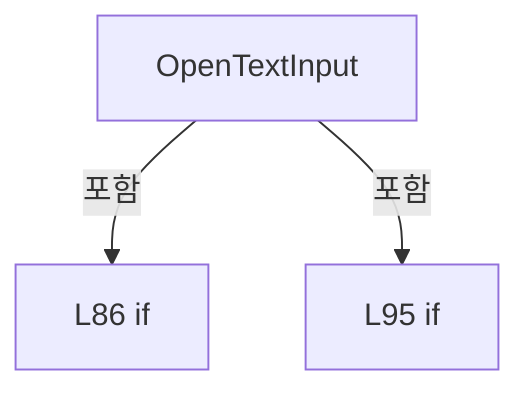

변경 전 점검: 입력/반환 타입, 위 호출자, 예외/취소 경로, 공유 상태와 저장·전송 소비자를 함께 확인합니다. 값의 단위나 물리 방향을 이름만으로 확정하지 않습니다.

### MethodDeclaration `OpenManualParameterInput` · L102–113

[Drilling.UI/Views/CManualView.xaml.cs:102–113](https://github.com/kjuws10-rgb/A3Drilling/blob/5aee8e58439c9b455cae7c9593c9be986c3e682e/Drilling.UI/Views/CManualView.xaml.cs#L102-L113)

| 항목 | 실제 추출 값 |
| --- | --- |
| 서명 | void Drilling.UI.Views.CManualView.OpenManualParameterInput(object, RoutedEventArgs) |
| 접근/수식자 | Private / private |
| 반환/값 타입 | void |
| 소속 타입 | NamedType:Drilling.UI.Views.CManualView |

입력 계약:

| 이름 | 타입 | 전달 | 선택/기본값 |
| --- | --- | --- | --- |
| sender | object | None | False /  |
| e | RoutedEventArgs | None | False /  |

현재 부분 분석에서 직접 연결된 호출자는 없습니다. XAML/이벤트/인터페이스·델리게이트·외부 진입을 추가 확인해야 하며, 미사용으로 판정한 것이 아닙니다.

호출하는 대상과 해석 범위:

| 원본 행 | 표현식 | 분석 상태 | 대상/소스 위치 |
| --- | --- | --- | --- |
| 107 | new CValueInputDialog | resolved | Drilling.UI.Popup.CValueInputDialog.CValueInputDialog(string, string, Drilling.Common.Managers.EN_RECIPE_DATA_TYPE, double, double) · Drilling.UI/Popup/CValueInputDialog.xaml.cs:13 |
| 109 | Window.GetWindow | unresolved | None |
| 111 | dialog.ShowDialog | unresolved | None |

본문의 실제 연산·분기·예외·반환 순서(원문 위치 순):

| 원본 행 | 종류 | 주석 해설 |
| --- | --- | --- |
| 104 | if | 조건에 따라 분기합니다: if (sender is not FrameworkElement { DataContext: ST_MANUAL_PARAMETER row }) |
| 105 | return | 호출자에게 값 또는 제어를 반환합니다: return; |
| 106 | assignment | 값을 대상에 대입합니다: e.Handled = true |
| 107 | call | 함수·델리게이트 또는 객체 생성자를 호출합니다: new CValueInputDialog(row.Parameter, row.Value, row.DataType, row.Min, row.Max) { Owner = Window.GetWindow(this) } |
| 107 | local-declaration | 지역 변수를 선언합니다: var dialog = new CValueInputDialog(row.Parameter, row.Value, row.DataType, row.Min, row.Max) { Owner = Window.GetWindow(this) }; |
| 107 | variable-initializer | 변수의 초기값을 지정합니다: dialog = new CValueInputDialog(row.Parameter, row.Value, row.DataType, row.Min, row.Max) { Owner = Window.GetWindow(this) } |
| 109 | assignment | 값을 대상에 대입합니다: Owner = Window.GetWindow(this) |
| 109 | call | 함수·델리게이트 또는 객체 생성자를 호출합니다: Window.GetWindow(this) |
| 111 | call | 함수·델리게이트 또는 객체 생성자를 호출합니다: dialog.ShowDialog() |
| 111 | if | 조건에 따라 분기합니다: if (dialog.ShowDialog() == true) |
| 112 | assignment | 값을 대상에 대입합니다: row.Value = dialog.ResultValue |

제어 구문의 포함 구조(실제 실행 순서/CFG가 아닌 구문 탐색 그림):

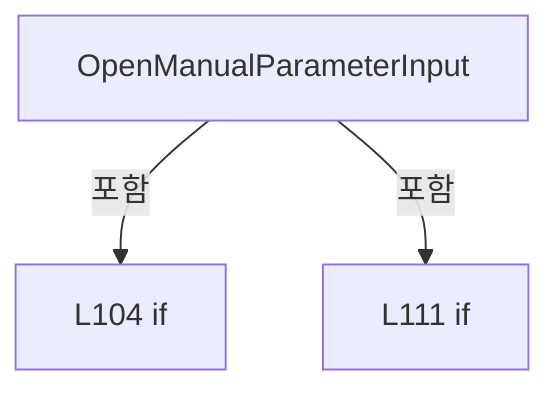

변경 전 점검: 입력/반환 타입, 위 호출자, 예외/취소 경로, 공유 상태와 저장·전송 소비자를 함께 확인합니다. 값의 단위나 물리 방향을 이름만으로 확정하지 않습니다.

### MethodDeclaration `OpenCommandStateInput` · L115–127

[Drilling.UI/Views/CManualView.xaml.cs:115–127](https://github.com/kjuws10-rgb/A3Drilling/blob/5aee8e58439c9b455cae7c9593c9be986c3e682e/Drilling.UI/Views/CManualView.xaml.cs#L115-L127)

| 항목 | 실제 추출 값 |
| --- | --- |
| 서명 | void Drilling.UI.Views.CManualView.OpenCommandStateInput(object, RoutedEventArgs) |
| 접근/수식자 | Private / private |
| 반환/값 타입 | void |
| 소속 타입 | NamedType:Drilling.UI.Views.CManualView |

입력 계약:

| 이름 | 타입 | 전달 | 선택/기본값 |
| --- | --- | --- | --- |
| sender | object | None | False /  |
| e | RoutedEventArgs | None | False /  |

현재 부분 분석에서 직접 연결된 호출자는 없습니다. XAML/이벤트/인터페이스·델리게이트·외부 진입을 추가 확인해야 하며, 미사용으로 판정한 것이 아닙니다.

호출하는 대상과 해석 범위:

| 원본 행 | 표현식 | 분석 상태 | 대상/소스 위치 |
| --- | --- | --- | --- |
| 120 | row.Name.Contains | resolved | bool string.Contains(string, System.StringComparison) |
| 121 | new CValueInputDialog | resolved | Drilling.UI.Popup.CValueInputDialog.CValueInputDialog(string, string, Drilling.Common.Managers.EN_RECIPE_DATA_TYPE, double, double) · Drilling.UI/Popup/CValueInputDialog.xaml.cs:13 |
| 123 | Window.GetWindow | unresolved | None |
| 125 | dialog.ShowDialog | unresolved | None |

본문의 실제 연산·분기·예외·반환 순서(원문 위치 순):

| 원본 행 | 종류 | 주석 해설 |
| --- | --- | --- |
| 117 | if | 조건에 따라 분기합니다: if (sender is not FrameworkElement { DataContext: ST_MANUAL_COMMAND_STATE row } &#124;&#124; !row.IsEditable) |
| 118 | return | 호출자에게 값 또는 제어를 반환합니다: return; |
| 119 | assignment | 값을 대상에 대입합니다: e.Handled = true |
| 120 | call | 함수·델리게이트 또는 객체 생성자를 호출합니다: row.Name.Contains("Count", StringComparison.OrdinalIgnoreCase) |
| 120 | conditional-expression | 조건에 따라 결과식을 선택합니다: row.Name.Contains("Count", StringComparison.OrdinalIgnoreCase) ? EN_RECIPE_DATA_TYPE.Int : EN_RECIPE_DATA_TYPE.Double |
| 120 | local-declaration | 지역 변수를 선언합니다: var dataType = row.Name.Contains("Count", StringComparison.OrdinalIgnoreCase) ? EN_RECIPE_DATA_TYPE.Int : EN_RECIPE_DATA_TYPE.Double; |
| 120 | variable-initializer | 변수의 초기값을 지정합니다: dataType = row.Name.Contains("Count", StringComparison.OrdinalIgnoreCase) ? EN_RECIPE_DATA_TYPE.Int : EN_RECIPE_DATA_TYPE.Double |
| 121 | call | 함수·델리게이트 또는 객체 생성자를 호출합니다: new CValueInputDialog(row.Name, row.Value, dataType, 0, 0) { Owner = Window.GetWindow(this) } |
| 121 | local-declaration | 지역 변수를 선언합니다: var dialog = new CValueInputDialog(row.Name, row.Value, dataType, 0, 0) { Owner = Window.GetWindow(this) }; |
| 121 | variable-initializer | 변수의 초기값을 지정합니다: dialog = new CValueInputDialog(row.Name, row.Value, dataType, 0, 0) { Owner = Window.GetWindow(this) } |
| 123 | assignment | 값을 대상에 대입합니다: Owner = Window.GetWindow(this) |
| 123 | call | 함수·델리게이트 또는 객체 생성자를 호출합니다: Window.GetWindow(this) |
| 125 | call | 함수·델리게이트 또는 객체 생성자를 호출합니다: dialog.ShowDialog() |
| 125 | if | 조건에 따라 분기합니다: if (dialog.ShowDialog() == true) |
| 126 | assignment | 값을 대상에 대입합니다: row.Value = dialog.ResultValue |

제어 구문의 포함 구조(실제 실행 순서/CFG가 아닌 구문 탐색 그림):

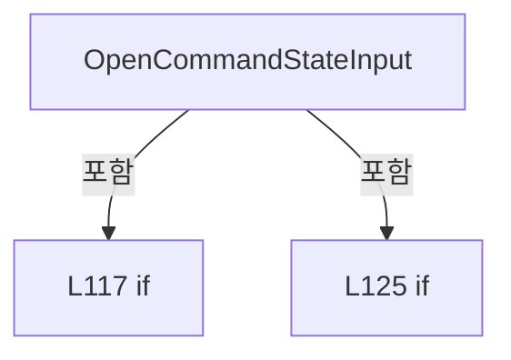

변경 전 점검: 입력/반환 타입, 위 호출자, 예외/취소 경로, 공유 상태와 저장·전송 소비자를 함께 확인합니다. 값의 단위나 물리 방향을 이름만으로 확정하지 않습니다.

### MethodDeclaration `OpenStageTargetInput` · L129–140

[Drilling.UI/Views/CManualView.xaml.cs:129–140](https://github.com/kjuws10-rgb/A3Drilling/blob/5aee8e58439c9b455cae7c9593c9be986c3e682e/Drilling.UI/Views/CManualView.xaml.cs#L129-L140)

| 항목 | 실제 추출 값 |
| --- | --- |
| 서명 | void Drilling.UI.Views.CManualView.OpenStageTargetInput(object, RoutedEventArgs) |
| 접근/수식자 | Private / private |
| 반환/값 타입 | void |
| 소속 타입 | NamedType:Drilling.UI.Views.CManualView |

입력 계약:

| 이름 | 타입 | 전달 | 선택/기본값 |
| --- | --- | --- | --- |
| sender | object | None | False /  |
| e | RoutedEventArgs | None | False /  |

현재 부분 분석에서 직접 연결된 호출자는 없습니다. XAML/이벤트/인터페이스·델리게이트·외부 진입을 추가 확인해야 하며, 미사용으로 판정한 것이 아닙니다.

호출하는 대상과 해석 범위:

| 원본 행 | 표현식 | 분석 상태 | 대상/소스 위치 |
| --- | --- | --- | --- |
| 134 | new CValueInputDialog | resolved | Drilling.UI.Popup.CValueInputDialog.CValueInputDialog(string, string, Drilling.Common.Managers.EN_RECIPE_DATA_TYPE, double, double) · Drilling.UI/Popup/CValueInputDialog.xaml.cs:13 |
| 136 | Window.GetWindow | unresolved | None |
| 138 | dialog.ShowDialog | unresolved | None |

본문의 실제 연산·분기·예외·반환 순서(원문 위치 순):

| 원본 행 | 종류 | 주석 해설 |
| --- | --- | --- |
| 131 | if | 조건에 따라 분기합니다: if (sender is not FrameworkElement { DataContext: ST_MANUAL_STAGE_AXIS row }) |
| 132 | return | 호출자에게 값 또는 제어를 반환합니다: return; |
| 133 | assignment | 값을 대상에 대입합니다: e.Handled = true |
| 134 | call | 함수·델리게이트 또는 객체 생성자를 호출합니다: new CValueInputDialog($"{row.DisplayName} Pos", row.TargetPosition, EN_RECIPE_DATA_TYPE.Double, 0, 0) { Owner = Window.GetWindow(this) } |
| 134 | local-declaration | 지역 변수를 선언합니다: var dialog = new CValueInputDialog($"{row.DisplayName} Pos", row.TargetPosition, EN_RECIPE_DATA_TYPE.Double, 0, 0) { Owner = Window.GetWindow(this) }; |
| 134 | variable-initializer | 변수의 초기값을 지정합니다: dialog = new CValueInputDialog($"{row.DisplayName} Pos", row.TargetPosition, EN_RECIPE_DATA_TYPE.Double, 0, 0) { Owner = Window.GetWindow(this) } |
| 136 | assignment | 값을 대상에 대입합니다: Owner = Window.GetWindow(this) |
| 136 | call | 함수·델리게이트 또는 객체 생성자를 호출합니다: Window.GetWindow(this) |
| 138 | call | 함수·델리게이트 또는 객체 생성자를 호출합니다: dialog.ShowDialog() |
| 138 | if | 조건에 따라 분기합니다: if (dialog.ShowDialog() == true) |
| 139 | assignment | 값을 대상에 대입합니다: row.TargetPosition = dialog.ResultValue |

제어 구문의 포함 구조(실제 실행 순서/CFG가 아닌 구문 탐색 그림):

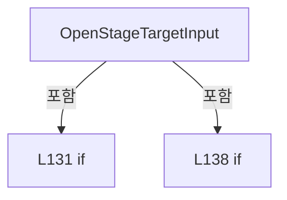

변경 전 점검: 입력/반환 타입, 위 호출자, 예외/취소 경로, 공유 상태와 저장·전송 소비자를 함께 확인합니다. 값의 단위나 물리 방향을 이름만으로 확정하지 않습니다.

### MethodDeclaration `OpenStageSpeedInput` · L142–153

[Drilling.UI/Views/CManualView.xaml.cs:142–153](https://github.com/kjuws10-rgb/A3Drilling/blob/5aee8e58439c9b455cae7c9593c9be986c3e682e/Drilling.UI/Views/CManualView.xaml.cs#L142-L153)

| 항목 | 실제 추출 값 |
| --- | --- |
| 서명 | void Drilling.UI.Views.CManualView.OpenStageSpeedInput(object, RoutedEventArgs) |
| 접근/수식자 | Private / private |
| 반환/값 타입 | void |
| 소속 타입 | NamedType:Drilling.UI.Views.CManualView |

입력 계약:

| 이름 | 타입 | 전달 | 선택/기본값 |
| --- | --- | --- | --- |
| sender | object | None | False /  |
| e | RoutedEventArgs | None | False /  |

현재 부분 분석에서 직접 연결된 호출자는 없습니다. XAML/이벤트/인터페이스·델리게이트·외부 진입을 추가 확인해야 하며, 미사용으로 판정한 것이 아닙니다.

호출하는 대상과 해석 범위:

| 원본 행 | 표현식 | 분석 상태 | 대상/소스 위치 |
| --- | --- | --- | --- |
| 147 | new CValueInputDialog | resolved | Drilling.UI.Popup.CValueInputDialog.CValueInputDialog(string, string, Drilling.Common.Managers.EN_RECIPE_DATA_TYPE, double, double) · Drilling.UI/Popup/CValueInputDialog.xaml.cs:13 |
| 149 | Window.GetWindow | unresolved | None |
| 151 | dialog.ShowDialog | unresolved | None |

본문의 실제 연산·분기·예외·반환 순서(원문 위치 순):

| 원본 행 | 종류 | 주석 해설 |
| --- | --- | --- |
| 144 | if | 조건에 따라 분기합니다: if (sender is not FrameworkElement { DataContext: ST_MANUAL_STAGE_AXIS row }) |
| 145 | return | 호출자에게 값 또는 제어를 반환합니다: return; |
| 146 | assignment | 값을 대상에 대입합니다: e.Handled = true |
| 147 | call | 함수·델리게이트 또는 객체 생성자를 호출합니다: new CValueInputDialog($"{row.DisplayName} Speed", row.TargetSpeed, EN_RECIPE_DATA_TYPE.Double, 0, 0) { Owner = Window.GetWindow(this) } |
| 147 | local-declaration | 지역 변수를 선언합니다: var dialog = new CValueInputDialog($"{row.DisplayName} Speed", row.TargetSpeed, EN_RECIPE_DATA_TYPE.Double, 0, 0) { Owner = Window.GetWindow(this) }; |
| 147 | variable-initializer | 변수의 초기값을 지정합니다: dialog = new CValueInputDialog($"{row.DisplayName} Speed", row.TargetSpeed, EN_RECIPE_DATA_TYPE.Double, 0, 0) { Owner = Window.GetWindow(this) } |
| 149 | assignment | 값을 대상에 대입합니다: Owner = Window.GetWindow(this) |
| 149 | call | 함수·델리게이트 또는 객체 생성자를 호출합니다: Window.GetWindow(this) |
| 151 | call | 함수·델리게이트 또는 객체 생성자를 호출합니다: dialog.ShowDialog() |
| 151 | if | 조건에 따라 분기합니다: if (dialog.ShowDialog() == true) |
| 152 | assignment | 값을 대상에 대입합니다: row.TargetSpeed = dialog.ResultValue |

제어 구문의 포함 구조(실제 실행 순서/CFG가 아닌 구문 탐색 그림):

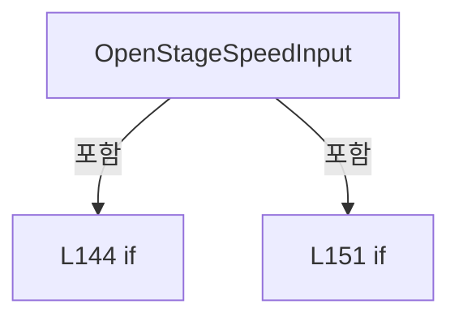

변경 전 점검: 입력/반환 타입, 위 호출자, 예외/취소 경로, 공유 상태와 저장·전송 소비자를 함께 확인합니다. 값의 단위나 물리 방향을 이름만으로 확정하지 않습니다.

## 구문·바인딩 한계

전체 WPF/벤더 SDK/프로젝트별 빌드 조건을 로드한 정식 빌드가 아닙니다. `resolved`는 이 부분 컴파일에서의 심볼 연결이며 virtual/interface/delegate/이벤트/Reflection/XAML의 실제 런타임 구현을 확정하지 않습니다. `candidate`와 `unresolved`는 후속 확인 대상으로 남깁니다.

## 원문 전체 주석 해설본

[원본 모든 행과 행별 해설 보기](../../../annotated/Drilling.UI/Views/CManualView.xaml.cs.annotated.txt)

원본을 빠뜨리거나 임의로 줄이지 않았습니다. `L000001 |` 표시는 원본 행 번호, `// 해설`은 별도 설명입니다. 실행용 소스가 아닌 문서입니다.

## 수정·재검증 체크

- 원본 Commit과 현재 작업 파일 SHA가 같은지 먼저 확인합니다. 다르면 이 문서를 과거 버전 자료로 취급합니다.
- 선언·직접 호출·이벤트/인터페이스 경계·설정 소비를 함께 확인합니다. 정적 연결의 빈 곳을 정상 경로로 추정하지 않습니다.
- 저장 형식/단위/식별자·재시도·취소·예외·롤백에 영향을 주는 변경은 상세 해설장과 호출자를 다시 검토합니다.
- 도구의 구문 추출과 별도 정적 추적 해설, 실제 빌드·시뮬레이션·실장비 검증 결과를 분리합니다.
