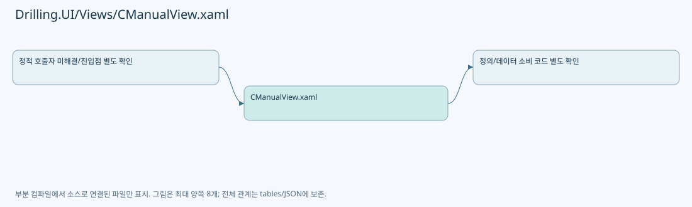

# Drilling.UI/Views/CManualView.xaml

| 항목 | 내용 |
| --- | --- |
| 원본 저장소 | https://github.com/kjuws10-rgb/A3Drilling.git |
| 원본 Commit | 5aee8e58439c9b455cae7c9593c9be986c3e682e |
| 원본 SHA256 | 8bdcde89c76247dc25566061c9e1069ae94e3cc886ddc060fc9cc9e20bf0efbd |
| 파일 분류 | code |
| 원본 크기/행 | 139,863 bytes / 1,782 physical lines |
| 인코딩 | utf-8-sig |
| 검토 범위 | 구문/부분 의미 분석에서 추출한 사실. 동작·물리 단위·실장비 합격을 보증하지 않습니다. |
| 원본 링크 | [고정 Commit 원본](https://github.com/kjuws10-rgb/A3Drilling/blob/5aee8e58439c9b455cae7c9593c9be986c3e682e/Drilling.UI/Views/CManualView.xaml) |

## 파일의 역할과 읽는 순서

WPF 화면·사용자 명령·표시 상태를 구성합니다. XAML 이벤트와 코드 비하인드, RootView의 조립 경로를 함께 추적합니다.

## 화면 구성과 코드 비하인드 연결

| 항목 | 추출 값 |
| --- | --- |
| 코드 비하인드 후보 | Drilling.UI/Views/CManualView.xaml.cs |
| 이름 있는 요소 | ToggleButton, Shell, Popup, ManualReviewTab, ManualMofAutomationStatusPanel, ManualMofActionPanel, ManualMofActionBody, ManualMofAlignAvailableBox, ManualMofAlignCompleteBox, ManualMofAlignRequestBox, ManualMofAlignRequestButton, ManualMofAlignCancelButton, ManualMofReadyMoveSection, ManualMofRunSection, ManualMofInterlockState, ManualMofInterlockListButton, ManualMofRunButton, ManualMofStopButton, ManualMofShiftOffsetButton, ManualMofProgress, MofActionBlink, ManualControllerPanel, ManualControllerActions, ManualControllerStatusGrid, ManualMotionPanel, MotionHeadTable, RowBackground, ManualScanPanel, ManualScanActionPanel, ManualScanAutomationStatusPanel, ManualStageReviewPanel, ManualReviewWorkspace |
| 이벤트 개수 | 3 |
| Binding 표현 개수 | 214 |

| 이벤트 | 핸들러 이름 | 해석 |
| --- | --- | --- |
| Click | OpenShiftOffsetDialog | 코드 비하인드/이벤트 라우팅에서 실제 연결 확인 필요 |
| Loaded | FitManualParameterRows | 코드 비하인드/이벤트 라우팅에서 실제 연결 확인 필요 |
| Click | OpenManualParameterInput | 코드 비하인드/이벤트 라우팅에서 실제 연결 확인 필요 |

| Binding 표현 |
| --- |
| Message |
| IsActive |
| IsDropDownOpen, Mode=TwoWay, RelativeSource={RelativeSource TemplatedParent |
| SelectionBoxItem, RelativeSource={RelativeSource AncestorType=ComboBox |
| SelectionBoxItemTemplate, RelativeSource={RelativeSource AncestorType=ComboBox |
| SelectionBoxItemStringFormat, RelativeSource={RelativeSource AncestorType=ComboBox |
| CurrentScreen.IsManualLayout, Converter={StaticResource BooleanToVisibilityConverter |
| CurrentScreen.Manual.SelectManualWorkspaceCommand |
| CurrentScreen.Manual.IsScannerWorkspace |
| CurrentScreen.Manual.SelectManualWorkspaceCommand |
| CurrentScreen.Manual.IsStageVisionWorkspace |
| CurrentScreen.Manual.SelectManualWorkspaceCommand |
| CurrentScreen.Manual.IsReviewWorkspace |
| CurrentScreen.Manual.IsScannerWorkspace, Converter={StaticResource BooleanToVisibilityConverter |
| CurrentScreen.Manual.ShowResetSequenceCommand |
| CurrentScreen.Manual.IsScannerWorkspace, Converter={StaticResource BooleanToVisibilityConverter |
| CurrentScreen.Manual.SelectManualHeadsCommand |
| CurrentScreen.Manual.SelectManualHeadsCommand |
| CurrentScreen.Manual.SelectManualHeadsCommand |
| CurrentScreen.Manual.SelectManualHeadsCommand |
| CurrentScreen.Manual.HeadGroups |
| Title |
| Heads |
| DataContext.CurrentScreen.Manual.SelectHeadCommand, RelativeSource={RelativeSource AncestorType=UserControl |
| HeadNo |
| IsSelected |
| IsSelected |
| HeadName |
| TextBrush |
| CurrentScreen.Manual.IsScannerWorkspace, Converter={StaticResource BooleanToVisibilityConverter |
| CurrentScreen.Manual.SelectManualControlTabCommand |
| CurrentScreen.Manual.IsManualControllerTab |
| CurrentScreen.Manual.SelectManualControlTabCommand |
| CurrentScreen.Manual.IsManualMotionTab |
| CurrentScreen.Manual.SelectManualControlTabCommand |
| CurrentScreen.Manual.IsManualScanTab |
| CurrentScreen.Manual.SelectManualControlTabCommand |
| CurrentScreen.Manual.IsManualPowerMeasureTab |
| CurrentScreen.Manual.SelectManualControlTabCommand |
| CurrentScreen.Manual.IsManualMofTab |
| CurrentScreen.Manual.IsManualMofTab, Converter={StaticResource BooleanToVisibilityConverter |
| CurrentScreen.Manual.MofPreview |
| CurrentScreen.Manual.AutomationControllerStatusItems |
| CurrentScreen.Manual.MofAlign |
| Availability |
| Text |
| Completion |
| Text |
| Request |
| Text |
| RequestCommand |
| CancelRequestCommand |
| CurrentScreen.Manual.MofStage |
| CurrentScreen.Manual.MofRun |
| StateBackground |
| SelectionText |
| State |
| InterlockListCommand |
| SelectionText |
| RunCommand |
| ScriptDirectory |
| StopCommand |
| DataContext, RelativeSource={RelativeSource AncestorType=views:CManualView |
| IsManualShiftOffsetVisible, Converter={StaticResource BooleanToVisibilityConverter |
| ShiftOffsetX, Mode=OneWay |
| ShiftOffsetY, Mode=OneWay |
| CurrentScreen.Manual.MofRun |
| Message |
| Actions |
| Background |
| Detail |
| IsRunning |
| Title |
| State |
| CurrentScreen.Manual.IsManualPowerMeasureTab, Converter={StaticResource BooleanToVisibilityConverter |
| CurrentScreen.Manual.PowerMeasurePanel |
| CurrentScreen.Manual.IsManualControllerTab, Converter={StaticResource BooleanToVisibilityConverter |
| CurrentScreen.Manual.HeadGroups |
| Title |
| DataContext.CurrentScreen.Manual.ResetAutomationControllerCommand, RelativeSource={RelativeSource AncestorType=UserControl |
| DataContext.CurrentScreen.Manual.HomeAutomationControllerAxesCommand, RelativeSource={RelativeSource AncestorType=UserControl |
| DataContext.CurrentScreen.Manual.DisableControllerMofCommand, RelativeSource={RelativeSource AncestorType=UserControl |
| DataContext.CurrentScreen.Manual.OpenHomeSpeedSettingsCommand, RelativeSource={RelativeSource AncestorType=UserControl |
| CurrentScreen.Manual.ManualControllerHeads.Count |
| CurrentScreen.Manual.ManualControllerHeads |
| HeadName |
| Axes |
| IsControlEnabled |
| AxisReference |
| Enable |
| EnableBrush |
| Home |
| HomeBrush |
| FaultBrush |
| FaultDetail |
| FaultState |
| FaultState |
| DataContext.CurrentScreen.Manual.ScannerAxisHomeCommand, RelativeSource={RelativeSource AncestorType=UserControl |
| DataContext.CurrentScreen.Manual.ScannerAxisEnableCommand, RelativeSource={RelativeSource AncestorType=UserControl |
| DataContext.CurrentScreen.Manual.ScannerAxisDisableCommand, RelativeSource={RelativeSource AncestorType=UserControl |
| CanClearFault |
| DataContext.CurrentScreen.Manual.ScannerAxisClearFaultCommand, RelativeSource={RelativeSource AncestorType=UserControl |
| DioBackground |
| DioState |
| ReadDioCommand |
| CanControlDio |
| DioOnCommand |
| CanControlDio |
| DioOffCommand |
| CanControlDio |
| CurrentScreen.Manual.MotionPanel |
| CurrentScreen.Manual.IsManualMotionTab, Converter={StaticResource BooleanToVisibilityConverter |
| CurrentScreen.Manual.ManualControllerHeads |
| CurrentScreen.Manual.MotionPanel.SelectedHead, Mode=TwoWay |
| HeadName |
| XAxis.AxisReference, TargetNullValue=-, FallbackValue=- |
| XAxis.Detail |
| XCurrentPosition |
| XAxis.Detail |
| YAxis.AxisReference, TargetNullValue=-, FallbackValue=- |
| YAxis.Detail |
| YCurrentPosition |
| YAxis.Detail |
| ZAxis.AxisReference, TargetNullValue=-, FallbackValue=- |
| ZAxis.Detail |
| ZCurrentPosition |
| ZAxis.Detail |
| CurrentScreen.Manual.ManualControllerHeads.Count |
| CurrentScreen.Manual.MotionPanel |
| Title |
| Axes |
| CanMove |
| AxisName, StringFormat=ABS {0 |
| AxisName |
| Absolute, Mode=TwoWay, UpdateSourceTrigger=PropertyChanged |
| AbsoluteCommand |
| Axes |
| CanMove |
| AxisName, StringFormat=REL {0 |
| AxisName |
| Relative, Mode=TwoWay, UpdateSourceTrigger=PropertyChanged |
| RelativeCommand |
| Axes |
| CanMove |
| AxisName, StringFormat=JOG {0 |
| AxisName |
| CenterCommand |
| RecipeCommand |
| StopCommand |
| CurrentScreen.Manual.IsManualScanTab, Converter={StaticResource BooleanToVisibilityConverter |
| CurrentScreen.Manual.SettingFiles |
| DataContext.CurrentScreen.Manual.SelectSettingCommand, RelativeSource={RelativeSource AncestorType=UserControl |
| Name |
| IsSelected |
| Name |
| IsSelected |
| CurrentScreen.Manual.PreviousSettingPageCommand |
| CurrentScreen.Manual.SettingFilesPageText |
| CurrentScreen.Manual.NextSettingPageCommand |
| CurrentScreen.Manual.CreateCommand |
| CurrentScreen.Manual.DeleteCommand |
| CurrentScreen.Manual.RenameCommand |
| CurrentScreen.Manual.SaveCommand |
| CurrentScreen.Manual.SettingParameters, NotifyOnTargetUpdated=True |
| Parameter |
| Value |
| UsesSelectionEditor |
| ValueOptions |
| Value, Mode=TwoWay, UpdateSourceTrigger=PropertyChanged |
| UsesSelectionEditor |
| Unit |
| CurrentScreen.Manual.ScanAssignments.Heads |
| HeadName |
| SettingNames |
| SelectedSettingName, Mode=TwoWay, UpdateSourceTrigger=PropertyChanged |
| CurrentScreen.Manual.ScanAssignments.Heads.Count |
| CurrentScreen.Manual.LaserOnCommand |
| CurrentScreen.Manual.LaserOnCommand |
| CurrentScreen.Manual.LaserOffCommand |
| CurrentScreen.Manual.ShapeStartCommand |
| CurrentScreen.Manual.ShapeStartCommand |
| CurrentScreen.Manual.ShapeStopCommand |
| CurrentScreen.Manual.AutomationControllerStatusItems |
| CurrentScreen.Manual.IsManualStageReviewTab, Converter={StaticResource BooleanToVisibilityConverter |
| CurrentScreen.Manual.PowerMeasurePanel.StageMotion |
| CurrentScreen.Manual.IsReviewWorkspace, Converter={StaticResource BooleanToVisibilityConverter |
| CurrentScreen.Manual.IsStageVisionWorkspace, Converter={StaticResource BooleanToVisibilityConverter |
| CurrentScreen.Manual.VisionProtocolEndpoint |
| CurrentScreen.Manual.VisionProtocolRefreshCommand |
| CurrentScreen.Manual.VisionProtocolStatus |
| CurrentScreen.Manual.VisionProtocolKeepAlive |
| CurrentScreen.Manual.VisionProtocolCommands |
| CurrentScreen.Manual.SelectedVisionProtocolCommand, Mode=TwoWay |
| CurrentScreen.Manual.VisionProtocolCommandDescription |
| CurrentScreen.Manual.VisionProtocolIsFlyingReady, Converter={StaticResource BooleanToVisibilityConverter |
| CurrentScreen.Manual.VisionProtocolInspectionType, Mode=TwoWay, UpdateSourceTrigger=PropertyChanged |
| CurrentScreen.Manual.VisionProtocolUsesMarkRows, Converter={StaticResource BooleanToVisibilityConverter |
| CurrentScreen.Manual.VisionProtocolIsFlyingReady, Converter={StaticResource BooleanToVisibilityConverter |
| CurrentScreen.Manual.VisionProtocolMarkRowCountText |
| CurrentScreen.Manual.VisionProtocolAddMarkCommand |
| CurrentScreen.Manual.VisionProtocolRemoveMarkCommand |
| CurrentScreen.Manual.VisionProtocolMarkRows |
| CellNo, Mode=TwoWay, UpdateSourceTrigger=PropertyChanged |
| DoeNo, Mode=TwoWay, UpdateSourceTrigger=PropertyChanged |
| LineNo, Mode=TwoWay, UpdateSourceTrigger=PropertyChanged |
| IndexX, Mode=TwoWay, UpdateSourceTrigger=PropertyChanged |
| IndexY, Mode=TwoWay, UpdateSourceTrigger=PropertyChanged |
| HeadNo, Mode=TwoWay, UpdateSourceTrigger=PropertyChanged |
| CurrentScreen.Manual.VisionProtocolHasNoArguments, Converter={StaticResource BooleanToVisibilityConverter |
| CurrentScreen.Manual.VisionProtocolRequestPreview |
| CurrentScreen.Manual.VisionProtocolRequestPreview |
| CurrentScreen.Manual.VisionProtocolSendCommand |
| CurrentScreen.Manual.VisionProtocolClearLogCommand |
| CurrentScreen.Manual.VisionProtocolLogs |

## 원문 전체 주석 해설본

[원본 모든 행과 행별 해설 보기](../../../annotated/Drilling.UI/Views/CManualView.xaml.annotated.txt)

원본을 빠뜨리거나 임의로 줄이지 않았습니다. `L000001 |` 표시는 원본 행 번호, `// 해설`은 별도 설명입니다. 실행용 소스가 아닌 문서입니다.

## 수정·재검증 체크

- 원본 Commit과 현재 작업 파일 SHA가 같은지 먼저 확인합니다. 다르면 이 문서를 과거 버전 자료로 취급합니다.
- 선언·직접 호출·이벤트/인터페이스 경계·설정 소비를 함께 확인합니다. 정적 연결의 빈 곳을 정상 경로로 추정하지 않습니다.
- 저장 형식/단위/식별자·재시도·취소·예외·롤백에 영향을 주는 변경은 상세 해설장과 호출자를 다시 검토합니다.
- 도구의 구문 추출과 별도 정적 추적 해설, 실제 빌드·시뮬레이션·실장비 검증 결과를 분리합니다.
