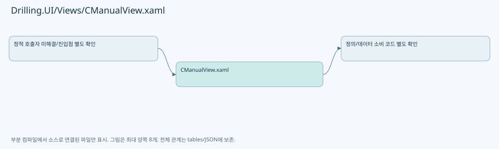

# Drilling.UI/Views/CManualView.xaml

| 항목 | 내용 |
| --- | --- |
| 원본 저장소 | https://github.com/kjuws10-rgb/A3Drilling.git |
| 원본 Commit | dfa5920e6301d9ec4b0eab1452ae59521aafc986 |
| 원본 SHA256 | 1d9c373bb067bfd0107e333fafc3f93a79cb663f7ff4027731db20f99eb768f8 |
| 파일 분류 | code |
| 원본 크기/행 | 138,519 bytes / 1,764 physical lines |
| 인코딩 | utf-8-sig |
| 검토 범위 | 구문/부분 의미 분석에서 추출한 사실. 동작·물리 단위·실장비 합격을 보증하지 않습니다. |
| 원본 링크 | [고정 Commit 원본](https://github.com/kjuws10-rgb/A3Drilling/blob/dfa5920e6301d9ec4b0eab1452ae59521aafc986/Drilling.UI/Views/CManualView.xaml) |

## 파일의 역할과 읽는 순서

WPF 화면·사용자 명령·표시 상태를 구성합니다. XAML 이벤트와 코드 비하인드, RootView의 조립 경로를 함께 추적합니다.

## 화면 구성과 코드 비하인드 연결

| 항목 | 추출 값 |
| --- | --- |
| 코드 비하인드 후보 | Drilling.UI/Views/CManualView.xaml.cs |
| 이름 있는 요소 | ToggleButton, Shell, Popup, ManualMofAutomationStatusPanel, ManualMofActionPanel, ManualMofActionBody, ManualMofAlignAvailableBox, ManualMofAlignCompleteBox, ManualMofAlignRequestBox, ManualMofAlignRequestButton, ManualMofAlignCancelButton, ManualMofReadyMoveSection, ManualMofRunSection, ManualMofInterlockState, ManualMofInterlockListButton, ManualMofRunButton, ManualMofStopButton, ManualMofShiftOffsetButton, ManualMofProgress, MofActionBlink, ManualControllerPanel, ManualControllerActions, ManualControllerStatusGrid, ManualMotionPanel, MotionHeadTable, RowBackground, ManualScanPanel, ManualScanActionPanel, ManualScanAutomationStatusPanel, ManualStageReviewPanel |
| 이벤트 개수 | 12 |
| Binding 표현 개수 | 222 |

이름 있는 요소는 WPF가 필드를 생성할 수 있는 XAML 선언입니다. 문서 추출기는 WPF 생성 코드를 만들거나 로드하지 않으므로 C# 원문 멤버 수에 합산하지 않습니다.

| 요소 이름 | 원본 범위 |
| --- | --- |
| ToggleButton | L242–242 |
| Shell | L248–248 |
| Popup | L282–282 |
| ManualMofAutomationStatusPanel | L592–592 |
| ManualMofActionPanel | L597–597 |
| ManualMofActionBody | L608–608 |
| ManualMofAlignAvailableBox | L631–631 |
| ManualMofAlignCompleteBox | L638–638 |
| ManualMofAlignRequestBox | L645–645 |
| ManualMofAlignRequestButton | L658–658 |
| ManualMofAlignCancelButton | L660–660 |
| ManualMofReadyMoveSection | L667–667 |
| ManualMofRunSection | L677–677 |
| ManualMofInterlockState | L693–693 |
| ManualMofInterlockListButton | L700–700 |
| ManualMofRunButton | L704–704 |
| ManualMofStopButton | L706–706 |
| ManualMofShiftOffsetButton | L709–709 |
| ManualMofProgress | L723–723 |
| MofActionBlink | L734–734 |
| ManualControllerPanel | L764–764 |
| ManualControllerActions | L771–771 |
| ManualControllerStatusGrid | L823–823 |
| ManualMotionPanel | L921–921 |
| MotionHeadTable | L940–940 |
| RowBackground | L948–948 |
| ManualScanPanel | L1053–1053 |
| ManualScanActionPanel | L1338–1338 |
| ManualScanAutomationStatusPanel | L1427–1427 |
| ManualStageReviewPanel | L1434–1434 |

| 이벤트 | 핸들러 이름 | 원본 범위 | 해석 |
| --- | --- | --- | --- |
| Click | OpenShiftOffsetDialog | L709–709 | 코드 비하인드/이벤트 라우팅에서 실제 연결 확인 필요 |
| IsVisibleChanged | MotionVisibilityChanged | L921–921 | 코드 비하인드/이벤트 라우팅에서 실제 연결 확인 필요 |
| PreviewMouseLeftButtonDown | OpenTextInput | L1000–1000 | 코드 비하인드/이벤트 라우팅에서 실제 연결 확인 필요 |
| PreviewMouseLeftButtonDown | OpenTextInput | L1014–1014 | 코드 비하인드/이벤트 라우팅에서 실제 연결 확인 필요 |
| PreviewMouseLeftButtonDown | JogPressed | L1029–1029 | 코드 비하인드/이벤트 라우팅에서 실제 연결 확인 필요 |
| PreviewMouseLeftButtonUp | JogReleased | L1029–1029 | 코드 비하인드/이벤트 라우팅에서 실제 연결 확인 필요 |
| PreviewMouseLeftButtonDown | JogPressed | L1031–1031 | 코드 비하인드/이벤트 라우팅에서 실제 연결 확인 필요 |
| PreviewMouseLeftButtonUp | JogReleased | L1031–1031 | 코드 비하인드/이벤트 라우팅에서 실제 연결 확인 필요 |
| Loaded | FitManualParameterRows | L1188–1188 | 코드 비하인드/이벤트 라우팅에서 실제 연결 확인 필요 |
| SizeChanged | FitManualParameterRows | L1189–1189 | 코드 비하인드/이벤트 라우팅에서 실제 연결 확인 필요 |
| TargetUpdated | FitManualParameterRows | L1190–1190 | 코드 비하인드/이벤트 라우팅에서 실제 연결 확인 필요 |
| Click | OpenManualParameterInput | L1218–1218 | 코드 비하인드/이벤트 라우팅에서 실제 연결 확인 필요 |

| Binding 표현 | 원본 범위 |
| --- | --- |
| {Binding Message} | L124–124 |
| {Binding IsActive} | L126–126 |
| {Binding IsDropDownOpen, Mode=TwoWay, RelativeSource={RelativeSource TemplatedParent}} | L245–245 |
| {Binding SelectionBoxItem, RelativeSource={RelativeSource AncestorType=ComboBox}} | L261–261 |
| {Binding SelectionBoxItemTemplate, RelativeSource={RelativeSource AncestorType=ComboBox}} | L262–262 |
| {Binding SelectionBoxItemStringFormat, RelativeSource={RelativeSource AncestorType=ComboBox}} | L263–263 |
| {Binding CurrentScreen.IsManualLayout, Converter={StaticResource BooleanToVisibilityConverter}} | L310–310 |
| {Binding CurrentScreen.Manual.SelectManualWorkspaceCommand} | L337–337 |
| {Binding CurrentScreen.Manual.IsScannerWorkspace} | L343–343 |
| {Binding CurrentScreen.Manual.SelectManualWorkspaceCommand} | L355–355 |
| {Binding CurrentScreen.Manual.IsStageVisionWorkspace} | L360–360 |
| {Binding CurrentScreen.Manual.IsScannerWorkspace, Converter={StaticResource BooleanToVisibilityConverter}} | L375–375 |
| {Binding CurrentScreen.Manual.ShowResetSequenceCommand} | L376–376 |
| {Binding CurrentScreen.Manual.IsScannerWorkspace, Converter={StaticResource BooleanToVisibilityConverter}} | L383–383 |
| {Binding CurrentScreen.Manual.SelectManualHeadsCommand} | L396–396 |
| {Binding CurrentScreen.Manual.SelectManualHeadsCommand} | L397–397 |
| {Binding CurrentScreen.Manual.SelectManualHeadsCommand} | L398–398 |
| {Binding CurrentScreen.Manual.SelectManualHeadsCommand} | L399–399 |
| {Binding CurrentScreen.Manual.HeadGroups} | L403–403 |
| {Binding Title} | L424–424 |
| {Binding Heads} | L432–432 |
| {Binding DataContext.CurrentScreen.Manual.SelectHeadCommand, RelativeSource={RelativeSource AncestorType=UserControl}} | L440–440 |
| {Binding HeadNo} | L441–441 |
| {Binding IsSelected} | L452–452 |
| {Binding IsSelected} | L475–475 |
| {Binding HeadName} | L482–482 |
| {Binding TextBrush} | L484–484 |
| {Binding CurrentScreen.Manual.IsScannerWorkspace, Converter={StaticResource BooleanToVisibilityConverter}} | L505–505 |
| {Binding CurrentScreen.Manual.SelectManualControlTabCommand} | L512–512 |
| {Binding CurrentScreen.Manual.IsManualControllerTab} | L516–516 |
| {Binding CurrentScreen.Manual.SelectManualControlTabCommand} | L526–526 |
| {Binding CurrentScreen.Manual.IsManualMotionTab} | L530–530 |
| {Binding CurrentScreen.Manual.SelectManualControlTabCommand} | L540–540 |
| {Binding CurrentScreen.Manual.IsManualScanTab} | L544–544 |
| {Binding CurrentScreen.Manual.SelectManualControlTabCommand} | L554–554 |
| {Binding CurrentScreen.Manual.IsManualPowerMeasureTab} | L558–558 |
| {Binding CurrentScreen.Manual.SelectManualControlTabCommand} | L568–568 |
| {Binding CurrentScreen.Manual.IsManualMofTab} | L572–572 |
| {Binding CurrentScreen.Manual.IsManualMofTab, Converter={StaticResource BooleanToVisibilityConverter}} | L583–583 |
| {Binding CurrentScreen.Manual.MofPreview} | L591–591 |
| {Binding CurrentScreen.Manual.AutomationControllerStatusItems} | L594–594 |
| {Binding CurrentScreen.Manual.MofAlign} | L620–620 |
| {Binding Availability} | L631–631 |
| {Binding Text} | L635–635 |
| {Binding Completion} | L638–638 |
| {Binding Text} | L642–642 |
| {Binding Request} | L645–645 |
| {Binding Text} | L649–649 |
| {Binding RequestCommand} | L659–659 |
| {Binding CancelRequestCommand} | L661–661 |
| {Binding CurrentScreen.Manual.MofStage} | L674–674 |
| {Binding CurrentScreen.Manual.MofRun} | L683–683 |
| {Binding StateBackground} | L693–693 |
| {Binding SelectionText} | L694–694 |
| {Binding State} | L697–697 |
| {Binding InterlockListCommand} | L701–701 |
| {Binding SelectionText} | L702–702 |
| {Binding RunCommand} | L705–705 |
| {Binding ScriptDirectory} | L705–705 |
| {Binding StopCommand} | L707–707 |
| {Binding DataContext, RelativeSource={RelativeSource AncestorType=views:CManualView}} | L710–710 |
| {Binding IsManualShiftOffsetVisible, Converter={StaticResource BooleanToVisibilityConverter}} | L712–712 |
| {Binding ShiftOffsetX, Mode=OneWay} | L716–716 |
| {Binding ShiftOffsetY, Mode=OneWay} | L718–718 |
| {Binding CurrentScreen.Manual.MofRun} | L723–723 |
| {Binding Message} | L723–723 |
| {Binding Actions} | L724–724 |
| {Binding Background} | L728–728 |
| {Binding Detail} | L728–728 |
| {Binding IsRunning} | L732–732 |
| {Binding Title} | L745–745 |
| {Binding State} | L746–746 |
| {Binding CurrentScreen.Manual.IsManualPowerMeasureTab, Converter={StaticResource BooleanToVisibilityConverter}} | L760–760 |
| {Binding CurrentScreen.Manual.PowerMeasurePanel} | L761–761 |
| {Binding CurrentScreen.Manual.IsManualControllerTab, Converter={StaticResource BooleanToVisibilityConverter}} | L765–765 |
| {Binding CurrentScreen.Manual.HeadGroups} | L771–771 |
| {Binding Title} | L781–781 |
| {Binding DataContext.CurrentScreen.Manual.ResetAutomationControllerCommand, RelativeSource={RelativeSource AncestorType=UserControl}} | L793–793 |
| {Binding} | L794–794 |
| {Binding DataContext.CurrentScreen.Manual.HomeAutomationControllerAxesCommand, RelativeSource={RelativeSource AncestorType=UserControl}} | L798–798 |
| {Binding} | L799–799 |
| {Binding DataContext.CurrentScreen.Manual.DisableControllerMofCommand, RelativeSource={RelativeSource AncestorType=UserControl}} | L803–803 |
| {Binding} | L804–804 |
| {Binding DataContext.CurrentScreen.Manual.OpenHomeSpeedSettingsCommand, RelativeSource={RelativeSource AncestorType=UserControl}} | L807–807 |
| {Binding} | L808–808 |
| {Binding CurrentScreen.Manual.ManualControllerHeads.Count} | L819–819 |
| {Binding CurrentScreen.Manual.ManualControllerHeads} | L826–826 |
| {Binding HeadName} | L855–855 |
| {Binding Axes} | L867–867 |
| {Binding IsControlEnabled} | L874–874 |
| {Binding AxisReference} | L879–879 |
| {Binding Enable} | L880–880 |
| {Binding EnableBrush} | L880–880 |
| {Binding Home} | L881–881 |
| {Binding HomeBrush} | L881–881 |
| {Binding FaultBrush} | L882–882 |
| {Binding FaultDetail} | L882–882 |
| {Binding FaultState} | L885–885 |
| {Binding FaultState} | L886–886 |
| {Binding DataContext.CurrentScreen.Manual.ScannerAxisHomeCommand, RelativeSource={RelativeSource AncestorType=UserControl}} | L890–890 |
| {Binding} | L890–890 |
| {Binding DataContext.CurrentScreen.Manual.ScannerAxisEnableCommand, RelativeSource={RelativeSource AncestorType=UserControl}} | L891–891 |
| {Binding} | L891–891 |
| {Binding DataContext.CurrentScreen.Manual.ScannerAxisDisableCommand, RelativeSource={RelativeSource AncestorType=UserControl}} | L892–892 |
| {Binding} | L892–892 |
| {Binding CanClearFault} | L893–893 |
| {Binding DataContext.CurrentScreen.Manual.ScannerAxisClearFaultCommand, RelativeSource={RelativeSource AncestorType=UserControl}} | L893–893 |
| {Binding} | L893–893 |
| {Binding DioBackground} | L905–905 |
| {Binding DioState} | L906–906 |
| {Binding ReadDioCommand} | L908–908 |
| {Binding CanControlDio} | L908–908 |
| {Binding DioOnCommand} | L909–909 |
| {Binding CanControlDio} | L909–909 |
| {Binding DioOffCommand} | L910–910 |
| {Binding CanControlDio} | L910–910 |
| {Binding CurrentScreen.Manual.MotionPanel} | L921–921 |
| {Binding CurrentScreen.Manual.IsManualMotionTab, Converter={StaticResource BooleanToVisibilityConverter}} | L923–923 |
| {Binding CurrentScreen.Manual.ManualControllerHeads} | L940–940 |
| {Binding CurrentScreen.Manual.MotionPanel.SelectedHead, Mode=TwoWay} | L941–941 |
| {Binding HeadName} | L966–966 |
| {Binding XAxis.AxisReference, TargetNullValue=-, FallbackValue=-} | L967–967 |
| {Binding XAxis.Detail} | L967–967 |
| {Binding XCurrentPosition} | L968–968 |
| {Binding XAxis.Detail} | L968–968 |
| {Binding YAxis.AxisReference, TargetNullValue=-, FallbackValue=-} | L969–969 |
| {Binding YAxis.Detail} | L969–969 |
| {Binding YCurrentPosition} | L970–970 |
| {Binding YAxis.Detail} | L970–970 |
| {Binding ZAxis.AxisReference, TargetNullValue=-, FallbackValue=-} | L971–971 |
| {Binding ZAxis.Detail} | L971–971 |
| {Binding ZCurrentPosition} | L972–972 |
| {Binding ZAxis.Detail} | L972–972 |
| {Binding CurrentScreen.Manual.ManualControllerHeads.Count} | L982–982 |
| {Binding CurrentScreen.Manual.MotionPanel} | L988–988 |
| {Binding Title} | L990–990 |
| {Binding Axes} | L996–996 |
| {Binding CanMove} | L997–997 |
| {Binding AxisName, StringFormat=ABS {0}} | L999–999 |
| {Binding AxisName} | L999–999 |
| {Binding Absolute, Mode=TwoWay, UpdateSourceTrigger=PropertyChanged} | L1000–1000 |
| {Binding AbsoluteCommand} | L1001–1001 |
| {Binding Axes} | L1010–1010 |
| {Binding CanMove} | L1011–1011 |
| {Binding AxisName, StringFormat=REL {0}} | L1013–1013 |
| {Binding AxisName} | L1013–1013 |
| {Binding Relative, Mode=TwoWay, UpdateSourceTrigger=PropertyChanged} | L1014–1014 |
| {Binding RelativeCommand} | L1015–1015 |
| {Binding Axes} | L1024–1024 |
| {Binding CanMove} | L1025–1025 |
| {Binding AxisName, StringFormat=JOG {0}} | L1027–1027 |
| {Binding AxisName} | L1027–1027 |
| {Binding CenterCommand} | L1038–1038 |
| {Binding RecipeCommand} | L1039–1039 |
| {Binding StopCommand} | L1040–1040 |
| {Binding CurrentScreen.Manual.IsManualScanTab, Converter={StaticResource BooleanToVisibilityConverter}} | L1048–1048 |
| {Binding CurrentScreen.Manual.SettingFiles} | L1088–1088 |
| {Binding DataContext.CurrentScreen.Manual.SelectSettingCommand, RelativeSource={RelativeSource AncestorType=UserControl}} | L1091–1091 |
| {Binding Name} | L1092–1092 |
| {Binding IsSelected} | L1100–1100 |
| {Binding Name} | L1106–1106 |
| {Binding IsSelected} | L1110–1110 |
| {Binding CurrentScreen.Manual.PreviousSettingPageCommand} | L1134–1134 |
| {Binding CurrentScreen.Manual.SettingFilesPageText} | L1140–1140 |
| {Binding CurrentScreen.Manual.NextSettingPageCommand} | L1148–1148 |
| {Binding CurrentScreen.Manual.CreateCommand} | L1160–1160 |
| {Binding CurrentScreen.Manual.DeleteCommand} | L1165–1165 |
| {Binding CurrentScreen.Manual.RenameCommand} | L1170–1170 |
| {Binding CurrentScreen.Manual.SaveCommand} | L1175–1175 |
| {Binding CurrentScreen.Manual.SettingParameters, NotifyOnTargetUpdated=True} | L1187–1187 |
| {Binding Parameter} | L1204–1204 |
| {Binding Value} | L1217–1217 |
| {Binding UsesSelectionEditor} | L1230–1230 |
| {Binding ValueOptions} | L1237–1237 |
| {Binding Value, Mode=TwoWay, UpdateSourceTrigger=PropertyChanged} | L1238–1238 |
| {Binding} | L1247–1247 |
| {Binding UsesSelectionEditor} | L1254–1254 |
| {Binding Unit} | L1265–1265 |
| {Binding CurrentScreen.Manual.ScanAssignments.Heads} | L1287–1287 |
| {Binding HeadName} | L1300–1300 |
| {Binding SettingNames} | L1306–1306 |
| {Binding SelectedSettingName, Mode=TwoWay, UpdateSourceTrigger=PropertyChanged} | L1307–1307 |
| {Binding} | L1314–1314 |
| {Binding CurrentScreen.Manual.ScanAssignments.Heads.Count} | L1329–1329 |
| {Binding CurrentScreen.Manual.LaserOnCommand} | L1357–1357 |
| {Binding CurrentScreen.Manual.LaserOnCommand} | L1367–1367 |
| {Binding CurrentScreen.Manual.LaserOffCommand} | L1377–1377 |
| {Binding CurrentScreen.Manual.ShapeStartCommand} | L1398–1398 |
| {Binding CurrentScreen.Manual.ShapeStartCommand} | L1408–1408 |
| {Binding CurrentScreen.Manual.ShapeStopCommand} | L1418–1418 |
| {Binding CurrentScreen.Manual.AutomationControllerStatusItems} | L1429–1429 |
| {Binding CurrentScreen.Manual.IsManualStageReviewTab, Converter={StaticResource BooleanToVisibilityConverter}} | L1435–1435 |
| {Binding CurrentScreen.Manual.PowerMeasurePanel.StageMotion} | L1438–1438 |
| {Binding CurrentScreen.Manual.IsStageVisionWorkspace, Converter={StaticResource BooleanToVisibilityConverter}} | L1444–1444 |
| {Binding CurrentScreen.Manual.VisionProtocolEndpoint} | L1490–1490 |
| {Binding CurrentScreen.Manual.VisionProtocolRefreshCommand} | L1497–1497 |
| {Binding CurrentScreen.Manual.VisionProtocolStatus} | L1505–1505 |
| {Binding CurrentScreen.Manual.VisionProtocolKeepAlive} | L1516–1516 |
| {Binding CurrentScreen.Manual.VisionProtocolCommands} | L1540–1540 |
| {Binding CurrentScreen.Manual.SelectedVisionProtocolCommand, Mode=TwoWay} | L1541–1541 |
| {Binding CurrentScreen.Manual.VisionProtocolCommandDescription} | L1552–1552 |
| {Binding CurrentScreen.Manual.VisionProtocolIsFlyingReady, Converter={StaticResource BooleanToVisibilityConverter}} | L1560–1560 |
| {Binding CurrentScreen.Manual.VisionProtocolInspectionType, Mode=TwoWay, UpdateSourceTrigger=PropertyChanged} | L1571–1571 |
| {Binding CurrentScreen.Manual.VisionProtocolUsesMarkRows, Converter={StaticResource BooleanToVisibilityConverter}} | L1585–1585 |
| {Binding CurrentScreen.Manual.VisionProtocolIsFlyingReady, Converter={StaticResource BooleanToVisibilityConverter}} | L1603–1603 |
| {Binding CurrentScreen.Manual.VisionProtocolMarkRowCountText} | L1604–1604 |
| {Binding CurrentScreen.Manual.VisionProtocolAddMarkCommand} | L1609–1609 |
| {Binding CurrentScreen.Manual.VisionProtocolRemoveMarkCommand} | L1616–1616 |
| {Binding CurrentScreen.Manual.VisionProtocolMarkRows} | L1645–1645 |
| {Binding CellNo, Mode=TwoWay, UpdateSourceTrigger=PropertyChanged} | L1657–1657 |
| {Binding DoeNo, Mode=TwoWay, UpdateSourceTrigger=PropertyChanged} | L1658–1658 |
| {Binding LineNo, Mode=TwoWay, UpdateSourceTrigger=PropertyChanged} | L1659–1659 |
| {Binding IndexX, Mode=TwoWay, UpdateSourceTrigger=PropertyChanged} | L1660–1660 |
| {Binding IndexY, Mode=TwoWay, UpdateSourceTrigger=PropertyChanged} | L1661–1661 |
| {Binding HeadNo, Mode=TwoWay, UpdateSourceTrigger=PropertyChanged} | L1662–1662 |
| {Binding CurrentScreen.Manual.VisionProtocolHasNoArguments, Converter={StaticResource BooleanToVisibilityConverter}} | L1681–1681 |
| {Binding CurrentScreen.Manual.VisionProtocolRequestPreview} | L1702–1702 |
| {Binding CurrentScreen.Manual.VisionProtocolRequestPreview} | L1708–1708 |
| {Binding CurrentScreen.Manual.VisionProtocolSendCommand} | L1712–1712 |
| {Binding CurrentScreen.Manual.VisionProtocolClearLogCommand} | L1730–1730 |
| {Binding CurrentScreen.Manual.VisionProtocolLogs} | L1741–1741 |
| {Binding} | L1751–1751 |

## 원문 전체 주석 해설본

[원본 모든 행과 행별 해설 보기](../../../annotated/Drilling.UI/Views/CManualView.xaml.annotated.txt)

원본을 빠뜨리거나 임의로 줄이지 않았습니다. `L000001 |` 표시는 원본 행 번호, `// 해설`은 별도 설명입니다. 실행용 소스가 아닌 문서입니다.

## 수정·재검증 체크

- 원본 Commit과 현재 작업 파일 SHA가 같은지 먼저 확인합니다. 다르면 이 문서를 과거 버전 자료로 취급합니다.
- 선언·직접 호출·이벤트/인터페이스 경계·설정 소비를 함께 확인합니다. 정적 연결의 빈 곳을 정상 경로로 추정하지 않습니다.
- 저장 형식/단위/식별자·재시도·취소·예외·롤백에 영향을 주는 변경은 상세 해설장과 호출자를 다시 검토합니다.
- 도구의 구문 추출과 별도 정적 추적 해설, 실제 빌드·시뮬레이션·실장비 검증 결과를 분리합니다.
