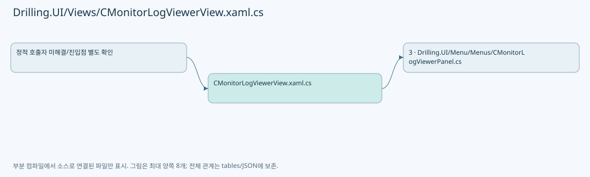
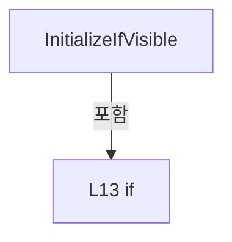
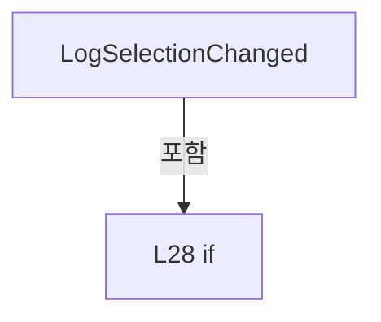
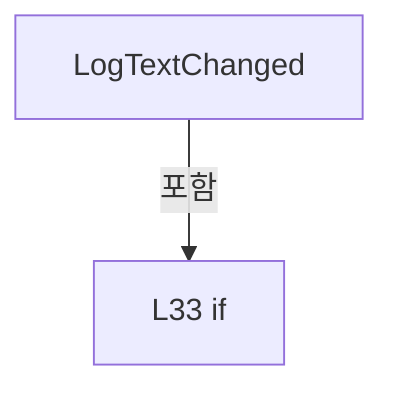

# Drilling.UI/Views/CMonitorLogViewerView.xaml.cs

| 항목 | 내용 |
| --- | --- |
| 원본 저장소 | https://github.com/kjuws10-rgb/A3Drilling.git |
| 원본 Commit | 5aee8e58439c9b455cae7c9593c9be986c3e682e |
| 원본 SHA256 | e1096238698282a8761bea6faa05dce66d1728abe81ffbb1573c716730538094 |
| 파일 분류 | code |
| 원본 크기/행 | 1,489 bytes / 37 physical lines |
| 인코딩 | utf-8-sig |
| 검토 범위 | 구문/부분 의미 분석에서 추출한 사실. 동작·물리 단위·실장비 합격을 보증하지 않습니다. |
| 원본 링크 | [고정 Commit 원본](https://github.com/kjuws10-rgb/A3Drilling/blob/5aee8e58439c9b455cae7c9593c9be986c3e682e/Drilling.UI/Views/CMonitorLogViewerView.xaml.cs) |

## 파일의 역할과 읽는 순서

WPF 화면·사용자 명령·표시 상태를 구성합니다. XAML 이벤트와 코드 비하인드, RootView의 조립 경로를 함께 추적합니다.

## 네임스페이스·타입·상속

| 타입 | 구분 | 원본 범위 | 선언/상속 |
| --- | --- | --- | --- |
| CMonitorLogViewerView | ClassDeclaration | 7–37 | CMonitorLogViewerView: UserControl |

## 멤버 빠른 목록

| 이름 | 종류 | 범위 | 서명 |
| --- | --- | --- | --- |
| .ctor | ConstructorDeclaration | L9–9 | Drilling.UI.Views.CMonitorLogViewerView.CMonitorLogViewerView() |
| InitializeIfVisible | MethodDeclaration | L11–14 | System.Threading.Tasks.Task Drilling.UI.Views.CMonitorLogViewerView.InitializeIfVisible() |
| ViewLoaded | MethodDeclaration | L16–16 | void Drilling.UI.Views.CMonitorLogViewerView.ViewLoaded(object, RoutedEventArgs) |
| ViewVisibilityChanged | MethodDeclaration | L17–17 | void Drilling.UI.Views.CMonitorLogViewerView.ViewVisibilityChanged(object, DependencyPropertyChangedEventArgs) |
| ViewDataContextChanged | MethodDeclaration | L18–18 | void Drilling.UI.Views.CMonitorLogViewerView.ViewDataContextChanged(object, DependencyPropertyChangedEventArgs) |
| FolderExpanded | MethodDeclaration | L20–24 | void Drilling.UI.Views.CMonitorLogViewerView.FolderExpanded(object, RoutedEventArgs) |
| LogSelectionChanged | MethodDeclaration | L26–29 | void Drilling.UI.Views.CMonitorLogViewerView.LogSelectionChanged(object, RoutedPropertyChangedEventArgs<object>) |
| LogTextChanged | MethodDeclaration | L31–36 | void Drilling.UI.Views.CMonitorLogViewerView.LogTextChanged(object, TextChangedEventArgs) |

## 멤버별 상세 계약·호출·처리 해설

### ConstructorDeclaration `.ctor` · L9–9

[Drilling.UI/Views/CMonitorLogViewerView.xaml.cs:9–9](https://github.com/kjuws10-rgb/A3Drilling/blob/5aee8e58439c9b455cae7c9593c9be986c3e682e/Drilling.UI/Views/CMonitorLogViewerView.xaml.cs#L9-L9)

| 항목 | 실제 추출 값 |
| --- | --- |
| 서명 | Drilling.UI.Views.CMonitorLogViewerView.CMonitorLogViewerView() |
| 접근/수식자 | Public / public |
| 반환/값 타입 | void |
| 소속 타입 | NamedType:Drilling.UI.Views.CMonitorLogViewerView |

현재 부분 분석에서 직접 연결된 호출자는 없습니다. XAML/이벤트/인터페이스·델리게이트·외부 진입을 추가 확인해야 하며, 미사용으로 판정한 것이 아닙니다.

호출하는 대상과 해석 범위:

| 원본 행 | 표현식 | 분석 상태 | 대상/소스 위치 |
| --- | --- | --- | --- |
| 9 | InitializeComponent | unresolved | None |

본문의 실제 연산·분기·예외·반환 순서(원문 위치 순):

| 원본 행 | 종류 | 주석 해설 |
| --- | --- | --- |
| 9 | call | 함수·델리게이트 또는 객체 생성자를 호출합니다: InitializeComponent() |

변경 전 점검: 입력/반환 타입, 위 호출자, 예외/취소 경로, 공유 상태와 저장·전송 소비자를 함께 확인합니다. 값의 단위나 물리 방향을 이름만으로 확정하지 않습니다.

### MethodDeclaration `InitializeIfVisible` · L11–14

[Drilling.UI/Views/CMonitorLogViewerView.xaml.cs:11–14](https://github.com/kjuws10-rgb/A3Drilling/blob/5aee8e58439c9b455cae7c9593c9be986c3e682e/Drilling.UI/Views/CMonitorLogViewerView.xaml.cs#L11-L14)

| 항목 | 실제 추출 값 |
| --- | --- |
| 서명 | System.Threading.Tasks.Task Drilling.UI.Views.CMonitorLogViewerView.InitializeIfVisible() |
| 접근/수식자 | Private / private, async |
| 반환/값 타입 | System.Threading.Tasks.Task |
| 소속 타입 | NamedType:Drilling.UI.Views.CMonitorLogViewerView |

정적 호출자로 확인된 위치:

| 호출 파일/행 | 호출 표현식 | 런타임 분기 가능 |
| --- | --- | --- |
| [Drilling.UI/Views/CMonitorLogViewerView.xaml.cs:16–16](https://github.com/kjuws10-rgb/A3Drilling/blob/5aee8e58439c9b455cae7c9593c9be986c3e682e/Drilling.UI/Views/CMonitorLogViewerView.xaml.cs#L16-L16) | InitializeIfVisible | False |
| [Drilling.UI/Views/CMonitorLogViewerView.xaml.cs:17–17](https://github.com/kjuws10-rgb/A3Drilling/blob/5aee8e58439c9b455cae7c9593c9be986c3e682e/Drilling.UI/Views/CMonitorLogViewerView.xaml.cs#L17-L17) | InitializeIfVisible | False |
| [Drilling.UI/Views/CMonitorLogViewerView.xaml.cs:18–18](https://github.com/kjuws10-rgb/A3Drilling/blob/5aee8e58439c9b455cae7c9593c9be986c3e682e/Drilling.UI/Views/CMonitorLogViewerView.xaml.cs#L18-L18) | InitializeIfVisible | False |

호출하는 대상과 해석 범위:

| 원본 행 | 표현식 | 분석 상태 | 대상/소스 위치 |
| --- | --- | --- | --- |
| 13 | panel.InitializeAsync | resolved | System.Threading.Tasks.Task Drilling.UI.Menu.Menus.CMonitorLogViewerPanel.InitializeAsync() · Drilling.UI/Menu/Menus/CMonitorLogViewerPanel.cs:44 |

본문의 실제 연산·분기·예외·반환 순서(원문 위치 순):

| 원본 행 | 종류 | 주석 해설 |
| --- | --- | --- |
| 13 | await | 비동기 완료를 기다립니다: await panel.InitializeAsync() |
| 13 | call | 함수·델리게이트 또는 객체 생성자를 호출합니다: panel.InitializeAsync() |
| 13 | if | 조건에 따라 분기합니다: if (IsVisible && DataContext is CMonitorLogViewerPanel panel) |

제어 구문의 포함 구조(실제 실행 순서/CFG가 아닌 구문 탐색 그림):

변경 전 점검: 입력/반환 타입, 위 호출자, 예외/취소 경로, 공유 상태와 저장·전송 소비자를 함께 확인합니다. 값의 단위나 물리 방향을 이름만으로 확정하지 않습니다.

### MethodDeclaration `ViewLoaded` · L16–16

[Drilling.UI/Views/CMonitorLogViewerView.xaml.cs:16–16](https://github.com/kjuws10-rgb/A3Drilling/blob/5aee8e58439c9b455cae7c9593c9be986c3e682e/Drilling.UI/Views/CMonitorLogViewerView.xaml.cs#L16-L16)

| 항목 | 실제 추출 값 |
| --- | --- |
| 서명 | void Drilling.UI.Views.CMonitorLogViewerView.ViewLoaded(object, RoutedEventArgs) |
| 접근/수식자 | Private / private, async |
| 반환/값 타입 | void |
| 소속 타입 | NamedType:Drilling.UI.Views.CMonitorLogViewerView |

입력 계약:

| 이름 | 타입 | 전달 | 선택/기본값 |
| --- | --- | --- | --- |
| sender | object | None | False /  |
| e | RoutedEventArgs | None | False /  |

현재 부분 분석에서 직접 연결된 호출자는 없습니다. XAML/이벤트/인터페이스·델리게이트·외부 진입을 추가 확인해야 하며, 미사용으로 판정한 것이 아닙니다.

호출하는 대상과 해석 범위:

| 원본 행 | 표현식 | 분석 상태 | 대상/소스 위치 |
| --- | --- | --- | --- |
| 16 | InitializeIfVisible | resolved | System.Threading.Tasks.Task Drilling.UI.Views.CMonitorLogViewerView.InitializeIfVisible() · Drilling.UI/Views/CMonitorLogViewerView.xaml.cs:11 |

본문의 실제 연산·분기·예외·반환 순서(원문 위치 순):

| 원본 행 | 종류 | 주석 해설 |
| --- | --- | --- |
| 16 | await | 비동기 완료를 기다립니다: await InitializeIfVisible() |
| 16 | call | 함수·델리게이트 또는 객체 생성자를 호출합니다: InitializeIfVisible() |

변경 전 점검: 입력/반환 타입, 위 호출자, 예외/취소 경로, 공유 상태와 저장·전송 소비자를 함께 확인합니다. 값의 단위나 물리 방향을 이름만으로 확정하지 않습니다.

### MethodDeclaration `ViewVisibilityChanged` · L17–17

[Drilling.UI/Views/CMonitorLogViewerView.xaml.cs:17–17](https://github.com/kjuws10-rgb/A3Drilling/blob/5aee8e58439c9b455cae7c9593c9be986c3e682e/Drilling.UI/Views/CMonitorLogViewerView.xaml.cs#L17-L17)

| 항목 | 실제 추출 값 |
| --- | --- |
| 서명 | void Drilling.UI.Views.CMonitorLogViewerView.ViewVisibilityChanged(object, DependencyPropertyChangedEventArgs) |
| 접근/수식자 | Private / private, async |
| 반환/값 타입 | void |
| 소속 타입 | NamedType:Drilling.UI.Views.CMonitorLogViewerView |

입력 계약:

| 이름 | 타입 | 전달 | 선택/기본값 |
| --- | --- | --- | --- |
| sender | object | None | False /  |
| e | DependencyPropertyChangedEventArgs | None | False /  |

현재 부분 분석에서 직접 연결된 호출자는 없습니다. XAML/이벤트/인터페이스·델리게이트·외부 진입을 추가 확인해야 하며, 미사용으로 판정한 것이 아닙니다.

호출하는 대상과 해석 범위:

| 원본 행 | 표현식 | 분석 상태 | 대상/소스 위치 |
| --- | --- | --- | --- |
| 17 | InitializeIfVisible | resolved | System.Threading.Tasks.Task Drilling.UI.Views.CMonitorLogViewerView.InitializeIfVisible() · Drilling.UI/Views/CMonitorLogViewerView.xaml.cs:11 |

본문의 실제 연산·분기·예외·반환 순서(원문 위치 순):

| 원본 행 | 종류 | 주석 해설 |
| --- | --- | --- |
| 17 | await | 비동기 완료를 기다립니다: await InitializeIfVisible() |
| 17 | call | 함수·델리게이트 또는 객체 생성자를 호출합니다: InitializeIfVisible() |

변경 전 점검: 입력/반환 타입, 위 호출자, 예외/취소 경로, 공유 상태와 저장·전송 소비자를 함께 확인합니다. 값의 단위나 물리 방향을 이름만으로 확정하지 않습니다.

### MethodDeclaration `ViewDataContextChanged` · L18–18

[Drilling.UI/Views/CMonitorLogViewerView.xaml.cs:18–18](https://github.com/kjuws10-rgb/A3Drilling/blob/5aee8e58439c9b455cae7c9593c9be986c3e682e/Drilling.UI/Views/CMonitorLogViewerView.xaml.cs#L18-L18)

| 항목 | 실제 추출 값 |
| --- | --- |
| 서명 | void Drilling.UI.Views.CMonitorLogViewerView.ViewDataContextChanged(object, DependencyPropertyChangedEventArgs) |
| 접근/수식자 | Private / private, async |
| 반환/값 타입 | void |
| 소속 타입 | NamedType:Drilling.UI.Views.CMonitorLogViewerView |

입력 계약:

| 이름 | 타입 | 전달 | 선택/기본값 |
| --- | --- | --- | --- |
| sender | object | None | False /  |
| e | DependencyPropertyChangedEventArgs | None | False /  |

현재 부분 분석에서 직접 연결된 호출자는 없습니다. XAML/이벤트/인터페이스·델리게이트·외부 진입을 추가 확인해야 하며, 미사용으로 판정한 것이 아닙니다.

호출하는 대상과 해석 범위:

| 원본 행 | 표현식 | 분석 상태 | 대상/소스 위치 |
| --- | --- | --- | --- |
| 18 | InitializeIfVisible | resolved | System.Threading.Tasks.Task Drilling.UI.Views.CMonitorLogViewerView.InitializeIfVisible() · Drilling.UI/Views/CMonitorLogViewerView.xaml.cs:11 |

본문의 실제 연산·분기·예외·반환 순서(원문 위치 순):

| 원본 행 | 종류 | 주석 해설 |
| --- | --- | --- |
| 18 | await | 비동기 완료를 기다립니다: await InitializeIfVisible() |
| 18 | call | 함수·델리게이트 또는 객체 생성자를 호출합니다: InitializeIfVisible() |

변경 전 점검: 입력/반환 타입, 위 호출자, 예외/취소 경로, 공유 상태와 저장·전송 소비자를 함께 확인합니다. 값의 단위나 물리 방향을 이름만으로 확정하지 않습니다.

### MethodDeclaration `FolderExpanded` · L20–24

[Drilling.UI/Views/CMonitorLogViewerView.xaml.cs:20–24](https://github.com/kjuws10-rgb/A3Drilling/blob/5aee8e58439c9b455cae7c9593c9be986c3e682e/Drilling.UI/Views/CMonitorLogViewerView.xaml.cs#L20-L24)

| 항목 | 실제 추출 값 |
| --- | --- |
| 서명 | void Drilling.UI.Views.CMonitorLogViewerView.FolderExpanded(object, RoutedEventArgs) |
| 접근/수식자 | Private / private, async |
| 반환/값 타입 | void |
| 소속 타입 | NamedType:Drilling.UI.Views.CMonitorLogViewerView |

입력 계약:

| 이름 | 타입 | 전달 | 선택/기본값 |
| --- | --- | --- | --- |
| sender | object | None | False /  |
| e | RoutedEventArgs | None | False /  |

현재 부분 분석에서 직접 연결된 호출자는 없습니다. XAML/이벤트/인터페이스·델리게이트·외부 진입을 추가 확인해야 하며, 미사용으로 판정한 것이 아닙니다.

호출하는 대상과 해석 범위:

| 원본 행 | 표현식 | 분석 상태 | 대상/소스 위치 |
| --- | --- | --- | --- |
| 23 | panel.ExpandDirectoryAsync | resolved | System.Threading.Tasks.Task Drilling.UI.Menu.Menus.CMonitorLogViewerPanel.ExpandDirectoryAsync(Drilling.UI.Menu.Menus.CLogTreeNode) · Drilling.UI/Menu/Menus/CMonitorLogViewerPanel.cs:45 |

본문의 실제 연산·분기·예외·반환 순서(원문 위치 순):

| 원본 행 | 종류 | 주석 해설 |
| --- | --- | --- |
| 22 | if | 조건에 따라 분기합니다: if (DataContext is CMonitorLogViewerPanel panel && e.OriginalSource is TreeViewItem { DataContext: CLogTreeNode node }) |
| 23 | await | 비동기 완료를 기다립니다: await panel.ExpandDirectoryAsync(node) |
| 23 | call | 함수·델리게이트 또는 객체 생성자를 호출합니다: panel.ExpandDirectoryAsync(node) |

제어 구문의 포함 구조(실제 실행 순서/CFG가 아닌 구문 탐색 그림):

변경 전 점검: 입력/반환 타입, 위 호출자, 예외/취소 경로, 공유 상태와 저장·전송 소비자를 함께 확인합니다. 값의 단위나 물리 방향을 이름만으로 확정하지 않습니다.

### MethodDeclaration `LogSelectionChanged` · L26–29

[Drilling.UI/Views/CMonitorLogViewerView.xaml.cs:26–29](https://github.com/kjuws10-rgb/A3Drilling/blob/5aee8e58439c9b455cae7c9593c9be986c3e682e/Drilling.UI/Views/CMonitorLogViewerView.xaml.cs#L26-L29)

| 항목 | 실제 추출 값 |
| --- | --- |
| 서명 | void Drilling.UI.Views.CMonitorLogViewerView.LogSelectionChanged(object, RoutedPropertyChangedEventArgs<object>) |
| 접근/수식자 | Private / private, async |
| 반환/값 타입 | void |
| 소속 타입 | NamedType:Drilling.UI.Views.CMonitorLogViewerView |

입력 계약:

| 이름 | 타입 | 전달 | 선택/기본값 |
| --- | --- | --- | --- |
| sender | object | None | False /  |
| e | RoutedPropertyChangedEventArgs<object> | None | False /  |

현재 부분 분석에서 직접 연결된 호출자는 없습니다. XAML/이벤트/인터페이스·델리게이트·외부 진입을 추가 확인해야 하며, 미사용으로 판정한 것이 아닙니다.

호출하는 대상과 해석 범위:

| 원본 행 | 표현식 | 분석 상태 | 대상/소스 위치 |
| --- | --- | --- | --- |
| 28 | panel.SelectNodeAsync | resolved | System.Threading.Tasks.Task Drilling.UI.Menu.Menus.CMonitorLogViewerPanel.SelectNodeAsync(Drilling.UI.Menu.Menus.CLogTreeNode?) · Drilling.UI/Menu/Menus/CMonitorLogViewerPanel.cs:46 |

본문의 실제 연산·분기·예외·반환 순서(원문 위치 순):

| 원본 행 | 종류 | 주석 해설 |
| --- | --- | --- |
| 28 | await | 비동기 완료를 기다립니다: await panel.SelectNodeAsync(e.NewValue as CLogTreeNode) |
| 28 | call | 함수·델리게이트 또는 객체 생성자를 호출합니다: panel.SelectNodeAsync(e.NewValue as CLogTreeNode) |
| 28 | if | 조건에 따라 분기합니다: if (DataContext is CMonitorLogViewerPanel panel) |

제어 구문의 포함 구조(실제 실행 순서/CFG가 아닌 구문 탐색 그림):

변경 전 점검: 입력/반환 타입, 위 호출자, 예외/취소 경로, 공유 상태와 저장·전송 소비자를 함께 확인합니다. 값의 단위나 물리 방향을 이름만으로 확정하지 않습니다.

### MethodDeclaration `LogTextChanged` · L31–36

[Drilling.UI/Views/CMonitorLogViewerView.xaml.cs:31–36](https://github.com/kjuws10-rgb/A3Drilling/blob/5aee8e58439c9b455cae7c9593c9be986c3e682e/Drilling.UI/Views/CMonitorLogViewerView.xaml.cs#L31-L36)

| 항목 | 실제 추출 값 |
| --- | --- |
| 서명 | void Drilling.UI.Views.CMonitorLogViewerView.LogTextChanged(object, TextChangedEventArgs) |
| 접근/수식자 | Private / private |
| 반환/값 타입 | void |
| 소속 타입 | NamedType:Drilling.UI.Views.CMonitorLogViewerView |

입력 계약:

| 이름 | 타입 | 전달 | 선택/기본값 |
| --- | --- | --- | --- |
| sender | object | None | False /  |
| e | TextChangedEventArgs | None | False /  |

현재 부분 분석에서 직접 연결된 호출자는 없습니다. XAML/이벤트/인터페이스·델리게이트·외부 진입을 추가 확인해야 하며, 미사용으로 판정한 것이 아닙니다.

호출하는 대상과 해석 범위:

| 원본 행 | 표현식 | 분석 상태 | 대상/소스 위치 |
| --- | --- | --- | --- |
| 34 | text.ScrollToHome | unresolved | None |
| 35 | text.ScrollToHorizontalOffset | unresolved | None |

본문의 실제 연산·분기·예외·반환 순서(원문 위치 순):

| 원본 행 | 종류 | 주석 해설 |
| --- | --- | --- |
| 33 | if | 조건에 따라 분기합니다: if (sender is not TextBox text) |
| 33 | return | 호출자에게 값 또는 제어를 반환합니다: return; |
| 34 | call | 함수·델리게이트 또는 객체 생성자를 호출합니다: text.ScrollToHome() |
| 35 | call | 함수·델리게이트 또는 객체 생성자를 호출합니다: text.ScrollToHorizontalOffset(0) |

제어 구문의 포함 구조(실제 실행 순서/CFG가 아닌 구문 탐색 그림):

변경 전 점검: 입력/반환 타입, 위 호출자, 예외/취소 경로, 공유 상태와 저장·전송 소비자를 함께 확인합니다. 값의 단위나 물리 방향을 이름만으로 확정하지 않습니다.

## 구문·바인딩 한계

전체 WPF/벤더 SDK/프로젝트별 빌드 조건을 로드한 정식 빌드가 아닙니다. `resolved`는 이 부분 컴파일에서의 심볼 연결이며 virtual/interface/delegate/이벤트/Reflection/XAML의 실제 런타임 구현을 확정하지 않습니다. `candidate`와 `unresolved`는 후속 확인 대상으로 남깁니다.

## 원문 전체 주석 해설본

[원본 모든 행과 행별 해설 보기](../../../annotated/Drilling.UI/Views/CMonitorLogViewerView.xaml.cs.annotated.txt)

원본을 빠뜨리거나 임의로 줄이지 않았습니다. `L000001 |` 표시는 원본 행 번호, `// 해설`은 별도 설명입니다. 실행용 소스가 아닌 문서입니다.

## 수정·재검증 체크

- 원본 Commit과 현재 작업 파일 SHA가 같은지 먼저 확인합니다. 다르면 이 문서를 과거 버전 자료로 취급합니다.
- 선언·직접 호출·이벤트/인터페이스 경계·설정 소비를 함께 확인합니다. 정적 연결의 빈 곳을 정상 경로로 추정하지 않습니다.
- 저장 형식/단위/식별자·재시도·취소·예외·롤백에 영향을 주는 변경은 상세 해설장과 호출자를 다시 검토합니다.
- 도구의 구문 추출과 별도 정적 추적 해설, 실제 빌드·시뮬레이션·실장비 검증 결과를 분리합니다.
