# Drilling.UI/Views/CMonitorView.xaml.cs

| 항목 | 내용 |
| --- | --- |
| 원본 저장소 | https://github.com/kjuws10-rgb/A3Drilling.git |
| 원본 Commit | 5aee8e58439c9b455cae7c9593c9be986c3e682e |
| 원본 SHA256 | 0ae841c577d69f7dbbf0b8fae82ff9f890bda1b2b978238aee15e47d8617b625 |
| 파일 분류 | code |
| 원본 크기/행 | 17,927 bytes / 571 physical lines |
| 인코딩 | utf-8-sig |
| 검토 범위 | 구문/부분 의미 분석에서 추출한 사실. 동작·물리 단위·실장비 합격을 보증하지 않습니다. |
| 원본 링크 | [고정 Commit 원본](https://github.com/kjuws10-rgb/A3Drilling/blob/5aee8e58439c9b455cae7c9593c9be986c3e682e/Drilling.UI/Views/CMonitorView.xaml.cs) |

## 파일의 역할과 읽는 순서

WPF 화면·사용자 명령·표시 상태를 구성합니다. XAML 이벤트와 코드 비하인드, RootView의 조립 경로를 함께 추적합니다.

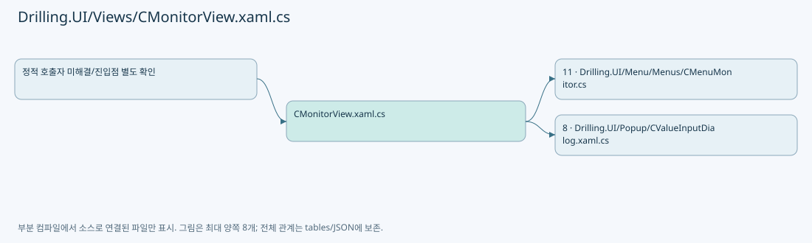

## 네임스페이스·타입·상속

| 타입 | 구분 | 원본 범위 | 선언/상속 |
| --- | --- | --- | --- |
| CMonitorView | ClassDeclaration | 10–571 | CMonitorView: UserControl |

## 멤버 빠른 목록

| 이름 | 종류 | 범위 | 서명 |
| --- | --- | --- | --- |
| _hostWindow | FieldDeclaration | L12–12 | Window? Drilling.UI.Views.CMonitorView._hostWindow |
| _rootView | FieldDeclaration | L13–13 | Drilling.UI.CRootView? Drilling.UI.Views.CMonitorView._rootView |
| _monitorMenu | FieldDeclaration | L14–14 | Drilling.UI.Menu.Menus.CMenuMonitor? Drilling.UI.Views.CMonitorView._monitorMenu |
| .ctor | ConstructorDeclaration | L16–19 | Drilling.UI.Views.CMonitorView.CMonitorView() |
| MonitorViewLoaded | MethodDeclaration | L21–55 | void Drilling.UI.Views.CMonitorView.MonitorViewLoaded(object, RoutedEventArgs) |
| RootViewCurrentScreenChanged | MethodDeclaration | L57–71 | void Drilling.UI.Views.CMonitorView.RootViewCurrentScreenChanged(object?, System.EventArgs) |
| MonitorViewPreviewKeyDown | MethodDeclaration | L73–86 | void Drilling.UI.Views.CMonitorView.MonitorViewPreviewKeyDown(object, KeyEventArgs) |
| MonitorViewUnloaded | MethodDeclaration | L88–104 | void Drilling.UI.Views.CMonitorView.MonitorViewUnloaded(object, RoutedEventArgs) |
| XpsMultiMoveGrid_PreviewMouseWheel | MethodDeclaration | L106–118 | void Drilling.UI.Views.CMonitorView.XpsMultiMoveGrid_PreviewMouseWheel(object, MouseWheelEventArgs) |
| OuterScrollViewer_PreviewMouseWheel | MethodDeclaration | L120–136 | void Drilling.UI.Views.CMonitorView.OuterScrollViewer_PreviewMouseWheel(object, MouseWheelEventArgs) |
| CoordinateCellPreviewLabel_MouseMove | MethodDeclaration | L138–149 | void Drilling.UI.Views.CMonitorView.CoordinateCellPreviewLabel_MouseMove(object, MouseEventArgs) |
| CoordinateCellPreviewLabel_MouseLeave | MethodDeclaration | L151–154 | void Drilling.UI.Views.CMonitorView.CoordinateCellPreviewLabel_MouseLeave(object, MouseEventArgs) |
| PositionCoordinateGlassPreviewHoverTip | MethodDeclaration | L156–177 | void Drilling.UI.Views.CMonitorView.PositionCoordinateGlassPreviewHoverTip(Point) |
| HideCoordinateGlassPreviewHoverTip | MethodDeclaration | L179–183 | void Drilling.UI.Views.CMonitorView.HideCoordinateGlassPreviewHoverTip() |
| AttenuatorScrollViewer_ScrollChanged | MethodDeclaration | L185–193 | void Drilling.UI.Views.CMonitorView.AttenuatorScrollViewer_ScrollChanged(object, ScrollChangedEventArgs) |
| MelsecGrid_SizeChanged | MethodDeclaration | L195–214 | void Drilling.UI.Views.CMonitorView.MelsecGrid_SizeChanged(object, SizeChangedEventArgs) |
| CloseOpenComboBoxes | MethodDeclaration | L216–227 | void Drilling.UI.Views.CMonitorView.CloseOpenComboBoxes(DependencyObject) |
| OpenPowerMeterSettingInput | MethodDeclaration | L229–251 | void Drilling.UI.Views.CMonitorView.OpenPowerMeterSettingInput(object, RoutedEventArgs) |
| PowerMeterSettingSelection_PreviewMouseDown | MethodDeclaration | L253–260 | void Drilling.UI.Views.CMonitorView.PowerMeterSettingSelection_PreviewMouseDown(object, MouseButtonEventArgs) |
| PowerMeterSettingSelection_PreviewKeyDown | MethodDeclaration | L262–274 | void Drilling.UI.Views.CMonitorView.PowerMeterSettingSelection_PreviewKeyDown(object, KeyEventArgs) |
| PowerMeterSettingSelection_PreviewMouseWheel | MethodDeclaration | L276–283 | void Drilling.UI.Views.CMonitorView.PowerMeterSettingSelection_PreviewMouseWheel(object, MouseWheelEventArgs) |
| PowerMeterSettingSelection_DropDownOpened | MethodDeclaration | L285–294 | void Drilling.UI.Views.CMonitorView.PowerMeterSettingSelection_DropDownOpened(object, System.EventArgs) |
| IsPowerMeterSettingSelectionKey | MethodDeclaration | L296–312 | bool Drilling.UI.Views.CMonitorView.IsPowerMeterSettingSelectionKey(Key) |
| OpenLaserSettingInput | MethodDeclaration | L314–331 | void Drilling.UI.Views.CMonitorView.OpenLaserSettingInput(object, RoutedEventArgs) |
| OpenMotorOperationInput | MethodDeclaration | L333–350 | void Drilling.UI.Views.CMonitorView.OpenMotorOperationInput(object, RoutedEventArgs) |
| OpenXpsMultiMoveTargetInput | MethodDeclaration | L352–368 | void Drilling.UI.Views.CMonitorView.OpenXpsMultiMoveTargetInput(object, RoutedEventArgs) |
| StartXpsJogNegative | MethodDeclaration | L370–374 | void Drilling.UI.Views.CMonitorView.StartXpsJogNegative(object, MouseButtonEventArgs) |
| StartXpsJogPositive | MethodDeclaration | L376–380 | void Drilling.UI.Views.CMonitorView.StartXpsJogPositive(object, MouseButtonEventArgs) |
| StopXpsJog | MethodDeclaration | L382–386 | void Drilling.UI.Views.CMonitorView.StopXpsJog(object, MouseButtonEventArgs) |
| StopXpsJogOnMouseLeave | MethodDeclaration | L388–391 | void Drilling.UI.Views.CMonitorView.StopXpsJogOnMouseLeave(object, MouseEventArgs) |
| StopXpsJogOnLostMouseCapture | MethodDeclaration | L393–396 | void Drilling.UI.Views.CMonitorView.StopXpsJogOnLostMouseCapture(object, MouseEventArgs) |
| StopXpsJogOnLostKeyboardFocus | MethodDeclaration | L398–401 | void Drilling.UI.Views.CMonitorView.StopXpsJogOnLostKeyboardFocus(object, KeyboardFocusChangedEventArgs) |
| ExecuteXpsJogEvent | MethodDeclaration | L403–429 | System.Threading.Tasks.Task Drilling.UI.Views.CMonitorView.ExecuteXpsJogEvent(bool?) |
| GetMonitorMenu | MethodDeclaration | L431–434 | Drilling.UI.Menu.Menus.CMenuMonitor? Drilling.UI.Views.CMonitorView.GetMonitorMenu() |
| OpenAttenuatorPositionInput | MethodDeclaration | L436–455 | void Drilling.UI.Views.CMonitorView.OpenAttenuatorPositionInput(object, RoutedEventArgs) |
| OpenBetTableInput | MethodDeclaration | L457–497 | void Drilling.UI.Views.CMonitorView.OpenBetTableInput(object, RoutedEventArgs) |
| OpenBetPositionInput | MethodDeclaration | L499–516 | void Drilling.UI.Views.CMonitorView.OpenBetPositionInput(object, RoutedEventArgs) |
| OpenMelsecWriteInput | MethodDeclaration | L518–539 | void Drilling.UI.Views.CMonitorView.OpenMelsecWriteInput(object, RoutedEventArgs) |
| MelsecWriteSelectionPreviewInput | MethodDeclaration | L541–551 | void Drilling.UI.Views.CMonitorView.MelsecWriteSelectionPreviewInput(object, RoutedEventArgs) |
| EnsureMelsecWriteInputUnlocked | MethodDeclaration | L553–569 | bool Drilling.UI.Views.CMonitorView.EnsureMelsecWriteInputUnlocked(RoutedEventArgs) |

## 멤버별 상세 계약·호출·처리 해설

### FieldDeclaration `_hostWindow` · L12–12

[Drilling.UI/Views/CMonitorView.xaml.cs:12–12](https://github.com/kjuws10-rgb/A3Drilling/blob/5aee8e58439c9b455cae7c9593c9be986c3e682e/Drilling.UI/Views/CMonitorView.xaml.cs#L12-L12)

| 항목 | 실제 추출 값 |
| --- | --- |
| 서명 | Window? Drilling.UI.Views.CMonitorView._hostWindow |
| 접근/수식자 | Private / private |
| 반환/값 타입 | Window? |
| 소속 타입 | NamedType:Drilling.UI.Views.CMonitorView |

현재 부분 분석에서 직접 연결된 호출자는 없습니다. XAML/이벤트/인터페이스·델리게이트·외부 진입을 추가 확인해야 하며, 미사용으로 판정한 것이 아닙니다.

변경 전 점검: 입력/반환 타입, 위 호출자, 예외/취소 경로, 공유 상태와 저장·전송 소비자를 함께 확인합니다. 값의 단위나 물리 방향을 이름만으로 확정하지 않습니다.

### FieldDeclaration `_rootView` · L13–13

[Drilling.UI/Views/CMonitorView.xaml.cs:13–13](https://github.com/kjuws10-rgb/A3Drilling/blob/5aee8e58439c9b455cae7c9593c9be986c3e682e/Drilling.UI/Views/CMonitorView.xaml.cs#L13-L13)

| 항목 | 실제 추출 값 |
| --- | --- |
| 서명 | Drilling.UI.CRootView? Drilling.UI.Views.CMonitorView._rootView |
| 접근/수식자 | Private / private |
| 반환/값 타입 | Drilling.UI.CRootView? |
| 소속 타입 | NamedType:Drilling.UI.Views.CMonitorView |

현재 부분 분석에서 직접 연결된 호출자는 없습니다. XAML/이벤트/인터페이스·델리게이트·외부 진입을 추가 확인해야 하며, 미사용으로 판정한 것이 아닙니다.

변경 전 점검: 입력/반환 타입, 위 호출자, 예외/취소 경로, 공유 상태와 저장·전송 소비자를 함께 확인합니다. 값의 단위나 물리 방향을 이름만으로 확정하지 않습니다.

### FieldDeclaration `_monitorMenu` · L14–14

[Drilling.UI/Views/CMonitorView.xaml.cs:14–14](https://github.com/kjuws10-rgb/A3Drilling/blob/5aee8e58439c9b455cae7c9593c9be986c3e682e/Drilling.UI/Views/CMonitorView.xaml.cs#L14-L14)

| 항목 | 실제 추출 값 |
| --- | --- |
| 서명 | Drilling.UI.Menu.Menus.CMenuMonitor? Drilling.UI.Views.CMonitorView._monitorMenu |
| 접근/수식자 | Private / private |
| 반환/값 타입 | Drilling.UI.Menu.Menus.CMenuMonitor? |
| 소속 타입 | NamedType:Drilling.UI.Views.CMonitorView |

현재 부분 분석에서 직접 연결된 호출자는 없습니다. XAML/이벤트/인터페이스·델리게이트·외부 진입을 추가 확인해야 하며, 미사용으로 판정한 것이 아닙니다.

변경 전 점검: 입력/반환 타입, 위 호출자, 예외/취소 경로, 공유 상태와 저장·전송 소비자를 함께 확인합니다. 값의 단위나 물리 방향을 이름만으로 확정하지 않습니다.

### ConstructorDeclaration `.ctor` · L16–19

[Drilling.UI/Views/CMonitorView.xaml.cs:16–19](https://github.com/kjuws10-rgb/A3Drilling/blob/5aee8e58439c9b455cae7c9593c9be986c3e682e/Drilling.UI/Views/CMonitorView.xaml.cs#L16-L19)

| 항목 | 실제 추출 값 |
| --- | --- |
| 서명 | Drilling.UI.Views.CMonitorView.CMonitorView() |
| 접근/수식자 | Public / public |
| 반환/값 타입 | void |
| 소속 타입 | NamedType:Drilling.UI.Views.CMonitorView |

현재 부분 분석에서 직접 연결된 호출자는 없습니다. XAML/이벤트/인터페이스·델리게이트·외부 진입을 추가 확인해야 하며, 미사용으로 판정한 것이 아닙니다.

호출하는 대상과 해석 범위:

| 원본 행 | 표현식 | 분석 상태 | 대상/소스 위치 |
| --- | --- | --- | --- |
| 18 | InitializeComponent | unresolved | None |

본문의 실제 연산·분기·예외·반환 순서(원문 위치 순):

| 원본 행 | 종류 | 주석 해설 |
| --- | --- | --- |
| 18 | call | 함수·델리게이트 또는 객체 생성자를 호출합니다: InitializeComponent() |

변경 전 점검: 입력/반환 타입, 위 호출자, 예외/취소 경로, 공유 상태와 저장·전송 소비자를 함께 확인합니다. 값의 단위나 물리 방향을 이름만으로 확정하지 않습니다.

### MethodDeclaration `MonitorViewLoaded` · L21–55

[Drilling.UI/Views/CMonitorView.xaml.cs:21–55](https://github.com/kjuws10-rgb/A3Drilling/blob/5aee8e58439c9b455cae7c9593c9be986c3e682e/Drilling.UI/Views/CMonitorView.xaml.cs#L21-L55)

| 항목 | 실제 추출 값 |
| --- | --- |
| 서명 | void Drilling.UI.Views.CMonitorView.MonitorViewLoaded(object, RoutedEventArgs) |
| 접근/수식자 | Private / private |
| 반환/값 타입 | void |
| 소속 타입 | NamedType:Drilling.UI.Views.CMonitorView |

입력 계약:

| 이름 | 타입 | 전달 | 선택/기본값 |
| --- | --- | --- | --- |
| sender | object | None | False /  |
| e | RoutedEventArgs | None | False /  |

현재 부분 분석에서 직접 연결된 호출자는 없습니다. XAML/이벤트/인터페이스·델리게이트·외부 진입을 추가 확인해야 하며, 미사용으로 판정한 것이 아닙니다.

호출하는 대상과 해석 범위:

| 원본 행 | 표현식 | 분석 상태 | 대상/소스 위치 |
| --- | --- | --- | --- |
| 23 | Window.GetWindow | unresolved | None |
| 24 | ReferenceEquals | candidate | OverloadResolutionFailure |
| 39 | ReferenceEquals | candidate | OverloadResolutionFailure |

본문의 실제 연산·분기·예외·반환 순서(원문 위치 순):

| 원본 행 | 종류 | 주석 해설 |
| --- | --- | --- |
| 23 | call | 함수·델리게이트 또는 객체 생성자를 호출합니다: Window.GetWindow(this) |
| 23 | local-declaration | 지역 변수를 선언합니다: var window = Window.GetWindow(this); |
| 23 | variable-initializer | 변수의 초기값을 지정합니다: window = Window.GetWindow(this) |
| 24 | call | 함수·델리게이트 또는 객체 생성자를 호출합니다: ReferenceEquals(_hostWindow, window) |
| 24 | if | 조건에 따라 분기합니다: if (!ReferenceEquals(_hostWindow, window)) |
| 26 | if | 조건에 따라 분기합니다: if (_hostWindow is not null) |
| 28 | compound-assignment-or-event-subscription | 복합 대입 또는 이벤트 구독/해지 표현입니다: _hostWindow.PreviewKeyDown -= MonitorViewPreviewKeyDown |
| 31 | assignment | 값을 대상에 대입합니다: _hostWindow = window |
| 32 | if | 조건에 따라 분기합니다: if (_hostWindow is not null) |
| 34 | compound-assignment-or-event-subscription | 복합 대입 또는 이벤트 구독/해지 표현입니다: _hostWindow.PreviewKeyDown += MonitorViewPreviewKeyDown |
| 38 | local-declaration | 지역 변수를 선언합니다: var rootView = DataContext as CRootView ?? _hostWindow?.DataContext as CRootView; |
| 38 | variable-initializer | 변수의 초기값을 지정합니다: rootView = DataContext as CRootView ?? _hostWindow?.DataContext as CRootView |
| 39 | call | 함수·델리게이트 또는 객체 생성자를 호출합니다: ReferenceEquals(_rootView, rootView) |
| 39 | if | 조건에 따라 분기합니다: if (ReferenceEquals(_rootView, rootView)) |
| 41 | return | 호출자에게 값 또는 제어를 반환합니다: return; |
| 44 | if | 조건에 따라 분기합니다: if (_rootView is not null) |
| 46 | compound-assignment-or-event-subscription | 복합 대입 또는 이벤트 구독/해지 표현입니다: _rootView.CurrentScreenChanged -= RootViewCurrentScreenChanged |
| 49 | assignment | 값을 대상에 대입합니다: _rootView = rootView |
| 50 | if | 조건에 따라 분기합니다: if (_rootView is not null) |
| 52 | compound-assignment-or-event-subscription | 복합 대입 또는 이벤트 구독/해지 표현입니다: _rootView.CurrentScreenChanged += RootViewCurrentScreenChanged |
| 53 | assignment | 값을 대상에 대입합니다: _monitorMenu = _rootView.CurrentScreen.Monitor ?? _monitorMenu |

제어 구문의 포함 구조(실제 실행 순서/CFG가 아닌 구문 탐색 그림):

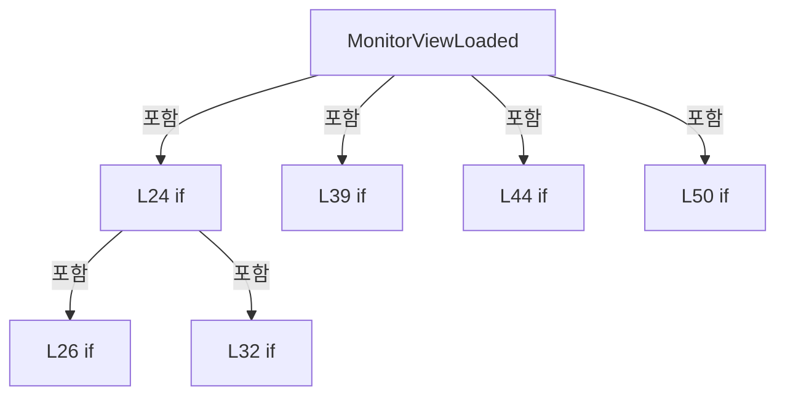

변경 전 점검: 입력/반환 타입, 위 호출자, 예외/취소 경로, 공유 상태와 저장·전송 소비자를 함께 확인합니다. 값의 단위나 물리 방향을 이름만으로 확정하지 않습니다.

### MethodDeclaration `RootViewCurrentScreenChanged` · L57–71

[Drilling.UI/Views/CMonitorView.xaml.cs:57–71](https://github.com/kjuws10-rgb/A3Drilling/blob/5aee8e58439c9b455cae7c9593c9be986c3e682e/Drilling.UI/Views/CMonitorView.xaml.cs#L57-L71)

| 항목 | 실제 추출 값 |
| --- | --- |
| 서명 | void Drilling.UI.Views.CMonitorView.RootViewCurrentScreenChanged(object?, System.EventArgs) |
| 접근/수식자 | Private / private |
| 반환/값 타입 | void |
| 소속 타입 | NamedType:Drilling.UI.Views.CMonitorView |

입력 계약:

| 이름 | 타입 | 전달 | 선택/기본값 |
| --- | --- | --- | --- |
| sender | object? | None | False /  |
| e | System.EventArgs | None | False /  |

현재 부분 분석에서 직접 연결된 호출자는 없습니다. XAML/이벤트/인터페이스·델리게이트·외부 진입을 추가 확인해야 하며, 미사용으로 판정한 것이 아닙니다.

호출하는 대상과 해석 범위:

| 원본 행 | 표현식 | 분석 상태 | 대상/소스 위치 |
| --- | --- | --- | --- |
| 66 | .HideAndLockMelsecWrite | resolved | void Drilling.UI.Menu.Menus.CMenuMonitor.HideAndLockMelsecWrite() · Drilling.UI/Menu/Menus/CMenuMonitor.cs:613 |

본문의 실제 연산·분기·예외·반환 순서(원문 위치 순):

| 원본 행 | 종류 | 주석 해설 |
| --- | --- | --- |
| 59 | if | 조건에 따라 분기합니다: if (_rootView is null) |
| 61 | return | 호출자에게 값 또는 제어를 반환합니다: return; |
| 64 | if | 조건에 따라 분기합니다: if (_rootView.CurrentScreen.Menu != EN_MENU.Monitor) |
| 66 | call | 함수·델리게이트 또는 객체 생성자를 호출합니다: .HideAndLockMelsecWrite() |
| 67 | return | 호출자에게 값 또는 제어를 반환합니다: return; |
| 70 | assignment | 값을 대상에 대입합니다: _monitorMenu = _rootView.CurrentScreen.Monitor ?? _monitorMenu |

제어 구문의 포함 구조(실제 실행 순서/CFG가 아닌 구문 탐색 그림):

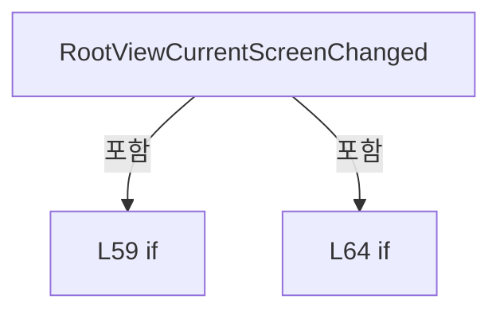

변경 전 점검: 입력/반환 타입, 위 호출자, 예외/취소 경로, 공유 상태와 저장·전송 소비자를 함께 확인합니다. 값의 단위나 물리 방향을 이름만으로 확정하지 않습니다.

### MethodDeclaration `MonitorViewPreviewKeyDown` · L73–86

[Drilling.UI/Views/CMonitorView.xaml.cs:73–86](https://github.com/kjuws10-rgb/A3Drilling/blob/5aee8e58439c9b455cae7c9593c9be986c3e682e/Drilling.UI/Views/CMonitorView.xaml.cs#L73-L86)

| 항목 | 실제 추출 값 |
| --- | --- |
| 서명 | void Drilling.UI.Views.CMonitorView.MonitorViewPreviewKeyDown(object, KeyEventArgs) |
| 접근/수식자 | Private / private |
| 반환/값 타입 | void |
| 소속 타입 | NamedType:Drilling.UI.Views.CMonitorView |

입력 계약:

| 이름 | 타입 | 전달 | 선택/기본값 |
| --- | --- | --- | --- |
| sender | object | None | False /  |
| e | KeyEventArgs | None | False /  |

현재 부분 분석에서 직접 연결된 호출자는 없습니다. XAML/이벤트/인터페이스·델리게이트·외부 진입을 추가 확인해야 하며, 미사용으로 판정한 것이 아닙니다.

호출하는 대상과 해석 범위:

| 원본 행 | 표현식 | 분석 상태 | 대상/소스 위치 |
| --- | --- | --- | --- |
| 84 | monitor.ToggleMelsecWriteLockVisibility | resolved | void Drilling.UI.Menu.Menus.CMenuMonitor.ToggleMelsecWriteLockVisibility() · Drilling.UI/Menu/Menus/CMenuMonitor.cs:594 |

본문의 실제 연산·분기·예외·반환 순서(원문 위치 순):

| 원본 행 | 종류 | 주석 해설 |
| --- | --- | --- |
| 75 | local-declaration | 지역 변수를 선언합니다: var rootView = DataContext as CRootView ?? _hostWindow?.DataContext as CRootView; |
| 75 | variable-initializer | 변수의 초기값을 지정합니다: rootView = DataContext as CRootView ?? _hostWindow?.DataContext as CRootView |
| 76 | local-declaration | 지역 변수를 선언합니다: var requiredModifiers = ModifierKeys.Control &#124; ModifierKeys.Shift; |
| 76 | variable-initializer | 변수의 초기값을 지정합니다: requiredModifiers = ModifierKeys.Control &#124; ModifierKeys.Shift |
| 77 | if | 조건에 따라 분기합니다: if (e.Key != Key.F12 &#124;&#124; (Keyboard.Modifiers & requiredModifiers) != requiredModifiers &#124;&#124; rootView?.CurrentScreen.Monitor is not CMenuMonitor monitor) |
| 81 | return | 호출자에게 값 또는 제어를 반환합니다: return; |
| 84 | call | 함수·델리게이트 또는 객체 생성자를 호출합니다: monitor.ToggleMelsecWriteLockVisibility() |
| 85 | assignment | 값을 대상에 대입합니다: e.Handled = true |

제어 구문의 포함 구조(실제 실행 순서/CFG가 아닌 구문 탐색 그림):

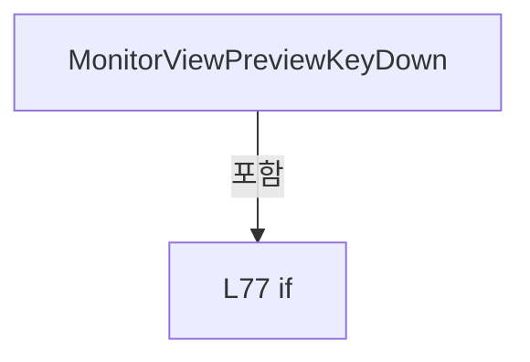

변경 전 점검: 입력/반환 타입, 위 호출자, 예외/취소 경로, 공유 상태와 저장·전송 소비자를 함께 확인합니다. 값의 단위나 물리 방향을 이름만으로 확정하지 않습니다.

### MethodDeclaration `MonitorViewUnloaded` · L88–104

[Drilling.UI/Views/CMonitorView.xaml.cs:88–104](https://github.com/kjuws10-rgb/A3Drilling/blob/5aee8e58439c9b455cae7c9593c9be986c3e682e/Drilling.UI/Views/CMonitorView.xaml.cs#L88-L104)

| 항목 | 실제 추출 값 |
| --- | --- |
| 서명 | void Drilling.UI.Views.CMonitorView.MonitorViewUnloaded(object, RoutedEventArgs) |
| 접근/수식자 | Private / private |
| 반환/값 타입 | void |
| 소속 타입 | NamedType:Drilling.UI.Views.CMonitorView |

입력 계약:

| 이름 | 타입 | 전달 | 선택/기본값 |
| --- | --- | --- | --- |
| sender | object | None | False /  |
| e | RoutedEventArgs | None | False /  |

현재 부분 분석에서 직접 연결된 호출자는 없습니다. XAML/이벤트/인터페이스·델리게이트·외부 진입을 추가 확인해야 하며, 미사용으로 판정한 것이 아닙니다.

호출하는 대상과 해석 범위:

| 원본 행 | 표현식 | 분석 상태 | 대상/소스 위치 |
| --- | --- | --- | --- |
| 102 | .HideAndLockMelsecWrite | resolved | void Drilling.UI.Menu.Menus.CMenuMonitor.HideAndLockMelsecWrite() · Drilling.UI/Menu/Menus/CMenuMonitor.cs:613 |

본문의 실제 연산·분기·예외·반환 순서(원문 위치 순):

| 원본 행 | 종류 | 주석 해설 |
| --- | --- | --- |
| 90 | if | 조건에 따라 분기합니다: if (_hostWindow is not null) |
| 92 | compound-assignment-or-event-subscription | 복합 대입 또는 이벤트 구독/해지 표현입니다: _hostWindow.PreviewKeyDown -= MonitorViewPreviewKeyDown |
| 93 | assignment | 값을 대상에 대입합니다: _hostWindow = null |
| 96 | if | 조건에 따라 분기합니다: if (_rootView is not null) |
| 98 | compound-assignment-or-event-subscription | 복합 대입 또는 이벤트 구독/해지 표현입니다: _rootView.CurrentScreenChanged -= RootViewCurrentScreenChanged |
| 99 | assignment | 값을 대상에 대입합니다: _rootView = null |
| 102 | call | 함수·델리게이트 또는 객체 생성자를 호출합니다: .HideAndLockMelsecWrite() |
| 103 | assignment | 값을 대상에 대입합니다: _monitorMenu = null |

제어 구문의 포함 구조(실제 실행 순서/CFG가 아닌 구문 탐색 그림):

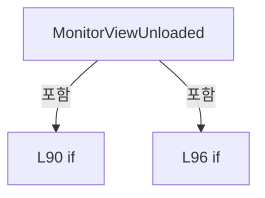

변경 전 점검: 입력/반환 타입, 위 호출자, 예외/취소 경로, 공유 상태와 저장·전송 소비자를 함께 확인합니다. 값의 단위나 물리 방향을 이름만으로 확정하지 않습니다.

### MethodDeclaration `XpsMultiMoveGrid_PreviewMouseWheel` · L106–118

[Drilling.UI/Views/CMonitorView.xaml.cs:106–118](https://github.com/kjuws10-rgb/A3Drilling/blob/5aee8e58439c9b455cae7c9593c9be986c3e682e/Drilling.UI/Views/CMonitorView.xaml.cs#L106-L118)

| 항목 | 실제 추출 값 |
| --- | --- |
| 서명 | void Drilling.UI.Views.CMonitorView.XpsMultiMoveGrid_PreviewMouseWheel(object, MouseWheelEventArgs) |
| 접근/수식자 | Private / private |
| 반환/값 타입 | void |
| 소속 타입 | NamedType:Drilling.UI.Views.CMonitorView |

입력 계약:

| 이름 | 타입 | 전달 | 선택/기본값 |
| --- | --- | --- | --- |
| sender | object | None | False /  |
| e | MouseWheelEventArgs | None | False /  |

현재 부분 분석에서 직접 연결된 호출자는 없습니다. XAML/이벤트/인터페이스·델리게이트·외부 진입을 추가 확인해야 하며, 미사용으로 판정한 것이 아닙니다.

호출하는 대상과 해석 범위:

| 원본 행 | 표현식 | 분석 상태 | 대상/소스 위치 |
| --- | --- | --- | --- |
| 116 | scrollViewer.ScrollToVerticalOffset | unresolved | None |

본문의 실제 연산·분기·예외·반환 순서(원문 위치 순):

| 원본 행 | 종류 | 주석 해설 |
| --- | --- | --- |
| 108 | local-declaration | 지역 변수를 선언합니다: var scrollViewer = XpsOperationScrollViewer; |
| 108 | variable-initializer | 변수의 초기값을 지정합니다: scrollViewer = XpsOperationScrollViewer |
| 109 | local-declaration | 지역 변수를 선언합니다: var canScrollUp = e.Delta > 0 && scrollViewer.VerticalOffset > 0; |
| 109 | variable-initializer | 변수의 초기값을 지정합니다: canScrollUp = e.Delta > 0 && scrollViewer.VerticalOffset > 0 |
| 110 | local-declaration | 지역 변수를 선언합니다: var canScrollDown = e.Delta < 0 && scrollViewer.VerticalOffset < scrollViewer.ScrollableHeight; |
| 110 | variable-initializer | 변수의 초기값을 지정합니다: canScrollDown = e.Delta < 0 && scrollViewer.VerticalOffset < scrollViewer.ScrollableHeight |
| 111 | if | 조건에 따라 분기합니다: if (!canScrollUp && !canScrollDown) |
| 113 | return | 호출자에게 값 또는 제어를 반환합니다: return; |
| 116 | call | 함수·델리게이트 또는 객체 생성자를 호출합니다: scrollViewer.ScrollToVerticalOffset(scrollViewer.VerticalOffset - (e.Delta / 3.0)) |
| 117 | assignment | 값을 대상에 대입합니다: e.Handled = true |

제어 구문의 포함 구조(실제 실행 순서/CFG가 아닌 구문 탐색 그림):

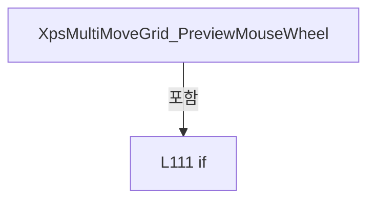

변경 전 점검: 입력/반환 타입, 위 호출자, 예외/취소 경로, 공유 상태와 저장·전송 소비자를 함께 확인합니다. 값의 단위나 물리 방향을 이름만으로 확정하지 않습니다.

### MethodDeclaration `OuterScrollViewer_PreviewMouseWheel` · L120–136

[Drilling.UI/Views/CMonitorView.xaml.cs:120–136](https://github.com/kjuws10-rgb/A3Drilling/blob/5aee8e58439c9b455cae7c9593c9be986c3e682e/Drilling.UI/Views/CMonitorView.xaml.cs#L120-L136)

| 항목 | 실제 추출 값 |
| --- | --- |
| 서명 | void Drilling.UI.Views.CMonitorView.OuterScrollViewer_PreviewMouseWheel(object, MouseWheelEventArgs) |
| 접근/수식자 | Private / private |
| 반환/값 타입 | void |
| 소속 타입 | NamedType:Drilling.UI.Views.CMonitorView |

입력 계약:

| 이름 | 타입 | 전달 | 선택/기본값 |
| --- | --- | --- | --- |
| sender | object | None | False /  |
| e | MouseWheelEventArgs | None | False /  |

현재 부분 분석에서 직접 연결된 호출자는 없습니다. XAML/이벤트/인터페이스·델리게이트·외부 진입을 추가 확인해야 하며, 미사용으로 판정한 것이 아닙니다.

호출하는 대상과 해석 범위:

| 원본 행 | 표현식 | 분석 상태 | 대상/소스 위치 |
| --- | --- | --- | --- |
| 134 | scrollViewer.ScrollToVerticalOffset | unresolved | None |

본문의 실제 연산·분기·예외·반환 순서(원문 위치 순):

| 원본 행 | 종류 | 주석 해설 |
| --- | --- | --- |
| 122 | if | 조건에 따라 분기합니다: if (sender is not ScrollViewer scrollViewer) |
| 124 | return | 호출자에게 값 또는 제어를 반환합니다: return; |
| 127 | local-declaration | 지역 변수를 선언합니다: var canScrollUp = e.Delta > 0 && scrollViewer.VerticalOffset > 0; |
| 127 | variable-initializer | 변수의 초기값을 지정합니다: canScrollUp = e.Delta > 0 && scrollViewer.VerticalOffset > 0 |
| 128 | local-declaration | 지역 변수를 선언합니다: var canScrollDown = e.Delta < 0 && scrollViewer.VerticalOffset < scrollViewer.ScrollableHeight; |
| 128 | variable-initializer | 변수의 초기값을 지정합니다: canScrollDown = e.Delta < 0 && scrollViewer.VerticalOffset < scrollViewer.ScrollableHeight |
| 129 | if | 조건에 따라 분기합니다: if (!canScrollUp && !canScrollDown) |
| 131 | return | 호출자에게 값 또는 제어를 반환합니다: return; |
| 134 | call | 함수·델리게이트 또는 객체 생성자를 호출합니다: scrollViewer.ScrollToVerticalOffset(scrollViewer.VerticalOffset - (e.Delta / 3.0)) |
| 135 | assignment | 값을 대상에 대입합니다: e.Handled = true |

제어 구문의 포함 구조(실제 실행 순서/CFG가 아닌 구문 탐색 그림):

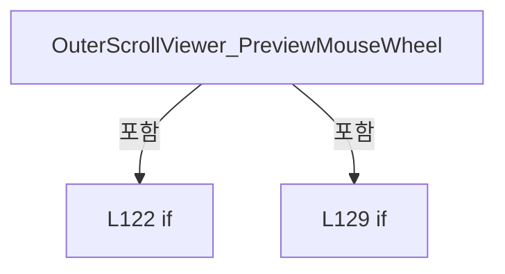

변경 전 점검: 입력/반환 타입, 위 호출자, 예외/취소 경로, 공유 상태와 저장·전송 소비자를 함께 확인합니다. 값의 단위나 물리 방향을 이름만으로 확정하지 않습니다.

### MethodDeclaration `CoordinateCellPreviewLabel_MouseMove` · L138–149

[Drilling.UI/Views/CMonitorView.xaml.cs:138–149](https://github.com/kjuws10-rgb/A3Drilling/blob/5aee8e58439c9b455cae7c9593c9be986c3e682e/Drilling.UI/Views/CMonitorView.xaml.cs#L138-L149)

| 항목 | 실제 추출 값 |
| --- | --- |
| 서명 | void Drilling.UI.Views.CMonitorView.CoordinateCellPreviewLabel_MouseMove(object, MouseEventArgs) |
| 접근/수식자 | Private / private |
| 반환/값 타입 | void |
| 소속 타입 | NamedType:Drilling.UI.Views.CMonitorView |

입력 계약:

| 이름 | 타입 | 전달 | 선택/기본값 |
| --- | --- | --- | --- |
| sender | object | None | False /  |
| e | MouseEventArgs | None | False /  |

현재 부분 분석에서 직접 연결된 호출자는 없습니다. XAML/이벤트/인터페이스·델리게이트·외부 진입을 추가 확인해야 하며, 미사용으로 판정한 것이 아닙니다.

호출하는 대상과 해석 범위:

| 원본 행 | 표현식 | 분석 상태 | 대상/소스 위치 |
| --- | --- | --- | --- |
| 142 | HideCoordinateGlassPreviewHoverTip | resolved | void Drilling.UI.Views.CMonitorView.HideCoordinateGlassPreviewHoverTip() · Drilling.UI/Views/CMonitorView.xaml.cs:179 |
| 148 | PositionCoordinateGlassPreviewHoverTip | candidate | OverloadResolutionFailure |
| 148 | e.GetPosition | unresolved | None |

본문의 실제 연산·분기·예외·반환 순서(원문 위치 순):

| 원본 행 | 종류 | 주석 해설 |
| --- | --- | --- |
| 140 | if | 조건에 따라 분기합니다: if (sender is not FrameworkElement { DataContext: ST_CELL_PREVIEW_LABEL label }) |
| 142 | call | 함수·델리게이트 또는 객체 생성자를 호출합니다: HideCoordinateGlassPreviewHoverTip() |
| 143 | return | 호출자에게 값 또는 제어를 반환합니다: return; |
| 146 | assignment | 값을 대상에 대입합니다: CoordinateGlassPreviewHoverTipText.Text = label.DisplayText |
| 147 | assignment | 값을 대상에 대입합니다: CoordinateGlassPreviewHoverTip.Visibility = Visibility.Visible |
| 148 | call | 함수·델리게이트 또는 객체 생성자를 호출합니다: PositionCoordinateGlassPreviewHoverTip(e.GetPosition(CoordinateGlassPreviewViewport)) |
| 148 | call | 함수·델리게이트 또는 객체 생성자를 호출합니다: e.GetPosition(CoordinateGlassPreviewViewport) |

제어 구문의 포함 구조(실제 실행 순서/CFG가 아닌 구문 탐색 그림):

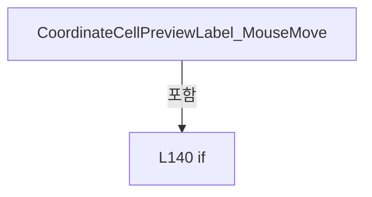

변경 전 점검: 입력/반환 타입, 위 호출자, 예외/취소 경로, 공유 상태와 저장·전송 소비자를 함께 확인합니다. 값의 단위나 물리 방향을 이름만으로 확정하지 않습니다.

### MethodDeclaration `CoordinateCellPreviewLabel_MouseLeave` · L151–154

[Drilling.UI/Views/CMonitorView.xaml.cs:151–154](https://github.com/kjuws10-rgb/A3Drilling/blob/5aee8e58439c9b455cae7c9593c9be986c3e682e/Drilling.UI/Views/CMonitorView.xaml.cs#L151-L154)

| 항목 | 실제 추출 값 |
| --- | --- |
| 서명 | void Drilling.UI.Views.CMonitorView.CoordinateCellPreviewLabel_MouseLeave(object, MouseEventArgs) |
| 접근/수식자 | Private / private |
| 반환/값 타입 | void |
| 소속 타입 | NamedType:Drilling.UI.Views.CMonitorView |

입력 계약:

| 이름 | 타입 | 전달 | 선택/기본값 |
| --- | --- | --- | --- |
| sender | object | None | False /  |
| e | MouseEventArgs | None | False /  |

현재 부분 분석에서 직접 연결된 호출자는 없습니다. XAML/이벤트/인터페이스·델리게이트·외부 진입을 추가 확인해야 하며, 미사용으로 판정한 것이 아닙니다.

호출하는 대상과 해석 범위:

| 원본 행 | 표현식 | 분석 상태 | 대상/소스 위치 |
| --- | --- | --- | --- |
| 153 | HideCoordinateGlassPreviewHoverTip | resolved | void Drilling.UI.Views.CMonitorView.HideCoordinateGlassPreviewHoverTip() · Drilling.UI/Views/CMonitorView.xaml.cs:179 |

본문의 실제 연산·분기·예외·반환 순서(원문 위치 순):

| 원본 행 | 종류 | 주석 해설 |
| --- | --- | --- |
| 153 | call | 함수·델리게이트 또는 객체 생성자를 호출합니다: HideCoordinateGlassPreviewHoverTip() |

변경 전 점검: 입력/반환 타입, 위 호출자, 예외/취소 경로, 공유 상태와 저장·전송 소비자를 함께 확인합니다. 값의 단위나 물리 방향을 이름만으로 확정하지 않습니다.

### MethodDeclaration `PositionCoordinateGlassPreviewHoverTip` · L156–177

[Drilling.UI/Views/CMonitorView.xaml.cs:156–177](https://github.com/kjuws10-rgb/A3Drilling/blob/5aee8e58439c9b455cae7c9593c9be986c3e682e/Drilling.UI/Views/CMonitorView.xaml.cs#L156-L177)

| 항목 | 실제 추출 값 |
| --- | --- |
| 서명 | void Drilling.UI.Views.CMonitorView.PositionCoordinateGlassPreviewHoverTip(Point) |
| 접근/수식자 | Private / private |
| 반환/값 타입 | void |
| 소속 타입 | NamedType:Drilling.UI.Views.CMonitorView |

입력 계약:

| 이름 | 타입 | 전달 | 선택/기본값 |
| --- | --- | --- | --- |
| pointer | Point | None | False /  |

현재 부분 분석에서 직접 연결된 호출자는 없습니다. XAML/이벤트/인터페이스·델리게이트·외부 진입을 추가 확인해야 하며, 미사용으로 판정한 것이 아닙니다.

호출하는 대상과 해석 범위:

| 원본 행 | 표현식 | 분석 상태 | 대상/소스 위치 |
| --- | --- | --- | --- |
| 161 | CoordinateGlassPreviewHoverTip.Measure | unresolved | None |
| 161 | new Size | unresolved | None |
| 167 | Math.Clamp | candidate | OverloadResolutionFailure |
| 167 | Math.Max | candidate | OverloadResolutionFailure |
| 172 | Math.Clamp | candidate | OverloadResolutionFailure |
| 172 | Math.Max | candidate | OverloadResolutionFailure |

본문의 실제 연산·분기·예외·반환 순서(원문 위치 순):

| 원본 행 | 종류 | 주석 해설 |
| --- | --- | --- |
| 158 | local-declaration | 지역 변수를 선언합니다: const double margin = 4.0; |
| 158 | variable-initializer | 변수의 초기값을 지정합니다: margin = 4.0 |
| 159 | local-declaration | 지역 변수를 선언합니다: const double offsetX = 12.0; |
| 159 | variable-initializer | 변수의 초기값을 지정합니다: offsetX = 12.0 |
| 160 | local-declaration | 지역 변수를 선언합니다: const double offsetY = 14.0; |
| 160 | variable-initializer | 변수의 초기값을 지정합니다: offsetY = 14.0 |
| 161 | call | 함수·델리게이트 또는 객체 생성자를 호출합니다: CoordinateGlassPreviewHoverTip.Measure(new Size(double.PositiveInfinity, double.PositiveInfinity)) |
| 161 | call | 함수·델리게이트 또는 객체 생성자를 호출합니다: new Size(double.PositiveInfinity, double.PositiveInfinity) |
| 162 | local-declaration | 지역 변수를 선언합니다: var tipSize = CoordinateGlassPreviewHoverTip.DesiredSize; |
| 162 | variable-initializer | 변수의 초기값을 지정합니다: tipSize = CoordinateGlassPreviewHoverTip.DesiredSize |
| 163 | local-declaration | 지역 변수를 선언합니다: var x = pointer.X + offsetX; |
| 163 | variable-initializer | 변수의 초기값을 지정합니다: x = pointer.X + offsetX |
| 164 | local-declaration | 지역 변수를 선언합니다: var y = pointer.Y + offsetY; |
| 164 | variable-initializer | 변수의 초기값을 지정합니다: y = pointer.Y + offsetY |
| 165 | if | 조건에 따라 분기합니다: if (CoordinateGlassPreviewViewport.ActualWidth > 0) |
| 167 | assignment | 값을 대상에 대입합니다: x = Math.Clamp(x, margin, Math.Max(margin, CoordinateGlassPreviewViewport.ActualWidth - tipSize.Width - margin)) |
| 167 | call | 함수·델리게이트 또는 객체 생성자를 호출합니다: Math.Clamp(x, margin, Math.Max(margin, CoordinateGlassPreviewViewport.ActualWidth - tipSize.Width - margin)) |
| 167 | call | 함수·델리게이트 또는 객체 생성자를 호출합니다: Math.Max(margin, CoordinateGlassPreviewViewport.ActualWidth - tipSize.Width - margin) |
| 170 | if | 조건에 따라 분기합니다: if (CoordinateGlassPreviewViewport.ActualHeight > 0) |
| 172 | assignment | 값을 대상에 대입합니다: y = Math.Clamp(y, margin, Math.Max(margin, CoordinateGlassPreviewViewport.ActualHeight - tipSize.Height - margin)) |
| 172 | call | 함수·델리게이트 또는 객체 생성자를 호출합니다: Math.Clamp(y, margin, Math.Max(margin, CoordinateGlassPreviewViewport.ActualHeight - tipSize.Height - margin)) |
| 172 | call | 함수·델리게이트 또는 객체 생성자를 호출합니다: Math.Max(margin, CoordinateGlassPreviewViewport.ActualHeight - tipSize.Height - margin) |
| 175 | assignment | 값을 대상에 대입합니다: CoordinateGlassPreviewHoverTipTranslateTransform.X = x |
| 176 | assignment | 값을 대상에 대입합니다: CoordinateGlassPreviewHoverTipTranslateTransform.Y = y |

제어 구문의 포함 구조(실제 실행 순서/CFG가 아닌 구문 탐색 그림):

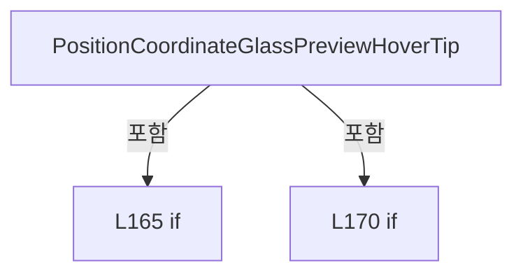

변경 전 점검: 입력/반환 타입, 위 호출자, 예외/취소 경로, 공유 상태와 저장·전송 소비자를 함께 확인합니다. 값의 단위나 물리 방향을 이름만으로 확정하지 않습니다.

### MethodDeclaration `HideCoordinateGlassPreviewHoverTip` · L179–183

[Drilling.UI/Views/CMonitorView.xaml.cs:179–183](https://github.com/kjuws10-rgb/A3Drilling/blob/5aee8e58439c9b455cae7c9593c9be986c3e682e/Drilling.UI/Views/CMonitorView.xaml.cs#L179-L183)

| 항목 | 실제 추출 값 |
| --- | --- |
| 서명 | void Drilling.UI.Views.CMonitorView.HideCoordinateGlassPreviewHoverTip() |
| 접근/수식자 | Private / private |
| 반환/값 타입 | void |
| 소속 타입 | NamedType:Drilling.UI.Views.CMonitorView |

정적 호출자로 확인된 위치:

| 호출 파일/행 | 호출 표현식 | 런타임 분기 가능 |
| --- | --- | --- |
| [Drilling.UI/Views/CMonitorView.xaml.cs:142–142](https://github.com/kjuws10-rgb/A3Drilling/blob/5aee8e58439c9b455cae7c9593c9be986c3e682e/Drilling.UI/Views/CMonitorView.xaml.cs#L142-L142) | HideCoordinateGlassPreviewHoverTip | False |
| [Drilling.UI/Views/CMonitorView.xaml.cs:153–153](https://github.com/kjuws10-rgb/A3Drilling/blob/5aee8e58439c9b455cae7c9593c9be986c3e682e/Drilling.UI/Views/CMonitorView.xaml.cs#L153-L153) | HideCoordinateGlassPreviewHoverTip | False |

본문의 실제 연산·분기·예외·반환 순서(원문 위치 순):

| 원본 행 | 종류 | 주석 해설 |
| --- | --- | --- |
| 181 | assignment | 값을 대상에 대입합니다: CoordinateGlassPreviewHoverTip.Visibility = Visibility.Collapsed |
| 182 | assignment | 값을 대상에 대입합니다: CoordinateGlassPreviewHoverTipText.Text = "" |

변경 전 점검: 입력/반환 타입, 위 호출자, 예외/취소 경로, 공유 상태와 저장·전송 소비자를 함께 확인합니다. 값의 단위나 물리 방향을 이름만으로 확정하지 않습니다.

### MethodDeclaration `AttenuatorScrollViewer_ScrollChanged` · L185–193

[Drilling.UI/Views/CMonitorView.xaml.cs:185–193](https://github.com/kjuws10-rgb/A3Drilling/blob/5aee8e58439c9b455cae7c9593c9be986c3e682e/Drilling.UI/Views/CMonitorView.xaml.cs#L185-L193)

| 항목 | 실제 추출 값 |
| --- | --- |
| 서명 | void Drilling.UI.Views.CMonitorView.AttenuatorScrollViewer_ScrollChanged(object, ScrollChangedEventArgs) |
| 접근/수식자 | Private / private |
| 반환/값 타입 | void |
| 소속 타입 | NamedType:Drilling.UI.Views.CMonitorView |

입력 계약:

| 이름 | 타입 | 전달 | 선택/기본값 |
| --- | --- | --- | --- |
| sender | object | None | False /  |
| e | ScrollChangedEventArgs | None | False /  |

현재 부분 분석에서 직접 연결된 호출자는 없습니다. XAML/이벤트/인터페이스·델리게이트·외부 진입을 추가 확인해야 하며, 미사용으로 판정한 것이 아닙니다.

호출하는 대상과 해석 범위:

| 원본 행 | 표현식 | 분석 상태 | 대상/소스 위치 |
| --- | --- | --- | --- |
| 192 | CloseOpenComboBoxes | resolved | void Drilling.UI.Views.CMonitorView.CloseOpenComboBoxes(DependencyObject) · Drilling.UI/Views/CMonitorView.xaml.cs:216 |

본문의 실제 연산·분기·예외·반환 순서(원문 위치 순):

| 원본 행 | 종류 | 주석 해설 |
| --- | --- | --- |
| 187 | if | 조건에 따라 분기합니다: if (e.VerticalChange == 0 &#124;&#124; sender is not DependencyObject root) |
| 189 | return | 호출자에게 값 또는 제어를 반환합니다: return; |
| 192 | call | 함수·델리게이트 또는 객체 생성자를 호출합니다: CloseOpenComboBoxes(root) |

제어 구문의 포함 구조(실제 실행 순서/CFG가 아닌 구문 탐색 그림):

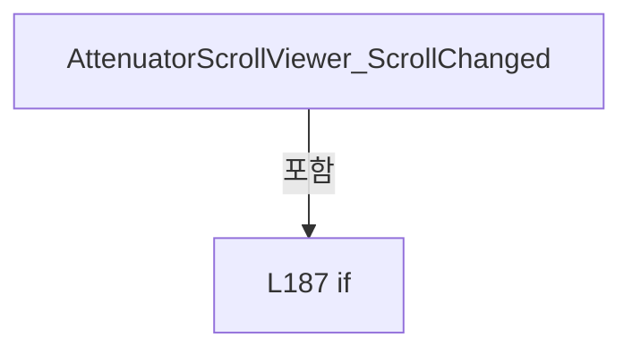

변경 전 점검: 입력/반환 타입, 위 호출자, 예외/취소 경로, 공유 상태와 저장·전송 소비자를 함께 확인합니다. 값의 단위나 물리 방향을 이름만으로 확정하지 않습니다.

### MethodDeclaration `MelsecGrid_SizeChanged` · L195–214

[Drilling.UI/Views/CMonitorView.xaml.cs:195–214](https://github.com/kjuws10-rgb/A3Drilling/blob/5aee8e58439c9b455cae7c9593c9be986c3e682e/Drilling.UI/Views/CMonitorView.xaml.cs#L195-L214)

| 항목 | 실제 추출 값 |
| --- | --- |
| 서명 | void Drilling.UI.Views.CMonitorView.MelsecGrid_SizeChanged(object, SizeChangedEventArgs) |
| 접근/수식자 | Private / private |
| 반환/값 타입 | void |
| 소속 타입 | NamedType:Drilling.UI.Views.CMonitorView |

입력 계약:

| 이름 | 타입 | 전달 | 선택/기본값 |
| --- | --- | --- | --- |
| sender | object | None | False /  |
| e | SizeChangedEventArgs | None | False /  |

현재 부분 분석에서 직접 연결된 호출자는 없습니다. XAML/이벤트/인터페이스·델리게이트·외부 진입을 추가 확인해야 하며, 미사용으로 판정한 것이 아닙니다.

호출하는 대상과 해석 범위:

| 원본 행 | 표현식 | 분석 상태 | 대상/소스 위치 |
| --- | --- | --- | --- |
| 213 | new DataGridLength | unresolved | None |
| 213 | Math.Max | candidate | OverloadResolutionFailure |

본문의 실제 연산·분기·예외·반환 순서(원문 위치 순):

| 원본 행 | 종류 | 주석 해설 |
| --- | --- | --- |
| 197 | if | 조건에 따라 분기합니다: if (sender is not DataGrid grid &#124;&#124; grid.Columns.Count == 0) |
| 199 | return | 호출자에게 값 또는 제어를 반환합니다: return; |
| 202 | local-declaration | 지역 변수를 선언합니다: var fixedColumnsWidth = 0.0; |
| 202 | variable-initializer | 변수의 초기값을 지정합니다: fixedColumnsWidth = 0.0 |
| 203 | variable-initializer | 변수의 초기값을 지정합니다: index = 1 |
| 203 | for | 초기화·조건·증감이 있는 반복입니다: for (var index = 1; index < grid.Columns.Count; index++) |
| 205 | compound-assignment-or-event-subscription | 복합 대입 또는 이벤트 구독/해지 표현입니다: fixedColumnsWidth += grid.Columns[index].Width.Value |
| 208 | local-declaration | 지역 변수를 선언합니다: const double minimumIdWidth = 160.0; |
| 208 | variable-initializer | 변수의 초기값을 지정합니다: minimumIdWidth = 160.0 |
| 209 | local-declaration | 지역 변수를 선언합니다: var availableIdWidth = grid.ActualWidth - fixedColumnsWidth - SystemParameters.VerticalScrollBarWidth - 2.0; |
| 209 | variable-initializer | 변수의 초기값을 지정합니다: availableIdWidth = grid.ActualWidth - fixedColumnsWidth - SystemParameters.VerticalScrollBarWidth - 2.0 |
| 213 | assignment | 값을 대상에 대입합니다: grid.Columns[0].Width = new DataGridLength(Math.Max(minimumIdWidth, availableIdWidth)) |
| 213 | call | 함수·델리게이트 또는 객체 생성자를 호출합니다: new DataGridLength(Math.Max(minimumIdWidth, availableIdWidth)) |
| 213 | call | 함수·델리게이트 또는 객체 생성자를 호출합니다: Math.Max(minimumIdWidth, availableIdWidth) |

제어 구문의 포함 구조(실제 실행 순서/CFG가 아닌 구문 탐색 그림):

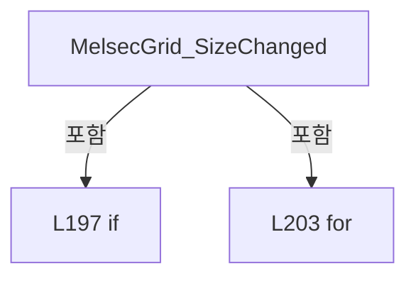

변경 전 점검: 입력/반환 타입, 위 호출자, 예외/취소 경로, 공유 상태와 저장·전송 소비자를 함께 확인합니다. 값의 단위나 물리 방향을 이름만으로 확정하지 않습니다.

### MethodDeclaration `CloseOpenComboBoxes` · L216–227

[Drilling.UI/Views/CMonitorView.xaml.cs:216–227](https://github.com/kjuws10-rgb/A3Drilling/blob/5aee8e58439c9b455cae7c9593c9be986c3e682e/Drilling.UI/Views/CMonitorView.xaml.cs#L216-L227)

| 항목 | 실제 추출 값 |
| --- | --- |
| 서명 | void Drilling.UI.Views.CMonitorView.CloseOpenComboBoxes(DependencyObject) |
| 접근/수식자 | Private / private, static |
| 반환/값 타입 | void |
| 소속 타입 | NamedType:Drilling.UI.Views.CMonitorView |

입력 계약:

| 이름 | 타입 | 전달 | 선택/기본값 |
| --- | --- | --- | --- |
| root | DependencyObject | None | False /  |

정적 호출자로 확인된 위치:

| 호출 파일/행 | 호출 표현식 | 런타임 분기 가능 |
| --- | --- | --- |
| [Drilling.UI/Views/CMonitorView.xaml.cs:192–192](https://github.com/kjuws10-rgb/A3Drilling/blob/5aee8e58439c9b455cae7c9593c9be986c3e682e/Drilling.UI/Views/CMonitorView.xaml.cs#L192-L192) | CloseOpenComboBoxes | False |

호출하는 대상과 해석 범위:

| 원본 행 | 표현식 | 분석 상태 | 대상/소스 위치 |
| --- | --- | --- | --- |
| 223 | VisualTreeHelper.GetChildrenCount | unresolved | None |
| 225 | CloseOpenComboBoxes | candidate | OverloadResolutionFailure |
| 225 | VisualTreeHelper.GetChild | unresolved | None |

본문의 실제 연산·분기·예외·반환 순서(원문 위치 순):

| 원본 행 | 종류 | 주석 해설 |
| --- | --- | --- |
| 218 | if | 조건에 따라 분기합니다: if (root is ComboBox { IsDropDownOpen: true } comboBox) |
| 220 | assignment | 값을 대상에 대입합니다: comboBox.IsDropDownOpen = false |
| 223 | call | 함수·델리게이트 또는 객체 생성자를 호출합니다: VisualTreeHelper.GetChildrenCount(root) |
| 223 | variable-initializer | 변수의 초기값을 지정합니다: index = 0 |
| 223 | for | 초기화·조건·증감이 있는 반복입니다: for (var index = 0; index < VisualTreeHelper.GetChildrenCount(root); index++) |
| 225 | call | 함수·델리게이트 또는 객체 생성자를 호출합니다: CloseOpenComboBoxes(VisualTreeHelper.GetChild(root, index)) |
| 225 | call | 함수·델리게이트 또는 객체 생성자를 호출합니다: VisualTreeHelper.GetChild(root, index) |

제어 구문의 포함 구조(실제 실행 순서/CFG가 아닌 구문 탐색 그림):

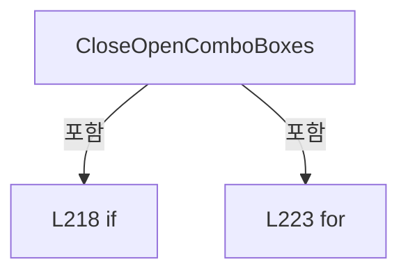

변경 전 점검: 입력/반환 타입, 위 호출자, 예외/취소 경로, 공유 상태와 저장·전송 소비자를 함께 확인합니다. 값의 단위나 물리 방향을 이름만으로 확정하지 않습니다.

### MethodDeclaration `OpenPowerMeterSettingInput` · L229–251

[Drilling.UI/Views/CMonitorView.xaml.cs:229–251](https://github.com/kjuws10-rgb/A3Drilling/blob/5aee8e58439c9b455cae7c9593c9be986c3e682e/Drilling.UI/Views/CMonitorView.xaml.cs#L229-L251)

| 항목 | 실제 추출 값 |
| --- | --- |
| 서명 | void Drilling.UI.Views.CMonitorView.OpenPowerMeterSettingInput(object, RoutedEventArgs) |
| 접근/수식자 | Private / private |
| 반환/값 타입 | void |
| 소속 타입 | NamedType:Drilling.UI.Views.CMonitorView |

입력 계약:

| 이름 | 타입 | 전달 | 선택/기본값 |
| --- | --- | --- | --- |
| sender | object | None | False /  |
| e | RoutedEventArgs | None | False /  |

현재 부분 분석에서 직접 연결된 호출자는 없습니다. XAML/이벤트/인터페이스·델리게이트·외부 진입을 추가 확인해야 하며, 미사용으로 판정한 것이 아닙니다.

호출하는 대상과 해석 범위:

| 원본 행 | 표현식 | 분석 상태 | 대상/소스 위치 |
| --- | --- | --- | --- |
| 237 | GetMonitorMenu | resolved | Drilling.UI.Menu.Menus.CMenuMonitor? Drilling.UI.Views.CMonitorView.GetMonitorMenu() · Drilling.UI/Views/CMonitorView.xaml.cs:431 |
| 238 | .TryNotifyPowerMeterTuneLocked | resolved | bool Drilling.UI.Menu.Menus.CMenuMonitor.TryNotifyPowerMeterTuneLocked(string) · Drilling.UI/Menu/Menus/CMenuMonitor.cs:5311 |
| 243 | new CValueInputDialog | resolved | Drilling.UI.Popup.CValueInputDialog.CValueInputDialog(string, string, Drilling.Common.Managers.EN_RECIPE_DATA_TYPE, double, double) · Drilling.UI/Popup/CValueInputDialog.xaml.cs:13 |
| 245 | Window.GetWindow | unresolved | None |
| 247 | dialog.ShowDialog | unresolved | None |

본문의 실제 연산·분기·예외·반환 순서(원문 위치 순):

| 원본 행 | 종류 | 주석 해설 |
| --- | --- | --- |
| 231 | if | 조건에 따라 분기합니다: if (sender is not FrameworkElement { DataContext: ST_PWM_SETTING_ROW row } &#124;&#124; row.UsesSelectionEditor) |
| 233 | return | 호출자에게 값 또는 제어를 반환합니다: return; |
| 236 | assignment | 값을 대상에 대입합니다: e.Handled = true |
| 237 | call | 함수·델리게이트 또는 객체 생성자를 호출합니다: GetMonitorMenu() |
| 237 | local-declaration | 지역 변수를 선언합니다: var monitor = GetMonitorMenu(); |
| 237 | variable-initializer | 변수의 초기값을 지정합니다: monitor = GetMonitorMenu() |
| 238 | call | 함수·델리게이트 또는 객체 생성자를 호출합니다: .TryNotifyPowerMeterTuneLocked("SETTING 변경") |
| 238 | if | 조건에 따라 분기합니다: if (monitor?.TryNotifyPowerMeterTuneLocked("SETTING 변경") == true) |
| 240 | return | 호출자에게 값 또는 제어를 반환합니다: return; |
| 243 | call | 함수·델리게이트 또는 객체 생성자를 호출합니다: new CValueInputDialog(row.Parameter, row.Value, row.DataType, 0, 0) { Owner = Window.GetWindow(this) } |
| 243 | local-declaration | 지역 변수를 선언합니다: var dialog = new CValueInputDialog(row.Parameter, row.Value, row.DataType, 0, 0) { Owner = Window.GetWindow(this) }; |
| 243 | variable-initializer | 변수의 초기값을 지정합니다: dialog = new CValueInputDialog(row.Parameter, row.Value, row.DataType, 0, 0) { Owner = Window.GetWindow(this) } |
| 245 | assignment | 값을 대상에 대입합니다: Owner = Window.GetWindow(this) |
| 245 | call | 함수·델리게이트 또는 객체 생성자를 호출합니다: Window.GetWindow(this) |
| 247 | call | 함수·델리게이트 또는 객체 생성자를 호출합니다: dialog.ShowDialog() |
| 247 | if | 조건에 따라 분기합니다: if (dialog.ShowDialog() == true) |
| 249 | assignment | 값을 대상에 대입합니다: row.Value = dialog.ResultValue |

제어 구문의 포함 구조(실제 실행 순서/CFG가 아닌 구문 탐색 그림):

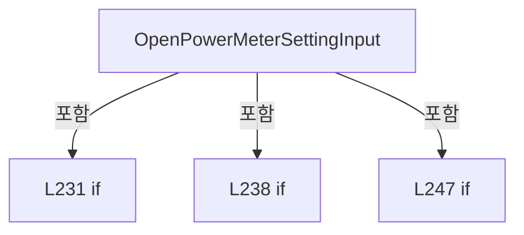

변경 전 점검: 입력/반환 타입, 위 호출자, 예외/취소 경로, 공유 상태와 저장·전송 소비자를 함께 확인합니다. 값의 단위나 물리 방향을 이름만으로 확정하지 않습니다.

### MethodDeclaration `PowerMeterSettingSelection_PreviewMouseDown` · L253–260

[Drilling.UI/Views/CMonitorView.xaml.cs:253–260](https://github.com/kjuws10-rgb/A3Drilling/blob/5aee8e58439c9b455cae7c9593c9be986c3e682e/Drilling.UI/Views/CMonitorView.xaml.cs#L253-L260)

| 항목 | 실제 추출 값 |
| --- | --- |
| 서명 | void Drilling.UI.Views.CMonitorView.PowerMeterSettingSelection_PreviewMouseDown(object, MouseButtonEventArgs) |
| 접근/수식자 | Private / private |
| 반환/값 타입 | void |
| 소속 타입 | NamedType:Drilling.UI.Views.CMonitorView |

입력 계약:

| 이름 | 타입 | 전달 | 선택/기본값 |
| --- | --- | --- | --- |
| sender | object | None | False /  |
| e | MouseButtonEventArgs | None | False /  |

현재 부분 분석에서 직접 연결된 호출자는 없습니다. XAML/이벤트/인터페이스·델리게이트·외부 진입을 추가 확인해야 하며, 미사용으로 판정한 것이 아닙니다.

호출하는 대상과 해석 범위:

| 원본 행 | 표현식 | 분석 상태 | 대상/소스 위치 |
| --- | --- | --- | --- |
| 255 | GetMonitorMenu | resolved | Drilling.UI.Menu.Menus.CMenuMonitor? Drilling.UI.Views.CMonitorView.GetMonitorMenu() · Drilling.UI/Views/CMonitorView.xaml.cs:431 |
| 256 | .TryNotifyPowerMeterTuneLocked | resolved | bool Drilling.UI.Menu.Menus.CMenuMonitor.TryNotifyPowerMeterTuneLocked(string) · Drilling.UI/Menu/Menus/CMenuMonitor.cs:5311 |

본문의 실제 연산·분기·예외·반환 순서(원문 위치 순):

| 원본 행 | 종류 | 주석 해설 |
| --- | --- | --- |
| 255 | call | 함수·델리게이트 또는 객체 생성자를 호출합니다: GetMonitorMenu() |
| 255 | local-declaration | 지역 변수를 선언합니다: var monitor = GetMonitorMenu(); |
| 255 | variable-initializer | 변수의 초기값을 지정합니다: monitor = GetMonitorMenu() |
| 256 | call | 함수·델리게이트 또는 객체 생성자를 호출합니다: .TryNotifyPowerMeterTuneLocked("SETTING 변경") |
| 256 | if | 조건에 따라 분기합니다: if (monitor?.TryNotifyPowerMeterTuneLocked("SETTING 변경") == true) |
| 258 | assignment | 값을 대상에 대입합니다: e.Handled = true |

제어 구문의 포함 구조(실제 실행 순서/CFG가 아닌 구문 탐색 그림):

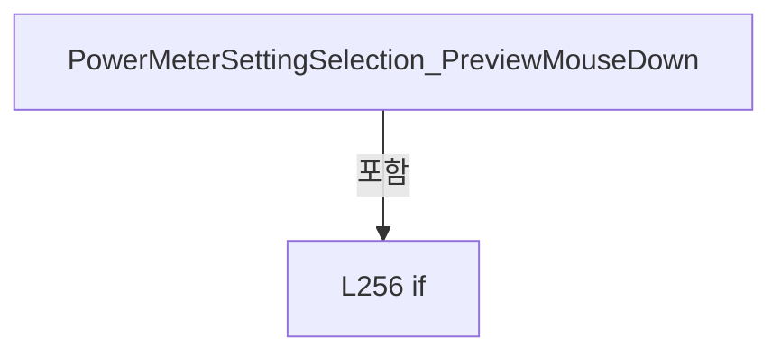

변경 전 점검: 입력/반환 타입, 위 호출자, 예외/취소 경로, 공유 상태와 저장·전송 소비자를 함께 확인합니다. 값의 단위나 물리 방향을 이름만으로 확정하지 않습니다.

### MethodDeclaration `PowerMeterSettingSelection_PreviewKeyDown` · L262–274

[Drilling.UI/Views/CMonitorView.xaml.cs:262–274](https://github.com/kjuws10-rgb/A3Drilling/blob/5aee8e58439c9b455cae7c9593c9be986c3e682e/Drilling.UI/Views/CMonitorView.xaml.cs#L262-L274)

| 항목 | 실제 추출 값 |
| --- | --- |
| 서명 | void Drilling.UI.Views.CMonitorView.PowerMeterSettingSelection_PreviewKeyDown(object, KeyEventArgs) |
| 접근/수식자 | Private / private |
| 반환/값 타입 | void |
| 소속 타입 | NamedType:Drilling.UI.Views.CMonitorView |

입력 계약:

| 이름 | 타입 | 전달 | 선택/기본값 |
| --- | --- | --- | --- |
| sender | object | None | False /  |
| e | KeyEventArgs | None | False /  |

현재 부분 분석에서 직접 연결된 호출자는 없습니다. XAML/이벤트/인터페이스·델리게이트·외부 진입을 추가 확인해야 하며, 미사용으로 판정한 것이 아닙니다.

호출하는 대상과 해석 범위:

| 원본 행 | 표현식 | 분석 상태 | 대상/소스 위치 |
| --- | --- | --- | --- |
| 264 | IsPowerMeterSettingSelectionKey | candidate | OverloadResolutionFailure |
| 269 | GetMonitorMenu | resolved | Drilling.UI.Menu.Menus.CMenuMonitor? Drilling.UI.Views.CMonitorView.GetMonitorMenu() · Drilling.UI/Views/CMonitorView.xaml.cs:431 |
| 270 | .TryNotifyPowerMeterTuneLocked | resolved | bool Drilling.UI.Menu.Menus.CMenuMonitor.TryNotifyPowerMeterTuneLocked(string) · Drilling.UI/Menu/Menus/CMenuMonitor.cs:5311 |

본문의 실제 연산·분기·예외·반환 순서(원문 위치 순):

| 원본 행 | 종류 | 주석 해설 |
| --- | --- | --- |
| 264 | call | 함수·델리게이트 또는 객체 생성자를 호출합니다: IsPowerMeterSettingSelectionKey(e.Key) |
| 264 | if | 조건에 따라 분기합니다: if (!IsPowerMeterSettingSelectionKey(e.Key)) |
| 266 | return | 호출자에게 값 또는 제어를 반환합니다: return; |
| 269 | call | 함수·델리게이트 또는 객체 생성자를 호출합니다: GetMonitorMenu() |
| 269 | local-declaration | 지역 변수를 선언합니다: var monitor = GetMonitorMenu(); |
| 269 | variable-initializer | 변수의 초기값을 지정합니다: monitor = GetMonitorMenu() |
| 270 | call | 함수·델리게이트 또는 객체 생성자를 호출합니다: .TryNotifyPowerMeterTuneLocked("SETTING 변경") |
| 270 | if | 조건에 따라 분기합니다: if (monitor?.TryNotifyPowerMeterTuneLocked("SETTING 변경") == true) |
| 272 | assignment | 값을 대상에 대입합니다: e.Handled = true |

제어 구문의 포함 구조(실제 실행 순서/CFG가 아닌 구문 탐색 그림):

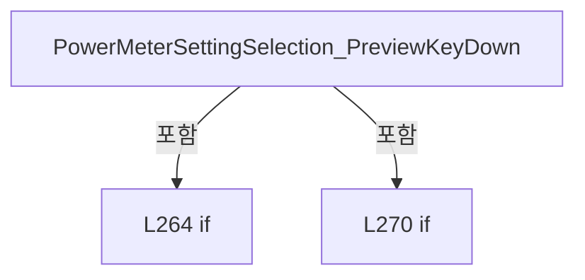

변경 전 점검: 입력/반환 타입, 위 호출자, 예외/취소 경로, 공유 상태와 저장·전송 소비자를 함께 확인합니다. 값의 단위나 물리 방향을 이름만으로 확정하지 않습니다.

### MethodDeclaration `PowerMeterSettingSelection_PreviewMouseWheel` · L276–283

[Drilling.UI/Views/CMonitorView.xaml.cs:276–283](https://github.com/kjuws10-rgb/A3Drilling/blob/5aee8e58439c9b455cae7c9593c9be986c3e682e/Drilling.UI/Views/CMonitorView.xaml.cs#L276-L283)

| 항목 | 실제 추출 값 |
| --- | --- |
| 서명 | void Drilling.UI.Views.CMonitorView.PowerMeterSettingSelection_PreviewMouseWheel(object, MouseWheelEventArgs) |
| 접근/수식자 | Private / private |
| 반환/값 타입 | void |
| 소속 타입 | NamedType:Drilling.UI.Views.CMonitorView |

입력 계약:

| 이름 | 타입 | 전달 | 선택/기본값 |
| --- | --- | --- | --- |
| sender | object | None | False /  |
| e | MouseWheelEventArgs | None | False /  |

현재 부분 분석에서 직접 연결된 호출자는 없습니다. XAML/이벤트/인터페이스·델리게이트·외부 진입을 추가 확인해야 하며, 미사용으로 판정한 것이 아닙니다.

호출하는 대상과 해석 범위:

| 원본 행 | 표현식 | 분석 상태 | 대상/소스 위치 |
| --- | --- | --- | --- |
| 278 | GetMonitorMenu | resolved | Drilling.UI.Menu.Menus.CMenuMonitor? Drilling.UI.Views.CMonitorView.GetMonitorMenu() · Drilling.UI/Views/CMonitorView.xaml.cs:431 |
| 279 | .TryNotifyPowerMeterTuneLocked | resolved | bool Drilling.UI.Menu.Menus.CMenuMonitor.TryNotifyPowerMeterTuneLocked(string) · Drilling.UI/Menu/Menus/CMenuMonitor.cs:5311 |

본문의 실제 연산·분기·예외·반환 순서(원문 위치 순):

| 원본 행 | 종류 | 주석 해설 |
| --- | --- | --- |
| 278 | call | 함수·델리게이트 또는 객체 생성자를 호출합니다: GetMonitorMenu() |
| 278 | local-declaration | 지역 변수를 선언합니다: var monitor = GetMonitorMenu(); |
| 278 | variable-initializer | 변수의 초기값을 지정합니다: monitor = GetMonitorMenu() |
| 279 | call | 함수·델리게이트 또는 객체 생성자를 호출합니다: .TryNotifyPowerMeterTuneLocked("SETTING 변경") |
| 279 | if | 조건에 따라 분기합니다: if (monitor?.TryNotifyPowerMeterTuneLocked("SETTING 변경") == true) |
| 281 | assignment | 값을 대상에 대입합니다: e.Handled = true |

제어 구문의 포함 구조(실제 실행 순서/CFG가 아닌 구문 탐색 그림):

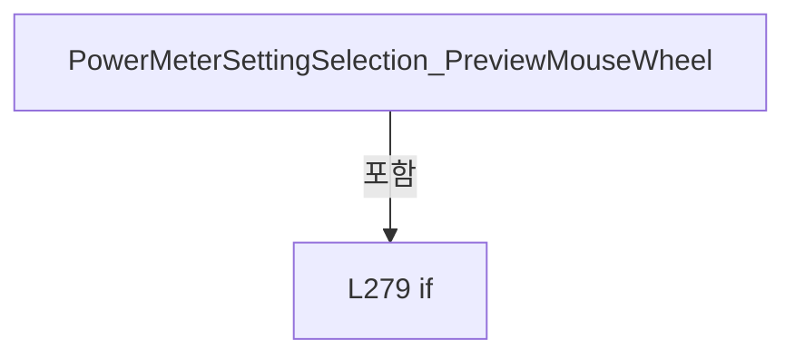

변경 전 점검: 입력/반환 타입, 위 호출자, 예외/취소 경로, 공유 상태와 저장·전송 소비자를 함께 확인합니다. 값의 단위나 물리 방향을 이름만으로 확정하지 않습니다.

### MethodDeclaration `PowerMeterSettingSelection_DropDownOpened` · L285–294

[Drilling.UI/Views/CMonitorView.xaml.cs:285–294](https://github.com/kjuws10-rgb/A3Drilling/blob/5aee8e58439c9b455cae7c9593c9be986c3e682e/Drilling.UI/Views/CMonitorView.xaml.cs#L285-L294)

| 항목 | 실제 추출 값 |
| --- | --- |
| 서명 | void Drilling.UI.Views.CMonitorView.PowerMeterSettingSelection_DropDownOpened(object, System.EventArgs) |
| 접근/수식자 | Private / private |
| 반환/값 타입 | void |
| 소속 타입 | NamedType:Drilling.UI.Views.CMonitorView |

입력 계약:

| 이름 | 타입 | 전달 | 선택/기본값 |
| --- | --- | --- | --- |
| sender | object | None | False /  |
| e | System.EventArgs | None | False /  |

현재 부분 분석에서 직접 연결된 호출자는 없습니다. XAML/이벤트/인터페이스·델리게이트·외부 진입을 추가 확인해야 하며, 미사용으로 판정한 것이 아닙니다.

호출하는 대상과 해석 범위:

| 원본 행 | 표현식 | 분석 상태 | 대상/소스 위치 |
| --- | --- | --- | --- |
| 287 | GetMonitorMenu | resolved | Drilling.UI.Menu.Menus.CMenuMonitor? Drilling.UI.Views.CMonitorView.GetMonitorMenu() · Drilling.UI/Views/CMonitorView.xaml.cs:431 |
| 288 | .TryNotifyPowerMeterTuneLocked | resolved | bool Drilling.UI.Menu.Menus.CMenuMonitor.TryNotifyPowerMeterTuneLocked(string) · Drilling.UI/Menu/Menus/CMenuMonitor.cs:5311 |

본문의 실제 연산·분기·예외·반환 순서(원문 위치 순):

| 원본 행 | 종류 | 주석 해설 |
| --- | --- | --- |
| 287 | call | 함수·델리게이트 또는 객체 생성자를 호출합니다: GetMonitorMenu() |
| 287 | local-declaration | 지역 변수를 선언합니다: var monitor = GetMonitorMenu(); |
| 287 | variable-initializer | 변수의 초기값을 지정합니다: monitor = GetMonitorMenu() |
| 288 | call | 함수·델리게이트 또는 객체 생성자를 호출합니다: .TryNotifyPowerMeterTuneLocked("SETTING 변경") |
| 288 | if | 조건에 따라 분기합니다: if (monitor?.TryNotifyPowerMeterTuneLocked("SETTING 변경") != true &#124;&#124; sender is not ComboBox comboBox) |
| 290 | return | 호출자에게 값 또는 제어를 반환합니다: return; |
| 293 | assignment | 값을 대상에 대입합니다: comboBox.IsDropDownOpen = false |

제어 구문의 포함 구조(실제 실행 순서/CFG가 아닌 구문 탐색 그림):

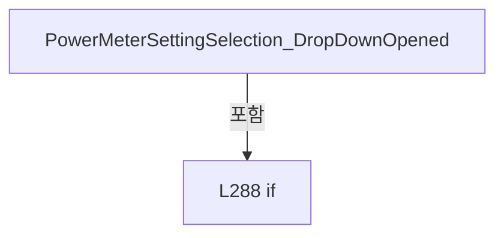

변경 전 점검: 입력/반환 타입, 위 호출자, 예외/취소 경로, 공유 상태와 저장·전송 소비자를 함께 확인합니다. 값의 단위나 물리 방향을 이름만으로 확정하지 않습니다.

### MethodDeclaration `IsPowerMeterSettingSelectionKey` · L296–312

[Drilling.UI/Views/CMonitorView.xaml.cs:296–312](https://github.com/kjuws10-rgb/A3Drilling/blob/5aee8e58439c9b455cae7c9593c9be986c3e682e/Drilling.UI/Views/CMonitorView.xaml.cs#L296-L312)

| 항목 | 실제 추출 값 |
| --- | --- |
| 서명 | bool Drilling.UI.Views.CMonitorView.IsPowerMeterSettingSelectionKey(Key) |
| 접근/수식자 | Private / private, static |
| 반환/값 타입 | bool |
| 소속 타입 | NamedType:Drilling.UI.Views.CMonitorView |

입력 계약:

| 이름 | 타입 | 전달 | 선택/기본값 |
| --- | --- | --- | --- |
| key | Key | None | False /  |

현재 부분 분석에서 직접 연결된 호출자는 없습니다. XAML/이벤트/인터페이스·델리게이트·외부 진입을 추가 확인해야 하며, 미사용으로 판정한 것이 아닙니다.

본문의 실제 연산·분기·예외·반환 순서(원문 위치 순):

| 원본 행 | 종류 | 주석 해설 |
| --- | --- | --- |
| 298 | switch | 값에 따라 분기합니다: switch (key) |
| 300 | case | 분기값/패턴의 구간입니다: case Key.Enter: |
| 301 | case | 분기값/패턴의 구간입니다: case Key.Space: |
| 302 | case | 분기값/패턴의 구간입니다: case Key.Up: |
| 303 | case | 분기값/패턴의 구간입니다: case Key.Down: |
| 304 | case | 분기값/패턴의 구간입니다: case Key.PageUp: |
| 305 | case | 분기값/패턴의 구간입니다: case Key.PageDown: |
| 306 | case | 분기값/패턴의 구간입니다: case Key.Home: |
| 307 | case | 분기값/패턴의 구간입니다: case Key.End: |
| 308 | return | 호출자에게 값 또는 제어를 반환합니다: return true; |
| 309 | case | 분기값/패턴의 구간입니다: default: |
| 310 | return | 호출자에게 값 또는 제어를 반환합니다: return false; |

제어 구문의 포함 구조(실제 실행 순서/CFG가 아닌 구문 탐색 그림):

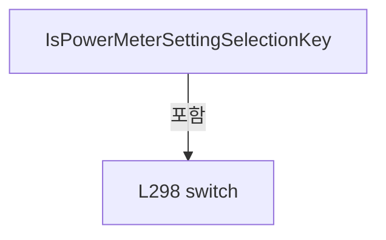

변경 전 점검: 입력/반환 타입, 위 호출자, 예외/취소 경로, 공유 상태와 저장·전송 소비자를 함께 확인합니다. 값의 단위나 물리 방향을 이름만으로 확정하지 않습니다.

### MethodDeclaration `OpenLaserSettingInput` · L314–331

[Drilling.UI/Views/CMonitorView.xaml.cs:314–331](https://github.com/kjuws10-rgb/A3Drilling/blob/5aee8e58439c9b455cae7c9593c9be986c3e682e/Drilling.UI/Views/CMonitorView.xaml.cs#L314-L331)

| 항목 | 실제 추출 값 |
| --- | --- |
| 서명 | void Drilling.UI.Views.CMonitorView.OpenLaserSettingInput(object, RoutedEventArgs) |
| 접근/수식자 | Private / private |
| 반환/값 타입 | void |
| 소속 타입 | NamedType:Drilling.UI.Views.CMonitorView |

입력 계약:

| 이름 | 타입 | 전달 | 선택/기본값 |
| --- | --- | --- | --- |
| sender | object | None | False /  |
| e | RoutedEventArgs | None | False /  |

현재 부분 분석에서 직접 연결된 호출자는 없습니다. XAML/이벤트/인터페이스·델리게이트·외부 진입을 추가 확인해야 하며, 미사용으로 판정한 것이 아닙니다.

호출하는 대상과 해석 범위:

| 원본 행 | 표현식 | 분석 상태 | 대상/소스 위치 |
| --- | --- | --- | --- |
| 322 | new CValueInputDialog | resolved | Drilling.UI.Popup.CValueInputDialog.CValueInputDialog(string, string, Drilling.Common.Managers.EN_RECIPE_DATA_TYPE, double, double) · Drilling.UI/Popup/CValueInputDialog.xaml.cs:13 |
| 324 | Window.GetWindow | unresolved | None |
| 326 | dialog.ShowDialog | unresolved | None |

본문의 실제 연산·분기·예외·반환 순서(원문 위치 순):

| 원본 행 | 종류 | 주석 해설 |
| --- | --- | --- |
| 316 | if | 조건에 따라 분기합니다: if (sender is not Button { DataContext: ST_MONITOR_LASER_CONTROL_ROW row } button &#124;&#124; !row.CanCommand) |
| 318 | return | 호출자에게 값 또는 제어를 반환합니다: return; |
| 321 | assignment | 값을 대상에 대입합니다: e.Handled = true |
| 322 | call | 함수·델리게이트 또는 객체 생성자를 호출합니다: new CValueInputDialog(row.CurrentLabel, row.Setting.Value, EN_RECIPE_DATA_TYPE.Int, 0, int.MaxValue) { Owner = Window.GetWindow(this) } |
| 322 | local-declaration | 지역 변수를 선언합니다: var dialog = new CValueInputDialog(row.CurrentLabel, row.Setting.Value, EN_RECIPE_DATA_TYPE.Int, 0, int.MaxValue) { Owner = Window.GetWindow(this) }; |
| 322 | variable-initializer | 변수의 초기값을 지정합니다: dialog = new CValueInputDialog(row.CurrentLabel, row.Setting.Value, EN_RECIPE_DATA_TYPE.Int, 0, int.MaxValue) { Owner = Window.GetWindow(this) } |
| 324 | assignment | 값을 대상에 대입합니다: Owner = Window.GetWindow(this) |
| 324 | call | 함수·델리게이트 또는 객체 생성자를 호출합니다: Window.GetWindow(this) |
| 326 | call | 함수·델리게이트 또는 객체 생성자를 호출합니다: dialog.ShowDialog() |
| 326 | if | 조건에 따라 분기합니다: if (dialog.ShowDialog() == true) |
| 328 | assignment | 값을 대상에 대입합니다: row.Setting.Value = dialog.ResultValue |
| 329 | assignment | 값을 대상에 대입합니다: button.Content = dialog.ResultValue |

제어 구문의 포함 구조(실제 실행 순서/CFG가 아닌 구문 탐색 그림):

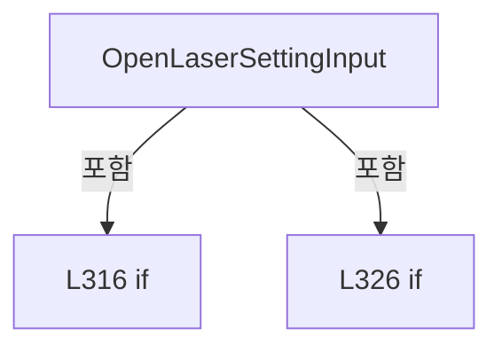

변경 전 점검: 입력/반환 타입, 위 호출자, 예외/취소 경로, 공유 상태와 저장·전송 소비자를 함께 확인합니다. 값의 단위나 물리 방향을 이름만으로 확정하지 않습니다.

### MethodDeclaration `OpenMotorOperationInput` · L333–350

[Drilling.UI/Views/CMonitorView.xaml.cs:333–350](https://github.com/kjuws10-rgb/A3Drilling/blob/5aee8e58439c9b455cae7c9593c9be986c3e682e/Drilling.UI/Views/CMonitorView.xaml.cs#L333-L350)

| 항목 | 실제 추출 값 |
| --- | --- |
| 서명 | void Drilling.UI.Views.CMonitorView.OpenMotorOperationInput(object, RoutedEventArgs) |
| 접근/수식자 | Private / private |
| 반환/값 타입 | void |
| 소속 타입 | NamedType:Drilling.UI.Views.CMonitorView |

입력 계약:

| 이름 | 타입 | 전달 | 선택/기본값 |
| --- | --- | --- | --- |
| sender | object | None | False /  |
| e | RoutedEventArgs | None | False /  |

현재 부분 분석에서 직접 연결된 호출자는 없습니다. XAML/이벤트/인터페이스·델리게이트·외부 진입을 추가 확인해야 하며, 미사용으로 판정한 것이 아닙니다.

호출하는 대상과 해석 범위:

| 원본 행 | 표현식 | 분석 상태 | 대상/소스 위치 |
| --- | --- | --- | --- |
| 341 | new CValueInputDialog | resolved | Drilling.UI.Popup.CValueInputDialog.CValueInputDialog(string, string, Drilling.Common.Managers.EN_RECIPE_DATA_TYPE, double, double) · Drilling.UI/Popup/CValueInputDialog.xaml.cs:13 |
| 343 | Window.GetWindow | unresolved | None |
| 345 | dialog.ShowDialog | unresolved | None |

본문의 실제 연산·분기·예외·반환 순서(원문 위치 순):

| 원본 행 | 종류 | 주석 해설 |
| --- | --- | --- |
| 335 | if | 조건에 따라 분기합니다: if (sender is not Button { Tag: ST_MONITOR_PARAMETER_ROW row } button) |
| 337 | return | 호출자에게 값 또는 제어를 반환합니다: return; |
| 340 | assignment | 값을 대상에 대입합니다: e.Handled = true |
| 341 | call | 함수·델리게이트 또는 객체 생성자를 호출합니다: new CValueInputDialog(row.Parameter, row.Value, EN_RECIPE_DATA_TYPE.Double, 0, 0) { Owner = Window.GetWindow(this) } |
| 341 | local-declaration | 지역 변수를 선언합니다: var dialog = new CValueInputDialog(row.Parameter, row.Value, EN_RECIPE_DATA_TYPE.Double, 0, 0) { Owner = Window.GetWindow(this) }; |
| 341 | variable-initializer | 변수의 초기값을 지정합니다: dialog = new CValueInputDialog(row.Parameter, row.Value, EN_RECIPE_DATA_TYPE.Double, 0, 0) { Owner = Window.GetWindow(this) } |
| 343 | assignment | 값을 대상에 대입합니다: Owner = Window.GetWindow(this) |
| 343 | call | 함수·델리게이트 또는 객체 생성자를 호출합니다: Window.GetWindow(this) |
| 345 | call | 함수·델리게이트 또는 객체 생성자를 호출합니다: dialog.ShowDialog() |
| 345 | if | 조건에 따라 분기합니다: if (dialog.ShowDialog() == true) |
| 347 | assignment | 값을 대상에 대입합니다: row.Value = dialog.ResultValue |
| 348 | assignment | 값을 대상에 대입합니다: button.Content = dialog.ResultValue |

제어 구문의 포함 구조(실제 실행 순서/CFG가 아닌 구문 탐색 그림):

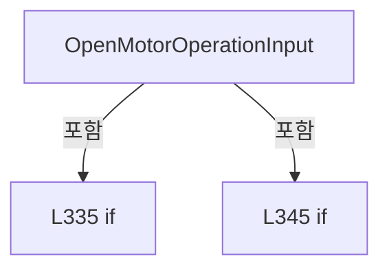

변경 전 점검: 입력/반환 타입, 위 호출자, 예외/취소 경로, 공유 상태와 저장·전송 소비자를 함께 확인합니다. 값의 단위나 물리 방향을 이름만으로 확정하지 않습니다.

### MethodDeclaration `OpenXpsMultiMoveTargetInput` · L352–368

[Drilling.UI/Views/CMonitorView.xaml.cs:352–368](https://github.com/kjuws10-rgb/A3Drilling/blob/5aee8e58439c9b455cae7c9593c9be986c3e682e/Drilling.UI/Views/CMonitorView.xaml.cs#L352-L368)

| 항목 | 실제 추출 값 |
| --- | --- |
| 서명 | void Drilling.UI.Views.CMonitorView.OpenXpsMultiMoveTargetInput(object, RoutedEventArgs) |
| 접근/수식자 | Private / private |
| 반환/값 타입 | void |
| 소속 타입 | NamedType:Drilling.UI.Views.CMonitorView |

입력 계약:

| 이름 | 타입 | 전달 | 선택/기본값 |
| --- | --- | --- | --- |
| sender | object | None | False /  |
| e | RoutedEventArgs | None | False /  |

현재 부분 분석에서 직접 연결된 호출자는 없습니다. XAML/이벤트/인터페이스·델리게이트·외부 진입을 추가 확인해야 하며, 미사용으로 판정한 것이 아닙니다.

호출하는 대상과 해석 범위:

| 원본 행 | 표현식 | 분석 상태 | 대상/소스 위치 |
| --- | --- | --- | --- |
| 360 | new CValueInputDialog | resolved | Drilling.UI.Popup.CValueInputDialog.CValueInputDialog(string, string, Drilling.Common.Managers.EN_RECIPE_DATA_TYPE, double, double) · Drilling.UI/Popup/CValueInputDialog.xaml.cs:13 |
| 362 | Window.GetWindow | unresolved | None |
| 364 | dialog.ShowDialog | unresolved | None |

본문의 실제 연산·분기·예외·반환 순서(원문 위치 순):

| 원본 행 | 종류 | 주석 해설 |
| --- | --- | --- |
| 354 | if | 조건에 따라 분기합니다: if (sender is not Button { Tag: ST_MONITOR_MULTI_MOVE_AXIS_ROW row }) |
| 356 | return | 호출자에게 값 또는 제어를 반환합니다: return; |
| 359 | assignment | 값을 대상에 대입합니다: e.Handled = true |
| 360 | call | 함수·델리게이트 또는 객체 생성자를 호출합니다: new CValueInputDialog($"Axis {row.Axis} Target Position", row.TargetPosition, EN_RECIPE_DATA_TYPE.Double, 0, 0) { Owner = Window.GetWindow(this) } |
| 360 | local-declaration | 지역 변수를 선언합니다: var dialog = new CValueInputDialog($"Axis {row.Axis} Target Position", row.TargetPosition, EN_RECIPE_DATA_TYPE.Double, 0, 0) { Owner = Window.GetWindow(this) }; |
| 360 | variable-initializer | 변수의 초기값을 지정합니다: dialog = new CValueInputDialog($"Axis {row.Axis} Target Position", row.TargetPosition, EN_RECIPE_DATA_TYPE.Double, 0, 0) { Owner = Window.GetWindow(this) } |
| 362 | assignment | 값을 대상에 대입합니다: Owner = Window.GetWindow(this) |
| 362 | call | 함수·델리게이트 또는 객체 생성자를 호출합니다: Window.GetWindow(this) |
| 364 | call | 함수·델리게이트 또는 객체 생성자를 호출합니다: dialog.ShowDialog() |
| 364 | if | 조건에 따라 분기합니다: if (dialog.ShowDialog() == true) |
| 366 | assignment | 값을 대상에 대입합니다: row.TargetPosition = dialog.ResultValue |

제어 구문의 포함 구조(실제 실행 순서/CFG가 아닌 구문 탐색 그림):

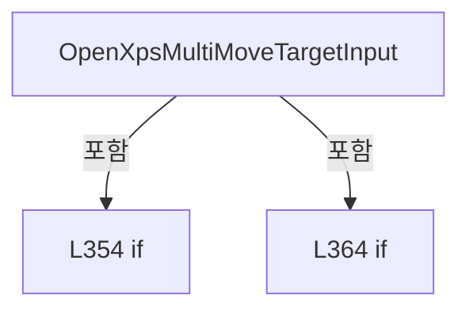

변경 전 점검: 입력/반환 타입, 위 호출자, 예외/취소 경로, 공유 상태와 저장·전송 소비자를 함께 확인합니다. 값의 단위나 물리 방향을 이름만으로 확정하지 않습니다.

### MethodDeclaration `StartXpsJogNegative` · L370–374

[Drilling.UI/Views/CMonitorView.xaml.cs:370–374](https://github.com/kjuws10-rgb/A3Drilling/blob/5aee8e58439c9b455cae7c9593c9be986c3e682e/Drilling.UI/Views/CMonitorView.xaml.cs#L370-L374)

| 항목 | 실제 추출 값 |
| --- | --- |
| 서명 | void Drilling.UI.Views.CMonitorView.StartXpsJogNegative(object, MouseButtonEventArgs) |
| 접근/수식자 | Private / private, async |
| 반환/값 타입 | void |
| 소속 타입 | NamedType:Drilling.UI.Views.CMonitorView |

입력 계약:

| 이름 | 타입 | 전달 | 선택/기본값 |
| --- | --- | --- | --- |
| sender | object | None | False /  |
| e | MouseButtonEventArgs | None | False /  |

현재 부분 분석에서 직접 연결된 호출자는 없습니다. XAML/이벤트/인터페이스·델리게이트·외부 진입을 추가 확인해야 하며, 미사용으로 판정한 것이 아닙니다.

호출하는 대상과 해석 범위:

| 원본 행 | 표현식 | 분석 상태 | 대상/소스 위치 |
| --- | --- | --- | --- |
| 373 | ExecuteXpsJogEvent | resolved | System.Threading.Tasks.Task Drilling.UI.Views.CMonitorView.ExecuteXpsJogEvent(bool?) · Drilling.UI/Views/CMonitorView.xaml.cs:403 |

본문의 실제 연산·분기·예외·반환 순서(원문 위치 순):

| 원본 행 | 종류 | 주석 해설 |
| --- | --- | --- |
| 372 | assignment | 값을 대상에 대입합니다: e.Handled = true |
| 373 | await | 비동기 완료를 기다립니다: await ExecuteXpsJogEvent(positive: false) |
| 373 | call | 함수·델리게이트 또는 객체 생성자를 호출합니다: ExecuteXpsJogEvent(positive: false) |

변경 전 점검: 입력/반환 타입, 위 호출자, 예외/취소 경로, 공유 상태와 저장·전송 소비자를 함께 확인합니다. 값의 단위나 물리 방향을 이름만으로 확정하지 않습니다.

### MethodDeclaration `StartXpsJogPositive` · L376–380

[Drilling.UI/Views/CMonitorView.xaml.cs:376–380](https://github.com/kjuws10-rgb/A3Drilling/blob/5aee8e58439c9b455cae7c9593c9be986c3e682e/Drilling.UI/Views/CMonitorView.xaml.cs#L376-L380)

| 항목 | 실제 추출 값 |
| --- | --- |
| 서명 | void Drilling.UI.Views.CMonitorView.StartXpsJogPositive(object, MouseButtonEventArgs) |
| 접근/수식자 | Private / private, async |
| 반환/값 타입 | void |
| 소속 타입 | NamedType:Drilling.UI.Views.CMonitorView |

입력 계약:

| 이름 | 타입 | 전달 | 선택/기본값 |
| --- | --- | --- | --- |
| sender | object | None | False /  |
| e | MouseButtonEventArgs | None | False /  |

현재 부분 분석에서 직접 연결된 호출자는 없습니다. XAML/이벤트/인터페이스·델리게이트·외부 진입을 추가 확인해야 하며, 미사용으로 판정한 것이 아닙니다.

호출하는 대상과 해석 범위:

| 원본 행 | 표현식 | 분석 상태 | 대상/소스 위치 |
| --- | --- | --- | --- |
| 379 | ExecuteXpsJogEvent | resolved | System.Threading.Tasks.Task Drilling.UI.Views.CMonitorView.ExecuteXpsJogEvent(bool?) · Drilling.UI/Views/CMonitorView.xaml.cs:403 |

본문의 실제 연산·분기·예외·반환 순서(원문 위치 순):

| 원본 행 | 종류 | 주석 해설 |
| --- | --- | --- |
| 378 | assignment | 값을 대상에 대입합니다: e.Handled = true |
| 379 | await | 비동기 완료를 기다립니다: await ExecuteXpsJogEvent(positive: true) |
| 379 | call | 함수·델리게이트 또는 객체 생성자를 호출합니다: ExecuteXpsJogEvent(positive: true) |

변경 전 점검: 입력/반환 타입, 위 호출자, 예외/취소 경로, 공유 상태와 저장·전송 소비자를 함께 확인합니다. 값의 단위나 물리 방향을 이름만으로 확정하지 않습니다.

### MethodDeclaration `StopXpsJog` · L382–386

[Drilling.UI/Views/CMonitorView.xaml.cs:382–386](https://github.com/kjuws10-rgb/A3Drilling/blob/5aee8e58439c9b455cae7c9593c9be986c3e682e/Drilling.UI/Views/CMonitorView.xaml.cs#L382-L386)

| 항목 | 실제 추출 값 |
| --- | --- |
| 서명 | void Drilling.UI.Views.CMonitorView.StopXpsJog(object, MouseButtonEventArgs) |
| 접근/수식자 | Private / private, async |
| 반환/값 타입 | void |
| 소속 타입 | NamedType:Drilling.UI.Views.CMonitorView |

입력 계약:

| 이름 | 타입 | 전달 | 선택/기본값 |
| --- | --- | --- | --- |
| sender | object | None | False /  |
| e | MouseButtonEventArgs | None | False /  |

현재 부분 분석에서 직접 연결된 호출자는 없습니다. XAML/이벤트/인터페이스·델리게이트·외부 진입을 추가 확인해야 하며, 미사용으로 판정한 것이 아닙니다.

호출하는 대상과 해석 범위:

| 원본 행 | 표현식 | 분석 상태 | 대상/소스 위치 |
| --- | --- | --- | --- |
| 385 | ExecuteXpsJogEvent | resolved | System.Threading.Tasks.Task Drilling.UI.Views.CMonitorView.ExecuteXpsJogEvent(bool?) · Drilling.UI/Views/CMonitorView.xaml.cs:403 |

본문의 실제 연산·분기·예외·반환 순서(원문 위치 순):

| 원본 행 | 종류 | 주석 해설 |
| --- | --- | --- |
| 384 | assignment | 값을 대상에 대입합니다: e.Handled = true |
| 385 | await | 비동기 완료를 기다립니다: await ExecuteXpsJogEvent(positive: null) |
| 385 | call | 함수·델리게이트 또는 객체 생성자를 호출합니다: ExecuteXpsJogEvent(positive: null) |

변경 전 점검: 입력/반환 타입, 위 호출자, 예외/취소 경로, 공유 상태와 저장·전송 소비자를 함께 확인합니다. 값의 단위나 물리 방향을 이름만으로 확정하지 않습니다.

### MethodDeclaration `StopXpsJogOnMouseLeave` · L388–391

[Drilling.UI/Views/CMonitorView.xaml.cs:388–391](https://github.com/kjuws10-rgb/A3Drilling/blob/5aee8e58439c9b455cae7c9593c9be986c3e682e/Drilling.UI/Views/CMonitorView.xaml.cs#L388-L391)

| 항목 | 실제 추출 값 |
| --- | --- |
| 서명 | void Drilling.UI.Views.CMonitorView.StopXpsJogOnMouseLeave(object, MouseEventArgs) |
| 접근/수식자 | Private / private, async |
| 반환/값 타입 | void |
| 소속 타입 | NamedType:Drilling.UI.Views.CMonitorView |

입력 계약:

| 이름 | 타입 | 전달 | 선택/기본값 |
| --- | --- | --- | --- |
| sender | object | None | False /  |
| e | MouseEventArgs | None | False /  |

현재 부분 분석에서 직접 연결된 호출자는 없습니다. XAML/이벤트/인터페이스·델리게이트·외부 진입을 추가 확인해야 하며, 미사용으로 판정한 것이 아닙니다.

호출하는 대상과 해석 범위:

| 원본 행 | 표현식 | 분석 상태 | 대상/소스 위치 |
| --- | --- | --- | --- |
| 390 | ExecuteXpsJogEvent | resolved | System.Threading.Tasks.Task Drilling.UI.Views.CMonitorView.ExecuteXpsJogEvent(bool?) · Drilling.UI/Views/CMonitorView.xaml.cs:403 |

본문의 실제 연산·분기·예외·반환 순서(원문 위치 순):

| 원본 행 | 종류 | 주석 해설 |
| --- | --- | --- |
| 390 | await | 비동기 완료를 기다립니다: await ExecuteXpsJogEvent(positive: null) |
| 390 | call | 함수·델리게이트 또는 객체 생성자를 호출합니다: ExecuteXpsJogEvent(positive: null) |

변경 전 점검: 입력/반환 타입, 위 호출자, 예외/취소 경로, 공유 상태와 저장·전송 소비자를 함께 확인합니다. 값의 단위나 물리 방향을 이름만으로 확정하지 않습니다.

### MethodDeclaration `StopXpsJogOnLostMouseCapture` · L393–396

[Drilling.UI/Views/CMonitorView.xaml.cs:393–396](https://github.com/kjuws10-rgb/A3Drilling/blob/5aee8e58439c9b455cae7c9593c9be986c3e682e/Drilling.UI/Views/CMonitorView.xaml.cs#L393-L396)

| 항목 | 실제 추출 값 |
| --- | --- |
| 서명 | void Drilling.UI.Views.CMonitorView.StopXpsJogOnLostMouseCapture(object, MouseEventArgs) |
| 접근/수식자 | Private / private, async |
| 반환/값 타입 | void |
| 소속 타입 | NamedType:Drilling.UI.Views.CMonitorView |

입력 계약:

| 이름 | 타입 | 전달 | 선택/기본값 |
| --- | --- | --- | --- |
| sender | object | None | False /  |
| e | MouseEventArgs | None | False /  |

현재 부분 분석에서 직접 연결된 호출자는 없습니다. XAML/이벤트/인터페이스·델리게이트·외부 진입을 추가 확인해야 하며, 미사용으로 판정한 것이 아닙니다.

호출하는 대상과 해석 범위:

| 원본 행 | 표현식 | 분석 상태 | 대상/소스 위치 |
| --- | --- | --- | --- |
| 395 | ExecuteXpsJogEvent | resolved | System.Threading.Tasks.Task Drilling.UI.Views.CMonitorView.ExecuteXpsJogEvent(bool?) · Drilling.UI/Views/CMonitorView.xaml.cs:403 |

본문의 실제 연산·분기·예외·반환 순서(원문 위치 순):

| 원본 행 | 종류 | 주석 해설 |
| --- | --- | --- |
| 395 | await | 비동기 완료를 기다립니다: await ExecuteXpsJogEvent(positive: null) |
| 395 | call | 함수·델리게이트 또는 객체 생성자를 호출합니다: ExecuteXpsJogEvent(positive: null) |

변경 전 점검: 입력/반환 타입, 위 호출자, 예외/취소 경로, 공유 상태와 저장·전송 소비자를 함께 확인합니다. 값의 단위나 물리 방향을 이름만으로 확정하지 않습니다.

### MethodDeclaration `StopXpsJogOnLostKeyboardFocus` · L398–401

[Drilling.UI/Views/CMonitorView.xaml.cs:398–401](https://github.com/kjuws10-rgb/A3Drilling/blob/5aee8e58439c9b455cae7c9593c9be986c3e682e/Drilling.UI/Views/CMonitorView.xaml.cs#L398-L401)

| 항목 | 실제 추출 값 |
| --- | --- |
| 서명 | void Drilling.UI.Views.CMonitorView.StopXpsJogOnLostKeyboardFocus(object, KeyboardFocusChangedEventArgs) |
| 접근/수식자 | Private / private, async |
| 반환/값 타입 | void |
| 소속 타입 | NamedType:Drilling.UI.Views.CMonitorView |

입력 계약:

| 이름 | 타입 | 전달 | 선택/기본값 |
| --- | --- | --- | --- |
| sender | object | None | False /  |
| e | KeyboardFocusChangedEventArgs | None | False /  |

현재 부분 분석에서 직접 연결된 호출자는 없습니다. XAML/이벤트/인터페이스·델리게이트·외부 진입을 추가 확인해야 하며, 미사용으로 판정한 것이 아닙니다.

호출하는 대상과 해석 범위:

| 원본 행 | 표현식 | 분석 상태 | 대상/소스 위치 |
| --- | --- | --- | --- |
| 400 | ExecuteXpsJogEvent | resolved | System.Threading.Tasks.Task Drilling.UI.Views.CMonitorView.ExecuteXpsJogEvent(bool?) · Drilling.UI/Views/CMonitorView.xaml.cs:403 |

본문의 실제 연산·분기·예외·반환 순서(원문 위치 순):

| 원본 행 | 종류 | 주석 해설 |
| --- | --- | --- |
| 400 | await | 비동기 완료를 기다립니다: await ExecuteXpsJogEvent(positive: null) |
| 400 | call | 함수·델리게이트 또는 객체 생성자를 호출합니다: ExecuteXpsJogEvent(positive: null) |

변경 전 점검: 입력/반환 타입, 위 호출자, 예외/취소 경로, 공유 상태와 저장·전송 소비자를 함께 확인합니다. 값의 단위나 물리 방향을 이름만으로 확정하지 않습니다.

### MethodDeclaration `ExecuteXpsJogEvent` · L403–429

[Drilling.UI/Views/CMonitorView.xaml.cs:403–429](https://github.com/kjuws10-rgb/A3Drilling/blob/5aee8e58439c9b455cae7c9593c9be986c3e682e/Drilling.UI/Views/CMonitorView.xaml.cs#L403-L429)

| 항목 | 실제 추출 값 |
| --- | --- |
| 서명 | System.Threading.Tasks.Task Drilling.UI.Views.CMonitorView.ExecuteXpsJogEvent(bool?) |
| 접근/수식자 | Private / private, async |
| 반환/값 타입 | System.Threading.Tasks.Task |
| 소속 타입 | NamedType:Drilling.UI.Views.CMonitorView |

입력 계약:

| 이름 | 타입 | 전달 | 선택/기본값 |
| --- | --- | --- | --- |
| positive | bool? | None | False /  |

정적 호출자로 확인된 위치:

| 호출 파일/행 | 호출 표현식 | 런타임 분기 가능 |
| --- | --- | --- |
| [Drilling.UI/Views/CMonitorView.xaml.cs:373–373](https://github.com/kjuws10-rgb/A3Drilling/blob/5aee8e58439c9b455cae7c9593c9be986c3e682e/Drilling.UI/Views/CMonitorView.xaml.cs#L373-L373) | ExecuteXpsJogEvent | False |
| [Drilling.UI/Views/CMonitorView.xaml.cs:379–379](https://github.com/kjuws10-rgb/A3Drilling/blob/5aee8e58439c9b455cae7c9593c9be986c3e682e/Drilling.UI/Views/CMonitorView.xaml.cs#L379-L379) | ExecuteXpsJogEvent | False |
| [Drilling.UI/Views/CMonitorView.xaml.cs:385–385](https://github.com/kjuws10-rgb/A3Drilling/blob/5aee8e58439c9b455cae7c9593c9be986c3e682e/Drilling.UI/Views/CMonitorView.xaml.cs#L385-L385) | ExecuteXpsJogEvent | False |
| [Drilling.UI/Views/CMonitorView.xaml.cs:390–390](https://github.com/kjuws10-rgb/A3Drilling/blob/5aee8e58439c9b455cae7c9593c9be986c3e682e/Drilling.UI/Views/CMonitorView.xaml.cs#L390-L390) | ExecuteXpsJogEvent | False |
| [Drilling.UI/Views/CMonitorView.xaml.cs:395–395](https://github.com/kjuws10-rgb/A3Drilling/blob/5aee8e58439c9b455cae7c9593c9be986c3e682e/Drilling.UI/Views/CMonitorView.xaml.cs#L395-L395) | ExecuteXpsJogEvent | False |
| [Drilling.UI/Views/CMonitorView.xaml.cs:400–400](https://github.com/kjuws10-rgb/A3Drilling/blob/5aee8e58439c9b455cae7c9593c9be986c3e682e/Drilling.UI/Views/CMonitorView.xaml.cs#L400-L400) | ExecuteXpsJogEvent | False |

호출하는 대상과 해석 범위:

| 원본 행 | 표현식 | 분석 상태 | 대상/소스 위치 |
| --- | --- | --- | --- |
| 405 | GetMonitorMenu | resolved | Drilling.UI.Menu.Menus.CMenuMonitor? Drilling.UI.Views.CMonitorView.GetMonitorMenu() · Drilling.UI/Views/CMonitorView.xaml.cs:431 |
| 414 | monitor.StartXpsJog | resolved | System.Threading.Tasks.Task Drilling.UI.Menu.Menus.CMenuMonitor.StartXpsJog(bool) · Drilling.UI/Menu/Menus/CMenuMonitor.cs:4401 |
| 418 | monitor.StopXpsJog | resolved | System.Threading.Tasks.Task Drilling.UI.Menu.Menus.CMenuMonitor.StopXpsJog() · Drilling.UI/Menu/Menus/CMenuMonitor.cs:4471 |
| 427 | monitor.ReportXpsJogFailure | resolved | void Drilling.UI.Menu.Menus.CMenuMonitor.ReportXpsJogFailure(System.Exception) · Drilling.UI/Menu/Menus/CMenuMonitor.cs:4507 |

본문의 실제 연산·분기·예외·반환 순서(원문 위치 순):

| 원본 행 | 종류 | 주석 해설 |
| --- | --- | --- |
| 405 | call | 함수·델리게이트 또는 객체 생성자를 호출합니다: GetMonitorMenu() |
| 405 | if | 조건에 따라 분기합니다: if (GetMonitorMenu()is not { } monitor) |
| 407 | return | 호출자에게 값 또는 제어를 반환합니다: return; |
| 410 | try | 예외 처리 범위입니다: try |
| 412 | if | 조건에 따라 분기합니다: if (positive.HasValue) |
| 414 | await | 비동기 완료를 기다립니다: await monitor.StartXpsJog(positive.Value) |
| 414 | call | 함수·델리게이트 또는 객체 생성자를 호출합니다: monitor.StartXpsJog(positive.Value) |
| 416 | else | 앞 조건이 거짓인 경로입니다: else |
| 418 | await | 비동기 완료를 기다립니다: await monitor.StopXpsJog() |
| 418 | call | 함수·델리게이트 또는 객체 생성자를 호출합니다: monitor.StopXpsJog() |
| 421 | catch | 지정 예외를 처리합니다: catch (OperationCanceledException) when (positive.HasValue) |
| 425 | catch | 지정 예외를 처리합니다: catch (Exception exception) |
| 427 | call | 함수·델리게이트 또는 객체 생성자를 호출합니다: monitor.ReportXpsJogFailure(exception) |

제어 구문의 포함 구조(실제 실행 순서/CFG가 아닌 구문 탐색 그림):

```mermaid
flowchart TD
 M["ExecuteXpsJogEvent"]
 N0["L405 if"]
 M -->|포함| N0
 N1["L410 try"]
 M -->|포함| N1
 N2["L412 if"]
 N1 -->|포함| N2
 N3["L416 else"]
 N2 -->|포함| N3
 N4["L421 catch"]
 N1 -->|포함| N4
 N5["L425 catch"]
 N1 -->|포함| N5
```

변경 전 점검: 입력/반환 타입, 위 호출자, 예외/취소 경로, 공유 상태와 저장·전송 소비자를 함께 확인합니다. 값의 단위나 물리 방향을 이름만으로 확정하지 않습니다.

### MethodDeclaration `GetMonitorMenu` · L431–434

[Drilling.UI/Views/CMonitorView.xaml.cs:431–434](https://github.com/kjuws10-rgb/A3Drilling/blob/5aee8e58439c9b455cae7c9593c9be986c3e682e/Drilling.UI/Views/CMonitorView.xaml.cs#L431-L434)

| 항목 | 실제 추출 값 |
| --- | --- |
| 서명 | Drilling.UI.Menu.Menus.CMenuMonitor? Drilling.UI.Views.CMonitorView.GetMonitorMenu() |
| 접근/수식자 | Private / private |
| 반환/값 타입 | Drilling.UI.Menu.Menus.CMenuMonitor? |
| 소속 타입 | NamedType:Drilling.UI.Views.CMonitorView |

정적 호출자로 확인된 위치:

| 호출 파일/행 | 호출 표현식 | 런타임 분기 가능 |
| --- | --- | --- |
| [Drilling.UI/Views/CMonitorView.xaml.cs:237–237](https://github.com/kjuws10-rgb/A3Drilling/blob/5aee8e58439c9b455cae7c9593c9be986c3e682e/Drilling.UI/Views/CMonitorView.xaml.cs#L237-L237) | GetMonitorMenu | False |
| [Drilling.UI/Views/CMonitorView.xaml.cs:255–255](https://github.com/kjuws10-rgb/A3Drilling/blob/5aee8e58439c9b455cae7c9593c9be986c3e682e/Drilling.UI/Views/CMonitorView.xaml.cs#L255-L255) | GetMonitorMenu | False |
| [Drilling.UI/Views/CMonitorView.xaml.cs:269–269](https://github.com/kjuws10-rgb/A3Drilling/blob/5aee8e58439c9b455cae7c9593c9be986c3e682e/Drilling.UI/Views/CMonitorView.xaml.cs#L269-L269) | GetMonitorMenu | False |
| [Drilling.UI/Views/CMonitorView.xaml.cs:278–278](https://github.com/kjuws10-rgb/A3Drilling/blob/5aee8e58439c9b455cae7c9593c9be986c3e682e/Drilling.UI/Views/CMonitorView.xaml.cs#L278-L278) | GetMonitorMenu | False |
| [Drilling.UI/Views/CMonitorView.xaml.cs:287–287](https://github.com/kjuws10-rgb/A3Drilling/blob/5aee8e58439c9b455cae7c9593c9be986c3e682e/Drilling.UI/Views/CMonitorView.xaml.cs#L287-L287) | GetMonitorMenu | False |
| [Drilling.UI/Views/CMonitorView.xaml.cs:405–405](https://github.com/kjuws10-rgb/A3Drilling/blob/5aee8e58439c9b455cae7c9593c9be986c3e682e/Drilling.UI/Views/CMonitorView.xaml.cs#L405-L405) | GetMonitorMenu | False |
| [Drilling.UI/Views/CMonitorView.xaml.cs:555–555](https://github.com/kjuws10-rgb/A3Drilling/blob/5aee8e58439c9b455cae7c9593c9be986c3e682e/Drilling.UI/Views/CMonitorView.xaml.cs#L555-L555) | GetMonitorMenu | False |

본문의 실제 연산·분기·예외·반환 순서(원문 위치 순):

| 원본 행 | 종류 | 주석 해설 |
| --- | --- | --- |
| 433 | conditional-expression | 조건에 따라 결과식을 선택합니다: DataContext is CRootView rootView ? rootView.CurrentScreen.Monitor : null |
| 433 | return | 호출자에게 값 또는 제어를 반환합니다: return DataContext is CRootView rootView ? rootView.CurrentScreen.Monitor : null; |

변경 전 점검: 입력/반환 타입, 위 호출자, 예외/취소 경로, 공유 상태와 저장·전송 소비자를 함께 확인합니다. 값의 단위나 물리 방향을 이름만으로 확정하지 않습니다.

### MethodDeclaration `OpenAttenuatorPositionInput` · L436–455

[Drilling.UI/Views/CMonitorView.xaml.cs:436–455](https://github.com/kjuws10-rgb/A3Drilling/blob/5aee8e58439c9b455cae7c9593c9be986c3e682e/Drilling.UI/Views/CMonitorView.xaml.cs#L436-L455)

| 항목 | 실제 추출 값 |
| --- | --- |
| 서명 | void Drilling.UI.Views.CMonitorView.OpenAttenuatorPositionInput(object, RoutedEventArgs) |
| 접근/수식자 | Private / private |
| 반환/값 타입 | void |
| 소속 타입 | NamedType:Drilling.UI.Views.CMonitorView |

입력 계약:

| 이름 | 타입 | 전달 | 선택/기본값 |
| --- | --- | --- | --- |
| sender | object | None | False /  |
| e | RoutedEventArgs | None | False /  |

현재 부분 분석에서 직접 연결된 호출자는 없습니다. XAML/이벤트/인터페이스·델리게이트·외부 진입을 추가 확인해야 하며, 미사용으로 판정한 것이 아닙니다.

호출하는 대상과 해석 범위:

| 원본 행 | 표현식 | 분석 상태 | 대상/소스 위치 |
| --- | --- | --- | --- |
| 445 | string.Equals | resolved | bool string.Equals(string?, string?, System.StringComparison) |
| 446 | new CValueInputDialog | resolved | Drilling.UI.Popup.CValueInputDialog.CValueInputDialog(string, string, Drilling.Common.Managers.EN_RECIPE_DATA_TYPE, double, double) · Drilling.UI/Popup/CValueInputDialog.xaml.cs:13 |
| 448 | Window.GetWindow | unresolved | None |
| 450 | dialog.ShowDialog | unresolved | None |

본문의 실제 연산·분기·예외·반환 순서(원문 위치 순):

| 원본 행 | 종류 | 주석 해설 |
| --- | --- | --- |
| 438 | if | 조건에 따라 분기합니다: if (sender is not Button { Tag: ST_MONITOR_PARAMETER_ROW row } button) |
| 440 | return | 호출자에게 값 또는 제어를 반환합니다: return; |
| 443 | assignment | 값을 대상에 대입합니다: e.Handled = true |
| 444 | local-declaration | 지역 변수를 선언합니다: var parameter = row.Parameter ?? string.Empty; |
| 444 | variable-initializer | 변수의 초기값을 지정합니다: parameter = row.Parameter ?? string.Empty |
| 445 | call | 함수·델리게이트 또는 객체 생성자를 호출합니다: string.Equals(parameter, "Home Type", StringComparison.OrdinalIgnoreCase) |
| 445 | conditional-expression | 조건에 따라 결과식을 선택합니다: string.Equals(parameter, "Home Type", StringComparison.OrdinalIgnoreCase) ? EN_RECIPE_DATA_TYPE.Int : EN_RECIPE_DATA_TYPE.Double |
| 445 | local-declaration | 지역 변수를 선언합니다: var dataType = string.Equals(parameter, "Home Type", StringComparison.OrdinalIgnoreCase) ? EN_RECIPE_DATA_TYPE.Int : EN_RECIPE_DATA_TYPE.Double; |
| 445 | variable-initializer | 변수의 초기값을 지정합니다: dataType = string.Equals(parameter, "Home Type", StringComparison.OrdinalIgnoreCase) ? EN_RECIPE_DATA_TYPE.Int : EN_RECIPE_DATA_TYPE.Double |
| 446 | call | 함수·델리게이트 또는 객체 생성자를 호출합니다: new CValueInputDialog(parameter, row.Value, dataType, 0, 0) { Owner = Window.GetWindow(this) } |
| 446 | local-declaration | 지역 변수를 선언합니다: var dialog = new CValueInputDialog(parameter, row.Value, dataType, 0, 0) { Owner = Window.GetWindow(this) }; |
| 446 | variable-initializer | 변수의 초기값을 지정합니다: dialog = new CValueInputDialog(parameter, row.Value, dataType, 0, 0) { Owner = Window.GetWindow(this) } |
| 448 | assignment | 값을 대상에 대입합니다: Owner = Window.GetWindow(this) |
| 448 | call | 함수·델리게이트 또는 객체 생성자를 호출합니다: Window.GetWindow(this) |
| 450 | call | 함수·델리게이트 또는 객체 생성자를 호출합니다: dialog.ShowDialog() |
| 450 | if | 조건에 따라 분기합니다: if (dialog.ShowDialog() == true) |
| 452 | assignment | 값을 대상에 대입합니다: row.Value = dialog.ResultValue |
| 453 | assignment | 값을 대상에 대입합니다: button.Content = dialog.ResultValue |

제어 구문의 포함 구조(실제 실행 순서/CFG가 아닌 구문 탐색 그림):

```mermaid
flowchart TD
 M["OpenAttenuatorPositionInput"]
 N0["L438 if"]
 M -->|포함| N0
 N1["L450 if"]
 M -->|포함| N1
```

변경 전 점검: 입력/반환 타입, 위 호출자, 예외/취소 경로, 공유 상태와 저장·전송 소비자를 함께 확인합니다. 값의 단위나 물리 방향을 이름만으로 확정하지 않습니다.

### MethodDeclaration `OpenBetTableInput` · L457–497

[Drilling.UI/Views/CMonitorView.xaml.cs:457–497](https://github.com/kjuws10-rgb/A3Drilling/blob/5aee8e58439c9b455cae7c9593c9be986c3e682e/Drilling.UI/Views/CMonitorView.xaml.cs#L457-L497)

| 항목 | 실제 추출 값 |
| --- | --- |
| 서명 | void Drilling.UI.Views.CMonitorView.OpenBetTableInput(object, RoutedEventArgs) |
| 접근/수식자 | Private / private |
| 반환/값 타입 | void |
| 소속 타입 | NamedType:Drilling.UI.Views.CMonitorView |

입력 계약:

| 이름 | 타입 | 전달 | 선택/기본값 |
| --- | --- | --- | --- |
| sender | object | None | False /  |
| e | RoutedEventArgs | None | False /  |

현재 부분 분석에서 직접 연결된 호출자는 없습니다. XAML/이벤트/인터페이스·델리게이트·외부 진입을 추가 확인해야 하며, 미사용으로 판정한 것이 아닙니다.

호출하는 대상과 해석 범위:

| 원본 행 | 표현식 | 분석 상태 | 대상/소스 위치 |
| --- | --- | --- | --- |
| 474 | new CValueInputDialog | resolved | Drilling.UI.Popup.CValueInputDialog.CValueInputDialog(string, string, Drilling.Common.Managers.EN_RECIPE_DATA_TYPE, double, double) · Drilling.UI/Popup/CValueInputDialog.xaml.cs:13 |
| 476 | Window.GetWindow | unresolved | None |
| 478 | dialog.ShowDialog | unresolved | None |

본문의 실제 연산·분기·예외·반환 순서(원문 위치 순):

| 원본 행 | 종류 | 주석 해설 |
| --- | --- | --- |
| 459 | if | 조건에 따라 분기합니다: if (sender is not Button { DataContext: ST_MONITOR_BET_TABLE_ROW row, Tag: string field } button) |
| 461 | return | 호출자에게 값 또는 제어를 반환합니다: return; |
| 464 | assignment | 값을 대상에 대입합니다: e.Handled = true |
| 465 | local-declaration | 지역 변수를 선언합니다: var currentValue = field switch { "DESCRIPTION" => row.Description, "DIV" => row.Div, "MAG" => row.Mag, _ => "" }; |
| 465 | switch-expression | 값별 결과식을 선택합니다: field switch { "DESCRIPTION" => row.Description, "DIV" => row.Div, "MAG" => row.Mag, _ => "" } |
| 465 | variable-initializer | 변수의 초기값을 지정합니다: currentValue = field switch { "DESCRIPTION" => row.Description, "DIV" => row.Div, "MAG" => row.Mag, _ => "" } |
| 472 | conditional-expression | 조건에 따라 결과식을 선택합니다: field == "DESCRIPTION" ? EN_RECIPE_DATA_TYPE.String : EN_RECIPE_DATA_TYPE.Int |
| 472 | local-declaration | 지역 변수를 선언합니다: var dataType = field == "DESCRIPTION" ? EN_RECIPE_DATA_TYPE.String : EN_RECIPE_DATA_TYPE.Int; |
| 472 | variable-initializer | 변수의 초기값을 지정합니다: dataType = field == "DESCRIPTION" ? EN_RECIPE_DATA_TYPE.String : EN_RECIPE_DATA_TYPE.Int |
| 473 | conditional-expression | 조건에 따라 결과식을 선택합니다: field is "DIV" or "MAG" ? 4500 : 0 |
| 473 | local-declaration | 지역 변수를 선언합니다: var max = field is "DIV" or "MAG" ? 4500 : 0; |
| 473 | variable-initializer | 변수의 초기값을 지정합니다: max = field is "DIV" or "MAG" ? 4500 : 0 |
| 474 | call | 함수·델리게이트 또는 객체 생성자를 호출합니다: new CValueInputDialog(field, currentValue, dataType, 0, max) { Owner = Window.GetWindow(this) } |
| 474 | local-declaration | 지역 변수를 선언합니다: var dialog = new CValueInputDialog(field, currentValue, dataType, 0, max) { Owner = Window.GetWindow(this) }; |
| 474 | variable-initializer | 변수의 초기값을 지정합니다: dialog = new CValueInputDialog(field, currentValue, dataType, 0, max) { Owner = Window.GetWindow(this) } |
| 476 | assignment | 값을 대상에 대입합니다: Owner = Window.GetWindow(this) |
| 476 | call | 함수·델리게이트 또는 객체 생성자를 호출합니다: Window.GetWindow(this) |
| 478 | call | 함수·델리게이트 또는 객체 생성자를 호출합니다: dialog.ShowDialog() |
| 478 | if | 조건에 따라 분기합니다: if (dialog.ShowDialog() != true) |
| 480 | return | 호출자에게 값 또는 제어를 반환합니다: return; |
| 483 | switch | 값에 따라 분기합니다: switch (field) |
| 485 | case | 분기값/패턴의 구간입니다: case "DESCRIPTION": |
| 486 | assignment | 값을 대상에 대입합니다: row.Description = dialog.ResultValue |
| 487 | break | 해당 반복/분기 구간을 종료합니다: break; |
| 488 | case | 분기값/패턴의 구간입니다: case "DIV": |
| 489 | assignment | 값을 대상에 대입합니다: row.Div = dialog.ResultValue |
| 490 | break | 해당 반복/분기 구간을 종료합니다: break; |
| 491 | case | 분기값/패턴의 구간입니다: case "MAG": |
| 492 | assignment | 값을 대상에 대입합니다: row.Mag = dialog.ResultValue |
| 493 | break | 해당 반복/분기 구간을 종료합니다: break; |
| 496 | assignment | 값을 대상에 대입합니다: button.Content = dialog.ResultValue |

제어 구문의 포함 구조(실제 실행 순서/CFG가 아닌 구문 탐색 그림):

```mermaid
flowchart TD
 M["OpenBetTableInput"]
 N0["L459 if"]
 M -->|포함| N0
 N1["L465 switch-expression"]
 M -->|포함| N1
 N2["L478 if"]
 M -->|포함| N2
 N3["L483 switch"]
 M -->|포함| N3
```

변경 전 점검: 입력/반환 타입, 위 호출자, 예외/취소 경로, 공유 상태와 저장·전송 소비자를 함께 확인합니다. 값의 단위나 물리 방향을 이름만으로 확정하지 않습니다.

### MethodDeclaration `OpenBetPositionInput` · L499–516

[Drilling.UI/Views/CMonitorView.xaml.cs:499–516](https://github.com/kjuws10-rgb/A3Drilling/blob/5aee8e58439c9b455cae7c9593c9be986c3e682e/Drilling.UI/Views/CMonitorView.xaml.cs#L499-L516)

| 항목 | 실제 추출 값 |
| --- | --- |
| 서명 | void Drilling.UI.Views.CMonitorView.OpenBetPositionInput(object, RoutedEventArgs) |
| 접근/수식자 | Private / private |
| 반환/값 타입 | void |
| 소속 타입 | NamedType:Drilling.UI.Views.CMonitorView |

입력 계약:

| 이름 | 타입 | 전달 | 선택/기본값 |
| --- | --- | --- | --- |
| sender | object | None | False /  |
| e | RoutedEventArgs | None | False /  |

현재 부분 분석에서 직접 연결된 호출자는 없습니다. XAML/이벤트/인터페이스·델리게이트·외부 진입을 추가 확인해야 하며, 미사용으로 판정한 것이 아닙니다.

호출하는 대상과 해석 범위:

| 원본 행 | 표현식 | 분석 상태 | 대상/소스 위치 |
| --- | --- | --- | --- |
| 507 | new CValueInputDialog | resolved | Drilling.UI.Popup.CValueInputDialog.CValueInputDialog(string, string, Drilling.Common.Managers.EN_RECIPE_DATA_TYPE, double, double) · Drilling.UI/Popup/CValueInputDialog.xaml.cs:13 |
| 509 | Window.GetWindow | unresolved | None |
| 511 | dialog.ShowDialog | unresolved | None |

본문의 실제 연산·분기·예외·반환 순서(원문 위치 순):

| 원본 행 | 종류 | 주석 해설 |
| --- | --- | --- |
| 501 | if | 조건에 따라 분기합니다: if (sender is not Button { Tag: ST_MONITOR_PARAMETER_ROW row } button) |
| 503 | return | 호출자에게 값 또는 제어를 반환합니다: return; |
| 506 | assignment | 값을 대상에 대입합니다: e.Handled = true |
| 507 | call | 함수·델리게이트 또는 객체 생성자를 호출합니다: new CValueInputDialog(row.Parameter, row.Value, EN_RECIPE_DATA_TYPE.Int, 0, 4500) { Owner = Window.GetWindow(this) } |
| 507 | local-declaration | 지역 변수를 선언합니다: var dialog = new CValueInputDialog(row.Parameter, row.Value, EN_RECIPE_DATA_TYPE.Int, 0, 4500) { Owner = Window.GetWindow(this) }; |
| 507 | variable-initializer | 변수의 초기값을 지정합니다: dialog = new CValueInputDialog(row.Parameter, row.Value, EN_RECIPE_DATA_TYPE.Int, 0, 4500) { Owner = Window.GetWindow(this) } |
| 509 | assignment | 값을 대상에 대입합니다: Owner = Window.GetWindow(this) |
| 509 | call | 함수·델리게이트 또는 객체 생성자를 호출합니다: Window.GetWindow(this) |
| 511 | call | 함수·델리게이트 또는 객체 생성자를 호출합니다: dialog.ShowDialog() |
| 511 | if | 조건에 따라 분기합니다: if (dialog.ShowDialog() == true) |
| 513 | assignment | 값을 대상에 대입합니다: row.Value = dialog.ResultValue |
| 514 | assignment | 값을 대상에 대입합니다: button.Content = dialog.ResultValue |

제어 구문의 포함 구조(실제 실행 순서/CFG가 아닌 구문 탐색 그림):

```mermaid
flowchart TD
 M["OpenBetPositionInput"]
 N0["L501 if"]
 M -->|포함| N0
 N1["L511 if"]
 M -->|포함| N1
```

변경 전 점검: 입력/반환 타입, 위 호출자, 예외/취소 경로, 공유 상태와 저장·전송 소비자를 함께 확인합니다. 값의 단위나 물리 방향을 이름만으로 확정하지 않습니다.

### MethodDeclaration `OpenMelsecWriteInput` · L518–539

[Drilling.UI/Views/CMonitorView.xaml.cs:518–539](https://github.com/kjuws10-rgb/A3Drilling/blob/5aee8e58439c9b455cae7c9593c9be986c3e682e/Drilling.UI/Views/CMonitorView.xaml.cs#L518-L539)

| 항목 | 실제 추출 값 |
| --- | --- |
| 서명 | void Drilling.UI.Views.CMonitorView.OpenMelsecWriteInput(object, RoutedEventArgs) |
| 접근/수식자 | Private / private |
| 반환/값 타입 | void |
| 소속 타입 | NamedType:Drilling.UI.Views.CMonitorView |

입력 계약:

| 이름 | 타입 | 전달 | 선택/기본값 |
| --- | --- | --- | --- |
| sender | object | None | False /  |
| e | RoutedEventArgs | None | False /  |

현재 부분 분석에서 직접 연결된 호출자는 없습니다. XAML/이벤트/인터페이스·델리게이트·외부 진입을 추가 확인해야 하며, 미사용으로 판정한 것이 아닙니다.

호출하는 대상과 해석 범위:

| 원본 행 | 표현식 | 분석 상태 | 대상/소스 위치 |
| --- | --- | --- | --- |
| 526 | EnsureMelsecWriteInputUnlocked | resolved | bool Drilling.UI.Views.CMonitorView.EnsureMelsecWriteInputUnlocked(RoutedEventArgs) · Drilling.UI/Views/CMonitorView.xaml.cs:553 |
| 531 | new CValueInputDialog | resolved | Drilling.UI.Popup.CValueInputDialog.CValueInputDialog(string, string, Drilling.Common.Managers.EN_RECIPE_DATA_TYPE, double, double) · Drilling.UI/Popup/CValueInputDialog.xaml.cs:13 |
| 533 | Window.GetWindow | unresolved | None |
| 535 | dialog.ShowDialog | unresolved | None |
| 535 | EnsureMelsecWriteInputUnlocked | resolved | bool Drilling.UI.Views.CMonitorView.EnsureMelsecWriteInputUnlocked(RoutedEventArgs) · Drilling.UI/Views/CMonitorView.xaml.cs:553 |

본문의 실제 연산·분기·예외·반환 순서(원문 위치 순):

| 원본 행 | 종류 | 주석 해설 |
| --- | --- | --- |
| 520 | if | 조건에 따라 분기합니다: if (sender is not Button { DataContext: ST_MONITOR_MELSEC_ROW row } &#124;&#124; !row.CanWrite &#124;&#124; row.UsesWriteSelection) |
| 522 | return | 호출자에게 값 또는 제어를 반환합니다: return; |
| 525 | assignment | 값을 대상에 대입합니다: e.Handled = true |
| 526 | call | 함수·델리게이트 또는 객체 생성자를 호출합니다: EnsureMelsecWriteInputUnlocked(e) |
| 526 | if | 조건에 따라 분기합니다: if (!EnsureMelsecWriteInputUnlocked(e)) |
| 528 | return | 호출자에게 값 또는 제어를 반환합니다: return; |
| 531 | call | 함수·델리게이트 또는 객체 생성자를 호출합니다: new CValueInputDialog($"{row.Id} Write Value", row.WriteValue, row.WriteInputType, 0, 0) { Owner = Window.GetWindow(this) } |
| 531 | local-declaration | 지역 변수를 선언합니다: var dialog = new CValueInputDialog($"{row.Id} Write Value", row.WriteValue, row.WriteInputType, 0, 0) { Owner = Window.GetWindow(this) }; |
| 531 | variable-initializer | 변수의 초기값을 지정합니다: dialog = new CValueInputDialog($"{row.Id} Write Value", row.WriteValue, row.WriteInputType, 0, 0) { Owner = Window.GetWindow(this) } |
| 533 | assignment | 값을 대상에 대입합니다: Owner = Window.GetWindow(this) |
| 533 | call | 함수·델리게이트 또는 객체 생성자를 호출합니다: Window.GetWindow(this) |
| 535 | call | 함수·델리게이트 또는 객체 생성자를 호출합니다: dialog.ShowDialog() |
| 535 | call | 함수·델리게이트 또는 객체 생성자를 호출합니다: EnsureMelsecWriteInputUnlocked(e) |
| 535 | if | 조건에 따라 분기합니다: if (dialog.ShowDialog() == true && EnsureMelsecWriteInputUnlocked(e)) |
| 537 | assignment | 값을 대상에 대입합니다: row.WriteValue = dialog.ResultValue |

제어 구문의 포함 구조(실제 실행 순서/CFG가 아닌 구문 탐색 그림):

```mermaid
flowchart TD
 M["OpenMelsecWriteInput"]
 N0["L520 if"]
 M -->|포함| N0
 N1["L526 if"]
 M -->|포함| N1
 N2["L535 if"]
 M -->|포함| N2
```

변경 전 점검: 입력/반환 타입, 위 호출자, 예외/취소 경로, 공유 상태와 저장·전송 소비자를 함께 확인합니다. 값의 단위나 물리 방향을 이름만으로 확정하지 않습니다.

### MethodDeclaration `MelsecWriteSelectionPreviewInput` · L541–551

[Drilling.UI/Views/CMonitorView.xaml.cs:541–551](https://github.com/kjuws10-rgb/A3Drilling/blob/5aee8e58439c9b455cae7c9593c9be986c3e682e/Drilling.UI/Views/CMonitorView.xaml.cs#L541-L551)

| 항목 | 실제 추출 값 |
| --- | --- |
| 서명 | void Drilling.UI.Views.CMonitorView.MelsecWriteSelectionPreviewInput(object, RoutedEventArgs) |
| 접근/수식자 | Private / private |
| 반환/값 타입 | void |
| 소속 타입 | NamedType:Drilling.UI.Views.CMonitorView |

입력 계약:

| 이름 | 타입 | 전달 | 선택/기본값 |
| --- | --- | --- | --- |
| sender | object | None | False /  |
| e | RoutedEventArgs | None | False /  |

현재 부분 분석에서 직접 연결된 호출자는 없습니다. XAML/이벤트/인터페이스·델리게이트·외부 진입을 추가 확인해야 하며, 미사용으로 판정한 것이 아닙니다.

호출하는 대상과 해석 범위:

| 원본 행 | 표현식 | 분석 상태 | 대상/소스 위치 |
| --- | --- | --- | --- |
| 550 | EnsureMelsecWriteInputUnlocked | resolved | bool Drilling.UI.Views.CMonitorView.EnsureMelsecWriteInputUnlocked(RoutedEventArgs) · Drilling.UI/Views/CMonitorView.xaml.cs:553 |

본문의 실제 연산·분기·예외·반환 순서(원문 위치 순):

| 원본 행 | 종류 | 주석 해설 |
| --- | --- | --- |
| 544 | if | 조건에 따라 분기합니다: if (e is KeyEventArgs key && key.Key is Key.Tab or Key.Escape or Key.LeftShift or Key.RightShift or Key.LeftCtrl or Key.RightCtrl or Key.LeftAlt or Key.RightAlt) |
| 547 | return | 호출자에게 값 또는 제어를 반환합니다: return; |
| 550 | call | 함수·델리게이트 또는 객체 생성자를 호출합니다: EnsureMelsecWriteInputUnlocked(e) |

제어 구문의 포함 구조(실제 실행 순서/CFG가 아닌 구문 탐색 그림):

```mermaid
flowchart TD
 M["MelsecWriteSelectionPreviewInput"]
 N0["L544 if"]
 M -->|포함| N0
```

변경 전 점검: 입력/반환 타입, 위 호출자, 예외/취소 경로, 공유 상태와 저장·전송 소비자를 함께 확인합니다. 값의 단위나 물리 방향을 이름만으로 확정하지 않습니다.

### MethodDeclaration `EnsureMelsecWriteInputUnlocked` · L553–569

[Drilling.UI/Views/CMonitorView.xaml.cs:553–569](https://github.com/kjuws10-rgb/A3Drilling/blob/5aee8e58439c9b455cae7c9593c9be986c3e682e/Drilling.UI/Views/CMonitorView.xaml.cs#L553-L569)

| 항목 | 실제 추출 값 |
| --- | --- |
| 서명 | bool Drilling.UI.Views.CMonitorView.EnsureMelsecWriteInputUnlocked(RoutedEventArgs) |
| 접근/수식자 | Private / private |
| 반환/값 타입 | bool |
| 소속 타입 | NamedType:Drilling.UI.Views.CMonitorView |

입력 계약:

| 이름 | 타입 | 전달 | 선택/기본값 |
| --- | --- | --- | --- |
| e | RoutedEventArgs | None | False /  |

정적 호출자로 확인된 위치:

| 호출 파일/행 | 호출 표현식 | 런타임 분기 가능 |
| --- | --- | --- |
| [Drilling.UI/Views/CMonitorView.xaml.cs:526–526](https://github.com/kjuws10-rgb/A3Drilling/blob/5aee8e58439c9b455cae7c9593c9be986c3e682e/Drilling.UI/Views/CMonitorView.xaml.cs#L526-L526) | EnsureMelsecWriteInputUnlocked | False |
| [Drilling.UI/Views/CMonitorView.xaml.cs:535–535](https://github.com/kjuws10-rgb/A3Drilling/blob/5aee8e58439c9b455cae7c9593c9be986c3e682e/Drilling.UI/Views/CMonitorView.xaml.cs#L535-L535) | EnsureMelsecWriteInputUnlocked | False |
| [Drilling.UI/Views/CMonitorView.xaml.cs:550–550](https://github.com/kjuws10-rgb/A3Drilling/blob/5aee8e58439c9b455cae7c9593c9be986c3e682e/Drilling.UI/Views/CMonitorView.xaml.cs#L550-L550) | EnsureMelsecWriteInputUnlocked | False |

호출하는 대상과 해석 범위:

| 원본 행 | 표현식 | 분석 상태 | 대상/소스 위치 |
| --- | --- | --- | --- |
| 555 | GetMonitorMenu | resolved | Drilling.UI.Menu.Menus.CMenuMonitor? Drilling.UI.Views.CMonitorView.GetMonitorMenu() · Drilling.UI/Views/CMonitorView.xaml.cs:431 |
| 564 | CRecipeConfirmDialog.ShowWarning | candidate | OverloadResolutionFailure |
| 566 | Window.GetWindow | unresolved | None |

본문의 실제 연산·분기·예외·반환 순서(원문 위치 순):

| 원본 행 | 종류 | 주석 해설 |
| --- | --- | --- |
| 555 | call | 함수·델리게이트 또는 객체 생성자를 호출합니다: GetMonitorMenu() |
| 555 | local-declaration | 지역 변수를 선언합니다: var monitor = GetMonitorMenu(); |
| 555 | variable-initializer | 변수의 초기값을 지정합니다: monitor = GetMonitorMenu() |
| 556 | if | 조건에 따라 분기합니다: if (monitor?.IsMelsecWriteUnlocked == true) |
| 558 | return | 호출자에게 값 또는 제어를 반환합니다: return true; |
| 561 | assignment | 값을 대상에 대입합니다: e.Handled = true |
| 562 | if | 조건에 따라 분기합니다: if (monitor is not null) |
| 564 | call | 함수·델리게이트 또는 객체 생성자를 호출합니다: CRecipeConfirmDialog.ShowWarning("MELSEC WRITE LOCK", "WRITE LOCK 상태에서는 값을 입력하거나 변경할 수 없습니다.\nWRITE UNLOCK 후 다시 입력해 주세요.", Window.GetWindow(this)) |
| 566 | call | 함수·델리게이트 또는 객체 생성자를 호출합니다: Window.GetWindow(this) |
| 568 | return | 호출자에게 값 또는 제어를 반환합니다: return false; |

제어 구문의 포함 구조(실제 실행 순서/CFG가 아닌 구문 탐색 그림):

```mermaid
flowchart TD
 M["EnsureMelsecWriteInputUnlocked"]
 N0["L556 if"]
 M -->|포함| N0
 N1["L562 if"]
 M -->|포함| N1
```

변경 전 점검: 입력/반환 타입, 위 호출자, 예외/취소 경로, 공유 상태와 저장·전송 소비자를 함께 확인합니다. 값의 단위나 물리 방향을 이름만으로 확정하지 않습니다.

## 구문·바인딩 한계

전체 WPF/벤더 SDK/프로젝트별 빌드 조건을 로드한 정식 빌드가 아닙니다. `resolved`는 이 부분 컴파일에서의 심볼 연결이며 virtual/interface/delegate/이벤트/Reflection/XAML의 실제 런타임 구현을 확정하지 않습니다. `candidate`와 `unresolved`는 후속 확인 대상으로 남깁니다.

## 원문 전체 주석 해설본

[원본 모든 행과 행별 해설 보기](../../../annotated/Drilling.UI/Views/CMonitorView.xaml.cs.annotated.txt)

원본을 빠뜨리거나 임의로 줄이지 않았습니다. `L000001 |` 표시는 원본 행 번호, `// 해설`은 별도 설명입니다. 실행용 소스가 아닌 문서입니다.

## 수정·재검증 체크

- 원본 Commit과 현재 작업 파일 SHA가 같은지 먼저 확인합니다. 다르면 이 문서를 과거 버전 자료로 취급합니다.
- 선언·직접 호출·이벤트/인터페이스 경계·설정 소비를 함께 확인합니다. 정적 연결의 빈 곳을 정상 경로로 추정하지 않습니다.
- 저장 형식/단위/식별자·재시도·취소·예외·롤백에 영향을 주는 변경은 상세 해설장과 호출자를 다시 검토합니다.
- 도구의 구문 추출과 별도 정적 추적 해설, 실제 빌드·시뮬레이션·실장비 검증 결과를 분리합니다.
