# Drilling.UI/Views/CMonitorView.xaml.cs

| 항목 | 내용 |
| --- | --- |
| 원본 저장소 | https://github.com/kjuws10-rgb/A3Drilling.git |
| 원본 Commit | dfa5920e6301d9ec4b0eab1452ae59521aafc986 |
| 원본 SHA256 | ed18bc5081d304c3ae249f70e2c4a09d2324f90efdca71db63686116b5f4453a |
| 파일 분류 | code |
| 원본 크기/행 | 18,955 bytes / 603 physical lines |
| 인코딩 | utf-8-sig |
| 검토 범위 | 구문/부분 의미 분석에서 추출한 사실. 동작·물리 단위·실장비 합격을 보증하지 않습니다. |
| 원본 링크 | [고정 Commit 원본](https://github.com/kjuws10-rgb/A3Drilling/blob/dfa5920e6301d9ec4b0eab1452ae59521aafc986/Drilling.UI/Views/CMonitorView.xaml.cs) |

## 파일의 역할과 읽는 순서

WPF 화면·사용자 명령·표시 상태를 구성합니다. XAML 이벤트와 코드 비하인드, RootView의 조립 경로를 함께 추적합니다.

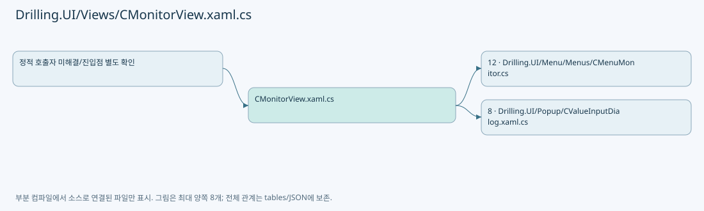

## 네임스페이스·타입·상속

| 타입 | 구분 | 원본 범위 | 선언/상속 |
| --- | --- | --- | --- |
| CMonitorView | ClassDeclaration | 10–603 | CMonitorView: UserControl |

## 멤버 빠른 목록

| 이름 | 종류 | 범위 | 서명 |
| --- | --- | --- | --- |
| _hostWindow | FieldDeclaration | L12–12 | Window? Drilling.UI.Views.CMonitorView._hostWindow |
| _rootView | FieldDeclaration | L13–13 | Drilling.UI.CRootView? Drilling.UI.Views.CMonitorView._rootView |
| _monitorMenu | FieldDeclaration | L14–14 | Drilling.UI.Menu.Menus.CMenuMonitor? Drilling.UI.Views.CMonitorView._monitorMenu |
| .ctor | ConstructorDeclaration | L16–19 | Drilling.UI.Views.CMonitorView.CMonitorView() |
| MonitorViewLoaded | MethodDeclaration | L21–55 | void Drilling.UI.Views.CMonitorView.MonitorViewLoaded(object, RoutedEventArgs) |
| RootViewCurrentScreenChanged | MethodDeclaration | L57–71 | void Drilling.UI.Views.CMonitorView.RootViewCurrentScreenChanged(object?, System.EventArgs) |
| MonitorViewPreviewKeyDown | MethodDeclaration | L73–86 | void Drilling.UI.Views.CMonitorView.MonitorViewPreviewKeyDown(object, KeyEventArgs) |
| MonitorViewUnloaded | MethodDeclaration | L88–104 | void Drilling.UI.Views.CMonitorView.MonitorViewUnloaded(object, RoutedEventArgs) |
| XpsMultiMoveGrid_PreviewMouseWheel | MethodDeclaration | L106–118 | void Drilling.UI.Views.CMonitorView.XpsMultiMoveGrid_PreviewMouseWheel(object, MouseWheelEventArgs) |
| OuterScrollViewer_PreviewMouseWheel | MethodDeclaration | L120–136 | void Drilling.UI.Views.CMonitorView.OuterScrollViewer_PreviewMouseWheel(object, MouseWheelEventArgs) |
| CoordinateCellPreviewLabel_MouseMove | MethodDeclaration | L138–149 | void Drilling.UI.Views.CMonitorView.CoordinateCellPreviewLabel_MouseMove(object, MouseEventArgs) |
| CoordinateCellPreviewLabel_MouseLeave | MethodDeclaration | L151–154 | void Drilling.UI.Views.CMonitorView.CoordinateCellPreviewLabel_MouseLeave(object, MouseEventArgs) |
| CoordinateShotMap_MouseLeftButtonDown | MethodDeclaration | L156–167 | void Drilling.UI.Views.CMonitorView.CoordinateShotMap_MouseLeftButtonDown(object, MouseButtonEventArgs) |
| CoordinateShotCoordinateGrid_SelectionChanged | MethodDeclaration | L169–186 | void Drilling.UI.Views.CMonitorView.CoordinateShotCoordinateGrid_SelectionChanged(object, SelectionChangedEventArgs) |
| PositionCoordinateGlassPreviewHoverTip | MethodDeclaration | L188–209 | void Drilling.UI.Views.CMonitorView.PositionCoordinateGlassPreviewHoverTip(Point) |
| HideCoordinateGlassPreviewHoverTip | MethodDeclaration | L211–215 | void Drilling.UI.Views.CMonitorView.HideCoordinateGlassPreviewHoverTip() |
| AttenuatorScrollViewer_ScrollChanged | MethodDeclaration | L217–225 | void Drilling.UI.Views.CMonitorView.AttenuatorScrollViewer_ScrollChanged(object, ScrollChangedEventArgs) |
| MelsecGrid_SizeChanged | MethodDeclaration | L227–246 | void Drilling.UI.Views.CMonitorView.MelsecGrid_SizeChanged(object, SizeChangedEventArgs) |
| CloseOpenComboBoxes | MethodDeclaration | L248–259 | void Drilling.UI.Views.CMonitorView.CloseOpenComboBoxes(DependencyObject) |
| OpenPowerMeterSettingInput | MethodDeclaration | L261–283 | void Drilling.UI.Views.CMonitorView.OpenPowerMeterSettingInput(object, RoutedEventArgs) |
| PowerMeterSettingSelection_PreviewMouseDown | MethodDeclaration | L285–292 | void Drilling.UI.Views.CMonitorView.PowerMeterSettingSelection_PreviewMouseDown(object, MouseButtonEventArgs) |
| PowerMeterSettingSelection_PreviewKeyDown | MethodDeclaration | L294–306 | void Drilling.UI.Views.CMonitorView.PowerMeterSettingSelection_PreviewKeyDown(object, KeyEventArgs) |
| PowerMeterSettingSelection_PreviewMouseWheel | MethodDeclaration | L308–315 | void Drilling.UI.Views.CMonitorView.PowerMeterSettingSelection_PreviewMouseWheel(object, MouseWheelEventArgs) |
| PowerMeterSettingSelection_DropDownOpened | MethodDeclaration | L317–326 | void Drilling.UI.Views.CMonitorView.PowerMeterSettingSelection_DropDownOpened(object, System.EventArgs) |
| IsPowerMeterSettingSelectionKey | MethodDeclaration | L328–344 | bool Drilling.UI.Views.CMonitorView.IsPowerMeterSettingSelectionKey(Key) |
| OpenLaserSettingInput | MethodDeclaration | L346–363 | void Drilling.UI.Views.CMonitorView.OpenLaserSettingInput(object, RoutedEventArgs) |
| OpenMotorOperationInput | MethodDeclaration | L365–382 | void Drilling.UI.Views.CMonitorView.OpenMotorOperationInput(object, RoutedEventArgs) |
| OpenXpsMultiMoveTargetInput | MethodDeclaration | L384–400 | void Drilling.UI.Views.CMonitorView.OpenXpsMultiMoveTargetInput(object, RoutedEventArgs) |
| StartXpsJogNegative | MethodDeclaration | L402–406 | void Drilling.UI.Views.CMonitorView.StartXpsJogNegative(object, MouseButtonEventArgs) |
| StartXpsJogPositive | MethodDeclaration | L408–412 | void Drilling.UI.Views.CMonitorView.StartXpsJogPositive(object, MouseButtonEventArgs) |
| StopXpsJog | MethodDeclaration | L414–418 | void Drilling.UI.Views.CMonitorView.StopXpsJog(object, MouseButtonEventArgs) |
| StopXpsJogOnMouseLeave | MethodDeclaration | L420–423 | void Drilling.UI.Views.CMonitorView.StopXpsJogOnMouseLeave(object, MouseEventArgs) |
| StopXpsJogOnLostMouseCapture | MethodDeclaration | L425–428 | void Drilling.UI.Views.CMonitorView.StopXpsJogOnLostMouseCapture(object, MouseEventArgs) |
| StopXpsJogOnLostKeyboardFocus | MethodDeclaration | L430–433 | void Drilling.UI.Views.CMonitorView.StopXpsJogOnLostKeyboardFocus(object, KeyboardFocusChangedEventArgs) |
| ExecuteXpsJogEvent | MethodDeclaration | L435–461 | System.Threading.Tasks.Task Drilling.UI.Views.CMonitorView.ExecuteXpsJogEvent(bool?) |
| GetMonitorMenu | MethodDeclaration | L463–466 | Drilling.UI.Menu.Menus.CMenuMonitor? Drilling.UI.Views.CMonitorView.GetMonitorMenu() |
| OpenAttenuatorPositionInput | MethodDeclaration | L468–487 | void Drilling.UI.Views.CMonitorView.OpenAttenuatorPositionInput(object, RoutedEventArgs) |
| OpenBetTableInput | MethodDeclaration | L489–529 | void Drilling.UI.Views.CMonitorView.OpenBetTableInput(object, RoutedEventArgs) |
| OpenBetPositionInput | MethodDeclaration | L531–548 | void Drilling.UI.Views.CMonitorView.OpenBetPositionInput(object, RoutedEventArgs) |
| OpenMelsecWriteInput | MethodDeclaration | L550–571 | void Drilling.UI.Views.CMonitorView.OpenMelsecWriteInput(object, RoutedEventArgs) |
| MelsecWriteSelectionPreviewInput | MethodDeclaration | L573–583 | void Drilling.UI.Views.CMonitorView.MelsecWriteSelectionPreviewInput(object, RoutedEventArgs) |
| EnsureMelsecWriteInputUnlocked | MethodDeclaration | L585–601 | bool Drilling.UI.Views.CMonitorView.EnsureMelsecWriteInputUnlocked(RoutedEventArgs) |

## 멤버별 상세 계약·호출·처리 해설

### FieldDeclaration `_hostWindow` · L12–12

[Drilling.UI/Views/CMonitorView.xaml.cs:12–12](https://github.com/kjuws10-rgb/A3Drilling/blob/dfa5920e6301d9ec4b0eab1452ae59521aafc986/Drilling.UI/Views/CMonitorView.xaml.cs#L12-L12)

| 항목 | 실제 추출 값 |
| --- | --- |
| 서명 | Window? Drilling.UI.Views.CMonitorView._hostWindow |
| 접근/수식자 | Private / private |
| 반환/값 타입 | Window? |
| 소속 타입 | NamedType:Drilling.UI.Views.CMonitorView |

현재 부분 분석에서 직접 연결된 호출자는 없습니다. XAML/이벤트/인터페이스·델리게이트·외부 진입을 추가 확인해야 하며, 미사용으로 판정한 것이 아닙니다.

변경 전 점검: 입력/반환 타입, 위 호출자, 예외/취소 경로, 공유 상태와 저장·전송 소비자를 함께 확인합니다. 값의 단위나 물리 방향을 이름만으로 확정하지 않습니다.

### FieldDeclaration `_rootView` · L13–13

[Drilling.UI/Views/CMonitorView.xaml.cs:13–13](https://github.com/kjuws10-rgb/A3Drilling/blob/dfa5920e6301d9ec4b0eab1452ae59521aafc986/Drilling.UI/Views/CMonitorView.xaml.cs#L13-L13)

| 항목 | 실제 추출 값 |
| --- | --- |
| 서명 | Drilling.UI.CRootView? Drilling.UI.Views.CMonitorView._rootView |
| 접근/수식자 | Private / private |
| 반환/값 타입 | Drilling.UI.CRootView? |
| 소속 타입 | NamedType:Drilling.UI.Views.CMonitorView |

현재 부분 분석에서 직접 연결된 호출자는 없습니다. XAML/이벤트/인터페이스·델리게이트·외부 진입을 추가 확인해야 하며, 미사용으로 판정한 것이 아닙니다.

변경 전 점검: 입력/반환 타입, 위 호출자, 예외/취소 경로, 공유 상태와 저장·전송 소비자를 함께 확인합니다. 값의 단위나 물리 방향을 이름만으로 확정하지 않습니다.

### FieldDeclaration `_monitorMenu` · L14–14

[Drilling.UI/Views/CMonitorView.xaml.cs:14–14](https://github.com/kjuws10-rgb/A3Drilling/blob/dfa5920e6301d9ec4b0eab1452ae59521aafc986/Drilling.UI/Views/CMonitorView.xaml.cs#L14-L14)

| 항목 | 실제 추출 값 |
| --- | --- |
| 서명 | Drilling.UI.Menu.Menus.CMenuMonitor? Drilling.UI.Views.CMonitorView._monitorMenu |
| 접근/수식자 | Private / private |
| 반환/값 타입 | Drilling.UI.Menu.Menus.CMenuMonitor? |
| 소속 타입 | NamedType:Drilling.UI.Views.CMonitorView |

현재 부분 분석에서 직접 연결된 호출자는 없습니다. XAML/이벤트/인터페이스·델리게이트·외부 진입을 추가 확인해야 하며, 미사용으로 판정한 것이 아닙니다.

변경 전 점검: 입력/반환 타입, 위 호출자, 예외/취소 경로, 공유 상태와 저장·전송 소비자를 함께 확인합니다. 값의 단위나 물리 방향을 이름만으로 확정하지 않습니다.

### ConstructorDeclaration `.ctor` · L16–19

[Drilling.UI/Views/CMonitorView.xaml.cs:16–19](https://github.com/kjuws10-rgb/A3Drilling/blob/dfa5920e6301d9ec4b0eab1452ae59521aafc986/Drilling.UI/Views/CMonitorView.xaml.cs#L16-L19)

| 항목 | 실제 추출 값 |
| --- | --- |
| 서명 | Drilling.UI.Views.CMonitorView.CMonitorView() |
| 접근/수식자 | Public / public |
| 반환/값 타입 | void |
| 소속 타입 | NamedType:Drilling.UI.Views.CMonitorView |

현재 부분 분석에서 직접 연결된 호출자는 없습니다. XAML/이벤트/인터페이스·델리게이트·외부 진입을 추가 확인해야 하며, 미사용으로 판정한 것이 아닙니다.

호출하는 대상과 해석 범위:

| 원본 행 | 표현식 | 분석 상태 | 대상/소스 위치 |
| --- | --- | --- | --- |
| 18 | InitializeComponent | unresolved | None |

본문의 실제 연산·분기·예외·반환 순서(원문 위치 순):

| 원본 행 | 종류 | 주석 해설 |
| --- | --- | --- |
| 18 | call | 함수·델리게이트 또는 객체 생성자를 호출합니다: InitializeComponent() |

변경 전 점검: 입력/반환 타입, 위 호출자, 예외/취소 경로, 공유 상태와 저장·전송 소비자를 함께 확인합니다. 값의 단위나 물리 방향을 이름만으로 확정하지 않습니다.

### MethodDeclaration `MonitorViewLoaded` · L21–55

[Drilling.UI/Views/CMonitorView.xaml.cs:21–55](https://github.com/kjuws10-rgb/A3Drilling/blob/dfa5920e6301d9ec4b0eab1452ae59521aafc986/Drilling.UI/Views/CMonitorView.xaml.cs#L21-L55)

| 항목 | 실제 추출 값 |
| --- | --- |
| 서명 | void Drilling.UI.Views.CMonitorView.MonitorViewLoaded(object, RoutedEventArgs) |
| 접근/수식자 | Private / private |
| 반환/값 타입 | void |
| 소속 타입 | NamedType:Drilling.UI.Views.CMonitorView |

입력 계약:

| 이름 | 타입 | 전달 | 선택/기본값 |
| --- | --- | --- | --- |
| sender | object | None | False /  |
| e | RoutedEventArgs | None | False /  |

현재 부분 분석에서 직접 연결된 호출자는 없습니다. XAML/이벤트/인터페이스·델리게이트·외부 진입을 추가 확인해야 하며, 미사용으로 판정한 것이 아닙니다.

호출하는 대상과 해석 범위:

| 원본 행 | 표현식 | 분석 상태 | 대상/소스 위치 |
| --- | --- | --- | --- |
| 23 | Window.GetWindow | unresolved | None |
| 24 | ReferenceEquals | candidate | OverloadResolutionFailure |
| 39 | ReferenceEquals | candidate | OverloadResolutionFailure |

본문의 실제 연산·분기·예외·반환 순서(원문 위치 순):

| 원본 행 | 종류 | 주석 해설 |
| --- | --- | --- |
| 23 | call | 함수·델리게이트 또는 객체 생성자를 호출합니다: Window.GetWindow(this) |
| 23 | local-declaration | 지역 변수를 선언합니다: var window = Window.GetWindow(this); |
| 23 | variable-initializer | 변수의 초기값을 지정합니다: window = Window.GetWindow(this) |
| 24 | call | 함수·델리게이트 또는 객체 생성자를 호출합니다: ReferenceEquals(_hostWindow, window) |
| 24 | if | 조건에 따라 분기합니다: if (!ReferenceEquals(_hostWindow, window)) |
| 26 | if | 조건에 따라 분기합니다: if (_hostWindow is not null) |
| 28 | compound-assignment-or-event-subscription | 복합 대입 또는 이벤트 구독/해지 표현입니다: _hostWindow.PreviewKeyDown -= MonitorViewPreviewKeyDown |
| 31 | assignment | 값을 대상에 대입합니다: _hostWindow = window |
| 32 | if | 조건에 따라 분기합니다: if (_hostWindow is not null) |
| 34 | compound-assignment-or-event-subscription | 복합 대입 또는 이벤트 구독/해지 표현입니다: _hostWindow.PreviewKeyDown += MonitorViewPreviewKeyDown |
| 38 | local-declaration | 지역 변수를 선언합니다: var rootView = DataContext as CRootView ?? _hostWindow?.DataContext as CRootView; |
| 38 | variable-initializer | 변수의 초기값을 지정합니다: rootView = DataContext as CRootView ?? _hostWindow?.DataContext as CRootView |
| 39 | call | 함수·델리게이트 또는 객체 생성자를 호출합니다: ReferenceEquals(_rootView, rootView) |
| 39 | if | 조건에 따라 분기합니다: if (ReferenceEquals(_rootView, rootView)) |
| 41 | return | 호출자에게 값 또는 제어를 반환합니다: return; |
| 44 | if | 조건에 따라 분기합니다: if (_rootView is not null) |
| 46 | compound-assignment-or-event-subscription | 복합 대입 또는 이벤트 구독/해지 표현입니다: _rootView.CurrentScreenChanged -= RootViewCurrentScreenChanged |
| 49 | assignment | 값을 대상에 대입합니다: _rootView = rootView |
| 50 | if | 조건에 따라 분기합니다: if (_rootView is not null) |
| 52 | compound-assignment-or-event-subscription | 복합 대입 또는 이벤트 구독/해지 표현입니다: _rootView.CurrentScreenChanged += RootViewCurrentScreenChanged |
| 53 | assignment | 값을 대상에 대입합니다: _monitorMenu = _rootView.CurrentScreen.Monitor ?? _monitorMenu |

제어 구문의 포함 구조(실제 실행 순서/CFG가 아닌 구문 탐색 그림):

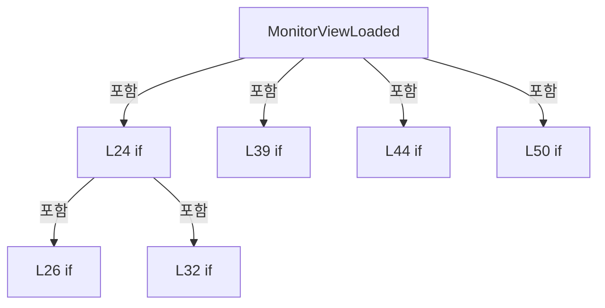

변경 전 점검: 입력/반환 타입, 위 호출자, 예외/취소 경로, 공유 상태와 저장·전송 소비자를 함께 확인합니다. 값의 단위나 물리 방향을 이름만으로 확정하지 않습니다.

### MethodDeclaration `RootViewCurrentScreenChanged` · L57–71

[Drilling.UI/Views/CMonitorView.xaml.cs:57–71](https://github.com/kjuws10-rgb/A3Drilling/blob/dfa5920e6301d9ec4b0eab1452ae59521aafc986/Drilling.UI/Views/CMonitorView.xaml.cs#L57-L71)

| 항목 | 실제 추출 값 |
| --- | --- |
| 서명 | void Drilling.UI.Views.CMonitorView.RootViewCurrentScreenChanged(object?, System.EventArgs) |
| 접근/수식자 | Private / private |
| 반환/값 타입 | void |
| 소속 타입 | NamedType:Drilling.UI.Views.CMonitorView |

입력 계약:

| 이름 | 타입 | 전달 | 선택/기본값 |
| --- | --- | --- | --- |
| sender | object? | None | False /  |
| e | System.EventArgs | None | False /  |

현재 부분 분석에서 직접 연결된 호출자는 없습니다. XAML/이벤트/인터페이스·델리게이트·외부 진입을 추가 확인해야 하며, 미사용으로 판정한 것이 아닙니다.

호출하는 대상과 해석 범위:

| 원본 행 | 표현식 | 분석 상태 | 대상/소스 위치 |
| --- | --- | --- | --- |
| 66 | .HideAndLockMelsecWrite | resolved | void Drilling.UI.Menu.Menus.CMenuMonitor.HideAndLockMelsecWrite() · Drilling.UI/Menu/Menus/CMenuMonitor.cs:688 |

본문의 실제 연산·분기·예외·반환 순서(원문 위치 순):

| 원본 행 | 종류 | 주석 해설 |
| --- | --- | --- |
| 59 | if | 조건에 따라 분기합니다: if (_rootView is null) |
| 61 | return | 호출자에게 값 또는 제어를 반환합니다: return; |
| 64 | if | 조건에 따라 분기합니다: if (_rootView.CurrentScreen.Menu != EN_MENU.Monitor) |
| 66 | call | 함수·델리게이트 또는 객체 생성자를 호출합니다: .HideAndLockMelsecWrite() |
| 67 | return | 호출자에게 값 또는 제어를 반환합니다: return; |
| 70 | assignment | 값을 대상에 대입합니다: _monitorMenu = _rootView.CurrentScreen.Monitor ?? _monitorMenu |

제어 구문의 포함 구조(실제 실행 순서/CFG가 아닌 구문 탐색 그림):

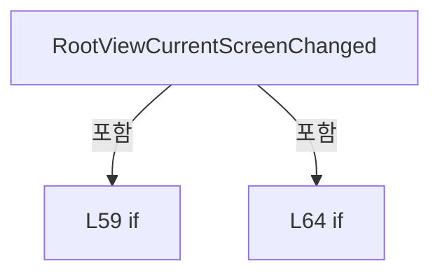

변경 전 점검: 입력/반환 타입, 위 호출자, 예외/취소 경로, 공유 상태와 저장·전송 소비자를 함께 확인합니다. 값의 단위나 물리 방향을 이름만으로 확정하지 않습니다.

### MethodDeclaration `MonitorViewPreviewKeyDown` · L73–86

[Drilling.UI/Views/CMonitorView.xaml.cs:73–86](https://github.com/kjuws10-rgb/A3Drilling/blob/dfa5920e6301d9ec4b0eab1452ae59521aafc986/Drilling.UI/Views/CMonitorView.xaml.cs#L73-L86)

| 항목 | 실제 추출 값 |
| --- | --- |
| 서명 | void Drilling.UI.Views.CMonitorView.MonitorViewPreviewKeyDown(object, KeyEventArgs) |
| 접근/수식자 | Private / private |
| 반환/값 타입 | void |
| 소속 타입 | NamedType:Drilling.UI.Views.CMonitorView |

입력 계약:

| 이름 | 타입 | 전달 | 선택/기본값 |
| --- | --- | --- | --- |
| sender | object | None | False /  |
| e | KeyEventArgs | None | False /  |

현재 부분 분석에서 직접 연결된 호출자는 없습니다. XAML/이벤트/인터페이스·델리게이트·외부 진입을 추가 확인해야 하며, 미사용으로 판정한 것이 아닙니다.

호출하는 대상과 해석 범위:

| 원본 행 | 표현식 | 분석 상태 | 대상/소스 위치 |
| --- | --- | --- | --- |
| 84 | monitor.ToggleMelsecWriteLockVisibility | resolved | void Drilling.UI.Menu.Menus.CMenuMonitor.ToggleMelsecWriteLockVisibility() · Drilling.UI/Menu/Menus/CMenuMonitor.cs:669 |

본문의 실제 연산·분기·예외·반환 순서(원문 위치 순):

| 원본 행 | 종류 | 주석 해설 |
| --- | --- | --- |
| 75 | local-declaration | 지역 변수를 선언합니다: var rootView = DataContext as CRootView ?? _hostWindow?.DataContext as CRootView; |
| 75 | variable-initializer | 변수의 초기값을 지정합니다: rootView = DataContext as CRootView ?? _hostWindow?.DataContext as CRootView |
| 76 | local-declaration | 지역 변수를 선언합니다: var requiredModifiers = ModifierKeys.Control &#124; ModifierKeys.Shift; |
| 76 | variable-initializer | 변수의 초기값을 지정합니다: requiredModifiers = ModifierKeys.Control &#124; ModifierKeys.Shift |
| 77 | if | 조건에 따라 분기합니다: if (e.Key != Key.F12 &#124;&#124; (Keyboard.Modifiers & requiredModifiers) != requiredModifiers &#124;&#124; rootView?.CurrentScreen.Monitor is not CMenuMonitor monitor) |
| 81 | return | 호출자에게 값 또는 제어를 반환합니다: return; |
| 84 | call | 함수·델리게이트 또는 객체 생성자를 호출합니다: monitor.ToggleMelsecWriteLockVisibility() |
| 85 | assignment | 값을 대상에 대입합니다: e.Handled = true |

제어 구문의 포함 구조(실제 실행 순서/CFG가 아닌 구문 탐색 그림):

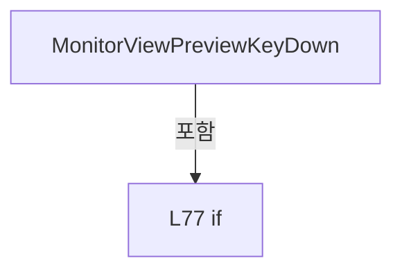

변경 전 점검: 입력/반환 타입, 위 호출자, 예외/취소 경로, 공유 상태와 저장·전송 소비자를 함께 확인합니다. 값의 단위나 물리 방향을 이름만으로 확정하지 않습니다.

### MethodDeclaration `MonitorViewUnloaded` · L88–104

[Drilling.UI/Views/CMonitorView.xaml.cs:88–104](https://github.com/kjuws10-rgb/A3Drilling/blob/dfa5920e6301d9ec4b0eab1452ae59521aafc986/Drilling.UI/Views/CMonitorView.xaml.cs#L88-L104)

| 항목 | 실제 추출 값 |
| --- | --- |
| 서명 | void Drilling.UI.Views.CMonitorView.MonitorViewUnloaded(object, RoutedEventArgs) |
| 접근/수식자 | Private / private |
| 반환/값 타입 | void |
| 소속 타입 | NamedType:Drilling.UI.Views.CMonitorView |

입력 계약:

| 이름 | 타입 | 전달 | 선택/기본값 |
| --- | --- | --- | --- |
| sender | object | None | False /  |
| e | RoutedEventArgs | None | False /  |

현재 부분 분석에서 직접 연결된 호출자는 없습니다. XAML/이벤트/인터페이스·델리게이트·외부 진입을 추가 확인해야 하며, 미사용으로 판정한 것이 아닙니다.

호출하는 대상과 해석 범위:

| 원본 행 | 표현식 | 분석 상태 | 대상/소스 위치 |
| --- | --- | --- | --- |
| 102 | .HideAndLockMelsecWrite | resolved | void Drilling.UI.Menu.Menus.CMenuMonitor.HideAndLockMelsecWrite() · Drilling.UI/Menu/Menus/CMenuMonitor.cs:688 |

본문의 실제 연산·분기·예외·반환 순서(원문 위치 순):

| 원본 행 | 종류 | 주석 해설 |
| --- | --- | --- |
| 90 | if | 조건에 따라 분기합니다: if (_hostWindow is not null) |
| 92 | compound-assignment-or-event-subscription | 복합 대입 또는 이벤트 구독/해지 표현입니다: _hostWindow.PreviewKeyDown -= MonitorViewPreviewKeyDown |
| 93 | assignment | 값을 대상에 대입합니다: _hostWindow = null |
| 96 | if | 조건에 따라 분기합니다: if (_rootView is not null) |
| 98 | compound-assignment-or-event-subscription | 복합 대입 또는 이벤트 구독/해지 표현입니다: _rootView.CurrentScreenChanged -= RootViewCurrentScreenChanged |
| 99 | assignment | 값을 대상에 대입합니다: _rootView = null |
| 102 | call | 함수·델리게이트 또는 객체 생성자를 호출합니다: .HideAndLockMelsecWrite() |
| 103 | assignment | 값을 대상에 대입합니다: _monitorMenu = null |

제어 구문의 포함 구조(실제 실행 순서/CFG가 아닌 구문 탐색 그림):

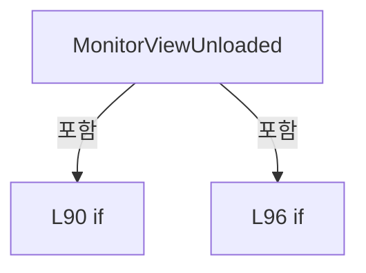

변경 전 점검: 입력/반환 타입, 위 호출자, 예외/취소 경로, 공유 상태와 저장·전송 소비자를 함께 확인합니다. 값의 단위나 물리 방향을 이름만으로 확정하지 않습니다.

### MethodDeclaration `XpsMultiMoveGrid_PreviewMouseWheel` · L106–118

[Drilling.UI/Views/CMonitorView.xaml.cs:106–118](https://github.com/kjuws10-rgb/A3Drilling/blob/dfa5920e6301d9ec4b0eab1452ae59521aafc986/Drilling.UI/Views/CMonitorView.xaml.cs#L106-L118)

| 항목 | 실제 추출 값 |
| --- | --- |
| 서명 | void Drilling.UI.Views.CMonitorView.XpsMultiMoveGrid_PreviewMouseWheel(object, MouseWheelEventArgs) |
| 접근/수식자 | Private / private |
| 반환/값 타입 | void |
| 소속 타입 | NamedType:Drilling.UI.Views.CMonitorView |

입력 계약:

| 이름 | 타입 | 전달 | 선택/기본값 |
| --- | --- | --- | --- |
| sender | object | None | False /  |
| e | MouseWheelEventArgs | None | False /  |

현재 부분 분석에서 직접 연결된 호출자는 없습니다. XAML/이벤트/인터페이스·델리게이트·외부 진입을 추가 확인해야 하며, 미사용으로 판정한 것이 아닙니다.

호출하는 대상과 해석 범위:

| 원본 행 | 표현식 | 분석 상태 | 대상/소스 위치 |
| --- | --- | --- | --- |
| 116 | scrollViewer.ScrollToVerticalOffset | unresolved | None |

본문의 실제 연산·분기·예외·반환 순서(원문 위치 순):

| 원본 행 | 종류 | 주석 해설 |
| --- | --- | --- |
| 108 | local-declaration | 지역 변수를 선언합니다: var scrollViewer = XpsOperationScrollViewer; |
| 108 | variable-initializer | 변수의 초기값을 지정합니다: scrollViewer = XpsOperationScrollViewer |
| 109 | local-declaration | 지역 변수를 선언합니다: var canScrollUp = e.Delta > 0 && scrollViewer.VerticalOffset > 0; |
| 109 | variable-initializer | 변수의 초기값을 지정합니다: canScrollUp = e.Delta > 0 && scrollViewer.VerticalOffset > 0 |
| 110 | local-declaration | 지역 변수를 선언합니다: var canScrollDown = e.Delta < 0 && scrollViewer.VerticalOffset < scrollViewer.ScrollableHeight; |
| 110 | variable-initializer | 변수의 초기값을 지정합니다: canScrollDown = e.Delta < 0 && scrollViewer.VerticalOffset < scrollViewer.ScrollableHeight |
| 111 | if | 조건에 따라 분기합니다: if (!canScrollUp && !canScrollDown) |
| 113 | return | 호출자에게 값 또는 제어를 반환합니다: return; |
| 116 | call | 함수·델리게이트 또는 객체 생성자를 호출합니다: scrollViewer.ScrollToVerticalOffset(scrollViewer.VerticalOffset - (e.Delta / 3.0)) |
| 117 | assignment | 값을 대상에 대입합니다: e.Handled = true |

제어 구문의 포함 구조(실제 실행 순서/CFG가 아닌 구문 탐색 그림):

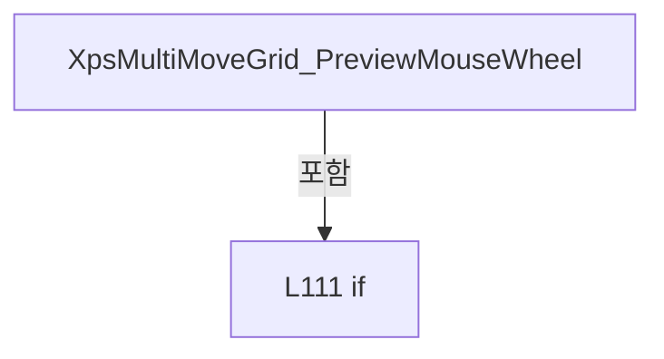

변경 전 점검: 입력/반환 타입, 위 호출자, 예외/취소 경로, 공유 상태와 저장·전송 소비자를 함께 확인합니다. 값의 단위나 물리 방향을 이름만으로 확정하지 않습니다.

### MethodDeclaration `OuterScrollViewer_PreviewMouseWheel` · L120–136

[Drilling.UI/Views/CMonitorView.xaml.cs:120–136](https://github.com/kjuws10-rgb/A3Drilling/blob/dfa5920e6301d9ec4b0eab1452ae59521aafc986/Drilling.UI/Views/CMonitorView.xaml.cs#L120-L136)

| 항목 | 실제 추출 값 |
| --- | --- |
| 서명 | void Drilling.UI.Views.CMonitorView.OuterScrollViewer_PreviewMouseWheel(object, MouseWheelEventArgs) |
| 접근/수식자 | Private / private |
| 반환/값 타입 | void |
| 소속 타입 | NamedType:Drilling.UI.Views.CMonitorView |

입력 계약:

| 이름 | 타입 | 전달 | 선택/기본값 |
| --- | --- | --- | --- |
| sender | object | None | False /  |
| e | MouseWheelEventArgs | None | False /  |

현재 부분 분석에서 직접 연결된 호출자는 없습니다. XAML/이벤트/인터페이스·델리게이트·외부 진입을 추가 확인해야 하며, 미사용으로 판정한 것이 아닙니다.

호출하는 대상과 해석 범위:

| 원본 행 | 표현식 | 분석 상태 | 대상/소스 위치 |
| --- | --- | --- | --- |
| 134 | scrollViewer.ScrollToVerticalOffset | unresolved | None |

본문의 실제 연산·분기·예외·반환 순서(원문 위치 순):

| 원본 행 | 종류 | 주석 해설 |
| --- | --- | --- |
| 122 | if | 조건에 따라 분기합니다: if (sender is not ScrollViewer scrollViewer) |
| 124 | return | 호출자에게 값 또는 제어를 반환합니다: return; |
| 127 | local-declaration | 지역 변수를 선언합니다: var canScrollUp = e.Delta > 0 && scrollViewer.VerticalOffset > 0; |
| 127 | variable-initializer | 변수의 초기값을 지정합니다: canScrollUp = e.Delta > 0 && scrollViewer.VerticalOffset > 0 |
| 128 | local-declaration | 지역 변수를 선언합니다: var canScrollDown = e.Delta < 0 && scrollViewer.VerticalOffset < scrollViewer.ScrollableHeight; |
| 128 | variable-initializer | 변수의 초기값을 지정합니다: canScrollDown = e.Delta < 0 && scrollViewer.VerticalOffset < scrollViewer.ScrollableHeight |
| 129 | if | 조건에 따라 분기합니다: if (!canScrollUp && !canScrollDown) |
| 131 | return | 호출자에게 값 또는 제어를 반환합니다: return; |
| 134 | call | 함수·델리게이트 또는 객체 생성자를 호출합니다: scrollViewer.ScrollToVerticalOffset(scrollViewer.VerticalOffset - (e.Delta / 3.0)) |
| 135 | assignment | 값을 대상에 대입합니다: e.Handled = true |

제어 구문의 포함 구조(실제 실행 순서/CFG가 아닌 구문 탐색 그림):

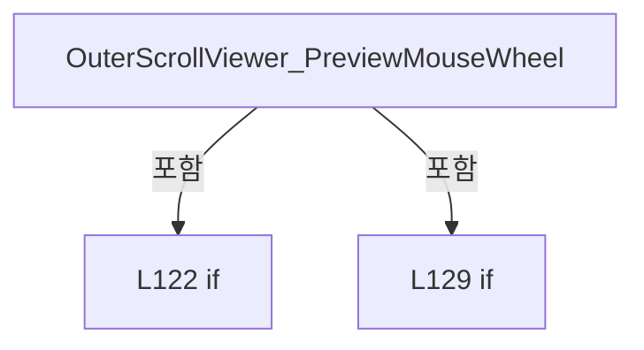

변경 전 점검: 입력/반환 타입, 위 호출자, 예외/취소 경로, 공유 상태와 저장·전송 소비자를 함께 확인합니다. 값의 단위나 물리 방향을 이름만으로 확정하지 않습니다.

### MethodDeclaration `CoordinateCellPreviewLabel_MouseMove` · L138–149

[Drilling.UI/Views/CMonitorView.xaml.cs:138–149](https://github.com/kjuws10-rgb/A3Drilling/blob/dfa5920e6301d9ec4b0eab1452ae59521aafc986/Drilling.UI/Views/CMonitorView.xaml.cs#L138-L149)

| 항목 | 실제 추출 값 |
| --- | --- |
| 서명 | void Drilling.UI.Views.CMonitorView.CoordinateCellPreviewLabel_MouseMove(object, MouseEventArgs) |
| 접근/수식자 | Private / private |
| 반환/값 타입 | void |
| 소속 타입 | NamedType:Drilling.UI.Views.CMonitorView |

입력 계약:

| 이름 | 타입 | 전달 | 선택/기본값 |
| --- | --- | --- | --- |
| sender | object | None | False /  |
| e | MouseEventArgs | None | False /  |

현재 부분 분석에서 직접 연결된 호출자는 없습니다. XAML/이벤트/인터페이스·델리게이트·외부 진입을 추가 확인해야 하며, 미사용으로 판정한 것이 아닙니다.

호출하는 대상과 해석 범위:

| 원본 행 | 표현식 | 분석 상태 | 대상/소스 위치 |
| --- | --- | --- | --- |
| 142 | HideCoordinateGlassPreviewHoverTip | resolved | void Drilling.UI.Views.CMonitorView.HideCoordinateGlassPreviewHoverTip() · Drilling.UI/Views/CMonitorView.xaml.cs:211 |
| 148 | PositionCoordinateGlassPreviewHoverTip | candidate | OverloadResolutionFailure |
| 148 | e.GetPosition | unresolved | None |

본문의 실제 연산·분기·예외·반환 순서(원문 위치 순):

| 원본 행 | 종류 | 주석 해설 |
| --- | --- | --- |
| 140 | if | 조건에 따라 분기합니다: if (sender is not FrameworkElement { DataContext: ST_CELL_PREVIEW_LABEL label }) |
| 142 | call | 함수·델리게이트 또는 객체 생성자를 호출합니다: HideCoordinateGlassPreviewHoverTip() |
| 143 | return | 호출자에게 값 또는 제어를 반환합니다: return; |
| 146 | assignment | 값을 대상에 대입합니다: CoordinateGlassPreviewHoverTipText.Text = label.DisplayText |
| 147 | assignment | 값을 대상에 대입합니다: CoordinateGlassPreviewHoverTip.Visibility = Visibility.Visible |
| 148 | call | 함수·델리게이트 또는 객체 생성자를 호출합니다: PositionCoordinateGlassPreviewHoverTip(e.GetPosition(CoordinateGlassPreviewViewport)) |
| 148 | call | 함수·델리게이트 또는 객체 생성자를 호출합니다: e.GetPosition(CoordinateGlassPreviewViewport) |

제어 구문의 포함 구조(실제 실행 순서/CFG가 아닌 구문 탐색 그림):

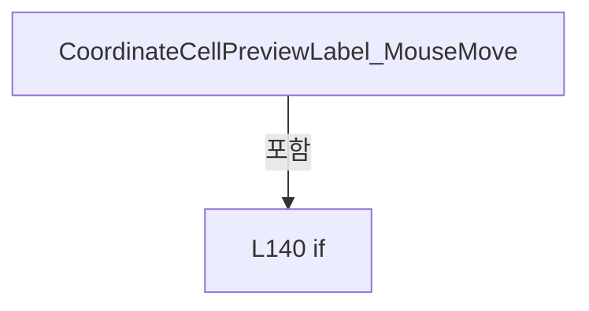

변경 전 점검: 입력/반환 타입, 위 호출자, 예외/취소 경로, 공유 상태와 저장·전송 소비자를 함께 확인합니다. 값의 단위나 물리 방향을 이름만으로 확정하지 않습니다.

### MethodDeclaration `CoordinateCellPreviewLabel_MouseLeave` · L151–154

[Drilling.UI/Views/CMonitorView.xaml.cs:151–154](https://github.com/kjuws10-rgb/A3Drilling/blob/dfa5920e6301d9ec4b0eab1452ae59521aafc986/Drilling.UI/Views/CMonitorView.xaml.cs#L151-L154)

| 항목 | 실제 추출 값 |
| --- | --- |
| 서명 | void Drilling.UI.Views.CMonitorView.CoordinateCellPreviewLabel_MouseLeave(object, MouseEventArgs) |
| 접근/수식자 | Private / private |
| 반환/값 타입 | void |
| 소속 타입 | NamedType:Drilling.UI.Views.CMonitorView |

입력 계약:

| 이름 | 타입 | 전달 | 선택/기본값 |
| --- | --- | --- | --- |
| sender | object | None | False /  |
| e | MouseEventArgs | None | False /  |

현재 부분 분석에서 직접 연결된 호출자는 없습니다. XAML/이벤트/인터페이스·델리게이트·외부 진입을 추가 확인해야 하며, 미사용으로 판정한 것이 아닙니다.

호출하는 대상과 해석 범위:

| 원본 행 | 표현식 | 분석 상태 | 대상/소스 위치 |
| --- | --- | --- | --- |
| 153 | HideCoordinateGlassPreviewHoverTip | resolved | void Drilling.UI.Views.CMonitorView.HideCoordinateGlassPreviewHoverTip() · Drilling.UI/Views/CMonitorView.xaml.cs:211 |

본문의 실제 연산·분기·예외·반환 순서(원문 위치 순):

| 원본 행 | 종류 | 주석 해설 |
| --- | --- | --- |
| 153 | call | 함수·델리게이트 또는 객체 생성자를 호출합니다: HideCoordinateGlassPreviewHoverTip() |

변경 전 점검: 입력/반환 타입, 위 호출자, 예외/취소 경로, 공유 상태와 저장·전송 소비자를 함께 확인합니다. 값의 단위나 물리 방향을 이름만으로 확정하지 않습니다.

### MethodDeclaration `CoordinateShotMap_MouseLeftButtonDown` · L156–167

[Drilling.UI/Views/CMonitorView.xaml.cs:156–167](https://github.com/kjuws10-rgb/A3Drilling/blob/dfa5920e6301d9ec4b0eab1452ae59521aafc986/Drilling.UI/Views/CMonitorView.xaml.cs#L156-L167)

| 항목 | 실제 추출 값 |
| --- | --- |
| 서명 | void Drilling.UI.Views.CMonitorView.CoordinateShotMap_MouseLeftButtonDown(object, MouseButtonEventArgs) |
| 접근/수식자 | Private / private, async |
| 반환/값 타입 | void |
| 소속 타입 | NamedType:Drilling.UI.Views.CMonitorView |

입력 계약:

| 이름 | 타입 | 전달 | 선택/기본값 |
| --- | --- | --- | --- |
| sender | object | None | False /  |
| e | MouseButtonEventArgs | None | False /  |

현재 부분 분석에서 직접 연결된 호출자는 없습니다. XAML/이벤트/인터페이스·델리게이트·외부 진입을 추가 확인해야 하며, 미사용으로 판정한 것이 아닙니다.

호출하는 대상과 해석 범위:

| 원본 행 | 표현식 | 분석 상태 | 대상/소스 위치 |
| --- | --- | --- | --- |
| 164 | e.GetPosition | unresolved | None |
| 166 | monitor.SelectCoordinateShotAt | candidate | OverloadResolutionFailure |

본문의 실제 연산·분기·예외·반환 순서(원문 위치 순):

| 원본 행 | 종류 | 주석 해설 |
| --- | --- | --- |
| 158 | local-declaration | 지역 변수를 선언합니다: var monitor = _rootView?.CurrentScreen.Monitor ?? _monitorMenu; |
| 158 | variable-initializer | 변수의 초기값을 지정합니다: monitor = _rootView?.CurrentScreen.Monitor ?? _monitorMenu |
| 159 | if | 조건에 따라 분기합니다: if (sender is not FrameworkElement shotMap &#124;&#124; monitor is null) |
| 161 | return | 호출자에게 값 또는 제어를 반환합니다: return; |
| 164 | call | 함수·델리게이트 또는 객체 생성자를 호출합니다: e.GetPosition(shotMap) |
| 164 | local-declaration | 지역 변수를 선언합니다: var point = e.GetPosition(shotMap); |
| 164 | variable-initializer | 변수의 초기값을 지정합니다: point = e.GetPosition(shotMap) |
| 165 | assignment | 값을 대상에 대입합니다: e.Handled = true |
| 166 | await | 비동기 완료를 기다립니다: await monitor.SelectCoordinateShotAt(point.X, point.Y) |
| 166 | call | 함수·델리게이트 또는 객체 생성자를 호출합니다: monitor.SelectCoordinateShotAt(point.X, point.Y) |

제어 구문의 포함 구조(실제 실행 순서/CFG가 아닌 구문 탐색 그림):

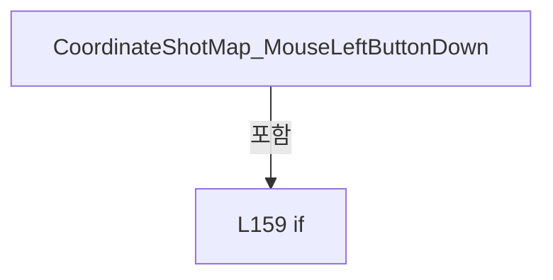

변경 전 점검: 입력/반환 타입, 위 호출자, 예외/취소 경로, 공유 상태와 저장·전송 소비자를 함께 확인합니다. 값의 단위나 물리 방향을 이름만으로 확정하지 않습니다.

### MethodDeclaration `CoordinateShotCoordinateGrid_SelectionChanged` · L169–186

[Drilling.UI/Views/CMonitorView.xaml.cs:169–186](https://github.com/kjuws10-rgb/A3Drilling/blob/dfa5920e6301d9ec4b0eab1452ae59521aafc986/Drilling.UI/Views/CMonitorView.xaml.cs#L169-L186)

| 항목 | 실제 추출 값 |
| --- | --- |
| 서명 | void Drilling.UI.Views.CMonitorView.CoordinateShotCoordinateGrid_SelectionChanged(object, SelectionChangedEventArgs) |
| 접근/수식자 | Private / private, async |
| 반환/값 타입 | void |
| 소속 타입 | NamedType:Drilling.UI.Views.CMonitorView |

입력 계약:

| 이름 | 타입 | 전달 | 선택/기본값 |
| --- | --- | --- | --- |
| sender | object | None | False /  |
| e | SelectionChangedEventArgs | None | False /  |

현재 부분 분석에서 직접 연결된 호출자는 없습니다. XAML/이벤트/인터페이스·델리게이트·외부 진입을 추가 확인해야 하며, 미사용으로 판정한 것이 아닙니다.

호출하는 대상과 해석 범위:

| 원본 행 | 표현식 | 분석 상태 | 대상/소스 위치 |
| --- | --- | --- | --- |
| 179 | grid.ScrollIntoView | unresolved | None |
| 185 | monitor.SelectCoordinateShotFromGrid | resolved | System.Threading.Tasks.Task Drilling.UI.Menu.Menus.CMenuMonitor.SelectCoordinateShotFromGrid(string) · Drilling.UI/Menu/Menus/CMenuMonitor.cs:2780 |

본문의 실제 연산·분기·예외·반환 순서(원문 위치 순):

| 원본 행 | 종류 | 주석 해설 |
| --- | --- | --- |
| 171 | local-declaration | 지역 변수를 선언합니다: var monitor = _rootView?.CurrentScreen.Monitor ?? _monitorMenu; |
| 171 | variable-initializer | 변수의 초기값을 지정합니다: monitor = _rootView?.CurrentScreen.Monitor ?? _monitorMenu |
| 172 | if | 조건에 따라 분기합니다: if (sender is not DataGrid grid &#124;&#124; grid.SelectedItem is not ST_MONITOR_COORDINATE_SHOT_COORDINATE_ROW row &#124;&#124; monitor is null) |
| 176 | return | 호출자에게 값 또는 제어를 반환합니다: return; |
| 179 | call | 함수·델리게이트 또는 객체 생성자를 호출합니다: grid.ScrollIntoView(row) |
| 180 | if | 조건에 따라 분기합니다: if (row.IsSelected) |
| 182 | return | 호출자에게 값 또는 제어를 반환합니다: return; |
| 185 | await | 비동기 완료를 기다립니다: await monitor.SelectCoordinateShotFromGrid(row.ShotKey) |
| 185 | call | 함수·델리게이트 또는 객체 생성자를 호출합니다: monitor.SelectCoordinateShotFromGrid(row.ShotKey) |

제어 구문의 포함 구조(실제 실행 순서/CFG가 아닌 구문 탐색 그림):

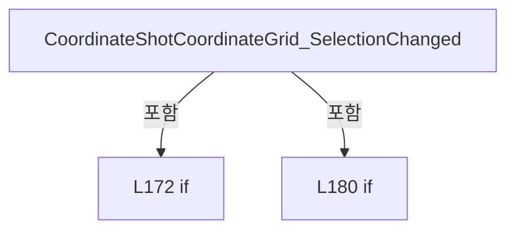

변경 전 점검: 입력/반환 타입, 위 호출자, 예외/취소 경로, 공유 상태와 저장·전송 소비자를 함께 확인합니다. 값의 단위나 물리 방향을 이름만으로 확정하지 않습니다.

### MethodDeclaration `PositionCoordinateGlassPreviewHoverTip` · L188–209

[Drilling.UI/Views/CMonitorView.xaml.cs:188–209](https://github.com/kjuws10-rgb/A3Drilling/blob/dfa5920e6301d9ec4b0eab1452ae59521aafc986/Drilling.UI/Views/CMonitorView.xaml.cs#L188-L209)

| 항목 | 실제 추출 값 |
| --- | --- |
| 서명 | void Drilling.UI.Views.CMonitorView.PositionCoordinateGlassPreviewHoverTip(Point) |
| 접근/수식자 | Private / private |
| 반환/값 타입 | void |
| 소속 타입 | NamedType:Drilling.UI.Views.CMonitorView |

입력 계약:

| 이름 | 타입 | 전달 | 선택/기본값 |
| --- | --- | --- | --- |
| pointer | Point | None | False /  |

현재 부분 분석에서 직접 연결된 호출자는 없습니다. XAML/이벤트/인터페이스·델리게이트·외부 진입을 추가 확인해야 하며, 미사용으로 판정한 것이 아닙니다.

호출하는 대상과 해석 범위:

| 원본 행 | 표현식 | 분석 상태 | 대상/소스 위치 |
| --- | --- | --- | --- |
| 193 | CoordinateGlassPreviewHoverTip.Measure | unresolved | None |
| 193 | new Size | unresolved | None |
| 199 | Math.Clamp | candidate | OverloadResolutionFailure |
| 199 | Math.Max | candidate | OverloadResolutionFailure |
| 204 | Math.Clamp | candidate | OverloadResolutionFailure |
| 204 | Math.Max | candidate | OverloadResolutionFailure |

본문의 실제 연산·분기·예외·반환 순서(원문 위치 순):

| 원본 행 | 종류 | 주석 해설 |
| --- | --- | --- |
| 190 | local-declaration | 지역 변수를 선언합니다: const double margin = 4.0; |
| 190 | variable-initializer | 변수의 초기값을 지정합니다: margin = 4.0 |
| 191 | local-declaration | 지역 변수를 선언합니다: const double offsetX = 12.0; |
| 191 | variable-initializer | 변수의 초기값을 지정합니다: offsetX = 12.0 |
| 192 | local-declaration | 지역 변수를 선언합니다: const double offsetY = 14.0; |
| 192 | variable-initializer | 변수의 초기값을 지정합니다: offsetY = 14.0 |
| 193 | call | 함수·델리게이트 또는 객체 생성자를 호출합니다: CoordinateGlassPreviewHoverTip.Measure(new Size(double.PositiveInfinity, double.PositiveInfinity)) |
| 193 | call | 함수·델리게이트 또는 객체 생성자를 호출합니다: new Size(double.PositiveInfinity, double.PositiveInfinity) |
| 194 | local-declaration | 지역 변수를 선언합니다: var tipSize = CoordinateGlassPreviewHoverTip.DesiredSize; |
| 194 | variable-initializer | 변수의 초기값을 지정합니다: tipSize = CoordinateGlassPreviewHoverTip.DesiredSize |
| 195 | local-declaration | 지역 변수를 선언합니다: var x = pointer.X + offsetX; |
| 195 | variable-initializer | 변수의 초기값을 지정합니다: x = pointer.X + offsetX |
| 196 | local-declaration | 지역 변수를 선언합니다: var y = pointer.Y + offsetY; |
| 196 | variable-initializer | 변수의 초기값을 지정합니다: y = pointer.Y + offsetY |
| 197 | if | 조건에 따라 분기합니다: if (CoordinateGlassPreviewViewport.ActualWidth > 0) |
| 199 | assignment | 값을 대상에 대입합니다: x = Math.Clamp(x, margin, Math.Max(margin, CoordinateGlassPreviewViewport.ActualWidth - tipSize.Width - margin)) |
| 199 | call | 함수·델리게이트 또는 객체 생성자를 호출합니다: Math.Clamp(x, margin, Math.Max(margin, CoordinateGlassPreviewViewport.ActualWidth - tipSize.Width - margin)) |
| 199 | call | 함수·델리게이트 또는 객체 생성자를 호출합니다: Math.Max(margin, CoordinateGlassPreviewViewport.ActualWidth - tipSize.Width - margin) |
| 202 | if | 조건에 따라 분기합니다: if (CoordinateGlassPreviewViewport.ActualHeight > 0) |
| 204 | assignment | 값을 대상에 대입합니다: y = Math.Clamp(y, margin, Math.Max(margin, CoordinateGlassPreviewViewport.ActualHeight - tipSize.Height - margin)) |
| 204 | call | 함수·델리게이트 또는 객체 생성자를 호출합니다: Math.Clamp(y, margin, Math.Max(margin, CoordinateGlassPreviewViewport.ActualHeight - tipSize.Height - margin)) |
| 204 | call | 함수·델리게이트 또는 객체 생성자를 호출합니다: Math.Max(margin, CoordinateGlassPreviewViewport.ActualHeight - tipSize.Height - margin) |
| 207 | assignment | 값을 대상에 대입합니다: CoordinateGlassPreviewHoverTipTranslateTransform.X = x |
| 208 | assignment | 값을 대상에 대입합니다: CoordinateGlassPreviewHoverTipTranslateTransform.Y = y |

제어 구문의 포함 구조(실제 실행 순서/CFG가 아닌 구문 탐색 그림):

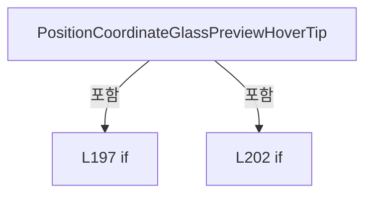

변경 전 점검: 입력/반환 타입, 위 호출자, 예외/취소 경로, 공유 상태와 저장·전송 소비자를 함께 확인합니다. 값의 단위나 물리 방향을 이름만으로 확정하지 않습니다.

### MethodDeclaration `HideCoordinateGlassPreviewHoverTip` · L211–215

[Drilling.UI/Views/CMonitorView.xaml.cs:211–215](https://github.com/kjuws10-rgb/A3Drilling/blob/dfa5920e6301d9ec4b0eab1452ae59521aafc986/Drilling.UI/Views/CMonitorView.xaml.cs#L211-L215)

| 항목 | 실제 추출 값 |
| --- | --- |
| 서명 | void Drilling.UI.Views.CMonitorView.HideCoordinateGlassPreviewHoverTip() |
| 접근/수식자 | Private / private |
| 반환/값 타입 | void |
| 소속 타입 | NamedType:Drilling.UI.Views.CMonitorView |

정적 호출자로 확인된 위치:

| 호출 파일/행 | 호출 표현식 | 런타임 분기 가능 |
| --- | --- | --- |
| [Drilling.UI/Views/CMonitorView.xaml.cs:142–142](https://github.com/kjuws10-rgb/A3Drilling/blob/dfa5920e6301d9ec4b0eab1452ae59521aafc986/Drilling.UI/Views/CMonitorView.xaml.cs#L142-L142) | HideCoordinateGlassPreviewHoverTip | False |
| [Drilling.UI/Views/CMonitorView.xaml.cs:153–153](https://github.com/kjuws10-rgb/A3Drilling/blob/dfa5920e6301d9ec4b0eab1452ae59521aafc986/Drilling.UI/Views/CMonitorView.xaml.cs#L153-L153) | HideCoordinateGlassPreviewHoverTip | False |

본문의 실제 연산·분기·예외·반환 순서(원문 위치 순):

| 원본 행 | 종류 | 주석 해설 |
| --- | --- | --- |
| 213 | assignment | 값을 대상에 대입합니다: CoordinateGlassPreviewHoverTip.Visibility = Visibility.Collapsed |
| 214 | assignment | 값을 대상에 대입합니다: CoordinateGlassPreviewHoverTipText.Text = "" |

변경 전 점검: 입력/반환 타입, 위 호출자, 예외/취소 경로, 공유 상태와 저장·전송 소비자를 함께 확인합니다. 값의 단위나 물리 방향을 이름만으로 확정하지 않습니다.

### MethodDeclaration `AttenuatorScrollViewer_ScrollChanged` · L217–225

[Drilling.UI/Views/CMonitorView.xaml.cs:217–225](https://github.com/kjuws10-rgb/A3Drilling/blob/dfa5920e6301d9ec4b0eab1452ae59521aafc986/Drilling.UI/Views/CMonitorView.xaml.cs#L217-L225)

| 항목 | 실제 추출 값 |
| --- | --- |
| 서명 | void Drilling.UI.Views.CMonitorView.AttenuatorScrollViewer_ScrollChanged(object, ScrollChangedEventArgs) |
| 접근/수식자 | Private / private |
| 반환/값 타입 | void |
| 소속 타입 | NamedType:Drilling.UI.Views.CMonitorView |

입력 계약:

| 이름 | 타입 | 전달 | 선택/기본값 |
| --- | --- | --- | --- |
| sender | object | None | False /  |
| e | ScrollChangedEventArgs | None | False /  |

현재 부분 분석에서 직접 연결된 호출자는 없습니다. XAML/이벤트/인터페이스·델리게이트·외부 진입을 추가 확인해야 하며, 미사용으로 판정한 것이 아닙니다.

호출하는 대상과 해석 범위:

| 원본 행 | 표현식 | 분석 상태 | 대상/소스 위치 |
| --- | --- | --- | --- |
| 224 | CloseOpenComboBoxes | resolved | void Drilling.UI.Views.CMonitorView.CloseOpenComboBoxes(DependencyObject) · Drilling.UI/Views/CMonitorView.xaml.cs:248 |

본문의 실제 연산·분기·예외·반환 순서(원문 위치 순):

| 원본 행 | 종류 | 주석 해설 |
| --- | --- | --- |
| 219 | if | 조건에 따라 분기합니다: if (e.VerticalChange == 0 &#124;&#124; sender is not DependencyObject root) |
| 221 | return | 호출자에게 값 또는 제어를 반환합니다: return; |
| 224 | call | 함수·델리게이트 또는 객체 생성자를 호출합니다: CloseOpenComboBoxes(root) |

제어 구문의 포함 구조(실제 실행 순서/CFG가 아닌 구문 탐색 그림):

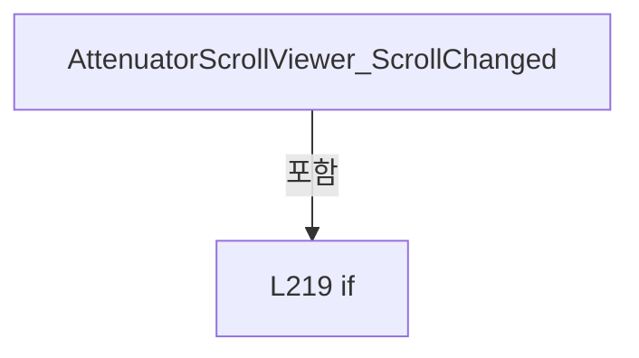

변경 전 점검: 입력/반환 타입, 위 호출자, 예외/취소 경로, 공유 상태와 저장·전송 소비자를 함께 확인합니다. 값의 단위나 물리 방향을 이름만으로 확정하지 않습니다.

### MethodDeclaration `MelsecGrid_SizeChanged` · L227–246

[Drilling.UI/Views/CMonitorView.xaml.cs:227–246](https://github.com/kjuws10-rgb/A3Drilling/blob/dfa5920e6301d9ec4b0eab1452ae59521aafc986/Drilling.UI/Views/CMonitorView.xaml.cs#L227-L246)

| 항목 | 실제 추출 값 |
| --- | --- |
| 서명 | void Drilling.UI.Views.CMonitorView.MelsecGrid_SizeChanged(object, SizeChangedEventArgs) |
| 접근/수식자 | Private / private |
| 반환/값 타입 | void |
| 소속 타입 | NamedType:Drilling.UI.Views.CMonitorView |

입력 계약:

| 이름 | 타입 | 전달 | 선택/기본값 |
| --- | --- | --- | --- |
| sender | object | None | False /  |
| e | SizeChangedEventArgs | None | False /  |

현재 부분 분석에서 직접 연결된 호출자는 없습니다. XAML/이벤트/인터페이스·델리게이트·외부 진입을 추가 확인해야 하며, 미사용으로 판정한 것이 아닙니다.

호출하는 대상과 해석 범위:

| 원본 행 | 표현식 | 분석 상태 | 대상/소스 위치 |
| --- | --- | --- | --- |
| 245 | new DataGridLength | unresolved | None |
| 245 | Math.Max | candidate | OverloadResolutionFailure |

본문의 실제 연산·분기·예외·반환 순서(원문 위치 순):

| 원본 행 | 종류 | 주석 해설 |
| --- | --- | --- |
| 229 | if | 조건에 따라 분기합니다: if (sender is not DataGrid grid &#124;&#124; grid.Columns.Count == 0) |
| 231 | return | 호출자에게 값 또는 제어를 반환합니다: return; |
| 234 | local-declaration | 지역 변수를 선언합니다: var fixedColumnsWidth = 0.0; |
| 234 | variable-initializer | 변수의 초기값을 지정합니다: fixedColumnsWidth = 0.0 |
| 235 | variable-initializer | 변수의 초기값을 지정합니다: index = 1 |
| 235 | for | 초기화·조건·증감이 있는 반복입니다: for (var index = 1; index < grid.Columns.Count; index++) |
| 237 | compound-assignment-or-event-subscription | 복합 대입 또는 이벤트 구독/해지 표현입니다: fixedColumnsWidth += grid.Columns[index].Width.Value |
| 240 | local-declaration | 지역 변수를 선언합니다: const double minimumIdWidth = 160.0; |
| 240 | variable-initializer | 변수의 초기값을 지정합니다: minimumIdWidth = 160.0 |
| 241 | local-declaration | 지역 변수를 선언합니다: var availableIdWidth = grid.ActualWidth - fixedColumnsWidth - SystemParameters.VerticalScrollBarWidth - 2.0; |
| 241 | variable-initializer | 변수의 초기값을 지정합니다: availableIdWidth = grid.ActualWidth - fixedColumnsWidth - SystemParameters.VerticalScrollBarWidth - 2.0 |
| 245 | assignment | 값을 대상에 대입합니다: grid.Columns[0].Width = new DataGridLength(Math.Max(minimumIdWidth, availableIdWidth)) |
| 245 | call | 함수·델리게이트 또는 객체 생성자를 호출합니다: new DataGridLength(Math.Max(minimumIdWidth, availableIdWidth)) |
| 245 | call | 함수·델리게이트 또는 객체 생성자를 호출합니다: Math.Max(minimumIdWidth, availableIdWidth) |

제어 구문의 포함 구조(실제 실행 순서/CFG가 아닌 구문 탐색 그림):

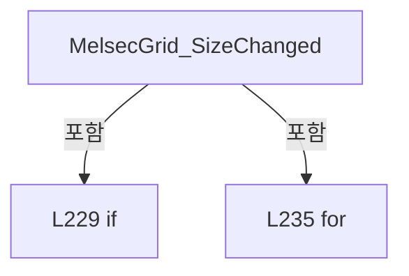

변경 전 점검: 입력/반환 타입, 위 호출자, 예외/취소 경로, 공유 상태와 저장·전송 소비자를 함께 확인합니다. 값의 단위나 물리 방향을 이름만으로 확정하지 않습니다.

### MethodDeclaration `CloseOpenComboBoxes` · L248–259

[Drilling.UI/Views/CMonitorView.xaml.cs:248–259](https://github.com/kjuws10-rgb/A3Drilling/blob/dfa5920e6301d9ec4b0eab1452ae59521aafc986/Drilling.UI/Views/CMonitorView.xaml.cs#L248-L259)

| 항목 | 실제 추출 값 |
| --- | --- |
| 서명 | void Drilling.UI.Views.CMonitorView.CloseOpenComboBoxes(DependencyObject) |
| 접근/수식자 | Private / private, static |
| 반환/값 타입 | void |
| 소속 타입 | NamedType:Drilling.UI.Views.CMonitorView |

입력 계약:

| 이름 | 타입 | 전달 | 선택/기본값 |
| --- | --- | --- | --- |
| root | DependencyObject | None | False /  |

정적 호출자로 확인된 위치:

| 호출 파일/행 | 호출 표현식 | 런타임 분기 가능 |
| --- | --- | --- |
| [Drilling.UI/Views/CMonitorView.xaml.cs:224–224](https://github.com/kjuws10-rgb/A3Drilling/blob/dfa5920e6301d9ec4b0eab1452ae59521aafc986/Drilling.UI/Views/CMonitorView.xaml.cs#L224-L224) | CloseOpenComboBoxes | False |

호출하는 대상과 해석 범위:

| 원본 행 | 표현식 | 분석 상태 | 대상/소스 위치 |
| --- | --- | --- | --- |
| 255 | VisualTreeHelper.GetChildrenCount | unresolved | None |
| 257 | CloseOpenComboBoxes | candidate | OverloadResolutionFailure |
| 257 | VisualTreeHelper.GetChild | unresolved | None |

본문의 실제 연산·분기·예외·반환 순서(원문 위치 순):

| 원본 행 | 종류 | 주석 해설 |
| --- | --- | --- |
| 250 | if | 조건에 따라 분기합니다: if (root is ComboBox { IsDropDownOpen: true } comboBox) |
| 252 | assignment | 값을 대상에 대입합니다: comboBox.IsDropDownOpen = false |
| 255 | call | 함수·델리게이트 또는 객체 생성자를 호출합니다: VisualTreeHelper.GetChildrenCount(root) |
| 255 | variable-initializer | 변수의 초기값을 지정합니다: index = 0 |
| 255 | for | 초기화·조건·증감이 있는 반복입니다: for (var index = 0; index < VisualTreeHelper.GetChildrenCount(root); index++) |
| 257 | call | 함수·델리게이트 또는 객체 생성자를 호출합니다: CloseOpenComboBoxes(VisualTreeHelper.GetChild(root, index)) |
| 257 | call | 함수·델리게이트 또는 객체 생성자를 호출합니다: VisualTreeHelper.GetChild(root, index) |

제어 구문의 포함 구조(실제 실행 순서/CFG가 아닌 구문 탐색 그림):

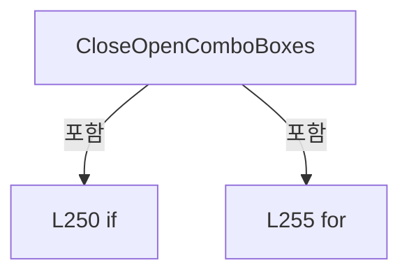

변경 전 점검: 입력/반환 타입, 위 호출자, 예외/취소 경로, 공유 상태와 저장·전송 소비자를 함께 확인합니다. 값의 단위나 물리 방향을 이름만으로 확정하지 않습니다.

### MethodDeclaration `OpenPowerMeterSettingInput` · L261–283

[Drilling.UI/Views/CMonitorView.xaml.cs:261–283](https://github.com/kjuws10-rgb/A3Drilling/blob/dfa5920e6301d9ec4b0eab1452ae59521aafc986/Drilling.UI/Views/CMonitorView.xaml.cs#L261-L283)

| 항목 | 실제 추출 값 |
| --- | --- |
| 서명 | void Drilling.UI.Views.CMonitorView.OpenPowerMeterSettingInput(object, RoutedEventArgs) |
| 접근/수식자 | Private / private |
| 반환/값 타입 | void |
| 소속 타입 | NamedType:Drilling.UI.Views.CMonitorView |

입력 계약:

| 이름 | 타입 | 전달 | 선택/기본값 |
| --- | --- | --- | --- |
| sender | object | None | False /  |
| e | RoutedEventArgs | None | False /  |

현재 부분 분석에서 직접 연결된 호출자는 없습니다. XAML/이벤트/인터페이스·델리게이트·외부 진입을 추가 확인해야 하며, 미사용으로 판정한 것이 아닙니다.

호출하는 대상과 해석 범위:

| 원본 행 | 표현식 | 분석 상태 | 대상/소스 위치 |
| --- | --- | --- | --- |
| 269 | GetMonitorMenu | resolved | Drilling.UI.Menu.Menus.CMenuMonitor? Drilling.UI.Views.CMonitorView.GetMonitorMenu() · Drilling.UI/Views/CMonitorView.xaml.cs:463 |
| 270 | .TryNotifyPowerMeterTuneLocked | resolved | bool Drilling.UI.Menu.Menus.CMenuMonitor.TryNotifyPowerMeterTuneLocked(string) · Drilling.UI/Menu/Menus/CMenuMonitor.cs:5782 |
| 275 | new CValueInputDialog | resolved | Drilling.UI.Popup.CValueInputDialog.CValueInputDialog(string, string, Drilling.Common.Managers.EN_RECIPE_DATA_TYPE, double, double) · Drilling.UI/Popup/CValueInputDialog.xaml.cs:13 |
| 277 | Window.GetWindow | unresolved | None |
| 279 | dialog.ShowDialog | unresolved | None |

본문의 실제 연산·분기·예외·반환 순서(원문 위치 순):

| 원본 행 | 종류 | 주석 해설 |
| --- | --- | --- |
| 263 | if | 조건에 따라 분기합니다: if (sender is not FrameworkElement { DataContext: ST_PWM_SETTING_ROW row } &#124;&#124; row.UsesSelectionEditor) |
| 265 | return | 호출자에게 값 또는 제어를 반환합니다: return; |
| 268 | assignment | 값을 대상에 대입합니다: e.Handled = true |
| 269 | call | 함수·델리게이트 또는 객체 생성자를 호출합니다: GetMonitorMenu() |
| 269 | local-declaration | 지역 변수를 선언합니다: var monitor = GetMonitorMenu(); |
| 269 | variable-initializer | 변수의 초기값을 지정합니다: monitor = GetMonitorMenu() |
| 270 | call | 함수·델리게이트 또는 객체 생성자를 호출합니다: .TryNotifyPowerMeterTuneLocked("SETTING 변경") |
| 270 | if | 조건에 따라 분기합니다: if (monitor?.TryNotifyPowerMeterTuneLocked("SETTING 변경") == true) |
| 272 | return | 호출자에게 값 또는 제어를 반환합니다: return; |
| 275 | call | 함수·델리게이트 또는 객체 생성자를 호출합니다: new CValueInputDialog(row.Parameter, row.Value, row.DataType, 0, 0) { Owner = Window.GetWindow(this) } |
| 275 | local-declaration | 지역 변수를 선언합니다: var dialog = new CValueInputDialog(row.Parameter, row.Value, row.DataType, 0, 0) { Owner = Window.GetWindow(this) }; |
| 275 | variable-initializer | 변수의 초기값을 지정합니다: dialog = new CValueInputDialog(row.Parameter, row.Value, row.DataType, 0, 0) { Owner = Window.GetWindow(this) } |
| 277 | assignment | 값을 대상에 대입합니다: Owner = Window.GetWindow(this) |
| 277 | call | 함수·델리게이트 또는 객체 생성자를 호출합니다: Window.GetWindow(this) |
| 279 | call | 함수·델리게이트 또는 객체 생성자를 호출합니다: dialog.ShowDialog() |
| 279 | if | 조건에 따라 분기합니다: if (dialog.ShowDialog() == true) |
| 281 | assignment | 값을 대상에 대입합니다: row.Value = dialog.ResultValue |

제어 구문의 포함 구조(실제 실행 순서/CFG가 아닌 구문 탐색 그림):

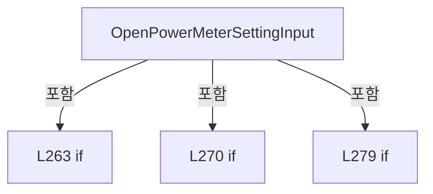

변경 전 점검: 입력/반환 타입, 위 호출자, 예외/취소 경로, 공유 상태와 저장·전송 소비자를 함께 확인합니다. 값의 단위나 물리 방향을 이름만으로 확정하지 않습니다.

### MethodDeclaration `PowerMeterSettingSelection_PreviewMouseDown` · L285–292

[Drilling.UI/Views/CMonitorView.xaml.cs:285–292](https://github.com/kjuws10-rgb/A3Drilling/blob/dfa5920e6301d9ec4b0eab1452ae59521aafc986/Drilling.UI/Views/CMonitorView.xaml.cs#L285-L292)

| 항목 | 실제 추출 값 |
| --- | --- |
| 서명 | void Drilling.UI.Views.CMonitorView.PowerMeterSettingSelection_PreviewMouseDown(object, MouseButtonEventArgs) |
| 접근/수식자 | Private / private |
| 반환/값 타입 | void |
| 소속 타입 | NamedType:Drilling.UI.Views.CMonitorView |

입력 계약:

| 이름 | 타입 | 전달 | 선택/기본값 |
| --- | --- | --- | --- |
| sender | object | None | False /  |
| e | MouseButtonEventArgs | None | False /  |

현재 부분 분석에서 직접 연결된 호출자는 없습니다. XAML/이벤트/인터페이스·델리게이트·외부 진입을 추가 확인해야 하며, 미사용으로 판정한 것이 아닙니다.

호출하는 대상과 해석 범위:

| 원본 행 | 표현식 | 분석 상태 | 대상/소스 위치 |
| --- | --- | --- | --- |
| 287 | GetMonitorMenu | resolved | Drilling.UI.Menu.Menus.CMenuMonitor? Drilling.UI.Views.CMonitorView.GetMonitorMenu() · Drilling.UI/Views/CMonitorView.xaml.cs:463 |
| 288 | .TryNotifyPowerMeterTuneLocked | resolved | bool Drilling.UI.Menu.Menus.CMenuMonitor.TryNotifyPowerMeterTuneLocked(string) · Drilling.UI/Menu/Menus/CMenuMonitor.cs:5782 |

본문의 실제 연산·분기·예외·반환 순서(원문 위치 순):

| 원본 행 | 종류 | 주석 해설 |
| --- | --- | --- |
| 287 | call | 함수·델리게이트 또는 객체 생성자를 호출합니다: GetMonitorMenu() |
| 287 | local-declaration | 지역 변수를 선언합니다: var monitor = GetMonitorMenu(); |
| 287 | variable-initializer | 변수의 초기값을 지정합니다: monitor = GetMonitorMenu() |
| 288 | call | 함수·델리게이트 또는 객체 생성자를 호출합니다: .TryNotifyPowerMeterTuneLocked("SETTING 변경") |
| 288 | if | 조건에 따라 분기합니다: if (monitor?.TryNotifyPowerMeterTuneLocked("SETTING 변경") == true) |
| 290 | assignment | 값을 대상에 대입합니다: e.Handled = true |

제어 구문의 포함 구조(실제 실행 순서/CFG가 아닌 구문 탐색 그림):

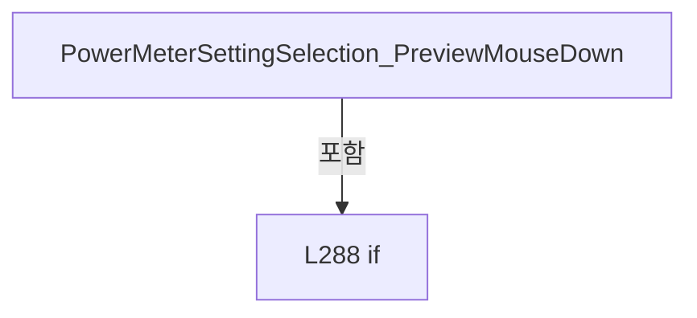

변경 전 점검: 입력/반환 타입, 위 호출자, 예외/취소 경로, 공유 상태와 저장·전송 소비자를 함께 확인합니다. 값의 단위나 물리 방향을 이름만으로 확정하지 않습니다.

### MethodDeclaration `PowerMeterSettingSelection_PreviewKeyDown` · L294–306

[Drilling.UI/Views/CMonitorView.xaml.cs:294–306](https://github.com/kjuws10-rgb/A3Drilling/blob/dfa5920e6301d9ec4b0eab1452ae59521aafc986/Drilling.UI/Views/CMonitorView.xaml.cs#L294-L306)

| 항목 | 실제 추출 값 |
| --- | --- |
| 서명 | void Drilling.UI.Views.CMonitorView.PowerMeterSettingSelection_PreviewKeyDown(object, KeyEventArgs) |
| 접근/수식자 | Private / private |
| 반환/값 타입 | void |
| 소속 타입 | NamedType:Drilling.UI.Views.CMonitorView |

입력 계약:

| 이름 | 타입 | 전달 | 선택/기본값 |
| --- | --- | --- | --- |
| sender | object | None | False /  |
| e | KeyEventArgs | None | False /  |

현재 부분 분석에서 직접 연결된 호출자는 없습니다. XAML/이벤트/인터페이스·델리게이트·외부 진입을 추가 확인해야 하며, 미사용으로 판정한 것이 아닙니다.

호출하는 대상과 해석 범위:

| 원본 행 | 표현식 | 분석 상태 | 대상/소스 위치 |
| --- | --- | --- | --- |
| 296 | IsPowerMeterSettingSelectionKey | candidate | OverloadResolutionFailure |
| 301 | GetMonitorMenu | resolved | Drilling.UI.Menu.Menus.CMenuMonitor? Drilling.UI.Views.CMonitorView.GetMonitorMenu() · Drilling.UI/Views/CMonitorView.xaml.cs:463 |
| 302 | .TryNotifyPowerMeterTuneLocked | resolved | bool Drilling.UI.Menu.Menus.CMenuMonitor.TryNotifyPowerMeterTuneLocked(string) · Drilling.UI/Menu/Menus/CMenuMonitor.cs:5782 |

본문의 실제 연산·분기·예외·반환 순서(원문 위치 순):

| 원본 행 | 종류 | 주석 해설 |
| --- | --- | --- |
| 296 | call | 함수·델리게이트 또는 객체 생성자를 호출합니다: IsPowerMeterSettingSelectionKey(e.Key) |
| 296 | if | 조건에 따라 분기합니다: if (!IsPowerMeterSettingSelectionKey(e.Key)) |
| 298 | return | 호출자에게 값 또는 제어를 반환합니다: return; |
| 301 | call | 함수·델리게이트 또는 객체 생성자를 호출합니다: GetMonitorMenu() |
| 301 | local-declaration | 지역 변수를 선언합니다: var monitor = GetMonitorMenu(); |
| 301 | variable-initializer | 변수의 초기값을 지정합니다: monitor = GetMonitorMenu() |
| 302 | call | 함수·델리게이트 또는 객체 생성자를 호출합니다: .TryNotifyPowerMeterTuneLocked("SETTING 변경") |
| 302 | if | 조건에 따라 분기합니다: if (monitor?.TryNotifyPowerMeterTuneLocked("SETTING 변경") == true) |
| 304 | assignment | 값을 대상에 대입합니다: e.Handled = true |

제어 구문의 포함 구조(실제 실행 순서/CFG가 아닌 구문 탐색 그림):

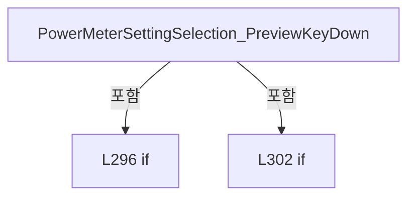

변경 전 점검: 입력/반환 타입, 위 호출자, 예외/취소 경로, 공유 상태와 저장·전송 소비자를 함께 확인합니다. 값의 단위나 물리 방향을 이름만으로 확정하지 않습니다.

### MethodDeclaration `PowerMeterSettingSelection_PreviewMouseWheel` · L308–315

[Drilling.UI/Views/CMonitorView.xaml.cs:308–315](https://github.com/kjuws10-rgb/A3Drilling/blob/dfa5920e6301d9ec4b0eab1452ae59521aafc986/Drilling.UI/Views/CMonitorView.xaml.cs#L308-L315)

| 항목 | 실제 추출 값 |
| --- | --- |
| 서명 | void Drilling.UI.Views.CMonitorView.PowerMeterSettingSelection_PreviewMouseWheel(object, MouseWheelEventArgs) |
| 접근/수식자 | Private / private |
| 반환/값 타입 | void |
| 소속 타입 | NamedType:Drilling.UI.Views.CMonitorView |

입력 계약:

| 이름 | 타입 | 전달 | 선택/기본값 |
| --- | --- | --- | --- |
| sender | object | None | False /  |
| e | MouseWheelEventArgs | None | False /  |

현재 부분 분석에서 직접 연결된 호출자는 없습니다. XAML/이벤트/인터페이스·델리게이트·외부 진입을 추가 확인해야 하며, 미사용으로 판정한 것이 아닙니다.

호출하는 대상과 해석 범위:

| 원본 행 | 표현식 | 분석 상태 | 대상/소스 위치 |
| --- | --- | --- | --- |
| 310 | GetMonitorMenu | resolved | Drilling.UI.Menu.Menus.CMenuMonitor? Drilling.UI.Views.CMonitorView.GetMonitorMenu() · Drilling.UI/Views/CMonitorView.xaml.cs:463 |
| 311 | .TryNotifyPowerMeterTuneLocked | resolved | bool Drilling.UI.Menu.Menus.CMenuMonitor.TryNotifyPowerMeterTuneLocked(string) · Drilling.UI/Menu/Menus/CMenuMonitor.cs:5782 |

본문의 실제 연산·분기·예외·반환 순서(원문 위치 순):

| 원본 행 | 종류 | 주석 해설 |
| --- | --- | --- |
| 310 | call | 함수·델리게이트 또는 객체 생성자를 호출합니다: GetMonitorMenu() |
| 310 | local-declaration | 지역 변수를 선언합니다: var monitor = GetMonitorMenu(); |
| 310 | variable-initializer | 변수의 초기값을 지정합니다: monitor = GetMonitorMenu() |
| 311 | call | 함수·델리게이트 또는 객체 생성자를 호출합니다: .TryNotifyPowerMeterTuneLocked("SETTING 변경") |
| 311 | if | 조건에 따라 분기합니다: if (monitor?.TryNotifyPowerMeterTuneLocked("SETTING 변경") == true) |
| 313 | assignment | 값을 대상에 대입합니다: e.Handled = true |

제어 구문의 포함 구조(실제 실행 순서/CFG가 아닌 구문 탐색 그림):

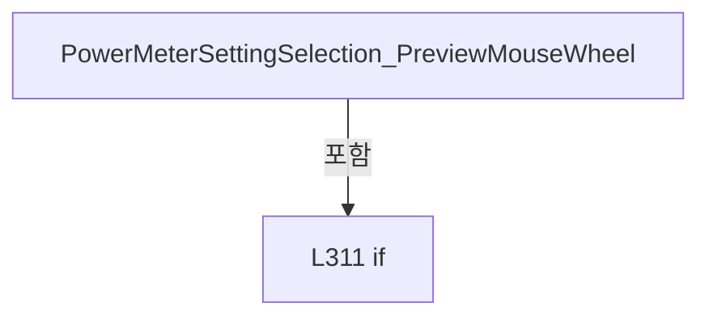

변경 전 점검: 입력/반환 타입, 위 호출자, 예외/취소 경로, 공유 상태와 저장·전송 소비자를 함께 확인합니다. 값의 단위나 물리 방향을 이름만으로 확정하지 않습니다.

### MethodDeclaration `PowerMeterSettingSelection_DropDownOpened` · L317–326

[Drilling.UI/Views/CMonitorView.xaml.cs:317–326](https://github.com/kjuws10-rgb/A3Drilling/blob/dfa5920e6301d9ec4b0eab1452ae59521aafc986/Drilling.UI/Views/CMonitorView.xaml.cs#L317-L326)

| 항목 | 실제 추출 값 |
| --- | --- |
| 서명 | void Drilling.UI.Views.CMonitorView.PowerMeterSettingSelection_DropDownOpened(object, System.EventArgs) |
| 접근/수식자 | Private / private |
| 반환/값 타입 | void |
| 소속 타입 | NamedType:Drilling.UI.Views.CMonitorView |

입력 계약:

| 이름 | 타입 | 전달 | 선택/기본값 |
| --- | --- | --- | --- |
| sender | object | None | False /  |
| e | System.EventArgs | None | False /  |

현재 부분 분석에서 직접 연결된 호출자는 없습니다. XAML/이벤트/인터페이스·델리게이트·외부 진입을 추가 확인해야 하며, 미사용으로 판정한 것이 아닙니다.

호출하는 대상과 해석 범위:

| 원본 행 | 표현식 | 분석 상태 | 대상/소스 위치 |
| --- | --- | --- | --- |
| 319 | GetMonitorMenu | resolved | Drilling.UI.Menu.Menus.CMenuMonitor? Drilling.UI.Views.CMonitorView.GetMonitorMenu() · Drilling.UI/Views/CMonitorView.xaml.cs:463 |
| 320 | .TryNotifyPowerMeterTuneLocked | resolved | bool Drilling.UI.Menu.Menus.CMenuMonitor.TryNotifyPowerMeterTuneLocked(string) · Drilling.UI/Menu/Menus/CMenuMonitor.cs:5782 |

본문의 실제 연산·분기·예외·반환 순서(원문 위치 순):

| 원본 행 | 종류 | 주석 해설 |
| --- | --- | --- |
| 319 | call | 함수·델리게이트 또는 객체 생성자를 호출합니다: GetMonitorMenu() |
| 319 | local-declaration | 지역 변수를 선언합니다: var monitor = GetMonitorMenu(); |
| 319 | variable-initializer | 변수의 초기값을 지정합니다: monitor = GetMonitorMenu() |
| 320 | call | 함수·델리게이트 또는 객체 생성자를 호출합니다: .TryNotifyPowerMeterTuneLocked("SETTING 변경") |
| 320 | if | 조건에 따라 분기합니다: if (monitor?.TryNotifyPowerMeterTuneLocked("SETTING 변경") != true &#124;&#124; sender is not ComboBox comboBox) |
| 322 | return | 호출자에게 값 또는 제어를 반환합니다: return; |
| 325 | assignment | 값을 대상에 대입합니다: comboBox.IsDropDownOpen = false |

제어 구문의 포함 구조(실제 실행 순서/CFG가 아닌 구문 탐색 그림):

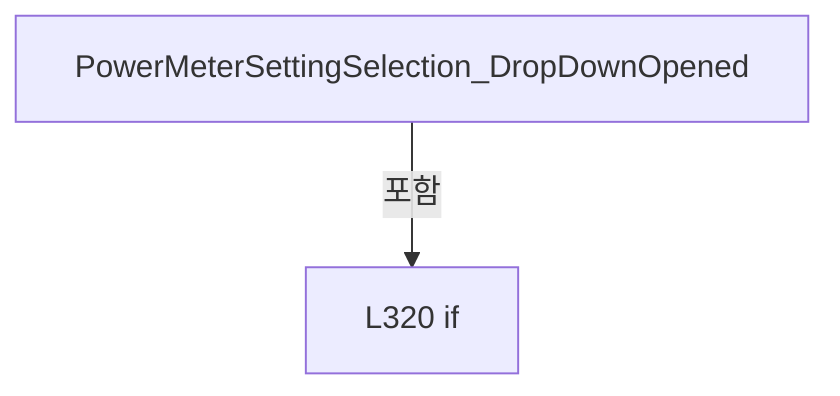

변경 전 점검: 입력/반환 타입, 위 호출자, 예외/취소 경로, 공유 상태와 저장·전송 소비자를 함께 확인합니다. 값의 단위나 물리 방향을 이름만으로 확정하지 않습니다.

### MethodDeclaration `IsPowerMeterSettingSelectionKey` · L328–344

[Drilling.UI/Views/CMonitorView.xaml.cs:328–344](https://github.com/kjuws10-rgb/A3Drilling/blob/dfa5920e6301d9ec4b0eab1452ae59521aafc986/Drilling.UI/Views/CMonitorView.xaml.cs#L328-L344)

| 항목 | 실제 추출 값 |
| --- | --- |
| 서명 | bool Drilling.UI.Views.CMonitorView.IsPowerMeterSettingSelectionKey(Key) |
| 접근/수식자 | Private / private, static |
| 반환/값 타입 | bool |
| 소속 타입 | NamedType:Drilling.UI.Views.CMonitorView |

입력 계약:

| 이름 | 타입 | 전달 | 선택/기본값 |
| --- | --- | --- | --- |
| key | Key | None | False /  |

현재 부분 분석에서 직접 연결된 호출자는 없습니다. XAML/이벤트/인터페이스·델리게이트·외부 진입을 추가 확인해야 하며, 미사용으로 판정한 것이 아닙니다.

본문의 실제 연산·분기·예외·반환 순서(원문 위치 순):

| 원본 행 | 종류 | 주석 해설 |
| --- | --- | --- |
| 330 | switch | 값에 따라 분기합니다: switch (key) |
| 332 | case | 분기값/패턴의 구간입니다: case Key.Enter: |
| 333 | case | 분기값/패턴의 구간입니다: case Key.Space: |
| 334 | case | 분기값/패턴의 구간입니다: case Key.Up: |
| 335 | case | 분기값/패턴의 구간입니다: case Key.Down: |
| 336 | case | 분기값/패턴의 구간입니다: case Key.PageUp: |
| 337 | case | 분기값/패턴의 구간입니다: case Key.PageDown: |
| 338 | case | 분기값/패턴의 구간입니다: case Key.Home: |
| 339 | case | 분기값/패턴의 구간입니다: case Key.End: |
| 340 | return | 호출자에게 값 또는 제어를 반환합니다: return true; |
| 341 | case | 분기값/패턴의 구간입니다: default: |
| 342 | return | 호출자에게 값 또는 제어를 반환합니다: return false; |

제어 구문의 포함 구조(실제 실행 순서/CFG가 아닌 구문 탐색 그림):

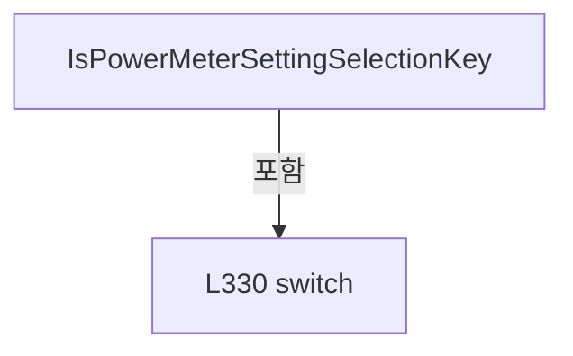

변경 전 점검: 입력/반환 타입, 위 호출자, 예외/취소 경로, 공유 상태와 저장·전송 소비자를 함께 확인합니다. 값의 단위나 물리 방향을 이름만으로 확정하지 않습니다.

### MethodDeclaration `OpenLaserSettingInput` · L346–363

[Drilling.UI/Views/CMonitorView.xaml.cs:346–363](https://github.com/kjuws10-rgb/A3Drilling/blob/dfa5920e6301d9ec4b0eab1452ae59521aafc986/Drilling.UI/Views/CMonitorView.xaml.cs#L346-L363)

| 항목 | 실제 추출 값 |
| --- | --- |
| 서명 | void Drilling.UI.Views.CMonitorView.OpenLaserSettingInput(object, RoutedEventArgs) |
| 접근/수식자 | Private / private |
| 반환/값 타입 | void |
| 소속 타입 | NamedType:Drilling.UI.Views.CMonitorView |

입력 계약:

| 이름 | 타입 | 전달 | 선택/기본값 |
| --- | --- | --- | --- |
| sender | object | None | False /  |
| e | RoutedEventArgs | None | False /  |

현재 부분 분석에서 직접 연결된 호출자는 없습니다. XAML/이벤트/인터페이스·델리게이트·외부 진입을 추가 확인해야 하며, 미사용으로 판정한 것이 아닙니다.

호출하는 대상과 해석 범위:

| 원본 행 | 표현식 | 분석 상태 | 대상/소스 위치 |
| --- | --- | --- | --- |
| 354 | new CValueInputDialog | resolved | Drilling.UI.Popup.CValueInputDialog.CValueInputDialog(string, string, Drilling.Common.Managers.EN_RECIPE_DATA_TYPE, double, double) · Drilling.UI/Popup/CValueInputDialog.xaml.cs:13 |
| 356 | Window.GetWindow | unresolved | None |
| 358 | dialog.ShowDialog | unresolved | None |

본문의 실제 연산·분기·예외·반환 순서(원문 위치 순):

| 원본 행 | 종류 | 주석 해설 |
| --- | --- | --- |
| 348 | if | 조건에 따라 분기합니다: if (sender is not Button { DataContext: ST_MONITOR_LASER_CONTROL_ROW row } button &#124;&#124; !row.CanCommand) |
| 350 | return | 호출자에게 값 또는 제어를 반환합니다: return; |
| 353 | assignment | 값을 대상에 대입합니다: e.Handled = true |
| 354 | call | 함수·델리게이트 또는 객체 생성자를 호출합니다: new CValueInputDialog(row.CurrentLabel, row.Setting.Value, EN_RECIPE_DATA_TYPE.Int, 0, int.MaxValue) { Owner = Window.GetWindow(this) } |
| 354 | local-declaration | 지역 변수를 선언합니다: var dialog = new CValueInputDialog(row.CurrentLabel, row.Setting.Value, EN_RECIPE_DATA_TYPE.Int, 0, int.MaxValue) { Owner = Window.GetWindow(this) }; |
| 354 | variable-initializer | 변수의 초기값을 지정합니다: dialog = new CValueInputDialog(row.CurrentLabel, row.Setting.Value, EN_RECIPE_DATA_TYPE.Int, 0, int.MaxValue) { Owner = Window.GetWindow(this) } |
| 356 | assignment | 값을 대상에 대입합니다: Owner = Window.GetWindow(this) |
| 356 | call | 함수·델리게이트 또는 객체 생성자를 호출합니다: Window.GetWindow(this) |
| 358 | call | 함수·델리게이트 또는 객체 생성자를 호출합니다: dialog.ShowDialog() |
| 358 | if | 조건에 따라 분기합니다: if (dialog.ShowDialog() == true) |
| 360 | assignment | 값을 대상에 대입합니다: row.Setting.Value = dialog.ResultValue |
| 361 | assignment | 값을 대상에 대입합니다: button.Content = dialog.ResultValue |

제어 구문의 포함 구조(실제 실행 순서/CFG가 아닌 구문 탐색 그림):

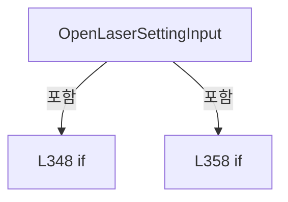

변경 전 점검: 입력/반환 타입, 위 호출자, 예외/취소 경로, 공유 상태와 저장·전송 소비자를 함께 확인합니다. 값의 단위나 물리 방향을 이름만으로 확정하지 않습니다.

### MethodDeclaration `OpenMotorOperationInput` · L365–382

[Drilling.UI/Views/CMonitorView.xaml.cs:365–382](https://github.com/kjuws10-rgb/A3Drilling/blob/dfa5920e6301d9ec4b0eab1452ae59521aafc986/Drilling.UI/Views/CMonitorView.xaml.cs#L365-L382)

| 항목 | 실제 추출 값 |
| --- | --- |
| 서명 | void Drilling.UI.Views.CMonitorView.OpenMotorOperationInput(object, RoutedEventArgs) |
| 접근/수식자 | Private / private |
| 반환/값 타입 | void |
| 소속 타입 | NamedType:Drilling.UI.Views.CMonitorView |

입력 계약:

| 이름 | 타입 | 전달 | 선택/기본값 |
| --- | --- | --- | --- |
| sender | object | None | False /  |
| e | RoutedEventArgs | None | False /  |

현재 부분 분석에서 직접 연결된 호출자는 없습니다. XAML/이벤트/인터페이스·델리게이트·외부 진입을 추가 확인해야 하며, 미사용으로 판정한 것이 아닙니다.

호출하는 대상과 해석 범위:

| 원본 행 | 표현식 | 분석 상태 | 대상/소스 위치 |
| --- | --- | --- | --- |
| 373 | new CValueInputDialog | resolved | Drilling.UI.Popup.CValueInputDialog.CValueInputDialog(string, string, Drilling.Common.Managers.EN_RECIPE_DATA_TYPE, double, double) · Drilling.UI/Popup/CValueInputDialog.xaml.cs:13 |
| 375 | Window.GetWindow | unresolved | None |
| 377 | dialog.ShowDialog | unresolved | None |

본문의 실제 연산·분기·예외·반환 순서(원문 위치 순):

| 원본 행 | 종류 | 주석 해설 |
| --- | --- | --- |
| 367 | if | 조건에 따라 분기합니다: if (sender is not Button { Tag: ST_MONITOR_PARAMETER_ROW row } button) |
| 369 | return | 호출자에게 값 또는 제어를 반환합니다: return; |
| 372 | assignment | 값을 대상에 대입합니다: e.Handled = true |
| 373 | call | 함수·델리게이트 또는 객체 생성자를 호출합니다: new CValueInputDialog(row.Parameter, row.Value, EN_RECIPE_DATA_TYPE.Double, 0, 0) { Owner = Window.GetWindow(this) } |
| 373 | local-declaration | 지역 변수를 선언합니다: var dialog = new CValueInputDialog(row.Parameter, row.Value, EN_RECIPE_DATA_TYPE.Double, 0, 0) { Owner = Window.GetWindow(this) }; |
| 373 | variable-initializer | 변수의 초기값을 지정합니다: dialog = new CValueInputDialog(row.Parameter, row.Value, EN_RECIPE_DATA_TYPE.Double, 0, 0) { Owner = Window.GetWindow(this) } |
| 375 | assignment | 값을 대상에 대입합니다: Owner = Window.GetWindow(this) |
| 375 | call | 함수·델리게이트 또는 객체 생성자를 호출합니다: Window.GetWindow(this) |
| 377 | call | 함수·델리게이트 또는 객체 생성자를 호출합니다: dialog.ShowDialog() |
| 377 | if | 조건에 따라 분기합니다: if (dialog.ShowDialog() == true) |
| 379 | assignment | 값을 대상에 대입합니다: row.Value = dialog.ResultValue |
| 380 | assignment | 값을 대상에 대입합니다: button.Content = dialog.ResultValue |

제어 구문의 포함 구조(실제 실행 순서/CFG가 아닌 구문 탐색 그림):

```mermaid
flowchart TD
 M["OpenMotorOperationInput"]
 N0["L367 if"]
 M -->|포함| N0
 N1["L377 if"]
 M -->|포함| N1
```

변경 전 점검: 입력/반환 타입, 위 호출자, 예외/취소 경로, 공유 상태와 저장·전송 소비자를 함께 확인합니다. 값의 단위나 물리 방향을 이름만으로 확정하지 않습니다.

### MethodDeclaration `OpenXpsMultiMoveTargetInput` · L384–400

[Drilling.UI/Views/CMonitorView.xaml.cs:384–400](https://github.com/kjuws10-rgb/A3Drilling/blob/dfa5920e6301d9ec4b0eab1452ae59521aafc986/Drilling.UI/Views/CMonitorView.xaml.cs#L384-L400)

| 항목 | 실제 추출 값 |
| --- | --- |
| 서명 | void Drilling.UI.Views.CMonitorView.OpenXpsMultiMoveTargetInput(object, RoutedEventArgs) |
| 접근/수식자 | Private / private |
| 반환/값 타입 | void |
| 소속 타입 | NamedType:Drilling.UI.Views.CMonitorView |

입력 계약:

| 이름 | 타입 | 전달 | 선택/기본값 |
| --- | --- | --- | --- |
| sender | object | None | False /  |
| e | RoutedEventArgs | None | False /  |

현재 부분 분석에서 직접 연결된 호출자는 없습니다. XAML/이벤트/인터페이스·델리게이트·외부 진입을 추가 확인해야 하며, 미사용으로 판정한 것이 아닙니다.

호출하는 대상과 해석 범위:

| 원본 행 | 표현식 | 분석 상태 | 대상/소스 위치 |
| --- | --- | --- | --- |
| 392 | new CValueInputDialog | resolved | Drilling.UI.Popup.CValueInputDialog.CValueInputDialog(string, string, Drilling.Common.Managers.EN_RECIPE_DATA_TYPE, double, double) · Drilling.UI/Popup/CValueInputDialog.xaml.cs:13 |
| 394 | Window.GetWindow | unresolved | None |
| 396 | dialog.ShowDialog | unresolved | None |

본문의 실제 연산·분기·예외·반환 순서(원문 위치 순):

| 원본 행 | 종류 | 주석 해설 |
| --- | --- | --- |
| 386 | if | 조건에 따라 분기합니다: if (sender is not Button { Tag: ST_MONITOR_MULTI_MOVE_AXIS_ROW row }) |
| 388 | return | 호출자에게 값 또는 제어를 반환합니다: return; |
| 391 | assignment | 값을 대상에 대입합니다: e.Handled = true |
| 392 | call | 함수·델리게이트 또는 객체 생성자를 호출합니다: new CValueInputDialog($"Axis {row.Axis} Target Position", row.TargetPosition, EN_RECIPE_DATA_TYPE.Double, 0, 0) { Owner = Window.GetWindow(this) } |
| 392 | local-declaration | 지역 변수를 선언합니다: var dialog = new CValueInputDialog($"Axis {row.Axis} Target Position", row.TargetPosition, EN_RECIPE_DATA_TYPE.Double, 0, 0) { Owner = Window.GetWindow(this) }; |
| 392 | variable-initializer | 변수의 초기값을 지정합니다: dialog = new CValueInputDialog($"Axis {row.Axis} Target Position", row.TargetPosition, EN_RECIPE_DATA_TYPE.Double, 0, 0) { Owner = Window.GetWindow(this) } |
| 394 | assignment | 값을 대상에 대입합니다: Owner = Window.GetWindow(this) |
| 394 | call | 함수·델리게이트 또는 객체 생성자를 호출합니다: Window.GetWindow(this) |
| 396 | call | 함수·델리게이트 또는 객체 생성자를 호출합니다: dialog.ShowDialog() |
| 396 | if | 조건에 따라 분기합니다: if (dialog.ShowDialog() == true) |
| 398 | assignment | 값을 대상에 대입합니다: row.TargetPosition = dialog.ResultValue |

제어 구문의 포함 구조(실제 실행 순서/CFG가 아닌 구문 탐색 그림):

```mermaid
flowchart TD
 M["OpenXpsMultiMoveTargetInput"]
 N0["L386 if"]
 M -->|포함| N0
 N1["L396 if"]
 M -->|포함| N1
```

변경 전 점검: 입력/반환 타입, 위 호출자, 예외/취소 경로, 공유 상태와 저장·전송 소비자를 함께 확인합니다. 값의 단위나 물리 방향을 이름만으로 확정하지 않습니다.

### MethodDeclaration `StartXpsJogNegative` · L402–406

[Drilling.UI/Views/CMonitorView.xaml.cs:402–406](https://github.com/kjuws10-rgb/A3Drilling/blob/dfa5920e6301d9ec4b0eab1452ae59521aafc986/Drilling.UI/Views/CMonitorView.xaml.cs#L402-L406)

| 항목 | 실제 추출 값 |
| --- | --- |
| 서명 | void Drilling.UI.Views.CMonitorView.StartXpsJogNegative(object, MouseButtonEventArgs) |
| 접근/수식자 | Private / private, async |
| 반환/값 타입 | void |
| 소속 타입 | NamedType:Drilling.UI.Views.CMonitorView |

입력 계약:

| 이름 | 타입 | 전달 | 선택/기본값 |
| --- | --- | --- | --- |
| sender | object | None | False /  |
| e | MouseButtonEventArgs | None | False /  |

현재 부분 분석에서 직접 연결된 호출자는 없습니다. XAML/이벤트/인터페이스·델리게이트·외부 진입을 추가 확인해야 하며, 미사용으로 판정한 것이 아닙니다.

호출하는 대상과 해석 범위:

| 원본 행 | 표현식 | 분석 상태 | 대상/소스 위치 |
| --- | --- | --- | --- |
| 405 | ExecuteXpsJogEvent | resolved | System.Threading.Tasks.Task Drilling.UI.Views.CMonitorView.ExecuteXpsJogEvent(bool?) · Drilling.UI/Views/CMonitorView.xaml.cs:435 |

본문의 실제 연산·분기·예외·반환 순서(원문 위치 순):

| 원본 행 | 종류 | 주석 해설 |
| --- | --- | --- |
| 404 | assignment | 값을 대상에 대입합니다: e.Handled = true |
| 405 | await | 비동기 완료를 기다립니다: await ExecuteXpsJogEvent(positive: false) |
| 405 | call | 함수·델리게이트 또는 객체 생성자를 호출합니다: ExecuteXpsJogEvent(positive: false) |

변경 전 점검: 입력/반환 타입, 위 호출자, 예외/취소 경로, 공유 상태와 저장·전송 소비자를 함께 확인합니다. 값의 단위나 물리 방향을 이름만으로 확정하지 않습니다.

### MethodDeclaration `StartXpsJogPositive` · L408–412

[Drilling.UI/Views/CMonitorView.xaml.cs:408–412](https://github.com/kjuws10-rgb/A3Drilling/blob/dfa5920e6301d9ec4b0eab1452ae59521aafc986/Drilling.UI/Views/CMonitorView.xaml.cs#L408-L412)

| 항목 | 실제 추출 값 |
| --- | --- |
| 서명 | void Drilling.UI.Views.CMonitorView.StartXpsJogPositive(object, MouseButtonEventArgs) |
| 접근/수식자 | Private / private, async |
| 반환/값 타입 | void |
| 소속 타입 | NamedType:Drilling.UI.Views.CMonitorView |

입력 계약:

| 이름 | 타입 | 전달 | 선택/기본값 |
| --- | --- | --- | --- |
| sender | object | None | False /  |
| e | MouseButtonEventArgs | None | False /  |

현재 부분 분석에서 직접 연결된 호출자는 없습니다. XAML/이벤트/인터페이스·델리게이트·외부 진입을 추가 확인해야 하며, 미사용으로 판정한 것이 아닙니다.

호출하는 대상과 해석 범위:

| 원본 행 | 표현식 | 분석 상태 | 대상/소스 위치 |
| --- | --- | --- | --- |
| 411 | ExecuteXpsJogEvent | resolved | System.Threading.Tasks.Task Drilling.UI.Views.CMonitorView.ExecuteXpsJogEvent(bool?) · Drilling.UI/Views/CMonitorView.xaml.cs:435 |

본문의 실제 연산·분기·예외·반환 순서(원문 위치 순):

| 원본 행 | 종류 | 주석 해설 |
| --- | --- | --- |
| 410 | assignment | 값을 대상에 대입합니다: e.Handled = true |
| 411 | await | 비동기 완료를 기다립니다: await ExecuteXpsJogEvent(positive: true) |
| 411 | call | 함수·델리게이트 또는 객체 생성자를 호출합니다: ExecuteXpsJogEvent(positive: true) |

변경 전 점검: 입력/반환 타입, 위 호출자, 예외/취소 경로, 공유 상태와 저장·전송 소비자를 함께 확인합니다. 값의 단위나 물리 방향을 이름만으로 확정하지 않습니다.

### MethodDeclaration `StopXpsJog` · L414–418

[Drilling.UI/Views/CMonitorView.xaml.cs:414–418](https://github.com/kjuws10-rgb/A3Drilling/blob/dfa5920e6301d9ec4b0eab1452ae59521aafc986/Drilling.UI/Views/CMonitorView.xaml.cs#L414-L418)

| 항목 | 실제 추출 값 |
| --- | --- |
| 서명 | void Drilling.UI.Views.CMonitorView.StopXpsJog(object, MouseButtonEventArgs) |
| 접근/수식자 | Private / private, async |
| 반환/값 타입 | void |
| 소속 타입 | NamedType:Drilling.UI.Views.CMonitorView |

입력 계약:

| 이름 | 타입 | 전달 | 선택/기본값 |
| --- | --- | --- | --- |
| sender | object | None | False /  |
| e | MouseButtonEventArgs | None | False /  |

현재 부분 분석에서 직접 연결된 호출자는 없습니다. XAML/이벤트/인터페이스·델리게이트·외부 진입을 추가 확인해야 하며, 미사용으로 판정한 것이 아닙니다.

호출하는 대상과 해석 범위:

| 원본 행 | 표현식 | 분석 상태 | 대상/소스 위치 |
| --- | --- | --- | --- |
| 417 | ExecuteXpsJogEvent | resolved | System.Threading.Tasks.Task Drilling.UI.Views.CMonitorView.ExecuteXpsJogEvent(bool?) · Drilling.UI/Views/CMonitorView.xaml.cs:435 |

본문의 실제 연산·분기·예외·반환 순서(원문 위치 순):

| 원본 행 | 종류 | 주석 해설 |
| --- | --- | --- |
| 416 | assignment | 값을 대상에 대입합니다: e.Handled = true |
| 417 | await | 비동기 완료를 기다립니다: await ExecuteXpsJogEvent(positive: null) |
| 417 | call | 함수·델리게이트 또는 객체 생성자를 호출합니다: ExecuteXpsJogEvent(positive: null) |

변경 전 점검: 입력/반환 타입, 위 호출자, 예외/취소 경로, 공유 상태와 저장·전송 소비자를 함께 확인합니다. 값의 단위나 물리 방향을 이름만으로 확정하지 않습니다.

### MethodDeclaration `StopXpsJogOnMouseLeave` · L420–423

[Drilling.UI/Views/CMonitorView.xaml.cs:420–423](https://github.com/kjuws10-rgb/A3Drilling/blob/dfa5920e6301d9ec4b0eab1452ae59521aafc986/Drilling.UI/Views/CMonitorView.xaml.cs#L420-L423)

| 항목 | 실제 추출 값 |
| --- | --- |
| 서명 | void Drilling.UI.Views.CMonitorView.StopXpsJogOnMouseLeave(object, MouseEventArgs) |
| 접근/수식자 | Private / private, async |
| 반환/값 타입 | void |
| 소속 타입 | NamedType:Drilling.UI.Views.CMonitorView |

입력 계약:

| 이름 | 타입 | 전달 | 선택/기본값 |
| --- | --- | --- | --- |
| sender | object | None | False /  |
| e | MouseEventArgs | None | False /  |

현재 부분 분석에서 직접 연결된 호출자는 없습니다. XAML/이벤트/인터페이스·델리게이트·외부 진입을 추가 확인해야 하며, 미사용으로 판정한 것이 아닙니다.

호출하는 대상과 해석 범위:

| 원본 행 | 표현식 | 분석 상태 | 대상/소스 위치 |
| --- | --- | --- | --- |
| 422 | ExecuteXpsJogEvent | resolved | System.Threading.Tasks.Task Drilling.UI.Views.CMonitorView.ExecuteXpsJogEvent(bool?) · Drilling.UI/Views/CMonitorView.xaml.cs:435 |

본문의 실제 연산·분기·예외·반환 순서(원문 위치 순):

| 원본 행 | 종류 | 주석 해설 |
| --- | --- | --- |
| 422 | await | 비동기 완료를 기다립니다: await ExecuteXpsJogEvent(positive: null) |
| 422 | call | 함수·델리게이트 또는 객체 생성자를 호출합니다: ExecuteXpsJogEvent(positive: null) |

변경 전 점검: 입력/반환 타입, 위 호출자, 예외/취소 경로, 공유 상태와 저장·전송 소비자를 함께 확인합니다. 값의 단위나 물리 방향을 이름만으로 확정하지 않습니다.

### MethodDeclaration `StopXpsJogOnLostMouseCapture` · L425–428

[Drilling.UI/Views/CMonitorView.xaml.cs:425–428](https://github.com/kjuws10-rgb/A3Drilling/blob/dfa5920e6301d9ec4b0eab1452ae59521aafc986/Drilling.UI/Views/CMonitorView.xaml.cs#L425-L428)

| 항목 | 실제 추출 값 |
| --- | --- |
| 서명 | void Drilling.UI.Views.CMonitorView.StopXpsJogOnLostMouseCapture(object, MouseEventArgs) |
| 접근/수식자 | Private / private, async |
| 반환/값 타입 | void |
| 소속 타입 | NamedType:Drilling.UI.Views.CMonitorView |

입력 계약:

| 이름 | 타입 | 전달 | 선택/기본값 |
| --- | --- | --- | --- |
| sender | object | None | False /  |
| e | MouseEventArgs | None | False /  |

현재 부분 분석에서 직접 연결된 호출자는 없습니다. XAML/이벤트/인터페이스·델리게이트·외부 진입을 추가 확인해야 하며, 미사용으로 판정한 것이 아닙니다.

호출하는 대상과 해석 범위:

| 원본 행 | 표현식 | 분석 상태 | 대상/소스 위치 |
| --- | --- | --- | --- |
| 427 | ExecuteXpsJogEvent | resolved | System.Threading.Tasks.Task Drilling.UI.Views.CMonitorView.ExecuteXpsJogEvent(bool?) · Drilling.UI/Views/CMonitorView.xaml.cs:435 |

본문의 실제 연산·분기·예외·반환 순서(원문 위치 순):

| 원본 행 | 종류 | 주석 해설 |
| --- | --- | --- |
| 427 | await | 비동기 완료를 기다립니다: await ExecuteXpsJogEvent(positive: null) |
| 427 | call | 함수·델리게이트 또는 객체 생성자를 호출합니다: ExecuteXpsJogEvent(positive: null) |

변경 전 점검: 입력/반환 타입, 위 호출자, 예외/취소 경로, 공유 상태와 저장·전송 소비자를 함께 확인합니다. 값의 단위나 물리 방향을 이름만으로 확정하지 않습니다.

### MethodDeclaration `StopXpsJogOnLostKeyboardFocus` · L430–433

[Drilling.UI/Views/CMonitorView.xaml.cs:430–433](https://github.com/kjuws10-rgb/A3Drilling/blob/dfa5920e6301d9ec4b0eab1452ae59521aafc986/Drilling.UI/Views/CMonitorView.xaml.cs#L430-L433)

| 항목 | 실제 추출 값 |
| --- | --- |
| 서명 | void Drilling.UI.Views.CMonitorView.StopXpsJogOnLostKeyboardFocus(object, KeyboardFocusChangedEventArgs) |
| 접근/수식자 | Private / private, async |
| 반환/값 타입 | void |
| 소속 타입 | NamedType:Drilling.UI.Views.CMonitorView |

입력 계약:

| 이름 | 타입 | 전달 | 선택/기본값 |
| --- | --- | --- | --- |
| sender | object | None | False /  |
| e | KeyboardFocusChangedEventArgs | None | False /  |

현재 부분 분석에서 직접 연결된 호출자는 없습니다. XAML/이벤트/인터페이스·델리게이트·외부 진입을 추가 확인해야 하며, 미사용으로 판정한 것이 아닙니다.

호출하는 대상과 해석 범위:

| 원본 행 | 표현식 | 분석 상태 | 대상/소스 위치 |
| --- | --- | --- | --- |
| 432 | ExecuteXpsJogEvent | resolved | System.Threading.Tasks.Task Drilling.UI.Views.CMonitorView.ExecuteXpsJogEvent(bool?) · Drilling.UI/Views/CMonitorView.xaml.cs:435 |

본문의 실제 연산·분기·예외·반환 순서(원문 위치 순):

| 원본 행 | 종류 | 주석 해설 |
| --- | --- | --- |
| 432 | await | 비동기 완료를 기다립니다: await ExecuteXpsJogEvent(positive: null) |
| 432 | call | 함수·델리게이트 또는 객체 생성자를 호출합니다: ExecuteXpsJogEvent(positive: null) |

변경 전 점검: 입력/반환 타입, 위 호출자, 예외/취소 경로, 공유 상태와 저장·전송 소비자를 함께 확인합니다. 값의 단위나 물리 방향을 이름만으로 확정하지 않습니다.

### MethodDeclaration `ExecuteXpsJogEvent` · L435–461

[Drilling.UI/Views/CMonitorView.xaml.cs:435–461](https://github.com/kjuws10-rgb/A3Drilling/blob/dfa5920e6301d9ec4b0eab1452ae59521aafc986/Drilling.UI/Views/CMonitorView.xaml.cs#L435-L461)

| 항목 | 실제 추출 값 |
| --- | --- |
| 서명 | System.Threading.Tasks.Task Drilling.UI.Views.CMonitorView.ExecuteXpsJogEvent(bool?) |
| 접근/수식자 | Private / private, async |
| 반환/값 타입 | System.Threading.Tasks.Task |
| 소속 타입 | NamedType:Drilling.UI.Views.CMonitorView |

입력 계약:

| 이름 | 타입 | 전달 | 선택/기본값 |
| --- | --- | --- | --- |
| positive | bool? | None | False /  |

정적 호출자로 확인된 위치:

| 호출 파일/행 | 호출 표현식 | 런타임 분기 가능 |
| --- | --- | --- |
| [Drilling.UI/Views/CMonitorView.xaml.cs:405–405](https://github.com/kjuws10-rgb/A3Drilling/blob/dfa5920e6301d9ec4b0eab1452ae59521aafc986/Drilling.UI/Views/CMonitorView.xaml.cs#L405-L405) | ExecuteXpsJogEvent | False |
| [Drilling.UI/Views/CMonitorView.xaml.cs:411–411](https://github.com/kjuws10-rgb/A3Drilling/blob/dfa5920e6301d9ec4b0eab1452ae59521aafc986/Drilling.UI/Views/CMonitorView.xaml.cs#L411-L411) | ExecuteXpsJogEvent | False |
| [Drilling.UI/Views/CMonitorView.xaml.cs:417–417](https://github.com/kjuws10-rgb/A3Drilling/blob/dfa5920e6301d9ec4b0eab1452ae59521aafc986/Drilling.UI/Views/CMonitorView.xaml.cs#L417-L417) | ExecuteXpsJogEvent | False |
| [Drilling.UI/Views/CMonitorView.xaml.cs:422–422](https://github.com/kjuws10-rgb/A3Drilling/blob/dfa5920e6301d9ec4b0eab1452ae59521aafc986/Drilling.UI/Views/CMonitorView.xaml.cs#L422-L422) | ExecuteXpsJogEvent | False |
| [Drilling.UI/Views/CMonitorView.xaml.cs:427–427](https://github.com/kjuws10-rgb/A3Drilling/blob/dfa5920e6301d9ec4b0eab1452ae59521aafc986/Drilling.UI/Views/CMonitorView.xaml.cs#L427-L427) | ExecuteXpsJogEvent | False |
| [Drilling.UI/Views/CMonitorView.xaml.cs:432–432](https://github.com/kjuws10-rgb/A3Drilling/blob/dfa5920e6301d9ec4b0eab1452ae59521aafc986/Drilling.UI/Views/CMonitorView.xaml.cs#L432-L432) | ExecuteXpsJogEvent | False |

호출하는 대상과 해석 범위:

| 원본 행 | 표현식 | 분석 상태 | 대상/소스 위치 |
| --- | --- | --- | --- |
| 437 | GetMonitorMenu | resolved | Drilling.UI.Menu.Menus.CMenuMonitor? Drilling.UI.Views.CMonitorView.GetMonitorMenu() · Drilling.UI/Views/CMonitorView.xaml.cs:463 |
| 446 | monitor.StartXpsJog | resolved | System.Threading.Tasks.Task Drilling.UI.Menu.Menus.CMenuMonitor.StartXpsJog(bool) · Drilling.UI/Menu/Menus/CMenuMonitor.cs:4872 |
| 450 | monitor.StopXpsJog | resolved | System.Threading.Tasks.Task Drilling.UI.Menu.Menus.CMenuMonitor.StopXpsJog() · Drilling.UI/Menu/Menus/CMenuMonitor.cs:4942 |
| 459 | monitor.ReportXpsJogFailure | resolved | void Drilling.UI.Menu.Menus.CMenuMonitor.ReportXpsJogFailure(System.Exception) · Drilling.UI/Menu/Menus/CMenuMonitor.cs:4978 |

본문의 실제 연산·분기·예외·반환 순서(원문 위치 순):

| 원본 행 | 종류 | 주석 해설 |
| --- | --- | --- |
| 437 | call | 함수·델리게이트 또는 객체 생성자를 호출합니다: GetMonitorMenu() |
| 437 | if | 조건에 따라 분기합니다: if (GetMonitorMenu()is not { } monitor) |
| 439 | return | 호출자에게 값 또는 제어를 반환합니다: return; |
| 442 | try | 예외 처리 범위입니다: try |
| 444 | if | 조건에 따라 분기합니다: if (positive.HasValue) |
| 446 | await | 비동기 완료를 기다립니다: await monitor.StartXpsJog(positive.Value) |
| 446 | call | 함수·델리게이트 또는 객체 생성자를 호출합니다: monitor.StartXpsJog(positive.Value) |
| 448 | else | 앞 조건이 거짓인 경로입니다: else |
| 450 | await | 비동기 완료를 기다립니다: await monitor.StopXpsJog() |
| 450 | call | 함수·델리게이트 또는 객체 생성자를 호출합니다: monitor.StopXpsJog() |
| 453 | catch | 지정 예외를 처리합니다: catch (OperationCanceledException) when (positive.HasValue) |
| 457 | catch | 지정 예외를 처리합니다: catch (Exception exception) |
| 459 | call | 함수·델리게이트 또는 객체 생성자를 호출합니다: monitor.ReportXpsJogFailure(exception) |

제어 구문의 포함 구조(실제 실행 순서/CFG가 아닌 구문 탐색 그림):

```mermaid
flowchart TD
 M["ExecuteXpsJogEvent"]
 N0["L437 if"]
 M -->|포함| N0
 N1["L442 try"]
 M -->|포함| N1
 N2["L444 if"]
 N1 -->|포함| N2
 N3["L448 else"]
 N2 -->|포함| N3
 N4["L453 catch"]
 N1 -->|포함| N4
 N5["L457 catch"]
 N1 -->|포함| N5
```

변경 전 점검: 입력/반환 타입, 위 호출자, 예외/취소 경로, 공유 상태와 저장·전송 소비자를 함께 확인합니다. 값의 단위나 물리 방향을 이름만으로 확정하지 않습니다.

### MethodDeclaration `GetMonitorMenu` · L463–466

[Drilling.UI/Views/CMonitorView.xaml.cs:463–466](https://github.com/kjuws10-rgb/A3Drilling/blob/dfa5920e6301d9ec4b0eab1452ae59521aafc986/Drilling.UI/Views/CMonitorView.xaml.cs#L463-L466)

| 항목 | 실제 추출 값 |
| --- | --- |
| 서명 | Drilling.UI.Menu.Menus.CMenuMonitor? Drilling.UI.Views.CMonitorView.GetMonitorMenu() |
| 접근/수식자 | Private / private |
| 반환/값 타입 | Drilling.UI.Menu.Menus.CMenuMonitor? |
| 소속 타입 | NamedType:Drilling.UI.Views.CMonitorView |

정적 호출자로 확인된 위치:

| 호출 파일/행 | 호출 표현식 | 런타임 분기 가능 |
| --- | --- | --- |
| [Drilling.UI/Views/CMonitorView.xaml.cs:269–269](https://github.com/kjuws10-rgb/A3Drilling/blob/dfa5920e6301d9ec4b0eab1452ae59521aafc986/Drilling.UI/Views/CMonitorView.xaml.cs#L269-L269) | GetMonitorMenu | False |
| [Drilling.UI/Views/CMonitorView.xaml.cs:287–287](https://github.com/kjuws10-rgb/A3Drilling/blob/dfa5920e6301d9ec4b0eab1452ae59521aafc986/Drilling.UI/Views/CMonitorView.xaml.cs#L287-L287) | GetMonitorMenu | False |
| [Drilling.UI/Views/CMonitorView.xaml.cs:301–301](https://github.com/kjuws10-rgb/A3Drilling/blob/dfa5920e6301d9ec4b0eab1452ae59521aafc986/Drilling.UI/Views/CMonitorView.xaml.cs#L301-L301) | GetMonitorMenu | False |
| [Drilling.UI/Views/CMonitorView.xaml.cs:310–310](https://github.com/kjuws10-rgb/A3Drilling/blob/dfa5920e6301d9ec4b0eab1452ae59521aafc986/Drilling.UI/Views/CMonitorView.xaml.cs#L310-L310) | GetMonitorMenu | False |
| [Drilling.UI/Views/CMonitorView.xaml.cs:319–319](https://github.com/kjuws10-rgb/A3Drilling/blob/dfa5920e6301d9ec4b0eab1452ae59521aafc986/Drilling.UI/Views/CMonitorView.xaml.cs#L319-L319) | GetMonitorMenu | False |
| [Drilling.UI/Views/CMonitorView.xaml.cs:437–437](https://github.com/kjuws10-rgb/A3Drilling/blob/dfa5920e6301d9ec4b0eab1452ae59521aafc986/Drilling.UI/Views/CMonitorView.xaml.cs#L437-L437) | GetMonitorMenu | False |
| [Drilling.UI/Views/CMonitorView.xaml.cs:587–587](https://github.com/kjuws10-rgb/A3Drilling/blob/dfa5920e6301d9ec4b0eab1452ae59521aafc986/Drilling.UI/Views/CMonitorView.xaml.cs#L587-L587) | GetMonitorMenu | False |

본문의 실제 연산·분기·예외·반환 순서(원문 위치 순):

| 원본 행 | 종류 | 주석 해설 |
| --- | --- | --- |
| 465 | conditional-expression | 조건에 따라 결과식을 선택합니다: DataContext is CRootView rootView ? rootView.CurrentScreen.Monitor : null |
| 465 | return | 호출자에게 값 또는 제어를 반환합니다: return DataContext is CRootView rootView ? rootView.CurrentScreen.Monitor : null; |

변경 전 점검: 입력/반환 타입, 위 호출자, 예외/취소 경로, 공유 상태와 저장·전송 소비자를 함께 확인합니다. 값의 단위나 물리 방향을 이름만으로 확정하지 않습니다.

### MethodDeclaration `OpenAttenuatorPositionInput` · L468–487

[Drilling.UI/Views/CMonitorView.xaml.cs:468–487](https://github.com/kjuws10-rgb/A3Drilling/blob/dfa5920e6301d9ec4b0eab1452ae59521aafc986/Drilling.UI/Views/CMonitorView.xaml.cs#L468-L487)

| 항목 | 실제 추출 값 |
| --- | --- |
| 서명 | void Drilling.UI.Views.CMonitorView.OpenAttenuatorPositionInput(object, RoutedEventArgs) |
| 접근/수식자 | Private / private |
| 반환/값 타입 | void |
| 소속 타입 | NamedType:Drilling.UI.Views.CMonitorView |

입력 계약:

| 이름 | 타입 | 전달 | 선택/기본값 |
| --- | --- | --- | --- |
| sender | object | None | False /  |
| e | RoutedEventArgs | None | False /  |

현재 부분 분석에서 직접 연결된 호출자는 없습니다. XAML/이벤트/인터페이스·델리게이트·외부 진입을 추가 확인해야 하며, 미사용으로 판정한 것이 아닙니다.

호출하는 대상과 해석 범위:

| 원본 행 | 표현식 | 분석 상태 | 대상/소스 위치 |
| --- | --- | --- | --- |
| 477 | string.Equals | resolved | bool string.Equals(string?, string?, System.StringComparison) |
| 478 | new CValueInputDialog | resolved | Drilling.UI.Popup.CValueInputDialog.CValueInputDialog(string, string, Drilling.Common.Managers.EN_RECIPE_DATA_TYPE, double, double) · Drilling.UI/Popup/CValueInputDialog.xaml.cs:13 |
| 480 | Window.GetWindow | unresolved | None |
| 482 | dialog.ShowDialog | unresolved | None |

본문의 실제 연산·분기·예외·반환 순서(원문 위치 순):

| 원본 행 | 종류 | 주석 해설 |
| --- | --- | --- |
| 470 | if | 조건에 따라 분기합니다: if (sender is not Button { Tag: ST_MONITOR_PARAMETER_ROW row } button) |
| 472 | return | 호출자에게 값 또는 제어를 반환합니다: return; |
| 475 | assignment | 값을 대상에 대입합니다: e.Handled = true |
| 476 | local-declaration | 지역 변수를 선언합니다: var parameter = row.Parameter ?? string.Empty; |
| 476 | variable-initializer | 변수의 초기값을 지정합니다: parameter = row.Parameter ?? string.Empty |
| 477 | call | 함수·델리게이트 또는 객체 생성자를 호출합니다: string.Equals(parameter, "Home Type", StringComparison.OrdinalIgnoreCase) |
| 477 | conditional-expression | 조건에 따라 결과식을 선택합니다: string.Equals(parameter, "Home Type", StringComparison.OrdinalIgnoreCase) ? EN_RECIPE_DATA_TYPE.Int : EN_RECIPE_DATA_TYPE.Double |
| 477 | local-declaration | 지역 변수를 선언합니다: var dataType = string.Equals(parameter, "Home Type", StringComparison.OrdinalIgnoreCase) ? EN_RECIPE_DATA_TYPE.Int : EN_RECIPE_DATA_TYPE.Double; |
| 477 | variable-initializer | 변수의 초기값을 지정합니다: dataType = string.Equals(parameter, "Home Type", StringComparison.OrdinalIgnoreCase) ? EN_RECIPE_DATA_TYPE.Int : EN_RECIPE_DATA_TYPE.Double |
| 478 | call | 함수·델리게이트 또는 객체 생성자를 호출합니다: new CValueInputDialog(parameter, row.Value, dataType, 0, 0) { Owner = Window.GetWindow(this) } |
| 478 | local-declaration | 지역 변수를 선언합니다: var dialog = new CValueInputDialog(parameter, row.Value, dataType, 0, 0) { Owner = Window.GetWindow(this) }; |
| 478 | variable-initializer | 변수의 초기값을 지정합니다: dialog = new CValueInputDialog(parameter, row.Value, dataType, 0, 0) { Owner = Window.GetWindow(this) } |
| 480 | assignment | 값을 대상에 대입합니다: Owner = Window.GetWindow(this) |
| 480 | call | 함수·델리게이트 또는 객체 생성자를 호출합니다: Window.GetWindow(this) |
| 482 | call | 함수·델리게이트 또는 객체 생성자를 호출합니다: dialog.ShowDialog() |
| 482 | if | 조건에 따라 분기합니다: if (dialog.ShowDialog() == true) |
| 484 | assignment | 값을 대상에 대입합니다: row.Value = dialog.ResultValue |
| 485 | assignment | 값을 대상에 대입합니다: button.Content = dialog.ResultValue |

제어 구문의 포함 구조(실제 실행 순서/CFG가 아닌 구문 탐색 그림):

```mermaid
flowchart TD
 M["OpenAttenuatorPositionInput"]
 N0["L470 if"]
 M -->|포함| N0
 N1["L482 if"]
 M -->|포함| N1
```

변경 전 점검: 입력/반환 타입, 위 호출자, 예외/취소 경로, 공유 상태와 저장·전송 소비자를 함께 확인합니다. 값의 단위나 물리 방향을 이름만으로 확정하지 않습니다.

### MethodDeclaration `OpenBetTableInput` · L489–529

[Drilling.UI/Views/CMonitorView.xaml.cs:489–529](https://github.com/kjuws10-rgb/A3Drilling/blob/dfa5920e6301d9ec4b0eab1452ae59521aafc986/Drilling.UI/Views/CMonitorView.xaml.cs#L489-L529)

| 항목 | 실제 추출 값 |
| --- | --- |
| 서명 | void Drilling.UI.Views.CMonitorView.OpenBetTableInput(object, RoutedEventArgs) |
| 접근/수식자 | Private / private |
| 반환/값 타입 | void |
| 소속 타입 | NamedType:Drilling.UI.Views.CMonitorView |

입력 계약:

| 이름 | 타입 | 전달 | 선택/기본값 |
| --- | --- | --- | --- |
| sender | object | None | False /  |
| e | RoutedEventArgs | None | False /  |

현재 부분 분석에서 직접 연결된 호출자는 없습니다. XAML/이벤트/인터페이스·델리게이트·외부 진입을 추가 확인해야 하며, 미사용으로 판정한 것이 아닙니다.

호출하는 대상과 해석 범위:

| 원본 행 | 표현식 | 분석 상태 | 대상/소스 위치 |
| --- | --- | --- | --- |
| 506 | new CValueInputDialog | resolved | Drilling.UI.Popup.CValueInputDialog.CValueInputDialog(string, string, Drilling.Common.Managers.EN_RECIPE_DATA_TYPE, double, double) · Drilling.UI/Popup/CValueInputDialog.xaml.cs:13 |
| 508 | Window.GetWindow | unresolved | None |
| 510 | dialog.ShowDialog | unresolved | None |

본문의 실제 연산·분기·예외·반환 순서(원문 위치 순):

| 원본 행 | 종류 | 주석 해설 |
| --- | --- | --- |
| 491 | if | 조건에 따라 분기합니다: if (sender is not Button { DataContext: ST_MONITOR_BET_TABLE_ROW row, Tag: string field } button) |
| 493 | return | 호출자에게 값 또는 제어를 반환합니다: return; |
| 496 | assignment | 값을 대상에 대입합니다: e.Handled = true |
| 497 | local-declaration | 지역 변수를 선언합니다: var currentValue = field switch { "DESCRIPTION" => row.Description, "DIV" => row.Div, "MAG" => row.Mag, _ => "" }; |
| 497 | switch-expression | 값별 결과식을 선택합니다: field switch { "DESCRIPTION" => row.Description, "DIV" => row.Div, "MAG" => row.Mag, _ => "" } |
| 497 | variable-initializer | 변수의 초기값을 지정합니다: currentValue = field switch { "DESCRIPTION" => row.Description, "DIV" => row.Div, "MAG" => row.Mag, _ => "" } |
| 504 | conditional-expression | 조건에 따라 결과식을 선택합니다: field == "DESCRIPTION" ? EN_RECIPE_DATA_TYPE.String : EN_RECIPE_DATA_TYPE.Int |
| 504 | local-declaration | 지역 변수를 선언합니다: var dataType = field == "DESCRIPTION" ? EN_RECIPE_DATA_TYPE.String : EN_RECIPE_DATA_TYPE.Int; |
| 504 | variable-initializer | 변수의 초기값을 지정합니다: dataType = field == "DESCRIPTION" ? EN_RECIPE_DATA_TYPE.String : EN_RECIPE_DATA_TYPE.Int |
| 505 | conditional-expression | 조건에 따라 결과식을 선택합니다: field is "DIV" or "MAG" ? 4500 : 0 |
| 505 | local-declaration | 지역 변수를 선언합니다: var max = field is "DIV" or "MAG" ? 4500 : 0; |
| 505 | variable-initializer | 변수의 초기값을 지정합니다: max = field is "DIV" or "MAG" ? 4500 : 0 |
| 506 | call | 함수·델리게이트 또는 객체 생성자를 호출합니다: new CValueInputDialog(field, currentValue, dataType, 0, max) { Owner = Window.GetWindow(this) } |
| 506 | local-declaration | 지역 변수를 선언합니다: var dialog = new CValueInputDialog(field, currentValue, dataType, 0, max) { Owner = Window.GetWindow(this) }; |
| 506 | variable-initializer | 변수의 초기값을 지정합니다: dialog = new CValueInputDialog(field, currentValue, dataType, 0, max) { Owner = Window.GetWindow(this) } |
| 508 | assignment | 값을 대상에 대입합니다: Owner = Window.GetWindow(this) |
| 508 | call | 함수·델리게이트 또는 객체 생성자를 호출합니다: Window.GetWindow(this) |
| 510 | call | 함수·델리게이트 또는 객체 생성자를 호출합니다: dialog.ShowDialog() |
| 510 | if | 조건에 따라 분기합니다: if (dialog.ShowDialog() != true) |
| 512 | return | 호출자에게 값 또는 제어를 반환합니다: return; |
| 515 | switch | 값에 따라 분기합니다: switch (field) |
| 517 | case | 분기값/패턴의 구간입니다: case "DESCRIPTION": |
| 518 | assignment | 값을 대상에 대입합니다: row.Description = dialog.ResultValue |
| 519 | break | 해당 반복/분기 구간을 종료합니다: break; |
| 520 | case | 분기값/패턴의 구간입니다: case "DIV": |
| 521 | assignment | 값을 대상에 대입합니다: row.Div = dialog.ResultValue |
| 522 | break | 해당 반복/분기 구간을 종료합니다: break; |
| 523 | case | 분기값/패턴의 구간입니다: case "MAG": |
| 524 | assignment | 값을 대상에 대입합니다: row.Mag = dialog.ResultValue |
| 525 | break | 해당 반복/분기 구간을 종료합니다: break; |
| 528 | assignment | 값을 대상에 대입합니다: button.Content = dialog.ResultValue |

제어 구문의 포함 구조(실제 실행 순서/CFG가 아닌 구문 탐색 그림):

```mermaid
flowchart TD
 M["OpenBetTableInput"]
 N0["L491 if"]
 M -->|포함| N0
 N1["L497 switch-expression"]
 M -->|포함| N1
 N2["L510 if"]
 M -->|포함| N2
 N3["L515 switch"]
 M -->|포함| N3
```

변경 전 점검: 입력/반환 타입, 위 호출자, 예외/취소 경로, 공유 상태와 저장·전송 소비자를 함께 확인합니다. 값의 단위나 물리 방향을 이름만으로 확정하지 않습니다.

### MethodDeclaration `OpenBetPositionInput` · L531–548

[Drilling.UI/Views/CMonitorView.xaml.cs:531–548](https://github.com/kjuws10-rgb/A3Drilling/blob/dfa5920e6301d9ec4b0eab1452ae59521aafc986/Drilling.UI/Views/CMonitorView.xaml.cs#L531-L548)

| 항목 | 실제 추출 값 |
| --- | --- |
| 서명 | void Drilling.UI.Views.CMonitorView.OpenBetPositionInput(object, RoutedEventArgs) |
| 접근/수식자 | Private / private |
| 반환/값 타입 | void |
| 소속 타입 | NamedType:Drilling.UI.Views.CMonitorView |

입력 계약:

| 이름 | 타입 | 전달 | 선택/기본값 |
| --- | --- | --- | --- |
| sender | object | None | False /  |
| e | RoutedEventArgs | None | False /  |

현재 부분 분석에서 직접 연결된 호출자는 없습니다. XAML/이벤트/인터페이스·델리게이트·외부 진입을 추가 확인해야 하며, 미사용으로 판정한 것이 아닙니다.

호출하는 대상과 해석 범위:

| 원본 행 | 표현식 | 분석 상태 | 대상/소스 위치 |
| --- | --- | --- | --- |
| 539 | new CValueInputDialog | resolved | Drilling.UI.Popup.CValueInputDialog.CValueInputDialog(string, string, Drilling.Common.Managers.EN_RECIPE_DATA_TYPE, double, double) · Drilling.UI/Popup/CValueInputDialog.xaml.cs:13 |
| 541 | Window.GetWindow | unresolved | None |
| 543 | dialog.ShowDialog | unresolved | None |

본문의 실제 연산·분기·예외·반환 순서(원문 위치 순):

| 원본 행 | 종류 | 주석 해설 |
| --- | --- | --- |
| 533 | if | 조건에 따라 분기합니다: if (sender is not Button { Tag: ST_MONITOR_PARAMETER_ROW row } button) |
| 535 | return | 호출자에게 값 또는 제어를 반환합니다: return; |
| 538 | assignment | 값을 대상에 대입합니다: e.Handled = true |
| 539 | call | 함수·델리게이트 또는 객체 생성자를 호출합니다: new CValueInputDialog(row.Parameter, row.Value, EN_RECIPE_DATA_TYPE.Int, 0, 4500) { Owner = Window.GetWindow(this) } |
| 539 | local-declaration | 지역 변수를 선언합니다: var dialog = new CValueInputDialog(row.Parameter, row.Value, EN_RECIPE_DATA_TYPE.Int, 0, 4500) { Owner = Window.GetWindow(this) }; |
| 539 | variable-initializer | 변수의 초기값을 지정합니다: dialog = new CValueInputDialog(row.Parameter, row.Value, EN_RECIPE_DATA_TYPE.Int, 0, 4500) { Owner = Window.GetWindow(this) } |
| 541 | assignment | 값을 대상에 대입합니다: Owner = Window.GetWindow(this) |
| 541 | call | 함수·델리게이트 또는 객체 생성자를 호출합니다: Window.GetWindow(this) |
| 543 | call | 함수·델리게이트 또는 객체 생성자를 호출합니다: dialog.ShowDialog() |
| 543 | if | 조건에 따라 분기합니다: if (dialog.ShowDialog() == true) |
| 545 | assignment | 값을 대상에 대입합니다: row.Value = dialog.ResultValue |
| 546 | assignment | 값을 대상에 대입합니다: button.Content = dialog.ResultValue |

제어 구문의 포함 구조(실제 실행 순서/CFG가 아닌 구문 탐색 그림):

```mermaid
flowchart TD
 M["OpenBetPositionInput"]
 N0["L533 if"]
 M -->|포함| N0
 N1["L543 if"]
 M -->|포함| N1
```

변경 전 점검: 입력/반환 타입, 위 호출자, 예외/취소 경로, 공유 상태와 저장·전송 소비자를 함께 확인합니다. 값의 단위나 물리 방향을 이름만으로 확정하지 않습니다.

### MethodDeclaration `OpenMelsecWriteInput` · L550–571

[Drilling.UI/Views/CMonitorView.xaml.cs:550–571](https://github.com/kjuws10-rgb/A3Drilling/blob/dfa5920e6301d9ec4b0eab1452ae59521aafc986/Drilling.UI/Views/CMonitorView.xaml.cs#L550-L571)

| 항목 | 실제 추출 값 |
| --- | --- |
| 서명 | void Drilling.UI.Views.CMonitorView.OpenMelsecWriteInput(object, RoutedEventArgs) |
| 접근/수식자 | Private / private |
| 반환/값 타입 | void |
| 소속 타입 | NamedType:Drilling.UI.Views.CMonitorView |

입력 계약:

| 이름 | 타입 | 전달 | 선택/기본값 |
| --- | --- | --- | --- |
| sender | object | None | False /  |
| e | RoutedEventArgs | None | False /  |

현재 부분 분석에서 직접 연결된 호출자는 없습니다. XAML/이벤트/인터페이스·델리게이트·외부 진입을 추가 확인해야 하며, 미사용으로 판정한 것이 아닙니다.

호출하는 대상과 해석 범위:

| 원본 행 | 표현식 | 분석 상태 | 대상/소스 위치 |
| --- | --- | --- | --- |
| 558 | EnsureMelsecWriteInputUnlocked | resolved | bool Drilling.UI.Views.CMonitorView.EnsureMelsecWriteInputUnlocked(RoutedEventArgs) · Drilling.UI/Views/CMonitorView.xaml.cs:585 |
| 563 | new CValueInputDialog | resolved | Drilling.UI.Popup.CValueInputDialog.CValueInputDialog(string, string, Drilling.Common.Managers.EN_RECIPE_DATA_TYPE, double, double) · Drilling.UI/Popup/CValueInputDialog.xaml.cs:13 |
| 565 | Window.GetWindow | unresolved | None |
| 567 | dialog.ShowDialog | unresolved | None |
| 567 | EnsureMelsecWriteInputUnlocked | resolved | bool Drilling.UI.Views.CMonitorView.EnsureMelsecWriteInputUnlocked(RoutedEventArgs) · Drilling.UI/Views/CMonitorView.xaml.cs:585 |

본문의 실제 연산·분기·예외·반환 순서(원문 위치 순):

| 원본 행 | 종류 | 주석 해설 |
| --- | --- | --- |
| 552 | if | 조건에 따라 분기합니다: if (sender is not Button { DataContext: ST_MONITOR_MELSEC_ROW row } &#124;&#124; !row.CanWrite &#124;&#124; row.UsesWriteSelection) |
| 554 | return | 호출자에게 값 또는 제어를 반환합니다: return; |
| 557 | assignment | 값을 대상에 대입합니다: e.Handled = true |
| 558 | call | 함수·델리게이트 또는 객체 생성자를 호출합니다: EnsureMelsecWriteInputUnlocked(e) |
| 558 | if | 조건에 따라 분기합니다: if (!EnsureMelsecWriteInputUnlocked(e)) |
| 560 | return | 호출자에게 값 또는 제어를 반환합니다: return; |
| 563 | call | 함수·델리게이트 또는 객체 생성자를 호출합니다: new CValueInputDialog($"{row.Id} Write Value", row.WriteValue, row.WriteInputType, 0, 0) { Owner = Window.GetWindow(this) } |
| 563 | local-declaration | 지역 변수를 선언합니다: var dialog = new CValueInputDialog($"{row.Id} Write Value", row.WriteValue, row.WriteInputType, 0, 0) { Owner = Window.GetWindow(this) }; |
| 563 | variable-initializer | 변수의 초기값을 지정합니다: dialog = new CValueInputDialog($"{row.Id} Write Value", row.WriteValue, row.WriteInputType, 0, 0) { Owner = Window.GetWindow(this) } |
| 565 | assignment | 값을 대상에 대입합니다: Owner = Window.GetWindow(this) |
| 565 | call | 함수·델리게이트 또는 객체 생성자를 호출합니다: Window.GetWindow(this) |
| 567 | call | 함수·델리게이트 또는 객체 생성자를 호출합니다: dialog.ShowDialog() |
| 567 | call | 함수·델리게이트 또는 객체 생성자를 호출합니다: EnsureMelsecWriteInputUnlocked(e) |
| 567 | if | 조건에 따라 분기합니다: if (dialog.ShowDialog() == true && EnsureMelsecWriteInputUnlocked(e)) |
| 569 | assignment | 값을 대상에 대입합니다: row.WriteValue = dialog.ResultValue |

제어 구문의 포함 구조(실제 실행 순서/CFG가 아닌 구문 탐색 그림):

```mermaid
flowchart TD
 M["OpenMelsecWriteInput"]
 N0["L552 if"]
 M -->|포함| N0
 N1["L558 if"]
 M -->|포함| N1
 N2["L567 if"]
 M -->|포함| N2
```

변경 전 점검: 입력/반환 타입, 위 호출자, 예외/취소 경로, 공유 상태와 저장·전송 소비자를 함께 확인합니다. 값의 단위나 물리 방향을 이름만으로 확정하지 않습니다.

### MethodDeclaration `MelsecWriteSelectionPreviewInput` · L573–583

[Drilling.UI/Views/CMonitorView.xaml.cs:573–583](https://github.com/kjuws10-rgb/A3Drilling/blob/dfa5920e6301d9ec4b0eab1452ae59521aafc986/Drilling.UI/Views/CMonitorView.xaml.cs#L573-L583)

| 항목 | 실제 추출 값 |
| --- | --- |
| 서명 | void Drilling.UI.Views.CMonitorView.MelsecWriteSelectionPreviewInput(object, RoutedEventArgs) |
| 접근/수식자 | Private / private |
| 반환/값 타입 | void |
| 소속 타입 | NamedType:Drilling.UI.Views.CMonitorView |

입력 계약:

| 이름 | 타입 | 전달 | 선택/기본값 |
| --- | --- | --- | --- |
| sender | object | None | False /  |
| e | RoutedEventArgs | None | False /  |

현재 부분 분석에서 직접 연결된 호출자는 없습니다. XAML/이벤트/인터페이스·델리게이트·외부 진입을 추가 확인해야 하며, 미사용으로 판정한 것이 아닙니다.

호출하는 대상과 해석 범위:

| 원본 행 | 표현식 | 분석 상태 | 대상/소스 위치 |
| --- | --- | --- | --- |
| 582 | EnsureMelsecWriteInputUnlocked | resolved | bool Drilling.UI.Views.CMonitorView.EnsureMelsecWriteInputUnlocked(RoutedEventArgs) · Drilling.UI/Views/CMonitorView.xaml.cs:585 |

본문의 실제 연산·분기·예외·반환 순서(원문 위치 순):

| 원본 행 | 종류 | 주석 해설 |
| --- | --- | --- |
| 576 | if | 조건에 따라 분기합니다: if (e is KeyEventArgs key && key.Key is Key.Tab or Key.Escape or Key.LeftShift or Key.RightShift or Key.LeftCtrl or Key.RightCtrl or Key.LeftAlt or Key.RightAlt) |
| 579 | return | 호출자에게 값 또는 제어를 반환합니다: return; |
| 582 | call | 함수·델리게이트 또는 객체 생성자를 호출합니다: EnsureMelsecWriteInputUnlocked(e) |

제어 구문의 포함 구조(실제 실행 순서/CFG가 아닌 구문 탐색 그림):

```mermaid
flowchart TD
 M["MelsecWriteSelectionPreviewInput"]
 N0["L576 if"]
 M -->|포함| N0
```

변경 전 점검: 입력/반환 타입, 위 호출자, 예외/취소 경로, 공유 상태와 저장·전송 소비자를 함께 확인합니다. 값의 단위나 물리 방향을 이름만으로 확정하지 않습니다.

### MethodDeclaration `EnsureMelsecWriteInputUnlocked` · L585–601

[Drilling.UI/Views/CMonitorView.xaml.cs:585–601](https://github.com/kjuws10-rgb/A3Drilling/blob/dfa5920e6301d9ec4b0eab1452ae59521aafc986/Drilling.UI/Views/CMonitorView.xaml.cs#L585-L601)

| 항목 | 실제 추출 값 |
| --- | --- |
| 서명 | bool Drilling.UI.Views.CMonitorView.EnsureMelsecWriteInputUnlocked(RoutedEventArgs) |
| 접근/수식자 | Private / private |
| 반환/값 타입 | bool |
| 소속 타입 | NamedType:Drilling.UI.Views.CMonitorView |

입력 계약:

| 이름 | 타입 | 전달 | 선택/기본값 |
| --- | --- | --- | --- |
| e | RoutedEventArgs | None | False /  |

정적 호출자로 확인된 위치:

| 호출 파일/행 | 호출 표현식 | 런타임 분기 가능 |
| --- | --- | --- |
| [Drilling.UI/Views/CMonitorView.xaml.cs:558–558](https://github.com/kjuws10-rgb/A3Drilling/blob/dfa5920e6301d9ec4b0eab1452ae59521aafc986/Drilling.UI/Views/CMonitorView.xaml.cs#L558-L558) | EnsureMelsecWriteInputUnlocked | False |
| [Drilling.UI/Views/CMonitorView.xaml.cs:567–567](https://github.com/kjuws10-rgb/A3Drilling/blob/dfa5920e6301d9ec4b0eab1452ae59521aafc986/Drilling.UI/Views/CMonitorView.xaml.cs#L567-L567) | EnsureMelsecWriteInputUnlocked | False |
| [Drilling.UI/Views/CMonitorView.xaml.cs:582–582](https://github.com/kjuws10-rgb/A3Drilling/blob/dfa5920e6301d9ec4b0eab1452ae59521aafc986/Drilling.UI/Views/CMonitorView.xaml.cs#L582-L582) | EnsureMelsecWriteInputUnlocked | False |

호출하는 대상과 해석 범위:

| 원본 행 | 표현식 | 분석 상태 | 대상/소스 위치 |
| --- | --- | --- | --- |
| 587 | GetMonitorMenu | resolved | Drilling.UI.Menu.Menus.CMenuMonitor? Drilling.UI.Views.CMonitorView.GetMonitorMenu() · Drilling.UI/Views/CMonitorView.xaml.cs:463 |
| 596 | CRecipeConfirmDialog.ShowWarning | candidate | OverloadResolutionFailure |
| 598 | Window.GetWindow | unresolved | None |

본문의 실제 연산·분기·예외·반환 순서(원문 위치 순):

| 원본 행 | 종류 | 주석 해설 |
| --- | --- | --- |
| 587 | call | 함수·델리게이트 또는 객체 생성자를 호출합니다: GetMonitorMenu() |
| 587 | local-declaration | 지역 변수를 선언합니다: var monitor = GetMonitorMenu(); |
| 587 | variable-initializer | 변수의 초기값을 지정합니다: monitor = GetMonitorMenu() |
| 588 | if | 조건에 따라 분기합니다: if (monitor?.IsMelsecWriteUnlocked == true) |
| 590 | return | 호출자에게 값 또는 제어를 반환합니다: return true; |
| 593 | assignment | 값을 대상에 대입합니다: e.Handled = true |
| 594 | if | 조건에 따라 분기합니다: if (monitor is not null) |
| 596 | call | 함수·델리게이트 또는 객체 생성자를 호출합니다: CRecipeConfirmDialog.ShowWarning("MELSEC WRITE LOCK", "WRITE LOCK 상태에서는 값을 입력하거나 변경할 수 없습니다.\nWRITE UNLOCK 후 다시 입력해 주세요.", Window.GetWindow(this)) |
| 598 | call | 함수·델리게이트 또는 객체 생성자를 호출합니다: Window.GetWindow(this) |
| 600 | return | 호출자에게 값 또는 제어를 반환합니다: return false; |

제어 구문의 포함 구조(실제 실행 순서/CFG가 아닌 구문 탐색 그림):

```mermaid
flowchart TD
 M["EnsureMelsecWriteInputUnlocked"]
 N0["L588 if"]
 M -->|포함| N0
 N1["L594 if"]
 M -->|포함| N1
```

변경 전 점검: 입력/반환 타입, 위 호출자, 예외/취소 경로, 공유 상태와 저장·전송 소비자를 함께 확인합니다. 값의 단위나 물리 방향을 이름만으로 확정하지 않습니다.

## 구문·바인딩 한계

전체 WPF/벤더 SDK/프로젝트별 빌드 조건을 로드한 정식 빌드가 아닙니다. `resolved`는 이 부분 컴파일에서의 심볼 연결이며 virtual/interface/delegate/이벤트/Reflection/XAML의 실제 런타임 구현을 확정하지 않습니다. `candidate`와 `unresolved`는 후속 확인 대상으로 남깁니다.

## 원문 전체 주석 해설본

[원본 모든 행과 행별 해설 보기](../../../annotated/Drilling.UI/Views/CMonitorView.xaml.cs.annotated.txt)

원본을 빠뜨리거나 임의로 줄이지 않았습니다. `L000001 |` 표시는 원본 행 번호, `// 해설`은 별도 설명입니다. 실행용 소스가 아닌 문서입니다.

## 수정·재검증 체크

- 원본 Commit과 현재 작업 파일 SHA가 같은지 먼저 확인합니다. 다르면 이 문서를 과거 버전 자료로 취급합니다.
- 선언·직접 호출·이벤트/인터페이스 경계·설정 소비를 함께 확인합니다. 정적 연결의 빈 곳을 정상 경로로 추정하지 않습니다.
- 저장 형식/단위/식별자·재시도·취소·예외·롤백에 영향을 주는 변경은 상세 해설장과 호출자를 다시 검토합니다.
- 도구의 구문 추출과 별도 정적 추적 해설, 실제 빌드·시뮬레이션·실장비 검증 결과를 분리합니다.
