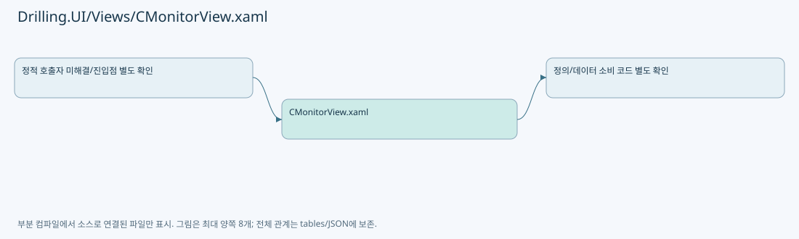

# Drilling.UI/Views/CMonitorView.xaml

| 항목 | 내용 |
| --- | --- |
| 원본 저장소 | https://github.com/kjuws10-rgb/A3Drilling.git |
| 원본 Commit | 96e22cd027c84bf302b23f2949b98985d7f301bb |
| 원본 SHA256 | d7595c09cb605ad998ce8c1805ff06d14319f655f3356d90d39b0374811fa42d |
| 파일 분류 | code |
| 원본 크기/행 | 284,245 bytes / 3,874 physical lines |
| 인코딩 | utf-8-sig |
| 검토 범위 | 구문/부분 의미 분석에서 추출한 사실. 동작·물리 단위·실장비 합격을 보증하지 않습니다. |
| 원본 링크 | [고정 Commit 원본](https://github.com/kjuws10-rgb/A3Drilling/blob/96e22cd027c84bf302b23f2949b98985d7f301bb/Drilling.UI/Views/CMonitorView.xaml) |

## 파일의 역할과 읽는 순서

WPF 화면·사용자 명령·표시 상태를 구성합니다. XAML 이벤트와 코드 비하인드, RootView의 조립 경로를 함께 추적합니다.

## 화면 구성과 코드 비하인드 연결

| 항목 | 추출 값 |
| --- | --- |
| 코드 비하인드 후보 | Drilling.UI/Views/CMonitorView.xaml.cs |
| 이름 있는 요소 | TabBorder, InputBorder, ItemBorder, ToggleButton, Shell, SelectedText, PART_Popup, XpsOperationScrollViewer, MelsecReadGrid, MelsecWriteGrid, CoordinatePositionValuesToggle, ToggleBorder, CoordinateGlassPreviewViewport, CoordinateGlassPreviewHoverTip, CoordinateGlassPreviewHoverTipTranslateTransform, CoordinateGlassPreviewHoverTipText, CoordinateShotCoordinateGrid |
| 이벤트 개수 | 49 |
| Binding 표현 개수 | 426 |

이름 있는 요소는 WPF가 필드를 생성할 수 있는 XAML 선언입니다. 문서 추출기는 WPF 생성 코드를 만들거나 로드하지 않으므로 C# 원문 멤버 수에 합산하지 않습니다.

| 요소 이름 | 원본 범위 |
| --- | --- |
| TabBorder | L56–56 |
| InputBorder | L131–131 |
| ItemBorder | L160–160 |
| ToggleButton | L172–172 |
| Shell | L172–172 |
| SelectedText | L172–172 |
| PART_Popup | L172–172 |
| XpsOperationScrollViewer | L492–492 |
| MelsecReadGrid | L2937–2937 |
| MelsecWriteGrid | L3006–3006 |
| CoordinatePositionValuesToggle | L3236–3236 |
| ToggleBorder | L3257–3257 |
| CoordinateGlassPreviewViewport | L3325–3325 |
| CoordinateGlassPreviewHoverTip | L3385–3385 |
| CoordinateGlassPreviewHoverTipTranslateTransform | L3397–3397 |
| CoordinateGlassPreviewHoverTipText | L3399–3399 |
| CoordinateShotCoordinateGrid | L3736–3736 |

| 이벤트 | 핸들러 이름 | 원본 범위 | 해석 |
| --- | --- | --- | --- |
| Loaded | MonitorViewLoaded | L10–10 | 코드 비하인드/이벤트 라우팅에서 실제 연결 확인 필요 |
| Unloaded | MonitorViewUnloaded | L11–11 | 코드 비하인드/이벤트 라우팅에서 실제 연결 확인 필요 |
| Click | OpenMotorOperationInput | L563–563 | 코드 비하인드/이벤트 라우팅에서 실제 연결 확인 필요 |
| Click | OpenMotorOperationInput | L583–583 | 코드 비하인드/이벤트 라우팅에서 실제 연결 확인 필요 |
| Click | OpenMotorOperationInput | L603–603 | 코드 비하인드/이벤트 라우팅에서 실제 연결 확인 필요 |
| Click | OpenMotorOperationInput | L675–675 | 코드 비하인드/이벤트 라우팅에서 실제 연결 확인 필요 |
| Click | OpenMotorOperationInput | L695–695 | 코드 비하인드/이벤트 라우팅에서 실제 연결 확인 필요 |
| Click | OpenMotorOperationInput | L715–715 | 코드 비하인드/이벤트 라우팅에서 실제 연결 확인 필요 |
| Click | OpenMotorOperationInput | L775–775 | 코드 비하인드/이벤트 라우팅에서 실제 연결 확인 필요 |
| Click | OpenMotorOperationInput | L795–795 | 코드 비하인드/이벤트 라우팅에서 실제 연결 확인 필요 |
| PreviewMouseLeftButtonDown | StartXpsJogNegative | L810–810 | 코드 비하인드/이벤트 라우팅에서 실제 연결 확인 필요 |
| PreviewMouseLeftButtonUp | StopXpsJog | L811–811 | 코드 비하인드/이벤트 라우팅에서 실제 연결 확인 필요 |
| MouseLeave | StopXpsJogOnMouseLeave | L812–812 | 코드 비하인드/이벤트 라우팅에서 실제 연결 확인 필요 |
| LostMouseCapture | StopXpsJogOnLostMouseCapture | L813–813 | 코드 비하인드/이벤트 라우팅에서 실제 연결 확인 필요 |
| LostKeyboardFocus | StopXpsJogOnLostKeyboardFocus | L814–814 | 코드 비하인드/이벤트 라우팅에서 실제 연결 확인 필요 |
| PreviewMouseLeftButtonDown | StartXpsJogPositive | L820–820 | 코드 비하인드/이벤트 라우팅에서 실제 연결 확인 필요 |
| PreviewMouseLeftButtonUp | StopXpsJog | L821–821 | 코드 비하인드/이벤트 라우팅에서 실제 연결 확인 필요 |
| MouseLeave | StopXpsJogOnMouseLeave | L822–822 | 코드 비하인드/이벤트 라우팅에서 실제 연결 확인 필요 |
| LostMouseCapture | StopXpsJogOnLostMouseCapture | L823–823 | 코드 비하인드/이벤트 라우팅에서 실제 연결 확인 필요 |
| LostKeyboardFocus | StopXpsJogOnLostKeyboardFocus | L824–824 | 코드 비하인드/이벤트 라우팅에서 실제 연결 확인 필요 |
| PreviewMouseWheel | XpsMultiMoveGrid_PreviewMouseWheel | L852–852 | 코드 비하인드/이벤트 라우팅에서 실제 연결 확인 필요 |
| Click | OpenXpsMultiMoveTargetInput | L891–891 | 코드 비하인드/이벤트 라우팅에서 실제 연결 확인 필요 |
| Click | OpenMotorOperationInput | L917–917 | 코드 비하인드/이벤트 라우팅에서 실제 연결 확인 필요 |
| Click | OpenMotorOperationInput | L938–938 | 코드 비하인드/이벤트 라우팅에서 실제 연결 확인 필요 |
| Click | OpenLaserSettingInput | L1182–1182 | 코드 비하인드/이벤트 라우팅에서 실제 연결 확인 필요 |
| PreviewMouseDown | PowerMeterSettingSelection_PreviewMouseDown | L1410–1410 | 코드 비하인드/이벤트 라우팅에서 실제 연결 확인 필요 |
| PreviewKeyDown | PowerMeterSettingSelection_PreviewKeyDown | L1411–1411 | 코드 비하인드/이벤트 라우팅에서 실제 연결 확인 필요 |
| PreviewMouseWheel | PowerMeterSettingSelection_PreviewMouseWheel | L1412–1412 | 코드 비하인드/이벤트 라우팅에서 실제 연결 확인 필요 |
| DropDownOpened | PowerMeterSettingSelection_DropDownOpened | L1413–1413 | 코드 비하인드/이벤트 라우팅에서 실제 연결 확인 필요 |
| ScrollChanged | AttenuatorScrollViewer_ScrollChanged | L1873–1873 | 코드 비하인드/이벤트 라우팅에서 실제 연결 확인 필요 |
| PreviewMouseWheel | OuterScrollViewer_PreviewMouseWheel | L1874–1874 | 코드 비하인드/이벤트 라우팅에서 실제 연결 확인 필요 |
| Click | OpenAttenuatorPositionInput | L2197–2197 | 코드 비하인드/이벤트 라우팅에서 실제 연결 확인 필요 |
| PreviewMouseWheel | OuterScrollViewer_PreviewMouseWheel | L2364–2364 | 코드 비하인드/이벤트 라우팅에서 실제 연결 확인 필요 |
| Click | OpenBetTableInput | L2485–2485 | 코드 비하인드/이벤트 라우팅에서 실제 연결 확인 필요 |
| Click | OpenBetTableInput | L2489–2489 | 코드 비하인드/이벤트 라우팅에서 실제 연결 확인 필요 |
| Click | OpenBetTableInput | L2493–2493 | 코드 비하인드/이벤트 라우팅에서 실제 연결 확인 필요 |
| Click | OpenBetPositionInput | L2618–2618 | 코드 비하인드/이벤트 라우팅에서 실제 연결 확인 필요 |
| Click | OpenBetPositionInput | L2652–2652 | 코드 비하인드/이벤트 라우팅에서 실제 연결 확인 필요 |
| SizeChanged | MelsecGrid_SizeChanged | L2946–2946 | 코드 비하인드/이벤트 라우팅에서 실제 연결 확인 필요 |
| SizeChanged | MelsecGrid_SizeChanged | L3015–3015 | 코드 비하인드/이벤트 라우팅에서 실제 연결 확인 필요 |
| Click | OpenMelsecWriteInput | L3046–3046 | 코드 비하인드/이벤트 라우팅에서 실제 연결 확인 필요 |
| PreviewMouseDown | MelsecWriteSelectionPreviewInput | L3062–3062 | 코드 비하인드/이벤트 라우팅에서 실제 연결 확인 필요 |
| PreviewMouseWheel | MelsecWriteSelectionPreviewInput | L3063–3063 | 코드 비하인드/이벤트 라우팅에서 실제 연결 확인 필요 |
| PreviewKeyDown | MelsecWriteSelectionPreviewInput | L3064–3064 | 코드 비하인드/이벤트 라우팅에서 실제 연결 확인 필요 |
| PreviewTextInput | MelsecWriteSelectionPreviewInput | L3065–3065 | 코드 비하인드/이벤트 라우팅에서 실제 연결 확인 필요 |
| MouseMove | CoordinateCellPreviewLabel_MouseMove | L3346–3346 | 코드 비하인드/이벤트 라우팅에서 실제 연결 확인 필요 |
| MouseLeave | CoordinateCellPreviewLabel_MouseLeave | L3347–3347 | 코드 비하인드/이벤트 라우팅에서 실제 연결 확인 필요 |
| MouseLeftButtonDown | CoordinateShotMap_MouseLeftButtonDown | L3487–3487 | 코드 비하인드/이벤트 라우팅에서 실제 연결 확인 필요 |
| SelectionChanged | CoordinateShotCoordinateGrid_SelectionChanged | L3739–3739 | 코드 비하인드/이벤트 라우팅에서 실제 연결 확인 필요 |

| Binding 표현 | 원본 범위 |
| --- | --- |
| {Binding PlacementTarget.DataContext.Description, RelativeSource={RelativeSource AncestorType=ToolTip}} | L18–18 |
| {Binding Description} | L25–25 |
| {Binding IsDropDownOpen, Mode=TwoWay, RelativeSource={RelativeSource TemplatedParent}} | L172–172 |
| {Binding SelectionBoxItem, RelativeSource={RelativeSource AncestorType=ComboBox}} | L172–172 |
| {Binding ActualWidth, ElementName=ToggleButton} | L172–172 |
| {Binding CurrentScreen.IsMonitorLayout, Converter={StaticResource BooleanToVisibilityConverter}} | L287–287 |
| {Binding CurrentScreen.Monitor.Title} | L295–295 |
| {Binding CurrentScreen.Monitor.Subtitle} | L299–299 |
| {Binding CurrentScreen.Monitor.Tabs} | L305–305 |
| {Binding Name} | L314–314 |
| {Binding DataContext.CurrentScreen.Monitor.SelectTabCommand, RelativeSource={RelativeSource AncestorType=UserControl}} | L315–315 |
| {Binding Name} | L316–316 |
| {Binding IsSelected} | L320–320 |
| {Binding CurrentScreen.Monitor.IsMotor, Converter={StaticResource BooleanToVisibilityConverter}} | L334–334 |
| {Binding CurrentScreen.Monitor.AxisRows} | L349–349 |
| {Binding CurrentScreen.Monitor.SelectedAxisRow, Mode=TwoWay} | L350–350 |
| {Binding IsSelected} | L362–362 |
| {Binding Axis} | L370–370 |
| {Binding Name} | L371–371 |
| {Binding CurrentPosition} | L372–372 |
| {Binding FeedbackVelocity} | L373–373 |
| {Binding FeedbackAcceleration} | L374–374 |
| {Binding Servo} | L375–375 |
| {Binding ServoBrush} | L378–378 |
| {Binding HomeBrush} | L393–393 |
| {Binding Home} | L394–394 |
| {Binding LimitPlusBrush} | L412–412 |
| {Binding LimitMinusBrush} | L425–425 |
| {Binding AlarmBrush} | L438–438 |
| {Binding CurrentScreen.Monitor.SelectedAxisRow.Name, StringFormat=XPS Axis Operation  (Selected Axis : {0})} | L455–455 |
| {Binding CurrentScreen.Monitor.ExecuteOperationCommand} | L461–461 |
| {Binding CurrentScreen.Monitor.ExecuteOperationCommand} | L468–468 |
| {Binding CurrentScreen.Monitor.ExecuteOperationCommand} | L476–476 |
| {Binding CurrentScreen.Monitor.ExecuteOperationCommand} | L483–483 |
| {Binding RelativeSource={RelativeSource AncestorType=ScrollViewer}, Path=ViewportHeight} | L497–497 |
| {Binding CurrentScreen.Monitor.SelectedAxisRow.CurrentPosition} | L540–540 |
| {Binding CurrentScreen.Monitor.OperationFields[0].Value} | L561–561 |
| {Binding CurrentScreen.Monitor.OperationFields[0]} | L562–562 |
| {Binding CurrentScreen.Monitor.OperationFields[0].Unit} | L566–566 |
| {Binding CurrentScreen.Monitor.OperationFields[1].Value} | L581–581 |
| {Binding CurrentScreen.Monitor.OperationFields[1]} | L582–582 |
| {Binding CurrentScreen.Monitor.OperationFields[1].Unit} | L586–586 |
| {Binding CurrentScreen.Monitor.OperationFields[2].Value} | L601–601 |
| {Binding CurrentScreen.Monitor.OperationFields[2]} | L602–602 |
| {Binding CurrentScreen.Monitor.OperationFields[2].Unit} | L606–606 |
| {Binding CurrentScreen.Monitor.ExecuteOperationCommand} | L613–613 |
| {Binding CurrentScreen.Monitor.SelectedAxisRow.CurrentPosition} | L652–652 |
| {Binding CurrentScreen.Monitor.OperationFields[3].Value} | L673–673 |
| {Binding CurrentScreen.Monitor.OperationFields[3]} | L674–674 |
| {Binding CurrentScreen.Monitor.OperationFields[3].Unit} | L678–678 |
| {Binding CurrentScreen.Monitor.OperationFields[4].Value} | L693–693 |
| {Binding CurrentScreen.Monitor.OperationFields[4]} | L694–694 |
| {Binding CurrentScreen.Monitor.OperationFields[4].Unit} | L698–698 |
| {Binding CurrentScreen.Monitor.OperationFields[5].Value} | L713–713 |
| {Binding CurrentScreen.Monitor.OperationFields[5]} | L714–714 |
| {Binding CurrentScreen.Monitor.OperationFields[5].Unit} | L718–718 |
| {Binding CurrentScreen.Monitor.ExecuteOperationCommand} | L725–725 |
| {Binding CurrentScreen.Monitor.ExecuteOperationCommand} | L738–738 |
| {Binding CurrentScreen.Monitor.OperationFields[6].Value} | L773–773 |
| {Binding CurrentScreen.Monitor.OperationFields[6]} | L774–774 |
| {Binding CurrentScreen.Monitor.OperationFields[6].Unit} | L778–778 |
| {Binding CurrentScreen.Monitor.OperationFields[7].Value} | L793–793 |
| {Binding CurrentScreen.Monitor.OperationFields[7]} | L794–794 |
| {Binding CurrentScreen.Monitor.OperationFields[7].Unit} | L798–798 |
| {Binding CurrentScreen.Monitor.MultiMoveAxisRows} | L851–851 |
| {Binding IsSelected, Mode=TwoWay, UpdateSourceTrigger=PropertyChanged} | L866–866 |
| {Binding Axis} | L872–872 |
| {Binding Name} | L873–873 |
| {Binding CurrentPosition} | L874–874 |
| {Binding TargetPosition} | L885–885 |
| {Binding} | L886–886 |
| {Binding CurrentScreen.Monitor.OperationFields[8].Value} | L915–915 |
| {Binding CurrentScreen.Monitor.OperationFields[8]} | L916–916 |
| {Binding CurrentScreen.Monitor.OperationFields[8].Unit} | L920–920 |
| {Binding CurrentScreen.Monitor.OperationFields[9].Value} | L936–936 |
| {Binding CurrentScreen.Monitor.OperationFields[9]} | L937–937 |
| {Binding CurrentScreen.Monitor.OperationFields[9].Unit} | L941–941 |
| {Binding CurrentScreen.Monitor.ExecuteOperationCommand} | L950–950 |
| {Binding CurrentScreen.Monitor.IsLaser, Converter={StaticResource BooleanToVisibilityConverter}} | L967–967 |
| {Binding CurrentScreen.Monitor.HeadDeviceSelectorTitle} | L985–985 |
| {Binding CurrentScreen.Monitor.SelectedHeadDeviceName} | L992–992 |
| {Binding CurrentScreen.Monitor.HeadSelectRows} | L1001–1001 |
| {Binding DataContext.CurrentScreen.Monitor.SelectHeadDeviceCommand, RelativeSource={RelativeSource AncestorType=UserControl}} | L1010–1010 |
| {Binding} | L1011–1011 |
| {Binding BackgroundBrush} | L1012–1012 |
| {Binding BorderBrush} | L1013–1013 |
| {Binding BorderThicknessValue} | L1014–1014 |
| {Binding ButtonOpacity} | L1018–1018 |
| {Binding HeadName} | L1041–1041 |
| {Binding TextBrush} | L1042–1042 |
| {Binding StateIndicatorBrush} | L1048–1048 |
| {Binding State} | L1052–1052 |
| {Binding StateTextBrush} | L1053–1053 |
| {Binding StateIndicatorBrush} | L1061–1061 |
| {Binding CurrentScreen.Monitor.OperationButtons} | L1085–1085 |
| {Binding BackgroundBrush} | L1094–1094 |
| {Binding BorderBrush} | L1095–1095 |
| {Binding DataContext.CurrentScreen.Monitor.ExecuteOperationCommand, RelativeSource={RelativeSource AncestorType=UserControl}} | L1096–1096 |
| {Binding} | L1097–1097 |
| {Binding Label} | L1103–1103 |
| {Binding CurrentScreen.Monitor.LaserControlRows} | L1140–1140 |
| {Binding CurrentLabel} | L1162–1162 |
| {Binding CurrentValue} | L1166–1166 |
| {Binding CurrentValueBrush} | L1167–1167 |
| {Binding CurrentUnit} | L1170–1170 |
| {Binding Setting.Value} | L1181–1181 |
| {Binding CanCommand} | L1187–1187 |
| {Binding CanCommand} | L1202–1202 |
| {Binding SetUnit} | L1214–1214 |
| {Binding BackgroundBrush} | L1221–1221 |
| {Binding BorderBrush} | L1222–1222 |
| {Binding DataContext.CurrentScreen.Monitor.ExecuteOperationCommand, RelativeSource={RelativeSource AncestorType=UserControl}} | L1223–1223 |
| {Binding CommandLabel} | L1224–1224 |
| {Binding CanCommand} | L1225–1225 |
| {Binding CommandOpacity} | L1226–1226 |
| {Binding CommandLabel} | L1229–1229 |
| {Binding CurrentScreen.Monitor.OperationButtons} | L1262–1262 |
| {Binding BackgroundBrush} | L1271–1271 |
| {Binding BorderBrush} | L1272–1272 |
| {Binding DataContext.CurrentScreen.Monitor.ExecuteOperationCommand, RelativeSource={RelativeSource AncestorType=UserControl}} | L1273–1273 |
| {Binding} | L1274–1274 |
| {Binding IconGeometry} | L1282–1282 |
| {Binding Label} | L1291–1291 |
| {Binding CurrentScreen.Monitor.ParameterRows} | L1328–1328 |
| {Binding Parameter} | L1349–1349 |
| {Binding Value} | L1353–1353 |
| {Binding ValueBrush} | L1354–1354 |
| {Binding Unit} | L1357–1357 |
| {Binding CurrentScreen.Monitor.PwmSettingRows[0]} | L1395–1395 |
| {Binding ValueOptions} | L1404–1404 |
| {Binding Value, Mode=TwoWay, UpdateSourceTrigger=PropertyChanged} | L1405–1405 |
| {Binding CurrentScreen.Monitor.PwmDeviceRows} | L1417–1417 |
| {Binding Item} | L1431–1431 |
| {Binding Value} | L1432–1432 |
| {Binding ValueBrush} | L1435–1435 |
| {Binding Unit} | L1441–1441 |
| {Binding Command} | L1452–1452 |
| {Binding DataContext.CurrentScreen.Monitor.ExecuteOperationCommand, RelativeSource={RelativeSource AncestorType=UserControl}} | L1455–1455 |
| {Binding} | L1456–1456 |
| {Binding CurrentScreen.Monitor.IsControlDevice, Converter={StaticResource BooleanToVisibilityConverter}} | L1473–1473 |
| {Binding CurrentScreen.Monitor.StatusPanelTitle} | L1483–1483 |
| {Binding CurrentScreen.Monitor.StatusRows} | L1486–1486 |
| {Binding Item} | L1493–1493 |
| {Binding Value} | L1494–1494 |
| {Binding ValueBrush} | L1497–1497 |
| {Binding StateBrush} | L1505–1505 |
| {Binding State} | L1510–1510 |
| {Binding Unit} | L1520–1520 |
| {Binding Description} | L1521–1521 |
| {Binding CurrentScreen.Monitor.OperationPanelTitle} | L1542–1542 |
| {Binding CurrentScreen.Monitor.OperationButtons} | L1547–1547 |
| {Binding BackgroundBrush} | L1556–1556 |
| {Binding BorderBrush} | L1557–1557 |
| {Binding DataContext.CurrentScreen.Monitor.ExecuteOperationCommand, RelativeSource={RelativeSource AncestorType=UserControl}} | L1558–1558 |
| {Binding} | L1559–1559 |
| {Binding IconGeometry} | L1567–1567 |
| {Binding Label} | L1576–1576 |
| {Binding CurrentScreen.Monitor.OperationFields} | L1589–1589 |
| {Binding Parameter} | L1604–1604 |
| {Binding Value} | L1608–1608 |
| {Binding Unit} | L1615–1615 |
| {Binding CurrentScreen.Monitor.ParameterPanelTitle} | L1646–1646 |
| {Binding CurrentScreen.Monitor.ParameterRows} | L1649–1649 |
| {Binding Parameter} | L1656–1656 |
| {Binding Value} | L1657–1657 |
| {Binding ValueBrush} | L1660–1660 |
| {Binding Unit} | L1665–1665 |
| {Binding CurrentScreen.Monitor.TrendPanelTitle} | L1690–1690 |
| {Binding CurrentScreen.Monitor.SummaryItems} | L1731–1731 |
| {Binding Name} | L1741–1741 |
| {Binding Value} | L1747–1747 |
| {Binding ValueBrush} | L1748–1748 |
| {Binding Unit} | L1751–1751 |
| {Binding CurrentScreen.Monitor.IsAttenuator, Converter={StaticResource BooleanToVisibilityConverter}} | L1766–1766 |
| {Binding CurrentScreen.Monitor.HeadDeviceSelectorTitle} | L1783–1783 |
| {Binding CurrentScreen.Monitor.SelectedHeadDeviceName} | L1790–1790 |
| {Binding CurrentScreen.Monitor.HeadSelectRows} | L1799–1799 |
| {Binding DataContext.CurrentScreen.Monitor.SelectHeadDeviceCommand, RelativeSource={RelativeSource AncestorType=UserControl}} | L1808–1808 |
| {Binding} | L1809–1809 |
| {Binding BackgroundBrush} | L1810–1810 |
| {Binding BorderBrush} | L1811–1811 |
| {Binding BorderThicknessValue} | L1812–1812 |
| {Binding HeadName} | L1838–1838 |
| {Binding TextBrush} | L1839–1839 |
| {Binding StateIndicatorBrush} | L1845–1845 |
| {Binding State} | L1849–1849 |
| {Binding StateTextBrush} | L1850–1850 |
| {Binding StateIndicatorBrush} | L1858–1858 |
| {Binding RelativeSource={RelativeSource AncestorType=ScrollViewer}, Path=ViewportHeight} | L1875–1875 |
| {Binding CurrentScreen.Monitor.AttenuatorStatusItems[0]} | L1909–1909 |
| {Binding Name} | L1915–1915 |
| {Binding Value} | L1922–1922 |
| {Binding ValueBrush} | L1923–1923 |
| {Binding Unit} | L1929–1929 |
| {Binding CurrentScreen.Monitor.AttenuatorStatusItems[1]} | L1950–1950 |
| {Binding Name} | L1956–1956 |
| {Binding Value} | L1962–1962 |
| {Binding ValueBrush} | L1963–1963 |
| {Binding CurrentScreen.Monitor.AttenuatorStatusItems[2]} | L1978–1978 |
| {Binding Name} | L1984–1984 |
| {Binding Value} | L1990–1990 |
| {Binding ValueBrush} | L1991–1991 |
| {Binding CurrentScreen.Monitor.AttenuatorStatusItems[3]} | L2006–2006 |
| {Binding Name} | L2012–2012 |
| {Binding Value} | L2018–2018 |
| {Binding ValueBrush} | L2019–2019 |
| {Binding CurrentScreen.Monitor.ExecuteOperationCommand} | L2041–2041 |
| {Binding CurrentScreen.Monitor.AttenuatorSettingItems} | L2058–2058 |
| {Binding Name} | L2077–2077 |
| {Binding Value} | L2084–2084 |
| {Binding ValueBrush} | L2085–2085 |
| {Binding Unit} | L2091–2091 |
| {Binding CurrentScreen.Monitor.OperationPanelTitle} | L2114–2114 |
| {Binding CurrentScreen.Monitor.ExecuteOperationCommand} | L2125–2125 |
| {Binding CurrentScreen.Monitor.ExecuteOperationCommand} | L2139–2139 |
| {Binding CurrentScreen.Monitor.ExecuteOperationCommand} | L2153–2153 |
| {Binding CurrentScreen.Monitor.OperationFields} | L2178–2178 |
| {Binding Parameter} | L2190–2190 |
| {Binding Value} | L2194–2194 |
| {Binding} | L2195–2195 |
| {Binding UsesSelectionEditor} | L2202–2202 |
| {Binding ValueOptions} | L2209–2209 |
| {Binding Value, Mode=TwoWay, UpdateSourceTrigger=PropertyChanged} | L2210–2210 |
| {Binding UsesSelectionEditor} | L2216–2216 |
| {Binding Unit} | L2225–2225 |
| {Binding DataContext.CurrentScreen.Monitor.ExecuteOperationCommand, RelativeSource={RelativeSource AncestorType=UserControl}} | L2230–2230 |
| {Binding CommandLabel} | L2231–2231 |
| {Binding HasCommand} | L2232–2232 |
| {Binding CommandLabel} | L2238–2238 |
| {Binding CurrentScreen.Monitor.IsBet, Converter={StaticResource BooleanToVisibilityConverter}} | L2257–2257 |
| {Binding CurrentScreen.Monitor.HeadDeviceSelectorTitle} | L2274–2274 |
| {Binding CurrentScreen.Monitor.SelectedHeadDeviceName} | L2281–2281 |
| {Binding CurrentScreen.Monitor.HeadSelectRows} | L2290–2290 |
| {Binding DataContext.CurrentScreen.Monitor.SelectHeadDeviceCommand, RelativeSource={RelativeSource AncestorType=UserControl}} | L2299–2299 |
| {Binding} | L2300–2300 |
| {Binding BackgroundBrush} | L2301–2301 |
| {Binding BorderBrush} | L2302–2302 |
| {Binding BorderThicknessValue} | L2303–2303 |
| {Binding HeadName} | L2329–2329 |
| {Binding TextBrush} | L2330–2330 |
| {Binding StateIndicatorBrush} | L2336–2336 |
| {Binding State} | L2340–2340 |
| {Binding StateTextBrush} | L2341–2341 |
| {Binding StateIndicatorBrush} | L2349–2349 |
| {Binding RelativeSource={RelativeSource AncestorType=ScrollViewer}, Path=ViewportHeight} | L2365–2365 |
| {Binding CurrentScreen.Monitor.SummaryItems} | L2386–2386 |
| {Binding Name} | L2406–2406 |
| {Binding Value} | L2415–2415 |
| {Binding ValueBrush} | L2416–2416 |
| {Binding Unit} | L2420–2420 |
| {Binding CurrentScreen.Monitor.ParameterPanelTitle} | L2437–2437 |
| {Binding CurrentScreen.Monitor.ExecuteOperationCommand} | L2442–2442 |
| {Binding CurrentScreen.Monitor.BetTableRows} | L2456–2456 |
| {Binding RowBrush} | L2467–2467 |
| {Binding No} | L2475–2475 |
| {Binding RowBrush} | L2476–2476 |
| {Binding Description} | L2485–2485 |
| {Binding Div} | L2489–2489 |
| {Binding Mag} | L2493–2493 |
| {Binding State} | L2498–2498 |
| {Binding StateBrush} | L2499–2499 |
| {Binding DataContext.CurrentScreen.Monitor.ExecuteOperationCommand, RelativeSource={RelativeSource AncestorType=UserControl}} | L2510–2510 |
| {Binding} | L2511–2511 |
| {Binding CurrentScreen.Monitor.TrendPanelTitle} | L2535–2535 |
| {Binding CurrentScreen.Monitor.ExecuteOperationCommand} | L2546–2546 |
| {Binding CurrentScreen.Monitor.ExecuteOperationCommand} | L2560–2560 |
| {Binding CurrentScreen.Monitor.ExecuteOperationCommand} | L2574–2574 |
| {Binding CurrentScreen.Monitor.OperationFields[0].Value} | L2615–2615 |
| {Binding CurrentScreen.Monitor.OperationFields[0]} | L2616–2616 |
| {Binding CurrentScreen.Monitor.OperationFields[0].Unit} | L2622–2622 |
| {Binding CurrentScreen.Monitor.ExecuteOperationCommand} | L2628–2628 |
| {Binding CurrentScreen.Monitor.OperationFields[1].Value} | L2649–2649 |
| {Binding CurrentScreen.Monitor.OperationFields[1]} | L2650–2650 |
| {Binding CurrentScreen.Monitor.OperationFields[1].Unit} | L2656–2656 |
| {Binding CurrentScreen.Monitor.ExecuteOperationCommand} | L2662–2662 |
| {Binding CurrentScreen.Monitor.IsProduct, Converter={StaticResource BooleanToVisibilityConverter}} | L2683–2683 |
| {Binding CurrentScreen.Monitor.CreateGlassCommand} | L2705–2705 |
| {Binding CurrentScreen.Monitor.DeleteGlassCommand} | L2710–2710 |
| {Binding CurrentScreen.Monitor.ProductGlassItems} | L2712–2712 |
| {Binding Name} | L2720–2720 |
| {Binding Value} | L2721–2721 |
| {Binding ValueBrush} | L2724–2724 |
| {Binding Value} | L2728–2728 |
| {Binding CurrentScreen.Monitor.ProductHistoryRows} | L2743–2743 |
| {Binding Time} | L2750–2750 |
| {Binding GlassId} | L2751–2751 |
| {Binding RecipeId} | L2752–2752 |
| {Binding Action} | L2753–2753 |
| {Binding Result} | L2754–2754 |
| {Binding ResultBrush} | L2757–2757 |
| {Binding Detail} | L2763–2763 |
| {Binding CurrentScreen.Monitor.ProductAlignItems} | L2780–2780 |
| {Binding Name} | L2784–2784 |
| {Binding Value} | L2785–2785 |
| {Binding ValueBrush} | L2788–2788 |
| {Binding Value} | L2791–2791 |
| {Binding CurrentScreen.Monitor.ProductDistortionItems} | L2802–2802 |
| {Binding Name} | L2806–2806 |
| {Binding Value} | L2807–2807 |
| {Binding ValueBrush} | L2810–2810 |
| {Binding Value} | L2813–2813 |
| {Binding CurrentScreen.Monitor.ProductProcessItems} | L2833–2833 |
| {Binding Name} | L2837–2837 |
| {Binding Value} | L2838–2838 |
| {Binding ValueBrush} | L2841–2841 |
| {Binding Value} | L2844–2844 |
| {Binding CurrentScreen.Monitor.ProductRecipeItems} | L2855–2855 |
| {Binding Name} | L2859–2859 |
| {Binding Value} | L2860–2860 |
| {Binding CurrentScreen.Monitor.ProductReviewItems} | L2877–2877 |
| {Binding Name} | L2881–2881 |
| {Binding Value} | L2882–2882 |
| {Binding ValueBrush} | L2885–2885 |
| {Binding Value} | L2888–2888 |
| {Binding CurrentScreen.Monitor.ProductReviewRows} | L2899–2899 |
| {Binding Shot} | L2902–2902 |
| {Binding CellNo} | L2903–2903 |
| {Binding BeamNo} | L2904–2904 |
| {Binding ErrorX} | L2905–2905 |
| {Binding ErrorY} | L2906–2906 |
| {Binding Judge} | L2907–2907 |
| {Binding JudgeBrush} | L2910–2910 |
| {Binding CurrentScreen.Monitor.IsMelsec, Converter={StaticResource BooleanToVisibilityConverter}} | L2924–2924 |
| {Binding CurrentScreen.Monitor.MelsecReadRows} | L2938–2938 |
| {Binding Id} | L2952–2952 |
| {Binding Group} | L2953–2953 |
| {Binding Address} | L2954–2954 |
| {Binding DataType} | L2955–2955 |
| {Binding ReadValue} | L2956–2956 |
| {Binding ValueBrush} | L2959–2959 |
| {Binding PollMs} | L2964–2964 |
| {Binding CurrentScreen.Monitor.MelsecWriteLockText} | L2981–2981 |
| {Binding CurrentScreen.Monitor.ToggleMelsecWriteLockCommand} | L2982–2982 |
| {Binding CurrentScreen.Monitor.IsMelsecWriteLockVisible} | L2994–2994 |
| {Binding CurrentScreen.Monitor.IsMelsecWriteUnlocked} | L2997–2997 |
| {Binding CurrentScreen.Monitor.MelsecWriteRows} | L3007–3007 |
| {Binding Id} | L3021–3021 |
| {Binding Group} | L3022–3022 |
| {Binding Address} | L3023–3023 |
| {Binding DataType} | L3024–3024 |
| {Binding ReadValue} | L3025–3025 |
| {Binding ValueBrush} | L3028–3028 |
| {Binding WriteValue} | L3044–3044 |
| {Binding CanWrite} | L3045–3045 |
| {Binding UsesWriteSelection} | L3054–3054 |
| {Binding WriteValueOptions} | L3059–3059 |
| {Binding WriteValue, Mode=TwoWay, UpdateSourceTrigger=PropertyChanged} | L3060–3060 |
| {Binding CanWrite} | L3061–3061 |
| {Binding UsesWriteSelection} | L3075–3075 |
| {Binding CanWrite} | L3093–3093 |
| {Binding DataContext.CurrentScreen.Monitor.WriteMelsecCommand, RelativeSource={RelativeSource AncestorType=UserControl}} | L3096–3096 |
| {Binding} | L3097–3097 |
| {Binding} | L3118–3118 |
| {Binding CurrentScreen.Monitor.IsPicoMotor, Converter={StaticResource BooleanToVisibilityConverter}} | L3119–3119 |
| {Binding CurrentScreen.Monitor.IsLogViewer, Converter={StaticResource BooleanToVisibilityConverter}} | L3121–3121 |
| {Binding CurrentScreen.Monitor.LogViewer} | L3122–3122 |
| {Binding CurrentScreen.Monitor.IsCoordinateViewer, Converter={StaticResource BooleanToVisibilityConverter}} | L3124–3124 |
| {Binding CurrentScreen.Monitor.CoordinateBasisOptions} | L3146–3146 |
| {Binding BackgroundBrush} | L3157–3157 |
| {Binding BorderBrush} | L3158–3158 |
| {Binding TextBrush} | L3159–3159 |
| {Binding DataContext.CurrentScreen.Monitor.SelectCoordinateBasisCommand, RelativeSource={RelativeSource AncestorType=UserControl}} | L3161–3161 |
| {Binding} | L3162–3162 |
| {Binding Name} | L3163–3163 |
| {Binding IsChecked, ElementName=CoordinatePositionValuesToggle} | L3188–3188 |
| {Binding CurrentScreen.Monitor.CoordinateValueRows} | L3200–3200 |
| {Binding Source} | L3208–3208 |
| {Binding Parameter} | L3209–3209 |
| {Binding Value} | L3210–3210 |
| {Binding Unit} | L3211–3211 |
| {Binding CurrentScreen.Monitor.CoordinateGlassPreviewSummary} | L3318–3318 |
| {Binding CurrentScreen.Monitor.CoordinateGlassPreviewImage} | L3328–3328 |
| {Binding CurrentScreen.Monitor.CoordinateCellPreviewLabels} | L3332–3332 |
| {Binding CellNo} | L3337–3337 |
| {Binding Width} | L3338–3338 |
| {Binding Height} | L3339–3339 |
| {Binding DataContext.CurrentScreen.Monitor.SelectCoordinateCellCommand, RelativeSource={RelativeSource AncestorType=UserControl}} | L3340–3340 |
| {Binding CellNo} | L3341–3341 |
| {Binding IsSelected} | L3370–3370 |
| {Binding CurrentScreen.Monitor.CoordinateSelectedCellName} | L3429–3429 |
| {Binding CurrentScreen.Monitor.CoordinateShotMapSurfaceWidth} | L3483–3483 |
| {Binding CurrentScreen.Monitor.CoordinateShotMapSurfaceHeight} | L3484–3484 |
| {Binding CurrentScreen.Monitor.CoordinateShotMapImage} | L3488–3488 |
| {Binding CurrentScreen.Monitor.CoordinateHasShotMap} | L3505–3505 |
| {Binding CurrentScreen.Monitor.CoordinateCalculationSummary} | L3536–3536 |
| {Binding CurrentScreen.Monitor.CoordinateCalculationRows} | L3549–3549 |
| {Binding Description} | L3560–3560 |
| {Binding IsResult} | L3562–3562 |
| {Binding IsSelected, Mode=OneWay} | L3574–3574 |
| {Binding DataContext.CurrentScreen.Monitor.ToggleCoordinateOffsetCommand, RelativeSource={RelativeSource AncestorType=UserControl}} | L3578–3578 |
| {Binding} | L3579–3579 |
| {Binding IsSelectable} | L3584–3584 |
| {Binding Step} | L3594–3594 |
| {Binding X} | L3595–3595 |
| {Binding Y} | L3596–3596 |
| {Binding CurrentScreen.Monitor.CoordinateOffsetPreviewMinimumText, Mode=TwoWay, UpdateSourceTrigger=PropertyChanged} | L3633–3633 |
| {Binding CurrentScreen.Monitor.CoordinateOffsetPreviewMaximumText, Mode=TwoWay, UpdateSourceTrigger=PropertyChanged} | L3650–3650 |
| {Binding CurrentScreen.Monitor.CoordinateOffsetPreviewGridText} | L3656–3656 |
| {Binding DataContext.CurrentScreen.Monitor.ApplyCoordinateOffsetPreviewRangeCommand, RelativeSource={RelativeSource AncestorType=UserControl}} | L3669–3669 |
| {Binding CurrentScreen.Monitor.CoordinateOffsetPreviewImage} | L3672–3672 |
| {Binding CurrentScreen.Monitor.CoordinateHasCalculationRows} | L3684–3684 |
| {Binding CurrentScreen.Monitor.CoordinateShotCoordinateSummary} | L3729–3729 |
| {Binding CurrentScreen.Monitor.CoordinateShotCoordinateRows} | L3737–3737 |
| {Binding CurrentScreen.Monitor.CoordinateSelectedShotCoordinateRow, Mode=OneWay} | L3738–3738 |
| {Binding Shot} | L3754–3754 |
| {Binding IsSelected} | L3756–3756 |
| {Binding Shot} | L3765–3765 |
| {Binding Head} | L3766–3766 |
| {Binding X} | L3767–3767 |
| {Binding Y} | L3768–3768 |
| {Binding State} | L3772–3772 |
| {Binding State} | L3780–3780 |
| {Binding State} | L3783–3783 |
| {Binding CurrentScreen.Monitor.CoordinateHasShotCoordinateRows} | L3801–3801 |
| {Binding CurrentScreen.Monitor.IsGenericDevice, Converter={StaticResource BooleanToVisibilityConverter}} | L3824–3824 |
| {Binding CurrentScreen.Monitor.StatusPanelTitle} | L3833–3833 |
| {Binding CurrentScreen.Monitor.StatusRows} | L3836–3836 |
| {Binding Item} | L3842–3842 |
| {Binding Value} | L3843–3843 |
| {Binding State} | L3844–3844 |
| {Binding Description} | L3845–3845 |
| {Binding CurrentScreen.Monitor.ParameterPanelTitle} | L3854–3854 |
| {Binding CurrentScreen.Monitor.ParameterRows} | L3857–3857 |
| {Binding Parameter} | L3863–3863 |
| {Binding Value} | L3864–3864 |
| {Binding Unit} | L3865–3865 |

## 원문 전체 주석 해설본

[원본 모든 행과 행별 해설 보기](../../../annotated/Drilling.UI/Views/CMonitorView.xaml.annotated.txt)

원본을 빠뜨리거나 임의로 줄이지 않았습니다. `L000001 |` 표시는 원본 행 번호, `// 해설`은 별도 설명입니다. 실행용 소스가 아닌 문서입니다.

## 수정·재검증 체크

- 원본 Commit과 현재 작업 파일 SHA가 같은지 먼저 확인합니다. 다르면 이 문서를 과거 버전 자료로 취급합니다.
- 선언·직접 호출·이벤트/인터페이스 경계·설정 소비를 함께 확인합니다. 정적 연결의 빈 곳을 정상 경로로 추정하지 않습니다.
- 저장 형식/단위/식별자·재시도·취소·예외·롤백에 영향을 주는 변경은 상세 해설장과 호출자를 다시 검토합니다.
- 도구의 구문 추출과 별도 정적 추적 해설, 실제 빌드·시뮬레이션·실장비 검증 결과를 분리합니다.
