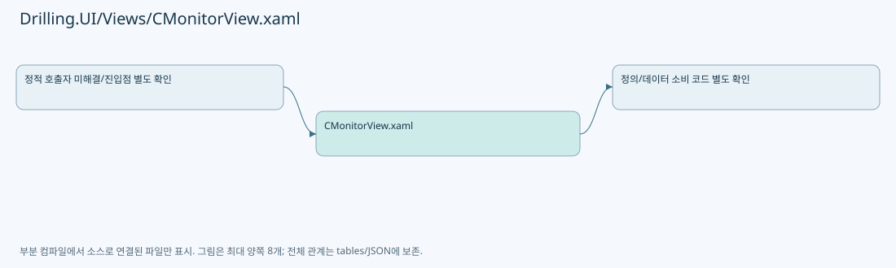

# Drilling.UI/Views/CMonitorView.xaml

| 항목 | 내용 |
| --- | --- |
| 원본 저장소 | https://github.com/kjuws10-rgb/A3Drilling.git |
| 원본 Commit | 5aee8e58439c9b455cae7c9593c9be986c3e682e |
| 원본 SHA256 | 1a714f2e69747af0491b4471c88b7bc7501d30dafdb0ff5ce1eec5e799a5e8cc |
| 파일 분류 | code |
| 원본 크기/행 | 253,250 bytes / 3,502 physical lines |
| 인코딩 | utf-8-sig |
| 검토 범위 | 구문/부분 의미 분석에서 추출한 사실. 동작·물리 단위·실장비 합격을 보증하지 않습니다. |
| 원본 링크 | [고정 Commit 원본](https://github.com/kjuws10-rgb/A3Drilling/blob/5aee8e58439c9b455cae7c9593c9be986c3e682e/Drilling.UI/Views/CMonitorView.xaml) |

## 파일의 역할과 읽는 순서

WPF 화면·사용자 명령·표시 상태를 구성합니다. XAML 이벤트와 코드 비하인드, RootView의 조립 경로를 함께 추적합니다.

## 화면 구성과 코드 비하인드 연결

| 항목 | 추출 값 |
| --- | --- |
| 코드 비하인드 후보 | Drilling.UI/Views/CMonitorView.xaml.cs |
| 이름 있는 요소 | TabBorder, InputBorder, ItemBorder, ToggleButton, Shell, SelectedText, PART_Popup, XpsOperationScrollViewer, MelsecReadGrid, MelsecWriteGrid, CoordinateGlassPreviewViewport, CoordinateGlassPreviewHoverTip, CoordinateGlassPreviewHoverTipTranslateTransform, CoordinateGlassPreviewHoverTipText |
| 이벤트 개수 | 24 |
| Binding 표현 개수 | 391 |

| 이벤트 | 핸들러 이름 | 해석 |
| --- | --- | --- |
| Loaded | MonitorViewLoaded | 코드 비하인드/이벤트 라우팅에서 실제 연결 확인 필요 |
| Unloaded | MonitorViewUnloaded | 코드 비하인드/이벤트 라우팅에서 실제 연결 확인 필요 |
| Click | OpenMotorOperationInput | 코드 비하인드/이벤트 라우팅에서 실제 연결 확인 필요 |
| Click | OpenMotorOperationInput | 코드 비하인드/이벤트 라우팅에서 실제 연결 확인 필요 |
| Click | OpenMotorOperationInput | 코드 비하인드/이벤트 라우팅에서 실제 연결 확인 필요 |
| Click | OpenMotorOperationInput | 코드 비하인드/이벤트 라우팅에서 실제 연결 확인 필요 |
| Click | OpenMotorOperationInput | 코드 비하인드/이벤트 라우팅에서 실제 연결 확인 필요 |
| Click | OpenMotorOperationInput | 코드 비하인드/이벤트 라우팅에서 실제 연결 확인 필요 |
| Click | OpenMotorOperationInput | 코드 비하인드/이벤트 라우팅에서 실제 연결 확인 필요 |
| Click | OpenMotorOperationInput | 코드 비하인드/이벤트 라우팅에서 실제 연결 확인 필요 |
| Click | OpenXpsMultiMoveTargetInput | 코드 비하인드/이벤트 라우팅에서 실제 연결 확인 필요 |
| Click | OpenMotorOperationInput | 코드 비하인드/이벤트 라우팅에서 실제 연결 확인 필요 |
| Click | OpenMotorOperationInput | 코드 비하인드/이벤트 라우팅에서 실제 연결 확인 필요 |
| Click | OpenLaserSettingInput | 코드 비하인드/이벤트 라우팅에서 실제 연결 확인 필요 |
| PreviewKeyDown | PowerMeterSettingSelection_PreviewKeyDown | 코드 비하인드/이벤트 라우팅에서 실제 연결 확인 필요 |
| Click | OpenAttenuatorPositionInput | 코드 비하인드/이벤트 라우팅에서 실제 연결 확인 필요 |
| Click | OpenBetTableInput | 코드 비하인드/이벤트 라우팅에서 실제 연결 확인 필요 |
| Click | OpenBetTableInput | 코드 비하인드/이벤트 라우팅에서 실제 연결 확인 필요 |
| Click | OpenBetTableInput | 코드 비하인드/이벤트 라우팅에서 실제 연결 확인 필요 |
| Click | OpenBetPositionInput | 코드 비하인드/이벤트 라우팅에서 실제 연결 확인 필요 |
| Click | OpenBetPositionInput | 코드 비하인드/이벤트 라우팅에서 실제 연결 확인 필요 |
| Click | OpenMelsecWriteInput | 코드 비하인드/이벤트 라우팅에서 실제 연결 확인 필요 |
| PreviewKeyDown | MelsecWriteSelectionPreviewInput | 코드 비하인드/이벤트 라우팅에서 실제 연결 확인 필요 |
| MouseMove | CoordinateCellPreviewLabel_MouseMove | 코드 비하인드/이벤트 라우팅에서 실제 연결 확인 필요 |

| Binding 표현 |
| --- |
| PlacementTarget.DataContext.Description, RelativeSource={RelativeSource AncestorType=ToolTip |
| Description |
| IsDropDownOpen, Mode=TwoWay, RelativeSource={RelativeSource TemplatedParent |
| SelectionBoxItem, RelativeSource={RelativeSource AncestorType=ComboBox |
| ActualWidth, ElementName=ToggleButton |
| CurrentScreen.IsMonitorLayout, Converter={StaticResource BooleanToVisibilityConverter |
| CurrentScreen.Monitor.Title |
| CurrentScreen.Monitor.Subtitle |
| CurrentScreen.Monitor.Tabs |
| Name |
| DataContext.CurrentScreen.Monitor.SelectTabCommand, RelativeSource={RelativeSource AncestorType=UserControl |
| Name |
| IsSelected |
| CurrentScreen.Monitor.IsMotor, Converter={StaticResource BooleanToVisibilityConverter |
| CurrentScreen.Monitor.AxisRows |
| CurrentScreen.Monitor.SelectedAxisRow, Mode=TwoWay |
| IsSelected |
| Axis |
| Name |
| CurrentPosition |
| FeedbackVelocity |
| FeedbackAcceleration |
| Servo |
| ServoBrush |
| HomeBrush |
| Home |
| LimitPlusBrush |
| LimitMinusBrush |
| AlarmBrush |
| CurrentScreen.Monitor.SelectedAxisRow.Name, StringFormat=XPS Axis Operation  (Selected Axis : {0 |
| CurrentScreen.Monitor.ExecuteOperationCommand |
| CurrentScreen.Monitor.ExecuteOperationCommand |
| CurrentScreen.Monitor.ExecuteOperationCommand |
| CurrentScreen.Monitor.ExecuteOperationCommand |
| RelativeSource={RelativeSource AncestorType=ScrollViewer |
| CurrentScreen.Monitor.SelectedAxisRow.CurrentPosition |
| CurrentScreen.Monitor.OperationFields[0].Value |
| CurrentScreen.Monitor.OperationFields[0] |
| CurrentScreen.Monitor.OperationFields[0].Unit |
| CurrentScreen.Monitor.OperationFields[1].Value |
| CurrentScreen.Monitor.OperationFields[1] |
| CurrentScreen.Monitor.OperationFields[1].Unit |
| CurrentScreen.Monitor.OperationFields[2].Value |
| CurrentScreen.Monitor.OperationFields[2] |
| CurrentScreen.Monitor.OperationFields[2].Unit |
| CurrentScreen.Monitor.ExecuteOperationCommand |
| CurrentScreen.Monitor.SelectedAxisRow.CurrentPosition |
| CurrentScreen.Monitor.OperationFields[3].Value |
| CurrentScreen.Monitor.OperationFields[3] |
| CurrentScreen.Monitor.OperationFields[3].Unit |
| CurrentScreen.Monitor.OperationFields[4].Value |
| CurrentScreen.Monitor.OperationFields[4] |
| CurrentScreen.Monitor.OperationFields[4].Unit |
| CurrentScreen.Monitor.OperationFields[5].Value |
| CurrentScreen.Monitor.OperationFields[5] |
| CurrentScreen.Monitor.OperationFields[5].Unit |
| CurrentScreen.Monitor.ExecuteOperationCommand |
| CurrentScreen.Monitor.ExecuteOperationCommand |
| CurrentScreen.Monitor.OperationFields[6].Value |
| CurrentScreen.Monitor.OperationFields[6] |
| CurrentScreen.Monitor.OperationFields[6].Unit |
| CurrentScreen.Monitor.OperationFields[7].Value |
| CurrentScreen.Monitor.OperationFields[7] |
| CurrentScreen.Monitor.OperationFields[7].Unit |
| CurrentScreen.Monitor.MultiMoveAxisRows |
| IsSelected, Mode=TwoWay, UpdateSourceTrigger=PropertyChanged |
| Axis |
| Name |
| CurrentPosition |
| TargetPosition |
| CurrentScreen.Monitor.OperationFields[8].Value |
| CurrentScreen.Monitor.OperationFields[8] |
| CurrentScreen.Monitor.OperationFields[8].Unit |
| CurrentScreen.Monitor.OperationFields[9].Value |
| CurrentScreen.Monitor.OperationFields[9] |
| CurrentScreen.Monitor.OperationFields[9].Unit |
| CurrentScreen.Monitor.ExecuteOperationCommand |
| CurrentScreen.Monitor.IsLaser, Converter={StaticResource BooleanToVisibilityConverter |
| CurrentScreen.Monitor.HeadDeviceSelectorTitle |
| CurrentScreen.Monitor.SelectedHeadDeviceName |
| CurrentScreen.Monitor.HeadSelectRows |
| DataContext.CurrentScreen.Monitor.SelectHeadDeviceCommand, RelativeSource={RelativeSource AncestorType=UserControl |
| BackgroundBrush |
| BorderBrush |
| BorderThicknessValue |
| ButtonOpacity |
| HeadName |
| TextBrush |
| StateIndicatorBrush |
| State |
| StateTextBrush |
| StateIndicatorBrush |
| CurrentScreen.Monitor.OperationButtons |
| BackgroundBrush |
| BorderBrush |
| DataContext.CurrentScreen.Monitor.ExecuteOperationCommand, RelativeSource={RelativeSource AncestorType=UserControl |
| Label |
| CurrentScreen.Monitor.LaserControlRows |
| CurrentLabel |
| CurrentValue |
| CurrentValueBrush |
| CurrentUnit |
| Setting.Value |
| CanCommand |
| CanCommand |
| SetUnit |
| BackgroundBrush |
| BorderBrush |
| DataContext.CurrentScreen.Monitor.ExecuteOperationCommand, RelativeSource={RelativeSource AncestorType=UserControl |
| CommandLabel |
| CanCommand |
| CommandOpacity |
| CommandLabel |
| CurrentScreen.Monitor.OperationButtons |
| BackgroundBrush |
| BorderBrush |
| DataContext.CurrentScreen.Monitor.ExecuteOperationCommand, RelativeSource={RelativeSource AncestorType=UserControl |
| IconGeometry |
| Label |
| CurrentScreen.Monitor.ParameterRows |
| Parameter |
| Value |
| ValueBrush |
| Unit |
| CurrentScreen.Monitor.PwmSettingRows[0] |
| ValueOptions |
| Value, Mode=TwoWay, UpdateSourceTrigger=PropertyChanged |
| CurrentScreen.Monitor.PwmDeviceRows |
| Item |
| Value |
| ValueBrush |
| Unit |
| Command |
| DataContext.CurrentScreen.Monitor.ExecuteOperationCommand, RelativeSource={RelativeSource AncestorType=UserControl |
| CurrentScreen.Monitor.IsControlDevice, Converter={StaticResource BooleanToVisibilityConverter |
| CurrentScreen.Monitor.StatusPanelTitle |
| CurrentScreen.Monitor.StatusRows |
| Item |
| Value |
| ValueBrush |
| StateBrush |
| State |
| Unit |
| Description |
| CurrentScreen.Monitor.OperationPanelTitle |
| CurrentScreen.Monitor.OperationButtons |
| BackgroundBrush |
| BorderBrush |
| DataContext.CurrentScreen.Monitor.ExecuteOperationCommand, RelativeSource={RelativeSource AncestorType=UserControl |
| IconGeometry |
| Label |
| CurrentScreen.Monitor.OperationFields |
| Parameter |
| Value |
| Unit |
| CurrentScreen.Monitor.ParameterPanelTitle |
| CurrentScreen.Monitor.ParameterRows |
| Parameter |
| Value |
| ValueBrush |
| Unit |
| CurrentScreen.Monitor.TrendPanelTitle |
| CurrentScreen.Monitor.SummaryItems |
| Name |
| Value |
| ValueBrush |
| Unit |
| CurrentScreen.Monitor.IsAttenuator, Converter={StaticResource BooleanToVisibilityConverter |
| CurrentScreen.Monitor.HeadDeviceSelectorTitle |
| CurrentScreen.Monitor.SelectedHeadDeviceName |
| CurrentScreen.Monitor.HeadSelectRows |
| DataContext.CurrentScreen.Monitor.SelectHeadDeviceCommand, RelativeSource={RelativeSource AncestorType=UserControl |
| BackgroundBrush |
| BorderBrush |
| BorderThicknessValue |
| HeadName |
| TextBrush |
| StateIndicatorBrush |
| State |
| StateTextBrush |
| StateIndicatorBrush |
| RelativeSource={RelativeSource AncestorType=ScrollViewer |
| CurrentScreen.Monitor.AttenuatorStatusItems[0] |
| Name |
| Value |
| ValueBrush |
| Unit |
| CurrentScreen.Monitor.AttenuatorStatusItems[1] |
| Name |
| Value |
| ValueBrush |
| CurrentScreen.Monitor.AttenuatorStatusItems[2] |
| Name |
| Value |
| ValueBrush |
| CurrentScreen.Monitor.AttenuatorStatusItems[3] |
| Name |
| Value |
| ValueBrush |
| CurrentScreen.Monitor.ExecuteOperationCommand |
| CurrentScreen.Monitor.AttenuatorSettingItems |
| Name |
| Value |
| ValueBrush |
| Unit |
| CurrentScreen.Monitor.OperationPanelTitle |
| CurrentScreen.Monitor.ExecuteOperationCommand |
| CurrentScreen.Monitor.ExecuteOperationCommand |
| CurrentScreen.Monitor.ExecuteOperationCommand |
| CurrentScreen.Monitor.OperationFields |
| Parameter |
| Value |
| UsesSelectionEditor |
| ValueOptions |
| Value, Mode=TwoWay, UpdateSourceTrigger=PropertyChanged |
| UsesSelectionEditor |
| Unit |
| DataContext.CurrentScreen.Monitor.ExecuteOperationCommand, RelativeSource={RelativeSource AncestorType=UserControl |
| CommandLabel |
| HasCommand |
| CommandLabel |
| CurrentScreen.Monitor.IsBet, Converter={StaticResource BooleanToVisibilityConverter |
| CurrentScreen.Monitor.HeadDeviceSelectorTitle |
| CurrentScreen.Monitor.SelectedHeadDeviceName |
| CurrentScreen.Monitor.HeadSelectRows |
| DataContext.CurrentScreen.Monitor.SelectHeadDeviceCommand, RelativeSource={RelativeSource AncestorType=UserControl |
| BackgroundBrush |
| BorderBrush |
| BorderThicknessValue |
| HeadName |
| TextBrush |
| StateIndicatorBrush |
| State |
| StateTextBrush |
| StateIndicatorBrush |
| RelativeSource={RelativeSource AncestorType=ScrollViewer |
| CurrentScreen.Monitor.SummaryItems |
| Name |
| Value |
| ValueBrush |
| Unit |
| CurrentScreen.Monitor.ParameterPanelTitle |
| CurrentScreen.Monitor.ExecuteOperationCommand |
| CurrentScreen.Monitor.BetTableRows |
| RowBrush |
| No |
| RowBrush |
| Description |
| Div |
| Mag |
| State |
| StateBrush |
| DataContext.CurrentScreen.Monitor.ExecuteOperationCommand, RelativeSource={RelativeSource AncestorType=UserControl |
| CurrentScreen.Monitor.TrendPanelTitle |
| CurrentScreen.Monitor.ExecuteOperationCommand |
| CurrentScreen.Monitor.ExecuteOperationCommand |
| CurrentScreen.Monitor.ExecuteOperationCommand |
| CurrentScreen.Monitor.OperationFields[0].Value |
| CurrentScreen.Monitor.OperationFields[0] |
| CurrentScreen.Monitor.OperationFields[0].Unit |
| CurrentScreen.Monitor.ExecuteOperationCommand |
| CurrentScreen.Monitor.OperationFields[1].Value |
| CurrentScreen.Monitor.OperationFields[1] |
| CurrentScreen.Monitor.OperationFields[1].Unit |
| CurrentScreen.Monitor.ExecuteOperationCommand |
| CurrentScreen.Monitor.IsProduct, Converter={StaticResource BooleanToVisibilityConverter |
| CurrentScreen.Monitor.CreateGlassCommand |
| CurrentScreen.Monitor.DeleteGlassCommand |
| CurrentScreen.Monitor.ProductGlassItems |
| Name |
| Value |
| ValueBrush |
| Value |
| CurrentScreen.Monitor.ProductHistoryRows |
| Time |
| GlassId |
| RecipeId |
| Action |
| Result |
| ResultBrush |
| Detail |
| CurrentScreen.Monitor.ProductAlignItems |
| Name |
| Value |
| ValueBrush |
| Value |
| CurrentScreen.Monitor.ProductDistortionItems |
| Name |
| Value |
| ValueBrush |
| Value |
| CurrentScreen.Monitor.ProductProcessItems |
| Name |
| Value |
| ValueBrush |
| Value |
| CurrentScreen.Monitor.ProductRecipeItems |
| Name |
| Value |
| CurrentScreen.Monitor.ProductReviewItems |
| Name |
| Value |
| ValueBrush |
| Value |
| CurrentScreen.Monitor.ProductReviewRows |
| Shot |
| CellNo |
| BeamNo |
| ErrorX |
| ErrorY |
| Judge |
| JudgeBrush |
| CurrentScreen.Monitor.IsMelsec, Converter={StaticResource BooleanToVisibilityConverter |
| CurrentScreen.Monitor.MelsecReadRows |
| Id |
| Group |
| Address |
| DataType |
| ReadValue |
| ValueBrush |
| PollMs |
| CurrentScreen.Monitor.MelsecWriteLockText |
| CurrentScreen.Monitor.ToggleMelsecWriteLockCommand |
| CurrentScreen.Monitor.IsMelsecWriteLockVisible |
| CurrentScreen.Monitor.IsMelsecWriteUnlocked |
| CurrentScreen.Monitor.MelsecWriteRows |
| Id |
| Group |
| Address |
| DataType |
| ReadValue |
| ValueBrush |
| WriteValue |
| CanWrite |
| UsesWriteSelection |
| WriteValueOptions |
| WriteValue, Mode=TwoWay, UpdateSourceTrigger=PropertyChanged |
| CanWrite |
| UsesWriteSelection |
| CanWrite |
| DataContext.CurrentScreen.Monitor.WriteMelsecCommand, RelativeSource={RelativeSource AncestorType=UserControl |
| CurrentScreen.Monitor.IsPicoMotor, Converter={StaticResource BooleanToVisibilityConverter |
| CurrentScreen.Monitor.IsLogViewer, Converter={StaticResource BooleanToVisibilityConverter |
| CurrentScreen.Monitor.LogViewer |
| CurrentScreen.Monitor.IsCoordinateViewer, Converter={StaticResource BooleanToVisibilityConverter |
| CurrentScreen.Monitor.CoordinateBasisOptions |
| BackgroundBrush |
| BorderBrush |
| TextBrush |
| DataContext.CurrentScreen.Monitor.SelectCoordinateBasisCommand, RelativeSource={RelativeSource AncestorType=UserControl |
| Name |
| CurrentScreen.Monitor.CoordinateValueRows |
| Source |
| Parameter |
| Value |
| Unit |
| CurrentScreen.Monitor.CoordinateSelectedBasisName |
| CurrentScreen.Monitor.CoordinateSelectedCellName |
| CurrentScreen.Monitor.CoordinateSelectedShotName |
| CurrentScreen.Monitor.CoordinateIsGlassPreviewVisible, Converter={StaticResource BooleanToVisibilityConverter |
| CurrentScreen.Monitor.CoordinateGlassPreviewImage |
| CurrentScreen.Monitor.CoordinateCellPreviewLabels |
| Width |
| Height |
| DataContext.CurrentScreen.Monitor.SelectCoordinateCellCommand, RelativeSource={RelativeSource AncestorType=UserControl |
| CellNo |
| CurrentScreen.Monitor.CoordinateGlassPreviewSummary |
| CurrentScreen.Monitor.CoordinateIsCellDetailVisible, Converter={StaticResource BooleanToVisibilityConverter |
| CurrentScreen.Monitor.BackToCoordinateGlassPreviewCommand |
| CurrentScreen.Monitor.CoordinateShotMatrixRows |
| Shots |
| SelectCommand |
| ShotKey |
| BackgroundBrush |
| BorderBrush |
| BorderThickness |
| ShotName |
| Detail |
| DetailBrush |
| CurrentScreen.Monitor.IsGenericDevice, Converter={StaticResource BooleanToVisibilityConverter |
| CurrentScreen.Monitor.StatusPanelTitle |
| CurrentScreen.Monitor.StatusRows |
| Item |
| Value |
| State |
| Description |
| CurrentScreen.Monitor.ParameterPanelTitle |
| CurrentScreen.Monitor.ParameterRows |
| Parameter |
| Value |
| Unit |

## 원문 전체 주석 해설본

[원본 모든 행과 행별 해설 보기](../../../annotated/Drilling.UI/Views/CMonitorView.xaml.annotated.txt)

원본을 빠뜨리거나 임의로 줄이지 않았습니다. `L000001 |` 표시는 원본 행 번호, `// 해설`은 별도 설명입니다. 실행용 소스가 아닌 문서입니다.

## 수정·재검증 체크

- 원본 Commit과 현재 작업 파일 SHA가 같은지 먼저 확인합니다. 다르면 이 문서를 과거 버전 자료로 취급합니다.
- 선언·직접 호출·이벤트/인터페이스 경계·설정 소비를 함께 확인합니다. 정적 연결의 빈 곳을 정상 경로로 추정하지 않습니다.
- 저장 형식/단위/식별자·재시도·취소·예외·롤백에 영향을 주는 변경은 상세 해설장과 호출자를 다시 검토합니다.
- 도구의 구문 추출과 별도 정적 추적 해설, 실제 빌드·시뮬레이션·실장비 검증 결과를 분리합니다.
