# Drilling.UI/Views/CPicoMotorMonitorView.xaml.cs

| 항목 | 내용 |
| --- | --- |
| 원본 저장소 | https://github.com/kjuws10-rgb/A3Drilling.git |
| 원본 Commit | 5aee8e58439c9b455cae7c9593c9be986c3e682e |
| 원본 SHA256 | 71b53c57cc61b41bc390045668d7c3d12d15ea7db282c75749b741836d516ca0 |
| 파일 분류 | code |
| 원본 크기/행 | 4,880 bytes / 168 physical lines |
| 인코딩 | utf-8-sig |
| 검토 범위 | 구문/부분 의미 분석에서 추출한 사실. 동작·물리 단위·실장비 합격을 보증하지 않습니다. |
| 원본 링크 | [고정 Commit 원본](https://github.com/kjuws10-rgb/A3Drilling/blob/5aee8e58439c9b455cae7c9593c9be986c3e682e/Drilling.UI/Views/CPicoMotorMonitorView.xaml.cs) |

## 파일의 역할과 읽는 순서

WPF 화면·사용자 명령·표시 상태를 구성합니다. XAML 이벤트와 코드 비하인드, RootView의 조립 경로를 함께 추적합니다.

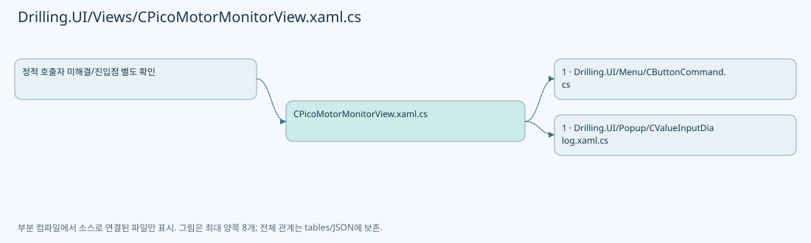

## 네임스페이스·타입·상속

| 타입 | 구분 | 원본 범위 | 선언/상속 |
| --- | --- | --- | --- |
| CPicoMotorMonitorView | ClassDeclaration | 10–168 | CPicoMotorMonitorView: UserControl |

## 멤버 빠른 목록

| 이름 | 종류 | 범위 | 서명 |
| --- | --- | --- | --- |
| .ctor | ConstructorDeclaration | L12–15 | Drilling.UI.Views.CPicoMotorMonitorView.CPicoMotorMonitorView() |
| PicoMonitorPreviewMouseLeftButtonDown | MethodDeclaration | L17–44 | void Drilling.UI.Views.CPicoMotorMonitorView.PicoMonitorPreviewMouseLeftButtonDown(object, MouseButtonEventArgs) |
| PicoValueEditorLostKeyboardFocus | MethodDeclaration | L46–54 | void Drilling.UI.Views.CPicoMotorMonitorView.PicoValueEditorLostKeyboardFocus(object, KeyboardFocusChangedEventArgs) |
| EndAllValueEdits | MethodDeclaration | L56–74 | void Drilling.UI.Views.CPicoMotorMonitorView.EndAllValueEdits(TextBox?) |
| FindAncestor | MethodDeclaration | L76–90 | T? Drilling.UI.Views.CPicoMotorMonitorView.FindAncestor<T>(DependencyObject?) |
| FindVisualChildren | MethodDeclaration | L92–108 | System.Collections.Generic.IEnumerable<T> Drilling.UI.Views.CPicoMotorMonitorView.FindVisualChildren<T>(DependencyObject) |
| PicoJogButtonPreviewMouseDown | MethodDeclaration | L110–118 | void Drilling.UI.Views.CPicoMotorMonitorView.PicoJogButtonPreviewMouseDown(object, MouseButtonEventArgs) |
| PicoJogButtonPreviewMouseUp | MethodDeclaration | L120–129 | void Drilling.UI.Views.CPicoMotorMonitorView.PicoJogButtonPreviewMouseUp(object, MouseButtonEventArgs) |
| PicoJogButtonMouseLeave | MethodDeclaration | L131–138 | void Drilling.UI.Views.CPicoMotorMonitorView.PicoJogButtonMouseLeave(object, MouseEventArgs) |
| StopPicoJog | MethodDeclaration | L140–146 | void Drilling.UI.Views.CPicoMotorMonitorView.StopPicoJog() |
| OpenPicoValueInput | MethodDeclaration | L148–167 | void Drilling.UI.Views.CPicoMotorMonitorView.OpenPicoValueInput(object, RoutedEventArgs) |

## 멤버별 상세 계약·호출·처리 해설

### ConstructorDeclaration `.ctor` · L12–15

[Drilling.UI/Views/CPicoMotorMonitorView.xaml.cs:12–15](https://github.com/kjuws10-rgb/A3Drilling/blob/5aee8e58439c9b455cae7c9593c9be986c3e682e/Drilling.UI/Views/CPicoMotorMonitorView.xaml.cs#L12-L15)

| 항목 | 실제 추출 값 |
| --- | --- |
| 서명 | Drilling.UI.Views.CPicoMotorMonitorView.CPicoMotorMonitorView() |
| 접근/수식자 | Public / public |
| 반환/값 타입 | void |
| 소속 타입 | NamedType:Drilling.UI.Views.CPicoMotorMonitorView |

현재 부분 분석에서 직접 연결된 호출자는 없습니다. XAML/이벤트/인터페이스·델리게이트·외부 진입을 추가 확인해야 하며, 미사용으로 판정한 것이 아닙니다.

호출하는 대상과 해석 범위:

| 원본 행 | 표현식 | 분석 상태 | 대상/소스 위치 |
| --- | --- | --- | --- |
| 14 | InitializeComponent | unresolved | None |

본문의 실제 연산·분기·예외·반환 순서(원문 위치 순):

| 원본 행 | 종류 | 주석 해설 |
| --- | --- | --- |
| 14 | call | 함수·델리게이트 또는 객체 생성자를 호출합니다: InitializeComponent() |

변경 전 점검: 입력/반환 타입, 위 호출자, 예외/취소 경로, 공유 상태와 저장·전송 소비자를 함께 확인합니다. 값의 단위나 물리 방향을 이름만으로 확정하지 않습니다.

### MethodDeclaration `PicoMonitorPreviewMouseLeftButtonDown` · L17–44

[Drilling.UI/Views/CPicoMotorMonitorView.xaml.cs:17–44](https://github.com/kjuws10-rgb/A3Drilling/blob/5aee8e58439c9b455cae7c9593c9be986c3e682e/Drilling.UI/Views/CPicoMotorMonitorView.xaml.cs#L17-L44)

| 항목 | 실제 추출 값 |
| --- | --- |
| 서명 | void Drilling.UI.Views.CPicoMotorMonitorView.PicoMonitorPreviewMouseLeftButtonDown(object, MouseButtonEventArgs) |
| 접근/수식자 | Private / private |
| 반환/값 타입 | void |
| 소속 타입 | NamedType:Drilling.UI.Views.CPicoMotorMonitorView |

입력 계약:

| 이름 | 타입 | 전달 | 선택/기본값 |
| --- | --- | --- | --- |
| sender | object | None | False /  |
| e | MouseButtonEventArgs | None | False /  |

현재 부분 분석에서 직접 연결된 호출자는 없습니다. XAML/이벤트/인터페이스·델리게이트·외부 진입을 추가 확인해야 하며, 미사용으로 판정한 것이 아닙니다.

호출하는 대상과 해석 범위:

| 원본 행 | 표현식 | 분석 상태 | 대상/소스 위치 |
| --- | --- | --- | --- |
| 19 | FindAncestor<TextBox> | candidate | OverloadResolutionFailure |
| 22 | EndAllValueEdits | resolved | void Drilling.UI.Views.CPicoMotorMonitorView.EndAllValueEdits(TextBox?) · Drilling.UI/Views/CPicoMotorMonitorView.xaml.cs:56 |
| 30 | EndAllValueEdits | candidate | OverloadResolutionFailure |
| 33 | editor.Focus | unresolved | None |
| 34 | editor.SelectAll | unresolved | None |
| 39 | Keyboard.ClearFocus | unresolved | None |

본문의 실제 연산·분기·예외·반환 순서(원문 위치 순):

| 원본 행 | 종류 | 주석 해설 |
| --- | --- | --- |
| 19 | call | 함수·델리게이트 또는 객체 생성자를 호출합니다: FindAncestor<TextBox>(e.OriginalSource as DependencyObject) |
| 19 | local-declaration | 지역 변수를 선언합니다: var editor = FindAncestor<TextBox>(e.OriginalSource as DependencyObject); |
| 19 | variable-initializer | 변수의 초기값을 지정합니다: editor = FindAncestor<TextBox>(e.OriginalSource as DependencyObject) |
| 20 | if | 조건에 따라 분기합니다: if (editor is null) |
| 22 | call | 함수·델리게이트 또는 객체 생성자를 호출합니다: EndAllValueEdits() |
| 23 | return | 호출자에게 값 또는 제어를 반환합니다: return; |
| 26 | if | 조건에 따라 분기합니다: if (editor.IsReadOnly) |
| 28 | if | 조건에 따라 분기합니다: if (e.ClickCount >= 2) |
| 30 | call | 함수·델리게이트 또는 객체 생성자를 호출합니다: EndAllValueEdits(editor) |
| 31 | assignment | 값을 대상에 대입합니다: editor.IsReadOnly = false |
| 32 | assignment | 값을 대상에 대입합니다: editor.Cursor = Cursors.IBeam |
| 33 | call | 함수·델리게이트 또는 객체 생성자를 호출합니다: editor.Focus() |
| 34 | call | 함수·델리게이트 또는 객체 생성자를 호출합니다: editor.SelectAll() |
| 36 | else | 앞 조건이 거짓인 경로입니다: else |
| 38 | assignment | 값을 대상에 대입합니다: editor.SelectionLength = 0 |
| 39 | call | 함수·델리게이트 또는 객체 생성자를 호출합니다: Keyboard.ClearFocus() |
| 42 | assignment | 값을 대상에 대입합니다: e.Handled = true |

제어 구문의 포함 구조(실제 실행 순서/CFG가 아닌 구문 탐색 그림):

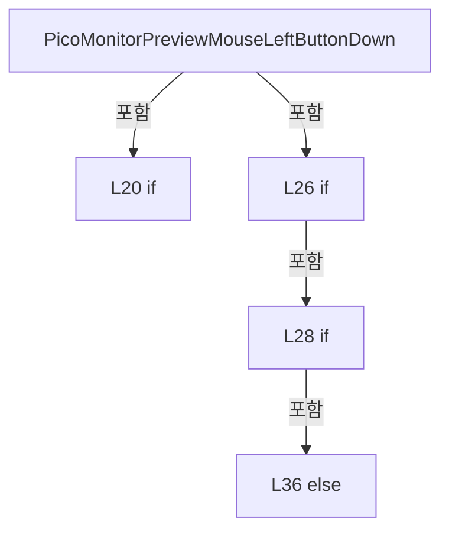

변경 전 점검: 입력/반환 타입, 위 호출자, 예외/취소 경로, 공유 상태와 저장·전송 소비자를 함께 확인합니다. 값의 단위나 물리 방향을 이름만으로 확정하지 않습니다.

### MethodDeclaration `PicoValueEditorLostKeyboardFocus` · L46–54

[Drilling.UI/Views/CPicoMotorMonitorView.xaml.cs:46–54](https://github.com/kjuws10-rgb/A3Drilling/blob/5aee8e58439c9b455cae7c9593c9be986c3e682e/Drilling.UI/Views/CPicoMotorMonitorView.xaml.cs#L46-L54)

| 항목 | 실제 추출 값 |
| --- | --- |
| 서명 | void Drilling.UI.Views.CPicoMotorMonitorView.PicoValueEditorLostKeyboardFocus(object, KeyboardFocusChangedEventArgs) |
| 접근/수식자 | Private / private |
| 반환/값 타입 | void |
| 소속 타입 | NamedType:Drilling.UI.Views.CPicoMotorMonitorView |

입력 계약:

| 이름 | 타입 | 전달 | 선택/기본값 |
| --- | --- | --- | --- |
| sender | object | None | False /  |
| e | KeyboardFocusChangedEventArgs | None | False /  |

현재 부분 분석에서 직접 연결된 호출자는 없습니다. XAML/이벤트/인터페이스·델리게이트·외부 진입을 추가 확인해야 하며, 미사용으로 판정한 것이 아닙니다.

본문의 실제 연산·분기·예외·반환 순서(원문 위치 순):

| 원본 행 | 종류 | 주석 해설 |
| --- | --- | --- |
| 48 | if | 조건에 따라 분기합니다: if (sender is TextBox editor) |
| 50 | assignment | 값을 대상에 대입합니다: editor.IsReadOnly = true |
| 51 | assignment | 값을 대상에 대입합니다: editor.Cursor = Cursors.Arrow |
| 52 | assignment | 값을 대상에 대입합니다: editor.SelectionLength = 0 |

제어 구문의 포함 구조(실제 실행 순서/CFG가 아닌 구문 탐색 그림):

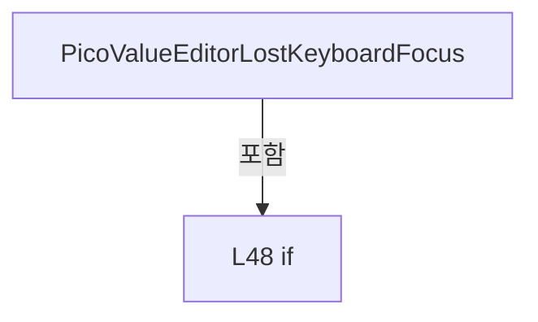

변경 전 점검: 입력/반환 타입, 위 호출자, 예외/취소 경로, 공유 상태와 저장·전송 소비자를 함께 확인합니다. 값의 단위나 물리 방향을 이름만으로 확정하지 않습니다.

### MethodDeclaration `EndAllValueEdits` · L56–74

[Drilling.UI/Views/CPicoMotorMonitorView.xaml.cs:56–74](https://github.com/kjuws10-rgb/A3Drilling/blob/5aee8e58439c9b455cae7c9593c9be986c3e682e/Drilling.UI/Views/CPicoMotorMonitorView.xaml.cs#L56-L74)

| 항목 | 실제 추출 값 |
| --- | --- |
| 서명 | void Drilling.UI.Views.CPicoMotorMonitorView.EndAllValueEdits(TextBox?) |
| 접근/수식자 | Private / private |
| 반환/값 타입 | void |
| 소속 타입 | NamedType:Drilling.UI.Views.CPicoMotorMonitorView |

입력 계약:

| 이름 | 타입 | 전달 | 선택/기본값 |
| --- | --- | --- | --- |
| except | TextBox? | None | True / null |

정적 호출자로 확인된 위치:

| 호출 파일/행 | 호출 표현식 | 런타임 분기 가능 |
| --- | --- | --- |
| [Drilling.UI/Views/CPicoMotorMonitorView.xaml.cs:22–22](https://github.com/kjuws10-rgb/A3Drilling/blob/5aee8e58439c9b455cae7c9593c9be986c3e682e/Drilling.UI/Views/CPicoMotorMonitorView.xaml.cs#L22-L22) | EndAllValueEdits | False |

호출하는 대상과 해석 범위:

| 원본 행 | 표현식 | 분석 상태 | 대상/소스 위치 |
| --- | --- | --- | --- |
| 58 | FindVisualChildren<TextBox> | candidate | OverloadResolutionFailure |
| 60 | ReferenceEquals | candidate | OverloadResolutionFailure |
| 72 | Keyboard.ClearFocus | unresolved | None |

본문의 실제 연산·분기·예외·반환 순서(원문 위치 순):

| 원본 행 | 종류 | 주석 해설 |
| --- | --- | --- |
| 58 | call | 함수·델리게이트 또는 객체 생성자를 호출합니다: FindVisualChildren<TextBox>(this) |
| 58 | foreach | 컬렉션 요소를 순회합니다: foreach (var editor in FindVisualChildren<TextBox>(this)) |
| 60 | call | 함수·델리게이트 또는 객체 생성자를 호출합니다: ReferenceEquals(editor, except) |
| 60 | if | 조건에 따라 분기합니다: if (ReferenceEquals(editor, except)) |
| 62 | continue | 다음 반복으로 진행합니다: continue; |
| 65 | assignment | 값을 대상에 대입합니다: editor.IsReadOnly = true |
| 66 | assignment | 값을 대상에 대입합니다: editor.Cursor = Cursors.Arrow |
| 67 | assignment | 값을 대상에 대입합니다: editor.SelectionLength = 0 |
| 70 | if | 조건에 따라 분기합니다: if (except is null) |
| 72 | call | 함수·델리게이트 또는 객체 생성자를 호출합니다: Keyboard.ClearFocus() |

제어 구문의 포함 구조(실제 실행 순서/CFG가 아닌 구문 탐색 그림):

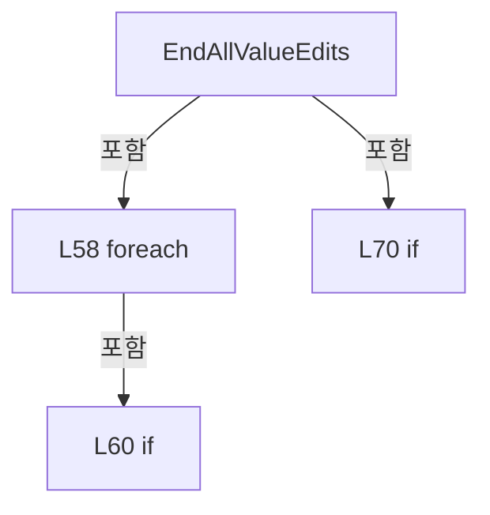

변경 전 점검: 입력/반환 타입, 위 호출자, 예외/취소 경로, 공유 상태와 저장·전송 소비자를 함께 확인합니다. 값의 단위나 물리 방향을 이름만으로 확정하지 않습니다.

### MethodDeclaration `FindAncestor` · L76–90

[Drilling.UI/Views/CPicoMotorMonitorView.xaml.cs:76–90](https://github.com/kjuws10-rgb/A3Drilling/blob/5aee8e58439c9b455cae7c9593c9be986c3e682e/Drilling.UI/Views/CPicoMotorMonitorView.xaml.cs#L76-L90)

| 항목 | 실제 추출 값 |
| --- | --- |
| 서명 | T? Drilling.UI.Views.CPicoMotorMonitorView.FindAncestor<T>(DependencyObject?) |
| 접근/수식자 | Private / private, static |
| 반환/값 타입 | T? |
| 소속 타입 | NamedType:Drilling.UI.Views.CPicoMotorMonitorView |

입력 계약:

| 이름 | 타입 | 전달 | 선택/기본값 |
| --- | --- | --- | --- |
| source | DependencyObject? | None | False /  |

현재 부분 분석에서 직접 연결된 호출자는 없습니다. XAML/이벤트/인터페이스·델리게이트·외부 진입을 추가 확인해야 하며, 미사용으로 판정한 것이 아닙니다.

호출하는 대상과 해석 범위:

| 원본 행 | 표현식 | 분석 상태 | 대상/소스 위치 |
| --- | --- | --- | --- |
| 86 | VisualTreeHelper.GetParent | unresolved | None |

본문의 실제 연산·분기·예외·반환 순서(원문 위치 순):

| 원본 행 | 종류 | 주석 해설 |
| --- | --- | --- |
| 79 | while | 조건을 먼저 확인하며 반복합니다: while (source is not null) |
| 81 | if | 조건에 따라 분기합니다: if (source is T match) |
| 83 | return | 호출자에게 값 또는 제어를 반환합니다: return match; |
| 86 | assignment | 값을 대상에 대입합니다: source = VisualTreeHelper.GetParent(source) |
| 86 | call | 함수·델리게이트 또는 객체 생성자를 호출합니다: VisualTreeHelper.GetParent(source) |
| 89 | return | 호출자에게 값 또는 제어를 반환합니다: return null; |

제어 구문의 포함 구조(실제 실행 순서/CFG가 아닌 구문 탐색 그림):

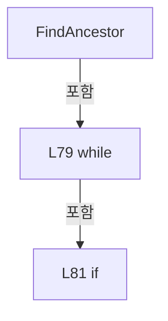

변경 전 점검: 입력/반환 타입, 위 호출자, 예외/취소 경로, 공유 상태와 저장·전송 소비자를 함께 확인합니다. 값의 단위나 물리 방향을 이름만으로 확정하지 않습니다.

### MethodDeclaration `FindVisualChildren` · L92–108

[Drilling.UI/Views/CPicoMotorMonitorView.xaml.cs:92–108](https://github.com/kjuws10-rgb/A3Drilling/blob/5aee8e58439c9b455cae7c9593c9be986c3e682e/Drilling.UI/Views/CPicoMotorMonitorView.xaml.cs#L92-L108)

| 항목 | 실제 추출 값 |
| --- | --- |
| 서명 | System.Collections.Generic.IEnumerable<T> Drilling.UI.Views.CPicoMotorMonitorView.FindVisualChildren<T>(DependencyObject) |
| 접근/수식자 | Private / private, static |
| 반환/값 타입 | System.Collections.Generic.IEnumerable<T> |
| 소속 타입 | NamedType:Drilling.UI.Views.CPicoMotorMonitorView |

입력 계약:

| 이름 | 타입 | 전달 | 선택/기본값 |
| --- | --- | --- | --- |
| parent | DependencyObject | None | False /  |

현재 부분 분석에서 직접 연결된 호출자는 없습니다. XAML/이벤트/인터페이스·델리게이트·외부 진입을 추가 확인해야 하며, 미사용으로 판정한 것이 아닙니다.

호출하는 대상과 해석 범위:

| 원본 행 | 표현식 | 분석 상태 | 대상/소스 위치 |
| --- | --- | --- | --- |
| 95 | VisualTreeHelper.GetChildrenCount | unresolved | None |
| 97 | VisualTreeHelper.GetChild | unresolved | None |
| 103 | FindVisualChildren<T> | candidate | OverloadResolutionFailure |

본문의 실제 연산·분기·예외·반환 순서(원문 위치 순):

| 원본 행 | 종류 | 주석 해설 |
| --- | --- | --- |
| 95 | call | 함수·델리게이트 또는 객체 생성자를 호출합니다: VisualTreeHelper.GetChildrenCount(parent) |
| 95 | variable-initializer | 변수의 초기값을 지정합니다: index = 0 |
| 95 | for | 초기화·조건·증감이 있는 반복입니다: for (var index = 0; index < VisualTreeHelper.GetChildrenCount(parent); index++) |
| 97 | call | 함수·델리게이트 또는 객체 생성자를 호출합니다: VisualTreeHelper.GetChild(parent, index) |
| 97 | local-declaration | 지역 변수를 선언합니다: var child = VisualTreeHelper.GetChild(parent, index); |
| 97 | variable-initializer | 변수의 초기값을 지정합니다: child = VisualTreeHelper.GetChild(parent, index) |
| 98 | if | 조건에 따라 분기합니다: if (child is T match) |
| 100 | yield | 열거값/종료를 전달합니다: yield return match; |
| 103 | call | 함수·델리게이트 또는 객체 생성자를 호출합니다: FindVisualChildren<T>(child) |
| 103 | foreach | 컬렉션 요소를 순회합니다: foreach (var descendant in FindVisualChildren<T>(child)) |
| 105 | yield | 열거값/종료를 전달합니다: yield return descendant; |

제어 구문의 포함 구조(실제 실행 순서/CFG가 아닌 구문 탐색 그림):

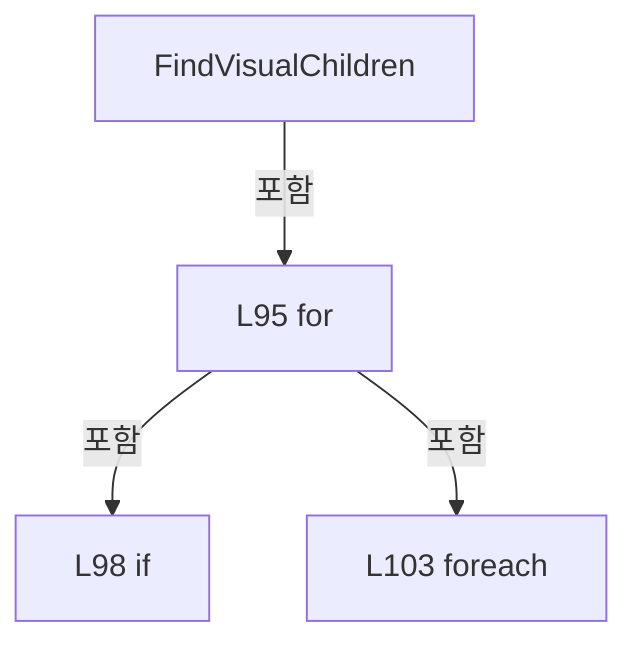

변경 전 점검: 입력/반환 타입, 위 호출자, 예외/취소 경로, 공유 상태와 저장·전송 소비자를 함께 확인합니다. 값의 단위나 물리 방향을 이름만으로 확정하지 않습니다.

### MethodDeclaration `PicoJogButtonPreviewMouseDown` · L110–118

[Drilling.UI/Views/CPicoMotorMonitorView.xaml.cs:110–118](https://github.com/kjuws10-rgb/A3Drilling/blob/5aee8e58439c9b455cae7c9593c9be986c3e682e/Drilling.UI/Views/CPicoMotorMonitorView.xaml.cs#L110-L118)

| 항목 | 실제 추출 값 |
| --- | --- |
| 서명 | void Drilling.UI.Views.CPicoMotorMonitorView.PicoJogButtonPreviewMouseDown(object, MouseButtonEventArgs) |
| 접근/수식자 | Private / private |
| 반환/값 타입 | void |
| 소속 타입 | NamedType:Drilling.UI.Views.CPicoMotorMonitorView |

입력 계약:

| 이름 | 타입 | 전달 | 선택/기본값 |
| --- | --- | --- | --- |
| sender | object | None | False /  |
| e | MouseButtonEventArgs | None | False /  |

현재 부분 분석에서 직접 연결된 호출자는 없습니다. XAML/이벤트/인터페이스·델리게이트·외부 진입을 추가 확인해야 하며, 미사용으로 판정한 것이 아닙니다.

호출하는 대상과 해석 범위:

| 원본 행 | 표현식 | 분석 상태 | 대상/소스 위치 |
| --- | --- | --- | --- |
| 114 | Mouse.Capture | unresolved | None |
| 115 | monitor.PicoJogStartCommand.Execute | candidate | OverloadResolutionFailure |

본문의 실제 연산·분기·예외·반환 순서(원문 위치 순):

| 원본 행 | 종류 | 주석 해설 |
| --- | --- | --- |
| 112 | if | 조건에 따라 분기합니다: if (sender is Button { DataContext: { } parameter } button && DataContext is CRootView rootView && rootView.CurrentScreen.Monitor is { } monitor) |
| 114 | call | 함수·델리게이트 또는 객체 생성자를 호출합니다: Mouse.Capture(button) |
| 115 | call | 함수·델리게이트 또는 객체 생성자를 호출합니다: monitor.PicoJogStartCommand.Execute(parameter) |
| 116 | assignment | 값을 대상에 대입합니다: e.Handled = true |

제어 구문의 포함 구조(실제 실행 순서/CFG가 아닌 구문 탐색 그림):

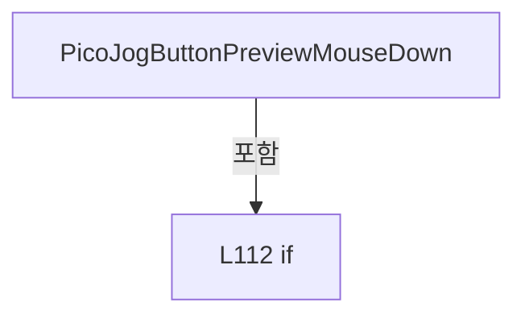

변경 전 점검: 입력/반환 타입, 위 호출자, 예외/취소 경로, 공유 상태와 저장·전송 소비자를 함께 확인합니다. 값의 단위나 물리 방향을 이름만으로 확정하지 않습니다.

### MethodDeclaration `PicoJogButtonPreviewMouseUp` · L120–129

[Drilling.UI/Views/CPicoMotorMonitorView.xaml.cs:120–129](https://github.com/kjuws10-rgb/A3Drilling/blob/5aee8e58439c9b455cae7c9593c9be986c3e682e/Drilling.UI/Views/CPicoMotorMonitorView.xaml.cs#L120-L129)

| 항목 | 실제 추출 값 |
| --- | --- |
| 서명 | void Drilling.UI.Views.CPicoMotorMonitorView.PicoJogButtonPreviewMouseUp(object, MouseButtonEventArgs) |
| 접근/수식자 | Private / private |
| 반환/값 타입 | void |
| 소속 타입 | NamedType:Drilling.UI.Views.CPicoMotorMonitorView |

입력 계약:

| 이름 | 타입 | 전달 | 선택/기본값 |
| --- | --- | --- | --- |
| sender | object | None | False /  |
| e | MouseButtonEventArgs | None | False /  |

현재 부분 분석에서 직접 연결된 호출자는 없습니다. XAML/이벤트/인터페이스·델리게이트·외부 진입을 추가 확인해야 하며, 미사용으로 판정한 것이 아닙니다.

호출하는 대상과 해석 범위:

| 원본 행 | 표현식 | 분석 상태 | 대상/소스 위치 |
| --- | --- | --- | --- |
| 124 | button.ReleaseMouseCapture | unresolved | None |
| 127 | StopPicoJog | resolved | void Drilling.UI.Views.CPicoMotorMonitorView.StopPicoJog() · Drilling.UI/Views/CPicoMotorMonitorView.xaml.cs:140 |

본문의 실제 연산·분기·예외·반환 순서(원문 위치 순):

| 원본 행 | 종류 | 주석 해설 |
| --- | --- | --- |
| 122 | if | 조건에 따라 분기합니다: if (sender is Button button) |
| 124 | call | 함수·델리게이트 또는 객체 생성자를 호출합니다: button.ReleaseMouseCapture() |
| 127 | call | 함수·델리게이트 또는 객체 생성자를 호출합니다: StopPicoJog() |
| 128 | assignment | 값을 대상에 대입합니다: e.Handled = true |

제어 구문의 포함 구조(실제 실행 순서/CFG가 아닌 구문 탐색 그림):

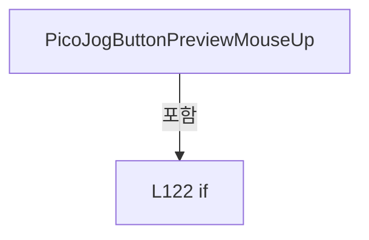

변경 전 점검: 입력/반환 타입, 위 호출자, 예외/취소 경로, 공유 상태와 저장·전송 소비자를 함께 확인합니다. 값의 단위나 물리 방향을 이름만으로 확정하지 않습니다.

### MethodDeclaration `PicoJogButtonMouseLeave` · L131–138

[Drilling.UI/Views/CPicoMotorMonitorView.xaml.cs:131–138](https://github.com/kjuws10-rgb/A3Drilling/blob/5aee8e58439c9b455cae7c9593c9be986c3e682e/Drilling.UI/Views/CPicoMotorMonitorView.xaml.cs#L131-L138)

| 항목 | 실제 추출 값 |
| --- | --- |
| 서명 | void Drilling.UI.Views.CPicoMotorMonitorView.PicoJogButtonMouseLeave(object, MouseEventArgs) |
| 접근/수식자 | Private / private |
| 반환/값 타입 | void |
| 소속 타입 | NamedType:Drilling.UI.Views.CPicoMotorMonitorView |

입력 계약:

| 이름 | 타입 | 전달 | 선택/기본값 |
| --- | --- | --- | --- |
| sender | object | None | False /  |
| e | MouseEventArgs | None | False /  |

현재 부분 분석에서 직접 연결된 호출자는 없습니다. XAML/이벤트/인터페이스·델리게이트·외부 진입을 추가 확인해야 하며, 미사용으로 판정한 것이 아닙니다.

호출하는 대상과 해석 범위:

| 원본 행 | 표현식 | 분석 상태 | 대상/소스 위치 |
| --- | --- | --- | --- |
| 135 | button.ReleaseMouseCapture | unresolved | None |
| 136 | StopPicoJog | resolved | void Drilling.UI.Views.CPicoMotorMonitorView.StopPicoJog() · Drilling.UI/Views/CPicoMotorMonitorView.xaml.cs:140 |

본문의 실제 연산·분기·예외·반환 순서(원문 위치 순):

| 원본 행 | 종류 | 주석 해설 |
| --- | --- | --- |
| 133 | if | 조건에 따라 분기합니다: if (sender is Button button && button.IsMouseCaptured) |
| 135 | call | 함수·델리게이트 또는 객체 생성자를 호출합니다: button.ReleaseMouseCapture() |
| 136 | call | 함수·델리게이트 또는 객체 생성자를 호출합니다: StopPicoJog() |

제어 구문의 포함 구조(실제 실행 순서/CFG가 아닌 구문 탐색 그림):

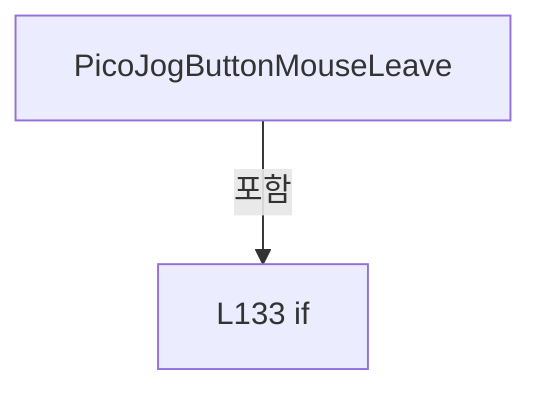

변경 전 점검: 입력/반환 타입, 위 호출자, 예외/취소 경로, 공유 상태와 저장·전송 소비자를 함께 확인합니다. 값의 단위나 물리 방향을 이름만으로 확정하지 않습니다.

### MethodDeclaration `StopPicoJog` · L140–146

[Drilling.UI/Views/CPicoMotorMonitorView.xaml.cs:140–146](https://github.com/kjuws10-rgb/A3Drilling/blob/5aee8e58439c9b455cae7c9593c9be986c3e682e/Drilling.UI/Views/CPicoMotorMonitorView.xaml.cs#L140-L146)

| 항목 | 실제 추출 값 |
| --- | --- |
| 서명 | void Drilling.UI.Views.CPicoMotorMonitorView.StopPicoJog() |
| 접근/수식자 | Private / private |
| 반환/값 타입 | void |
| 소속 타입 | NamedType:Drilling.UI.Views.CPicoMotorMonitorView |

정적 호출자로 확인된 위치:

| 호출 파일/행 | 호출 표현식 | 런타임 분기 가능 |
| --- | --- | --- |
| [Drilling.UI/Views/CPicoMotorMonitorView.xaml.cs:127–127](https://github.com/kjuws10-rgb/A3Drilling/blob/5aee8e58439c9b455cae7c9593c9be986c3e682e/Drilling.UI/Views/CPicoMotorMonitorView.xaml.cs#L127-L127) | StopPicoJog | False |
| [Drilling.UI/Views/CPicoMotorMonitorView.xaml.cs:136–136](https://github.com/kjuws10-rgb/A3Drilling/blob/5aee8e58439c9b455cae7c9593c9be986c3e682e/Drilling.UI/Views/CPicoMotorMonitorView.xaml.cs#L136-L136) | StopPicoJog | False |

호출하는 대상과 해석 범위:

| 원본 행 | 표현식 | 분석 상태 | 대상/소스 위치 |
| --- | --- | --- | --- |
| 144 | monitor.PicoJogStopCommand.Execute | resolved | void Drilling.UI.Menu.CButtonCommand.Execute(object?) · Drilling.UI/Menu/CButtonCommand.cs:19 |

본문의 실제 연산·분기·예외·반환 순서(원문 위치 순):

| 원본 행 | 종류 | 주석 해설 |
| --- | --- | --- |
| 142 | if | 조건에 따라 분기합니다: if (DataContext is CRootView rootView && rootView.CurrentScreen.Monitor is { } monitor) |
| 144 | call | 함수·델리게이트 또는 객체 생성자를 호출합니다: monitor.PicoJogStopCommand.Execute(null) |

제어 구문의 포함 구조(실제 실행 순서/CFG가 아닌 구문 탐색 그림):

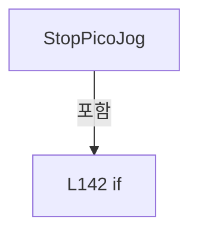

변경 전 점검: 입력/반환 타입, 위 호출자, 예외/취소 경로, 공유 상태와 저장·전송 소비자를 함께 확인합니다. 값의 단위나 물리 방향을 이름만으로 확정하지 않습니다.

### MethodDeclaration `OpenPicoValueInput` · L148–167

[Drilling.UI/Views/CPicoMotorMonitorView.xaml.cs:148–167](https://github.com/kjuws10-rgb/A3Drilling/blob/5aee8e58439c9b455cae7c9593c9be986c3e682e/Drilling.UI/Views/CPicoMotorMonitorView.xaml.cs#L148-L167)

| 항목 | 실제 추출 값 |
| --- | --- |
| 서명 | void Drilling.UI.Views.CPicoMotorMonitorView.OpenPicoValueInput(object, RoutedEventArgs) |
| 접근/수식자 | Private / private |
| 반환/값 타입 | void |
| 소속 타입 | NamedType:Drilling.UI.Views.CPicoMotorMonitorView |

입력 계약:

| 이름 | 타입 | 전달 | 선택/기본값 |
| --- | --- | --- | --- |
| sender | object | None | False /  |
| e | RoutedEventArgs | None | False /  |

현재 부분 분석에서 직접 연결된 호출자는 없습니다. XAML/이벤트/인터페이스·델리게이트·외부 진입을 추가 확인해야 하며, 미사용으로 판정한 것이 아닙니다.

호출하는 대상과 해석 범위:

| 원본 행 | 표현식 | 분석 상태 | 대상/소스 위치 |
| --- | --- | --- | --- |
| 156 | row.Parameter.Equals | resolved | bool string.Equals(string?, System.StringComparison) |
| 158 | new CValueInputDialog | resolved | Drilling.UI.Popup.CValueInputDialog.CValueInputDialog(string, string, Drilling.Common.Managers.EN_RECIPE_DATA_TYPE, double, double) · Drilling.UI/Popup/CValueInputDialog.xaml.cs:13 |
| 160 | Window.GetWindow | unresolved | None |
| 162 | dialog.ShowDialog | unresolved | None |

본문의 실제 연산·분기·예외·반환 순서(원문 위치 순):

| 원본 행 | 종류 | 주석 해설 |
| --- | --- | --- |
| 150 | if | 조건에 따라 분기합니다: if (sender is not Button { Tag: ST_MONITOR_PARAMETER_ROW row } button) |
| 152 | return | 호출자에게 값 또는 제어를 반환합니다: return; |
| 155 | assignment | 값을 대상에 대입합니다: e.Handled = true |
| 156 | call | 함수·델리게이트 또는 객체 생성자를 호출합니다: row.Parameter.Equals("Set Count", StringComparison.OrdinalIgnoreCase) |
| 156 | local-declaration | 지역 변수를 선언합니다: var isCount = row.Parameter.Equals("Set Count", StringComparison.OrdinalIgnoreCase); |
| 156 | variable-initializer | 변수의 초기값을 지정합니다: isCount = row.Parameter.Equals("Set Count", StringComparison.OrdinalIgnoreCase) |
| 157 | local-declaration | 지역 변수를 선언합니다: var nonNegative = row.Parameter is "Set Velocity" or "Set Acceleration" or "Relative Move" &#124;&#124; isCount; |
| 157 | variable-initializer | 변수의 초기값을 지정합니다: nonNegative = row.Parameter is "Set Velocity" or "Set Acceleration" or "Relative Move" &#124;&#124; isCount |
| 158 | conditional-expression | 조건에 따라 결과식을 선택합니다: isCount ? EN_RECIPE_DATA_TYPE.Int : EN_RECIPE_DATA_TYPE.Double |
| 158 | conditional-expression | 조건에 따라 결과식을 선택합니다: nonNegative ? (isCount ? 1 : 0) : 0 |
| 158 | conditional-expression | 조건에 따라 결과식을 선택합니다: isCount ? 1 : 0 |
| 158 | conditional-expression | 조건에 따라 결과식을 선택합니다: nonNegative ? int.MaxValue : 0 |
| 158 | call | 함수·델리게이트 또는 객체 생성자를 호출합니다: new CValueInputDialog(row.Parameter, row.Value, isCount ? EN_RECIPE_DATA_TYPE.Int : EN_RECIPE_DATA_TYPE.Double, nonNegative ? (isCount ? 1 : 0) : 0, nonNegative ? int.MaxValue : 0) { Owner = Window.GetWindow(this) } |
| 158 | local-declaration | 지역 변수를 선언합니다: var dialog = new CValueInputDialog(row.Parameter, row.Value, isCount ? EN_RECIPE_DATA_TYPE.Int : EN_RECIPE_DATA_TYPE.Double, nonNegative ? (isCount ? 1 : 0) : 0, nonNegative ? int.MaxValue : 0) { Owner = Window.GetWindow(this) }; |
| 158 | variable-initializer | 변수의 초기값을 지정합니다: dialog = new CValueInputDialog(row.Parameter, row.Value, isCount ? EN_RECIPE_DATA_TYPE.Int : EN_RECIPE_DATA_TYPE.Double, nonNegative ? (isCount ? 1 : 0) : 0, nonNegative ? int.MaxValue : 0) { Owner = Window.GetWindow(this) } |
| 160 | assignment | 값을 대상에 대입합니다: Owner = Window.GetWindow(this) |
| 160 | call | 함수·델리게이트 또는 객체 생성자를 호출합니다: Window.GetWindow(this) |
| 162 | call | 함수·델리게이트 또는 객체 생성자를 호출합니다: dialog.ShowDialog() |
| 162 | if | 조건에 따라 분기합니다: if (dialog.ShowDialog() == true) |
| 164 | assignment | 값을 대상에 대입합니다: row.Value = dialog.ResultValue |
| 165 | assignment | 값을 대상에 대입합니다: button.Content = dialog.ResultValue |

제어 구문의 포함 구조(실제 실행 순서/CFG가 아닌 구문 탐색 그림):

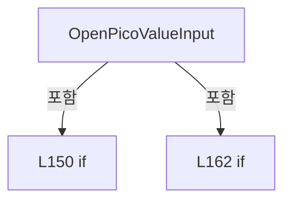

변경 전 점검: 입력/반환 타입, 위 호출자, 예외/취소 경로, 공유 상태와 저장·전송 소비자를 함께 확인합니다. 값의 단위나 물리 방향을 이름만으로 확정하지 않습니다.

## 구문·바인딩 한계

전체 WPF/벤더 SDK/프로젝트별 빌드 조건을 로드한 정식 빌드가 아닙니다. `resolved`는 이 부분 컴파일에서의 심볼 연결이며 virtual/interface/delegate/이벤트/Reflection/XAML의 실제 런타임 구현을 확정하지 않습니다. `candidate`와 `unresolved`는 후속 확인 대상으로 남깁니다.

## 원문 전체 주석 해설본

[원본 모든 행과 행별 해설 보기](../../../annotated/Drilling.UI/Views/CPicoMotorMonitorView.xaml.cs.annotated.txt)

원본을 빠뜨리거나 임의로 줄이지 않았습니다. `L000001 |` 표시는 원본 행 번호, `// 해설`은 별도 설명입니다. 실행용 소스가 아닌 문서입니다.

## 수정·재검증 체크

- 원본 Commit과 현재 작업 파일 SHA가 같은지 먼저 확인합니다. 다르면 이 문서를 과거 버전 자료로 취급합니다.
- 선언·직접 호출·이벤트/인터페이스 경계·설정 소비를 함께 확인합니다. 정적 연결의 빈 곳을 정상 경로로 추정하지 않습니다.
- 저장 형식/단위/식별자·재시도·취소·예외·롤백에 영향을 주는 변경은 상세 해설장과 호출자를 다시 검토합니다.
- 도구의 구문 추출과 별도 정적 추적 해설, 실제 빌드·시뮬레이션·실장비 검증 결과를 분리합니다.
