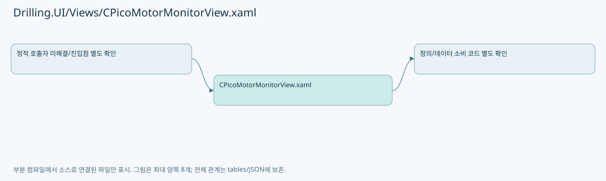

# Drilling.UI/Views/CPicoMotorMonitorView.xaml

| 항목 | 내용 |
| --- | --- |
| 원본 저장소 | https://github.com/kjuws10-rgb/A3Drilling.git |
| 원본 Commit | 28764c91d521777b8ee068dd7aaf2d3902ce9fe2 |
| 원본 SHA256 | 1d757532f556e72828c082d869aa3231926671bebe787342c5796c4b4e4a968d |
| 파일 분류 | code |
| 원본 크기/행 | 58,158 bytes / 899 physical lines |
| 인코딩 | utf-8-sig |
| 검토 범위 | 구문/부분 의미 분석에서 추출한 사실. 동작·물리 단위·실장비 합격을 보증하지 않습니다. |
| 원본 링크 | [고정 Commit 원본](https://github.com/kjuws10-rgb/A3Drilling/blob/28764c91d521777b8ee068dd7aaf2d3902ce9fe2/Drilling.UI/Views/CPicoMotorMonitorView.xaml) |

## 파일의 역할과 읽는 순서

WPF 화면·사용자 명령·표시 상태를 구성합니다. XAML 이벤트와 코드 비하인드, RootView의 조립 경로를 함께 추적합니다.

## 화면 구성과 코드 비하인드 연결

| 항목 | 추출 값 |
| --- | --- |
| 코드 비하인드 후보 | Drilling.UI/Views/CPicoMotorMonitorView.xaml.cs |
| 이름 있는 요소 | InputBorder |
| 이벤트 개수 | 11 |
| Binding 표현 개수 | 80 |

이름 있는 요소는 WPF가 필드를 생성할 수 있는 XAML 선언입니다. 문서 추출기는 WPF 생성 코드를 만들거나 로드하지 않으므로 C# 원문 멤버 수에 합산하지 않습니다.

| 요소 이름 | 원본 범위 |
| --- | --- |
| InputBorder | L163–163 |

| 이벤트 | 핸들러 이름 | 원본 범위 | 해석 |
| --- | --- | --- | --- |
| PreviewMouseLeftButtonDown | PicoMonitorPreviewMouseLeftButtonDown | L5–5 | 코드 비하인드/이벤트 라우팅에서 실제 연결 확인 필요 |
| LostKeyboardFocus | PicoValueEditorLostKeyboardFocus | L141–141 | 코드 비하인드/이벤트 라우팅에서 실제 연결 확인 필요 |
| Click | OpenPicoValueInput | L449–449 | 코드 비하인드/이벤트 라우팅에서 실제 연결 확인 필요 |
| Click | OpenPicoValueInput | L515–515 | 코드 비하인드/이벤트 라우팅에서 실제 연결 확인 필요 |
| PreviewMouseDown | PicoJogButtonPreviewMouseDown | L640–640 | 코드 비하인드/이벤트 라우팅에서 실제 연결 확인 필요 |
| PreviewMouseUp | PicoJogButtonPreviewMouseUp | L641–641 | 코드 비하인드/이벤트 라우팅에서 실제 연결 확인 필요 |
| MouseLeave | PicoJogButtonMouseLeave | L642–642 | 코드 비하인드/이벤트 라우팅에서 실제 연결 확인 필요 |
| Click | OpenPicoValueInput | L727–727 | 코드 비하인드/이벤트 라우팅에서 실제 연결 확인 필요 |
| Click | OpenPicoValueInput | L744–744 | 코드 비하인드/이벤트 라우팅에서 실제 연결 확인 필요 |
| Click | OpenPicoValueInput | L857–857 | 코드 비하인드/이벤트 라우팅에서 실제 연결 확인 필요 |
| Click | OpenPicoValueInput | L865–865 | 코드 비하인드/이벤트 라우팅에서 실제 연결 확인 필요 |

| Binding 표현 | 원본 범위 |
| --- | --- |
| {Binding IconGeometry} | L184–184 |
| {Binding Label} | L193–193 |
| {Binding IconGeometry} | L212–212 |
| {Binding Label} | L221–221 |
| {Binding CurrentScreen.Monitor.IsPicoMotor, Converter={StaticResource BooleanToVisibilityConverter}} | L231–231 |
| {Binding CurrentScreen.Monitor.StatusRows} | L250–250 |
| {Binding Item} | L257–257 |
| {Binding Value} | L258–258 |
| {Binding Unit} | L259–259 |
| {Binding State} | L260–260 |
| {Binding CurrentScreen.Monitor.PicoConnectionButtons} | L292–292 |
| {Binding BackgroundBrush} | L302–302 |
| {Binding BorderBrush} | L303–303 |
| {Binding DataContext.CurrentScreen.Monitor.ExecuteOperationCommand, RelativeSource={RelativeSource AncestorType=UserControl}} | L304–304 |
| {Binding} | L305–305 |
| {Binding IconGeometry} | L314–314 |
| {Binding Label} | L323–323 |
| {Binding CurrentScreen.Monitor.PicoMotorSelectButtons} | L347–347 |
| {Binding BackgroundBrush} | L358–358 |
| {Binding BorderBrush} | L359–359 |
| {Binding DataContext.CurrentScreen.Monitor.ExecuteOperationCommand, RelativeSource={RelativeSource AncestorType=UserControl}} | L360–360 |
| {Binding} | L361–361 |
| {Binding IconGeometry} | L370–370 |
| {Binding Label} | L379–379 |
| {Binding CurrentScreen.Monitor.OperationFields[0].Value} | L429–429 |
| {Binding CurrentScreen.Monitor.OperationFields[1].Value} | L447–447 |
| {Binding CurrentScreen.Monitor.OperationFields[1]} | L448–448 |
| {Binding CurrentScreen.Monitor.ExecuteOperationCommand} | L460–460 |
| {Binding CurrentScreen.Monitor.OperationFields[2].Value} | L495–495 |
| {Binding CurrentScreen.Monitor.OperationFields[3].Value} | L513–513 |
| {Binding CurrentScreen.Monitor.OperationFields[3]} | L514–514 |
| {Binding CurrentScreen.Monitor.ExecuteOperationCommand} | L525–525 |
| {Binding CurrentScreen.Monitor.PicoMotionStopButtons} | L589–589 |
| {Binding BackgroundBrush} | L594–594 |
| {Binding BorderBrush} | L595–595 |
| {Binding DataContext.CurrentScreen.Monitor.ExecuteOperationCommand, RelativeSource={RelativeSource AncestorType=UserControl}} | L596–596 |
| {Binding} | L597–597 |
| {Binding} | L598–598 |
| {Binding CurrentScreen.Monitor.PicoMotionMoveButtons} | L606–606 |
| {Binding BackgroundBrush} | L616–616 |
| {Binding BorderBrush} | L617–617 |
| {Binding DataContext.CurrentScreen.Monitor.ExecuteOperationCommand, RelativeSource={RelativeSource AncestorType=UserControl}} | L618–618 |
| {Binding} | L619–619 |
| {Binding} | L620–620 |
| {Binding CurrentScreen.Monitor.PicoMotionJogButtons} | L628–628 |
| {Binding BackgroundBrush} | L638–638 |
| {Binding BorderBrush} | L639–639 |
| {Binding} | L643–643 |
| {Binding CurrentScreen.Monitor.PicoMotionRelButtons} | L651–651 |
| {Binding BackgroundBrush} | L661–661 |
| {Binding BorderBrush} | L663–663 |
| {Binding DataContext.CurrentScreen.Monitor.ExecuteOperationCommand, RelativeSource={RelativeSource AncestorType=UserControl}} | L664–664 |
| {Binding} | L665–665 |
| {Binding} | L666–666 |
| {Binding CurrentScreen.Monitor.OperationFields[4].Value} | L707–707 |
| {Binding CurrentScreen.Monitor.OperationFields[6].Value} | L725–725 |
| {Binding CurrentScreen.Monitor.OperationFields[6]} | L726–726 |
| {Binding CurrentScreen.Monitor.OperationFields[5].Value} | L742–742 |
| {Binding CurrentScreen.Monitor.OperationFields[5]} | L743–743 |
| {Binding CurrentScreen.Monitor.ParameterRows} | L777–777 |
| {Binding Parameter} | L784–784 |
| {Binding Value} | L785–785 |
| {Binding State} | L786–786 |
| {Binding CurrentScreen.Monitor.PicoAllMotorSelectButtons} | L823–823 |
| {Binding BackgroundBrush} | L837–837 |
| {Binding BorderBrush} | L838–838 |
| {Binding DataContext.CurrentScreen.Monitor.ExecuteOperationCommand, RelativeSource={RelativeSource AncestorType=UserControl}} | L839–839 |
| {Binding} | L840–840 |
| {Binding} | L841–841 |
| {Binding CurrentScreen.Monitor.OperationFields[7].Value} | L850–850 |
| {Binding CurrentScreen.Monitor.OperationFields[8].Value} | L855–855 |
| {Binding CurrentScreen.Monitor.OperationFields[8]} | L856–856 |
| {Binding CurrentScreen.Monitor.OperationFields[9].Value} | L863–863 |
| {Binding CurrentScreen.Monitor.OperationFields[9]} | L864–864 |
| {Binding CurrentScreen.Monitor.PicoAllMotorCommandButtons} | L874–874 |
| {Binding BackgroundBrush} | L884–884 |
| {Binding BorderBrush} | L885–885 |
| {Binding DataContext.CurrentScreen.Monitor.ExecuteOperationCommand, RelativeSource={RelativeSource AncestorType=UserControl}} | L886–886 |
| {Binding} | L887–887 |
| {Binding} | L888–888 |

## 원문 전체 주석 해설본

[원본 모든 행과 행별 해설 보기](../../../annotated/Drilling.UI/Views/CPicoMotorMonitorView.xaml.annotated.txt)

원본을 빠뜨리거나 임의로 줄이지 않았습니다. `L000001 |` 표시는 원본 행 번호, `// 해설`은 별도 설명입니다. 실행용 소스가 아닌 문서입니다.

## 수정·재검증 체크

- 원본 Commit과 현재 작업 파일 SHA가 같은지 먼저 확인합니다. 다르면 이 문서를 과거 버전 자료로 취급합니다.
- 선언·직접 호출·이벤트/인터페이스 경계·설정 소비를 함께 확인합니다. 정적 연결의 빈 곳을 정상 경로로 추정하지 않습니다.
- 저장 형식/단위/식별자·재시도·취소·예외·롤백에 영향을 주는 변경은 상세 해설장과 호출자를 다시 검토합니다.
- 도구의 구문 추출과 별도 정적 추적 해설, 실제 빌드·시뮬레이션·실장비 검증 결과를 분리합니다.
