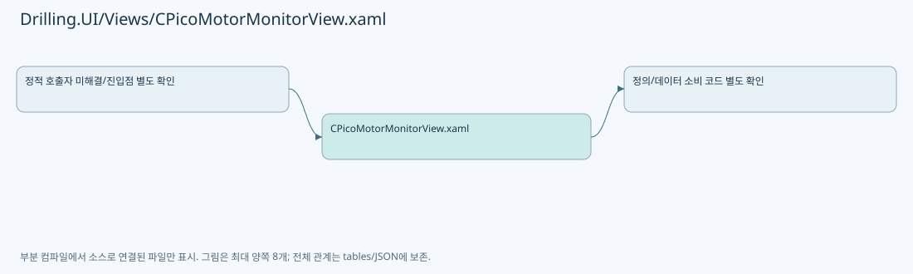

# Drilling.UI/Views/CPicoMotorMonitorView.xaml

| 항목 | 내용 |
| --- | --- |
| 원본 저장소 | https://github.com/kjuws10-rgb/A3Drilling.git |
| 원본 Commit | 5aee8e58439c9b455cae7c9593c9be986c3e682e |
| 원본 SHA256 | 1d757532f556e72828c082d869aa3231926671bebe787342c5796c4b4e4a968d |
| 파일 분류 | code |
| 원본 크기/행 | 58,158 bytes / 899 physical lines |
| 인코딩 | utf-8-sig |
| 검토 범위 | 구문/부분 의미 분석에서 추출한 사실. 동작·물리 단위·실장비 합격을 보증하지 않습니다. |
| 원본 링크 | [고정 Commit 원본](https://github.com/kjuws10-rgb/A3Drilling/blob/5aee8e58439c9b455cae7c9593c9be986c3e682e/Drilling.UI/Views/CPicoMotorMonitorView.xaml) |

## 파일의 역할과 읽는 순서

WPF 화면·사용자 명령·표시 상태를 구성합니다. XAML 이벤트와 코드 비하인드, RootView의 조립 경로를 함께 추적합니다.

## 화면 구성과 코드 비하인드 연결

| 항목 | 추출 값 |
| --- | --- |
| 코드 비하인드 후보 | Drilling.UI/Views/CPicoMotorMonitorView.xaml.cs |
| 이름 있는 요소 | InputBorder |
| 이벤트 개수 | 6 |
| Binding 표현 개수 | 67 |

| 이벤트 | 핸들러 이름 | 해석 |
| --- | --- | --- |
| Click | OpenPicoValueInput | 코드 비하인드/이벤트 라우팅에서 실제 연결 확인 필요 |
| Click | OpenPicoValueInput | 코드 비하인드/이벤트 라우팅에서 실제 연결 확인 필요 |
| Click | OpenPicoValueInput | 코드 비하인드/이벤트 라우팅에서 실제 연결 확인 필요 |
| Click | OpenPicoValueInput | 코드 비하인드/이벤트 라우팅에서 실제 연결 확인 필요 |
| Click | OpenPicoValueInput | 코드 비하인드/이벤트 라우팅에서 실제 연결 확인 필요 |
| Click | OpenPicoValueInput | 코드 비하인드/이벤트 라우팅에서 실제 연결 확인 필요 |

| Binding 표현 |
| --- |
| IconGeometry |
| Label |
| IconGeometry |
| Label |
| CurrentScreen.Monitor.IsPicoMotor, Converter={StaticResource BooleanToVisibilityConverter |
| CurrentScreen.Monitor.StatusRows |
| Item |
| Value |
| Unit |
| State |
| CurrentScreen.Monitor.PicoConnectionButtons |
| BackgroundBrush |
| BorderBrush |
| DataContext.CurrentScreen.Monitor.ExecuteOperationCommand, RelativeSource={RelativeSource AncestorType=UserControl |
| IconGeometry |
| Label |
| CurrentScreen.Monitor.PicoMotorSelectButtons |
| BackgroundBrush |
| BorderBrush |
| DataContext.CurrentScreen.Monitor.ExecuteOperationCommand, RelativeSource={RelativeSource AncestorType=UserControl |
| IconGeometry |
| Label |
| CurrentScreen.Monitor.OperationFields[0].Value |
| CurrentScreen.Monitor.OperationFields[1].Value |
| CurrentScreen.Monitor.OperationFields[1] |
| CurrentScreen.Monitor.ExecuteOperationCommand |
| CurrentScreen.Monitor.OperationFields[2].Value |
| CurrentScreen.Monitor.OperationFields[3].Value |
| CurrentScreen.Monitor.OperationFields[3] |
| CurrentScreen.Monitor.ExecuteOperationCommand |
| CurrentScreen.Monitor.PicoMotionStopButtons |
| BackgroundBrush |
| BorderBrush |
| DataContext.CurrentScreen.Monitor.ExecuteOperationCommand, RelativeSource={RelativeSource AncestorType=UserControl |
| CurrentScreen.Monitor.PicoMotionMoveButtons |
| BackgroundBrush |
| BorderBrush |
| DataContext.CurrentScreen.Monitor.ExecuteOperationCommand, RelativeSource={RelativeSource AncestorType=UserControl |
| CurrentScreen.Monitor.PicoMotionJogButtons |
| BackgroundBrush |
| BorderBrush |
| CurrentScreen.Monitor.PicoMotionRelButtons |
| BackgroundBrush |
| BorderBrush |
| DataContext.CurrentScreen.Monitor.ExecuteOperationCommand, RelativeSource={RelativeSource AncestorType=UserControl |
| CurrentScreen.Monitor.OperationFields[4].Value |
| CurrentScreen.Monitor.OperationFields[6].Value |
| CurrentScreen.Monitor.OperationFields[6] |
| CurrentScreen.Monitor.OperationFields[5].Value |
| CurrentScreen.Monitor.OperationFields[5] |
| CurrentScreen.Monitor.ParameterRows |
| Parameter |
| Value |
| State |
| CurrentScreen.Monitor.PicoAllMotorSelectButtons |
| BackgroundBrush |
| BorderBrush |
| DataContext.CurrentScreen.Monitor.ExecuteOperationCommand, RelativeSource={RelativeSource AncestorType=UserControl |
| CurrentScreen.Monitor.OperationFields[7].Value |
| CurrentScreen.Monitor.OperationFields[8].Value |
| CurrentScreen.Monitor.OperationFields[8] |
| CurrentScreen.Monitor.OperationFields[9].Value |
| CurrentScreen.Monitor.OperationFields[9] |
| CurrentScreen.Monitor.PicoAllMotorCommandButtons |
| BackgroundBrush |
| BorderBrush |
| DataContext.CurrentScreen.Monitor.ExecuteOperationCommand, RelativeSource={RelativeSource AncestorType=UserControl |

## 원문 전체 주석 해설본

[원본 모든 행과 행별 해설 보기](../../../annotated/Drilling.UI/Views/CPicoMotorMonitorView.xaml.annotated.txt)

원본을 빠뜨리거나 임의로 줄이지 않았습니다. `L000001 |` 표시는 원본 행 번호, `// 해설`은 별도 설명입니다. 실행용 소스가 아닌 문서입니다.

## 수정·재검증 체크

- 원본 Commit과 현재 작업 파일 SHA가 같은지 먼저 확인합니다. 다르면 이 문서를 과거 버전 자료로 취급합니다.
- 선언·직접 호출·이벤트/인터페이스 경계·설정 소비를 함께 확인합니다. 정적 연결의 빈 곳을 정상 경로로 추정하지 않습니다.
- 저장 형식/단위/식별자·재시도·취소·예외·롤백에 영향을 주는 변경은 상세 해설장과 호출자를 다시 검토합니다.
- 도구의 구문 추출과 별도 정적 추적 해설, 실제 빌드·시뮬레이션·실장비 검증 결과를 분리합니다.
