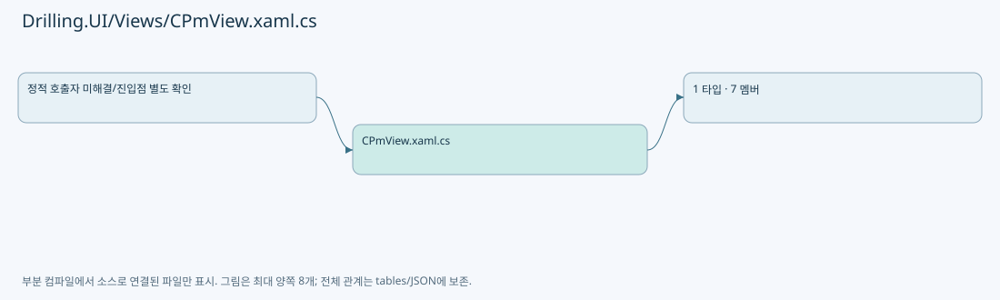
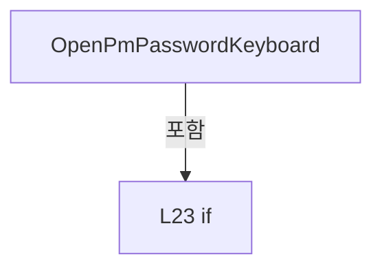
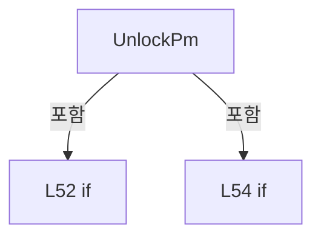

# Drilling.UI/Views/CPmView.xaml.cs

| 항목 | 내용 |
| --- | --- |
| 원본 저장소 | https://github.com/kjuws10-rgb/A3Drilling.git |
| 원본 Commit | 334b3599651b2e8e0181fd4459bafaf3cddafff3 |
| 원본 SHA256 | 2bc4898263b350dd75b8a7510b2377d23112ee311aab33838794268788959dbd |
| 파일 분류 | code |
| 원본 크기/행 | 1,925 bytes / 60 physical lines |
| 인코딩 | utf-8-sig |
| 검토 범위 | 구문/부분 의미 분석에서 추출한 사실. 동작·물리 단위·실장비 합격을 보증하지 않습니다. |
| 원본 링크 | [고정 Commit 원본](https://github.com/kjuws10-rgb/A3Drilling/blob/334b3599651b2e8e0181fd4459bafaf3cddafff3/Drilling.UI/Views/CPmView.xaml.cs) |

## 파일의 역할과 읽는 순서

WPF 화면·사용자 명령·표시 상태를 구성합니다. XAML 이벤트와 코드 비하인드, RootView의 조립 경로를 함께 추적합니다.

## 네임스페이스·타입·상속

| 타입 | 구분 | 원본 범위 | 선언/상속 |
| --- | --- | --- | --- |
| CPmView | ClassDeclaration | 7–60 | CPmView: UserControl |

## 멤버 빠른 목록

| 이름 | 종류 | 범위 | 서명 |
| --- | --- | --- | --- |
| _isPmPasswordVisible | FieldDeclaration | L9–9 | bool Drilling.UI.Views.CPmView._isPmPasswordVisible |
| .ctor | ConstructorDeclaration | L11–14 | Drilling.UI.Views.CPmView.CPmView() |
| OpenPmPasswordKeyboard | MethodDeclaration | L16–28 | void Drilling.UI.Views.CPmView.OpenPmPasswordKeyboard(object, MouseButtonEventArgs) |
| ClearPmPassword | MethodDeclaration | L30–34 | void Drilling.UI.Views.CPmView.ClearPmPassword(object, RoutedEventArgs) |
| PmPasswordChanged | MethodDeclaration | L36–39 | void Drilling.UI.Views.CPmView.PmPasswordChanged(object, RoutedEventArgs) |
| TogglePmPasswordVisibility | MethodDeclaration | L41–48 | void Drilling.UI.Views.CPmView.TogglePmPasswordVisibility(object, RoutedEventArgs) |
| UnlockPm | MethodDeclaration | L50–59 | void Drilling.UI.Views.CPmView.UnlockPm(object, RoutedEventArgs) |

## 멤버별 상세 계약·호출·처리 해설

### FieldDeclaration `_isPmPasswordVisible` · L9–9

[Drilling.UI/Views/CPmView.xaml.cs:9–9](https://github.com/kjuws10-rgb/A3Drilling/blob/334b3599651b2e8e0181fd4459bafaf3cddafff3/Drilling.UI/Views/CPmView.xaml.cs#L9-L9)

| 항목 | 실제 추출 값 |
| --- | --- |
| 서명 | bool Drilling.UI.Views.CPmView._isPmPasswordVisible |
| 접근/수식자 | Private / private |
| 반환/값 타입 | bool |
| 소속 타입 | NamedType:Drilling.UI.Views.CPmView |

현재 부분 분석에서 직접 연결된 호출자는 없습니다. XAML/이벤트/인터페이스·델리게이트·외부 진입을 추가 확인해야 하며, 미사용으로 판정한 것이 아닙니다.

변경 전 점검: 입력/반환 타입, 위 호출자, 예외/취소 경로, 공유 상태와 저장·전송 소비자를 함께 확인합니다. 값의 단위나 물리 방향을 이름만으로 확정하지 않습니다.

### ConstructorDeclaration `.ctor` · L11–14

[Drilling.UI/Views/CPmView.xaml.cs:11–14](https://github.com/kjuws10-rgb/A3Drilling/blob/334b3599651b2e8e0181fd4459bafaf3cddafff3/Drilling.UI/Views/CPmView.xaml.cs#L11-L14)

| 항목 | 실제 추출 값 |
| --- | --- |
| 서명 | Drilling.UI.Views.CPmView.CPmView() |
| 접근/수식자 | Public / public |
| 반환/값 타입 | void |
| 소속 타입 | NamedType:Drilling.UI.Views.CPmView |

현재 부분 분석에서 직접 연결된 호출자는 없습니다. XAML/이벤트/인터페이스·델리게이트·외부 진입을 추가 확인해야 하며, 미사용으로 판정한 것이 아닙니다.

호출하는 대상과 해석 범위:

| 원본 행 | 표현식 | 분석 상태 | 대상/소스 위치 |
| --- | --- | --- | --- |
| 13 | InitializeComponent | unresolved | None |

본문의 실제 연산·분기·예외·반환 순서(원문 위치 순):

| 원본 행 | 종류 | 주석 해설 |
| --- | --- | --- |
| 13 | call | 함수·델리게이트 또는 객체 생성자를 호출합니다: InitializeComponent() |

변경 전 점검: 입력/반환 타입, 위 호출자, 예외/취소 경로, 공유 상태와 저장·전송 소비자를 함께 확인합니다. 값의 단위나 물리 방향을 이름만으로 확정하지 않습니다.

### MethodDeclaration `OpenPmPasswordKeyboard` · L16–28

[Drilling.UI/Views/CPmView.xaml.cs:16–28](https://github.com/kjuws10-rgb/A3Drilling/blob/334b3599651b2e8e0181fd4459bafaf3cddafff3/Drilling.UI/Views/CPmView.xaml.cs#L16-L28)

| 항목 | 실제 추출 값 |
| --- | --- |
| 서명 | void Drilling.UI.Views.CPmView.OpenPmPasswordKeyboard(object, MouseButtonEventArgs) |
| 접근/수식자 | Private / private |
| 반환/값 타입 | void |
| 소속 타입 | NamedType:Drilling.UI.Views.CPmView |

입력 계약:

| 이름 | 타입 | 전달 | 선택/기본값 |
| --- | --- | --- | --- |
| sender | object | None | False /  |
| e | MouseButtonEventArgs | None | False /  |

현재 부분 분석에서 직접 연결된 호출자는 없습니다. XAML/이벤트/인터페이스·델리게이트·외부 진입을 추가 확인해야 하며, 미사용으로 판정한 것이 아닙니다.

호출하는 대상과 해석 범위:

| 원본 행 | 표현식 | 분석 상태 | 대상/소스 위치 |
| --- | --- | --- | --- |
| 19 | new CPasswordInputDialog | candidate | OverloadResolutionFailure |
| 21 | Window.GetWindow | unresolved | None |
| 23 | dialog.ShowDialog | unresolved | None |

본문의 실제 연산·분기·예외·반환 순서(원문 위치 순):

| 원본 행 | 종류 | 주석 해설 |
| --- | --- | --- |
| 18 | assignment | 값을 대상에 대입합니다: e.Handled = true |
| 19 | call | 함수·델리게이트 또는 객체 생성자를 호출합니다: new CPasswordInputDialog(PmPasswordBox.Password) { Owner = Window.GetWindow(this) } |
| 19 | local-declaration | 지역 변수를 선언합니다: var dialog = new CPasswordInputDialog(PmPasswordBox.Password) { Owner = Window.GetWindow(this) }; |
| 19 | variable-initializer | 변수의 초기값을 지정합니다: dialog = new CPasswordInputDialog(PmPasswordBox.Password) { Owner = Window.GetWindow(this) } |
| 21 | assignment | 값을 대상에 대입합니다: Owner = Window.GetWindow(this) |
| 21 | call | 함수·델리게이트 또는 객체 생성자를 호출합니다: Window.GetWindow(this) |
| 23 | call | 함수·델리게이트 또는 객체 생성자를 호출합니다: dialog.ShowDialog() |
| 23 | if | 조건에 따라 분기합니다: if (dialog.ShowDialog() == true) |
| 25 | assignment | 값을 대상에 대입합니다: PmPasswordBox.Password = dialog.ResultPassword |
| 26 | assignment | 값을 대상에 대입합니다: PmPasswordVisibleTextBox.Text = dialog.ResultPassword |

제어 구문의 포함 구조(실제 실행 순서/CFG가 아닌 구문 탐색 그림):

변경 전 점검: 입력/반환 타입, 위 호출자, 예외/취소 경로, 공유 상태와 저장·전송 소비자를 함께 확인합니다. 값의 단위나 물리 방향을 이름만으로 확정하지 않습니다.

### MethodDeclaration `ClearPmPassword` · L30–34

[Drilling.UI/Views/CPmView.xaml.cs:30–34](https://github.com/kjuws10-rgb/A3Drilling/blob/334b3599651b2e8e0181fd4459bafaf3cddafff3/Drilling.UI/Views/CPmView.xaml.cs#L30-L34)

| 항목 | 실제 추출 값 |
| --- | --- |
| 서명 | void Drilling.UI.Views.CPmView.ClearPmPassword(object, RoutedEventArgs) |
| 접근/수식자 | Private / private |
| 반환/값 타입 | void |
| 소속 타입 | NamedType:Drilling.UI.Views.CPmView |

입력 계약:

| 이름 | 타입 | 전달 | 선택/기본값 |
| --- | --- | --- | --- |
| sender | object | None | False /  |
| e | RoutedEventArgs | None | False /  |

현재 부분 분석에서 직접 연결된 호출자는 없습니다. XAML/이벤트/인터페이스·델리게이트·외부 진입을 추가 확인해야 하며, 미사용으로 판정한 것이 아닙니다.

호출하는 대상과 해석 범위:

| 원본 행 | 표현식 | 분석 상태 | 대상/소스 위치 |
| --- | --- | --- | --- |
| 32 | PmPasswordBox.Clear | unresolved | None |
| 33 | PmPasswordVisibleTextBox.Clear | unresolved | None |

본문의 실제 연산·분기·예외·반환 순서(원문 위치 순):

| 원본 행 | 종류 | 주석 해설 |
| --- | --- | --- |
| 32 | call | 함수·델리게이트 또는 객체 생성자를 호출합니다: PmPasswordBox.Clear() |
| 33 | call | 함수·델리게이트 또는 객체 생성자를 호출합니다: PmPasswordVisibleTextBox.Clear() |

변경 전 점검: 입력/반환 타입, 위 호출자, 예외/취소 경로, 공유 상태와 저장·전송 소비자를 함께 확인합니다. 값의 단위나 물리 방향을 이름만으로 확정하지 않습니다.

### MethodDeclaration `PmPasswordChanged` · L36–39

[Drilling.UI/Views/CPmView.xaml.cs:36–39](https://github.com/kjuws10-rgb/A3Drilling/blob/334b3599651b2e8e0181fd4459bafaf3cddafff3/Drilling.UI/Views/CPmView.xaml.cs#L36-L39)

| 항목 | 실제 추출 값 |
| --- | --- |
| 서명 | void Drilling.UI.Views.CPmView.PmPasswordChanged(object, RoutedEventArgs) |
| 접근/수식자 | Private / private |
| 반환/값 타입 | void |
| 소속 타입 | NamedType:Drilling.UI.Views.CPmView |

입력 계약:

| 이름 | 타입 | 전달 | 선택/기본값 |
| --- | --- | --- | --- |
| sender | object | None | False /  |
| e | RoutedEventArgs | None | False /  |

현재 부분 분석에서 직접 연결된 호출자는 없습니다. XAML/이벤트/인터페이스·델리게이트·외부 진입을 추가 확인해야 하며, 미사용으로 판정한 것이 아닙니다.

본문의 실제 연산·분기·예외·반환 순서(원문 위치 순):

| 원본 행 | 종류 | 주석 해설 |
| --- | --- | --- |
| 38 | assignment | 값을 대상에 대입합니다: PmPasswordVisibleTextBox.Text = PmPasswordBox.Password |

변경 전 점검: 입력/반환 타입, 위 호출자, 예외/취소 경로, 공유 상태와 저장·전송 소비자를 함께 확인합니다. 값의 단위나 물리 방향을 이름만으로 확정하지 않습니다.

### MethodDeclaration `TogglePmPasswordVisibility` · L41–48

[Drilling.UI/Views/CPmView.xaml.cs:41–48](https://github.com/kjuws10-rgb/A3Drilling/blob/334b3599651b2e8e0181fd4459bafaf3cddafff3/Drilling.UI/Views/CPmView.xaml.cs#L41-L48)

| 항목 | 실제 추출 값 |
| --- | --- |
| 서명 | void Drilling.UI.Views.CPmView.TogglePmPasswordVisibility(object, RoutedEventArgs) |
| 접근/수식자 | Private / private |
| 반환/값 타입 | void |
| 소속 타입 | NamedType:Drilling.UI.Views.CPmView |

입력 계약:

| 이름 | 타입 | 전달 | 선택/기본값 |
| --- | --- | --- | --- |
| sender | object | None | False /  |
| e | RoutedEventArgs | None | False /  |

현재 부분 분석에서 직접 연결된 호출자는 없습니다. XAML/이벤트/인터페이스·델리게이트·외부 진입을 추가 확인해야 하며, 미사용으로 판정한 것이 아닙니다.

본문의 실제 연산·분기·예외·반환 순서(원문 위치 순):

| 원본 행 | 종류 | 주석 해설 |
| --- | --- | --- |
| 43 | assignment | 값을 대상에 대입합니다: _isPmPasswordVisible = !_isPmPasswordVisible |
| 44 | assignment | 값을 대상에 대입합니다: PmPasswordVisibleTextBox.Text = PmPasswordBox.Password |
| 45 | assignment | 값을 대상에 대입합니다: PmPasswordBox.Visibility = _isPmPasswordVisible ? Visibility.Collapsed : Visibility.Visible |
| 45 | conditional-expression | 조건에 따라 결과식을 선택합니다: _isPmPasswordVisible ? Visibility.Collapsed : Visibility.Visible |
| 46 | assignment | 값을 대상에 대입합니다: PmPasswordVisibleTextBox.Visibility = _isPmPasswordVisible ? Visibility.Visible : Visibility.Collapsed |
| 46 | conditional-expression | 조건에 따라 결과식을 선택합니다: _isPmPasswordVisible ? Visibility.Visible : Visibility.Collapsed |
| 47 | assignment | 값을 대상에 대입합니다: PmPasswordVisibilitySlash.Visibility = _isPmPasswordVisible ? Visibility.Visible : Visibility.Collapsed |
| 47 | conditional-expression | 조건에 따라 결과식을 선택합니다: _isPmPasswordVisible ? Visibility.Visible : Visibility.Collapsed |

변경 전 점검: 입력/반환 타입, 위 호출자, 예외/취소 경로, 공유 상태와 저장·전송 소비자를 함께 확인합니다. 값의 단위나 물리 방향을 이름만으로 확정하지 않습니다.

### MethodDeclaration `UnlockPm` · L50–59

[Drilling.UI/Views/CPmView.xaml.cs:50–59](https://github.com/kjuws10-rgb/A3Drilling/blob/334b3599651b2e8e0181fd4459bafaf3cddafff3/Drilling.UI/Views/CPmView.xaml.cs#L50-L59)

| 항목 | 실제 추출 값 |
| --- | --- |
| 서명 | void Drilling.UI.Views.CPmView.UnlockPm(object, RoutedEventArgs) |
| 접근/수식자 | Private / private, async |
| 반환/값 타입 | void |
| 소속 타입 | NamedType:Drilling.UI.Views.CPmView |

입력 계약:

| 이름 | 타입 | 전달 | 선택/기본값 |
| --- | --- | --- | --- |
| sender | object | None | False /  |
| e | RoutedEventArgs | None | False /  |

현재 부분 분석에서 직접 연결된 호출자는 없습니다. XAML/이벤트/인터페이스·델리게이트·외부 진입을 추가 확인해야 하며, 미사용으로 판정한 것이 아닙니다.

호출하는 대상과 해석 범위:

| 원본 행 | 표현식 | 분석 상태 | 대상/소스 위치 |
| --- | --- | --- | --- |
| 54 | root.UnlockPm | candidate | OverloadResolutionFailure |
| 56 | PmPasswordBox.Clear | unresolved | None |
| 57 | PmPasswordVisibleTextBox.Clear | unresolved | None |

본문의 실제 연산·분기·예외·반환 순서(원문 위치 순):

| 원본 행 | 종류 | 주석 해설 |
| --- | --- | --- |
| 52 | if | 조건에 따라 분기합니다: if (DataContext is not CRootView root) |
| 53 | return | 호출자에게 값 또는 제어를 반환합니다: return; |
| 54 | await | 비동기 완료를 기다립니다: await root.UnlockPm(PmPasswordBox.Password) |
| 54 | call | 함수·델리게이트 또는 객체 생성자를 호출합니다: root.UnlockPm(PmPasswordBox.Password) |
| 54 | if | 조건에 따라 분기합니다: if (await root.UnlockPm(PmPasswordBox.Password)) |
| 56 | call | 함수·델리게이트 또는 객체 생성자를 호출합니다: PmPasswordBox.Clear() |
| 57 | call | 함수·델리게이트 또는 객체 생성자를 호출합니다: PmPasswordVisibleTextBox.Clear() |

제어 구문의 포함 구조(실제 실행 순서/CFG가 아닌 구문 탐색 그림):

변경 전 점검: 입력/반환 타입, 위 호출자, 예외/취소 경로, 공유 상태와 저장·전송 소비자를 함께 확인합니다. 값의 단위나 물리 방향을 이름만으로 확정하지 않습니다.

## 구문·바인딩 한계

전체 WPF/벤더 SDK/프로젝트별 빌드 조건을 로드한 정식 빌드가 아닙니다. `resolved`는 이 부분 컴파일에서의 심볼 연결이며 virtual/interface/delegate/이벤트/Reflection/XAML의 실제 런타임 구현을 확정하지 않습니다. `candidate`와 `unresolved`는 후속 확인 대상으로 남깁니다.

## 원문 전체 주석 해설본

[원본 모든 행과 행별 해설 보기](../../../annotated/Drilling.UI/Views/CPmView.xaml.cs.annotated.txt)

원본을 빠뜨리거나 임의로 줄이지 않았습니다. `L000001 |` 표시는 원본 행 번호, `// 해설`은 별도 설명입니다. 실행용 소스가 아닌 문서입니다.

## 수정·재검증 체크

- 원본 Commit과 현재 작업 파일 SHA가 같은지 먼저 확인합니다. 다르면 이 문서를 과거 버전 자료로 취급합니다.
- 선언·직접 호출·이벤트/인터페이스 경계·설정 소비를 함께 확인합니다. 정적 연결의 빈 곳을 정상 경로로 추정하지 않습니다.
- 저장 형식/단위/식별자·재시도·취소·예외·롤백에 영향을 주는 변경은 상세 해설장과 호출자를 다시 검토합니다.
- 도구의 구문 추출과 별도 정적 추적 해설, 실제 빌드·시뮬레이션·실장비 검증 결과를 분리합니다.
