# Drilling.UI/Views/CRecipeView.xaml.cs

| 항목 | 내용 |
| --- | --- |
| 원본 저장소 | https://github.com/kjuws10-rgb/A3Drilling.git |
| 원본 Commit | 5aee8e58439c9b455cae7c9593c9be986c3e682e |
| 원본 SHA256 | c3d27bc81b7f9cdd0b8dd2bad10ef87e51ba22c93e2f192c6897b746e8fe704d |
| 파일 분류 | code |
| 원본 크기/행 | 20,953 bytes / 549 physical lines |
| 인코딩 | utf-8-sig |
| 검토 범위 | 구문/부분 의미 분석에서 추출한 사실. 동작·물리 단위·실장비 합격을 보증하지 않습니다. |
| 원본 링크 | [고정 Commit 원본](https://github.com/kjuws10-rgb/A3Drilling/blob/5aee8e58439c9b455cae7c9593c9be986c3e682e/Drilling.UI/Views/CRecipeView.xaml.cs) |

## 파일의 역할과 읽는 순서

WPF 화면·사용자 명령·표시 상태를 구성합니다. XAML 이벤트와 코드 비하인드, RootView의 조립 경로를 함께 추적합니다.

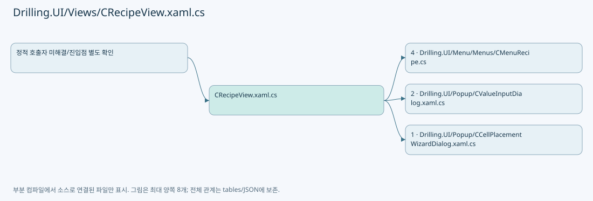

## 네임스페이스·타입·상속

| 타입 | 구분 | 원본 범위 | 선언/상속 |
| --- | --- | --- | --- |
| CRecipeView | ClassDeclaration | 13–549 | CRecipeView: UserControl |

## 멤버 빠른 목록

| 이름 | 종류 | 범위 | 서명 |
| --- | --- | --- | --- |
| PreviewZoomMinimum | FieldDeclaration | L15–15 | double Drilling.UI.Views.CRecipeView.PreviewZoomMinimum |
| PreviewZoomMaximum | FieldDeclaration | L16–16 | double Drilling.UI.Views.CRecipeView.PreviewZoomMaximum |
| PreviewZoomStep | FieldDeclaration | L17–17 | double Drilling.UI.Views.CRecipeView.PreviewZoomStep |
| _isRecipePreviewDragging | FieldDeclaration | L18–18 | bool Drilling.UI.Views.CRecipeView._isRecipePreviewDragging |
| _recipePreviewDragStart | FieldDeclaration | L19–19 | Point Drilling.UI.Views.CRecipeView._recipePreviewDragStart |
| _recipePreviewDragStartX | FieldDeclaration | L20–20 | double Drilling.UI.Views.CRecipeView._recipePreviewDragStartX |
| _recipePreviewDragStartY | FieldDeclaration | L21–21 | double Drilling.UI.Views.CRecipeView._recipePreviewDragStartY |
| _isHistoryExpanded | FieldDeclaration | L22–22 | bool Drilling.UI.Views.CRecipeView._isHistoryExpanded |
| .ctor | ConstructorDeclaration | L23–26 | Drilling.UI.Views.CRecipeView.CRecipeView() |
| ToggleHistory_Click | MethodDeclaration | L28–40 | void Drilling.UI.Views.CRecipeView.ToggleHistory_Click(object, RoutedEventArgs) |
| RecipePreview_PreviewMouseWheel | MethodDeclaration | L42–79 | void Drilling.UI.Views.CRecipeView.RecipePreview_PreviewMouseWheel(object, MouseWheelEventArgs) |
| GetPreviewZoomTranslation | MethodDeclaration | L81–85 | double Drilling.UI.Views.CRecipeView.GetPreviewZoomTranslation(double, double, double, double, double, double) |
| RecipePreview_PreviewMouseLeftButtonDown | MethodDeclaration | L87–105 | void Drilling.UI.Views.CRecipeView.RecipePreview_PreviewMouseLeftButtonDown(object, MouseButtonEventArgs) |
| RecipePreview_PreviewMouseMove | MethodDeclaration | L107–119 | void Drilling.UI.Views.CRecipeView.RecipePreview_PreviewMouseMove(object, MouseEventArgs) |
| RecipePreview_PreviewMouseLeftButtonUp | MethodDeclaration | L121–130 | void Drilling.UI.Views.CRecipeView.RecipePreview_PreviewMouseLeftButtonUp(object, MouseButtonEventArgs) |
| RecipePreview_PreviewMouseRightButtonDown | MethodDeclaration | L132–144 | void Drilling.UI.Views.CRecipeView.RecipePreview_PreviewMouseRightButtonDown(object, MouseButtonEventArgs) |
| RecipePreview_LostMouseCapture | MethodDeclaration | L146–152 | void Drilling.UI.Views.CRecipeView.RecipePreview_LostMouseCapture(object, MouseEventArgs) |
| RecipePreviewResize_Click | MethodDeclaration | L154–158 | void Drilling.UI.Views.CRecipeView.RecipePreviewResize_Click(object, RoutedEventArgs) |
| CellShotMap_PreviewMouseWheel | MethodDeclaration | L160–197 | void Drilling.UI.Views.CRecipeView.CellShotMap_PreviewMouseWheel(object, MouseWheelEventArgs) |
| CellShotMap_PreviewMouseRightButtonDown | MethodDeclaration | L199–210 | void Drilling.UI.Views.CRecipeView.CellShotMap_PreviewMouseRightButtonDown(object, MouseButtonEventArgs) |
| CellShotMapResize_Click | MethodDeclaration | L212–216 | void Drilling.UI.Views.CRecipeView.CellShotMapResize_Click(object, RoutedEventArgs) |
| EndRecipePreviewDrag | MethodDeclaration | L218–227 | void Drilling.UI.Views.CRecipeView.EndRecipePreviewDrag(FrameworkElement) |
| ClampRecipePreviewTranslation | MethodDeclaration | L229–240 | void Drilling.UI.Views.CRecipeView.ClampRecipePreviewTranslation(FrameworkElement) |
| ClampCellShotMapTranslation | MethodDeclaration | L242–253 | void Drilling.UI.Views.CRecipeView.ClampCellShotMapTranslation(FrameworkElement) |
| ResetRecipePreviewZoom | MethodDeclaration | L255–264 | void Drilling.UI.Views.CRecipeView.ResetRecipePreviewZoom() |
| ResetCellShotMapZoom | MethodDeclaration | L266–274 | void Drilling.UI.Views.CRecipeView.ResetCellShotMapZoom() |
| CellContentScrollViewer_PreviewMouseWheel | MethodDeclaration | L276–288 | void Drilling.UI.Views.CRecipeView.CellContentScrollViewer_PreviewMouseWheel(object, MouseWheelEventArgs) |
| ToggleCellPlacement_Click | MethodDeclaration | L290–303 | void Drilling.UI.Views.CRecipeView.ToggleCellPlacement_Click(object, RoutedEventArgs) |
| OpenCellPlacementWizard_Click | MethodDeclaration | L305–326 | void Drilling.UI.Views.CRecipeView.OpenCellPlacementWizard_Click(object, RoutedEventArgs) |
| OpenManagedItemInput | MethodDeclaration | L328–341 | void Drilling.UI.Views.CRecipeView.OpenManagedItemInput(object, RoutedEventArgs) |
| OpenCellOverviewInput | MethodDeclaration | L343–383 | void Drilling.UI.Views.CRecipeView.OpenCellOverviewInput(object, RoutedEventArgs) |
| OpenShotGroupOffsetInput | MethodDeclaration | L385–404 | void Drilling.UI.Views.CRecipeView.OpenShotGroupOffsetInput(object, RoutedEventArgs) |
| CanEditCurrentRecipe | MethodDeclaration | L406–409 | bool Drilling.UI.Views.CRecipeView.CanEditCurrentRecipe() |
| SelectShotGroupFromMap | MethodDeclaration | L411–421 | void Drilling.UI.Views.CRecipeView.SelectShotGroupFromMap(object, MouseButtonEventArgs) |
| CellPreviewLabel_MouseMove | MethodDeclaration | L423–434 | void Drilling.UI.Views.CRecipeView.CellPreviewLabel_MouseMove(object, MouseEventArgs) |
| CellPreviewLabel_MouseLeave | MethodDeclaration | L436–439 | void Drilling.UI.Views.CRecipeView.CellPreviewLabel_MouseLeave(object, MouseEventArgs) |
| PositionRecipePreviewHoverTip | MethodDeclaration | L441–462 | void Drilling.UI.Views.CRecipeView.PositionRecipePreviewHoverTip(Point) |
| HideRecipePreviewHoverTip | MethodDeclaration | L464–468 | void Drilling.UI.Views.CRecipeView.HideRecipePreviewHoverTip() |
| CellShotMapSurface_MouseMove | MethodDeclaration | L470–489 | void Drilling.UI.Views.CRecipeView.CellShotMapSurface_MouseMove(object, MouseEventArgs) |
| CellShotMapSurface_MouseLeave | MethodDeclaration | L491–494 | void Drilling.UI.Views.CRecipeView.CellShotMapSurface_MouseLeave(object, MouseEventArgs) |
| PositionCellShotMapHoverTip | MethodDeclaration | L496–517 | void Drilling.UI.Views.CRecipeView.PositionCellShotMapHoverTip(Point) |
| HideCellShotMapHoverTip | MethodDeclaration | L519–523 | void Drilling.UI.Views.CRecipeView.HideCellShotMapHoverTip() |
| RecipeView_IsVisibleChanged | MethodDeclaration | L525–532 | void Drilling.UI.Views.CRecipeView.RecipeView_IsVisibleChanged(object, DependencyPropertyChangedEventArgs) |
| FindAncestor | MethodDeclaration | L534–548 | T? Drilling.UI.Views.CRecipeView.FindAncestor<T>(DependencyObject?) |

## 멤버별 상세 계약·호출·처리 해설

### FieldDeclaration `PreviewZoomMinimum` · L15–15

[Drilling.UI/Views/CRecipeView.xaml.cs:15–15](https://github.com/kjuws10-rgb/A3Drilling/blob/5aee8e58439c9b455cae7c9593c9be986c3e682e/Drilling.UI/Views/CRecipeView.xaml.cs#L15-L15)

| 항목 | 실제 추출 값 |
| --- | --- |
| 서명 | double Drilling.UI.Views.CRecipeView.PreviewZoomMinimum |
| 접근/수식자 | Private / private, const |
| 반환/값 타입 | double |
| 소속 타입 | NamedType:Drilling.UI.Views.CRecipeView |

현재 부분 분석에서 직접 연결된 호출자는 없습니다. XAML/이벤트/인터페이스·델리게이트·외부 진입을 추가 확인해야 하며, 미사용으로 판정한 것이 아닙니다.

본문의 실제 연산·분기·예외·반환 순서(원문 위치 순):

| 원본 행 | 종류 | 주석 해설 |
| --- | --- | --- |
| 15 | variable-initializer | 변수의 초기값을 지정합니다: PreviewZoomMinimum = 1.0 |

변경 전 점검: 입력/반환 타입, 위 호출자, 예외/취소 경로, 공유 상태와 저장·전송 소비자를 함께 확인합니다. 값의 단위나 물리 방향을 이름만으로 확정하지 않습니다.

### FieldDeclaration `PreviewZoomMaximum` · L16–16

[Drilling.UI/Views/CRecipeView.xaml.cs:16–16](https://github.com/kjuws10-rgb/A3Drilling/blob/5aee8e58439c9b455cae7c9593c9be986c3e682e/Drilling.UI/Views/CRecipeView.xaml.cs#L16-L16)

| 항목 | 실제 추출 값 |
| --- | --- |
| 서명 | double Drilling.UI.Views.CRecipeView.PreviewZoomMaximum |
| 접근/수식자 | Private / private, const |
| 반환/값 타입 | double |
| 소속 타입 | NamedType:Drilling.UI.Views.CRecipeView |

현재 부분 분석에서 직접 연결된 호출자는 없습니다. XAML/이벤트/인터페이스·델리게이트·외부 진입을 추가 확인해야 하며, 미사용으로 판정한 것이 아닙니다.

본문의 실제 연산·분기·예외·반환 순서(원문 위치 순):

| 원본 행 | 종류 | 주석 해설 |
| --- | --- | --- |
| 16 | variable-initializer | 변수의 초기값을 지정합니다: PreviewZoomMaximum = 4.0 |

변경 전 점검: 입력/반환 타입, 위 호출자, 예외/취소 경로, 공유 상태와 저장·전송 소비자를 함께 확인합니다. 값의 단위나 물리 방향을 이름만으로 확정하지 않습니다.

### FieldDeclaration `PreviewZoomStep` · L17–17

[Drilling.UI/Views/CRecipeView.xaml.cs:17–17](https://github.com/kjuws10-rgb/A3Drilling/blob/5aee8e58439c9b455cae7c9593c9be986c3e682e/Drilling.UI/Views/CRecipeView.xaml.cs#L17-L17)

| 항목 | 실제 추출 값 |
| --- | --- |
| 서명 | double Drilling.UI.Views.CRecipeView.PreviewZoomStep |
| 접근/수식자 | Private / private, const |
| 반환/값 타입 | double |
| 소속 타입 | NamedType:Drilling.UI.Views.CRecipeView |

현재 부분 분석에서 직접 연결된 호출자는 없습니다. XAML/이벤트/인터페이스·델리게이트·외부 진입을 추가 확인해야 하며, 미사용으로 판정한 것이 아닙니다.

본문의 실제 연산·분기·예외·반환 순서(원문 위치 순):

| 원본 행 | 종류 | 주석 해설 |
| --- | --- | --- |
| 17 | variable-initializer | 변수의 초기값을 지정합니다: PreviewZoomStep = 0.2 |

변경 전 점검: 입력/반환 타입, 위 호출자, 예외/취소 경로, 공유 상태와 저장·전송 소비자를 함께 확인합니다. 값의 단위나 물리 방향을 이름만으로 확정하지 않습니다.

### FieldDeclaration `_isRecipePreviewDragging` · L18–18

[Drilling.UI/Views/CRecipeView.xaml.cs:18–18](https://github.com/kjuws10-rgb/A3Drilling/blob/5aee8e58439c9b455cae7c9593c9be986c3e682e/Drilling.UI/Views/CRecipeView.xaml.cs#L18-L18)

| 항목 | 실제 추출 값 |
| --- | --- |
| 서명 | bool Drilling.UI.Views.CRecipeView._isRecipePreviewDragging |
| 접근/수식자 | Private / private |
| 반환/값 타입 | bool |
| 소속 타입 | NamedType:Drilling.UI.Views.CRecipeView |

현재 부분 분석에서 직접 연결된 호출자는 없습니다. XAML/이벤트/인터페이스·델리게이트·외부 진입을 추가 확인해야 하며, 미사용으로 판정한 것이 아닙니다.

변경 전 점검: 입력/반환 타입, 위 호출자, 예외/취소 경로, 공유 상태와 저장·전송 소비자를 함께 확인합니다. 값의 단위나 물리 방향을 이름만으로 확정하지 않습니다.

### FieldDeclaration `_recipePreviewDragStart` · L19–19

[Drilling.UI/Views/CRecipeView.xaml.cs:19–19](https://github.com/kjuws10-rgb/A3Drilling/blob/5aee8e58439c9b455cae7c9593c9be986c3e682e/Drilling.UI/Views/CRecipeView.xaml.cs#L19-L19)

| 항목 | 실제 추출 값 |
| --- | --- |
| 서명 | Point Drilling.UI.Views.CRecipeView._recipePreviewDragStart |
| 접근/수식자 | Private / private |
| 반환/값 타입 | Point |
| 소속 타입 | NamedType:Drilling.UI.Views.CRecipeView |

현재 부분 분석에서 직접 연결된 호출자는 없습니다. XAML/이벤트/인터페이스·델리게이트·외부 진입을 추가 확인해야 하며, 미사용으로 판정한 것이 아닙니다.

변경 전 점검: 입력/반환 타입, 위 호출자, 예외/취소 경로, 공유 상태와 저장·전송 소비자를 함께 확인합니다. 값의 단위나 물리 방향을 이름만으로 확정하지 않습니다.

### FieldDeclaration `_recipePreviewDragStartX` · L20–20

[Drilling.UI/Views/CRecipeView.xaml.cs:20–20](https://github.com/kjuws10-rgb/A3Drilling/blob/5aee8e58439c9b455cae7c9593c9be986c3e682e/Drilling.UI/Views/CRecipeView.xaml.cs#L20-L20)

| 항목 | 실제 추출 값 |
| --- | --- |
| 서명 | double Drilling.UI.Views.CRecipeView._recipePreviewDragStartX |
| 접근/수식자 | Private / private |
| 반환/값 타입 | double |
| 소속 타입 | NamedType:Drilling.UI.Views.CRecipeView |

현재 부분 분석에서 직접 연결된 호출자는 없습니다. XAML/이벤트/인터페이스·델리게이트·외부 진입을 추가 확인해야 하며, 미사용으로 판정한 것이 아닙니다.

변경 전 점검: 입력/반환 타입, 위 호출자, 예외/취소 경로, 공유 상태와 저장·전송 소비자를 함께 확인합니다. 값의 단위나 물리 방향을 이름만으로 확정하지 않습니다.

### FieldDeclaration `_recipePreviewDragStartY` · L21–21

[Drilling.UI/Views/CRecipeView.xaml.cs:21–21](https://github.com/kjuws10-rgb/A3Drilling/blob/5aee8e58439c9b455cae7c9593c9be986c3e682e/Drilling.UI/Views/CRecipeView.xaml.cs#L21-L21)

| 항목 | 실제 추출 값 |
| --- | --- |
| 서명 | double Drilling.UI.Views.CRecipeView._recipePreviewDragStartY |
| 접근/수식자 | Private / private |
| 반환/값 타입 | double |
| 소속 타입 | NamedType:Drilling.UI.Views.CRecipeView |

현재 부분 분석에서 직접 연결된 호출자는 없습니다. XAML/이벤트/인터페이스·델리게이트·외부 진입을 추가 확인해야 하며, 미사용으로 판정한 것이 아닙니다.

변경 전 점검: 입력/반환 타입, 위 호출자, 예외/취소 경로, 공유 상태와 저장·전송 소비자를 함께 확인합니다. 값의 단위나 물리 방향을 이름만으로 확정하지 않습니다.

### FieldDeclaration `_isHistoryExpanded` · L22–22

[Drilling.UI/Views/CRecipeView.xaml.cs:22–22](https://github.com/kjuws10-rgb/A3Drilling/blob/5aee8e58439c9b455cae7c9593c9be986c3e682e/Drilling.UI/Views/CRecipeView.xaml.cs#L22-L22)

| 항목 | 실제 추출 값 |
| --- | --- |
| 서명 | bool Drilling.UI.Views.CRecipeView._isHistoryExpanded |
| 접근/수식자 | Private / private |
| 반환/값 타입 | bool |
| 소속 타입 | NamedType:Drilling.UI.Views.CRecipeView |

현재 부분 분석에서 직접 연결된 호출자는 없습니다. XAML/이벤트/인터페이스·델리게이트·외부 진입을 추가 확인해야 하며, 미사용으로 판정한 것이 아닙니다.

변경 전 점검: 입력/반환 타입, 위 호출자, 예외/취소 경로, 공유 상태와 저장·전송 소비자를 함께 확인합니다. 값의 단위나 물리 방향을 이름만으로 확정하지 않습니다.

### ConstructorDeclaration `.ctor` · L23–26

[Drilling.UI/Views/CRecipeView.xaml.cs:23–26](https://github.com/kjuws10-rgb/A3Drilling/blob/5aee8e58439c9b455cae7c9593c9be986c3e682e/Drilling.UI/Views/CRecipeView.xaml.cs#L23-L26)

| 항목 | 실제 추출 값 |
| --- | --- |
| 서명 | Drilling.UI.Views.CRecipeView.CRecipeView() |
| 접근/수식자 | Public / public |
| 반환/값 타입 | void |
| 소속 타입 | NamedType:Drilling.UI.Views.CRecipeView |

현재 부분 분석에서 직접 연결된 호출자는 없습니다. XAML/이벤트/인터페이스·델리게이트·외부 진입을 추가 확인해야 하며, 미사용으로 판정한 것이 아닙니다.

호출하는 대상과 해석 범위:

| 원본 행 | 표현식 | 분석 상태 | 대상/소스 위치 |
| --- | --- | --- | --- |
| 25 | InitializeComponent | unresolved | None |

본문의 실제 연산·분기·예외·반환 순서(원문 위치 순):

| 원본 행 | 종류 | 주석 해설 |
| --- | --- | --- |
| 25 | call | 함수·델리게이트 또는 객체 생성자를 호출합니다: InitializeComponent() |

변경 전 점검: 입력/반환 타입, 위 호출자, 예외/취소 경로, 공유 상태와 저장·전송 소비자를 함께 확인합니다. 값의 단위나 물리 방향을 이름만으로 확정하지 않습니다.

### MethodDeclaration `ToggleHistory_Click` · L28–40

[Drilling.UI/Views/CRecipeView.xaml.cs:28–40](https://github.com/kjuws10-rgb/A3Drilling/blob/5aee8e58439c9b455cae7c9593c9be986c3e682e/Drilling.UI/Views/CRecipeView.xaml.cs#L28-L40)

| 항목 | 실제 추출 값 |
| --- | --- |
| 서명 | void Drilling.UI.Views.CRecipeView.ToggleHistory_Click(object, RoutedEventArgs) |
| 접근/수식자 | Private / private |
| 반환/값 타입 | void |
| 소속 타입 | NamedType:Drilling.UI.Views.CRecipeView |

입력 계약:

| 이름 | 타입 | 전달 | 선택/기본값 |
| --- | --- | --- | --- |
| sender | object | None | False /  |
| e | RoutedEventArgs | None | False /  |

현재 부분 분석에서 직접 연결된 호출자는 없습니다. XAML/이벤트/인터페이스·델리게이트·외부 진입을 추가 확인해야 하며, 미사용으로 판정한 것이 아닙니다.

호출하는 대상과 해석 범위:

| 원본 행 | 표현식 | 분석 상태 | 대상/소스 위치 |
| --- | --- | --- | --- |
| 33 | Grid.SetRow | unresolved | None |
| 34 | Grid.SetColumn | unresolved | None |
| 35 | Grid.SetRowSpan | unresolved | None |
| 36 | Grid.SetColumnSpan | unresolved | None |
| 37 | new Thickness | unresolved | None |
| 37 | new Thickness | unresolved | None |

본문의 실제 연산·분기·예외·반환 순서(원문 위치 순):

| 원본 행 | 종류 | 주석 해설 |
| --- | --- | --- |
| 30 | assignment | 값을 대상에 대입합니다: _isHistoryExpanded = !_isHistoryExpanded |
| 31 | assignment | 값을 대상에 대입합니다: RecipeFilesPanel.Visibility = _isHistoryExpanded ? Visibility.Collapsed : Visibility.Visible |
| 31 | conditional-expression | 조건에 따라 결과식을 선택합니다: _isHistoryExpanded ? Visibility.Collapsed : Visibility.Visible |
| 32 | assignment | 값을 대상에 대입합니다: RecipeEditorPanel.Visibility = _isHistoryExpanded ? Visibility.Collapsed : Visibility.Visible |
| 32 | conditional-expression | 조건에 따라 결과식을 선택합니다: _isHistoryExpanded ? Visibility.Collapsed : Visibility.Visible |
| 33 | call | 함수·델리게이트 또는 객체 생성자를 호출합니다: Grid.SetRow(HistoryPanel, _isHistoryExpanded ? 0 : 1) |
| 33 | conditional-expression | 조건에 따라 결과식을 선택합니다: _isHistoryExpanded ? 0 : 1 |
| 34 | call | 함수·델리게이트 또는 객체 생성자를 호출합니다: Grid.SetColumn(HistoryPanel, _isHistoryExpanded ? 0 : 1) |
| 34 | conditional-expression | 조건에 따라 결과식을 선택합니다: _isHistoryExpanded ? 0 : 1 |
| 35 | call | 함수·델리게이트 또는 객체 생성자를 호출합니다: Grid.SetRowSpan(HistoryPanel, _isHistoryExpanded ? 2 : 1) |
| 35 | conditional-expression | 조건에 따라 결과식을 선택합니다: _isHistoryExpanded ? 2 : 1 |
| 36 | call | 함수·델리게이트 또는 객체 생성자를 호출합니다: Grid.SetColumnSpan(HistoryPanel, _isHistoryExpanded ? 2 : 1) |
| 36 | conditional-expression | 조건에 따라 결과식을 선택합니다: _isHistoryExpanded ? 2 : 1 |
| 37 | assignment | 값을 대상에 대입합니다: HistoryPanel.Margin = _isHistoryExpanded ? new Thickness(0) : new Thickness(12, 12, 0, 0) |
| 37 | call | 함수·델리게이트 또는 객체 생성자를 호출합니다: new Thickness(0) |
| 37 | call | 함수·델리게이트 또는 객체 생성자를 호출합니다: new Thickness(12, 12, 0, 0) |
| 37 | conditional-expression | 조건에 따라 결과식을 선택합니다: _isHistoryExpanded ? new Thickness(0) : new Thickness(12, 12, 0, 0) |
| 38 | assignment | 값을 대상에 대입합니다: HistoryExpandButton.Content = _isHistoryExpanded ? "COLLAPSE" : "EXPAND" |
| 38 | conditional-expression | 조건에 따라 결과식을 선택합니다: _isHistoryExpanded ? "COLLAPSE" : "EXPAND" |
| 39 | assignment | 값을 대상에 대입합니다: e.Handled = true |

변경 전 점검: 입력/반환 타입, 위 호출자, 예외/취소 경로, 공유 상태와 저장·전송 소비자를 함께 확인합니다. 값의 단위나 물리 방향을 이름만으로 확정하지 않습니다.

### MethodDeclaration `RecipePreview_PreviewMouseWheel` · L42–79

[Drilling.UI/Views/CRecipeView.xaml.cs:42–79](https://github.com/kjuws10-rgb/A3Drilling/blob/5aee8e58439c9b455cae7c9593c9be986c3e682e/Drilling.UI/Views/CRecipeView.xaml.cs#L42-L79)

| 항목 | 실제 추출 값 |
| --- | --- |
| 서명 | void Drilling.UI.Views.CRecipeView.RecipePreview_PreviewMouseWheel(object, MouseWheelEventArgs) |
| 접근/수식자 | Private / private |
| 반환/값 타입 | void |
| 소속 타입 | NamedType:Drilling.UI.Views.CRecipeView |

입력 계약:

| 이름 | 타입 | 전달 | 선택/기본값 |
| --- | --- | --- | --- |
| sender | object | None | False /  |
| e | MouseWheelEventArgs | None | False /  |

현재 부분 분석에서 직접 연결된 호출자는 없습니다. XAML/이벤트/인터페이스·델리게이트·외부 진입을 추가 확인해야 하며, 미사용으로 판정한 것이 아닙니다.

호출하는 대상과 해석 범위:

| 원본 행 | 표현식 | 분석 상태 | 대상/소스 위치 |
| --- | --- | --- | --- |
| 51 | Math.Clamp | candidate | OverloadResolutionFailure |
| 52 | Math.Abs | candidate | OverloadResolutionFailure |
| 58 | e.GetPosition | unresolved | None |
| 60 | new Point | unresolved | None |
| 60 | Math.Clamp | candidate | OverloadResolutionFailure |
| 60 | Math.Clamp | candidate | OverloadResolutionFailure |
| 61 | GetPreviewZoomTranslation | candidate | OverloadResolutionFailure |
| 62 | GetPreviewZoomTranslation | candidate | OverloadResolutionFailure |
| 75 | ClampRecipePreviewTranslation | resolved | void Drilling.UI.Views.CRecipeView.ClampRecipePreviewTranslation(FrameworkElement) · Drilling.UI/Views/CRecipeView.xaml.cs:229 |

본문의 실제 연산·분기·예외·반환 순서(원문 위치 순):

| 원본 행 | 종류 | 주석 해설 |
| --- | --- | --- |
| 44 | if | 조건에 따라 분기합니다: if (sender is not FrameworkElement preview &#124;&#124; preview.ActualWidth <= 0 &#124;&#124; preview.ActualHeight <= 0) |
| 46 | return | 호출자에게 값 또는 제어를 반환합니다: return; |
| 49 | local-declaration | 지역 변수를 선언합니다: var currentScale = RecipePreviewScaleTransform.ScaleX; |
| 49 | variable-initializer | 변수의 초기값을 지정합니다: currentScale = RecipePreviewScaleTransform.ScaleX |
| 50 | conditional-expression | 조건에 따라 결과식을 선택합니다: e.Delta > 0 ? PreviewZoomStep : -PreviewZoomStep |
| 50 | local-declaration | 지역 변수를 선언합니다: var requestedScale = currentScale + (e.Delta > 0 ? PreviewZoomStep : -PreviewZoomStep); |
| 50 | variable-initializer | 변수의 초기값을 지정합니다: requestedScale = currentScale + (e.Delta > 0 ? PreviewZoomStep : -PreviewZoomStep) |
| 51 | call | 함수·델리게이트 또는 객체 생성자를 호출합니다: Math.Clamp(requestedScale, PreviewZoomMinimum, PreviewZoomMaximum) |
| 51 | local-declaration | 지역 변수를 선언합니다: var nextScale = Math.Clamp(requestedScale, PreviewZoomMinimum, PreviewZoomMaximum); |
| 51 | variable-initializer | 변수의 초기값을 지정합니다: nextScale = Math.Clamp(requestedScale, PreviewZoomMinimum, PreviewZoomMaximum) |
| 52 | call | 함수·델리게이트 또는 객체 생성자를 호출합니다: Math.Abs(nextScale - currentScale) |
| 52 | if | 조건에 따라 분기합니다: if (Math.Abs(nextScale - currentScale) < double.Epsilon) |
| 54 | assignment | 값을 대상에 대입합니다: e.Handled = true |
| 55 | return | 호출자에게 값 또는 제어를 반환합니다: return; |
| 58 | call | 함수·델리게이트 또는 객체 생성자를 호출합니다: e.GetPosition(preview) |
| 58 | local-declaration | 지역 변수를 선언합니다: var pointer = e.GetPosition(preview); |
| 58 | variable-initializer | 변수의 초기값을 지정합니다: pointer = e.GetPosition(preview) |
| 59 | local-declaration | 지역 변수를 선언합니다: var currentOrigin = RecipePreviewZoomContent.RenderTransformOrigin; |
| 59 | variable-initializer | 변수의 초기값을 지정합니다: currentOrigin = RecipePreviewZoomContent.RenderTransformOrigin |
| 60 | call | 함수·델리게이트 또는 객체 생성자를 호출합니다: new Point(Math.Clamp(pointer.X / preview.ActualWidth, 0.0, 1.0), Math.Clamp(pointer.Y / preview.ActualHeight, 0.0, 1.0)) |
| 60 | call | 함수·델리게이트 또는 객체 생성자를 호출합니다: Math.Clamp(pointer.X / preview.ActualWidth, 0.0, 1.0) |
| 60 | call | 함수·델리게이트 또는 객체 생성자를 호출합니다: Math.Clamp(pointer.Y / preview.ActualHeight, 0.0, 1.0) |
| 60 | local-declaration | 지역 변수를 선언합니다: var nextOrigin = new Point(Math.Clamp(pointer.X / preview.ActualWidth, 0.0, 1.0), Math.Clamp(pointer.Y / preview.ActualHeight, 0.0, 1.0)); |
| 60 | variable-initializer | 변수의 초기값을 지정합니다: nextOrigin = new Point(Math.Clamp(pointer.X / preview.ActualWidth, 0.0, 1.0), Math.Clamp(pointer.Y / preview.ActualHeight, 0.0, 1.0)) |
| 61 | call | 함수·델리게이트 또는 객체 생성자를 호출합니다: GetPreviewZoomTranslation(pointer.X, currentScale, nextScale, currentOrigin.X * preview.ActualWidth, nextOrigin.X * preview.ActualWidth, RecipePreviewTranslateTransform.X) |
| 61 | local-declaration | 지역 변수를 선언합니다: var nextTranslationX = GetPreviewZoomTranslation(pointer.X, currentScale, nextScale, currentOrigin.X * preview.ActualWidth, nextOrigin.X * preview.ActualWidth, RecipePreviewTranslateTransform.X); |
| 61 | variable-initializer | 변수의 초기값을 지정합니다: nextTranslationX = GetPreviewZoomTranslation(pointer.X, currentScale, nextScale, currentOrigin.X * preview.ActualWidth, nextOrigin.X * preview.ActualWidth, RecipePreviewTranslateTransform.X) |
| 62 | call | 함수·델리게이트 또는 객체 생성자를 호출합니다: GetPreviewZoomTranslation(pointer.Y, currentScale, nextScale, currentOrigin.Y * preview.ActualHeight, nextOrigin.Y * preview.ActualHeight, RecipePreviewTranslateTransform.Y) |
| 62 | local-declaration | 지역 변수를 선언합니다: var nextTranslationY = GetPreviewZoomTranslation(pointer.Y, currentScale, nextScale, currentOrigin.Y * preview.ActualHeight, nextOrigin.Y * preview.ActualHeight, RecipePreviewTranslateTransform.Y); |
| 62 | variable-initializer | 변수의 초기값을 지정합니다: nextTranslationY = GetPreviewZoomTranslation(pointer.Y, currentScale, nextScale, currentOrigin.Y * preview.ActualHeight, nextOrigin.Y * preview.ActualHeight, RecipePreviewTranslateTransform.Y) |
| 63 | assignment | 값을 대상에 대입합니다: RecipePreviewZoomContent.RenderTransformOrigin = nextOrigin |
| 64 | assignment | 값을 대상에 대입합니다: RecipePreviewScaleTransform.ScaleX = nextScale |
| 65 | assignment | 값을 대상에 대입합니다: RecipePreviewScaleTransform.ScaleY = nextScale |
| 66 | if | 조건에 따라 분기합니다: if (nextScale <= PreviewZoomMinimum) |
| 68 | assignment | 값을 대상에 대입합니다: RecipePreviewTranslateTransform.X = 0 |
| 69 | assignment | 값을 대상에 대입합니다: RecipePreviewTranslateTransform.Y = 0 |
| 71 | else | 앞 조건이 거짓인 경로입니다: else |
| 73 | assignment | 값을 대상에 대입합니다: RecipePreviewTranslateTransform.X = nextTranslationX |
| 74 | assignment | 값을 대상에 대입합니다: RecipePreviewTranslateTransform.Y = nextTranslationY |
| 75 | call | 함수·델리게이트 또는 객체 생성자를 호출합니다: ClampRecipePreviewTranslation(preview) |
| 78 | assignment | 값을 대상에 대입합니다: e.Handled = true |

제어 구문의 포함 구조(실제 실행 순서/CFG가 아닌 구문 탐색 그림):

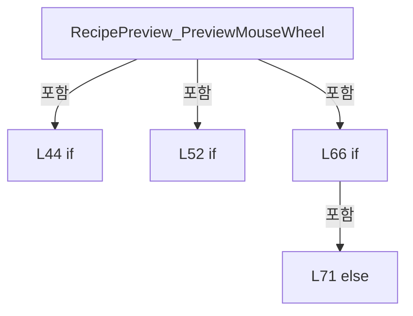

변경 전 점검: 입력/반환 타입, 위 호출자, 예외/취소 경로, 공유 상태와 저장·전송 소비자를 함께 확인합니다. 값의 단위나 물리 방향을 이름만으로 확정하지 않습니다.

### MethodDeclaration `GetPreviewZoomTranslation` · L81–85

[Drilling.UI/Views/CRecipeView.xaml.cs:81–85](https://github.com/kjuws10-rgb/A3Drilling/blob/5aee8e58439c9b455cae7c9593c9be986c3e682e/Drilling.UI/Views/CRecipeView.xaml.cs#L81-L85)

| 항목 | 실제 추출 값 |
| --- | --- |
| 서명 | double Drilling.UI.Views.CRecipeView.GetPreviewZoomTranslation(double, double, double, double, double, double) |
| 접근/수식자 | Private / private, static |
| 반환/값 타입 | double |
| 소속 타입 | NamedType:Drilling.UI.Views.CRecipeView |

입력 계약:

| 이름 | 타입 | 전달 | 선택/기본값 |
| --- | --- | --- | --- |
| pointer | double | None | False /  |
| currentScale | double | None | False /  |
| nextScale | double | None | False /  |
| currentOrigin | double | None | False /  |
| nextOrigin | double | None | False /  |
| currentTranslation | double | None | False /  |

현재 부분 분석에서 직접 연결된 호출자는 없습니다. XAML/이벤트/인터페이스·델리게이트·외부 진입을 추가 확인해야 하며, 미사용으로 판정한 것이 아닙니다.

본문의 실제 연산·분기·예외·반환 순서(원문 위치 순):

| 원본 행 | 종류 | 주석 해설 |
| --- | --- | --- |
| 83 | local-declaration | 지역 변수를 선언합니다: var contentCoordinate = (pointer - ((1.0 - currentScale) * currentOrigin) - currentTranslation) / currentScale; |
| 83 | variable-initializer | 변수의 초기값을 지정합니다: contentCoordinate = (pointer - ((1.0 - currentScale) * currentOrigin) - currentTranslation) / currentScale |
| 84 | return | 호출자에게 값 또는 제어를 반환합니다: return pointer - (nextScale * contentCoordinate) - ((1.0 - nextScale) * nextOrigin); |

변경 전 점검: 입력/반환 타입, 위 호출자, 예외/취소 경로, 공유 상태와 저장·전송 소비자를 함께 확인합니다. 값의 단위나 물리 방향을 이름만으로 확정하지 않습니다.

### MethodDeclaration `RecipePreview_PreviewMouseLeftButtonDown` · L87–105

[Drilling.UI/Views/CRecipeView.xaml.cs:87–105](https://github.com/kjuws10-rgb/A3Drilling/blob/5aee8e58439c9b455cae7c9593c9be986c3e682e/Drilling.UI/Views/CRecipeView.xaml.cs#L87-L105)

| 항목 | 실제 추출 값 |
| --- | --- |
| 서명 | void Drilling.UI.Views.CRecipeView.RecipePreview_PreviewMouseLeftButtonDown(object, MouseButtonEventArgs) |
| 접근/수식자 | Private / private |
| 반환/값 타입 | void |
| 소속 타입 | NamedType:Drilling.UI.Views.CRecipeView |

입력 계약:

| 이름 | 타입 | 전달 | 선택/기본값 |
| --- | --- | --- | --- |
| sender | object | None | False /  |
| e | MouseButtonEventArgs | None | False /  |

현재 부분 분석에서 직접 연결된 호출자는 없습니다. XAML/이벤트/인터페이스·델리게이트·외부 진입을 추가 확인해야 하며, 미사용으로 판정한 것이 아닙니다.

호출하는 대상과 해석 범위:

| 원본 행 | 표현식 | 분석 상태 | 대상/소스 위치 |
| --- | --- | --- | --- |
| 89 | FindAncestor<ButtonBase> | candidate | OverloadResolutionFailure |
| 94 | preview.CaptureMouse | unresolved | None |
| 100 | e.GetPosition | unresolved | None |

본문의 실제 연산·분기·예외·반환 순서(원문 위치 순):

| 원본 행 | 종류 | 주석 해설 |
| --- | --- | --- |
| 89 | call | 함수·델리게이트 또는 객체 생성자를 호출합니다: FindAncestor<ButtonBase>(e.OriginalSource as DependencyObject) |
| 89 | if | 조건에 따라 분기합니다: if (sender is not FrameworkElement preview &#124;&#124; RecipePreviewScaleTransform.ScaleX <= PreviewZoomMinimum &#124;&#124; FindAncestor<ButtonBase>(e.OriginalSource as DependencyObject) is not null) |
| 91 | return | 호출자에게 값 또는 제어를 반환합니다: return; |
| 94 | call | 함수·델리게이트 또는 객체 생성자를 호출합니다: preview.CaptureMouse() |
| 94 | if | 조건에 따라 분기합니다: if (!preview.CaptureMouse()) |
| 96 | return | 호출자에게 값 또는 제어를 반환합니다: return; |
| 99 | assignment | 값을 대상에 대입합니다: _isRecipePreviewDragging = true |
| 100 | assignment | 값을 대상에 대입합니다: _recipePreviewDragStart = e.GetPosition(preview) |
| 100 | call | 함수·델리게이트 또는 객체 생성자를 호출합니다: e.GetPosition(preview) |
| 101 | assignment | 값을 대상에 대입합니다: _recipePreviewDragStartX = RecipePreviewTranslateTransform.X |
| 102 | assignment | 값을 대상에 대입합니다: _recipePreviewDragStartY = RecipePreviewTranslateTransform.Y |
| 103 | assignment | 값을 대상에 대입합니다: preview.Cursor = Cursors.SizeAll |
| 104 | assignment | 값을 대상에 대입합니다: e.Handled = true |

제어 구문의 포함 구조(실제 실행 순서/CFG가 아닌 구문 탐색 그림):

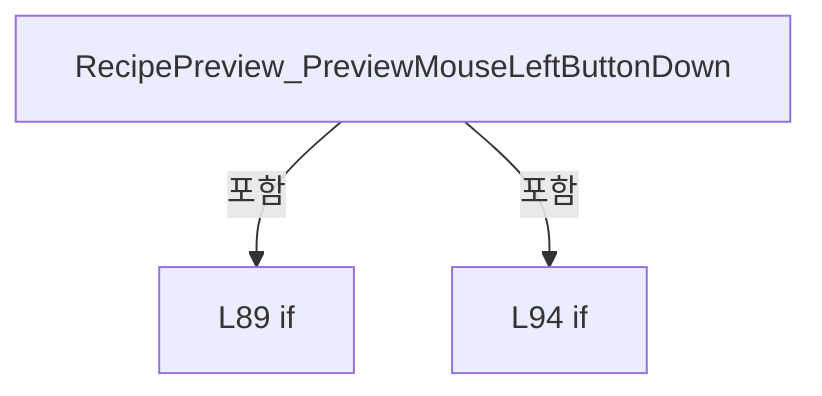

변경 전 점검: 입력/반환 타입, 위 호출자, 예외/취소 경로, 공유 상태와 저장·전송 소비자를 함께 확인합니다. 값의 단위나 물리 방향을 이름만으로 확정하지 않습니다.

### MethodDeclaration `RecipePreview_PreviewMouseMove` · L107–119

[Drilling.UI/Views/CRecipeView.xaml.cs:107–119](https://github.com/kjuws10-rgb/A3Drilling/blob/5aee8e58439c9b455cae7c9593c9be986c3e682e/Drilling.UI/Views/CRecipeView.xaml.cs#L107-L119)

| 항목 | 실제 추출 값 |
| --- | --- |
| 서명 | void Drilling.UI.Views.CRecipeView.RecipePreview_PreviewMouseMove(object, MouseEventArgs) |
| 접근/수식자 | Private / private |
| 반환/값 타입 | void |
| 소속 타입 | NamedType:Drilling.UI.Views.CRecipeView |

입력 계약:

| 이름 | 타입 | 전달 | 선택/기본값 |
| --- | --- | --- | --- |
| sender | object | None | False /  |
| e | MouseEventArgs | None | False /  |

현재 부분 분석에서 직접 연결된 호출자는 없습니다. XAML/이벤트/인터페이스·델리게이트·외부 진입을 추가 확인해야 하며, 미사용으로 판정한 것이 아닙니다.

호출하는 대상과 해석 범위:

| 원본 행 | 표현식 | 분석 상태 | 대상/소스 위치 |
| --- | --- | --- | --- |
| 114 | e.GetPosition | unresolved | None |
| 117 | ClampRecipePreviewTranslation | resolved | void Drilling.UI.Views.CRecipeView.ClampRecipePreviewTranslation(FrameworkElement) · Drilling.UI/Views/CRecipeView.xaml.cs:229 |

본문의 실제 연산·분기·예외·반환 순서(원문 위치 순):

| 원본 행 | 종류 | 주석 해설 |
| --- | --- | --- |
| 109 | if | 조건에 따라 분기합니다: if (!_isRecipePreviewDragging &#124;&#124; sender is not FrameworkElement preview) |
| 111 | return | 호출자에게 값 또는 제어를 반환합니다: return; |
| 114 | call | 함수·델리게이트 또는 객체 생성자를 호출합니다: e.GetPosition(preview) |
| 114 | local-declaration | 지역 변수를 선언합니다: var current = e.GetPosition(preview); |
| 114 | variable-initializer | 변수의 초기값을 지정합니다: current = e.GetPosition(preview) |
| 115 | assignment | 값을 대상에 대입합니다: RecipePreviewTranslateTransform.X = _recipePreviewDragStartX + current.X - _recipePreviewDragStart.X |
| 116 | assignment | 값을 대상에 대입합니다: RecipePreviewTranslateTransform.Y = _recipePreviewDragStartY + current.Y - _recipePreviewDragStart.Y |
| 117 | call | 함수·델리게이트 또는 객체 생성자를 호출합니다: ClampRecipePreviewTranslation(preview) |
| 118 | assignment | 값을 대상에 대입합니다: e.Handled = true |

제어 구문의 포함 구조(실제 실행 순서/CFG가 아닌 구문 탐색 그림):

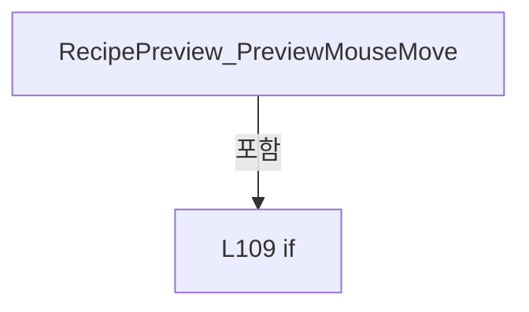

변경 전 점검: 입력/반환 타입, 위 호출자, 예외/취소 경로, 공유 상태와 저장·전송 소비자를 함께 확인합니다. 값의 단위나 물리 방향을 이름만으로 확정하지 않습니다.

### MethodDeclaration `RecipePreview_PreviewMouseLeftButtonUp` · L121–130

[Drilling.UI/Views/CRecipeView.xaml.cs:121–130](https://github.com/kjuws10-rgb/A3Drilling/blob/5aee8e58439c9b455cae7c9593c9be986c3e682e/Drilling.UI/Views/CRecipeView.xaml.cs#L121-L130)

| 항목 | 실제 추출 값 |
| --- | --- |
| 서명 | void Drilling.UI.Views.CRecipeView.RecipePreview_PreviewMouseLeftButtonUp(object, MouseButtonEventArgs) |
| 접근/수식자 | Private / private |
| 반환/값 타입 | void |
| 소속 타입 | NamedType:Drilling.UI.Views.CRecipeView |

입력 계약:

| 이름 | 타입 | 전달 | 선택/기본값 |
| --- | --- | --- | --- |
| sender | object | None | False /  |
| e | MouseButtonEventArgs | None | False /  |

현재 부분 분석에서 직접 연결된 호출자는 없습니다. XAML/이벤트/인터페이스·델리게이트·외부 진입을 추가 확인해야 하며, 미사용으로 판정한 것이 아닙니다.

호출하는 대상과 해석 범위:

| 원본 행 | 표현식 | 분석 상태 | 대상/소스 위치 |
| --- | --- | --- | --- |
| 128 | EndRecipePreviewDrag | resolved | void Drilling.UI.Views.CRecipeView.EndRecipePreviewDrag(FrameworkElement) · Drilling.UI/Views/CRecipeView.xaml.cs:218 |

본문의 실제 연산·분기·예외·반환 순서(원문 위치 순):

| 원본 행 | 종류 | 주석 해설 |
| --- | --- | --- |
| 123 | if | 조건에 따라 분기합니다: if (!_isRecipePreviewDragging &#124;&#124; sender is not FrameworkElement preview) |
| 125 | return | 호출자에게 값 또는 제어를 반환합니다: return; |
| 128 | call | 함수·델리게이트 또는 객체 생성자를 호출합니다: EndRecipePreviewDrag(preview) |
| 129 | assignment | 값을 대상에 대입합니다: e.Handled = true |

제어 구문의 포함 구조(실제 실행 순서/CFG가 아닌 구문 탐색 그림):

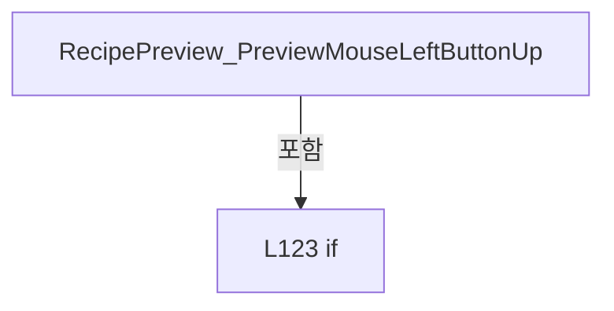

변경 전 점검: 입력/반환 타입, 위 호출자, 예외/취소 경로, 공유 상태와 저장·전송 소비자를 함께 확인합니다. 값의 단위나 물리 방향을 이름만으로 확정하지 않습니다.

### MethodDeclaration `RecipePreview_PreviewMouseRightButtonDown` · L132–144

[Drilling.UI/Views/CRecipeView.xaml.cs:132–144](https://github.com/kjuws10-rgb/A3Drilling/blob/5aee8e58439c9b455cae7c9593c9be986c3e682e/Drilling.UI/Views/CRecipeView.xaml.cs#L132-L144)

| 항목 | 실제 추출 값 |
| --- | --- |
| 서명 | void Drilling.UI.Views.CRecipeView.RecipePreview_PreviewMouseRightButtonDown(object, MouseButtonEventArgs) |
| 접근/수식자 | Private / private |
| 반환/값 타입 | void |
| 소속 타입 | NamedType:Drilling.UI.Views.CRecipeView |

입력 계약:

| 이름 | 타입 | 전달 | 선택/기본값 |
| --- | --- | --- | --- |
| sender | object | None | False /  |
| e | MouseButtonEventArgs | None | False /  |

현재 부분 분석에서 직접 연결된 호출자는 없습니다. XAML/이벤트/인터페이스·델리게이트·외부 진입을 추가 확인해야 하며, 미사용으로 판정한 것이 아닙니다.

호출하는 대상과 해석 범위:

| 원본 행 | 표현식 | 분석 상태 | 대상/소스 위치 |
| --- | --- | --- | --- |
| 134 | HideRecipePreviewHoverTip | resolved | void Drilling.UI.Views.CRecipeView.HideRecipePreviewHoverTip() · Drilling.UI/Views/CRecipeView.xaml.cs:464 |
| 135 | EndRecipePreviewDrag | candidate | OverloadResolutionFailure |

본문의 실제 연산·분기·예외·반환 순서(원문 위치 순):

| 원본 행 | 종류 | 주석 해설 |
| --- | --- | --- |
| 134 | call | 함수·델리게이트 또는 객체 생성자를 호출합니다: HideRecipePreviewHoverTip() |
| 135 | call | 함수·델리게이트 또는 객체 생성자를 호출합니다: EndRecipePreviewDrag(RecipePreviewViewport) |
| 136 | if | 조건에 따라 분기합니다: if (RecipePreviewViewport.ContextMenu is not { } contextMenu) |
| 138 | return | 호출자에게 값 또는 제어를 반환합니다: return; |
| 141 | assignment | 값을 대상에 대입합니다: contextMenu.PlacementTarget = RecipePreviewViewport |
| 142 | assignment | 값을 대상에 대입합니다: contextMenu.IsOpen = true |
| 143 | assignment | 값을 대상에 대입합니다: e.Handled = true |

제어 구문의 포함 구조(실제 실행 순서/CFG가 아닌 구문 탐색 그림):

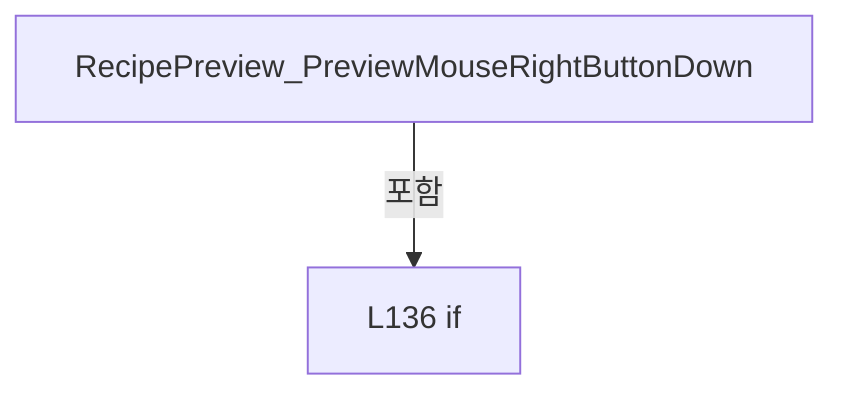

변경 전 점검: 입력/반환 타입, 위 호출자, 예외/취소 경로, 공유 상태와 저장·전송 소비자를 함께 확인합니다. 값의 단위나 물리 방향을 이름만으로 확정하지 않습니다.

### MethodDeclaration `RecipePreview_LostMouseCapture` · L146–152

[Drilling.UI/Views/CRecipeView.xaml.cs:146–152](https://github.com/kjuws10-rgb/A3Drilling/blob/5aee8e58439c9b455cae7c9593c9be986c3e682e/Drilling.UI/Views/CRecipeView.xaml.cs#L146-L152)

| 항목 | 실제 추출 값 |
| --- | --- |
| 서명 | void Drilling.UI.Views.CRecipeView.RecipePreview_LostMouseCapture(object, MouseEventArgs) |
| 접근/수식자 | Private / private |
| 반환/값 타입 | void |
| 소속 타입 | NamedType:Drilling.UI.Views.CRecipeView |

입력 계약:

| 이름 | 타입 | 전달 | 선택/기본값 |
| --- | --- | --- | --- |
| sender | object | None | False /  |
| e | MouseEventArgs | None | False /  |

현재 부분 분석에서 직접 연결된 호출자는 없습니다. XAML/이벤트/인터페이스·델리게이트·외부 진입을 추가 확인해야 하며, 미사용으로 판정한 것이 아닙니다.

호출하는 대상과 해석 범위:

| 원본 행 | 표현식 | 분석 상태 | 대상/소스 위치 |
| --- | --- | --- | --- |
| 150 | EndRecipePreviewDrag | resolved | void Drilling.UI.Views.CRecipeView.EndRecipePreviewDrag(FrameworkElement) · Drilling.UI/Views/CRecipeView.xaml.cs:218 |

본문의 실제 연산·분기·예외·반환 순서(원문 위치 순):

| 원본 행 | 종류 | 주석 해설 |
| --- | --- | --- |
| 148 | if | 조건에 따라 분기합니다: if (sender is FrameworkElement preview) |
| 150 | call | 함수·델리게이트 또는 객체 생성자를 호출합니다: EndRecipePreviewDrag(preview) |

제어 구문의 포함 구조(실제 실행 순서/CFG가 아닌 구문 탐색 그림):


변경 전 점검: 입력/반환 타입, 위 호출자, 예외/취소 경로, 공유 상태와 저장·전송 소비자를 함께 확인합니다. 값의 단위나 물리 방향을 이름만으로 확정하지 않습니다.

### MethodDeclaration `RecipePreviewResize_Click` · L154–158

[Drilling.UI/Views/CRecipeView.xaml.cs:154–158](https://github.com/kjuws10-rgb/A3Drilling/blob/5aee8e58439c9b455cae7c9593c9be986c3e682e/Drilling.UI/Views/CRecipeView.xaml.cs#L154-L158)

| 항목 | 실제 추출 값 |
| --- | --- |
| 서명 | void Drilling.UI.Views.CRecipeView.RecipePreviewResize_Click(object, RoutedEventArgs) |
| 접근/수식자 | Private / private |
| 반환/값 타입 | void |
| 소속 타입 | NamedType:Drilling.UI.Views.CRecipeView |

입력 계약:

| 이름 | 타입 | 전달 | 선택/기본값 |
| --- | --- | --- | --- |
| sender | object | None | False /  |
| e | RoutedEventArgs | None | False /  |

현재 부분 분석에서 직접 연결된 호출자는 없습니다. XAML/이벤트/인터페이스·델리게이트·외부 진입을 추가 확인해야 하며, 미사용으로 판정한 것이 아닙니다.

호출하는 대상과 해석 범위:

| 원본 행 | 표현식 | 분석 상태 | 대상/소스 위치 |
| --- | --- | --- | --- |
| 156 | ResetRecipePreviewZoom | resolved | void Drilling.UI.Views.CRecipeView.ResetRecipePreviewZoom() · Drilling.UI/Views/CRecipeView.xaml.cs:255 |

본문의 실제 연산·분기·예외·반환 순서(원문 위치 순):

| 원본 행 | 종류 | 주석 해설 |
| --- | --- | --- |
| 156 | call | 함수·델리게이트 또는 객체 생성자를 호출합니다: ResetRecipePreviewZoom() |
| 157 | assignment | 값을 대상에 대입합니다: e.Handled = true |

변경 전 점검: 입력/반환 타입, 위 호출자, 예외/취소 경로, 공유 상태와 저장·전송 소비자를 함께 확인합니다. 값의 단위나 물리 방향을 이름만으로 확정하지 않습니다.

### MethodDeclaration `CellShotMap_PreviewMouseWheel` · L160–197

[Drilling.UI/Views/CRecipeView.xaml.cs:160–197](https://github.com/kjuws10-rgb/A3Drilling/blob/5aee8e58439c9b455cae7c9593c9be986c3e682e/Drilling.UI/Views/CRecipeView.xaml.cs#L160-L197)

| 항목 | 실제 추출 값 |
| --- | --- |
| 서명 | void Drilling.UI.Views.CRecipeView.CellShotMap_PreviewMouseWheel(object, MouseWheelEventArgs) |
| 접근/수식자 | Private / private |
| 반환/값 타입 | void |
| 소속 타입 | NamedType:Drilling.UI.Views.CRecipeView |

입력 계약:

| 이름 | 타입 | 전달 | 선택/기본값 |
| --- | --- | --- | --- |
| sender | object | None | False /  |
| e | MouseWheelEventArgs | None | False /  |

현재 부분 분석에서 직접 연결된 호출자는 없습니다. XAML/이벤트/인터페이스·델리게이트·외부 진입을 추가 확인해야 하며, 미사용으로 판정한 것이 아닙니다.

호출하는 대상과 해석 범위:

| 원본 행 | 표현식 | 분석 상태 | 대상/소스 위치 |
| --- | --- | --- | --- |
| 169 | Math.Clamp | candidate | OverloadResolutionFailure |
| 170 | Math.Abs | candidate | OverloadResolutionFailure |
| 176 | e.GetPosition | unresolved | None |
| 178 | new Point | unresolved | None |
| 178 | Math.Clamp | candidate | OverloadResolutionFailure |
| 178 | Math.Clamp | candidate | OverloadResolutionFailure |
| 179 | GetPreviewZoomTranslation | candidate | OverloadResolutionFailure |
| 180 | GetPreviewZoomTranslation | candidate | OverloadResolutionFailure |
| 193 | ClampCellShotMapTranslation | resolved | void Drilling.UI.Views.CRecipeView.ClampCellShotMapTranslation(FrameworkElement) · Drilling.UI/Views/CRecipeView.xaml.cs:242 |

본문의 실제 연산·분기·예외·반환 순서(원문 위치 순):

| 원본 행 | 종류 | 주석 해설 |
| --- | --- | --- |
| 162 | if | 조건에 따라 분기합니다: if (sender is not FrameworkElement preview &#124;&#124; preview.ActualWidth <= 0 &#124;&#124; preview.ActualHeight <= 0) |
| 164 | return | 호출자에게 값 또는 제어를 반환합니다: return; |
| 167 | local-declaration | 지역 변수를 선언합니다: var currentScale = CellShotMapScaleTransform.ScaleX; |
| 167 | variable-initializer | 변수의 초기값을 지정합니다: currentScale = CellShotMapScaleTransform.ScaleX |
| 168 | conditional-expression | 조건에 따라 결과식을 선택합니다: e.Delta > 0 ? PreviewZoomStep : -PreviewZoomStep |
| 168 | local-declaration | 지역 변수를 선언합니다: var requestedScale = currentScale + (e.Delta > 0 ? PreviewZoomStep : -PreviewZoomStep); |
| 168 | variable-initializer | 변수의 초기값을 지정합니다: requestedScale = currentScale + (e.Delta > 0 ? PreviewZoomStep : -PreviewZoomStep) |
| 169 | call | 함수·델리게이트 또는 객체 생성자를 호출합니다: Math.Clamp(requestedScale, PreviewZoomMinimum, PreviewZoomMaximum) |
| 169 | local-declaration | 지역 변수를 선언합니다: var nextScale = Math.Clamp(requestedScale, PreviewZoomMinimum, PreviewZoomMaximum); |
| 169 | variable-initializer | 변수의 초기값을 지정합니다: nextScale = Math.Clamp(requestedScale, PreviewZoomMinimum, PreviewZoomMaximum) |
| 170 | call | 함수·델리게이트 또는 객체 생성자를 호출합니다: Math.Abs(nextScale - currentScale) |
| 170 | if | 조건에 따라 분기합니다: if (Math.Abs(nextScale - currentScale) < double.Epsilon) |
| 172 | assignment | 값을 대상에 대입합니다: e.Handled = true |
| 173 | return | 호출자에게 값 또는 제어를 반환합니다: return; |
| 176 | call | 함수·델리게이트 또는 객체 생성자를 호출합니다: e.GetPosition(preview) |
| 176 | local-declaration | 지역 변수를 선언합니다: var pointer = e.GetPosition(preview); |
| 176 | variable-initializer | 변수의 초기값을 지정합니다: pointer = e.GetPosition(preview) |
| 177 | local-declaration | 지역 변수를 선언합니다: var currentOrigin = CellShotMapZoomContent.RenderTransformOrigin; |
| 177 | variable-initializer | 변수의 초기값을 지정합니다: currentOrigin = CellShotMapZoomContent.RenderTransformOrigin |
| 178 | call | 함수·델리게이트 또는 객체 생성자를 호출합니다: new Point(Math.Clamp(pointer.X / preview.ActualWidth, 0.0, 1.0), Math.Clamp(pointer.Y / preview.ActualHeight, 0.0, 1.0)) |
| 178 | call | 함수·델리게이트 또는 객체 생성자를 호출합니다: Math.Clamp(pointer.X / preview.ActualWidth, 0.0, 1.0) |
| 178 | call | 함수·델리게이트 또는 객체 생성자를 호출합니다: Math.Clamp(pointer.Y / preview.ActualHeight, 0.0, 1.0) |
| 178 | local-declaration | 지역 변수를 선언합니다: var nextOrigin = new Point(Math.Clamp(pointer.X / preview.ActualWidth, 0.0, 1.0), Math.Clamp(pointer.Y / preview.ActualHeight, 0.0, 1.0)); |
| 178 | variable-initializer | 변수의 초기값을 지정합니다: nextOrigin = new Point(Math.Clamp(pointer.X / preview.ActualWidth, 0.0, 1.0), Math.Clamp(pointer.Y / preview.ActualHeight, 0.0, 1.0)) |
| 179 | call | 함수·델리게이트 또는 객체 생성자를 호출합니다: GetPreviewZoomTranslation(pointer.X, currentScale, nextScale, currentOrigin.X * preview.ActualWidth, nextOrigin.X * preview.ActualWidth, CellShotMapTranslateTransform.X) |
| 179 | local-declaration | 지역 변수를 선언합니다: var nextTranslationX = GetPreviewZoomTranslation(pointer.X, currentScale, nextScale, currentOrigin.X * preview.ActualWidth, nextOrigin.X * preview.ActualWidth, CellShotMapTranslateTransform.X); |
| 179 | variable-initializer | 변수의 초기값을 지정합니다: nextTranslationX = GetPreviewZoomTranslation(pointer.X, currentScale, nextScale, currentOrigin.X * preview.ActualWidth, nextOrigin.X * preview.ActualWidth, CellShotMapTranslateTransform.X) |
| 180 | call | 함수·델리게이트 또는 객체 생성자를 호출합니다: GetPreviewZoomTranslation(pointer.Y, currentScale, nextScale, currentOrigin.Y * preview.ActualHeight, nextOrigin.Y * preview.ActualHeight, CellShotMapTranslateTransform.Y) |
| 180 | local-declaration | 지역 변수를 선언합니다: var nextTranslationY = GetPreviewZoomTranslation(pointer.Y, currentScale, nextScale, currentOrigin.Y * preview.ActualHeight, nextOrigin.Y * preview.ActualHeight, CellShotMapTranslateTransform.Y); |
| 180 | variable-initializer | 변수의 초기값을 지정합니다: nextTranslationY = GetPreviewZoomTranslation(pointer.Y, currentScale, nextScale, currentOrigin.Y * preview.ActualHeight, nextOrigin.Y * preview.ActualHeight, CellShotMapTranslateTransform.Y) |
| 181 | assignment | 값을 대상에 대입합니다: CellShotMapZoomContent.RenderTransformOrigin = nextOrigin |
| 182 | assignment | 값을 대상에 대입합니다: CellShotMapScaleTransform.ScaleX = nextScale |
| 183 | assignment | 값을 대상에 대입합니다: CellShotMapScaleTransform.ScaleY = nextScale |
| 184 | if | 조건에 따라 분기합니다: if (nextScale <= PreviewZoomMinimum) |
| 186 | assignment | 값을 대상에 대입합니다: CellShotMapTranslateTransform.X = 0 |
| 187 | assignment | 값을 대상에 대입합니다: CellShotMapTranslateTransform.Y = 0 |
| 189 | else | 앞 조건이 거짓인 경로입니다: else |
| 191 | assignment | 값을 대상에 대입합니다: CellShotMapTranslateTransform.X = nextTranslationX |
| 192 | assignment | 값을 대상에 대입합니다: CellShotMapTranslateTransform.Y = nextTranslationY |
| 193 | call | 함수·델리게이트 또는 객체 생성자를 호출합니다: ClampCellShotMapTranslation(preview) |
| 196 | assignment | 값을 대상에 대입합니다: e.Handled = true |

제어 구문의 포함 구조(실제 실행 순서/CFG가 아닌 구문 탐색 그림):

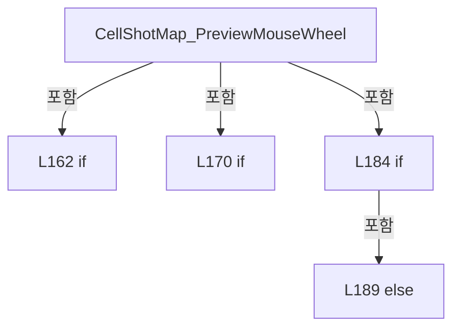

변경 전 점검: 입력/반환 타입, 위 호출자, 예외/취소 경로, 공유 상태와 저장·전송 소비자를 함께 확인합니다. 값의 단위나 물리 방향을 이름만으로 확정하지 않습니다.

### MethodDeclaration `CellShotMap_PreviewMouseRightButtonDown` · L199–210

[Drilling.UI/Views/CRecipeView.xaml.cs:199–210](https://github.com/kjuws10-rgb/A3Drilling/blob/5aee8e58439c9b455cae7c9593c9be986c3e682e/Drilling.UI/Views/CRecipeView.xaml.cs#L199-L210)

| 항목 | 실제 추출 값 |
| --- | --- |
| 서명 | void Drilling.UI.Views.CRecipeView.CellShotMap_PreviewMouseRightButtonDown(object, MouseButtonEventArgs) |
| 접근/수식자 | Private / private |
| 반환/값 타입 | void |
| 소속 타입 | NamedType:Drilling.UI.Views.CRecipeView |

입력 계약:

| 이름 | 타입 | 전달 | 선택/기본값 |
| --- | --- | --- | --- |
| sender | object | None | False /  |
| e | MouseButtonEventArgs | None | False /  |

현재 부분 분석에서 직접 연결된 호출자는 없습니다. XAML/이벤트/인터페이스·델리게이트·외부 진입을 추가 확인해야 하며, 미사용으로 판정한 것이 아닙니다.

호출하는 대상과 해석 범위:

| 원본 행 | 표현식 | 분석 상태 | 대상/소스 위치 |
| --- | --- | --- | --- |
| 201 | HideCellShotMapHoverTip | resolved | void Drilling.UI.Views.CRecipeView.HideCellShotMapHoverTip() · Drilling.UI/Views/CRecipeView.xaml.cs:519 |

본문의 실제 연산·분기·예외·반환 순서(원문 위치 순):

| 원본 행 | 종류 | 주석 해설 |
| --- | --- | --- |
| 201 | call | 함수·델리게이트 또는 객체 생성자를 호출합니다: HideCellShotMapHoverTip() |
| 202 | if | 조건에 따라 분기합니다: if (CellShotMapViewport.ContextMenu is not { } contextMenu) |
| 204 | return | 호출자에게 값 또는 제어를 반환합니다: return; |
| 207 | assignment | 값을 대상에 대입합니다: contextMenu.PlacementTarget = CellShotMapViewport |
| 208 | assignment | 값을 대상에 대입합니다: contextMenu.IsOpen = true |
| 209 | assignment | 값을 대상에 대입합니다: e.Handled = true |

제어 구문의 포함 구조(실제 실행 순서/CFG가 아닌 구문 탐색 그림):

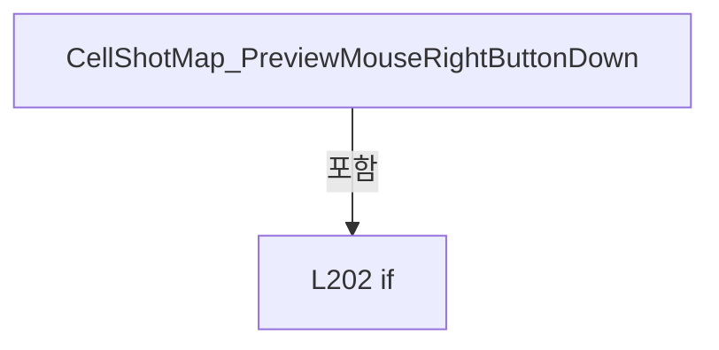

변경 전 점검: 입력/반환 타입, 위 호출자, 예외/취소 경로, 공유 상태와 저장·전송 소비자를 함께 확인합니다. 값의 단위나 물리 방향을 이름만으로 확정하지 않습니다.

### MethodDeclaration `CellShotMapResize_Click` · L212–216

[Drilling.UI/Views/CRecipeView.xaml.cs:212–216](https://github.com/kjuws10-rgb/A3Drilling/blob/5aee8e58439c9b455cae7c9593c9be986c3e682e/Drilling.UI/Views/CRecipeView.xaml.cs#L212-L216)

| 항목 | 실제 추출 값 |
| --- | --- |
| 서명 | void Drilling.UI.Views.CRecipeView.CellShotMapResize_Click(object, RoutedEventArgs) |
| 접근/수식자 | Private / private |
| 반환/값 타입 | void |
| 소속 타입 | NamedType:Drilling.UI.Views.CRecipeView |

입력 계약:

| 이름 | 타입 | 전달 | 선택/기본값 |
| --- | --- | --- | --- |
| sender | object | None | False /  |
| e | RoutedEventArgs | None | False /  |

현재 부분 분석에서 직접 연결된 호출자는 없습니다. XAML/이벤트/인터페이스·델리게이트·외부 진입을 추가 확인해야 하며, 미사용으로 판정한 것이 아닙니다.

호출하는 대상과 해석 범위:

| 원본 행 | 표현식 | 분석 상태 | 대상/소스 위치 |
| --- | --- | --- | --- |
| 214 | ResetCellShotMapZoom | resolved | void Drilling.UI.Views.CRecipeView.ResetCellShotMapZoom() · Drilling.UI/Views/CRecipeView.xaml.cs:266 |

본문의 실제 연산·분기·예외·반환 순서(원문 위치 순):

| 원본 행 | 종류 | 주석 해설 |
| --- | --- | --- |
| 214 | call | 함수·델리게이트 또는 객체 생성자를 호출합니다: ResetCellShotMapZoom() |
| 215 | assignment | 값을 대상에 대입합니다: e.Handled = true |

변경 전 점검: 입력/반환 타입, 위 호출자, 예외/취소 경로, 공유 상태와 저장·전송 소비자를 함께 확인합니다. 값의 단위나 물리 방향을 이름만으로 확정하지 않습니다.

### MethodDeclaration `EndRecipePreviewDrag` · L218–227

[Drilling.UI/Views/CRecipeView.xaml.cs:218–227](https://github.com/kjuws10-rgb/A3Drilling/blob/5aee8e58439c9b455cae7c9593c9be986c3e682e/Drilling.UI/Views/CRecipeView.xaml.cs#L218-L227)

| 항목 | 실제 추출 값 |
| --- | --- |
| 서명 | void Drilling.UI.Views.CRecipeView.EndRecipePreviewDrag(FrameworkElement) |
| 접근/수식자 | Private / private |
| 반환/값 타입 | void |
| 소속 타입 | NamedType:Drilling.UI.Views.CRecipeView |

입력 계약:

| 이름 | 타입 | 전달 | 선택/기본값 |
| --- | --- | --- | --- |
| preview | FrameworkElement | None | False /  |

정적 호출자로 확인된 위치:

| 호출 파일/행 | 호출 표현식 | 런타임 분기 가능 |
| --- | --- | --- |
| [Drilling.UI/Views/CRecipeView.xaml.cs:128–128](https://github.com/kjuws10-rgb/A3Drilling/blob/5aee8e58439c9b455cae7c9593c9be986c3e682e/Drilling.UI/Views/CRecipeView.xaml.cs#L128-L128) | EndRecipePreviewDrag | False |
| [Drilling.UI/Views/CRecipeView.xaml.cs:150–150](https://github.com/kjuws10-rgb/A3Drilling/blob/5aee8e58439c9b455cae7c9593c9be986c3e682e/Drilling.UI/Views/CRecipeView.xaml.cs#L150-L150) | EndRecipePreviewDrag | False |

호출하는 대상과 해석 범위:

| 원본 행 | 표현식 | 분석 상태 | 대상/소스 위치 |
| --- | --- | --- | --- |
| 223 | preview.ReleaseMouseCapture | unresolved | None |

본문의 실제 연산·분기·예외·반환 순서(원문 위치 순):

| 원본 행 | 종류 | 주석 해설 |
| --- | --- | --- |
| 220 | assignment | 값을 대상에 대입합니다: _isRecipePreviewDragging = false |
| 221 | if | 조건에 따라 분기합니다: if (Mouse.Captured == preview) |
| 223 | call | 함수·델리게이트 또는 객체 생성자를 호출합니다: preview.ReleaseMouseCapture() |
| 226 | assignment | 값을 대상에 대입합니다: preview.Cursor = Cursors.Hand |

제어 구문의 포함 구조(실제 실행 순서/CFG가 아닌 구문 탐색 그림):


변경 전 점검: 입력/반환 타입, 위 호출자, 예외/취소 경로, 공유 상태와 저장·전송 소비자를 함께 확인합니다. 값의 단위나 물리 방향을 이름만으로 확정하지 않습니다.

### MethodDeclaration `ClampRecipePreviewTranslation` · L229–240

[Drilling.UI/Views/CRecipeView.xaml.cs:229–240](https://github.com/kjuws10-rgb/A3Drilling/blob/5aee8e58439c9b455cae7c9593c9be986c3e682e/Drilling.UI/Views/CRecipeView.xaml.cs#L229-L240)

| 항목 | 실제 추출 값 |
| --- | --- |
| 서명 | void Drilling.UI.Views.CRecipeView.ClampRecipePreviewTranslation(FrameworkElement) |
| 접근/수식자 | Private / private |
| 반환/값 타입 | void |
| 소속 타입 | NamedType:Drilling.UI.Views.CRecipeView |

입력 계약:

| 이름 | 타입 | 전달 | 선택/기본값 |
| --- | --- | --- | --- |
| preview | FrameworkElement | None | False /  |

정적 호출자로 확인된 위치:

| 호출 파일/행 | 호출 표현식 | 런타임 분기 가능 |
| --- | --- | --- |
| [Drilling.UI/Views/CRecipeView.xaml.cs:75–75](https://github.com/kjuws10-rgb/A3Drilling/blob/5aee8e58439c9b455cae7c9593c9be986c3e682e/Drilling.UI/Views/CRecipeView.xaml.cs#L75-L75) | ClampRecipePreviewTranslation | False |
| [Drilling.UI/Views/CRecipeView.xaml.cs:117–117](https://github.com/kjuws10-rgb/A3Drilling/blob/5aee8e58439c9b455cae7c9593c9be986c3e682e/Drilling.UI/Views/CRecipeView.xaml.cs#L117-L117) | ClampRecipePreviewTranslation | False |

호출하는 대상과 해석 범위:

| 원본 행 | 표현식 | 분석 상태 | 대상/소스 위치 |
| --- | --- | --- | --- |
| 232 | Math.Max | candidate | OverloadResolutionFailure |
| 238 | Math.Clamp | candidate | OverloadResolutionFailure |
| 239 | Math.Clamp | candidate | OverloadResolutionFailure |

본문의 실제 연산·분기·예외·반환 순서(원문 위치 순):

| 원본 행 | 종류 | 주석 해설 |
| --- | --- | --- |
| 231 | local-declaration | 지역 변수를 선언합니다: var scale = RecipePreviewScaleTransform.ScaleX; |
| 231 | variable-initializer | 변수의 초기값을 지정합니다: scale = RecipePreviewScaleTransform.ScaleX |
| 232 | call | 함수·델리게이트 또는 객체 생성자를 호출합니다: Math.Max(0.0, scale - PreviewZoomMinimum) |
| 232 | local-declaration | 지역 변수를 선언합니다: var overflowRatio = Math.Max(0.0, scale - PreviewZoomMinimum); |
| 232 | variable-initializer | 변수의 초기값을 지정합니다: overflowRatio = Math.Max(0.0, scale - PreviewZoomMinimum) |
| 233 | local-declaration | 지역 변수를 선언합니다: var origin = RecipePreviewZoomContent.RenderTransformOrigin; |
| 233 | variable-initializer | 변수의 초기값을 지정합니다: origin = RecipePreviewZoomContent.RenderTransformOrigin |
| 234 | local-declaration | 지역 변수를 선언합니다: var minX = -preview.ActualWidth * (1.0 - origin.X) * overflowRatio; |
| 234 | variable-initializer | 변수의 초기값을 지정합니다: minX = -preview.ActualWidth * (1.0 - origin.X) * overflowRatio |
| 235 | local-declaration | 지역 변수를 선언합니다: var maxX = preview.ActualWidth * origin.X * overflowRatio; |
| 235 | variable-initializer | 변수의 초기값을 지정합니다: maxX = preview.ActualWidth * origin.X * overflowRatio |
| 236 | local-declaration | 지역 변수를 선언합니다: var minY = -preview.ActualHeight * (1.0 - origin.Y) * overflowRatio; |
| 236 | variable-initializer | 변수의 초기값을 지정합니다: minY = -preview.ActualHeight * (1.0 - origin.Y) * overflowRatio |
| 237 | local-declaration | 지역 변수를 선언합니다: var maxY = preview.ActualHeight * origin.Y * overflowRatio; |
| 237 | variable-initializer | 변수의 초기값을 지정합니다: maxY = preview.ActualHeight * origin.Y * overflowRatio |
| 238 | assignment | 값을 대상에 대입합니다: RecipePreviewTranslateTransform.X = Math.Clamp(RecipePreviewTranslateTransform.X, minX, maxX) |
| 238 | call | 함수·델리게이트 또는 객체 생성자를 호출합니다: Math.Clamp(RecipePreviewTranslateTransform.X, minX, maxX) |
| 239 | assignment | 값을 대상에 대입합니다: RecipePreviewTranslateTransform.Y = Math.Clamp(RecipePreviewTranslateTransform.Y, minY, maxY) |
| 239 | call | 함수·델리게이트 또는 객체 생성자를 호출합니다: Math.Clamp(RecipePreviewTranslateTransform.Y, minY, maxY) |

변경 전 점검: 입력/반환 타입, 위 호출자, 예외/취소 경로, 공유 상태와 저장·전송 소비자를 함께 확인합니다. 값의 단위나 물리 방향을 이름만으로 확정하지 않습니다.

### MethodDeclaration `ClampCellShotMapTranslation` · L242–253

[Drilling.UI/Views/CRecipeView.xaml.cs:242–253](https://github.com/kjuws10-rgb/A3Drilling/blob/5aee8e58439c9b455cae7c9593c9be986c3e682e/Drilling.UI/Views/CRecipeView.xaml.cs#L242-L253)

| 항목 | 실제 추출 값 |
| --- | --- |
| 서명 | void Drilling.UI.Views.CRecipeView.ClampCellShotMapTranslation(FrameworkElement) |
| 접근/수식자 | Private / private |
| 반환/값 타입 | void |
| 소속 타입 | NamedType:Drilling.UI.Views.CRecipeView |

입력 계약:

| 이름 | 타입 | 전달 | 선택/기본값 |
| --- | --- | --- | --- |
| preview | FrameworkElement | None | False /  |

정적 호출자로 확인된 위치:

| 호출 파일/행 | 호출 표현식 | 런타임 분기 가능 |
| --- | --- | --- |
| [Drilling.UI/Views/CRecipeView.xaml.cs:193–193](https://github.com/kjuws10-rgb/A3Drilling/blob/5aee8e58439c9b455cae7c9593c9be986c3e682e/Drilling.UI/Views/CRecipeView.xaml.cs#L193-L193) | ClampCellShotMapTranslation | False |

호출하는 대상과 해석 범위:

| 원본 행 | 표현식 | 분석 상태 | 대상/소스 위치 |
| --- | --- | --- | --- |
| 245 | Math.Max | candidate | OverloadResolutionFailure |
| 251 | Math.Clamp | candidate | OverloadResolutionFailure |
| 252 | Math.Clamp | candidate | OverloadResolutionFailure |

본문의 실제 연산·분기·예외·반환 순서(원문 위치 순):

| 원본 행 | 종류 | 주석 해설 |
| --- | --- | --- |
| 244 | local-declaration | 지역 변수를 선언합니다: var scale = CellShotMapScaleTransform.ScaleX; |
| 244 | variable-initializer | 변수의 초기값을 지정합니다: scale = CellShotMapScaleTransform.ScaleX |
| 245 | call | 함수·델리게이트 또는 객체 생성자를 호출합니다: Math.Max(0.0, scale - PreviewZoomMinimum) |
| 245 | local-declaration | 지역 변수를 선언합니다: var overflowRatio = Math.Max(0.0, scale - PreviewZoomMinimum); |
| 245 | variable-initializer | 변수의 초기값을 지정합니다: overflowRatio = Math.Max(0.0, scale - PreviewZoomMinimum) |
| 246 | local-declaration | 지역 변수를 선언합니다: var origin = CellShotMapZoomContent.RenderTransformOrigin; |
| 246 | variable-initializer | 변수의 초기값을 지정합니다: origin = CellShotMapZoomContent.RenderTransformOrigin |
| 247 | local-declaration | 지역 변수를 선언합니다: var minX = -preview.ActualWidth * (1.0 - origin.X) * overflowRatio; |
| 247 | variable-initializer | 변수의 초기값을 지정합니다: minX = -preview.ActualWidth * (1.0 - origin.X) * overflowRatio |
| 248 | local-declaration | 지역 변수를 선언합니다: var maxX = preview.ActualWidth * origin.X * overflowRatio; |
| 248 | variable-initializer | 변수의 초기값을 지정합니다: maxX = preview.ActualWidth * origin.X * overflowRatio |
| 249 | local-declaration | 지역 변수를 선언합니다: var minY = -preview.ActualHeight * (1.0 - origin.Y) * overflowRatio; |
| 249 | variable-initializer | 변수의 초기값을 지정합니다: minY = -preview.ActualHeight * (1.0 - origin.Y) * overflowRatio |
| 250 | local-declaration | 지역 변수를 선언합니다: var maxY = preview.ActualHeight * origin.Y * overflowRatio; |
| 250 | variable-initializer | 변수의 초기값을 지정합니다: maxY = preview.ActualHeight * origin.Y * overflowRatio |
| 251 | assignment | 값을 대상에 대입합니다: CellShotMapTranslateTransform.X = Math.Clamp(CellShotMapTranslateTransform.X, minX, maxX) |
| 251 | call | 함수·델리게이트 또는 객체 생성자를 호출합니다: Math.Clamp(CellShotMapTranslateTransform.X, minX, maxX) |
| 252 | assignment | 값을 대상에 대입합니다: CellShotMapTranslateTransform.Y = Math.Clamp(CellShotMapTranslateTransform.Y, minY, maxY) |
| 252 | call | 함수·델리게이트 또는 객체 생성자를 호출합니다: Math.Clamp(CellShotMapTranslateTransform.Y, minY, maxY) |

변경 전 점검: 입력/반환 타입, 위 호출자, 예외/취소 경로, 공유 상태와 저장·전송 소비자를 함께 확인합니다. 값의 단위나 물리 방향을 이름만으로 확정하지 않습니다.

### MethodDeclaration `ResetRecipePreviewZoom` · L255–264

[Drilling.UI/Views/CRecipeView.xaml.cs:255–264](https://github.com/kjuws10-rgb/A3Drilling/blob/5aee8e58439c9b455cae7c9593c9be986c3e682e/Drilling.UI/Views/CRecipeView.xaml.cs#L255-L264)

| 항목 | 실제 추출 값 |
| --- | --- |
| 서명 | void Drilling.UI.Views.CRecipeView.ResetRecipePreviewZoom() |
| 접근/수식자 | Private / private |
| 반환/값 타입 | void |
| 소속 타입 | NamedType:Drilling.UI.Views.CRecipeView |

정적 호출자로 확인된 위치:

| 호출 파일/행 | 호출 표현식 | 런타임 분기 가능 |
| --- | --- | --- |
| [Drilling.UI/Views/CRecipeView.xaml.cs:156–156](https://github.com/kjuws10-rgb/A3Drilling/blob/5aee8e58439c9b455cae7c9593c9be986c3e682e/Drilling.UI/Views/CRecipeView.xaml.cs#L156-L156) | ResetRecipePreviewZoom | False |
| [Drilling.UI/Views/CRecipeView.xaml.cs:529–529](https://github.com/kjuws10-rgb/A3Drilling/blob/5aee8e58439c9b455cae7c9593c9be986c3e682e/Drilling.UI/Views/CRecipeView.xaml.cs#L529-L529) | ResetRecipePreviewZoom | False |

호출하는 대상과 해석 범위:

| 원본 행 | 표현식 | 분석 상태 | 대상/소스 위치 |
| --- | --- | --- | --- |
| 257 | HideRecipePreviewHoverTip | resolved | void Drilling.UI.Views.CRecipeView.HideRecipePreviewHoverTip() · Drilling.UI/Views/CRecipeView.xaml.cs:464 |
| 258 | EndRecipePreviewDrag | candidate | OverloadResolutionFailure |
| 263 | new Point | unresolved | None |

본문의 실제 연산·분기·예외·반환 순서(원문 위치 순):

| 원본 행 | 종류 | 주석 해설 |
| --- | --- | --- |
| 257 | call | 함수·델리게이트 또는 객체 생성자를 호출합니다: HideRecipePreviewHoverTip() |
| 258 | call | 함수·델리게이트 또는 객체 생성자를 호출합니다: EndRecipePreviewDrag(RecipePreviewViewport) |
| 259 | assignment | 값을 대상에 대입합니다: RecipePreviewScaleTransform.ScaleX = PreviewZoomMinimum |
| 260 | assignment | 값을 대상에 대입합니다: RecipePreviewScaleTransform.ScaleY = PreviewZoomMinimum |
| 261 | assignment | 값을 대상에 대입합니다: RecipePreviewTranslateTransform.X = 0 |
| 262 | assignment | 값을 대상에 대입합니다: RecipePreviewTranslateTransform.Y = 0 |
| 263 | assignment | 값을 대상에 대입합니다: RecipePreviewZoomContent.RenderTransformOrigin = new Point(0.5, 0.5) |
| 263 | call | 함수·델리게이트 또는 객체 생성자를 호출합니다: new Point(0.5, 0.5) |

변경 전 점검: 입력/반환 타입, 위 호출자, 예외/취소 경로, 공유 상태와 저장·전송 소비자를 함께 확인합니다. 값의 단위나 물리 방향을 이름만으로 확정하지 않습니다.

### MethodDeclaration `ResetCellShotMapZoom` · L266–274

[Drilling.UI/Views/CRecipeView.xaml.cs:266–274](https://github.com/kjuws10-rgb/A3Drilling/blob/5aee8e58439c9b455cae7c9593c9be986c3e682e/Drilling.UI/Views/CRecipeView.xaml.cs#L266-L274)

| 항목 | 실제 추출 값 |
| --- | --- |
| 서명 | void Drilling.UI.Views.CRecipeView.ResetCellShotMapZoom() |
| 접근/수식자 | Private / private |
| 반환/값 타입 | void |
| 소속 타입 | NamedType:Drilling.UI.Views.CRecipeView |

정적 호출자로 확인된 위치:

| 호출 파일/행 | 호출 표현식 | 런타임 분기 가능 |
| --- | --- | --- |
| [Drilling.UI/Views/CRecipeView.xaml.cs:214–214](https://github.com/kjuws10-rgb/A3Drilling/blob/5aee8e58439c9b455cae7c9593c9be986c3e682e/Drilling.UI/Views/CRecipeView.xaml.cs#L214-L214) | ResetCellShotMapZoom | False |
| [Drilling.UI/Views/CRecipeView.xaml.cs:530–530](https://github.com/kjuws10-rgb/A3Drilling/blob/5aee8e58439c9b455cae7c9593c9be986c3e682e/Drilling.UI/Views/CRecipeView.xaml.cs#L530-L530) | ResetCellShotMapZoom | False |

호출하는 대상과 해석 범위:

| 원본 행 | 표현식 | 분석 상태 | 대상/소스 위치 |
| --- | --- | --- | --- |
| 268 | HideCellShotMapHoverTip | resolved | void Drilling.UI.Views.CRecipeView.HideCellShotMapHoverTip() · Drilling.UI/Views/CRecipeView.xaml.cs:519 |
| 273 | new Point | unresolved | None |

본문의 실제 연산·분기·예외·반환 순서(원문 위치 순):

| 원본 행 | 종류 | 주석 해설 |
| --- | --- | --- |
| 268 | call | 함수·델리게이트 또는 객체 생성자를 호출합니다: HideCellShotMapHoverTip() |
| 269 | assignment | 값을 대상에 대입합니다: CellShotMapScaleTransform.ScaleX = PreviewZoomMinimum |
| 270 | assignment | 값을 대상에 대입합니다: CellShotMapScaleTransform.ScaleY = PreviewZoomMinimum |
| 271 | assignment | 값을 대상에 대입합니다: CellShotMapTranslateTransform.X = 0 |
| 272 | assignment | 값을 대상에 대입합니다: CellShotMapTranslateTransform.Y = 0 |
| 273 | assignment | 값을 대상에 대입합니다: CellShotMapZoomContent.RenderTransformOrigin = new Point(0.5, 0.5) |
| 273 | call | 함수·델리게이트 또는 객체 생성자를 호출합니다: new Point(0.5, 0.5) |

변경 전 점검: 입력/반환 타입, 위 호출자, 예외/취소 경로, 공유 상태와 저장·전송 소비자를 함께 확인합니다. 값의 단위나 물리 방향을 이름만으로 확정하지 않습니다.

### MethodDeclaration `CellContentScrollViewer_PreviewMouseWheel` · L276–288

[Drilling.UI/Views/CRecipeView.xaml.cs:276–288](https://github.com/kjuws10-rgb/A3Drilling/blob/5aee8e58439c9b455cae7c9593c9be986c3e682e/Drilling.UI/Views/CRecipeView.xaml.cs#L276-L288)

| 항목 | 실제 추출 값 |
| --- | --- |
| 서명 | void Drilling.UI.Views.CRecipeView.CellContentScrollViewer_PreviewMouseWheel(object, MouseWheelEventArgs) |
| 접근/수식자 | Private / private |
| 반환/값 타입 | void |
| 소속 타입 | NamedType:Drilling.UI.Views.CRecipeView |

입력 계약:

| 이름 | 타입 | 전달 | 선택/기본값 |
| --- | --- | --- | --- |
| sender | object | None | False /  |
| e | MouseWheelEventArgs | None | False /  |

현재 부분 분석에서 직접 연결된 호출자는 없습니다. XAML/이벤트/인터페이스·델리게이트·외부 진입을 추가 확인해야 하며, 미사용으로 판정한 것이 아닙니다.

호출하는 대상과 해석 범위:

| 원본 행 | 표현식 | 분석 상태 | 대상/소스 위치 |
| --- | --- | --- | --- |
| 286 | scrollViewer.ScrollToVerticalOffset | unresolved | None |

본문의 실제 연산·분기·예외·반환 순서(원문 위치 순):

| 원본 행 | 종류 | 주석 해설 |
| --- | --- | --- |
| 278 | if | 조건에 따라 분기합니다: if (sender is not ScrollViewer scrollViewer) |
| 279 | return | 호출자에게 값 또는 제어를 반환합니다: return; |
| 281 | local-declaration | 지역 변수를 선언합니다: var canScrollUp = e.Delta > 0 && scrollViewer.VerticalOffset > 0; |
| 281 | variable-initializer | 변수의 초기값을 지정합니다: canScrollUp = e.Delta > 0 && scrollViewer.VerticalOffset > 0 |
| 282 | local-declaration | 지역 변수를 선언합니다: var canScrollDown = e.Delta < 0 && scrollViewer.VerticalOffset < scrollViewer.ScrollableHeight; |
| 282 | variable-initializer | 변수의 초기값을 지정합니다: canScrollDown = e.Delta < 0 && scrollViewer.VerticalOffset < scrollViewer.ScrollableHeight |
| 283 | if | 조건에 따라 분기합니다: if (!canScrollUp && !canScrollDown) |
| 284 | return | 호출자에게 값 또는 제어를 반환합니다: return; |
| 286 | call | 함수·델리게이트 또는 객체 생성자를 호출합니다: scrollViewer.ScrollToVerticalOffset(scrollViewer.VerticalOffset - (e.Delta / 3.0)) |
| 287 | assignment | 값을 대상에 대입합니다: e.Handled = true |

제어 구문의 포함 구조(실제 실행 순서/CFG가 아닌 구문 탐색 그림):

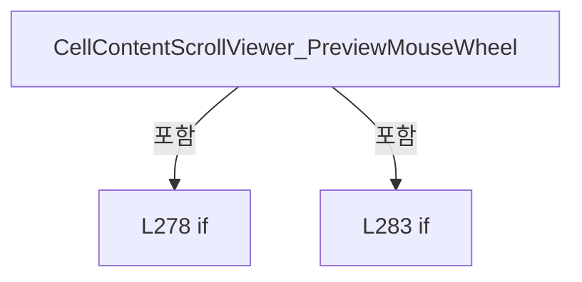

변경 전 점검: 입력/반환 타입, 위 호출자, 예외/취소 경로, 공유 상태와 저장·전송 소비자를 함께 확인합니다. 값의 단위나 물리 방향을 이름만으로 확정하지 않습니다.

### MethodDeclaration `ToggleCellPlacement_Click` · L290–303

[Drilling.UI/Views/CRecipeView.xaml.cs:290–303](https://github.com/kjuws10-rgb/A3Drilling/blob/5aee8e58439c9b455cae7c9593c9be986c3e682e/Drilling.UI/Views/CRecipeView.xaml.cs#L290-L303)

| 항목 | 실제 추출 값 |
| --- | --- |
| 서명 | void Drilling.UI.Views.CRecipeView.ToggleCellPlacement_Click(object, RoutedEventArgs) |
| 접근/수식자 | Private / private |
| 반환/값 타입 | void |
| 소속 타입 | NamedType:Drilling.UI.Views.CRecipeView |

입력 계약:

| 이름 | 타입 | 전달 | 선택/기본값 |
| --- | --- | --- | --- |
| sender | object | None | False /  |
| e | RoutedEventArgs | None | False /  |

현재 부분 분석에서 직접 연결된 호출자는 없습니다. XAML/이벤트/인터페이스·델리게이트·외부 진입을 추가 확인해야 하며, 미사용으로 판정한 것이 아닙니다.

호출하는 대상과 해석 범위:

| 원본 행 | 표현식 | 분석 상태 | 대상/소스 위치 |
| --- | --- | --- | --- |
| 294 | recipe.ToggleCellPlacementExpanded | resolved | void Drilling.UI.Menu.Menus.CMenuRecipe.ToggleCellPlacementExpanded() · Drilling.UI/Menu/Menus/CMenuRecipe.cs:936 |

본문의 실제 연산·분기·예외·반환 순서(원문 위치 순):

| 원본 행 | 종류 | 주석 해설 |
| --- | --- | --- |
| 292 | if | 조건에 따라 분기합니다: if (DataContext is CRootView root && root.CurrentScreen.Recipe is CMenuRecipe recipe) |
| 294 | call | 함수·델리게이트 또는 객체 생성자를 호출합니다: recipe.ToggleCellPlacementExpanded() |
| 295 | assignment | 값을 대상에 대입합니다: CellParameterPanel.Visibility = recipe.IsCellPlacementExpanded ? Visibility.Collapsed : Visibility.Visible |
| 295 | conditional-expression | 조건에 따라 결과식을 선택합니다: recipe.IsCellPlacementExpanded ? Visibility.Collapsed : Visibility.Visible |
| 296 | if | 조건에 따라 분기합니다: if (sender is Button button) |
| 298 | assignment | 값을 대상에 대입합니다: button.Content = recipe.CellPlacementExpandButtonText |
| 302 | assignment | 값을 대상에 대입합니다: e.Handled = true |

제어 구문의 포함 구조(실제 실행 순서/CFG가 아닌 구문 탐색 그림):

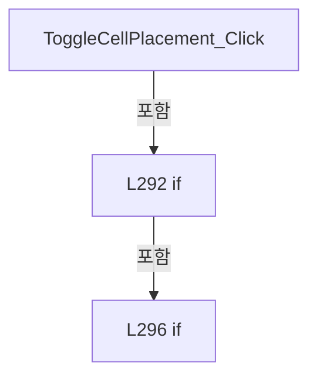

변경 전 점검: 입력/반환 타입, 위 호출자, 예외/취소 경로, 공유 상태와 저장·전송 소비자를 함께 확인합니다. 값의 단위나 물리 방향을 이름만으로 확정하지 않습니다.

### MethodDeclaration `OpenCellPlacementWizard_Click` · L305–326

[Drilling.UI/Views/CRecipeView.xaml.cs:305–326](https://github.com/kjuws10-rgb/A3Drilling/blob/5aee8e58439c9b455cae7c9593c9be986c3e682e/Drilling.UI/Views/CRecipeView.xaml.cs#L305-L326)

| 항목 | 실제 추출 값 |
| --- | --- |
| 서명 | void Drilling.UI.Views.CRecipeView.OpenCellPlacementWizard_Click(object, RoutedEventArgs) |
| 접근/수식자 | Private / private |
| 반환/값 타입 | void |
| 소속 타입 | NamedType:Drilling.UI.Views.CRecipeView |

입력 계약:

| 이름 | 타입 | 전달 | 선택/기본값 |
| --- | --- | --- | --- |
| sender | object | None | False /  |
| e | RoutedEventArgs | None | False /  |

현재 부분 분석에서 직접 연결된 호출자는 없습니다. XAML/이벤트/인터페이스·델리게이트·외부 진입을 추가 확인해야 하며, 미사용으로 판정한 것이 아닙니다.

호출하는 대상과 해석 범위:

| 원본 행 | 표현식 | 분석 상태 | 대상/소스 위치 |
| --- | --- | --- | --- |
| 313 | CanEditCurrentRecipe | resolved | bool Drilling.UI.Views.CRecipeView.CanEditCurrentRecipe() · Drilling.UI/Views/CRecipeView.xaml.cs:406 |
| 318 | new CCellPlacementWizardDialog | resolved | Drilling.UI.Popup.CCellPlacementWizardDialog.CCellPlacementWizardDialog(Drilling.UI.Popup.ST_CELL_PLACEMENT_WIZARD_CONTEXT) · Drilling.UI/Popup/CCellPlacementWizardDialog.xaml.cs:27 |
| 318 | recipe.CreateCellPlacementWizardContext | resolved | Drilling.UI.Popup.ST_CELL_PLACEMENT_WIZARD_CONTEXT Drilling.UI.Menu.Menus.CMenuRecipe.CreateCellPlacementWizardContext() · Drilling.UI/Menu/Menus/CMenuRecipe.cs:943 |
| 320 | Window.GetWindow | unresolved | None |
| 322 | dialog.ShowDialog | unresolved | None |
| 324 | recipe.ApplyCellPlacementWizard | resolved | void Drilling.UI.Menu.Menus.CMenuRecipe.ApplyCellPlacementWizard(Drilling.UI.Popup.ST_CELL_PLACEMENT_WIZARD_RESULT) · Drilling.UI/Menu/Menus/CMenuRecipe.cs:957 |

본문의 실제 연산·분기·예외·반환 순서(원문 위치 순):

| 원본 행 | 종류 | 주석 해설 |
| --- | --- | --- |
| 307 | assignment | 값을 대상에 대입합니다: e.Handled = true |
| 308 | if | 조건에 따라 분기합니다: if (DataContext is not CRootView root &#124;&#124; root.CurrentScreen.Recipe is not CMenuRecipe recipe) |
| 310 | return | 호출자에게 값 또는 제어를 반환합니다: return; |
| 313 | call | 함수·델리게이트 또는 객체 생성자를 호출합니다: CanEditCurrentRecipe() |
| 313 | if | 조건에 따라 분기합니다: if (!CanEditCurrentRecipe()) |
| 315 | return | 호출자에게 값 또는 제어를 반환합니다: return; |
| 318 | call | 함수·델리게이트 또는 객체 생성자를 호출합니다: recipe.CreateCellPlacementWizardContext() |
| 318 | call | 함수·델리게이트 또는 객체 생성자를 호출합니다: new CCellPlacementWizardDialog(recipe.CreateCellPlacementWizardContext()) { Owner = Window.GetWindow(this) } |
| 318 | local-declaration | 지역 변수를 선언합니다: var dialog = new CCellPlacementWizardDialog(recipe.CreateCellPlacementWizardContext()) { Owner = Window.GetWindow(this) }; |
| 318 | variable-initializer | 변수의 초기값을 지정합니다: dialog = new CCellPlacementWizardDialog(recipe.CreateCellPlacementWizardContext()) { Owner = Window.GetWindow(this) } |
| 320 | assignment | 값을 대상에 대입합니다: Owner = Window.GetWindow(this) |
| 320 | call | 함수·델리게이트 또는 객체 생성자를 호출합니다: Window.GetWindow(this) |
| 322 | call | 함수·델리게이트 또는 객체 생성자를 호출합니다: dialog.ShowDialog() |
| 322 | if | 조건에 따라 분기합니다: if (dialog.ShowDialog() == true) |
| 324 | call | 함수·델리게이트 또는 객체 생성자를 호출합니다: recipe.ApplyCellPlacementWizard(dialog.Result) |

제어 구문의 포함 구조(실제 실행 순서/CFG가 아닌 구문 탐색 그림):

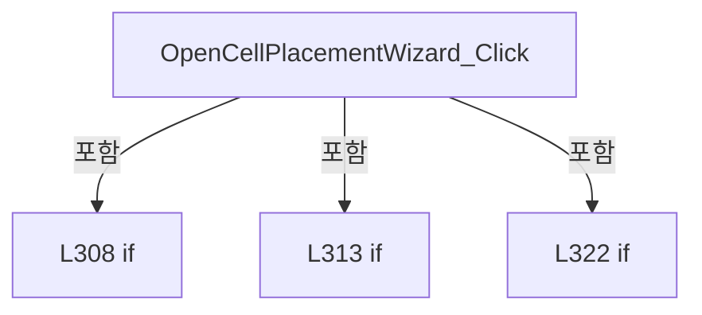

변경 전 점검: 입력/반환 타입, 위 호출자, 예외/취소 경로, 공유 상태와 저장·전송 소비자를 함께 확인합니다. 값의 단위나 물리 방향을 이름만으로 확정하지 않습니다.

### MethodDeclaration `OpenManagedItemInput` · L328–341

[Drilling.UI/Views/CRecipeView.xaml.cs:328–341](https://github.com/kjuws10-rgb/A3Drilling/blob/5aee8e58439c9b455cae7c9593c9be986c3e682e/Drilling.UI/Views/CRecipeView.xaml.cs#L328-L341)

| 항목 | 실제 추출 값 |
| --- | --- |
| 서명 | void Drilling.UI.Views.CRecipeView.OpenManagedItemInput(object, RoutedEventArgs) |
| 접근/수식자 | Private / private |
| 반환/값 타입 | void |
| 소속 타입 | NamedType:Drilling.UI.Views.CRecipeView |

입력 계약:

| 이름 | 타입 | 전달 | 선택/기본값 |
| --- | --- | --- | --- |
| sender | object | None | False /  |
| e | RoutedEventArgs | None | False /  |

현재 부분 분석에서 직접 연결된 호출자는 없습니다. XAML/이벤트/인터페이스·델리게이트·외부 진입을 추가 확인해야 하며, 미사용으로 판정한 것이 아닙니다.

호출하는 대상과 해석 범위:

| 원본 행 | 표현식 | 분석 상태 | 대상/소스 위치 |
| --- | --- | --- | --- |
| 333 | CanEditCurrentRecipe | resolved | bool Drilling.UI.Views.CRecipeView.CanEditCurrentRecipe() · Drilling.UI/Views/CRecipeView.xaml.cs:406 |
| 335 | new CValueInputDialog | resolved | Drilling.UI.Popup.CValueInputDialog.CValueInputDialog(string, string, Drilling.Common.Managers.EN_RECIPE_DATA_TYPE, double, double) · Drilling.UI/Popup/CValueInputDialog.xaml.cs:13 |
| 337 | Window.GetWindow | unresolved | None |
| 339 | dialog.ShowDialog | unresolved | None |

본문의 실제 연산·분기·예외·반환 순서(원문 위치 순):

| 원본 행 | 종류 | 주석 해설 |
| --- | --- | --- |
| 330 | if | 조건에 따라 분기합니다: if (sender is not FrameworkElement { Tag: ST_RECIPE_PARAMETER_EDITOR_ITEM item }) |
| 331 | return | 호출자에게 값 또는 제어를 반환합니다: return; |
| 332 | assignment | 값을 대상에 대입합니다: e.Handled = true |
| 333 | call | 함수·델리게이트 또는 객체 생성자를 호출합니다: CanEditCurrentRecipe() |
| 333 | if | 조건에 따라 분기합니다: if (!CanEditCurrentRecipe()) |
| 334 | return | 호출자에게 값 또는 제어를 반환합니다: return; |
| 335 | call | 함수·델리게이트 또는 객체 생성자를 호출합니다: new CValueInputDialog(item.Item, item.Value, item.DataType, item.Min, item.Max) { Owner = Window.GetWindow(this) } |
| 335 | local-declaration | 지역 변수를 선언합니다: var dialog = new CValueInputDialog(item.Item, item.Value, item.DataType, item.Min, item.Max) { Owner = Window.GetWindow(this) }; |
| 335 | variable-initializer | 변수의 초기값을 지정합니다: dialog = new CValueInputDialog(item.Item, item.Value, item.DataType, item.Min, item.Max) { Owner = Window.GetWindow(this) } |
| 337 | assignment | 값을 대상에 대입합니다: Owner = Window.GetWindow(this) |
| 337 | call | 함수·델리게이트 또는 객체 생성자를 호출합니다: Window.GetWindow(this) |
| 339 | call | 함수·델리게이트 또는 객체 생성자를 호출합니다: dialog.ShowDialog() |
| 339 | if | 조건에 따라 분기합니다: if (dialog.ShowDialog() == true) |
| 340 | assignment | 값을 대상에 대입합니다: item.Value = dialog.ResultValue |

제어 구문의 포함 구조(실제 실행 순서/CFG가 아닌 구문 탐색 그림):

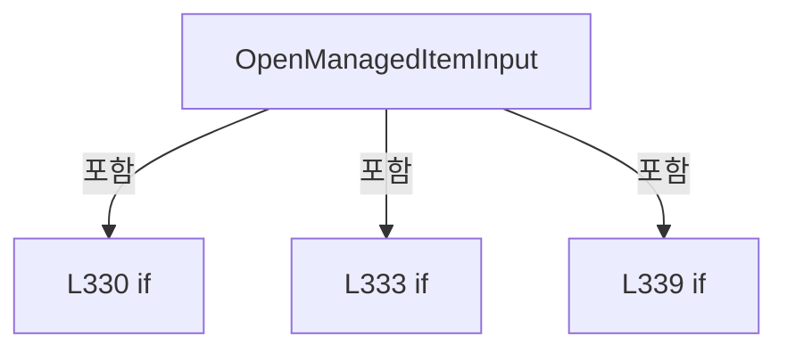

변경 전 점검: 입력/반환 타입, 위 호출자, 예외/취소 경로, 공유 상태와 저장·전송 소비자를 함께 확인합니다. 값의 단위나 물리 방향을 이름만으로 확정하지 않습니다.

### MethodDeclaration `OpenCellOverviewInput` · L343–383

[Drilling.UI/Views/CRecipeView.xaml.cs:343–383](https://github.com/kjuws10-rgb/A3Drilling/blob/5aee8e58439c9b455cae7c9593c9be986c3e682e/Drilling.UI/Views/CRecipeView.xaml.cs#L343-L383)

| 항목 | 실제 추출 값 |
| --- | --- |
| 서명 | void Drilling.UI.Views.CRecipeView.OpenCellOverviewInput(object, RoutedEventArgs) |
| 접근/수식자 | Private / private |
| 반환/값 타입 | void |
| 소속 타입 | NamedType:Drilling.UI.Views.CRecipeView |

입력 계약:

| 이름 | 타입 | 전달 | 선택/기본값 |
| --- | --- | --- | --- |
| sender | object | None | False /  |
| e | RoutedEventArgs | None | False /  |

현재 부분 분석에서 직접 연결된 호출자는 없습니다. XAML/이벤트/인터페이스·델리게이트·외부 진입을 추가 확인해야 하며, 미사용으로 판정한 것이 아닙니다.

호출하는 대상과 해석 범위:

| 원본 행 | 표현식 | 분석 상태 | 대상/소스 위치 |
| --- | --- | --- | --- |
| 348 | CanEditCurrentRecipe | resolved | bool Drilling.UI.Views.CRecipeView.CanEditCurrentRecipe() · Drilling.UI/Views/CRecipeView.xaml.cs:406 |
| 364 | row.GetItem | resolved | Drilling.UI.Menu.Menus.ST_RECIPE_PARAMETER_EDITOR_ITEM? Drilling.UI.Menu.Menus.ST_RECIPE_CELL_OVERVIEW_ROW.GetItem(string) · Drilling.UI/Menu/Menus/CMenuRecipe.cs:3576 |
| 365 | new CValueInputDialog | resolved | Drilling.UI.Popup.CValueInputDialog.CValueInputDialog(string, string, Drilling.Common.Managers.EN_RECIPE_DATA_TYPE, double, double) · Drilling.UI/Popup/CValueInputDialog.xaml.cs:13 |
| 367 | Window.GetWindow | unresolved | None |
| 369 | dialog.ShowDialog | unresolved | None |

본문의 실제 연산·분기·예외·반환 순서(원문 위치 순):

| 원본 행 | 종류 | 주석 해설 |
| --- | --- | --- |
| 345 | if | 조건에 따라 분기합니다: if (sender is not FrameworkElement { DataContext: ST_RECIPE_CELL_OVERVIEW_ROW row, Tag: string field }) |
| 346 | return | 호출자에게 값 또는 제어를 반환합니다: return; |
| 347 | assignment | 값을 대상에 대입합니다: e.Handled = true |
| 348 | call | 함수·델리게이트 또는 객체 생성자를 호출합니다: CanEditCurrentRecipe() |
| 348 | if | 조건에 따라 분기합니다: if (!CanEditCurrentRecipe()) |
| 349 | return | 호출자에게 값 또는 제어를 반환합니다: return; |
| 350 | local-declaration | 지역 변수를 선언합니다: var value = field switch { "FirstX" => row.FirstX, "FirstY" => row.FirstY, "Rotation" => row.Rotation, _ => "" }; |
| 350 | switch-expression | 값별 결과식을 선택합니다: field switch { "FirstX" => row.FirstX, "FirstY" => row.FirstY, "Rotation" => row.Rotation, _ => "" } |
| 350 | variable-initializer | 변수의 초기값을 지정합니다: value = field switch { "FirstX" => row.FirstX, "FirstY" => row.FirstY, "Rotation" => row.Rotation, _ => "" } |
| 357 | local-declaration | 지역 변수를 선언합니다: var parameterName = field switch { "FirstX" => "ALIGN_TO_1ST_PIXEL_X", "FirstY" => "ALIGN_TO_1ST_PIXEL_Y", "Rotation" => "ROTATION", _ => "" }; |
| 357 | switch-expression | 값별 결과식을 선택합니다: field switch { "FirstX" => "ALIGN_TO_1ST_PIXEL_X", "FirstY" => "ALIGN_TO_1ST_PIXEL_Y", "Rotation" => "ROTATION", _ => "" } |
| 357 | variable-initializer | 변수의 초기값을 지정합니다: parameterName = field switch { "FirstX" => "ALIGN_TO_1ST_PIXEL_X", "FirstY" => "ALIGN_TO_1ST_PIXEL_Y", "Rotation" => "ROTATION", _ => "" } |
| 364 | call | 함수·델리게이트 또는 객체 생성자를 호출합니다: row.GetItem(parameterName) |
| 364 | local-declaration | 지역 변수를 선언합니다: var item = row.GetItem(parameterName); |
| 364 | variable-initializer | 변수의 초기값을 지정합니다: item = row.GetItem(parameterName) |
| 365 | call | 함수·델리게이트 또는 객체 생성자를 호출합니다: new CValueInputDialog(item?.Item ?? field, value, item?.DataType ?? EN_RECIPE_DATA_TYPE.Double, item?.Min ?? 0.0, item?.Max ?? 0.0) { Owner = Window.GetWindow(this) } |
| 365 | local-declaration | 지역 변수를 선언합니다: var dialog = new CValueInputDialog(item?.Item ?? field, value, item?.DataType ?? EN_RECIPE_DATA_TYPE.Double, item?.Min ?? 0.0, item?.Max ?? 0.0) { Owner = Window.GetWindow(this) }; |
| 365 | variable-initializer | 변수의 초기값을 지정합니다: dialog = new CValueInputDialog(item?.Item ?? field, value, item?.DataType ?? EN_RECIPE_DATA_TYPE.Double, item?.Min ?? 0.0, item?.Max ?? 0.0) { Owner = Window.GetWindow(this) } |
| 367 | assignment | 값을 대상에 대입합니다: Owner = Window.GetWindow(this) |
| 367 | call | 함수·델리게이트 또는 객체 생성자를 호출합니다: Window.GetWindow(this) |
| 369 | call | 함수·델리게이트 또는 객체 생성자를 호출합니다: dialog.ShowDialog() |
| 369 | if | 조건에 따라 분기합니다: if (dialog.ShowDialog() != true) |
| 370 | return | 호출자에게 값 또는 제어를 반환합니다: return; |
| 371 | switch | 값에 따라 분기합니다: switch (field) |
| 373 | case | 분기값/패턴의 구간입니다: case "FirstX": |
| 374 | assignment | 값을 대상에 대입합니다: row.FirstX = dialog.ResultValue |
| 375 | break | 해당 반복/분기 구간을 종료합니다: break; |
| 376 | case | 분기값/패턴의 구간입니다: case "FirstY": |
| 377 | assignment | 값을 대상에 대입합니다: row.FirstY = dialog.ResultValue |
| 378 | break | 해당 반복/분기 구간을 종료합니다: break; |
| 379 | case | 분기값/패턴의 구간입니다: case "Rotation": |
| 380 | assignment | 값을 대상에 대입합니다: row.Rotation = dialog.ResultValue |
| 381 | break | 해당 반복/분기 구간을 종료합니다: break; |

제어 구문의 포함 구조(실제 실행 순서/CFG가 아닌 구문 탐색 그림):

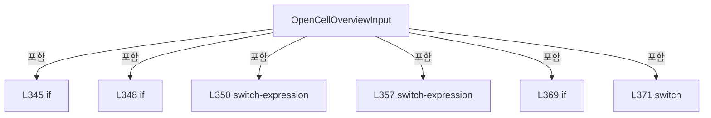

변경 전 점검: 입력/반환 타입, 위 호출자, 예외/취소 경로, 공유 상태와 저장·전송 소비자를 함께 확인합니다. 값의 단위나 물리 방향을 이름만으로 확정하지 않습니다.

### MethodDeclaration `OpenShotGroupOffsetInput` · L385–404

[Drilling.UI/Views/CRecipeView.xaml.cs:385–404](https://github.com/kjuws10-rgb/A3Drilling/blob/5aee8e58439c9b455cae7c9593c9be986c3e682e/Drilling.UI/Views/CRecipeView.xaml.cs#L385-L404)

| 항목 | 실제 추출 값 |
| --- | --- |
| 서명 | void Drilling.UI.Views.CRecipeView.OpenShotGroupOffsetInput(object, RoutedEventArgs) |
| 접근/수식자 | Private / private |
| 반환/값 타입 | void |
| 소속 타입 | NamedType:Drilling.UI.Views.CRecipeView |

입력 계약:

| 이름 | 타입 | 전달 | 선택/기본값 |
| --- | --- | --- | --- |
| sender | object | None | False /  |
| e | RoutedEventArgs | None | False /  |

현재 부분 분석에서 직접 연결된 호출자는 없습니다. XAML/이벤트/인터페이스·델리게이트·외부 진입을 추가 확인해야 하며, 미사용으로 판정한 것이 아닙니다.

호출하는 대상과 해석 범위:

| 원본 행 | 표현식 | 분석 상태 | 대상/소스 위치 |
| --- | --- | --- | --- |
| 391 | CanEditCurrentRecipe | resolved | bool Drilling.UI.Views.CRecipeView.CanEditCurrentRecipe() · Drilling.UI/Views/CRecipeView.xaml.cs:406 |
| 394 | new CValueInputDialog | candidate | OverloadResolutionFailure |
| 396 | Window.GetWindow | unresolved | None |
| 398 | dialog.ShowDialog | unresolved | None |

본문의 실제 연산·분기·예외·반환 순서(원문 위치 순):

| 원본 행 | 종류 | 주석 해설 |
| --- | --- | --- |
| 387 | if | 조건에 따라 분기합니다: if (sender is not FrameworkElement { Tag: ST_SHOT_GROUP_EDITOR_ROW row } element) |
| 388 | return | 호출자에게 값 또는 제어를 반환합니다: return; |
| 389 | local-declaration | 지역 변수를 선언합니다: var field = element.Uid; |
| 389 | variable-initializer | 변수의 초기값을 지정합니다: field = element.Uid |
| 390 | assignment | 값을 대상에 대입합니다: e.Handled = true |
| 391 | call | 함수·델리게이트 또는 객체 생성자를 호출합니다: CanEditCurrentRecipe() |
| 391 | if | 조건에 따라 분기합니다: if (!CanEditCurrentRecipe()) |
| 392 | return | 호출자에게 값 또는 제어를 반환합니다: return; |
| 393 | conditional-expression | 조건에 따라 결과식을 선택합니다: field == "OffsetX" ? row.OffsetX : row.OffsetY |
| 393 | local-declaration | 지역 변수를 선언합니다: var value = field == "OffsetX" ? row.OffsetX : row.OffsetY; |
| 393 | variable-initializer | 변수의 초기값을 지정합니다: value = field == "OffsetX" ? row.OffsetX : row.OffsetY |
| 394 | call | 함수·델리게이트 또는 객체 생성자를 호출합니다: new CValueInputDialog(field, value, EN_RECIPE_DATA_TYPE.Double, 0, 0) { Owner = Window.GetWindow(this) } |
| 394 | local-declaration | 지역 변수를 선언합니다: var dialog = new CValueInputDialog(field, value, EN_RECIPE_DATA_TYPE.Double, 0, 0) { Owner = Window.GetWindow(this) }; |
| 394 | variable-initializer | 변수의 초기값을 지정합니다: dialog = new CValueInputDialog(field, value, EN_RECIPE_DATA_TYPE.Double, 0, 0) { Owner = Window.GetWindow(this) } |
| 396 | assignment | 값을 대상에 대입합니다: Owner = Window.GetWindow(this) |
| 396 | call | 함수·델리게이트 또는 객체 생성자를 호출합니다: Window.GetWindow(this) |
| 398 | call | 함수·델리게이트 또는 객체 생성자를 호출합니다: dialog.ShowDialog() |
| 398 | if | 조건에 따라 분기합니다: if (dialog.ShowDialog() != true) |
| 399 | return | 호출자에게 값 또는 제어를 반환합니다: return; |
| 400 | if | 조건에 따라 분기합니다: if (field == "OffsetX") |
| 401 | assignment | 값을 대상에 대입합니다: row.OffsetX = dialog.ResultValue |
| 402 | else | 앞 조건이 거짓인 경로입니다: else |
| 403 | assignment | 값을 대상에 대입합니다: row.OffsetY = dialog.ResultValue |

제어 구문의 포함 구조(실제 실행 순서/CFG가 아닌 구문 탐색 그림):

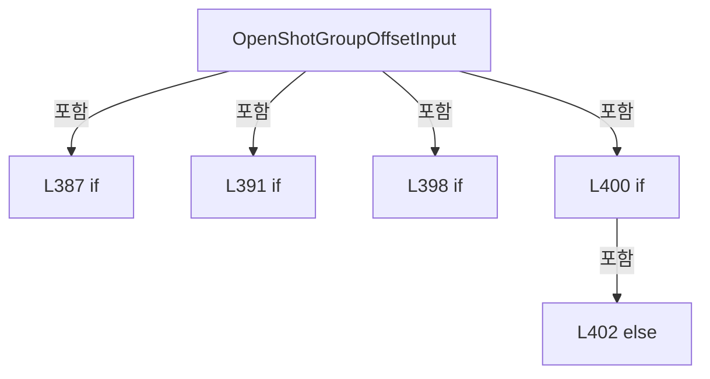

변경 전 점검: 입력/반환 타입, 위 호출자, 예외/취소 경로, 공유 상태와 저장·전송 소비자를 함께 확인합니다. 값의 단위나 물리 방향을 이름만으로 확정하지 않습니다.

### MethodDeclaration `CanEditCurrentRecipe` · L406–409

[Drilling.UI/Views/CRecipeView.xaml.cs:406–409](https://github.com/kjuws10-rgb/A3Drilling/blob/5aee8e58439c9b455cae7c9593c9be986c3e682e/Drilling.UI/Views/CRecipeView.xaml.cs#L406-L409)

| 항목 | 실제 추출 값 |
| --- | --- |
| 서명 | bool Drilling.UI.Views.CRecipeView.CanEditCurrentRecipe() |
| 접근/수식자 | Private / private |
| 반환/값 타입 | bool |
| 소속 타입 | NamedType:Drilling.UI.Views.CRecipeView |

정적 호출자로 확인된 위치:

| 호출 파일/행 | 호출 표현식 | 런타임 분기 가능 |
| --- | --- | --- |
| [Drilling.UI/Views/CRecipeView.xaml.cs:313–313](https://github.com/kjuws10-rgb/A3Drilling/blob/5aee8e58439c9b455cae7c9593c9be986c3e682e/Drilling.UI/Views/CRecipeView.xaml.cs#L313-L313) | CanEditCurrentRecipe | False |
| [Drilling.UI/Views/CRecipeView.xaml.cs:333–333](https://github.com/kjuws10-rgb/A3Drilling/blob/5aee8e58439c9b455cae7c9593c9be986c3e682e/Drilling.UI/Views/CRecipeView.xaml.cs#L333-L333) | CanEditCurrentRecipe | False |
| [Drilling.UI/Views/CRecipeView.xaml.cs:348–348](https://github.com/kjuws10-rgb/A3Drilling/blob/5aee8e58439c9b455cae7c9593c9be986c3e682e/Drilling.UI/Views/CRecipeView.xaml.cs#L348-L348) | CanEditCurrentRecipe | False |
| [Drilling.UI/Views/CRecipeView.xaml.cs:391–391](https://github.com/kjuws10-rgb/A3Drilling/blob/5aee8e58439c9b455cae7c9593c9be986c3e682e/Drilling.UI/Views/CRecipeView.xaml.cs#L391-L391) | CanEditCurrentRecipe | False |

본문의 실제 연산·분기·예외·반환 순서(원문 위치 순):

| 원본 행 | 종류 | 주석 해설 |
| --- | --- | --- |
| 408 | return | 호출자에게 값 또는 제어를 반환합니다: return DataContext is CRootView root && root.CurrentScreen.Recipe?.IsViewRecipeSelected == true; |

변경 전 점검: 입력/반환 타입, 위 호출자, 예외/취소 경로, 공유 상태와 저장·전송 소비자를 함께 확인합니다. 값의 단위나 물리 방향을 이름만으로 확정하지 않습니다.

### MethodDeclaration `SelectShotGroupFromMap` · L411–421

[Drilling.UI/Views/CRecipeView.xaml.cs:411–421](https://github.com/kjuws10-rgb/A3Drilling/blob/5aee8e58439c9b455cae7c9593c9be986c3e682e/Drilling.UI/Views/CRecipeView.xaml.cs#L411-L421)

| 항목 | 실제 추출 값 |
| --- | --- |
| 서명 | void Drilling.UI.Views.CRecipeView.SelectShotGroupFromMap(object, MouseButtonEventArgs) |
| 접근/수식자 | Private / private |
| 반환/값 타입 | void |
| 소속 타입 | NamedType:Drilling.UI.Views.CRecipeView |

입력 계약:

| 이름 | 타입 | 전달 | 선택/기본값 |
| --- | --- | --- | --- |
| sender | object | None | False /  |
| e | MouseButtonEventArgs | None | False /  |

현재 부분 분석에서 직접 연결된 호출자는 없습니다. XAML/이벤트/인터페이스·델리게이트·외부 진입을 추가 확인해야 하며, 미사용으로 판정한 것이 아닙니다.

호출하는 대상과 해석 범위:

| 원본 행 | 표현식 | 분석 상태 | 대상/소스 위치 |
| --- | --- | --- | --- |
| 418 | e.GetPosition | unresolved | None |
| 419 | recipe.SelectShotGroupAt | candidate | OverloadResolutionFailure |

본문의 실제 연산·분기·예외·반환 순서(원문 위치 순):

| 원본 행 | 종류 | 주석 해설 |
| --- | --- | --- |
| 413 | if | 조건에 따라 분기합니다: if (sender is not FrameworkElement map &#124;&#124; DataContext is not CRootView root &#124;&#124; root.CurrentScreen.Recipe is not CMenuRecipe recipe) |
| 415 | return | 호출자에게 값 또는 제어를 반환합니다: return; |
| 418 | call | 함수·델리게이트 또는 객체 생성자를 호출합니다: e.GetPosition(map) |
| 418 | local-declaration | 지역 변수를 선언합니다: var point = e.GetPosition(map); |
| 418 | variable-initializer | 변수의 초기값을 지정합니다: point = e.GetPosition(map) |
| 419 | call | 함수·델리게이트 또는 객체 생성자를 호출합니다: recipe.SelectShotGroupAt(point.X, point.Y) |
| 420 | assignment | 값을 대상에 대입합니다: e.Handled = true |

제어 구문의 포함 구조(실제 실행 순서/CFG가 아닌 구문 탐색 그림):

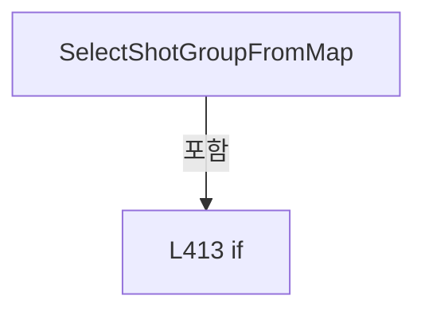

변경 전 점검: 입력/반환 타입, 위 호출자, 예외/취소 경로, 공유 상태와 저장·전송 소비자를 함께 확인합니다. 값의 단위나 물리 방향을 이름만으로 확정하지 않습니다.

### MethodDeclaration `CellPreviewLabel_MouseMove` · L423–434

[Drilling.UI/Views/CRecipeView.xaml.cs:423–434](https://github.com/kjuws10-rgb/A3Drilling/blob/5aee8e58439c9b455cae7c9593c9be986c3e682e/Drilling.UI/Views/CRecipeView.xaml.cs#L423-L434)

| 항목 | 실제 추출 값 |
| --- | --- |
| 서명 | void Drilling.UI.Views.CRecipeView.CellPreviewLabel_MouseMove(object, MouseEventArgs) |
| 접근/수식자 | Private / private |
| 반환/값 타입 | void |
| 소속 타입 | NamedType:Drilling.UI.Views.CRecipeView |

입력 계약:

| 이름 | 타입 | 전달 | 선택/기본값 |
| --- | --- | --- | --- |
| sender | object | None | False /  |
| e | MouseEventArgs | None | False /  |

현재 부분 분석에서 직접 연결된 호출자는 없습니다. XAML/이벤트/인터페이스·델리게이트·외부 진입을 추가 확인해야 하며, 미사용으로 판정한 것이 아닙니다.

호출하는 대상과 해석 범위:

| 원본 행 | 표현식 | 분석 상태 | 대상/소스 위치 |
| --- | --- | --- | --- |
| 427 | HideRecipePreviewHoverTip | resolved | void Drilling.UI.Views.CRecipeView.HideRecipePreviewHoverTip() · Drilling.UI/Views/CRecipeView.xaml.cs:464 |
| 433 | PositionRecipePreviewHoverTip | candidate | OverloadResolutionFailure |
| 433 | e.GetPosition | unresolved | None |

본문의 실제 연산·분기·예외·반환 순서(원문 위치 순):

| 원본 행 | 종류 | 주석 해설 |
| --- | --- | --- |
| 425 | if | 조건에 따라 분기합니다: if (sender is not FrameworkElement { DataContext: ST_CELL_PREVIEW_LABEL label }) |
| 427 | call | 함수·델리게이트 또는 객체 생성자를 호출합니다: HideRecipePreviewHoverTip() |
| 428 | return | 호출자에게 값 또는 제어를 반환합니다: return; |
| 431 | assignment | 값을 대상에 대입합니다: RecipePreviewHoverTipText.Text = label.DisplayText |
| 432 | assignment | 값을 대상에 대입합니다: RecipePreviewHoverTip.Visibility = Visibility.Visible |
| 433 | call | 함수·델리게이트 또는 객체 생성자를 호출합니다: PositionRecipePreviewHoverTip(e.GetPosition(RecipePreviewViewport)) |
| 433 | call | 함수·델리게이트 또는 객체 생성자를 호출합니다: e.GetPosition(RecipePreviewViewport) |

제어 구문의 포함 구조(실제 실행 순서/CFG가 아닌 구문 탐색 그림):

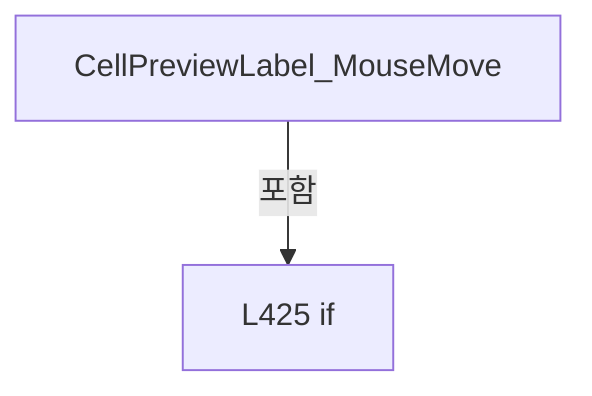

변경 전 점검: 입력/반환 타입, 위 호출자, 예외/취소 경로, 공유 상태와 저장·전송 소비자를 함께 확인합니다. 값의 단위나 물리 방향을 이름만으로 확정하지 않습니다.

### MethodDeclaration `CellPreviewLabel_MouseLeave` · L436–439

[Drilling.UI/Views/CRecipeView.xaml.cs:436–439](https://github.com/kjuws10-rgb/A3Drilling/blob/5aee8e58439c9b455cae7c9593c9be986c3e682e/Drilling.UI/Views/CRecipeView.xaml.cs#L436-L439)

| 항목 | 실제 추출 값 |
| --- | --- |
| 서명 | void Drilling.UI.Views.CRecipeView.CellPreviewLabel_MouseLeave(object, MouseEventArgs) |
| 접근/수식자 | Private / private |
| 반환/값 타입 | void |
| 소속 타입 | NamedType:Drilling.UI.Views.CRecipeView |

입력 계약:

| 이름 | 타입 | 전달 | 선택/기본값 |
| --- | --- | --- | --- |
| sender | object | None | False /  |
| e | MouseEventArgs | None | False /  |

현재 부분 분석에서 직접 연결된 호출자는 없습니다. XAML/이벤트/인터페이스·델리게이트·외부 진입을 추가 확인해야 하며, 미사용으로 판정한 것이 아닙니다.

호출하는 대상과 해석 범위:

| 원본 행 | 표현식 | 분석 상태 | 대상/소스 위치 |
| --- | --- | --- | --- |
| 438 | HideRecipePreviewHoverTip | resolved | void Drilling.UI.Views.CRecipeView.HideRecipePreviewHoverTip() · Drilling.UI/Views/CRecipeView.xaml.cs:464 |

본문의 실제 연산·분기·예외·반환 순서(원문 위치 순):

| 원본 행 | 종류 | 주석 해설 |
| --- | --- | --- |
| 438 | call | 함수·델리게이트 또는 객체 생성자를 호출합니다: HideRecipePreviewHoverTip() |

변경 전 점검: 입력/반환 타입, 위 호출자, 예외/취소 경로, 공유 상태와 저장·전송 소비자를 함께 확인합니다. 값의 단위나 물리 방향을 이름만으로 확정하지 않습니다.

### MethodDeclaration `PositionRecipePreviewHoverTip` · L441–462

[Drilling.UI/Views/CRecipeView.xaml.cs:441–462](https://github.com/kjuws10-rgb/A3Drilling/blob/5aee8e58439c9b455cae7c9593c9be986c3e682e/Drilling.UI/Views/CRecipeView.xaml.cs#L441-L462)

| 항목 | 실제 추출 값 |
| --- | --- |
| 서명 | void Drilling.UI.Views.CRecipeView.PositionRecipePreviewHoverTip(Point) |
| 접근/수식자 | Private / private |
| 반환/값 타입 | void |
| 소속 타입 | NamedType:Drilling.UI.Views.CRecipeView |

입력 계약:

| 이름 | 타입 | 전달 | 선택/기본값 |
| --- | --- | --- | --- |
| pointer | Point | None | False /  |

현재 부분 분석에서 직접 연결된 호출자는 없습니다. XAML/이벤트/인터페이스·델리게이트·외부 진입을 추가 확인해야 하며, 미사용으로 판정한 것이 아닙니다.

호출하는 대상과 해석 범위:

| 원본 행 | 표현식 | 분석 상태 | 대상/소스 위치 |
| --- | --- | --- | --- |
| 446 | RecipePreviewHoverTip.Measure | unresolved | None |
| 446 | new Size | unresolved | None |
| 452 | Math.Clamp | candidate | OverloadResolutionFailure |
| 452 | Math.Max | candidate | OverloadResolutionFailure |
| 457 | Math.Clamp | candidate | OverloadResolutionFailure |
| 457 | Math.Max | candidate | OverloadResolutionFailure |

본문의 실제 연산·분기·예외·반환 순서(원문 위치 순):

| 원본 행 | 종류 | 주석 해설 |
| --- | --- | --- |
| 443 | local-declaration | 지역 변수를 선언합니다: const double margin = 4.0; |
| 443 | variable-initializer | 변수의 초기값을 지정합니다: margin = 4.0 |
| 444 | local-declaration | 지역 변수를 선언합니다: const double offsetX = 12.0; |
| 444 | variable-initializer | 변수의 초기값을 지정합니다: offsetX = 12.0 |
| 445 | local-declaration | 지역 변수를 선언합니다: const double offsetY = 14.0; |
| 445 | variable-initializer | 변수의 초기값을 지정합니다: offsetY = 14.0 |
| 446 | call | 함수·델리게이트 또는 객체 생성자를 호출합니다: RecipePreviewHoverTip.Measure(new Size(double.PositiveInfinity, double.PositiveInfinity)) |
| 446 | call | 함수·델리게이트 또는 객체 생성자를 호출합니다: new Size(double.PositiveInfinity, double.PositiveInfinity) |
| 447 | local-declaration | 지역 변수를 선언합니다: var tipSize = RecipePreviewHoverTip.DesiredSize; |
| 447 | variable-initializer | 변수의 초기값을 지정합니다: tipSize = RecipePreviewHoverTip.DesiredSize |
| 448 | local-declaration | 지역 변수를 선언합니다: var x = pointer.X + offsetX; |
| 448 | variable-initializer | 변수의 초기값을 지정합니다: x = pointer.X + offsetX |
| 449 | local-declaration | 지역 변수를 선언합니다: var y = pointer.Y + offsetY; |
| 449 | variable-initializer | 변수의 초기값을 지정합니다: y = pointer.Y + offsetY |
| 450 | if | 조건에 따라 분기합니다: if (RecipePreviewViewport.ActualWidth > 0) |
| 452 | assignment | 값을 대상에 대입합니다: x = Math.Clamp(x, margin, Math.Max(margin, RecipePreviewViewport.ActualWidth - tipSize.Width - margin)) |
| 452 | call | 함수·델리게이트 또는 객체 생성자를 호출합니다: Math.Clamp(x, margin, Math.Max(margin, RecipePreviewViewport.ActualWidth - tipSize.Width - margin)) |
| 452 | call | 함수·델리게이트 또는 객체 생성자를 호출합니다: Math.Max(margin, RecipePreviewViewport.ActualWidth - tipSize.Width - margin) |
| 455 | if | 조건에 따라 분기합니다: if (RecipePreviewViewport.ActualHeight > 0) |
| 457 | assignment | 값을 대상에 대입합니다: y = Math.Clamp(y, margin, Math.Max(margin, RecipePreviewViewport.ActualHeight - tipSize.Height - margin)) |
| 457 | call | 함수·델리게이트 또는 객체 생성자를 호출합니다: Math.Clamp(y, margin, Math.Max(margin, RecipePreviewViewport.ActualHeight - tipSize.Height - margin)) |
| 457 | call | 함수·델리게이트 또는 객체 생성자를 호출합니다: Math.Max(margin, RecipePreviewViewport.ActualHeight - tipSize.Height - margin) |
| 460 | assignment | 값을 대상에 대입합니다: RecipePreviewHoverTipTranslateTransform.X = x |
| 461 | assignment | 값을 대상에 대입합니다: RecipePreviewHoverTipTranslateTransform.Y = y |

제어 구문의 포함 구조(실제 실행 순서/CFG가 아닌 구문 탐색 그림):

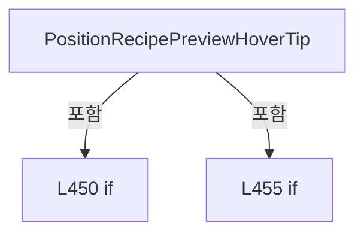

변경 전 점검: 입력/반환 타입, 위 호출자, 예외/취소 경로, 공유 상태와 저장·전송 소비자를 함께 확인합니다. 값의 단위나 물리 방향을 이름만으로 확정하지 않습니다.

### MethodDeclaration `HideRecipePreviewHoverTip` · L464–468

[Drilling.UI/Views/CRecipeView.xaml.cs:464–468](https://github.com/kjuws10-rgb/A3Drilling/blob/5aee8e58439c9b455cae7c9593c9be986c3e682e/Drilling.UI/Views/CRecipeView.xaml.cs#L464-L468)

| 항목 | 실제 추출 값 |
| --- | --- |
| 서명 | void Drilling.UI.Views.CRecipeView.HideRecipePreviewHoverTip() |
| 접근/수식자 | Private / private |
| 반환/값 타입 | void |
| 소속 타입 | NamedType:Drilling.UI.Views.CRecipeView |

정적 호출자로 확인된 위치:

| 호출 파일/행 | 호출 표현식 | 런타임 분기 가능 |
| --- | --- | --- |
| [Drilling.UI/Views/CRecipeView.xaml.cs:134–134](https://github.com/kjuws10-rgb/A3Drilling/blob/5aee8e58439c9b455cae7c9593c9be986c3e682e/Drilling.UI/Views/CRecipeView.xaml.cs#L134-L134) | HideRecipePreviewHoverTip | False |
| [Drilling.UI/Views/CRecipeView.xaml.cs:257–257](https://github.com/kjuws10-rgb/A3Drilling/blob/5aee8e58439c9b455cae7c9593c9be986c3e682e/Drilling.UI/Views/CRecipeView.xaml.cs#L257-L257) | HideRecipePreviewHoverTip | False |
| [Drilling.UI/Views/CRecipeView.xaml.cs:427–427](https://github.com/kjuws10-rgb/A3Drilling/blob/5aee8e58439c9b455cae7c9593c9be986c3e682e/Drilling.UI/Views/CRecipeView.xaml.cs#L427-L427) | HideRecipePreviewHoverTip | False |
| [Drilling.UI/Views/CRecipeView.xaml.cs:438–438](https://github.com/kjuws10-rgb/A3Drilling/blob/5aee8e58439c9b455cae7c9593c9be986c3e682e/Drilling.UI/Views/CRecipeView.xaml.cs#L438-L438) | HideRecipePreviewHoverTip | False |

본문의 실제 연산·분기·예외·반환 순서(원문 위치 순):

| 원본 행 | 종류 | 주석 해설 |
| --- | --- | --- |
| 466 | assignment | 값을 대상에 대입합니다: RecipePreviewHoverTip.Visibility = Visibility.Collapsed |
| 467 | assignment | 값을 대상에 대입합니다: RecipePreviewHoverTipText.Text = "" |

변경 전 점검: 입력/반환 타입, 위 호출자, 예외/취소 경로, 공유 상태와 저장·전송 소비자를 함께 확인합니다. 값의 단위나 물리 방향을 이름만으로 확정하지 않습니다.

### MethodDeclaration `CellShotMapSurface_MouseMove` · L470–489

[Drilling.UI/Views/CRecipeView.xaml.cs:470–489](https://github.com/kjuws10-rgb/A3Drilling/blob/5aee8e58439c9b455cae7c9593c9be986c3e682e/Drilling.UI/Views/CRecipeView.xaml.cs#L470-L489)

| 항목 | 실제 추출 값 |
| --- | --- |
| 서명 | void Drilling.UI.Views.CRecipeView.CellShotMapSurface_MouseMove(object, MouseEventArgs) |
| 접근/수식자 | Private / private |
| 반환/값 타입 | void |
| 소속 타입 | NamedType:Drilling.UI.Views.CRecipeView |

입력 계약:

| 이름 | 타입 | 전달 | 선택/기본값 |
| --- | --- | --- | --- |
| sender | object | None | False /  |
| e | MouseEventArgs | None | False /  |

현재 부분 분석에서 직접 연결된 호출자는 없습니다. XAML/이벤트/인터페이스·델리게이트·외부 진입을 추가 확인해야 하며, 미사용으로 판정한 것이 아닙니다.

호출하는 대상과 해석 범위:

| 원본 행 | 표현식 | 분석 상태 | 대상/소스 위치 |
| --- | --- | --- | --- |
| 474 | HideCellShotMapHoverTip | resolved | void Drilling.UI.Views.CRecipeView.HideCellShotMapHoverTip() · Drilling.UI/Views/CRecipeView.xaml.cs:519 |
| 478 | e.GetPosition | unresolved | None |
| 479 | recipe.GetShotGroupNameAt | candidate | OverloadResolutionFailure |
| 480 | string.IsNullOrWhiteSpace | resolved | bool string.IsNullOrWhiteSpace(string?) |
| 482 | HideCellShotMapHoverTip | resolved | void Drilling.UI.Views.CRecipeView.HideCellShotMapHoverTip() · Drilling.UI/Views/CRecipeView.xaml.cs:519 |
| 488 | PositionCellShotMapHoverTip | candidate | OverloadResolutionFailure |
| 488 | e.GetPosition | unresolved | None |

본문의 실제 연산·분기·예외·반환 순서(원문 위치 순):

| 원본 행 | 종류 | 주석 해설 |
| --- | --- | --- |
| 472 | if | 조건에 따라 분기합니다: if (sender is not FrameworkElement map &#124;&#124; DataContext is not CRootView root &#124;&#124; root.CurrentScreen.Recipe is not CMenuRecipe recipe) |
| 474 | call | 함수·델리게이트 또는 객체 생성자를 호출합니다: HideCellShotMapHoverTip() |
| 475 | return | 호출자에게 값 또는 제어를 반환합니다: return; |
| 478 | call | 함수·델리게이트 또는 객체 생성자를 호출합니다: e.GetPosition(map) |
| 478 | local-declaration | 지역 변수를 선언합니다: var point = e.GetPosition(map); |
| 478 | variable-initializer | 변수의 초기값을 지정합니다: point = e.GetPosition(map) |
| 479 | call | 함수·델리게이트 또는 객체 생성자를 호출합니다: recipe.GetShotGroupNameAt(point.X, point.Y) |
| 479 | local-declaration | 지역 변수를 선언합니다: var shotName = recipe.GetShotGroupNameAt(point.X, point.Y); |
| 479 | variable-initializer | 변수의 초기값을 지정합니다: shotName = recipe.GetShotGroupNameAt(point.X, point.Y) |
| 480 | call | 함수·델리게이트 또는 객체 생성자를 호출합니다: string.IsNullOrWhiteSpace(shotName) |
| 480 | if | 조건에 따라 분기합니다: if (string.IsNullOrWhiteSpace(shotName)) |
| 482 | call | 함수·델리게이트 또는 객체 생성자를 호출합니다: HideCellShotMapHoverTip() |
| 483 | return | 호출자에게 값 또는 제어를 반환합니다: return; |
| 486 | assignment | 값을 대상에 대입합니다: CellShotMapHoverTipText.Text = shotName |
| 487 | assignment | 값을 대상에 대입합니다: CellShotMapHoverTip.Visibility = Visibility.Visible |
| 488 | call | 함수·델리게이트 또는 객체 생성자를 호출합니다: PositionCellShotMapHoverTip(e.GetPosition(CellShotMapViewport)) |
| 488 | call | 함수·델리게이트 또는 객체 생성자를 호출합니다: e.GetPosition(CellShotMapViewport) |

제어 구문의 포함 구조(실제 실행 순서/CFG가 아닌 구문 탐색 그림):

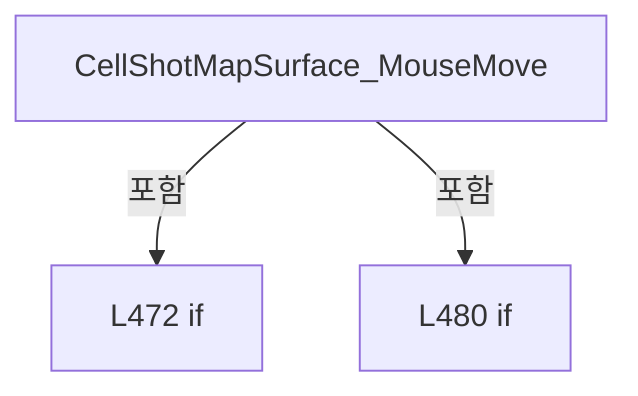

변경 전 점검: 입력/반환 타입, 위 호출자, 예외/취소 경로, 공유 상태와 저장·전송 소비자를 함께 확인합니다. 값의 단위나 물리 방향을 이름만으로 확정하지 않습니다.

### MethodDeclaration `CellShotMapSurface_MouseLeave` · L491–494

[Drilling.UI/Views/CRecipeView.xaml.cs:491–494](https://github.com/kjuws10-rgb/A3Drilling/blob/5aee8e58439c9b455cae7c9593c9be986c3e682e/Drilling.UI/Views/CRecipeView.xaml.cs#L491-L494)

| 항목 | 실제 추출 값 |
| --- | --- |
| 서명 | void Drilling.UI.Views.CRecipeView.CellShotMapSurface_MouseLeave(object, MouseEventArgs) |
| 접근/수식자 | Private / private |
| 반환/값 타입 | void |
| 소속 타입 | NamedType:Drilling.UI.Views.CRecipeView |

입력 계약:

| 이름 | 타입 | 전달 | 선택/기본값 |
| --- | --- | --- | --- |
| sender | object | None | False /  |
| e | MouseEventArgs | None | False /  |

현재 부분 분석에서 직접 연결된 호출자는 없습니다. XAML/이벤트/인터페이스·델리게이트·외부 진입을 추가 확인해야 하며, 미사용으로 판정한 것이 아닙니다.

호출하는 대상과 해석 범위:

| 원본 행 | 표현식 | 분석 상태 | 대상/소스 위치 |
| --- | --- | --- | --- |
| 493 | HideCellShotMapHoverTip | resolved | void Drilling.UI.Views.CRecipeView.HideCellShotMapHoverTip() · Drilling.UI/Views/CRecipeView.xaml.cs:519 |

본문의 실제 연산·분기·예외·반환 순서(원문 위치 순):

| 원본 행 | 종류 | 주석 해설 |
| --- | --- | --- |
| 493 | call | 함수·델리게이트 또는 객체 생성자를 호출합니다: HideCellShotMapHoverTip() |

변경 전 점검: 입력/반환 타입, 위 호출자, 예외/취소 경로, 공유 상태와 저장·전송 소비자를 함께 확인합니다. 값의 단위나 물리 방향을 이름만으로 확정하지 않습니다.

### MethodDeclaration `PositionCellShotMapHoverTip` · L496–517

[Drilling.UI/Views/CRecipeView.xaml.cs:496–517](https://github.com/kjuws10-rgb/A3Drilling/blob/5aee8e58439c9b455cae7c9593c9be986c3e682e/Drilling.UI/Views/CRecipeView.xaml.cs#L496-L517)

| 항목 | 실제 추출 값 |
| --- | --- |
| 서명 | void Drilling.UI.Views.CRecipeView.PositionCellShotMapHoverTip(Point) |
| 접근/수식자 | Private / private |
| 반환/값 타입 | void |
| 소속 타입 | NamedType:Drilling.UI.Views.CRecipeView |

입력 계약:

| 이름 | 타입 | 전달 | 선택/기본값 |
| --- | --- | --- | --- |
| pointer | Point | None | False /  |

현재 부분 분석에서 직접 연결된 호출자는 없습니다. XAML/이벤트/인터페이스·델리게이트·외부 진입을 추가 확인해야 하며, 미사용으로 판정한 것이 아닙니다.

호출하는 대상과 해석 범위:

| 원본 행 | 표현식 | 분석 상태 | 대상/소스 위치 |
| --- | --- | --- | --- |
| 501 | CellShotMapHoverTip.Measure | unresolved | None |
| 501 | new Size | unresolved | None |
| 507 | Math.Clamp | candidate | OverloadResolutionFailure |
| 507 | Math.Max | candidate | OverloadResolutionFailure |
| 512 | Math.Clamp | candidate | OverloadResolutionFailure |
| 512 | Math.Max | candidate | OverloadResolutionFailure |

본문의 실제 연산·분기·예외·반환 순서(원문 위치 순):

| 원본 행 | 종류 | 주석 해설 |
| --- | --- | --- |
| 498 | local-declaration | 지역 변수를 선언합니다: const double margin = 4.0; |
| 498 | variable-initializer | 변수의 초기값을 지정합니다: margin = 4.0 |
| 499 | local-declaration | 지역 변수를 선언합니다: const double offsetX = 12.0; |
| 499 | variable-initializer | 변수의 초기값을 지정합니다: offsetX = 12.0 |
| 500 | local-declaration | 지역 변수를 선언합니다: const double offsetY = 14.0; |
| 500 | variable-initializer | 변수의 초기값을 지정합니다: offsetY = 14.0 |
| 501 | call | 함수·델리게이트 또는 객체 생성자를 호출합니다: CellShotMapHoverTip.Measure(new Size(double.PositiveInfinity, double.PositiveInfinity)) |
| 501 | call | 함수·델리게이트 또는 객체 생성자를 호출합니다: new Size(double.PositiveInfinity, double.PositiveInfinity) |
| 502 | local-declaration | 지역 변수를 선언합니다: var tipSize = CellShotMapHoverTip.DesiredSize; |
| 502 | variable-initializer | 변수의 초기값을 지정합니다: tipSize = CellShotMapHoverTip.DesiredSize |
| 503 | local-declaration | 지역 변수를 선언합니다: var x = pointer.X + offsetX; |
| 503 | variable-initializer | 변수의 초기값을 지정합니다: x = pointer.X + offsetX |
| 504 | local-declaration | 지역 변수를 선언합니다: var y = pointer.Y + offsetY; |
| 504 | variable-initializer | 변수의 초기값을 지정합니다: y = pointer.Y + offsetY |
| 505 | if | 조건에 따라 분기합니다: if (CellShotMapViewport.ActualWidth > 0) |
| 507 | assignment | 값을 대상에 대입합니다: x = Math.Clamp(x, margin, Math.Max(margin, CellShotMapViewport.ActualWidth - tipSize.Width - margin)) |
| 507 | call | 함수·델리게이트 또는 객체 생성자를 호출합니다: Math.Clamp(x, margin, Math.Max(margin, CellShotMapViewport.ActualWidth - tipSize.Width - margin)) |
| 507 | call | 함수·델리게이트 또는 객체 생성자를 호출합니다: Math.Max(margin, CellShotMapViewport.ActualWidth - tipSize.Width - margin) |
| 510 | if | 조건에 따라 분기합니다: if (CellShotMapViewport.ActualHeight > 0) |
| 512 | assignment | 값을 대상에 대입합니다: y = Math.Clamp(y, margin, Math.Max(margin, CellShotMapViewport.ActualHeight - tipSize.Height - margin)) |
| 512 | call | 함수·델리게이트 또는 객체 생성자를 호출합니다: Math.Clamp(y, margin, Math.Max(margin, CellShotMapViewport.ActualHeight - tipSize.Height - margin)) |
| 512 | call | 함수·델리게이트 또는 객체 생성자를 호출합니다: Math.Max(margin, CellShotMapViewport.ActualHeight - tipSize.Height - margin) |
| 515 | assignment | 값을 대상에 대입합니다: CellShotMapHoverTipTranslateTransform.X = x |
| 516 | assignment | 값을 대상에 대입합니다: CellShotMapHoverTipTranslateTransform.Y = y |

제어 구문의 포함 구조(실제 실행 순서/CFG가 아닌 구문 탐색 그림):

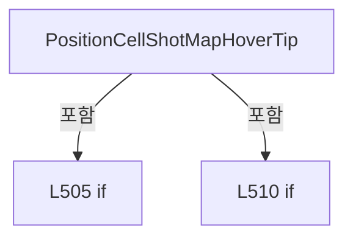

변경 전 점검: 입력/반환 타입, 위 호출자, 예외/취소 경로, 공유 상태와 저장·전송 소비자를 함께 확인합니다. 값의 단위나 물리 방향을 이름만으로 확정하지 않습니다.

### MethodDeclaration `HideCellShotMapHoverTip` · L519–523

[Drilling.UI/Views/CRecipeView.xaml.cs:519–523](https://github.com/kjuws10-rgb/A3Drilling/blob/5aee8e58439c9b455cae7c9593c9be986c3e682e/Drilling.UI/Views/CRecipeView.xaml.cs#L519-L523)

| 항목 | 실제 추출 값 |
| --- | --- |
| 서명 | void Drilling.UI.Views.CRecipeView.HideCellShotMapHoverTip() |
| 접근/수식자 | Private / private |
| 반환/값 타입 | void |
| 소속 타입 | NamedType:Drilling.UI.Views.CRecipeView |

정적 호출자로 확인된 위치:

| 호출 파일/행 | 호출 표현식 | 런타임 분기 가능 |
| --- | --- | --- |
| [Drilling.UI/Views/CRecipeView.xaml.cs:201–201](https://github.com/kjuws10-rgb/A3Drilling/blob/5aee8e58439c9b455cae7c9593c9be986c3e682e/Drilling.UI/Views/CRecipeView.xaml.cs#L201-L201) | HideCellShotMapHoverTip | False |
| [Drilling.UI/Views/CRecipeView.xaml.cs:268–268](https://github.com/kjuws10-rgb/A3Drilling/blob/5aee8e58439c9b455cae7c9593c9be986c3e682e/Drilling.UI/Views/CRecipeView.xaml.cs#L268-L268) | HideCellShotMapHoverTip | False |
| [Drilling.UI/Views/CRecipeView.xaml.cs:474–474](https://github.com/kjuws10-rgb/A3Drilling/blob/5aee8e58439c9b455cae7c9593c9be986c3e682e/Drilling.UI/Views/CRecipeView.xaml.cs#L474-L474) | HideCellShotMapHoverTip | False |
| [Drilling.UI/Views/CRecipeView.xaml.cs:482–482](https://github.com/kjuws10-rgb/A3Drilling/blob/5aee8e58439c9b455cae7c9593c9be986c3e682e/Drilling.UI/Views/CRecipeView.xaml.cs#L482-L482) | HideCellShotMapHoverTip | False |
| [Drilling.UI/Views/CRecipeView.xaml.cs:493–493](https://github.com/kjuws10-rgb/A3Drilling/blob/5aee8e58439c9b455cae7c9593c9be986c3e682e/Drilling.UI/Views/CRecipeView.xaml.cs#L493-L493) | HideCellShotMapHoverTip | False |

본문의 실제 연산·분기·예외·반환 순서(원문 위치 순):

| 원본 행 | 종류 | 주석 해설 |
| --- | --- | --- |
| 521 | assignment | 값을 대상에 대입합니다: CellShotMapHoverTip.Visibility = Visibility.Collapsed |
| 522 | assignment | 값을 대상에 대입합니다: CellShotMapHoverTipText.Text = "" |

변경 전 점검: 입력/반환 타입, 위 호출자, 예외/취소 경로, 공유 상태와 저장·전송 소비자를 함께 확인합니다. 값의 단위나 물리 방향을 이름만으로 확정하지 않습니다.

### MethodDeclaration `RecipeView_IsVisibleChanged` · L525–532

[Drilling.UI/Views/CRecipeView.xaml.cs:525–532](https://github.com/kjuws10-rgb/A3Drilling/blob/5aee8e58439c9b455cae7c9593c9be986c3e682e/Drilling.UI/Views/CRecipeView.xaml.cs#L525-L532)

| 항목 | 실제 추출 값 |
| --- | --- |
| 서명 | void Drilling.UI.Views.CRecipeView.RecipeView_IsVisibleChanged(object, DependencyPropertyChangedEventArgs) |
| 접근/수식자 | Private / private |
| 반환/값 타입 | void |
| 소속 타입 | NamedType:Drilling.UI.Views.CRecipeView |

입력 계약:

| 이름 | 타입 | 전달 | 선택/기본값 |
| --- | --- | --- | --- |
| sender | object | None | False /  |
| e | DependencyPropertyChangedEventArgs | None | False /  |

현재 부분 분석에서 직접 연결된 호출자는 없습니다. XAML/이벤트/인터페이스·델리게이트·외부 진입을 추가 확인해야 하며, 미사용으로 판정한 것이 아닙니다.

호출하는 대상과 해석 범위:

| 원본 행 | 표현식 | 분석 상태 | 대상/소스 위치 |
| --- | --- | --- | --- |
| 529 | ResetRecipePreviewZoom | resolved | void Drilling.UI.Views.CRecipeView.ResetRecipePreviewZoom() · Drilling.UI/Views/CRecipeView.xaml.cs:255 |
| 530 | ResetCellShotMapZoom | resolved | void Drilling.UI.Views.CRecipeView.ResetCellShotMapZoom() · Drilling.UI/Views/CRecipeView.xaml.cs:266 |

본문의 실제 연산·분기·예외·반환 순서(원문 위치 순):

| 원본 행 | 종류 | 주석 해설 |
| --- | --- | --- |
| 527 | if | 조건에 따라 분기합니다: if (e.NewValue is false) |
| 529 | call | 함수·델리게이트 또는 객체 생성자를 호출합니다: ResetRecipePreviewZoom() |
| 530 | call | 함수·델리게이트 또는 객체 생성자를 호출합니다: ResetCellShotMapZoom() |

제어 구문의 포함 구조(실제 실행 순서/CFG가 아닌 구문 탐색 그림):

```mermaid
flowchart TD
 M["RecipeView_IsVisibleChanged"]
 N0["L527 if"]
 M -->|포함| N0
```

변경 전 점검: 입력/반환 타입, 위 호출자, 예외/취소 경로, 공유 상태와 저장·전송 소비자를 함께 확인합니다. 값의 단위나 물리 방향을 이름만으로 확정하지 않습니다.

### MethodDeclaration `FindAncestor` · L534–548

[Drilling.UI/Views/CRecipeView.xaml.cs:534–548](https://github.com/kjuws10-rgb/A3Drilling/blob/5aee8e58439c9b455cae7c9593c9be986c3e682e/Drilling.UI/Views/CRecipeView.xaml.cs#L534-L548)

| 항목 | 실제 추출 값 |
| --- | --- |
| 서명 | T? Drilling.UI.Views.CRecipeView.FindAncestor<T>(DependencyObject?) |
| 접근/수식자 | Private / private, static |
| 반환/값 타입 | T? |
| 소속 타입 | NamedType:Drilling.UI.Views.CRecipeView |

입력 계약:

| 이름 | 타입 | 전달 | 선택/기본값 |
| --- | --- | --- | --- |
| source | DependencyObject? | None | False /  |

현재 부분 분석에서 직접 연결된 호출자는 없습니다. XAML/이벤트/인터페이스·델리게이트·외부 진입을 추가 확인해야 하며, 미사용으로 판정한 것이 아닙니다.

호출하는 대상과 해석 범위:

| 원본 행 | 표현식 | 분석 상태 | 대상/소스 위치 |
| --- | --- | --- | --- |
| 544 | VisualTreeHelper.GetParent | unresolved | None |

본문의 실제 연산·분기·예외·반환 순서(원문 위치 순):

| 원본 행 | 종류 | 주석 해설 |
| --- | --- | --- |
| 537 | while | 조건을 먼저 확인하며 반복합니다: while (source is not null) |
| 539 | if | 조건에 따라 분기합니다: if (source is T match) |
| 541 | return | 호출자에게 값 또는 제어를 반환합니다: return match; |
| 544 | assignment | 값을 대상에 대입합니다: source = source is Visual &#124;&#124; source is Visual3D ? VisualTreeHelper.GetParent(source) : null |
| 544 | call | 함수·델리게이트 또는 객체 생성자를 호출합니다: VisualTreeHelper.GetParent(source) |
| 544 | conditional-expression | 조건에 따라 결과식을 선택합니다: source is Visual &#124;&#124; source is Visual3D ? VisualTreeHelper.GetParent(source) : null |
| 547 | return | 호출자에게 값 또는 제어를 반환합니다: return null; |

제어 구문의 포함 구조(실제 실행 순서/CFG가 아닌 구문 탐색 그림):

```mermaid
flowchart TD
 M["FindAncestor"]
 N0["L537 while"]
 M -->|포함| N0
 N1["L539 if"]
 N0 -->|포함| N1
```

변경 전 점검: 입력/반환 타입, 위 호출자, 예외/취소 경로, 공유 상태와 저장·전송 소비자를 함께 확인합니다. 값의 단위나 물리 방향을 이름만으로 확정하지 않습니다.

## 구문·바인딩 한계

전체 WPF/벤더 SDK/프로젝트별 빌드 조건을 로드한 정식 빌드가 아닙니다. `resolved`는 이 부분 컴파일에서의 심볼 연결이며 virtual/interface/delegate/이벤트/Reflection/XAML의 실제 런타임 구현을 확정하지 않습니다. `candidate`와 `unresolved`는 후속 확인 대상으로 남깁니다.

## 원문 전체 주석 해설본

[원본 모든 행과 행별 해설 보기](../../../annotated/Drilling.UI/Views/CRecipeView.xaml.cs.annotated.txt)

원본을 빠뜨리거나 임의로 줄이지 않았습니다. `L000001 |` 표시는 원본 행 번호, `// 해설`은 별도 설명입니다. 실행용 소스가 아닌 문서입니다.

## 수정·재검증 체크

- 원본 Commit과 현재 작업 파일 SHA가 같은지 먼저 확인합니다. 다르면 이 문서를 과거 버전 자료로 취급합니다.
- 선언·직접 호출·이벤트/인터페이스 경계·설정 소비를 함께 확인합니다. 정적 연결의 빈 곳을 정상 경로로 추정하지 않습니다.
- 저장 형식/단위/식별자·재시도·취소·예외·롤백에 영향을 주는 변경은 상세 해설장과 호출자를 다시 검토합니다.
- 도구의 구문 추출과 별도 정적 추적 해설, 실제 빌드·시뮬레이션·실장비 검증 결과를 분리합니다.
