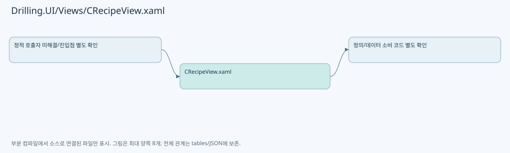

# Drilling.UI/Views/CRecipeView.xaml

| 항목 | 내용 |
| --- | --- |
| 원본 저장소 | https://github.com/kjuws10-rgb/A3Drilling.git |
| 원본 Commit | 96e22cd027c84bf302b23f2949b98985d7f301bb |
| 원본 SHA256 | 47f66a370bf4d019fe62a7f4fc9dcff79ac44d05447785c0893c569771d7d7a0 |
| 파일 분류 | code |
| 원본 크기/행 | 140,599 bytes / 1,779 physical lines |
| 인코딩 | utf-8-sig |
| 검토 범위 | 구문/부분 의미 분석에서 추출한 사실. 동작·물리 단위·실장비 합격을 보증하지 않습니다. |
| 원본 링크 | [고정 Commit 원본](https://github.com/kjuws10-rgb/A3Drilling/blob/96e22cd027c84bf302b23f2949b98985d7f301bb/Drilling.UI/Views/CRecipeView.xaml) |

## 파일의 역할과 읽는 순서

WPF 화면·사용자 명령·표시 상태를 구성합니다. XAML 이벤트와 코드 비하인드, RootView의 조립 경로를 함께 추적합니다.

## 화면 구성과 코드 비하인드 연결

| 항목 | 추출 값 |
| --- | --- |
| 코드 비하인드 후보 | Drilling.UI/Views/CRecipeView.xaml.cs |
| 이름 있는 요소 | ItemBorder, ToggleButton, Shell, PART_Popup, RecipeFilesPanel, RecipeEditorPanel, CellParameterPanel, CellShotMapViewport, CellShotMapZoomContent, CellShotMapScaleTransform, CellShotMapTranslateTransform, CellShotMapSurface, CellShotMapHoverTip, CellShotMapHoverTipTranslateTransform, CellShotMapHoverTipText, RecipePreviewViewport, RecipePreviewZoomContent, RecipePreviewScaleTransform, RecipePreviewTranslateTransform, RecipePreviewHoverTip, RecipePreviewHoverTipTranslateTransform, RecipePreviewHoverTipText, HistoryPanel, HistoryExpandButton, ChangeHistoryGrid |
| 이벤트 개수 | 34 |
| Binding 표현 개수 | 178 |

이름 있는 요소는 WPF가 필드를 생성할 수 있는 XAML 선언입니다. 문서 추출기는 WPF 생성 코드를 만들거나 로드하지 않으므로 C# 원문 멤버 수에 합산하지 않습니다.

| 요소 이름 | 원본 범위 |
| --- | --- |
| ItemBorder | L65–65 |
| ToggleButton | L87–87 |
| Shell | L88–88 |
| PART_Popup | L90–90 |
| RecipeFilesPanel | L232–232 |
| RecipeEditorPanel | L516–516 |
| CellParameterPanel | L664–664 |
| CellShotMapViewport | L1173–1173 |
| CellShotMapZoomContent | L1185–1185 |
| CellShotMapScaleTransform | L1189–1189 |
| CellShotMapTranslateTransform | L1192–1192 |
| CellShotMapSurface | L1196–1196 |
| CellShotMapHoverTip | L1210–1210 |
| CellShotMapHoverTipTranslateTransform | L1222–1222 |
| CellShotMapHoverTipText | L1224–1224 |
| RecipePreviewViewport | L1424–1424 |
| RecipePreviewZoomContent | L1439–1439 |
| RecipePreviewScaleTransform | L1443–1443 |
| RecipePreviewTranslateTransform | L1446–1446 |
| RecipePreviewHoverTip | L1496–1496 |
| RecipePreviewHoverTipTranslateTransform | L1508–1508 |
| RecipePreviewHoverTipText | L1510–1510 |
| HistoryPanel | L1726–1726 |
| HistoryExpandButton | L1740–1740 |
| ChangeHistoryGrid | L1745–1745 |

| 이벤트 | 핸들러 이름 | 원본 범위 | 해석 |
| --- | --- | --- | --- |
| IsVisibleChanged | RecipeView_IsVisibleChanged | L10–10 | 코드 비하인드/이벤트 라우팅에서 실제 연결 확인 필요 |
| Click | OpenManagedItemInput | L728–728 | 코드 비하인드/이벤트 라우팅에서 실제 연결 확인 필요 |
| Click | OpenManagedItemInput | L740–740 | 코드 비하인드/이벤트 라우팅에서 실제 연결 확인 필요 |
| Click | OpenManagedItemInput | L752–752 | 코드 비하인드/이벤트 라우팅에서 실제 연결 확인 필요 |
| Click | OpenManagedItemInput | L771–771 | 코드 비하인드/이벤트 라우팅에서 실제 연결 확인 필요 |
| Click | OpenManagedItemInput | L783–783 | 코드 비하인드/이벤트 라우팅에서 실제 연결 확인 필요 |
| Click | OpenManagedItemInput | L820–820 | 코드 비하인드/이벤트 라우팅에서 실제 연결 확인 필요 |
| Click | OpenManagedItemInput | L832–832 | 코드 비하인드/이벤트 라우팅에서 실제 연결 확인 필요 |
| Click | OpenManagedItemInput | L851–851 | 코드 비하인드/이벤트 라우팅에서 실제 연결 확인 필요 |
| Click | ToggleCellPlacement_Click | L956–956 | 코드 비하인드/이벤트 라우팅에서 실제 연결 확인 필요 |
| Click | OpenCellPlacementWizard_Click | L965–965 | 코드 비하인드/이벤트 라우팅에서 실제 연결 확인 필요 |
| Click | OpenCellOverviewInput | L1045–1045 | 코드 비하인드/이벤트 라우팅에서 실제 연결 확인 필요 |
| Click | OpenCellOverviewInput | L1046–1046 | 코드 비하인드/이벤트 라우팅에서 실제 연결 확인 필요 |
| Click | OpenCellOverviewInput | L1047–1047 | 코드 비하인드/이벤트 라우팅에서 실제 연결 확인 필요 |
| PreviewMouseWheel | CellShotMap_PreviewMouseWheel | L1178–1178 | 코드 비하인드/이벤트 라우팅에서 실제 연결 확인 필요 |
| PreviewMouseRightButtonDown | CellShotMap_PreviewMouseRightButtonDown | L1179–1179 | 코드 비하인드/이벤트 라우팅에서 실제 연결 확인 필요 |
| Click | CellShotMapResize_Click | L1182–1182 | 코드 비하인드/이벤트 라우팅에서 실제 연결 확인 필요 |
| MouseLeftButtonDown | SelectShotGroupFromMap | L1201–1201 | 코드 비하인드/이벤트 라우팅에서 실제 연결 확인 필요 |
| MouseMove | CellShotMapSurface_MouseMove | L1202–1202 | 코드 비하인드/이벤트 라우팅에서 실제 연결 확인 필요 |
| MouseLeave | CellShotMapSurface_MouseLeave | L1203–1203 | 코드 비하인드/이벤트 라우팅에서 실제 연결 확인 필요 |
| Click | OpenShotGroupOffsetInput | L1372–1372 | 코드 비하인드/이벤트 라우팅에서 실제 연결 확인 필요 |
| Click | OpenShotGroupOffsetInput | L1381–1381 | 코드 비하인드/이벤트 라우팅에서 실제 연결 확인 필요 |
| LostMouseCapture | RecipePreview_LostMouseCapture | L1428–1428 | 코드 비하인드/이벤트 라우팅에서 실제 연결 확인 필요 |
| PreviewMouseWheel | RecipePreview_PreviewMouseWheel | L1429–1429 | 코드 비하인드/이벤트 라우팅에서 실제 연결 확인 필요 |
| PreviewMouseLeftButtonDown | RecipePreview_PreviewMouseLeftButtonDown | L1430–1430 | 코드 비하인드/이벤트 라우팅에서 실제 연결 확인 필요 |
| PreviewMouseRightButtonDown | RecipePreview_PreviewMouseRightButtonDown | L1431–1431 | 코드 비하인드/이벤트 라우팅에서 실제 연결 확인 필요 |
| PreviewMouseMove | RecipePreview_PreviewMouseMove | L1432–1432 | 코드 비하인드/이벤트 라우팅에서 실제 연결 확인 필요 |
| PreviewMouseLeftButtonUp | RecipePreview_PreviewMouseLeftButtonUp | L1433–1433 | 코드 비하인드/이벤트 라우팅에서 실제 연결 확인 필요 |
| Click | RecipePreviewResize_Click | L1436–1436 | 코드 비하인드/이벤트 라우팅에서 실제 연결 확인 필요 |
| MouseMove | CellPreviewLabel_MouseMove | L1464–1464 | 코드 비하인드/이벤트 라우팅에서 실제 연결 확인 필요 |
| MouseLeave | CellPreviewLabel_MouseLeave | L1465–1465 | 코드 비하인드/이벤트 라우팅에서 실제 연결 확인 필요 |
| Click | OpenManagedItemInput | L1585–1585 | 코드 비하인드/이벤트 라우팅에서 실제 연결 확인 필요 |
| Click | OpenManagedItemInput | L1705–1705 | 코드 비하인드/이벤트 라우팅에서 실제 연결 확인 필요 |
| Click | ToggleHistory_Click | L1741–1741 | 코드 비하인드/이벤트 라우팅에서 실제 연결 확인 필요 |

| Binding 표현 | 원본 범위 |
| --- | --- |
| {Binding DataContext.CurrentScreen.Recipe.IsViewRecipeSelected, RelativeSource={RelativeSource AncestorType=UserControl}} | L24–24 |
| {Binding DataContext.CurrentScreen.Recipe.IsViewRecipeSelected, RelativeSource={RelativeSource AncestorType=UserControl}} | L75–75 |
| {Binding IsDropDownOpen, Mode=TwoWay, RelativeSource={RelativeSource TemplatedParent}} | L87–87 |
| {Binding SelectionBoxItem, RelativeSource={RelativeSource AncestorType=ComboBox}} | L88–88 |
| {Binding ActualWidth, ElementName=ToggleButton} | L90–90 |
| {Binding CurrentScreen.IsRecipeLayout, Converter={StaticResource BooleanToVisibilityConverter}} | L202–202 |
| {Binding CurrentScreen.Recipe.IsZeroDefenceCategory} | L223–223 |
| {Binding CurrentScreen.Recipe.RecipeFiles} | L278–278 |
| {Binding DataContext.CurrentScreen.Recipe.ViewCommand, RelativeSource={RelativeSource AncestorType=UserControl}} | L282–282 |
| {Binding FileName} | L283–283 |
| {Binding IsView} | L289–289 |
| {Binding IsSelect} | L292–292 |
| {Binding No} | L303–303 |
| {Binding IsView} | L311–311 |
| {Binding IsSelect} | L314–314 |
| {Binding FileName} | L325–325 |
| {Binding IsView} | L332–332 |
| {Binding IsSelect} | L335–335 |
| {Binding CurrentScreen.Recipe.PreviousRecipePageCommand} | L365–365 |
| {Binding CurrentScreen.Recipe.RecipeFilesPageText} | L367–367 |
| {Binding CurrentScreen.Recipe.NextRecipePageCommand} | L380–380 |
| {Binding CurrentScreen.Recipe.SelectCommand} | L389–389 |
| {Binding CurrentScreen.Recipe.CreateCommand} | L415–415 |
| {Binding CurrentScreen.Recipe.ModifyCommand} | L440–440 |
| {Binding CurrentScreen.Recipe.SaveCommand} | L467–467 |
| {Binding CurrentScreen.Recipe.DeleteCommand} | L490–490 |
| {Binding CurrentScreen.Recipe.IsCellCategory} | L527–527 |
| {Binding CurrentScreen.Recipe.IsCellCategory} | L539–539 |
| {Binding CurrentScreen.Recipe.ItemTabs} | L559–559 |
| {Binding DisplayName} | L567–567 |
| {Binding DataContext.CurrentScreen.Recipe.SelectCategoryCommand, RelativeSource={RelativeSource AncestorType=UserControl}} | L568–568 |
| {Binding Category} | L569–569 |
| {Binding IsSelected} | L576–576 |
| {Binding CurrentScreen.Recipe.GroupTabs} | L591–591 |
| {Binding CurrentScreen.Recipe.IsCellCategory} | L597–597 |
| {Binding CurrentScreen.Recipe.IsHeadCategory} | L600–600 |
| {Binding CurrentScreen.Recipe.IsZeroDefenceCategory} | L603–603 |
| {Binding Group} | L616–616 |
| {Binding DataContext.CurrentScreen.Recipe.SelectGroupCommand, RelativeSource={RelativeSource AncestorType=UserControl}} | L617–617 |
| {Binding Group} | L618–618 |
| {Binding IsSelected} | L628–628 |
| {Binding DataContext.CurrentScreen.Recipe.IsHeadCategory, RelativeSource={RelativeSource AncestorType=UserControl}} | L633–633 |
| {Binding CurrentScreen.Recipe.IsCellCategory, Converter={StaticResource BooleanToVisibilityConverter}} | L650–650 |
| {Binding DataContext.CurrentScreen.Recipe.IsCellPlacementExpanded, RelativeSource={RelativeSource AncestorType=UserControl}} | L677–677 |
| {Binding CurrentScreen.Recipe.GlassSizeXItem.Value} | L728–728 |
| {Binding CurrentScreen.Recipe.GlassSizeXItem} | L728–728 |
| {Binding CurrentScreen.Recipe.GlassSizeYItem.Value} | L740–740 |
| {Binding CurrentScreen.Recipe.GlassSizeYItem} | L740–740 |
| {Binding CurrentScreen.Recipe.MaxCellNumberItem.Value} | L752–752 |
| {Binding CurrentScreen.Recipe.MaxCellNumberItem} | L752–752 |
| {Binding CurrentScreen.Recipe.AkMarginXItem.Value} | L771–771 |
| {Binding CurrentScreen.Recipe.AkMarginXItem} | L771–771 |
| {Binding CurrentScreen.Recipe.AkMarginYItem.Value} | L783–783 |
| {Binding CurrentScreen.Recipe.AkMarginYItem} | L783–783 |
| {Binding CurrentScreen.Recipe.CellModelTypeCountItem.ValueOptions} | L796–796 |
| {Binding CurrentScreen.Recipe.CellModelTypeCountItem.Value, Mode=TwoWay, UpdateSourceTrigger=PropertyChanged} | L797–797 |
| {Binding CurrentScreen.Recipe.EscEdgeToGlassEdgeItem.Value} | L820–820 |
| {Binding CurrentScreen.Recipe.EscEdgeToGlassEdgeItem} | L820–820 |
| {Binding CurrentScreen.Recipe.GlassCenterToScannerCenterItem.Value} | L832–832 |
| {Binding CurrentScreen.Recipe.GlassCenterToScannerCenterItem} | L832–832 |
| {Binding CurrentScreen.Recipe.PixelSizeItem.Value} | L851–851 |
| {Binding CurrentScreen.Recipe.PixelSizeItem} | L851–851 |
| {Binding CurrentScreen.Recipe.SplitBeamCountItem.ValueOptions} | L871–871 |
| {Binding CurrentScreen.Recipe.SplitBeamCountItem.Value, Mode=TwoWay, UpdateSourceTrigger=PropertyChanged} | L872–872 |
| {Binding CurrentScreen.Recipe.ShotGroupPatternSummary} | L883–883 |
| {Binding CurrentScreen.Recipe.DistortionKeyItems} | L894–894 |
| {Binding DisplayText} | L917–917 |
| {Binding StageY} | L921–921 |
| {Binding YLabel} | L922–922 |
| {Binding CurrentScreen.Recipe.CurrentCellIndicatorText} | L949–949 |
| {Binding DataContext.CurrentScreen.Recipe.CellPlacementExpandButtonText, RelativeSource={RelativeSource AncestorType=UserControl}} | L955–955 |
| {Binding CurrentScreen.Recipe.CellOverviewRows} | L983–983 |
| {Binding IsCurrent} | L1019–1019 |
| {Binding CellNo} | L1030–1030 |
| {Binding DataContext.CurrentScreen.Recipe.SelectCellCommand, RelativeSource={RelativeSource AncestorType=UserControl}} | L1031–1031 |
| {Binding CellNo} | L1032–1032 |
| {Binding FirstX} | L1045–1045 |
| {Binding FirstY} | L1046–1046 |
| {Binding Rotation} | L1047–1047 |
| {Binding ModelOptions} | L1051–1051 |
| {Binding ModelType, Mode=TwoWay, UpdateSourceTrigger=PropertyChanged} | L1052–1052 |
| {Binding CurrentScreen.Recipe.IsCellDetailVisible, Converter={StaticResource BooleanToVisibilityConverter}} | L1072–1072 |
| {Binding CurrentScreen.Recipe.PreviousCellCommand} | L1086–1086 |
| {Binding CurrentScreen.Recipe.SelectedCellNavigationText} | L1101–1101 |
| {Binding CurrentScreen.Recipe.NextCellCommand} | L1109–1109 |
| {Binding CurrentScreen.Recipe.BackToCellPreviewCommand} | L1121–1121 |
| {Binding CurrentScreen.Recipe.SelectedCellShotGroupTitle} | L1128–1128 |
| {Binding CurrentScreen.Recipe.CellShotMapPanelHeight} | L1142–1142 |
| {Binding CurrentScreen.Recipe.CellShotMapGridRow} | L1154–1154 |
| {Binding CurrentScreen.Recipe.CellShotMapGridRowSpan} | L1155–1155 |
| {Binding CurrentScreen.Recipe.CellShotMapGridColumn} | L1156–1156 |
| {Binding CurrentScreen.Recipe.CellShotMapGridColumnSpan} | L1157–1157 |
| {Binding CurrentScreen.Recipe.CellShotMapSurfaceWidth} | L1197–1197 |
| {Binding CurrentScreen.Recipe.CellShotMapSurfaceHeight} | L1198–1198 |
| {Binding CurrentScreen.Recipe.CellShotMapImage} | L1204–1204 |
| {Binding CurrentScreen.Recipe.CellShotDetailGridRow} | L1244–1244 |
| {Binding CurrentScreen.Recipe.CellShotDetailGridRowSpan} | L1245–1245 |
| {Binding CurrentScreen.Recipe.CellShotDetailGridColumn} | L1246–1246 |
| {Binding CurrentScreen.Recipe.CellShotDetailGridColumnSpan} | L1247–1247 |
| {Binding CurrentScreen.Recipe.CellShotDetailVerticalGap} | L1250–1250 |
| {Binding CurrentScreen.Recipe.SelectedShotDetailGridRow} | L1259–1259 |
| {Binding CurrentScreen.Recipe.SelectedShotDetailGridColumn} | L1260–1260 |
| {Binding CurrentScreen.Recipe.SelectedShotDetailGridColumnSpan} | L1261–1261 |
| {Binding CurrentScreen.Recipe.SelectedShotDetailImage} | L1278–1278 |
| {Binding CurrentScreen.Recipe.ShotInformationGridRow} | L1299–1299 |
| {Binding CurrentScreen.Recipe.ShotInformationGridColumn} | L1300–1300 |
| {Binding CurrentScreen.Recipe.ShotInformationGridColumnSpan} | L1301–1301 |
| {Binding CurrentScreen.Recipe.SelectedShotGroupGridText} | L1330–1330 |
| {Binding CurrentScreen.Recipe.SelectedShotGroupCenterText} | L1332–1332 |
| {Binding CurrentScreen.Recipe.SelectedShotGroupStateText} | L1335–1335 |
| {Binding CurrentScreen.Recipe.SelectedShotGroup.IsChessSkipped} | L1340–1340 |
| {Binding CurrentScreen.Recipe.SelectedShotGroup.IsInsideGlass} | L1343–1343 |
| {Binding CurrentScreen.Recipe.SelectedShotGroup.IsMasked} | L1346–1346 |
| {Binding CurrentScreen.Recipe.SelectedShotGroup.MaskingStateText} | L1354–1354 |
| {Binding CurrentScreen.Recipe.SelectedShotGroup.IsMasked} | L1359–1359 |
| {Binding CurrentScreen.Recipe.SelectedShotGroup.OffsetX} | L1372–1372 |
| {Binding CurrentScreen.Recipe.SelectedShotGroup} | L1372–1372 |
| {Binding CurrentScreen.Recipe.SelectedShotGroup.OffsetY} | L1381–1381 |
| {Binding CurrentScreen.Recipe.SelectedShotGroup} | L1381–1381 |
| {Binding CurrentScreen.Recipe.IsCellPreviewVisible, Converter={StaticResource BooleanToVisibilityConverter}} | L1394–1394 |
| {Binding CurrentScreen.Recipe.CellPreviewSummaryText} | L1409–1409 |
| {Binding CurrentScreen.Recipe.CellPreviewImage} | L1449–1449 |
| {Binding CurrentScreen.Recipe.CellPreviewLabels} | L1453–1453 |
| {Binding Width} | L1458–1458 |
| {Binding Height} | L1459–1459 |
| {Binding DataContext.CurrentScreen.Recipe.SelectPreviewCellCommand, RelativeSource={RelativeSource AncestorType=UserControl}} | L1466–1466 |
| {Binding CellNo} | L1467–1467 |
| {Binding CurrentScreen.Recipe.IsHeadCategory, Converter={StaticResource BooleanToVisibilityConverter}} | L1522–1522 |
| {Binding CurrentScreen.Recipe.GroupTabs} | L1534–1534 |
| {Binding Group} | L1543–1543 |
| {Binding DataContext.CurrentScreen.Recipe.SelectGroupCommand, RelativeSource={RelativeSource AncestorType=UserControl}} | L1544–1544 |
| {Binding Group} | L1545–1545 |
| {Binding IsSelected} | L1556–1556 |
| {Binding CurrentScreen.Recipe.ManagedItems} | L1572–1572 |
| {Binding Group} | L1579–1579 |
| {Binding Item} | L1580–1580 |
| {Binding Value} | L1585–1585 |
| {Binding} | L1585–1585 |
| {Binding UsesSelectionEditor} | L1587–1587 |
| {Binding ValueOptions} | L1589–1589 |
| {Binding Value, Mode=TwoWay, UpdateSourceTrigger=PropertyChanged} | L1589–1589 |
| {Binding UsesSelectionEditor} | L1592–1592 |
| {Binding Unit} | L1598–1598 |
| {Binding CurrentScreen.Recipe.HeadPreviewSummaryText} | L1619–1619 |
| {Binding CurrentScreen.Recipe.HeadPreviewImage} | L1640–1640 |
| {Binding CurrentScreen.Recipe.HeadPreviewLabels} | L1644–1644 |
| {Binding Width} | L1648–1648 |
| {Binding Height} | L1649–1649 |
| {Binding BackgroundBrush} | L1651–1651 |
| {Binding BorderBrush} | L1652–1652 |
| {Binding DisplayText} | L1656–1656 |
| {Binding TextBrush} | L1657–1657 |
| {Binding CurrentScreen.Recipe.ZeroDefence} | L1673–1673 |
| {Binding DataContext.CurrentScreen.Recipe.IsZeroDefenceCategory, RelativeSource={RelativeSource AncestorType=views:CRecipeView}, Converter={StaticResource BooleanToVisibilityConverter}} | L1674–1674 |
| {Binding CurrentScreen.Recipe.ManagedItems} | L1677–1677 |
| {Binding CurrentScreen.Recipe.IsCellCategory} | L1686–1686 |
| {Binding CurrentScreen.Recipe.IsHeadCategory} | L1689–1689 |
| {Binding CurrentScreen.Recipe.IsZeroDefenceCategory} | L1692–1692 |
| {Binding Group} | L1699–1699 |
| {Binding Item} | L1700–1700 |
| {Binding Value} | L1705–1705 |
| {Binding} | L1705–1705 |
| {Binding UsesSelectionEditor} | L1707–1707 |
| {Binding ValueOptions} | L1709–1709 |
| {Binding Value, Mode=TwoWay, UpdateSourceTrigger=PropertyChanged} | L1709–1709 |
| {Binding UsesSelectionEditor} | L1712–1712 |
| {Binding Unit} | L1718–1718 |
| {Binding Description} | L1719–1719 |
| {Binding CurrentScreen.Recipe.ChangeHistory} | L1747–1747 |
| {Binding Time} | L1755–1755 |
| {Binding Action} | L1756–1756 |
| {Binding Recipe} | L1757–1757 |
| {Binding Tab} | L1758–1758 |
| {Binding Group} | L1759–1759 |
| {Binding Item} | L1760–1760 |
| {Binding Before} | L1761–1761 |
| {Binding After} | L1762–1762 |
| {Binding AfterBrush} | L1765–1765 |

## 원문 전체 주석 해설본

[원본 모든 행과 행별 해설 보기](../../../annotated/Drilling.UI/Views/CRecipeView.xaml.annotated.txt)

원본을 빠뜨리거나 임의로 줄이지 않았습니다. `L000001 |` 표시는 원본 행 번호, `// 해설`은 별도 설명입니다. 실행용 소스가 아닌 문서입니다.

## 수정·재검증 체크

- 원본 Commit과 현재 작업 파일 SHA가 같은지 먼저 확인합니다. 다르면 이 문서를 과거 버전 자료로 취급합니다.
- 선언·직접 호출·이벤트/인터페이스 경계·설정 소비를 함께 확인합니다. 정적 연결의 빈 곳을 정상 경로로 추정하지 않습니다.
- 저장 형식/단위/식별자·재시도·취소·예외·롤백에 영향을 주는 변경은 상세 해설장과 호출자를 다시 검토합니다.
- 도구의 구문 추출과 별도 정적 추적 해설, 실제 빌드·시뮬레이션·실장비 검증 결과를 분리합니다.
