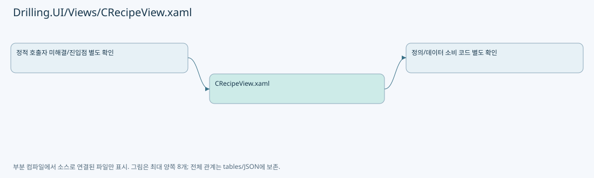

# Drilling.UI/Views/CRecipeView.xaml

| 항목 | 내용 |
| --- | --- |
| 원본 저장소 | https://github.com/kjuws10-rgb/A3Drilling.git |
| 원본 Commit | 5aee8e58439c9b455cae7c9593c9be986c3e682e |
| 원본 SHA256 | 47f66a370bf4d019fe62a7f4fc9dcff79ac44d05447785c0893c569771d7d7a0 |
| 파일 분류 | code |
| 원본 크기/행 | 140,599 bytes / 1,779 physical lines |
| 인코딩 | utf-8-sig |
| 검토 범위 | 구문/부분 의미 분석에서 추출한 사실. 동작·물리 단위·실장비 합격을 보증하지 않습니다. |
| 원본 링크 | [고정 Commit 원본](https://github.com/kjuws10-rgb/A3Drilling/blob/5aee8e58439c9b455cae7c9593c9be986c3e682e/Drilling.UI/Views/CRecipeView.xaml) |

## 파일의 역할과 읽는 순서

WPF 화면·사용자 명령·표시 상태를 구성합니다. XAML 이벤트와 코드 비하인드, RootView의 조립 경로를 함께 추적합니다.

## 화면 구성과 코드 비하인드 연결

| 항목 | 추출 값 |
| --- | --- |
| 코드 비하인드 후보 | Drilling.UI/Views/CRecipeView.xaml.cs |
| 이름 있는 요소 | ItemBorder, ToggleButton, Shell, PART_Popup, RecipeFilesPanel, RecipeEditorPanel, CellParameterPanel, CellShotMapViewport, CellShotMapZoomContent, CellShotMapScaleTransform, CellShotMapTranslateTransform, CellShotMapSurface, CellShotMapHoverTip, CellShotMapHoverTipTranslateTransform, CellShotMapHoverTipText, RecipePreviewViewport, RecipePreviewZoomContent, RecipePreviewScaleTransform, RecipePreviewTranslateTransform, RecipePreviewHoverTip, RecipePreviewHoverTipTranslateTransform, RecipePreviewHoverTipText, HistoryPanel, HistoryExpandButton, ChangeHistoryGrid |
| 이벤트 개수 | 22 |
| Binding 표현 개수 | 176 |

| 이벤트 | 핸들러 이름 | 해석 |
| --- | --- | --- |
| Click | OpenManagedItemInput | 코드 비하인드/이벤트 라우팅에서 실제 연결 확인 필요 |
| Click | OpenManagedItemInput | 코드 비하인드/이벤트 라우팅에서 실제 연결 확인 필요 |
| Click | OpenManagedItemInput | 코드 비하인드/이벤트 라우팅에서 실제 연결 확인 필요 |
| Click | OpenManagedItemInput | 코드 비하인드/이벤트 라우팅에서 실제 연결 확인 필요 |
| Click | OpenManagedItemInput | 코드 비하인드/이벤트 라우팅에서 실제 연결 확인 필요 |
| Click | OpenManagedItemInput | 코드 비하인드/이벤트 라우팅에서 실제 연결 확인 필요 |
| Click | OpenManagedItemInput | 코드 비하인드/이벤트 라우팅에서 실제 연결 확인 필요 |
| Click | OpenManagedItemInput | 코드 비하인드/이벤트 라우팅에서 실제 연결 확인 필요 |
| Click | ToggleCellPlacement_Click | 코드 비하인드/이벤트 라우팅에서 실제 연결 확인 필요 |
| Click | OpenCellPlacementWizard_Click | 코드 비하인드/이벤트 라우팅에서 실제 연결 확인 필요 |
| Click | OpenCellOverviewInput | 코드 비하인드/이벤트 라우팅에서 실제 연결 확인 필요 |
| Click | OpenCellOverviewInput | 코드 비하인드/이벤트 라우팅에서 실제 연결 확인 필요 |
| Click | OpenCellOverviewInput | 코드 비하인드/이벤트 라우팅에서 실제 연결 확인 필요 |
| Click | CellShotMapResize_Click | 코드 비하인드/이벤트 라우팅에서 실제 연결 확인 필요 |
| MouseMove | CellShotMapSurface_MouseMove | 코드 비하인드/이벤트 라우팅에서 실제 연결 확인 필요 |
| Click | OpenShotGroupOffsetInput | 코드 비하인드/이벤트 라우팅에서 실제 연결 확인 필요 |
| Click | OpenShotGroupOffsetInput | 코드 비하인드/이벤트 라우팅에서 실제 연결 확인 필요 |
| Click | RecipePreviewResize_Click | 코드 비하인드/이벤트 라우팅에서 실제 연결 확인 필요 |
| MouseMove | CellPreviewLabel_MouseMove | 코드 비하인드/이벤트 라우팅에서 실제 연결 확인 필요 |
| Click | OpenManagedItemInput | 코드 비하인드/이벤트 라우팅에서 실제 연결 확인 필요 |
| Click | OpenManagedItemInput | 코드 비하인드/이벤트 라우팅에서 실제 연결 확인 필요 |
| Click | ToggleHistory_Click | 코드 비하인드/이벤트 라우팅에서 실제 연결 확인 필요 |

| Binding 표현 |
| --- |
| DataContext.CurrentScreen.Recipe.IsViewRecipeSelected, RelativeSource={RelativeSource AncestorType=UserControl |
| DataContext.CurrentScreen.Recipe.IsViewRecipeSelected, RelativeSource={RelativeSource AncestorType=UserControl |
| IsDropDownOpen, Mode=TwoWay, RelativeSource={RelativeSource TemplatedParent |
| SelectionBoxItem, RelativeSource={RelativeSource AncestorType=ComboBox |
| ActualWidth, ElementName=ToggleButton |
| CurrentScreen.IsRecipeLayout, Converter={StaticResource BooleanToVisibilityConverter |
| CurrentScreen.Recipe.IsZeroDefenceCategory |
| CurrentScreen.Recipe.RecipeFiles |
| DataContext.CurrentScreen.Recipe.ViewCommand, RelativeSource={RelativeSource AncestorType=UserControl |
| FileName |
| IsView |
| IsSelect |
| No |
| IsView |
| IsSelect |
| FileName |
| IsView |
| IsSelect |
| CurrentScreen.Recipe.PreviousRecipePageCommand |
| CurrentScreen.Recipe.RecipeFilesPageText |
| CurrentScreen.Recipe.NextRecipePageCommand |
| CurrentScreen.Recipe.SelectCommand |
| CurrentScreen.Recipe.CreateCommand |
| CurrentScreen.Recipe.ModifyCommand |
| CurrentScreen.Recipe.SaveCommand |
| CurrentScreen.Recipe.DeleteCommand |
| CurrentScreen.Recipe.IsCellCategory |
| CurrentScreen.Recipe.IsCellCategory |
| CurrentScreen.Recipe.ItemTabs |
| DisplayName |
| DataContext.CurrentScreen.Recipe.SelectCategoryCommand, RelativeSource={RelativeSource AncestorType=UserControl |
| Category |
| IsSelected |
| CurrentScreen.Recipe.GroupTabs |
| CurrentScreen.Recipe.IsCellCategory |
| CurrentScreen.Recipe.IsHeadCategory |
| CurrentScreen.Recipe.IsZeroDefenceCategory |
| Group |
| DataContext.CurrentScreen.Recipe.SelectGroupCommand, RelativeSource={RelativeSource AncestorType=UserControl |
| Group |
| IsSelected |
| DataContext.CurrentScreen.Recipe.IsHeadCategory, RelativeSource={RelativeSource AncestorType=UserControl |
| CurrentScreen.Recipe.IsCellCategory, Converter={StaticResource BooleanToVisibilityConverter |
| DataContext.CurrentScreen.Recipe.IsCellPlacementExpanded, RelativeSource={RelativeSource AncestorType=UserControl |
| CurrentScreen.Recipe.GlassSizeXItem.Value |
| CurrentScreen.Recipe.GlassSizeXItem |
| CurrentScreen.Recipe.GlassSizeYItem.Value |
| CurrentScreen.Recipe.GlassSizeYItem |
| CurrentScreen.Recipe.MaxCellNumberItem.Value |
| CurrentScreen.Recipe.MaxCellNumberItem |
| CurrentScreen.Recipe.AkMarginXItem.Value |
| CurrentScreen.Recipe.AkMarginXItem |
| CurrentScreen.Recipe.AkMarginYItem.Value |
| CurrentScreen.Recipe.AkMarginYItem |
| CurrentScreen.Recipe.CellModelTypeCountItem.ValueOptions |
| CurrentScreen.Recipe.CellModelTypeCountItem.Value, Mode=TwoWay, UpdateSourceTrigger=PropertyChanged |
| CurrentScreen.Recipe.EscEdgeToGlassEdgeItem.Value |
| CurrentScreen.Recipe.EscEdgeToGlassEdgeItem |
| CurrentScreen.Recipe.GlassCenterToScannerCenterItem.Value |
| CurrentScreen.Recipe.GlassCenterToScannerCenterItem |
| CurrentScreen.Recipe.PixelSizeItem.Value |
| CurrentScreen.Recipe.PixelSizeItem |
| CurrentScreen.Recipe.SplitBeamCountItem.ValueOptions |
| CurrentScreen.Recipe.SplitBeamCountItem.Value, Mode=TwoWay, UpdateSourceTrigger=PropertyChanged |
| CurrentScreen.Recipe.ShotGroupPatternSummary |
| CurrentScreen.Recipe.DistortionKeyItems |
| DisplayText |
| StageY |
| YLabel |
| CurrentScreen.Recipe.CurrentCellIndicatorText |
| DataContext.CurrentScreen.Recipe.CellPlacementExpandButtonText, RelativeSource={RelativeSource AncestorType=UserControl |
| CurrentScreen.Recipe.CellOverviewRows |
| IsCurrent |
| CellNo |
| DataContext.CurrentScreen.Recipe.SelectCellCommand, RelativeSource={RelativeSource AncestorType=UserControl |
| CellNo |
| FirstX |
| FirstY |
| Rotation |
| ModelOptions |
| ModelType, Mode=TwoWay, UpdateSourceTrigger=PropertyChanged |
| CurrentScreen.Recipe.IsCellDetailVisible, Converter={StaticResource BooleanToVisibilityConverter |
| CurrentScreen.Recipe.PreviousCellCommand |
| CurrentScreen.Recipe.SelectedCellNavigationText |
| CurrentScreen.Recipe.NextCellCommand |
| CurrentScreen.Recipe.BackToCellPreviewCommand |
| CurrentScreen.Recipe.SelectedCellShotGroupTitle |
| CurrentScreen.Recipe.CellShotMapPanelHeight |
| CurrentScreen.Recipe.CellShotMapGridRow |
| CurrentScreen.Recipe.CellShotMapGridRowSpan |
| CurrentScreen.Recipe.CellShotMapGridColumn |
| CurrentScreen.Recipe.CellShotMapGridColumnSpan |
| CurrentScreen.Recipe.CellShotMapSurfaceWidth |
| CurrentScreen.Recipe.CellShotMapSurfaceHeight |
| CurrentScreen.Recipe.CellShotMapImage |
| CurrentScreen.Recipe.CellShotDetailGridRow |
| CurrentScreen.Recipe.CellShotDetailGridRowSpan |
| CurrentScreen.Recipe.CellShotDetailGridColumn |
| CurrentScreen.Recipe.CellShotDetailGridColumnSpan |
| CurrentScreen.Recipe.CellShotDetailVerticalGap |
| CurrentScreen.Recipe.SelectedShotDetailGridRow |
| CurrentScreen.Recipe.SelectedShotDetailGridColumn |
| CurrentScreen.Recipe.SelectedShotDetailGridColumnSpan |
| CurrentScreen.Recipe.SelectedShotDetailImage |
| CurrentScreen.Recipe.ShotInformationGridRow |
| CurrentScreen.Recipe.ShotInformationGridColumn |
| CurrentScreen.Recipe.ShotInformationGridColumnSpan |
| CurrentScreen.Recipe.SelectedShotGroupGridText |
| CurrentScreen.Recipe.SelectedShotGroupCenterText |
| CurrentScreen.Recipe.SelectedShotGroupStateText |
| CurrentScreen.Recipe.SelectedShotGroup.IsChessSkipped |
| CurrentScreen.Recipe.SelectedShotGroup.IsInsideGlass |
| CurrentScreen.Recipe.SelectedShotGroup.IsMasked |
| CurrentScreen.Recipe.SelectedShotGroup.MaskingStateText |
| CurrentScreen.Recipe.SelectedShotGroup.IsMasked |
| CurrentScreen.Recipe.SelectedShotGroup.OffsetX |
| CurrentScreen.Recipe.SelectedShotGroup |
| CurrentScreen.Recipe.SelectedShotGroup.OffsetY |
| CurrentScreen.Recipe.SelectedShotGroup |
| CurrentScreen.Recipe.IsCellPreviewVisible, Converter={StaticResource BooleanToVisibilityConverter |
| CurrentScreen.Recipe.CellPreviewSummaryText |
| CurrentScreen.Recipe.CellPreviewImage |
| CurrentScreen.Recipe.CellPreviewLabels |
| Width |
| Height |
| DataContext.CurrentScreen.Recipe.SelectPreviewCellCommand, RelativeSource={RelativeSource AncestorType=UserControl |
| CellNo |
| CurrentScreen.Recipe.IsHeadCategory, Converter={StaticResource BooleanToVisibilityConverter |
| CurrentScreen.Recipe.GroupTabs |
| Group |
| DataContext.CurrentScreen.Recipe.SelectGroupCommand, RelativeSource={RelativeSource AncestorType=UserControl |
| Group |
| IsSelected |
| CurrentScreen.Recipe.ManagedItems |
| Group |
| Item |
| Value |
| UsesSelectionEditor |
| ValueOptions |
| Value, Mode=TwoWay, UpdateSourceTrigger=PropertyChanged |
| UsesSelectionEditor |
| Unit |
| CurrentScreen.Recipe.HeadPreviewSummaryText |
| CurrentScreen.Recipe.HeadPreviewImage |
| CurrentScreen.Recipe.HeadPreviewLabels |
| Width |
| Height |
| BackgroundBrush |
| BorderBrush |
| DisplayText |
| TextBrush |
| CurrentScreen.Recipe.ZeroDefence |
| DataContext.CurrentScreen.Recipe.IsZeroDefenceCategory, RelativeSource={RelativeSource AncestorType=views:CRecipeView |
| CurrentScreen.Recipe.ManagedItems |
| CurrentScreen.Recipe.IsCellCategory |
| CurrentScreen.Recipe.IsHeadCategory |
| CurrentScreen.Recipe.IsZeroDefenceCategory |
| Group |
| Item |
| Value |
| UsesSelectionEditor |
| ValueOptions |
| Value, Mode=TwoWay, UpdateSourceTrigger=PropertyChanged |
| UsesSelectionEditor |
| Unit |
| Description |
| CurrentScreen.Recipe.ChangeHistory |
| Time |
| Action |
| Recipe |
| Tab |
| Group |
| Item |
| Before |
| After |
| AfterBrush |

## 원문 전체 주석 해설본

[원본 모든 행과 행별 해설 보기](../../../annotated/Drilling.UI/Views/CRecipeView.xaml.annotated.txt)

원본을 빠뜨리거나 임의로 줄이지 않았습니다. `L000001 |` 표시는 원본 행 번호, `// 해설`은 별도 설명입니다. 실행용 소스가 아닌 문서입니다.

## 수정·재검증 체크

- 원본 Commit과 현재 작업 파일 SHA가 같은지 먼저 확인합니다. 다르면 이 문서를 과거 버전 자료로 취급합니다.
- 선언·직접 호출·이벤트/인터페이스 경계·설정 소비를 함께 확인합니다. 정적 연결의 빈 곳을 정상 경로로 추정하지 않습니다.
- 저장 형식/단위/식별자·재시도·취소·예외·롤백에 영향을 주는 변경은 상세 해설장과 호출자를 다시 검토합니다.
- 도구의 구문 추출과 별도 정적 추적 해설, 실제 빌드·시뮬레이션·실장비 검증 결과를 분리합니다.
