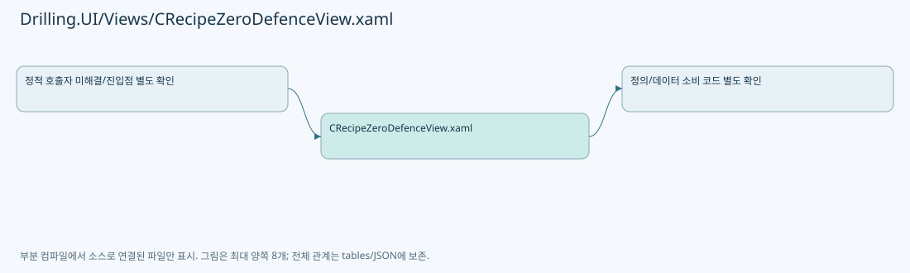

# Drilling.UI/Views/CRecipeZeroDefenceView.xaml

| 항목 | 내용 |
| --- | --- |
| 원본 저장소 | https://github.com/kjuws10-rgb/A3Drilling.git |
| 원본 Commit | 0219666f9053b907d96d7e0aa7d0c6c1be3a73d4 |
| 원본 SHA256 | b84943075a7eacf71b08226cc94113c216b79999d94646ac1e6aa29c80408a64 |
| 파일 분류 | code |
| 원본 크기/행 | 15,948 bytes / 134 physical lines |
| 인코딩 | utf-8-sig |
| 검토 범위 | 구문/부분 의미 분석에서 추출한 사실. 동작·물리 단위·실장비 합격을 보증하지 않습니다. |
| 원본 링크 | [고정 Commit 원본](https://github.com/kjuws10-rgb/A3Drilling/blob/0219666f9053b907d96d7e0aa7d0c6c1be3a73d4/Drilling.UI/Views/CRecipeZeroDefenceView.xaml) |

## 파일의 역할과 읽는 순서

WPF 화면·사용자 명령·표시 상태를 구성합니다. XAML 이벤트와 코드 비하인드, RootView의 조립 경로를 함께 추적합니다.

## 화면 구성과 코드 비하인드 연결

| 항목 | 추출 값 |
| --- | --- |
| 코드 비하인드 후보 | Drilling.UI/Views/CRecipeZeroDefenceView.xaml.cs |
| 이름 있는 요소 | ZeroGroupCards, ZeroCellGrid, CellBox, ZeroSelectionLabels, ZeroShotGrid, ShotBox, ZeroHeadGrid, ZeroBeamGrid |
| 이벤트 개수 | 0 |
| Binding 표현 개수 | 74 |

이름 있는 요소는 WPF가 필드를 생성할 수 있는 XAML 선언입니다. 문서 추출기는 WPF 생성 코드를 만들거나 로드하지 않으므로 C# 원문 멤버 수에 합산하지 않습니다.

| 요소 이름 | 원본 범위 |
| --- | --- |
| ZeroGroupCards | L31–31 |
| ZeroCellGrid | L56–56 |
| CellBox | L62–62 |
| ZeroSelectionLabels | L70–70 |
| ZeroShotGrid | L83–83 |
| ShotBox | L94–94 |
| ZeroHeadGrid | L104–104 |
| ZeroBeamGrid | L118–118 |

| 이벤트 | 핸들러 이름 | 원본 범위 | 해석 |
| --- | --- | --- | --- |

| Binding 표현 | 원본 범위 |
| --- | --- |
| {Binding SelectCountCommand} | L17–17 |
| {Binding IsTwo} | L18–18 |
| {Binding SelectCountCommand} | L20–20 |
| {Binding IsFour} | L21–21 |
| {Binding ClearGroupCommand} | L23–23 |
| {Binding Summary} | L24–24 |
| {Binding GroupCards} | L31–31 |
| {Binding Background} | L34–34 |
| {Binding Foreground} | L34–34 |
| {Binding Number} | L35–35 |
| {Binding DataContext.SelectGroupCommand, RelativeSource={RelativeSource AncestorType=UserControl}} | L35–35 |
| {Binding Name} | L36–36 |
| {Binding Detail} | L36–36 |
| {Binding BackToGlassCommand} | L42–42 |
| {Binding PreviewTitle} | L43–43 |
| {Binding GlassVisibility} | L51–51 |
| {Binding PreviewCanvasHeight} | L52–52 |
| {Binding PreviewImage} | L53–53 |
| {Binding GlassFrame.CanvasLeft} | L54–54 |
| {Binding GlassFrame.CanvasTop} | L54–54 |
| {Binding GlassFrame.Width} | L55–55 |
| {Binding GlassFrame.Height} | L55–55 |
| {Binding Cells} | L56–56 |
| {Binding Bounds.X} | L58–58 |
| {Binding Bounds.Y} | L58–58 |
| {Binding Bounds.Width} | L60–60 |
| {Binding Bounds.Height} | L60–60 |
| {Binding Number} | L60–60 |
| {Binding CanOpen} | L60–60 |
| {Binding Detail} | L61–61 |
| {Binding DataContext.SelectCellCommand, RelativeSource={RelativeSource AncestorType=UserControl}} | L61–61 |
| {Binding SelectedHeads} | L62–62 |
| {Binding HasSelection} | L63–63 |
| {Binding IsUnavailable} | L64–64 |
| {Binding SelectionLabels} | L70–70 |
| {Binding PreviewCanvasHeight} | L70–70 |
| {Binding DataContext.PreviewCanvasHeight, RelativeSource={RelativeSource AncestorType=UserControl}} | L73–73 |
| {Binding Leader} | L74–74 |
| {Binding Left} | L75–75 |
| {Binding Top} | L75–75 |
| {Binding Width} | L75–75 |
| {Binding Text} | L76–76 |
| {Binding FontSize} | L76–76 |
| {Binding ShotRows} | L83–83 |
| {Binding ShotVisibility} | L83–83 |
| {Binding Shots} | L87–87 |
| {Binding Background} | L91–91 |
| {Binding CanSelect} | L91–91 |
| {Binding Detail} | L91–91 |
| {Binding Key} | L92–92 |
| {Binding DataContext.SelectShotCommand, RelativeSource={RelativeSource AncestorType=UserControl}} | L92–92 |
| {Binding Label} | L93–93 |
| {Binding HeadRows} | L104–104 |
| {Binding Head} | L108–108 |
| {Binding GroupNo} | L109–109 |
| {Binding Cell} | L110–110 |
| {Binding Shot} | L111–111 |
| {Binding Beam} | L112–112 |
| {Binding State} | L113–113 |
| {Binding Tooltip} | L115–115 |
| {Binding IsSelected} | L115–115 |
| {Binding CandidateText} | L117–117 |
| {Binding Beams} | L118–118 |
| {Binding Background} | L121–121 |
| {Binding Foreground} | L121–121 |
| {Binding CanSelect} | L122–122 |
| {Binding Detail} | L122–122 |
| {Binding Number} | L122–122 |
| {Binding DataContext.SelectBeamCommand, RelativeSource={RelativeSource AncestorType=UserControl}} | L123–123 |
| {Binding Name} | L124–124 |
| {Binding Coordinates} | L124–124 |
| {Binding TimingSummary} | L129–129 |
| {Binding Status} | L130–130 |
| {Binding StatusBrush} | L130–130 |

## 원문 전체 주석 해설본

[원본 모든 행과 행별 해설 보기](../../../annotated/Drilling.UI/Views/CRecipeZeroDefenceView.xaml.annotated.txt)

원본을 빠뜨리거나 임의로 줄이지 않았습니다. `L000001 |` 표시는 원본 행 번호, `// 해설`은 별도 설명입니다. 실행용 소스가 아닌 문서입니다.

## 수정·재검증 체크

- 원본 Commit과 현재 작업 파일 SHA가 같은지 먼저 확인합니다. 다르면 이 문서를 과거 버전 자료로 취급합니다.
- 선언·직접 호출·이벤트/인터페이스 경계·설정 소비를 함께 확인합니다. 정적 연결의 빈 곳을 정상 경로로 추정하지 않습니다.
- 저장 형식/단위/식별자·재시도·취소·예외·롤백에 영향을 주는 변경은 상세 해설장과 호출자를 다시 검토합니다.
- 도구의 구문 추출과 별도 정적 추적 해설, 실제 빌드·시뮬레이션·실장비 검증 결과를 분리합니다.
