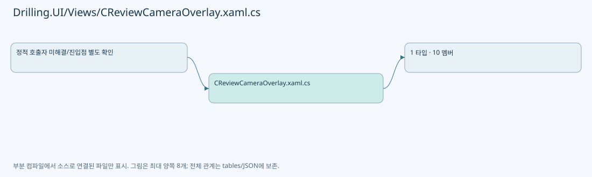
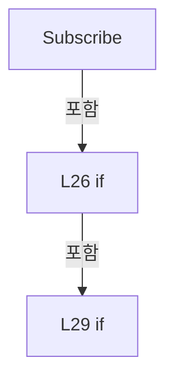
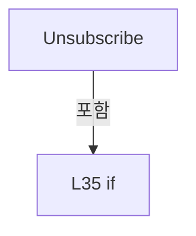
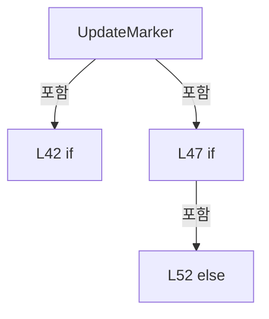

# Drilling.UI/Views/CReviewCameraOverlay.xaml.cs

| 항목 | 내용 |
| --- | --- |
| 원본 저장소 | https://github.com/kjuws10-rgb/A3Drilling.git |
| 원본 Commit | 5aee8e58439c9b455cae7c9593c9be986c3e682e |
| 원본 SHA256 | fdcc6ef6ce98cd9baef58348be383b0567a0bb398d911cc4383f342184ac7c26 |
| 파일 분류 | code |
| 원본 크기/행 | 2,676 bytes / 60 physical lines |
| 인코딩 | utf-8-sig |
| 검토 범위 | 구문/부분 의미 분석에서 추출한 사실. 동작·물리 단위·실장비 합격을 보증하지 않습니다. |
| 원본 링크 | [고정 Commit 원본](https://github.com/kjuws10-rgb/A3Drilling/blob/5aee8e58439c9b455cae7c9593c9be986c3e682e/Drilling.UI/Views/CReviewCameraOverlay.xaml.cs) |

## 파일의 역할과 읽는 순서

WPF 화면·사용자 명령·표시 상태를 구성합니다. XAML 이벤트와 코드 비하인드, RootView의 조립 경로를 함께 추적합니다.

## 네임스페이스·타입·상속

| 타입 | 구분 | 원본 범위 | 선언/상속 |
| --- | --- | --- | --- |
| CReviewCameraOverlay | ClassDeclaration | 11–60 | CReviewCameraOverlay: UserControl |

## 멤버 빠른 목록

| 이름 | 종류 | 범위 | 서명 |
| --- | --- | --- | --- |
| _camera | FieldDeclaration | L13–13 | Drilling.UI.Menu.Menus.CReviewCameraPreview? Drilling.UI.Views.CReviewCameraOverlay._camera |
| _projectionVersion | FieldDeclaration | L14–14 | int Drilling.UI.Views.CReviewCameraOverlay._projectionVersion |
| _wasVisible | FieldDeclaration | L15–15 | bool Drilling.UI.Views.CReviewCameraOverlay._wasVisible |
| .ctor | ConstructorDeclaration | L16–22 | Drilling.UI.Views.CReviewCameraOverlay.CReviewCameraOverlay() |
| Subscribe | MethodDeclaration | L24–32 | void Drilling.UI.Views.CReviewCameraOverlay.Subscribe() |
| Unsubscribe | MethodDeclaration | L33–37 | void Drilling.UI.Views.CReviewCameraOverlay.Unsubscribe() |
| CameraChanged | MethodDeclaration | L38–38 | void Drilling.UI.Views.CReviewCameraOverlay.CameraChanged(object?, System.ComponentModel.PropertyChangedEventArgs) |
| UpdateMarker | MethodDeclaration | L40–56 | void Drilling.UI.Views.CReviewCameraOverlay.UpdateMarker(bool) |
| StopAnimations | MethodDeclaration | L57–58 | void Drilling.UI.Views.CReviewCameraOverlay.StopAnimations() |
| Animation | MethodDeclaration | L59–59 | DoubleAnimation Drilling.UI.Views.CReviewCameraOverlay.Animation(double, double) |

## 멤버별 상세 계약·호출·처리 해설

### FieldDeclaration `_camera` · L13–13

[Drilling.UI/Views/CReviewCameraOverlay.xaml.cs:13–13](https://github.com/kjuws10-rgb/A3Drilling/blob/5aee8e58439c9b455cae7c9593c9be986c3e682e/Drilling.UI/Views/CReviewCameraOverlay.xaml.cs#L13-L13)

| 항목 | 실제 추출 값 |
| --- | --- |
| 서명 | Drilling.UI.Menu.Menus.CReviewCameraPreview? Drilling.UI.Views.CReviewCameraOverlay._camera |
| 접근/수식자 | Private / private |
| 반환/값 타입 | Drilling.UI.Menu.Menus.CReviewCameraPreview? |
| 소속 타입 | NamedType:Drilling.UI.Views.CReviewCameraOverlay |

현재 부분 분석에서 직접 연결된 호출자는 없습니다. XAML/이벤트/인터페이스·델리게이트·외부 진입을 추가 확인해야 하며, 미사용으로 판정한 것이 아닙니다.

변경 전 점검: 입력/반환 타입, 위 호출자, 예외/취소 경로, 공유 상태와 저장·전송 소비자를 함께 확인합니다. 값의 단위나 물리 방향을 이름만으로 확정하지 않습니다.

### FieldDeclaration `_projectionVersion` · L14–14

[Drilling.UI/Views/CReviewCameraOverlay.xaml.cs:14–14](https://github.com/kjuws10-rgb/A3Drilling/blob/5aee8e58439c9b455cae7c9593c9be986c3e682e/Drilling.UI/Views/CReviewCameraOverlay.xaml.cs#L14-L14)

| 항목 | 실제 추출 값 |
| --- | --- |
| 서명 | int Drilling.UI.Views.CReviewCameraOverlay._projectionVersion |
| 접근/수식자 | Private / private |
| 반환/값 타입 | int |
| 소속 타입 | NamedType:Drilling.UI.Views.CReviewCameraOverlay |

현재 부분 분석에서 직접 연결된 호출자는 없습니다. XAML/이벤트/인터페이스·델리게이트·외부 진입을 추가 확인해야 하며, 미사용으로 판정한 것이 아닙니다.

본문의 실제 연산·분기·예외·반환 순서(원문 위치 순):

| 원본 행 | 종류 | 주석 해설 |
| --- | --- | --- |
| 14 | variable-initializer | 변수의 초기값을 지정합니다: _projectionVersion = -1 |

변경 전 점검: 입력/반환 타입, 위 호출자, 예외/취소 경로, 공유 상태와 저장·전송 소비자를 함께 확인합니다. 값의 단위나 물리 방향을 이름만으로 확정하지 않습니다.

### FieldDeclaration `_wasVisible` · L15–15

[Drilling.UI/Views/CReviewCameraOverlay.xaml.cs:15–15](https://github.com/kjuws10-rgb/A3Drilling/blob/5aee8e58439c9b455cae7c9593c9be986c3e682e/Drilling.UI/Views/CReviewCameraOverlay.xaml.cs#L15-L15)

| 항목 | 실제 추출 값 |
| --- | --- |
| 서명 | bool Drilling.UI.Views.CReviewCameraOverlay._wasVisible |
| 접근/수식자 | Private / private |
| 반환/값 타입 | bool |
| 소속 타입 | NamedType:Drilling.UI.Views.CReviewCameraOverlay |

현재 부분 분석에서 직접 연결된 호출자는 없습니다. XAML/이벤트/인터페이스·델리게이트·외부 진입을 추가 확인해야 하며, 미사용으로 판정한 것이 아닙니다.

변경 전 점검: 입력/반환 타입, 위 호출자, 예외/취소 경로, 공유 상태와 저장·전송 소비자를 함께 확인합니다. 값의 단위나 물리 방향을 이름만으로 확정하지 않습니다.

### ConstructorDeclaration `.ctor` · L16–22

[Drilling.UI/Views/CReviewCameraOverlay.xaml.cs:16–22](https://github.com/kjuws10-rgb/A3Drilling/blob/5aee8e58439c9b455cae7c9593c9be986c3e682e/Drilling.UI/Views/CReviewCameraOverlay.xaml.cs#L16-L22)

| 항목 | 실제 추출 값 |
| --- | --- |
| 서명 | Drilling.UI.Views.CReviewCameraOverlay.CReviewCameraOverlay() |
| 접근/수식자 | Public / public |
| 반환/값 타입 | void |
| 소속 타입 | NamedType:Drilling.UI.Views.CReviewCameraOverlay |

현재 부분 분석에서 직접 연결된 호출자는 없습니다. XAML/이벤트/인터페이스·델리게이트·외부 진입을 추가 확인해야 하며, 미사용으로 판정한 것이 아닙니다.

호출하는 대상과 해석 범위:

| 원본 행 | 표현식 | 분석 상태 | 대상/소스 위치 |
| --- | --- | --- | --- |
| 18 | InitializeComponent | unresolved | None |
| 19 | Subscribe | resolved | void Drilling.UI.Views.CReviewCameraOverlay.Subscribe() · Drilling.UI/Views/CReviewCameraOverlay.xaml.cs:24 |
| 20 | Subscribe | resolved | void Drilling.UI.Views.CReviewCameraOverlay.Subscribe() · Drilling.UI/Views/CReviewCameraOverlay.xaml.cs:24 |
| 20 | UpdateMarker | resolved | void Drilling.UI.Views.CReviewCameraOverlay.UpdateMarker(bool) · Drilling.UI/Views/CReviewCameraOverlay.xaml.cs:40 |
| 21 | Unsubscribe | resolved | void Drilling.UI.Views.CReviewCameraOverlay.Unsubscribe() · Drilling.UI/Views/CReviewCameraOverlay.xaml.cs:33 |
| 21 | StopAnimations | resolved | void Drilling.UI.Views.CReviewCameraOverlay.StopAnimations() · Drilling.UI/Views/CReviewCameraOverlay.xaml.cs:57 |

본문의 실제 연산·분기·예외·반환 순서(원문 위치 순):

| 원본 행 | 종류 | 주석 해설 |
| --- | --- | --- |
| 18 | call | 함수·델리게이트 또는 객체 생성자를 호출합니다: InitializeComponent() |
| 19 | call | 함수·델리게이트 또는 객체 생성자를 호출합니다: Subscribe() |
| 19 | compound-assignment-or-event-subscription | 복합 대입 또는 이벤트 구독/해지 표현입니다: DataContextChanged += (_, _) => Subscribe() |
| 20 | call | 함수·델리게이트 또는 객체 생성자를 호출합니다: Subscribe() |
| 20 | call | 함수·델리게이트 또는 객체 생성자를 호출합니다: UpdateMarker(animate: false) |
| 20 | compound-assignment-or-event-subscription | 복합 대입 또는 이벤트 구독/해지 표현입니다: Loaded += (_, _) => { Subscribe(); UpdateMarker(animate: false); } |
| 21 | assignment | 값을 대상에 대입합니다: _wasVisible = false |
| 21 | call | 함수·델리게이트 또는 객체 생성자를 호출합니다: Unsubscribe() |
| 21 | call | 함수·델리게이트 또는 객체 생성자를 호출합니다: StopAnimations() |
| 21 | compound-assignment-or-event-subscription | 복합 대입 또는 이벤트 구독/해지 표현입니다: Unloaded += (_, _) => { Unsubscribe(); StopAnimations(); _wasVisible = false; } |

변경 전 점검: 입력/반환 타입, 위 호출자, 예외/취소 경로, 공유 상태와 저장·전송 소비자를 함께 확인합니다. 값의 단위나 물리 방향을 이름만으로 확정하지 않습니다.

### MethodDeclaration `Subscribe` · L24–32

[Drilling.UI/Views/CReviewCameraOverlay.xaml.cs:24–32](https://github.com/kjuws10-rgb/A3Drilling/blob/5aee8e58439c9b455cae7c9593c9be986c3e682e/Drilling.UI/Views/CReviewCameraOverlay.xaml.cs#L24-L32)

| 항목 | 실제 추출 값 |
| --- | --- |
| 서명 | void Drilling.UI.Views.CReviewCameraOverlay.Subscribe() |
| 접근/수식자 | Private / private |
| 반환/값 타입 | void |
| 소속 타입 | NamedType:Drilling.UI.Views.CReviewCameraOverlay |

정적 호출자로 확인된 위치:

| 호출 파일/행 | 호출 표현식 | 런타임 분기 가능 |
| --- | --- | --- |
| [Drilling.UI/Views/CReviewCameraOverlay.xaml.cs:19–19](https://github.com/kjuws10-rgb/A3Drilling/blob/5aee8e58439c9b455cae7c9593c9be986c3e682e/Drilling.UI/Views/CReviewCameraOverlay.xaml.cs#L19-L19) | Subscribe | False |
| [Drilling.UI/Views/CReviewCameraOverlay.xaml.cs:20–20](https://github.com/kjuws10-rgb/A3Drilling/blob/5aee8e58439c9b455cae7c9593c9be986c3e682e/Drilling.UI/Views/CReviewCameraOverlay.xaml.cs#L20-L20) | Subscribe | False |

호출하는 대상과 해석 범위:

| 원본 행 | 표현식 | 분석 상태 | 대상/소스 위치 |
| --- | --- | --- | --- |
| 26 | ReferenceEquals | candidate | OverloadResolutionFailure |
| 28 | Unsubscribe | resolved | void Drilling.UI.Views.CReviewCameraOverlay.Unsubscribe() · Drilling.UI/Views/CReviewCameraOverlay.xaml.cs:33 |
| 31 | UpdateMarker | resolved | void Drilling.UI.Views.CReviewCameraOverlay.UpdateMarker(bool) · Drilling.UI/Views/CReviewCameraOverlay.xaml.cs:40 |

본문의 실제 연산·분기·예외·반환 순서(원문 위치 순):

| 원본 행 | 종류 | 주석 해설 |
| --- | --- | --- |
| 26 | call | 함수·델리게이트 또는 객체 생성자를 호출합니다: ReferenceEquals(_camera, DataContext) |
| 26 | if | 조건에 따라 분기합니다: if (!ReferenceEquals(_camera, DataContext)) |
| 28 | assignment | 값을 대상에 대입합니다: _camera = DataContext as CReviewCameraPreview |
| 28 | call | 함수·델리게이트 또는 객체 생성자를 호출합니다: Unsubscribe() |
| 29 | compound-assignment-or-event-subscription | 복합 대입 또는 이벤트 구독/해지 표현입니다: _camera.PropertyChanged += CameraChanged |
| 29 | if | 조건에 따라 분기합니다: if (_camera is not null) |
| 31 | call | 함수·델리게이트 또는 객체 생성자를 호출합니다: UpdateMarker(animate: false) |

제어 구문의 포함 구조(실제 실행 순서/CFG가 아닌 구문 탐색 그림):

변경 전 점검: 입력/반환 타입, 위 호출자, 예외/취소 경로, 공유 상태와 저장·전송 소비자를 함께 확인합니다. 값의 단위나 물리 방향을 이름만으로 확정하지 않습니다.

### MethodDeclaration `Unsubscribe` · L33–37

[Drilling.UI/Views/CReviewCameraOverlay.xaml.cs:33–37](https://github.com/kjuws10-rgb/A3Drilling/blob/5aee8e58439c9b455cae7c9593c9be986c3e682e/Drilling.UI/Views/CReviewCameraOverlay.xaml.cs#L33-L37)

| 항목 | 실제 추출 값 |
| --- | --- |
| 서명 | void Drilling.UI.Views.CReviewCameraOverlay.Unsubscribe() |
| 접근/수식자 | Private / private |
| 반환/값 타입 | void |
| 소속 타입 | NamedType:Drilling.UI.Views.CReviewCameraOverlay |

정적 호출자로 확인된 위치:

| 호출 파일/행 | 호출 표현식 | 런타임 분기 가능 |
| --- | --- | --- |
| [Drilling.UI/Views/CReviewCameraOverlay.xaml.cs:21–21](https://github.com/kjuws10-rgb/A3Drilling/blob/5aee8e58439c9b455cae7c9593c9be986c3e682e/Drilling.UI/Views/CReviewCameraOverlay.xaml.cs#L21-L21) | Unsubscribe | False |
| [Drilling.UI/Views/CReviewCameraOverlay.xaml.cs:28–28](https://github.com/kjuws10-rgb/A3Drilling/blob/5aee8e58439c9b455cae7c9593c9be986c3e682e/Drilling.UI/Views/CReviewCameraOverlay.xaml.cs#L28-L28) | Unsubscribe | False |

본문의 실제 연산·분기·예외·반환 순서(원문 위치 순):

| 원본 행 | 종류 | 주석 해설 |
| --- | --- | --- |
| 35 | compound-assignment-or-event-subscription | 복합 대입 또는 이벤트 구독/해지 표현입니다: _camera.PropertyChanged -= CameraChanged |
| 35 | if | 조건에 따라 분기합니다: if (_camera is not null) |
| 36 | assignment | 값을 대상에 대입합니다: _camera = null |

제어 구문의 포함 구조(실제 실행 순서/CFG가 아닌 구문 탐색 그림):

변경 전 점검: 입력/반환 타입, 위 호출자, 예외/취소 경로, 공유 상태와 저장·전송 소비자를 함께 확인합니다. 값의 단위나 물리 방향을 이름만으로 확정하지 않습니다.

### MethodDeclaration `CameraChanged` · L38–38

[Drilling.UI/Views/CReviewCameraOverlay.xaml.cs:38–38](https://github.com/kjuws10-rgb/A3Drilling/blob/5aee8e58439c9b455cae7c9593c9be986c3e682e/Drilling.UI/Views/CReviewCameraOverlay.xaml.cs#L38-L38)

| 항목 | 실제 추출 값 |
| --- | --- |
| 서명 | void Drilling.UI.Views.CReviewCameraOverlay.CameraChanged(object?, System.ComponentModel.PropertyChangedEventArgs) |
| 접근/수식자 | Private / private |
| 반환/값 타입 | void |
| 소속 타입 | NamedType:Drilling.UI.Views.CReviewCameraOverlay |

입력 계약:

| 이름 | 타입 | 전달 | 선택/기본값 |
| --- | --- | --- | --- |
| sender | object? | None | False /  |
| e | System.ComponentModel.PropertyChangedEventArgs | None | False /  |

현재 부분 분석에서 직접 연결된 호출자는 없습니다. XAML/이벤트/인터페이스·델리게이트·외부 진입을 추가 확인해야 하며, 미사용으로 판정한 것이 아닙니다.

호출하는 대상과 해석 범위:

| 원본 행 | 표현식 | 분석 상태 | 대상/소스 위치 |
| --- | --- | --- | --- |
| 38 | UpdateMarker | resolved | void Drilling.UI.Views.CReviewCameraOverlay.UpdateMarker(bool) · Drilling.UI/Views/CReviewCameraOverlay.xaml.cs:40 |

본문의 실제 연산·분기·예외·반환 순서(원문 위치 순):

| 원본 행 | 종류 | 주석 해설 |
| --- | --- | --- |
| 38 | call | 함수·델리게이트 또는 객체 생성자를 호출합니다: UpdateMarker(animate: true) |

변경 전 점검: 입력/반환 타입, 위 호출자, 예외/취소 경로, 공유 상태와 저장·전송 소비자를 함께 확인합니다. 값의 단위나 물리 방향을 이름만으로 확정하지 않습니다.

### MethodDeclaration `UpdateMarker` · L40–56

[Drilling.UI/Views/CReviewCameraOverlay.xaml.cs:40–56](https://github.com/kjuws10-rgb/A3Drilling/blob/5aee8e58439c9b455cae7c9593c9be986c3e682e/Drilling.UI/Views/CReviewCameraOverlay.xaml.cs#L40-L56)

| 항목 | 실제 추출 값 |
| --- | --- |
| 서명 | void Drilling.UI.Views.CReviewCameraOverlay.UpdateMarker(bool) |
| 접근/수식자 | Private / private |
| 반환/값 타입 | void |
| 소속 타입 | NamedType:Drilling.UI.Views.CReviewCameraOverlay |

입력 계약:

| 이름 | 타입 | 전달 | 선택/기본값 |
| --- | --- | --- | --- |
| animate | bool | None | False /  |

정적 호출자로 확인된 위치:

| 호출 파일/행 | 호출 표현식 | 런타임 분기 가능 |
| --- | --- | --- |
| [Drilling.UI/Views/CReviewCameraOverlay.xaml.cs:20–20](https://github.com/kjuws10-rgb/A3Drilling/blob/5aee8e58439c9b455cae7c9593c9be986c3e682e/Drilling.UI/Views/CReviewCameraOverlay.xaml.cs#L20-L20) | UpdateMarker | False |
| [Drilling.UI/Views/CReviewCameraOverlay.xaml.cs:31–31](https://github.com/kjuws10-rgb/A3Drilling/blob/5aee8e58439c9b455cae7c9593c9be986c3e682e/Drilling.UI/Views/CReviewCameraOverlay.xaml.cs#L31-L31) | UpdateMarker | False |
| [Drilling.UI/Views/CReviewCameraOverlay.xaml.cs:38–38](https://github.com/kjuws10-rgb/A3Drilling/blob/5aee8e58439c9b455cae7c9593c9be986c3e682e/Drilling.UI/Views/CReviewCameraOverlay.xaml.cs#L38-L38) | UpdateMarker | False |

호출하는 대상과 해석 범위:

| 원본 행 | 표현식 | 분석 상태 | 대상/소스 위치 |
| --- | --- | --- | --- |
| 43 | StopAnimations | resolved | void Drilling.UI.Views.CReviewCameraOverlay.StopAnimations() · Drilling.UI/Views/CReviewCameraOverlay.xaml.cs:57 |
| 49 | CameraTranslation.BeginAnimation | unresolved | None |
| 49 | Animation | candidate | OverloadResolutionFailure |
| 50 | CameraTranslation.BeginAnimation | unresolved | None |
| 50 | Animation | candidate | OverloadResolutionFailure |
| 53 | StopAnimations | resolved | void Drilling.UI.Views.CReviewCameraOverlay.StopAnimations() · Drilling.UI/Views/CReviewCameraOverlay.xaml.cs:57 |

본문의 실제 연산·분기·예외·반환 순서(원문 위치 순):

| 원본 행 | 종류 | 주석 해설 |
| --- | --- | --- |
| 42 | if | 조건에 따라 분기합니다: if (_camera is not { IsVisible: true }) |
| 43 | assignment | 값을 대상에 대입합니다: CameraMarker.Visibility = Visibility.Collapsed |
| 43 | assignment | 값을 대상에 대입합니다: _wasVisible = false |
| 43 | call | 함수·델리게이트 또는 객체 생성자를 호출합니다: StopAnimations() |
| 43 | return | 호출자에게 값 또는 제어를 반환합니다: return; |
| 44 | local-declaration | 지역 변수를 선언합니다: var smooth = animate && _wasVisible && _projectionVersion == _camera.ProjectionVersion; |
| 44 | variable-initializer | 변수의 초기값을 지정합니다: smooth = animate && _wasVisible && _projectionVersion == _camera.ProjectionVersion |
| 45 | local-declaration | 지역 변수를 선언합니다: var x = _camera.Center.X - 18; |
| 45 | variable-initializer | 변수의 초기값을 지정합니다: x = _camera.Center.X - 18 |
| 46 | local-declaration | 지역 변수를 선언합니다: var y = _camera.Center.Y - 14; |
| 46 | variable-initializer | 변수의 초기값을 지정합니다: y = _camera.Center.Y - 14 |
| 47 | if | 조건에 따라 분기합니다: if (smooth) |
| 49 | call | 함수·델리게이트 또는 객체 생성자를 호출합니다: CameraTranslation.BeginAnimation(TranslateTransform.XProperty, Animation(CameraTranslation.X, x), HandoffBehavior.SnapshotAndReplace) |
| 49 | call | 함수·델리게이트 또는 객체 생성자를 호출합니다: Animation(CameraTranslation.X, x) |
| 50 | call | 함수·델리게이트 또는 객체 생성자를 호출합니다: CameraTranslation.BeginAnimation(TranslateTransform.YProperty, Animation(CameraTranslation.Y, y), HandoffBehavior.SnapshotAndReplace) |
| 50 | call | 함수·델리게이트 또는 객체 생성자를 호출합니다: Animation(CameraTranslation.Y, y) |
| 52 | else | 앞 조건이 거짓인 경로입니다: else |
| 53 | assignment | 값을 대상에 대입합니다: CameraTranslation.X = x |
| 53 | assignment | 값을 대상에 대입합니다: CameraTranslation.Y = y |
| 53 | call | 함수·델리게이트 또는 객체 생성자를 호출합니다: StopAnimations() |
| 54 | assignment | 값을 대상에 대입합니다: CameraMarker.Visibility = Visibility.Visible |
| 55 | assignment | 값을 대상에 대입합니다: _wasVisible = true |
| 55 | assignment | 값을 대상에 대입합니다: _projectionVersion = _camera.ProjectionVersion |

제어 구문의 포함 구조(실제 실행 순서/CFG가 아닌 구문 탐색 그림):

변경 전 점검: 입력/반환 타입, 위 호출자, 예외/취소 경로, 공유 상태와 저장·전송 소비자를 함께 확인합니다. 값의 단위나 물리 방향을 이름만으로 확정하지 않습니다.

### MethodDeclaration `StopAnimations` · L57–58

[Drilling.UI/Views/CReviewCameraOverlay.xaml.cs:57–58](https://github.com/kjuws10-rgb/A3Drilling/blob/5aee8e58439c9b455cae7c9593c9be986c3e682e/Drilling.UI/Views/CReviewCameraOverlay.xaml.cs#L57-L58)

| 항목 | 실제 추출 값 |
| --- | --- |
| 서명 | void Drilling.UI.Views.CReviewCameraOverlay.StopAnimations() |
| 접근/수식자 | Private / private |
| 반환/값 타입 | void |
| 소속 타입 | NamedType:Drilling.UI.Views.CReviewCameraOverlay |

정적 호출자로 확인된 위치:

| 호출 파일/행 | 호출 표현식 | 런타임 분기 가능 |
| --- | --- | --- |
| [Drilling.UI/Views/CReviewCameraOverlay.xaml.cs:21–21](https://github.com/kjuws10-rgb/A3Drilling/blob/5aee8e58439c9b455cae7c9593c9be986c3e682e/Drilling.UI/Views/CReviewCameraOverlay.xaml.cs#L21-L21) | StopAnimations | False |
| [Drilling.UI/Views/CReviewCameraOverlay.xaml.cs:43–43](https://github.com/kjuws10-rgb/A3Drilling/blob/5aee8e58439c9b455cae7c9593c9be986c3e682e/Drilling.UI/Views/CReviewCameraOverlay.xaml.cs#L43-L43) | StopAnimations | False |
| [Drilling.UI/Views/CReviewCameraOverlay.xaml.cs:53–53](https://github.com/kjuws10-rgb/A3Drilling/blob/5aee8e58439c9b455cae7c9593c9be986c3e682e/Drilling.UI/Views/CReviewCameraOverlay.xaml.cs#L53-L53) | StopAnimations | False |

호출하는 대상과 해석 범위:

| 원본 행 | 표현식 | 분석 상태 | 대상/소스 위치 |
| --- | --- | --- | --- |
| 58 | CameraTranslation.BeginAnimation | unresolved | None |
| 58 | CameraTranslation.BeginAnimation | unresolved | None |

본문의 실제 연산·분기·예외·반환 순서(원문 위치 순):

| 원본 행 | 종류 | 주석 해설 |
| --- | --- | --- |
| 58 | call | 함수·델리게이트 또는 객체 생성자를 호출합니다: CameraTranslation.BeginAnimation(TranslateTransform.XProperty, null) |
| 58 | call | 함수·델리게이트 또는 객체 생성자를 호출합니다: CameraTranslation.BeginAnimation(TranslateTransform.YProperty, null) |

변경 전 점검: 입력/반환 타입, 위 호출자, 예외/취소 경로, 공유 상태와 저장·전송 소비자를 함께 확인합니다. 값의 단위나 물리 방향을 이름만으로 확정하지 않습니다.

### MethodDeclaration `Animation` · L59–59

[Drilling.UI/Views/CReviewCameraOverlay.xaml.cs:59–59](https://github.com/kjuws10-rgb/A3Drilling/blob/5aee8e58439c9b455cae7c9593c9be986c3e682e/Drilling.UI/Views/CReviewCameraOverlay.xaml.cs#L59-L59)

| 항목 | 실제 추출 값 |
| --- | --- |
| 서명 | DoubleAnimation Drilling.UI.Views.CReviewCameraOverlay.Animation(double, double) |
| 접근/수식자 | Private / private, static |
| 반환/값 타입 | DoubleAnimation |
| 소속 타입 | NamedType:Drilling.UI.Views.CReviewCameraOverlay |

입력 계약:

| 이름 | 타입 | 전달 | 선택/기본값 |
| --- | --- | --- | --- |
| from | double | None | False /  |
| to | double | None | False /  |

현재 부분 분석에서 직접 연결된 호출자는 없습니다. XAML/이벤트/인터페이스·델리게이트·외부 진입을 추가 확인해야 하며, 미사용으로 판정한 것이 아닙니다.

호출하는 대상과 해석 범위:

| 원본 행 | 표현식 | 분석 상태 | 대상/소스 위치 |
| --- | --- | --- | --- |
| 59 | new | unresolved | None |
| 59 | new Duration | unresolved | None |
| 59 | TimeSpan.FromMilliseconds | resolved | System.TimeSpan System.TimeSpan.FromMilliseconds(long) |

본문의 실제 연산·분기·예외·반환 순서(원문 위치 순):

| 원본 행 | 종류 | 주석 해설 |
| --- | --- | --- |
| 59 | call | 함수·델리게이트 또는 객체 생성자를 호출합니다: new(from, to, new Duration(TimeSpan.FromMilliseconds(180))) |
| 59 | call | 함수·델리게이트 또는 객체 생성자를 호출합니다: new Duration(TimeSpan.FromMilliseconds(180)) |
| 59 | call | 함수·델리게이트 또는 객체 생성자를 호출합니다: TimeSpan.FromMilliseconds(180) |

변경 전 점검: 입력/반환 타입, 위 호출자, 예외/취소 경로, 공유 상태와 저장·전송 소비자를 함께 확인합니다. 값의 단위나 물리 방향을 이름만으로 확정하지 않습니다.

## 구문·바인딩 한계

전체 WPF/벤더 SDK/프로젝트별 빌드 조건을 로드한 정식 빌드가 아닙니다. `resolved`는 이 부분 컴파일에서의 심볼 연결이며 virtual/interface/delegate/이벤트/Reflection/XAML의 실제 런타임 구현을 확정하지 않습니다. `candidate`와 `unresolved`는 후속 확인 대상으로 남깁니다.

## 원문 전체 주석 해설본

[원본 모든 행과 행별 해설 보기](../../../annotated/Drilling.UI/Views/CReviewCameraOverlay.xaml.cs.annotated.txt)

원본을 빠뜨리거나 임의로 줄이지 않았습니다. `L000001 |` 표시는 원본 행 번호, `// 해설`은 별도 설명입니다. 실행용 소스가 아닌 문서입니다.

## 수정·재검증 체크

- 원본 Commit과 현재 작업 파일 SHA가 같은지 먼저 확인합니다. 다르면 이 문서를 과거 버전 자료로 취급합니다.
- 선언·직접 호출·이벤트/인터페이스 경계·설정 소비를 함께 확인합니다. 정적 연결의 빈 곳을 정상 경로로 추정하지 않습니다.
- 저장 형식/단위/식별자·재시도·취소·예외·롤백에 영향을 주는 변경은 상세 해설장과 호출자를 다시 검토합니다.
- 도구의 구문 추출과 별도 정적 추적 해설, 실제 빌드·시뮬레이션·실장비 검증 결과를 분리합니다.
