# Drilling.UI/Views/CReviewDataView.xaml.cs

| 항목 | 내용 |
| --- | --- |
| 원본 저장소 | https://github.com/kjuws10-rgb/A3Drilling.git |
| 원본 Commit | 96e22cd027c84bf302b23f2949b98985d7f301bb |
| 원본 SHA256 | 0a2ab0d2de63faefcb4eba373bb8b3f2b46cf50e9897e3ddfbbb500bd7ac2138 |
| 파일 분류 | code |
| 원본 크기/행 | 13,295 bytes / 349 physical lines |
| 인코딩 | utf-8-sig |
| 검토 범위 | 구문/부분 의미 분석에서 추출한 사실. 동작·물리 단위·실장비 합격을 보증하지 않습니다. |
| 원본 링크 | [고정 Commit 원본](https://github.com/kjuws10-rgb/A3Drilling/blob/96e22cd027c84bf302b23f2949b98985d7f301bb/Drilling.UI/Views/CReviewDataView.xaml.cs) |

## 파일의 역할과 읽는 순서

WPF 화면·사용자 명령·표시 상태를 구성합니다. XAML 이벤트와 코드 비하인드, RootView의 조립 경로를 함께 추적합니다.

## 네임스페이스·타입·상속

| 타입 | 구분 | 원본 범위 | 선언/상속 |
| --- | --- | --- | --- |
| CBindingProxy | ClassDeclaration | 11–28 | CBindingProxy: Freezable |
| CReviewDataView | ClassDeclaration | 30–348 | CReviewDataView: UserControl |

## 멤버 빠른 목록

| 이름 | 종류 | 범위 | 서명 |
| --- | --- | --- | --- |
| DataProperty | FieldDeclaration | L13–16 | DependencyProperty Drilling.UI.Views.CBindingProxy.DataProperty |
| Data | PropertyDeclaration | L18–22 | object? Drilling.UI.Views.CBindingProxy.Data |
| get_Data | GetAccessorDeclaration | L20–20 | object? Drilling.UI.Views.CBindingProxy.Data.get |
| set_Data | SetAccessorDeclaration | L21–21 | void Drilling.UI.Views.CBindingProxy.Data.set |
| CreateInstanceCore | MethodDeclaration | L24–27 | Freezable Drilling.UI.Views.CBindingProxy.CreateInstanceCore() |
| _resultEditDragSurface | FieldDeclaration | L32–32 | FrameworkElement? Drilling.UI.Views.CReviewDataView._resultEditDragSurface |
| _resultEditDragRectangle | FieldDeclaration | L33–33 | Rectangle? Drilling.UI.Views.CReviewDataView._resultEditDragRectangle |
| _resultEditDragStart | FieldDeclaration | L34–34 | Point Drilling.UI.Views.CReviewDataView._resultEditDragStart |
| _resultEditDragIsScatter | FieldDeclaration | L35–35 | bool Drilling.UI.Views.CReviewDataView._resultEditDragIsScatter |
| .ctor | ConstructorDeclaration | L37–40 | Drilling.UI.Views.CReviewDataView.CReviewDataView() |
| ReviewDataView_IsVisibleChanged | MethodDeclaration | L42–50 | void Drilling.UI.Views.CReviewDataView.ReviewDataView_IsVisibleChanged(object, DependencyPropertyChangedEventArgs) |
| ReviewResultsTree_SelectedItemChanged | MethodDeclaration | L52–65 | void Drilling.UI.Views.CReviewDataView.ReviewResultsTree_SelectedItemChanged(object, RoutedPropertyChangedEventArgs<object>) |
| ReviewDataShotMap_MouseLeftButtonDown | MethodDeclaration | L67–83 | void Drilling.UI.Views.CReviewDataView.ReviewDataShotMap_MouseLeftButtonDown(object, MouseButtonEventArgs) |
| ReviewDataScatterPlot_MouseLeftButtonDown | MethodDeclaration | L85–106 | void Drilling.UI.Views.CReviewDataView.ReviewDataScatterPlot_MouseLeftButtonDown(object, MouseButtonEventArgs) |
| BeginResultEditDrag | MethodDeclaration | L108–130 | void Drilling.UI.Views.CReviewDataView.BeginResultEditDrag(FrameworkElement, Rectangle, bool, MouseButtonEventArgs) |
| ReviewDataEditSurface_MouseMove | MethodDeclaration | L132–149 | void Drilling.UI.Views.CReviewDataView.ReviewDataEditSurface_MouseMove(object, MouseEventArgs) |
| ReviewDataEditSurface_MouseLeftButtonUp | MethodDeclaration | L151–202 | void Drilling.UI.Views.CReviewDataView.ReviewDataEditSurface_MouseLeftButtonUp(object, MouseButtonEventArgs) |
| ReviewDataEditSurface_LostMouseCapture | MethodDeclaration | L204–210 | void Drilling.UI.Views.CReviewDataView.ReviewDataEditSurface_LostMouseCapture(object, MouseEventArgs) |
| UpdateResultEditDragRectangle | MethodDeclaration | L212–225 | void Drilling.UI.Views.CReviewDataView.UpdateResultEditDragRectangle(Point) |
| CancelResultEditDrag | MethodDeclaration | L227–241 | void Drilling.UI.Views.CReviewDataView.CancelResultEditDrag() |
| ReviewDataResultGrid_SelectionChanged | MethodDeclaration | L243–258 | void Drilling.UI.Views.CReviewDataView.ReviewDataResultGrid_SelectionChanged(object, SelectionChangedEventArgs) |
| ReviewDataResultGrid_LoadingRow | MethodDeclaration | L260–268 | void Drilling.UI.Views.CReviewDataView.ReviewDataResultGrid_LoadingRow(object, DataGridRowEventArgs) |
| ReviewDataReinspectionGrid_SelectionChanged | MethodDeclaration | L270–282 | void Drilling.UI.Views.CReviewDataView.ReviewDataReinspectionGrid_SelectionChanged(object, SelectionChangedEventArgs) |
| ReviewDataReinspectionCheckBox_Changed | MethodDeclaration | L284–295 | void Drilling.UI.Views.CReviewDataView.ReviewDataReinspectionCheckBox_Changed(object, RoutedEventArgs) |
| ReviewDataResultEditCheckBox_Changed | MethodDeclaration | L297–308 | void Drilling.UI.Views.CReviewDataView.ReviewDataResultEditCheckBox_Changed(object, RoutedEventArgs) |
| ReviewDataResultEditKeyInGrid_SelectionChanged | MethodDeclaration | L310–317 | void Drilling.UI.Views.CReviewDataView.ReviewDataResultEditKeyInGrid_SelectionChanged(object, SelectionChangedEventArgs) |
| ReviewDataResultEditCopyGrid_SelectionChanged | MethodDeclaration | L319–326 | void Drilling.UI.Views.CReviewDataView.ReviewDataResultEditCopyGrid_SelectionChanged(object, SelectionChangedEventArgs) |
| FindVisualChild | MethodDeclaration | L328–347 | T? Drilling.UI.Views.CReviewDataView.FindVisualChild<T>(DependencyObject) |

## 멤버별 상세 계약·호출·처리 해설

### FieldDeclaration `DataProperty` · L13–16

[Drilling.UI/Views/CReviewDataView.xaml.cs:13–16](https://github.com/kjuws10-rgb/A3Drilling/blob/96e22cd027c84bf302b23f2949b98985d7f301bb/Drilling.UI/Views/CReviewDataView.xaml.cs#L13-L16)

| 항목 | 실제 추출 값 |
| --- | --- |
| 서명 | DependencyProperty Drilling.UI.Views.CBindingProxy.DataProperty |
| 접근/수식자 | Public / public, static, readonly |
| 반환/값 타입 | DependencyProperty |
| 소속 타입 | NamedType:Drilling.UI.Views.CBindingProxy |

현재 부분 분석에서 직접 연결된 호출자는 없습니다. XAML/이벤트/인터페이스·델리게이트·외부 진입을 추가 확인해야 하며, 미사용으로 판정한 것이 아닙니다.

호출하는 대상과 해석 범위:

| 원본 행 | 표현식 | 분석 상태 | 대상/소스 위치 |
| --- | --- | --- | --- |
| 13 | DependencyProperty.Register | unresolved | None |
| 14 | nameof | unresolved | None |

본문의 실제 연산·분기·예외·반환 순서(원문 위치 순):

| 원본 행 | 종류 | 주석 해설 |
| --- | --- | --- |
| 13 | call | 함수·델리게이트 또는 객체 생성자를 호출합니다: DependencyProperty.Register( nameof(Data), typeof(object), typeof(CBindingProxy)) |
| 13 | variable-initializer | 변수의 초기값을 지정합니다: DataProperty = DependencyProperty.Register( nameof(Data), typeof(object), typeof(CBindingProxy)) |
| 14 | call | 함수·델리게이트 또는 객체 생성자를 호출합니다: nameof(Data) |

변경 전 점검: 입력/반환 타입, 위 호출자, 예외/취소 경로, 공유 상태와 저장·전송 소비자를 함께 확인합니다. 값의 단위나 물리 방향을 이름만으로 확정하지 않습니다.

### PropertyDeclaration `Data` · L18–22

[Drilling.UI/Views/CReviewDataView.xaml.cs:18–22](https://github.com/kjuws10-rgb/A3Drilling/blob/96e22cd027c84bf302b23f2949b98985d7f301bb/Drilling.UI/Views/CReviewDataView.xaml.cs#L18-L22)

| 항목 | 실제 추출 값 |
| --- | --- |
| 서명 | object? Drilling.UI.Views.CBindingProxy.Data |
| 접근/수식자 | Public / public |
| 반환/값 타입 | object? |
| 소속 타입 | NamedType:Drilling.UI.Views.CBindingProxy |

현재 부분 분석에서 직접 연결된 호출자는 없습니다. XAML/이벤트/인터페이스·델리게이트·외부 진입을 추가 확인해야 하며, 미사용으로 판정한 것이 아닙니다.

변경 전 점검: 입력/반환 타입, 위 호출자, 예외/취소 경로, 공유 상태와 저장·전송 소비자를 함께 확인합니다. 값의 단위나 물리 방향을 이름만으로 확정하지 않습니다.

### GetAccessorDeclaration `get_Data` · L20–20

[Drilling.UI/Views/CReviewDataView.xaml.cs:20–20](https://github.com/kjuws10-rgb/A3Drilling/blob/96e22cd027c84bf302b23f2949b98985d7f301bb/Drilling.UI/Views/CReviewDataView.xaml.cs#L20-L20)

| 항목 | 실제 추출 값 |
| --- | --- |
| 서명 | object? Drilling.UI.Views.CBindingProxy.Data.get |
| 접근/수식자 | Public / get |
| 반환/값 타입 | object? |
| 소속 타입 | NamedType:Drilling.UI.Views.CBindingProxy |

현재 부분 분석에서 직접 연결된 호출자는 없습니다. XAML/이벤트/인터페이스·델리게이트·외부 진입을 추가 확인해야 하며, 미사용으로 판정한 것이 아닙니다.

호출하는 대상과 해석 범위:

| 원본 행 | 표현식 | 분석 상태 | 대상/소스 위치 |
| --- | --- | --- | --- |
| 20 | GetValue | unresolved | None |

본문의 실제 연산·분기·예외·반환 순서(원문 위치 순):

| 원본 행 | 종류 | 주석 해설 |
| --- | --- | --- |
| 20 | call | 함수·델리게이트 또는 객체 생성자를 호출합니다: GetValue(DataProperty) |

변경 전 점검: 입력/반환 타입, 위 호출자, 예외/취소 경로, 공유 상태와 저장·전송 소비자를 함께 확인합니다. 값의 단위나 물리 방향을 이름만으로 확정하지 않습니다.

### SetAccessorDeclaration `set_Data` · L21–21

[Drilling.UI/Views/CReviewDataView.xaml.cs:21–21](https://github.com/kjuws10-rgb/A3Drilling/blob/96e22cd027c84bf302b23f2949b98985d7f301bb/Drilling.UI/Views/CReviewDataView.xaml.cs#L21-L21)

| 항목 | 실제 추출 값 |
| --- | --- |
| 서명 | void Drilling.UI.Views.CBindingProxy.Data.set |
| 접근/수식자 | Public / set |
| 반환/값 타입 | void |
| 소속 타입 | NamedType:Drilling.UI.Views.CBindingProxy |

입력 계약:

| 이름 | 타입 | 전달 | 선택/기본값 |
| --- | --- | --- | --- |
| value | object? | None | False /  |

현재 부분 분석에서 직접 연결된 호출자는 없습니다. XAML/이벤트/인터페이스·델리게이트·외부 진입을 추가 확인해야 하며, 미사용으로 판정한 것이 아닙니다.

호출하는 대상과 해석 범위:

| 원본 행 | 표현식 | 분석 상태 | 대상/소스 위치 |
| --- | --- | --- | --- |
| 21 | SetValue | unresolved | None |

본문의 실제 연산·분기·예외·반환 순서(원문 위치 순):

| 원본 행 | 종류 | 주석 해설 |
| --- | --- | --- |
| 21 | call | 함수·델리게이트 또는 객체 생성자를 호출합니다: SetValue(DataProperty, value) |

변경 전 점검: 입력/반환 타입, 위 호출자, 예외/취소 경로, 공유 상태와 저장·전송 소비자를 함께 확인합니다. 값의 단위나 물리 방향을 이름만으로 확정하지 않습니다.

### MethodDeclaration `CreateInstanceCore` · L24–27

[Drilling.UI/Views/CReviewDataView.xaml.cs:24–27](https://github.com/kjuws10-rgb/A3Drilling/blob/96e22cd027c84bf302b23f2949b98985d7f301bb/Drilling.UI/Views/CReviewDataView.xaml.cs#L24-L27)

| 항목 | 실제 추출 값 |
| --- | --- |
| 서명 | Freezable Drilling.UI.Views.CBindingProxy.CreateInstanceCore() |
| 접근/수식자 | Protected / protected, override |
| 반환/값 타입 | Freezable |
| 소속 타입 | NamedType:Drilling.UI.Views.CBindingProxy |

현재 부분 분석에서 직접 연결된 호출자는 없습니다. XAML/이벤트/인터페이스·델리게이트·외부 진입을 추가 확인해야 하며, 미사용으로 판정한 것이 아닙니다.

호출하는 대상과 해석 범위:

| 원본 행 | 표현식 | 분석 상태 | 대상/소스 위치 |
| --- | --- | --- | --- |
| 26 | new CBindingProxy | resolved | Drilling.UI.Views.CBindingProxy.CBindingProxy() · Drilling.UI/Views/CReviewDataView.xaml.cs:11 |

본문의 실제 연산·분기·예외·반환 순서(원문 위치 순):

| 원본 행 | 종류 | 주석 해설 |
| --- | --- | --- |
| 26 | call | 함수·델리게이트 또는 객체 생성자를 호출합니다: new CBindingProxy() |
| 26 | return | 호출자에게 값 또는 제어를 반환합니다: return new CBindingProxy(); |

변경 전 점검: 입력/반환 타입, 위 호출자, 예외/취소 경로, 공유 상태와 저장·전송 소비자를 함께 확인합니다. 값의 단위나 물리 방향을 이름만으로 확정하지 않습니다.

### FieldDeclaration `_resultEditDragSurface` · L32–32

[Drilling.UI/Views/CReviewDataView.xaml.cs:32–32](https://github.com/kjuws10-rgb/A3Drilling/blob/96e22cd027c84bf302b23f2949b98985d7f301bb/Drilling.UI/Views/CReviewDataView.xaml.cs#L32-L32)

| 항목 | 실제 추출 값 |
| --- | --- |
| 서명 | FrameworkElement? Drilling.UI.Views.CReviewDataView._resultEditDragSurface |
| 접근/수식자 | Private / private |
| 반환/값 타입 | FrameworkElement? |
| 소속 타입 | NamedType:Drilling.UI.Views.CReviewDataView |

현재 부분 분석에서 직접 연결된 호출자는 없습니다. XAML/이벤트/인터페이스·델리게이트·외부 진입을 추가 확인해야 하며, 미사용으로 판정한 것이 아닙니다.

변경 전 점검: 입력/반환 타입, 위 호출자, 예외/취소 경로, 공유 상태와 저장·전송 소비자를 함께 확인합니다. 값의 단위나 물리 방향을 이름만으로 확정하지 않습니다.

### FieldDeclaration `_resultEditDragRectangle` · L33–33

[Drilling.UI/Views/CReviewDataView.xaml.cs:33–33](https://github.com/kjuws10-rgb/A3Drilling/blob/96e22cd027c84bf302b23f2949b98985d7f301bb/Drilling.UI/Views/CReviewDataView.xaml.cs#L33-L33)

| 항목 | 실제 추출 값 |
| --- | --- |
| 서명 | Rectangle? Drilling.UI.Views.CReviewDataView._resultEditDragRectangle |
| 접근/수식자 | Private / private |
| 반환/값 타입 | Rectangle? |
| 소속 타입 | NamedType:Drilling.UI.Views.CReviewDataView |

현재 부분 분석에서 직접 연결된 호출자는 없습니다. XAML/이벤트/인터페이스·델리게이트·외부 진입을 추가 확인해야 하며, 미사용으로 판정한 것이 아닙니다.

변경 전 점검: 입력/반환 타입, 위 호출자, 예외/취소 경로, 공유 상태와 저장·전송 소비자를 함께 확인합니다. 값의 단위나 물리 방향을 이름만으로 확정하지 않습니다.

### FieldDeclaration `_resultEditDragStart` · L34–34

[Drilling.UI/Views/CReviewDataView.xaml.cs:34–34](https://github.com/kjuws10-rgb/A3Drilling/blob/96e22cd027c84bf302b23f2949b98985d7f301bb/Drilling.UI/Views/CReviewDataView.xaml.cs#L34-L34)

| 항목 | 실제 추출 값 |
| --- | --- |
| 서명 | Point Drilling.UI.Views.CReviewDataView._resultEditDragStart |
| 접근/수식자 | Private / private |
| 반환/값 타입 | Point |
| 소속 타입 | NamedType:Drilling.UI.Views.CReviewDataView |

현재 부분 분석에서 직접 연결된 호출자는 없습니다. XAML/이벤트/인터페이스·델리게이트·외부 진입을 추가 확인해야 하며, 미사용으로 판정한 것이 아닙니다.

변경 전 점검: 입력/반환 타입, 위 호출자, 예외/취소 경로, 공유 상태와 저장·전송 소비자를 함께 확인합니다. 값의 단위나 물리 방향을 이름만으로 확정하지 않습니다.

### FieldDeclaration `_resultEditDragIsScatter` · L35–35

[Drilling.UI/Views/CReviewDataView.xaml.cs:35–35](https://github.com/kjuws10-rgb/A3Drilling/blob/96e22cd027c84bf302b23f2949b98985d7f301bb/Drilling.UI/Views/CReviewDataView.xaml.cs#L35-L35)

| 항목 | 실제 추출 값 |
| --- | --- |
| 서명 | bool Drilling.UI.Views.CReviewDataView._resultEditDragIsScatter |
| 접근/수식자 | Private / private |
| 반환/값 타입 | bool |
| 소속 타입 | NamedType:Drilling.UI.Views.CReviewDataView |

현재 부분 분석에서 직접 연결된 호출자는 없습니다. XAML/이벤트/인터페이스·델리게이트·외부 진입을 추가 확인해야 하며, 미사용으로 판정한 것이 아닙니다.

변경 전 점검: 입력/반환 타입, 위 호출자, 예외/취소 경로, 공유 상태와 저장·전송 소비자를 함께 확인합니다. 값의 단위나 물리 방향을 이름만으로 확정하지 않습니다.

### ConstructorDeclaration `.ctor` · L37–40

[Drilling.UI/Views/CReviewDataView.xaml.cs:37–40](https://github.com/kjuws10-rgb/A3Drilling/blob/96e22cd027c84bf302b23f2949b98985d7f301bb/Drilling.UI/Views/CReviewDataView.xaml.cs#L37-L40)

| 항목 | 실제 추출 값 |
| --- | --- |
| 서명 | Drilling.UI.Views.CReviewDataView.CReviewDataView() |
| 접근/수식자 | Public / public |
| 반환/값 타입 | void |
| 소속 타입 | NamedType:Drilling.UI.Views.CReviewDataView |

현재 부분 분석에서 직접 연결된 호출자는 없습니다. XAML/이벤트/인터페이스·델리게이트·외부 진입을 추가 확인해야 하며, 미사용으로 판정한 것이 아닙니다.

호출하는 대상과 해석 범위:

| 원본 행 | 표현식 | 분석 상태 | 대상/소스 위치 |
| --- | --- | --- | --- |
| 39 | InitializeComponent | unresolved | None |

본문의 실제 연산·분기·예외·반환 순서(원문 위치 순):

| 원본 행 | 종류 | 주석 해설 |
| --- | --- | --- |
| 39 | call | 함수·델리게이트 또는 객체 생성자를 호출합니다: InitializeComponent() |

변경 전 점검: 입력/반환 타입, 위 호출자, 예외/취소 경로, 공유 상태와 저장·전송 소비자를 함께 확인합니다. 값의 단위나 물리 방향을 이름만으로 확정하지 않습니다.

### MethodDeclaration `ReviewDataView_IsVisibleChanged` · L42–50

[Drilling.UI/Views/CReviewDataView.xaml.cs:42–50](https://github.com/kjuws10-rgb/A3Drilling/blob/96e22cd027c84bf302b23f2949b98985d7f301bb/Drilling.UI/Views/CReviewDataView.xaml.cs#L42-L50)

| 항목 | 실제 추출 값 |
| --- | --- |
| 서명 | void Drilling.UI.Views.CReviewDataView.ReviewDataView_IsVisibleChanged(object, DependencyPropertyChangedEventArgs) |
| 접근/수식자 | Private / private, async |
| 반환/값 타입 | void |
| 소속 타입 | NamedType:Drilling.UI.Views.CReviewDataView |

입력 계약:

| 이름 | 타입 | 전달 | 선택/기본값 |
| --- | --- | --- | --- |
| sender | object | None | False /  |
| eventArgs | DependencyPropertyChangedEventArgs | None | False /  |

현재 부분 분석에서 직접 연결된 호출자는 없습니다. XAML/이벤트/인터페이스·델리게이트·외부 진입을 추가 확인해야 하며, 미사용으로 판정한 것이 아닙니다.

호출하는 대상과 해석 범위:

| 원본 행 | 표현식 | 분석 상태 | 대상/소스 위치 |
| --- | --- | --- | --- |
| 48 | panel.ReloadWhenVisible | resolved | System.Threading.Tasks.Task Drilling.UI.Menu.Menus.CMenuCorrection.CReviewDataPanel.ReloadWhenVisible(System.Threading.CancellationToken) · Drilling.UI/Menu/Menus/CMenuCorrection.ReviewData.cs:111 |

본문의 실제 연산·분기·예외·반환 순서(원문 위치 순):

| 원본 행 | 종류 | 주석 해설 |
| --- | --- | --- |
| 46 | if | 조건에 따라 분기합니다: if (IsVisible && DataContext is CMenuCorrection.CReviewDataPanel panel) |
| 48 | await | 비동기 완료를 기다립니다: await panel.ReloadWhenVisible() |
| 48 | call | 함수·델리게이트 또는 객체 생성자를 호출합니다: panel.ReloadWhenVisible() |

제어 구문의 포함 구조(실제 실행 순서/CFG가 아닌 구문 탐색 그림):

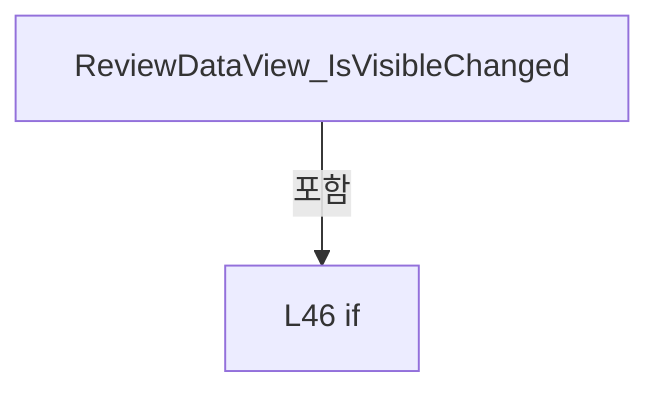

변경 전 점검: 입력/반환 타입, 위 호출자, 예외/취소 경로, 공유 상태와 저장·전송 소비자를 함께 확인합니다. 값의 단위나 물리 방향을 이름만으로 확정하지 않습니다.

### MethodDeclaration `ReviewResultsTree_SelectedItemChanged` · L52–65

[Drilling.UI/Views/CReviewDataView.xaml.cs:52–65](https://github.com/kjuws10-rgb/A3Drilling/blob/96e22cd027c84bf302b23f2949b98985d7f301bb/Drilling.UI/Views/CReviewDataView.xaml.cs#L52-L65)

| 항목 | 실제 추출 값 |
| --- | --- |
| 서명 | void Drilling.UI.Views.CReviewDataView.ReviewResultsTree_SelectedItemChanged(object, RoutedPropertyChangedEventArgs<object>) |
| 접근/수식자 | Private / private |
| 반환/값 타입 | void |
| 소속 타입 | NamedType:Drilling.UI.Views.CReviewDataView |

입력 계약:

| 이름 | 타입 | 전달 | 선택/기본값 |
| --- | --- | --- | --- |
| sender | object | None | False /  |
| eventArgs | RoutedPropertyChangedEventArgs<object> | None | False /  |

현재 부분 분석에서 직접 연결된 호출자는 없습니다. XAML/이벤트/인터페이스·델리게이트·외부 진입을 추가 확인해야 하며, 미사용으로 판정한 것이 아닙니다.

호출하는 대상과 해석 범위:

| 원본 행 | 표현식 | 분석 상태 | 대상/소스 위치 |
| --- | --- | --- | --- |
| 59 | panel.Select | resolved | void Drilling.UI.Menu.Menus.CMenuCorrection.CReviewDataPanel.Select(Drilling.UI.Menu.Menus.CMenuCorrection.ST_REVIEW_RESULT_TREE_NODE) · Drilling.UI/Menu/Menus/CMenuCorrection.ReviewData.cs:141 |
| 62 | ReviewResultsTree.Dispatcher.BeginInvoke | unresolved | None |
| 64 | new Action | unresolved | None |
| 64 | FindVisualChild<ScrollViewer> | candidate | OverloadResolutionFailure |
| 64 | .ScrollToLeftEnd | unresolved | None |

본문의 실제 연산·분기·예외·반환 순서(원문 위치 순):

| 원본 행 | 종류 | 주석 해설 |
| --- | --- | --- |
| 56 | if | 조건에 따라 분기합니다: if (DataContext is CMenuCorrection.CReviewDataPanel panel && eventArgs.NewValue is CMenuCorrection.ST_REVIEW_RESULT_TREE_NODE node) |
| 59 | call | 함수·델리게이트 또는 객체 생성자를 호출합니다: panel.Select(node) |
| 62 | call | 함수·델리게이트 또는 객체 생성자를 호출합니다: ReviewResultsTree.Dispatcher.BeginInvoke( DispatcherPriority.ContextIdle, new Action(() => FindVisualChild<ScrollViewer>(ReviewResultsTree)?.ScrollToLeftEnd())) |
| 64 | call | 함수·델리게이트 또는 객체 생성자를 호출합니다: new Action(() => FindVisualChild<ScrollViewer>(ReviewResultsTree)?.ScrollToLeftEnd()) |
| 64 | call | 함수·델리게이트 또는 객체 생성자를 호출합니다: FindVisualChild<ScrollViewer>(ReviewResultsTree) |
| 64 | call | 함수·델리게이트 또는 객체 생성자를 호출합니다: .ScrollToLeftEnd() |

제어 구문의 포함 구조(실제 실행 순서/CFG가 아닌 구문 탐색 그림):

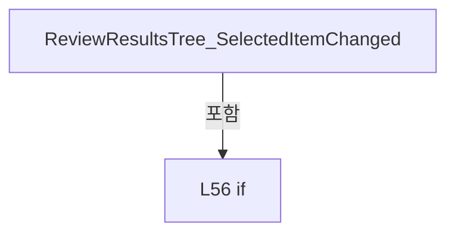

변경 전 점검: 입력/반환 타입, 위 호출자, 예외/취소 경로, 공유 상태와 저장·전송 소비자를 함께 확인합니다. 값의 단위나 물리 방향을 이름만으로 확정하지 않습니다.

### MethodDeclaration `ReviewDataShotMap_MouseLeftButtonDown` · L67–83

[Drilling.UI/Views/CReviewDataView.xaml.cs:67–83](https://github.com/kjuws10-rgb/A3Drilling/blob/96e22cd027c84bf302b23f2949b98985d7f301bb/Drilling.UI/Views/CReviewDataView.xaml.cs#L67-L83)

| 항목 | 실제 추출 값 |
| --- | --- |
| 서명 | void Drilling.UI.Views.CReviewDataView.ReviewDataShotMap_MouseLeftButtonDown(object, MouseButtonEventArgs) |
| 접근/수식자 | Private / private |
| 반환/값 타입 | void |
| 소속 타입 | NamedType:Drilling.UI.Views.CReviewDataView |

입력 계약:

| 이름 | 타입 | 전달 | 선택/기본값 |
| --- | --- | --- | --- |
| sender | object | None | False /  |
| eventArgs | MouseButtonEventArgs | None | False /  |

현재 부분 분석에서 직접 연결된 호출자는 없습니다. XAML/이벤트/인터페이스·델리게이트·외부 진입을 추가 확인해야 하며, 미사용으로 판정한 것이 아닙니다.

호출하는 대상과 해석 범위:

| 원본 행 | 표현식 | 분석 상태 | 대상/소스 위치 |
| --- | --- | --- | --- |
| 76 | BeginResultEditDrag | candidate | OverloadResolutionFailure |
| 80 | eventArgs.GetPosition | unresolved | None |
| 81 | panel.SelectShotAt | candidate | OverloadResolutionFailure |

본문의 실제 연산·분기·예외·반환 순서(원문 위치 순):

| 원본 행 | 종류 | 주석 해설 |
| --- | --- | --- |
| 69 | if | 조건에 따라 분기합니다: if (sender is not FrameworkElement map &#124;&#124; DataContext is not CMenuCorrection.CReviewDataPanel panel) |
| 71 | return | 호출자에게 값 또는 제어를 반환합니다: return; |
| 74 | if | 조건에 따라 분기합니다: if (panel.IsResultEditMode) |
| 76 | call | 함수·델리게이트 또는 객체 생성자를 호출합니다: BeginResultEditDrag(map, ShotMapEditSelectionRectangle, isScatter: false, eventArgs) |
| 77 | return | 호출자에게 값 또는 제어를 반환합니다: return; |
| 80 | call | 함수·델리게이트 또는 객체 생성자를 호출합니다: eventArgs.GetPosition(map) |
| 80 | local-declaration | 지역 변수를 선언합니다: var point = eventArgs.GetPosition(map); |
| 80 | variable-initializer | 변수의 초기값을 지정합니다: point = eventArgs.GetPosition(map) |
| 81 | call | 함수·델리게이트 또는 객체 생성자를 호출합니다: panel.SelectShotAt(point.X, point.Y) |
| 82 | assignment | 값을 대상에 대입합니다: eventArgs.Handled = true |

제어 구문의 포함 구조(실제 실행 순서/CFG가 아닌 구문 탐색 그림):

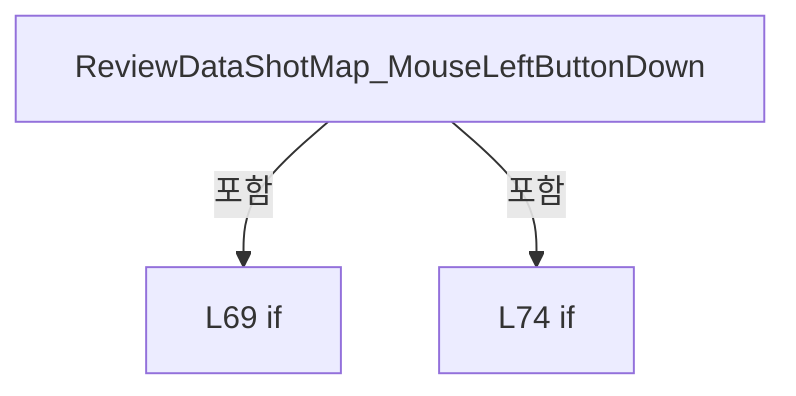

변경 전 점검: 입력/반환 타입, 위 호출자, 예외/취소 경로, 공유 상태와 저장·전송 소비자를 함께 확인합니다. 값의 단위나 물리 방향을 이름만으로 확정하지 않습니다.

### MethodDeclaration `ReviewDataScatterPlot_MouseLeftButtonDown` · L85–106

[Drilling.UI/Views/CReviewDataView.xaml.cs:85–106](https://github.com/kjuws10-rgb/A3Drilling/blob/96e22cd027c84bf302b23f2949b98985d7f301bb/Drilling.UI/Views/CReviewDataView.xaml.cs#L85-L106)

| 항목 | 실제 추출 값 |
| --- | --- |
| 서명 | void Drilling.UI.Views.CReviewDataView.ReviewDataScatterPlot_MouseLeftButtonDown(object, MouseButtonEventArgs) |
| 접근/수식자 | Private / private |
| 반환/값 타입 | void |
| 소속 타입 | NamedType:Drilling.UI.Views.CReviewDataView |

입력 계약:

| 이름 | 타입 | 전달 | 선택/기본값 |
| --- | --- | --- | --- |
| sender | object | None | False /  |
| eventArgs | MouseButtonEventArgs | None | False /  |

현재 부분 분석에서 직접 연결된 호출자는 없습니다. XAML/이벤트/인터페이스·델리게이트·외부 진입을 추가 확인해야 하며, 미사용으로 판정한 것이 아닙니다.

호출하는 대상과 해석 범위:

| 원본 행 | 표현식 | 분석 상태 | 대상/소스 위치 |
| --- | --- | --- | --- |
| 97 | BeginResultEditDrag | candidate | OverloadResolutionFailure |
| 101 | eventArgs.GetPosition | unresolved | None |
| 102 | panel.SelectScatterPointAt | candidate | OverloadResolutionFailure |

본문의 실제 연산·분기·예외·반환 순서(원문 위치 순):

| 원본 행 | 종류 | 주석 해설 |
| --- | --- | --- |
| 87 | if | 조건에 따라 분기합니다: if (sender is not FrameworkElement plot &#124;&#124; plot.ActualWidth <= 0.0 &#124;&#124; plot.ActualHeight <= 0.0 &#124;&#124; DataContext is not CMenuCorrection.CReviewDataPanel panel) |
| 92 | return | 호출자에게 값 또는 제어를 반환합니다: return; |
| 95 | if | 조건에 따라 분기합니다: if (panel.IsResultEditMode) |
| 97 | call | 함수·델리게이트 또는 객체 생성자를 호출합니다: BeginResultEditDrag(plot, ScatterEditSelectionRectangle, isScatter: true, eventArgs) |
| 98 | return | 호출자에게 값 또는 제어를 반환합니다: return; |
| 101 | call | 함수·델리게이트 또는 객체 생성자를 호출합니다: eventArgs.GetPosition(plot) |
| 101 | local-declaration | 지역 변수를 선언합니다: var point = eventArgs.GetPosition(plot); |
| 101 | variable-initializer | 변수의 초기값을 지정합니다: point = eventArgs.GetPosition(plot) |
| 102 | call | 함수·델리게이트 또는 객체 생성자를 호출합니다: panel.SelectScatterPointAt( point.X * panel.ScatterPlotSurfaceWidth / plot.ActualWidth, point.Y * panel.ScatterPlotSurfaceHeight / plot.ActualHeight) |
| 105 | assignment | 값을 대상에 대입합니다: eventArgs.Handled = true |

제어 구문의 포함 구조(실제 실행 순서/CFG가 아닌 구문 탐색 그림):

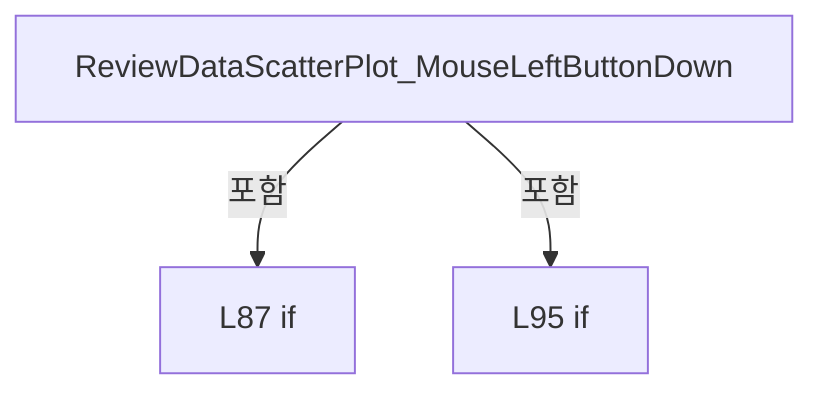

변경 전 점검: 입력/반환 타입, 위 호출자, 예외/취소 경로, 공유 상태와 저장·전송 소비자를 함께 확인합니다. 값의 단위나 물리 방향을 이름만으로 확정하지 않습니다.

### MethodDeclaration `BeginResultEditDrag` · L108–130

[Drilling.UI/Views/CReviewDataView.xaml.cs:108–130](https://github.com/kjuws10-rgb/A3Drilling/blob/96e22cd027c84bf302b23f2949b98985d7f301bb/Drilling.UI/Views/CReviewDataView.xaml.cs#L108-L130)

| 항목 | 실제 추출 값 |
| --- | --- |
| 서명 | void Drilling.UI.Views.CReviewDataView.BeginResultEditDrag(FrameworkElement, Rectangle, bool, MouseButtonEventArgs) |
| 접근/수식자 | Private / private |
| 반환/값 타입 | void |
| 소속 타입 | NamedType:Drilling.UI.Views.CReviewDataView |

입력 계약:

| 이름 | 타입 | 전달 | 선택/기본값 |
| --- | --- | --- | --- |
| surface | FrameworkElement | None | False /  |
| rectangle | Rectangle | None | False /  |
| isScatter | bool | None | False /  |
| eventArgs | MouseButtonEventArgs | None | False /  |

현재 부분 분석에서 직접 연결된 호출자는 없습니다. XAML/이벤트/인터페이스·델리게이트·외부 진입을 추가 확인해야 하며, 미사용으로 판정한 것이 아닙니다.

호출하는 대상과 해석 범위:

| 원본 행 | 표현식 | 분석 상태 | 대상/소스 위치 |
| --- | --- | --- | --- |
| 122 | eventArgs.GetPosition | unresolved | None |
| 125 | Canvas.SetLeft | unresolved | None |
| 126 | Canvas.SetTop | unresolved | None |
| 128 | surface.CaptureMouse | unresolved | None |

본문의 실제 연산·분기·예외·반환 순서(원문 위치 순):

| 원본 행 | 종류 | 주석 해설 |
| --- | --- | --- |
| 114 | if | 조건에 따라 분기합니다: if (eventArgs.ChangedButton != MouseButton.Left) |
| 116 | return | 호출자에게 값 또는 제어를 반환합니다: return; |
| 119 | assignment | 값을 대상에 대입합니다: _resultEditDragSurface = surface |
| 120 | assignment | 값을 대상에 대입합니다: _resultEditDragRectangle = rectangle |
| 121 | assignment | 값을 대상에 대입합니다: _resultEditDragIsScatter = isScatter |
| 122 | assignment | 값을 대상에 대입합니다: _resultEditDragStart = eventArgs.GetPosition(surface) |
| 122 | call | 함수·델리게이트 또는 객체 생성자를 호출합니다: eventArgs.GetPosition(surface) |
| 123 | assignment | 값을 대상에 대입합니다: rectangle.Width = 0.0 |
| 124 | assignment | 값을 대상에 대입합니다: rectangle.Height = 0.0 |
| 125 | call | 함수·델리게이트 또는 객체 생성자를 호출합니다: Canvas.SetLeft(rectangle, _resultEditDragStart.X) |
| 126 | call | 함수·델리게이트 또는 객체 생성자를 호출합니다: Canvas.SetTop(rectangle, _resultEditDragStart.Y) |
| 127 | assignment | 값을 대상에 대입합니다: rectangle.Visibility = Visibility.Visible |
| 128 | call | 함수·델리게이트 또는 객체 생성자를 호출합니다: surface.CaptureMouse() |
| 129 | assignment | 값을 대상에 대입합니다: eventArgs.Handled = true |

제어 구문의 포함 구조(실제 실행 순서/CFG가 아닌 구문 탐색 그림):

변경 전 점검: 입력/반환 타입, 위 호출자, 예외/취소 경로, 공유 상태와 저장·전송 소비자를 함께 확인합니다. 값의 단위나 물리 방향을 이름만으로 확정하지 않습니다.

### MethodDeclaration `ReviewDataEditSurface_MouseMove` · L132–149

[Drilling.UI/Views/CReviewDataView.xaml.cs:132–149](https://github.com/kjuws10-rgb/A3Drilling/blob/96e22cd027c84bf302b23f2949b98985d7f301bb/Drilling.UI/Views/CReviewDataView.xaml.cs#L132-L149)

| 항목 | 실제 추출 값 |
| --- | --- |
| 서명 | void Drilling.UI.Views.CReviewDataView.ReviewDataEditSurface_MouseMove(object, MouseEventArgs) |
| 접근/수식자 | Private / private |
| 반환/값 타입 | void |
| 소속 타입 | NamedType:Drilling.UI.Views.CReviewDataView |

입력 계약:

| 이름 | 타입 | 전달 | 선택/기본값 |
| --- | --- | --- | --- |
| sender | object | None | False /  |
| eventArgs | MouseEventArgs | None | False /  |

현재 부분 분석에서 직접 연결된 호출자는 없습니다. XAML/이벤트/인터페이스·델리게이트·외부 진입을 추가 확인해야 하며, 미사용으로 판정한 것이 아닙니다.

호출하는 대상과 해석 범위:

| 원본 행 | 표현식 | 분석 상태 | 대상/소스 위치 |
| --- | --- | --- | --- |
| 134 | ReferenceEquals | candidate | OverloadResolutionFailure |
| 143 | CancelResultEditDrag | resolved | void Drilling.UI.Views.CReviewDataView.CancelResultEditDrag() · Drilling.UI/Views/CReviewDataView.xaml.cs:227 |
| 147 | UpdateResultEditDragRectangle | candidate | OverloadResolutionFailure |
| 147 | eventArgs.GetPosition | unresolved | None |

본문의 실제 연산·분기·예외·반환 순서(원문 위치 순):

| 원본 행 | 종류 | 주석 해설 |
| --- | --- | --- |
| 134 | call | 함수·델리게이트 또는 객체 생성자를 호출합니다: ReferenceEquals(sender, _resultEditDragSurface) |
| 134 | if | 조건에 따라 분기합니다: if (!ReferenceEquals(sender, _resultEditDragSurface) &#124;&#124; _resultEditDragSurface is null &#124;&#124; _resultEditDragRectangle is null) |
| 138 | return | 호출자에게 값 또는 제어를 반환합니다: return; |
| 141 | if | 조건에 따라 분기합니다: if (eventArgs.LeftButton != MouseButtonState.Pressed) |
| 143 | call | 함수·델리게이트 또는 객체 생성자를 호출합니다: CancelResultEditDrag() |
| 144 | return | 호출자에게 값 또는 제어를 반환합니다: return; |
| 147 | call | 함수·델리게이트 또는 객체 생성자를 호출합니다: UpdateResultEditDragRectangle(eventArgs.GetPosition(_resultEditDragSurface)) |
| 147 | call | 함수·델리게이트 또는 객체 생성자를 호출합니다: eventArgs.GetPosition(_resultEditDragSurface) |
| 148 | assignment | 값을 대상에 대입합니다: eventArgs.Handled = true |

제어 구문의 포함 구조(실제 실행 순서/CFG가 아닌 구문 탐색 그림):

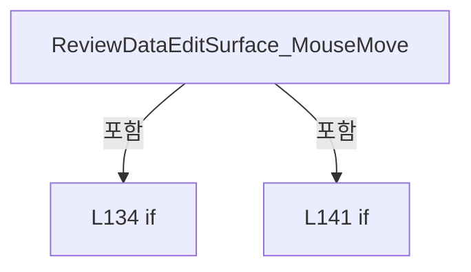

변경 전 점검: 입력/반환 타입, 위 호출자, 예외/취소 경로, 공유 상태와 저장·전송 소비자를 함께 확인합니다. 값의 단위나 물리 방향을 이름만으로 확정하지 않습니다.

### MethodDeclaration `ReviewDataEditSurface_MouseLeftButtonUp` · L151–202

[Drilling.UI/Views/CReviewDataView.xaml.cs:151–202](https://github.com/kjuws10-rgb/A3Drilling/blob/96e22cd027c84bf302b23f2949b98985d7f301bb/Drilling.UI/Views/CReviewDataView.xaml.cs#L151-L202)

| 항목 | 실제 추출 값 |
| --- | --- |
| 서명 | void Drilling.UI.Views.CReviewDataView.ReviewDataEditSurface_MouseLeftButtonUp(object, MouseButtonEventArgs) |
| 접근/수식자 | Private / private |
| 반환/값 타입 | void |
| 소속 타입 | NamedType:Drilling.UI.Views.CReviewDataView |

입력 계약:

| 이름 | 타입 | 전달 | 선택/기본값 |
| --- | --- | --- | --- |
| sender | object | None | False /  |
| eventArgs | MouseButtonEventArgs | None | False /  |

현재 부분 분석에서 직접 연결된 호출자는 없습니다. XAML/이벤트/인터페이스·델리게이트·외부 진입을 추가 확인해야 하며, 미사용으로 판정한 것이 아닙니다.

호출하는 대상과 해석 범위:

| 원본 행 | 표현식 | 분석 상태 | 대상/소스 위치 |
| --- | --- | --- | --- |
| 153 | ReferenceEquals | candidate | OverloadResolutionFailure |
| 162 | eventArgs.GetPosition | unresolved | None |
| 163 | UpdateResultEditDragRectangle | candidate | OverloadResolutionFailure |
| 164 | Math.Abs | candidate | OverloadResolutionFailure |
| 165 | Math.Abs | candidate | OverloadResolutionFailure |
| 170 | panel.SelectScatterPointAt | candidate | OverloadResolutionFailure |
| 171 | Math.Max | candidate | OverloadResolutionFailure |
| 172 | Math.Max | candidate | OverloadResolutionFailure |
| 176 | panel.SelectShotAt | candidate | OverloadResolutionFailure |
| 177 | Math.Max | candidate | OverloadResolutionFailure |
| 178 | Math.Max | candidate | OverloadResolutionFailure |
| 181 | panel.SelectCurrentShotForResultEdit | resolved | void Drilling.UI.Menu.Menus.CMenuCorrection.CReviewDataPanel.SelectCurrentShotForResultEdit() · Drilling.UI/Menu/Menus/CMenuCorrection.ReviewData.Edit.cs:144 |
| 185 | panel.SelectResultEditShotsInScatter | candidate | OverloadResolutionFailure |
| 186 | Math.Max | candidate | OverloadResolutionFailure |
| 187 | Math.Max | candidate | OverloadResolutionFailure |
| 188 | Math.Max | candidate | OverloadResolutionFailure |
| 189 | Math.Max | candidate | OverloadResolutionFailure |
| 193 | panel.SelectResultEditShotsInMap | candidate | OverloadResolutionFailure |
| 194 | Math.Max | candidate | OverloadResolutionFailure |
| 195 | Math.Max | candidate | OverloadResolutionFailure |
| 196 | Math.Max | candidate | OverloadResolutionFailure |
| 197 | Math.Max | candidate | OverloadResolutionFailure |
| 200 | CancelResultEditDrag | resolved | void Drilling.UI.Views.CReviewDataView.CancelResultEditDrag() · Drilling.UI/Views/CReviewDataView.xaml.cs:227 |

본문의 실제 연산·분기·예외·반환 순서(원문 위치 순):

| 원본 행 | 종류 | 주석 해설 |
| --- | --- | --- |
| 153 | call | 함수·델리게이트 또는 객체 생성자를 호출합니다: ReferenceEquals(sender, _resultEditDragSurface) |
| 153 | if | 조건에 따라 분기합니다: if (!ReferenceEquals(sender, _resultEditDragSurface) &#124;&#124; _resultEditDragSurface is null &#124;&#124; _resultEditDragRectangle is null &#124;&#124; DataContext is not CMenuCorrection.CReviewDataPanel panel) |
| 158 | return | 호출자에게 값 또는 제어를 반환합니다: return; |
| 161 | local-declaration | 지역 변수를 선언합니다: var surface = _resultEditDragSurface; |
| 161 | variable-initializer | 변수의 초기값을 지정합니다: surface = _resultEditDragSurface |
| 162 | call | 함수·델리게이트 또는 객체 생성자를 호출합니다: eventArgs.GetPosition(surface) |
| 162 | local-declaration | 지역 변수를 선언합니다: var end = eventArgs.GetPosition(surface); |
| 162 | variable-initializer | 변수의 초기값을 지정합니다: end = eventArgs.GetPosition(surface) |
| 163 | call | 함수·델리게이트 또는 객체 생성자를 호출합니다: UpdateResultEditDragRectangle(end) |
| 164 | call | 함수·델리게이트 또는 객체 생성자를 호출합니다: Math.Abs(end.X - _resultEditDragStart.X) |
| 164 | local-declaration | 지역 변수를 선언합니다: var deltaX = Math.Abs(end.X - _resultEditDragStart.X); |
| 164 | variable-initializer | 변수의 초기값을 지정합니다: deltaX = Math.Abs(end.X - _resultEditDragStart.X) |
| 165 | call | 함수·델리게이트 또는 객체 생성자를 호출합니다: Math.Abs(end.Y - _resultEditDragStart.Y) |
| 165 | local-declaration | 지역 변수를 선언합니다: var deltaY = Math.Abs(end.Y - _resultEditDragStart.Y); |
| 165 | variable-initializer | 변수의 초기값을 지정합니다: deltaY = Math.Abs(end.Y - _resultEditDragStart.Y) |
| 166 | if | 조건에 따라 분기합니다: if (deltaX < 5.0 && deltaY < 5.0) |
| 168 | if | 조건에 따라 분기합니다: if (_resultEditDragIsScatter) |
| 170 | call | 함수·델리게이트 또는 객체 생성자를 호출합니다: panel.SelectScatterPointAt( end.X * panel.ScatterPlotSurfaceWidth / Math.Max(1.0, surface.ActualWidth), end.Y * panel.ScatterPlotSurfaceHeight / Math.Max(1.0, surface.ActualHeight)) |
| 171 | call | 함수·델리게이트 또는 객체 생성자를 호출합니다: Math.Max(1.0, surface.ActualWidth) |
| 172 | call | 함수·델리게이트 또는 객체 생성자를 호출합니다: Math.Max(1.0, surface.ActualHeight) |
| 174 | else | 앞 조건이 거짓인 경로입니다: else |
| 176 | call | 함수·델리게이트 또는 객체 생성자를 호출합니다: panel.SelectShotAt( end.X * panel.ShotMapSurfaceWidth / Math.Max(1.0, surface.ActualWidth), end.Y * panel.ShotMapSurfaceHeight / Math.Max(1.0, surface.ActualHeight)) |
| 177 | call | 함수·델리게이트 또는 객체 생성자를 호출합니다: Math.Max(1.0, surface.ActualWidth) |
| 178 | call | 함수·델리게이트 또는 객체 생성자를 호출합니다: Math.Max(1.0, surface.ActualHeight) |
| 181 | call | 함수·델리게이트 또는 객체 생성자를 호출합니다: panel.SelectCurrentShotForResultEdit() |
| 183 | else | 앞 조건이 거짓인 경로입니다: else |
| 183 | if | 조건에 따라 분기합니다: if (_resultEditDragIsScatter) |
| 185 | call | 함수·델리게이트 또는 객체 생성자를 호출합니다: panel.SelectResultEditShotsInScatter( _resultEditDragStart.X * panel.ScatterPlotSurfaceWidth / Math.Max(1.0, surface.ActualWidth), _resultEditDragStart.Y * panel.ScatterPlotSurfaceHeight / Math.Max(1.0, surface.ActualHei… |
| 186 | call | 함수·델리게이트 또는 객체 생성자를 호출합니다: Math.Max(1.0, surface.ActualWidth) |
| 187 | call | 함수·델리게이트 또는 객체 생성자를 호출합니다: Math.Max(1.0, surface.ActualHeight) |
| 188 | call | 함수·델리게이트 또는 객체 생성자를 호출합니다: Math.Max(1.0, surface.ActualWidth) |
| 189 | call | 함수·델리게이트 또는 객체 생성자를 호출합니다: Math.Max(1.0, surface.ActualHeight) |
| 191 | else | 앞 조건이 거짓인 경로입니다: else |
| 193 | call | 함수·델리게이트 또는 객체 생성자를 호출합니다: panel.SelectResultEditShotsInMap( _resultEditDragStart.X * panel.ShotMapSurfaceWidth / Math.Max(1.0, surface.ActualWidth), _resultEditDragStart.Y * panel.ShotMapSurfaceHeight / Math.Max(1.0, surface.ActualHeight), end.X … |
| 194 | call | 함수·델리게이트 또는 객체 생성자를 호출합니다: Math.Max(1.0, surface.ActualWidth) |
| 195 | call | 함수·델리게이트 또는 객체 생성자를 호출합니다: Math.Max(1.0, surface.ActualHeight) |
| 196 | call | 함수·델리게이트 또는 객체 생성자를 호출합니다: Math.Max(1.0, surface.ActualWidth) |
| 197 | call | 함수·델리게이트 또는 객체 생성자를 호출합니다: Math.Max(1.0, surface.ActualHeight) |
| 200 | call | 함수·델리게이트 또는 객체 생성자를 호출합니다: CancelResultEditDrag() |
| 201 | assignment | 값을 대상에 대입합니다: eventArgs.Handled = true |

제어 구문의 포함 구조(실제 실행 순서/CFG가 아닌 구문 탐색 그림):

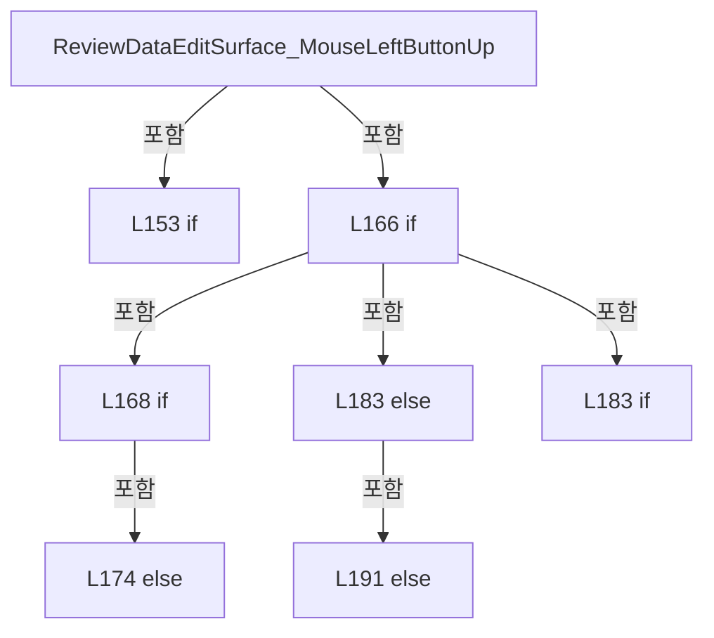

변경 전 점검: 입력/반환 타입, 위 호출자, 예외/취소 경로, 공유 상태와 저장·전송 소비자를 함께 확인합니다. 값의 단위나 물리 방향을 이름만으로 확정하지 않습니다.

### MethodDeclaration `ReviewDataEditSurface_LostMouseCapture` · L204–210

[Drilling.UI/Views/CReviewDataView.xaml.cs:204–210](https://github.com/kjuws10-rgb/A3Drilling/blob/96e22cd027c84bf302b23f2949b98985d7f301bb/Drilling.UI/Views/CReviewDataView.xaml.cs#L204-L210)

| 항목 | 실제 추출 값 |
| --- | --- |
| 서명 | void Drilling.UI.Views.CReviewDataView.ReviewDataEditSurface_LostMouseCapture(object, MouseEventArgs) |
| 접근/수식자 | Private / private |
| 반환/값 타입 | void |
| 소속 타입 | NamedType:Drilling.UI.Views.CReviewDataView |

입력 계약:

| 이름 | 타입 | 전달 | 선택/기본값 |
| --- | --- | --- | --- |
| sender | object | None | False /  |
| eventArgs | MouseEventArgs | None | False /  |

현재 부분 분석에서 직접 연결된 호출자는 없습니다. XAML/이벤트/인터페이스·델리게이트·외부 진입을 추가 확인해야 하며, 미사용으로 판정한 것이 아닙니다.

호출하는 대상과 해석 범위:

| 원본 행 | 표현식 | 분석 상태 | 대상/소스 위치 |
| --- | --- | --- | --- |
| 206 | ReferenceEquals | candidate | OverloadResolutionFailure |
| 208 | CancelResultEditDrag | resolved | void Drilling.UI.Views.CReviewDataView.CancelResultEditDrag() · Drilling.UI/Views/CReviewDataView.xaml.cs:227 |

본문의 실제 연산·분기·예외·반환 순서(원문 위치 순):

| 원본 행 | 종류 | 주석 해설 |
| --- | --- | --- |
| 206 | call | 함수·델리게이트 또는 객체 생성자를 호출합니다: ReferenceEquals(sender, _resultEditDragSurface) |
| 206 | if | 조건에 따라 분기합니다: if (ReferenceEquals(sender, _resultEditDragSurface)) |
| 208 | call | 함수·델리게이트 또는 객체 생성자를 호출합니다: CancelResultEditDrag() |

제어 구문의 포함 구조(실제 실행 순서/CFG가 아닌 구문 탐색 그림):

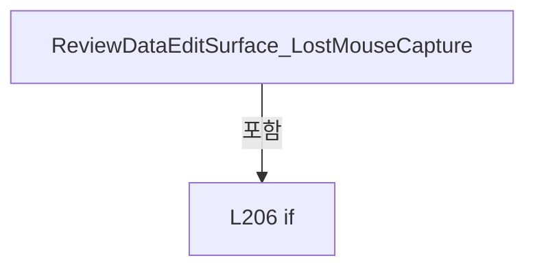

변경 전 점검: 입력/반환 타입, 위 호출자, 예외/취소 경로, 공유 상태와 저장·전송 소비자를 함께 확인합니다. 값의 단위나 물리 방향을 이름만으로 확정하지 않습니다.

### MethodDeclaration `UpdateResultEditDragRectangle` · L212–225

[Drilling.UI/Views/CReviewDataView.xaml.cs:212–225](https://github.com/kjuws10-rgb/A3Drilling/blob/96e22cd027c84bf302b23f2949b98985d7f301bb/Drilling.UI/Views/CReviewDataView.xaml.cs#L212-L225)

| 항목 | 실제 추출 값 |
| --- | --- |
| 서명 | void Drilling.UI.Views.CReviewDataView.UpdateResultEditDragRectangle(Point) |
| 접근/수식자 | Private / private |
| 반환/값 타입 | void |
| 소속 타입 | NamedType:Drilling.UI.Views.CReviewDataView |

입력 계약:

| 이름 | 타입 | 전달 | 선택/기본값 |
| --- | --- | --- | --- |
| end | Point | None | False /  |

현재 부분 분석에서 직접 연결된 호출자는 없습니다. XAML/이벤트/인터페이스·델리게이트·외부 진입을 추가 확인해야 하며, 미사용으로 판정한 것이 아닙니다.

호출하는 대상과 해석 범위:

| 원본 행 | 표현식 | 분석 상태 | 대상/소스 위치 |
| --- | --- | --- | --- |
| 219 | Math.Min | candidate | OverloadResolutionFailure |
| 220 | Math.Min | candidate | OverloadResolutionFailure |
| 221 | Canvas.SetLeft | unresolved | None |
| 222 | Canvas.SetTop | unresolved | None |
| 223 | Math.Abs | candidate | OverloadResolutionFailure |
| 224 | Math.Abs | candidate | OverloadResolutionFailure |

본문의 실제 연산·분기·예외·반환 순서(원문 위치 순):

| 원본 행 | 종류 | 주석 해설 |
| --- | --- | --- |
| 214 | if | 조건에 따라 분기합니다: if (_resultEditDragRectangle is null) |
| 216 | return | 호출자에게 값 또는 제어를 반환합니다: return; |
| 219 | call | 함수·델리게이트 또는 객체 생성자를 호출합니다: Math.Min(_resultEditDragStart.X, end.X) |
| 219 | local-declaration | 지역 변수를 선언합니다: var left = Math.Min(_resultEditDragStart.X, end.X); |
| 219 | variable-initializer | 변수의 초기값을 지정합니다: left = Math.Min(_resultEditDragStart.X, end.X) |
| 220 | call | 함수·델리게이트 또는 객체 생성자를 호출합니다: Math.Min(_resultEditDragStart.Y, end.Y) |
| 220 | local-declaration | 지역 변수를 선언합니다: var top = Math.Min(_resultEditDragStart.Y, end.Y); |
| 220 | variable-initializer | 변수의 초기값을 지정합니다: top = Math.Min(_resultEditDragStart.Y, end.Y) |
| 221 | call | 함수·델리게이트 또는 객체 생성자를 호출합니다: Canvas.SetLeft(_resultEditDragRectangle, left) |
| 222 | call | 함수·델리게이트 또는 객체 생성자를 호출합니다: Canvas.SetTop(_resultEditDragRectangle, top) |
| 223 | assignment | 값을 대상에 대입합니다: _resultEditDragRectangle.Width = Math.Abs(end.X - _resultEditDragStart.X) |
| 223 | call | 함수·델리게이트 또는 객체 생성자를 호출합니다: Math.Abs(end.X - _resultEditDragStart.X) |
| 224 | assignment | 값을 대상에 대입합니다: _resultEditDragRectangle.Height = Math.Abs(end.Y - _resultEditDragStart.Y) |
| 224 | call | 함수·델리게이트 또는 객체 생성자를 호출합니다: Math.Abs(end.Y - _resultEditDragStart.Y) |

제어 구문의 포함 구조(실제 실행 순서/CFG가 아닌 구문 탐색 그림):

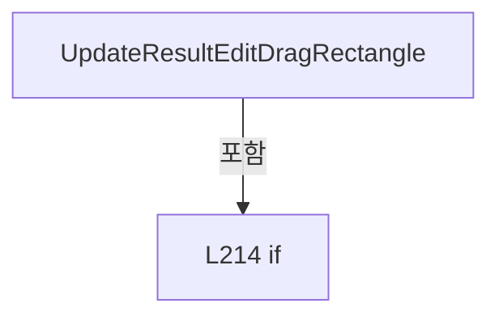

변경 전 점검: 입력/반환 타입, 위 호출자, 예외/취소 경로, 공유 상태와 저장·전송 소비자를 함께 확인합니다. 값의 단위나 물리 방향을 이름만으로 확정하지 않습니다.

### MethodDeclaration `CancelResultEditDrag` · L227–241

[Drilling.UI/Views/CReviewDataView.xaml.cs:227–241](https://github.com/kjuws10-rgb/A3Drilling/blob/96e22cd027c84bf302b23f2949b98985d7f301bb/Drilling.UI/Views/CReviewDataView.xaml.cs#L227-L241)

| 항목 | 실제 추출 값 |
| --- | --- |
| 서명 | void Drilling.UI.Views.CReviewDataView.CancelResultEditDrag() |
| 접근/수식자 | Private / private |
| 반환/값 타입 | void |
| 소속 타입 | NamedType:Drilling.UI.Views.CReviewDataView |

정적 호출자로 확인된 위치:

| 호출 파일/행 | 호출 표현식 | 런타임 분기 가능 |
| --- | --- | --- |
| [Drilling.UI/Views/CReviewDataView.xaml.cs:143–143](https://github.com/kjuws10-rgb/A3Drilling/blob/96e22cd027c84bf302b23f2949b98985d7f301bb/Drilling.UI/Views/CReviewDataView.xaml.cs#L143-L143) | CancelResultEditDrag | False |
| [Drilling.UI/Views/CReviewDataView.xaml.cs:200–200](https://github.com/kjuws10-rgb/A3Drilling/blob/96e22cd027c84bf302b23f2949b98985d7f301bb/Drilling.UI/Views/CReviewDataView.xaml.cs#L200-L200) | CancelResultEditDrag | False |
| [Drilling.UI/Views/CReviewDataView.xaml.cs:208–208](https://github.com/kjuws10-rgb/A3Drilling/blob/96e22cd027c84bf302b23f2949b98985d7f301bb/Drilling.UI/Views/CReviewDataView.xaml.cs#L208-L208) | CancelResultEditDrag | False |

호출하는 대상과 해석 범위:

| 원본 행 | 표현식 | 분석 상태 | 대상/소스 위치 |
| --- | --- | --- | --- |
| 236 | _resultEditDragSurface.ReleaseMouseCapture | unresolved | None |

본문의 실제 연산·분기·예외·반환 순서(원문 위치 순):

| 원본 행 | 종류 | 주석 해설 |
| --- | --- | --- |
| 229 | if | 조건에 따라 분기합니다: if (_resultEditDragRectangle is not null) |
| 231 | assignment | 값을 대상에 대입합니다: _resultEditDragRectangle.Visibility = Visibility.Collapsed |
| 234 | if | 조건에 따라 분기합니다: if (_resultEditDragSurface?.IsMouseCaptured == true) |
| 236 | call | 함수·델리게이트 또는 객체 생성자를 호출합니다: _resultEditDragSurface.ReleaseMouseCapture() |
| 239 | assignment | 값을 대상에 대입합니다: _resultEditDragSurface = null |
| 240 | assignment | 값을 대상에 대입합니다: _resultEditDragRectangle = null |

제어 구문의 포함 구조(실제 실행 순서/CFG가 아닌 구문 탐색 그림):

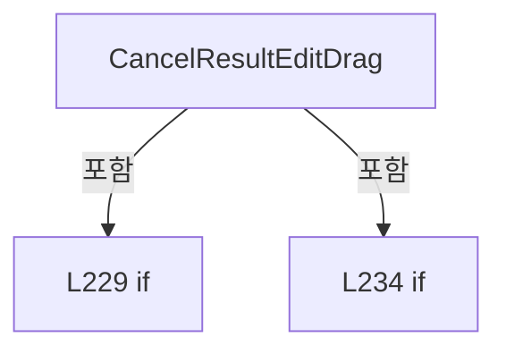

변경 전 점검: 입력/반환 타입, 위 호출자, 예외/취소 경로, 공유 상태와 저장·전송 소비자를 함께 확인합니다. 값의 단위나 물리 방향을 이름만으로 확정하지 않습니다.

### MethodDeclaration `ReviewDataResultGrid_SelectionChanged` · L243–258

[Drilling.UI/Views/CReviewDataView.xaml.cs:243–258](https://github.com/kjuws10-rgb/A3Drilling/blob/96e22cd027c84bf302b23f2949b98985d7f301bb/Drilling.UI/Views/CReviewDataView.xaml.cs#L243-L258)

| 항목 | 실제 추출 값 |
| --- | --- |
| 서명 | void Drilling.UI.Views.CReviewDataView.ReviewDataResultGrid_SelectionChanged(object, SelectionChangedEventArgs) |
| 접근/수식자 | Private / private |
| 반환/값 타입 | void |
| 소속 타입 | NamedType:Drilling.UI.Views.CReviewDataView |

입력 계약:

| 이름 | 타입 | 전달 | 선택/기본값 |
| --- | --- | --- | --- |
| sender | object | None | False /  |
| eventArgs | SelectionChangedEventArgs | None | False /  |

현재 부분 분석에서 직접 연결된 호출자는 없습니다. XAML/이벤트/인터페이스·델리게이트·외부 진입을 추가 확인해야 하며, 미사용으로 판정한 것이 아닙니다.

호출하는 대상과 해석 범위:

| 원본 행 | 표현식 | 분석 상태 | 대상/소스 위치 |
| --- | --- | --- | --- |
| 251 | panel.SelectRow | resolved | void Drilling.UI.Menu.Menus.CMenuCorrection.CReviewDataPanel.SelectRow(Drilling.UI.Menu.Menus.CMenuCorrection.ST_REVIEW_DATA_GRID_ROW) · Drilling.UI/Menu/Menus/CMenuCorrection.ReviewData.Display.cs:610 |
| 254 | ReviewDataResultGrid.Dispatcher.BeginInvoke | unresolved | None |
| 256 | new Action | unresolved | None |
| 256 | ReviewDataResultGrid.ScrollIntoView | unresolved | None |

본문의 실제 연산·분기·예외·반환 순서(원문 위치 순):

| 원본 행 | 종류 | 주석 해설 |
| --- | --- | --- |
| 245 | if | 조건에 따라 분기합니다: if (sender is not DataGrid { SelectedItem: CMenuCorrection.ST_REVIEW_DATA_GRID_ROW row } &#124;&#124; DataContext is not CMenuCorrection.CReviewDataPanel panel) |
| 248 | return | 호출자에게 값 또는 제어를 반환합니다: return; |
| 251 | call | 함수·델리게이트 또는 객체 생성자를 호출합니다: panel.SelectRow(row) |
| 252 | if | 조건에 따라 분기합니다: if (panel.SelectedRow is { } selectedRow) |
| 254 | call | 함수·델리게이트 또는 객체 생성자를 호출합니다: ReviewDataResultGrid.Dispatcher.BeginInvoke( DispatcherPriority.Background, new Action(() => ReviewDataResultGrid.ScrollIntoView(selectedRow))) |
| 256 | call | 함수·델리게이트 또는 객체 생성자를 호출합니다: new Action(() => ReviewDataResultGrid.ScrollIntoView(selectedRow)) |
| 256 | call | 함수·델리게이트 또는 객체 생성자를 호출합니다: ReviewDataResultGrid.ScrollIntoView(selectedRow) |

제어 구문의 포함 구조(실제 실행 순서/CFG가 아닌 구문 탐색 그림):

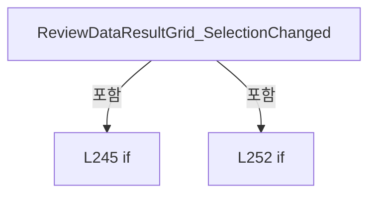

변경 전 점검: 입력/반환 타입, 위 호출자, 예외/취소 경로, 공유 상태와 저장·전송 소비자를 함께 확인합니다. 값의 단위나 물리 방향을 이름만으로 확정하지 않습니다.

### MethodDeclaration `ReviewDataResultGrid_LoadingRow` · L260–268

[Drilling.UI/Views/CReviewDataView.xaml.cs:260–268](https://github.com/kjuws10-rgb/A3Drilling/blob/96e22cd027c84bf302b23f2949b98985d7f301bb/Drilling.UI/Views/CReviewDataView.xaml.cs#L260-L268)

| 항목 | 실제 추출 값 |
| --- | --- |
| 서명 | void Drilling.UI.Views.CReviewDataView.ReviewDataResultGrid_LoadingRow(object, DataGridRowEventArgs) |
| 접근/수식자 | Private / private |
| 반환/값 타입 | void |
| 소속 타입 | NamedType:Drilling.UI.Views.CReviewDataView |

입력 계약:

| 이름 | 타입 | 전달 | 선택/기본값 |
| --- | --- | --- | --- |
| sender | object | None | False /  |
| eventArgs | DataGridRowEventArgs | None | False /  |

현재 부분 분석에서 직접 연결된 호출자는 없습니다. XAML/이벤트/인터페이스·델리게이트·외부 진입을 추가 확인해야 하며, 미사용으로 판정한 것이 아닙니다.

호출하는 대상과 해석 범위:

| 원본 행 | 표현식 | 분석 상태 | 대상/소스 위치 |
| --- | --- | --- | --- |
| 264 | eventArgs.Row.SetCurrentValue | unresolved | None |
| 266 | ReferenceEquals | candidate | OverloadResolutionFailure |

본문의 실제 연산·분기·예외·반환 순서(원문 위치 순):

| 원본 행 | 종류 | 주석 해설 |
| --- | --- | --- |
| 262 | if | 조건에 따라 분기합니다: if (DataContext is CMenuCorrection.CReviewDataPanel panel) |
| 264 | call | 함수·델리게이트 또는 객체 생성자를 호출합니다: eventArgs.Row.SetCurrentValue( DataGridRow.IsSelectedProperty, ReferenceEquals(eventArgs.Row.Item, panel.SelectedRow)) |
| 266 | call | 함수·델리게이트 또는 객체 생성자를 호출합니다: ReferenceEquals(eventArgs.Row.Item, panel.SelectedRow) |

제어 구문의 포함 구조(실제 실행 순서/CFG가 아닌 구문 탐색 그림):

변경 전 점검: 입력/반환 타입, 위 호출자, 예외/취소 경로, 공유 상태와 저장·전송 소비자를 함께 확인합니다. 값의 단위나 물리 방향을 이름만으로 확정하지 않습니다.

### MethodDeclaration `ReviewDataReinspectionGrid_SelectionChanged` · L270–282

[Drilling.UI/Views/CReviewDataView.xaml.cs:270–282](https://github.com/kjuws10-rgb/A3Drilling/blob/96e22cd027c84bf302b23f2949b98985d7f301bb/Drilling.UI/Views/CReviewDataView.xaml.cs#L270-L282)

| 항목 | 실제 추출 값 |
| --- | --- |
| 서명 | void Drilling.UI.Views.CReviewDataView.ReviewDataReinspectionGrid_SelectionChanged(object, SelectionChangedEventArgs) |
| 접근/수식자 | Private / private |
| 반환/값 타입 | void |
| 소속 타입 | NamedType:Drilling.UI.Views.CReviewDataView |

입력 계약:

| 이름 | 타입 | 전달 | 선택/기본값 |
| --- | --- | --- | --- |
| sender | object | None | False /  |
| eventArgs | SelectionChangedEventArgs | None | False /  |

현재 부분 분석에서 직접 연결된 호출자는 없습니다. XAML/이벤트/인터페이스·델리게이트·외부 진입을 추가 확인해야 하며, 미사용으로 판정한 것이 아닙니다.

호출하는 대상과 해석 범위:

| 원본 행 | 표현식 | 분석 상태 | 대상/소스 위치 |
| --- | --- | --- | --- |
| 280 | panel.SelectReinspectionShot | resolved | void Drilling.UI.Menu.Menus.CMenuCorrection.CReviewDataPanel.SelectReinspectionShot(Drilling.UI.Menu.Menus.CMenuCorrection.ST_REVIEW_DATA_REINSPECTION_ITEM) · Drilling.UI/Menu/Menus/CMenuCorrection.ReviewData.Reinspection.cs:628 |

본문의 실제 연산·분기·예외·반환 순서(원문 위치 순):

| 원본 행 | 종류 | 주석 해설 |
| --- | --- | --- |
| 274 | if | 조건에 따라 분기합니다: if (sender is DataGrid { SelectedItem: CMenuCorrection.ST_REVIEW_DATA_REINSPECTION_ITEM item } && DataContext is CMenuCorrection.CReviewDataPanel panel) |
| 280 | call | 함수·델리게이트 또는 객체 생성자를 호출합니다: panel.SelectReinspectionShot(item) |

제어 구문의 포함 구조(실제 실행 순서/CFG가 아닌 구문 탐색 그림):

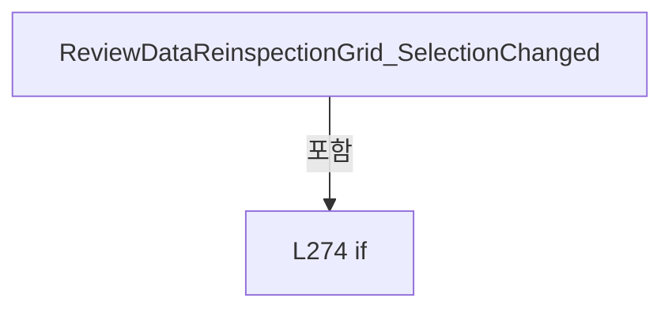

변경 전 점검: 입력/반환 타입, 위 호출자, 예외/취소 경로, 공유 상태와 저장·전송 소비자를 함께 확인합니다. 값의 단위나 물리 방향을 이름만으로 확정하지 않습니다.

### MethodDeclaration `ReviewDataReinspectionCheckBox_Changed` · L284–295

[Drilling.UI/Views/CReviewDataView.xaml.cs:284–295](https://github.com/kjuws10-rgb/A3Drilling/blob/96e22cd027c84bf302b23f2949b98985d7f301bb/Drilling.UI/Views/CReviewDataView.xaml.cs#L284-L295)

| 항목 | 실제 추출 값 |
| --- | --- |
| 서명 | void Drilling.UI.Views.CReviewDataView.ReviewDataReinspectionCheckBox_Changed(object, RoutedEventArgs) |
| 접근/수식자 | Private / private |
| 반환/값 타입 | void |
| 소속 타입 | NamedType:Drilling.UI.Views.CReviewDataView |

입력 계약:

| 이름 | 타입 | 전달 | 선택/기본값 |
| --- | --- | --- | --- |
| sender | object | None | False /  |
| eventArgs | RoutedEventArgs | None | False /  |

현재 부분 분석에서 직접 연결된 호출자는 없습니다. XAML/이벤트/인터페이스·델리게이트·외부 진입을 추가 확인해야 하며, 미사용으로 판정한 것이 아닙니다.

호출하는 대상과 해석 범위:

| 원본 행 | 표현식 | 분석 상태 | 대상/소스 위치 |
| --- | --- | --- | --- |
| 293 | panel.SetReinspectionRowSelection | resolved | void Drilling.UI.Menu.Menus.CMenuCorrection.CReviewDataPanel.SetReinspectionRowSelection(Drilling.UI.Menu.Menus.CMenuCorrection.ST_REVIEW_DATA_GRID_ROW, bool) · Drilling.UI/Menu/Menus/CMenuCorrection.ReviewData.Reinspection.cs:622 |

본문의 실제 연산·분기·예외·반환 순서(원문 위치 순):

| 원본 행 | 종류 | 주석 해설 |
| --- | --- | --- |
| 286 | if | 조건에 따라 분기합니다: if (sender is CheckBox { DataContext: CMenuCorrection.ST_REVIEW_DATA_GRID_ROW row, IsChecked: var isChecked } && DataContext is CMenuCorrection.CReviewDataPanel panel) |
| 293 | call | 함수·델리게이트 또는 객체 생성자를 호출합니다: panel.SetReinspectionRowSelection(row, isChecked == true) |

제어 구문의 포함 구조(실제 실행 순서/CFG가 아닌 구문 탐색 그림):

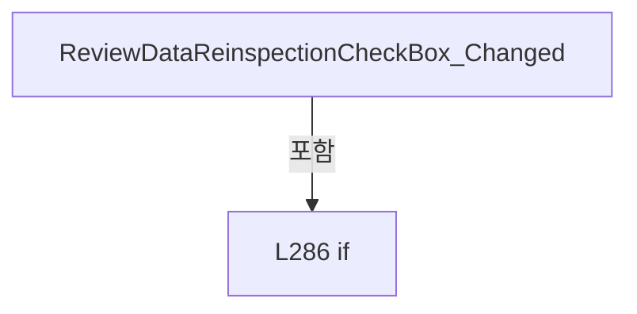

변경 전 점검: 입력/반환 타입, 위 호출자, 예외/취소 경로, 공유 상태와 저장·전송 소비자를 함께 확인합니다. 값의 단위나 물리 방향을 이름만으로 확정하지 않습니다.

### MethodDeclaration `ReviewDataResultEditCheckBox_Changed` · L297–308

[Drilling.UI/Views/CReviewDataView.xaml.cs:297–308](https://github.com/kjuws10-rgb/A3Drilling/blob/96e22cd027c84bf302b23f2949b98985d7f301bb/Drilling.UI/Views/CReviewDataView.xaml.cs#L297-L308)

| 항목 | 실제 추출 값 |
| --- | --- |
| 서명 | void Drilling.UI.Views.CReviewDataView.ReviewDataResultEditCheckBox_Changed(object, RoutedEventArgs) |
| 접근/수식자 | Private / private |
| 반환/값 타입 | void |
| 소속 타입 | NamedType:Drilling.UI.Views.CReviewDataView |

입력 계약:

| 이름 | 타입 | 전달 | 선택/기본값 |
| --- | --- | --- | --- |
| sender | object | None | False /  |
| eventArgs | RoutedEventArgs | None | False /  |

현재 부분 분석에서 직접 연결된 호출자는 없습니다. XAML/이벤트/인터페이스·델리게이트·외부 진입을 추가 확인해야 하며, 미사용으로 판정한 것이 아닙니다.

호출하는 대상과 해석 범위:

| 원본 행 | 표현식 | 분석 상태 | 대상/소스 위치 |
| --- | --- | --- | --- |
| 306 | panel.SetResultEditRowSelection | resolved | void Drilling.UI.Menu.Menus.CMenuCorrection.CReviewDataPanel.SetResultEditRowSelection(Drilling.UI.Menu.Menus.CMenuCorrection.ST_REVIEW_DATA_GRID_ROW, bool) · Drilling.UI/Menu/Menus/CMenuCorrection.ReviewData.Edit.cs:133 |

본문의 실제 연산·분기·예외·반환 순서(원문 위치 순):

| 원본 행 | 종류 | 주석 해설 |
| --- | --- | --- |
| 299 | if | 조건에 따라 분기합니다: if (sender is CheckBox { DataContext: CMenuCorrection.ST_REVIEW_DATA_GRID_ROW row, IsChecked: var isChecked } && DataContext is CMenuCorrection.CReviewDataPanel panel) |
| 306 | call | 함수·델리게이트 또는 객체 생성자를 호출합니다: panel.SetResultEditRowSelection(row, isChecked == true) |

제어 구문의 포함 구조(실제 실행 순서/CFG가 아닌 구문 탐색 그림):

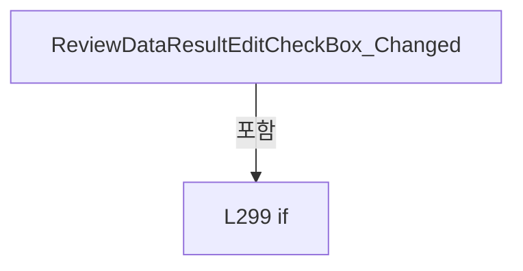

변경 전 점검: 입력/반환 타입, 위 호출자, 예외/취소 경로, 공유 상태와 저장·전송 소비자를 함께 확인합니다. 값의 단위나 물리 방향을 이름만으로 확정하지 않습니다.

### MethodDeclaration `ReviewDataResultEditKeyInGrid_SelectionChanged` · L310–317

[Drilling.UI/Views/CReviewDataView.xaml.cs:310–317](https://github.com/kjuws10-rgb/A3Drilling/blob/96e22cd027c84bf302b23f2949b98985d7f301bb/Drilling.UI/Views/CReviewDataView.xaml.cs#L310-L317)

| 항목 | 실제 추출 값 |
| --- | --- |
| 서명 | void Drilling.UI.Views.CReviewDataView.ReviewDataResultEditKeyInGrid_SelectionChanged(object, SelectionChangedEventArgs) |
| 접근/수식자 | Private / private |
| 반환/값 타입 | void |
| 소속 타입 | NamedType:Drilling.UI.Views.CReviewDataView |

입력 계약:

| 이름 | 타입 | 전달 | 선택/기본값 |
| --- | --- | --- | --- |
| sender | object | None | False /  |
| eventArgs | SelectionChangedEventArgs | None | False /  |

현재 부분 분석에서 직접 연결된 호출자는 없습니다. XAML/이벤트/인터페이스·델리게이트·외부 진입을 추가 확인해야 하며, 미사용으로 판정한 것이 아닙니다.

본문의 실제 연산·분기·예외·반환 순서(원문 위치 순):

| 원본 행 | 종류 | 주석 해설 |
| --- | --- | --- |
| 312 | if | 조건에 따라 분기합니다: if (sender is DataGrid { SelectedItem: CMenuCorrection.ST_REVIEW_DATA_EDIT_ITEM item } && DataContext is CMenuCorrection.CReviewDataPanel panel) |
| 315 | assignment | 값을 대상에 대입합니다: panel.SelectedResultEditKeyInItem = item |

제어 구문의 포함 구조(실제 실행 순서/CFG가 아닌 구문 탐색 그림):

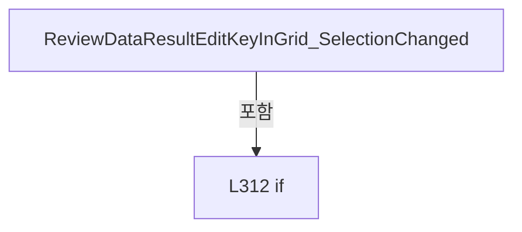

변경 전 점검: 입력/반환 타입, 위 호출자, 예외/취소 경로, 공유 상태와 저장·전송 소비자를 함께 확인합니다. 값의 단위나 물리 방향을 이름만으로 확정하지 않습니다.

### MethodDeclaration `ReviewDataResultEditCopyGrid_SelectionChanged` · L319–326

[Drilling.UI/Views/CReviewDataView.xaml.cs:319–326](https://github.com/kjuws10-rgb/A3Drilling/blob/96e22cd027c84bf302b23f2949b98985d7f301bb/Drilling.UI/Views/CReviewDataView.xaml.cs#L319-L326)

| 항목 | 실제 추출 값 |
| --- | --- |
| 서명 | void Drilling.UI.Views.CReviewDataView.ReviewDataResultEditCopyGrid_SelectionChanged(object, SelectionChangedEventArgs) |
| 접근/수식자 | Private / private |
| 반환/값 타입 | void |
| 소속 타입 | NamedType:Drilling.UI.Views.CReviewDataView |

입력 계약:

| 이름 | 타입 | 전달 | 선택/기본값 |
| --- | --- | --- | --- |
| sender | object | None | False /  |
| eventArgs | SelectionChangedEventArgs | None | False /  |

현재 부분 분석에서 직접 연결된 호출자는 없습니다. XAML/이벤트/인터페이스·델리게이트·외부 진입을 추가 확인해야 하며, 미사용으로 판정한 것이 아닙니다.

본문의 실제 연산·분기·예외·반환 순서(원문 위치 순):

| 원본 행 | 종류 | 주석 해설 |
| --- | --- | --- |
| 321 | if | 조건에 따라 분기합니다: if (sender is DataGrid { SelectedItem: CMenuCorrection.ST_REVIEW_DATA_EDIT_ITEM item } && DataContext is CMenuCorrection.CReviewDataPanel panel) |
| 324 | assignment | 값을 대상에 대입합니다: panel.SelectedResultEditCopyTarget = item |

제어 구문의 포함 구조(실제 실행 순서/CFG가 아닌 구문 탐색 그림):

변경 전 점검: 입력/반환 타입, 위 호출자, 예외/취소 경로, 공유 상태와 저장·전송 소비자를 함께 확인합니다. 값의 단위나 물리 방향을 이름만으로 확정하지 않습니다.

### MethodDeclaration `FindVisualChild` · L328–347

[Drilling.UI/Views/CReviewDataView.xaml.cs:328–347](https://github.com/kjuws10-rgb/A3Drilling/blob/96e22cd027c84bf302b23f2949b98985d7f301bb/Drilling.UI/Views/CReviewDataView.xaml.cs#L328-L347)

| 항목 | 실제 추출 값 |
| --- | --- |
| 서명 | T? Drilling.UI.Views.CReviewDataView.FindVisualChild<T>(DependencyObject) |
| 접근/수식자 | Private / private, static |
| 반환/값 타입 | T? |
| 소속 타입 | NamedType:Drilling.UI.Views.CReviewDataView |

입력 계약:

| 이름 | 타입 | 전달 | 선택/기본값 |
| --- | --- | --- | --- |
| parent | DependencyObject | None | False /  |

현재 부분 분석에서 직접 연결된 호출자는 없습니다. XAML/이벤트/인터페이스·델리게이트·외부 진입을 추가 확인해야 하며, 미사용으로 판정한 것이 아닙니다.

호출하는 대상과 해석 범위:

| 원본 행 | 표현식 | 분석 상태 | 대상/소스 위치 |
| --- | --- | --- | --- |
| 331 | VisualTreeHelper.GetChildrenCount | unresolved | None |
| 333 | VisualTreeHelper.GetChild | unresolved | None |
| 339 | FindVisualChild<T> | candidate | OverloadResolutionFailure |

본문의 실제 연산·분기·예외·반환 순서(원문 위치 순):

| 원본 행 | 종류 | 주석 해설 |
| --- | --- | --- |
| 331 | call | 함수·델리게이트 또는 객체 생성자를 호출합니다: VisualTreeHelper.GetChildrenCount(parent) |
| 331 | variable-initializer | 변수의 초기값을 지정합니다: index = 0 |
| 331 | for | 초기화·조건·증감이 있는 반복입니다: for (var index = 0; index < VisualTreeHelper.GetChildrenCount(parent); index++) |
| 333 | call | 함수·델리게이트 또는 객체 생성자를 호출합니다: VisualTreeHelper.GetChild(parent, index) |
| 333 | local-declaration | 지역 변수를 선언합니다: var child = VisualTreeHelper.GetChild(parent, index); |
| 333 | variable-initializer | 변수의 초기값을 지정합니다: child = VisualTreeHelper.GetChild(parent, index) |
| 334 | if | 조건에 따라 분기합니다: if (child is T match) |
| 336 | return | 호출자에게 값 또는 제어를 반환합니다: return match; |
| 339 | call | 함수·델리게이트 또는 객체 생성자를 호출합니다: FindVisualChild<T>(child) |
| 339 | local-declaration | 지역 변수를 선언합니다: var descendant = FindVisualChild<T>(child); |
| 339 | variable-initializer | 변수의 초기값을 지정합니다: descendant = FindVisualChild<T>(child) |
| 340 | if | 조건에 따라 분기합니다: if (descendant is not null) |
| 342 | return | 호출자에게 값 또는 제어를 반환합니다: return descendant; |
| 346 | return | 호출자에게 값 또는 제어를 반환합니다: return null; |

제어 구문의 포함 구조(실제 실행 순서/CFG가 아닌 구문 탐색 그림):

변경 전 점검: 입력/반환 타입, 위 호출자, 예외/취소 경로, 공유 상태와 저장·전송 소비자를 함께 확인합니다. 값의 단위나 물리 방향을 이름만으로 확정하지 않습니다.

## 구문·바인딩 한계

전체 WPF/벤더 SDK/프로젝트별 빌드 조건을 로드한 정식 빌드가 아닙니다. `resolved`는 이 부분 컴파일에서의 심볼 연결이며 virtual/interface/delegate/이벤트/Reflection/XAML의 실제 런타임 구현을 확정하지 않습니다. `candidate`와 `unresolved`는 후속 확인 대상으로 남깁니다.

## 원문 전체 주석 해설본

[원본 모든 행과 행별 해설 보기](../../../annotated/Drilling.UI/Views/CReviewDataView.xaml.cs.annotated.txt)

원본을 빠뜨리거나 임의로 줄이지 않았습니다. `L000001 |` 표시는 원본 행 번호, `// 해설`은 별도 설명입니다. 실행용 소스가 아닌 문서입니다.

## 수정·재검증 체크

- 원본 Commit과 현재 작업 파일 SHA가 같은지 먼저 확인합니다. 다르면 이 문서를 과거 버전 자료로 취급합니다.
- 선언·직접 호출·이벤트/인터페이스 경계·설정 소비를 함께 확인합니다. 정적 연결의 빈 곳을 정상 경로로 추정하지 않습니다.
- 저장 형식/단위/식별자·재시도·취소·예외·롤백에 영향을 주는 변경은 상세 해설장과 호출자를 다시 검토합니다.
- 도구의 구문 추출과 별도 정적 추적 해설, 실제 빌드·시뮬레이션·실장비 검증 결과를 분리합니다.
