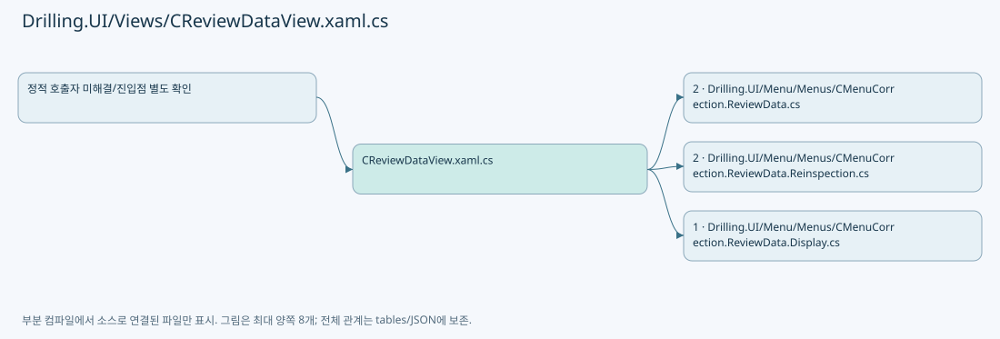
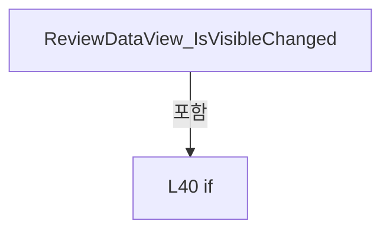
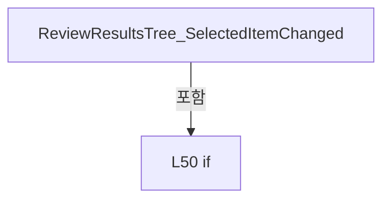
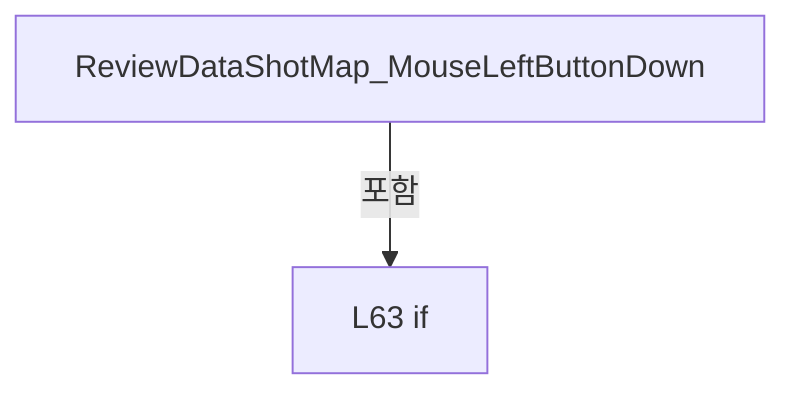
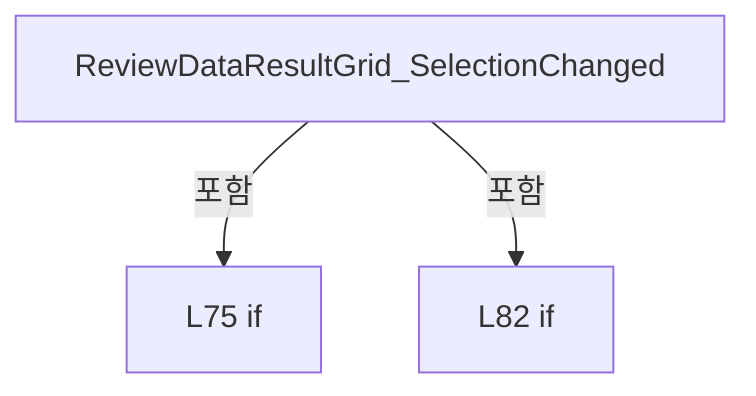
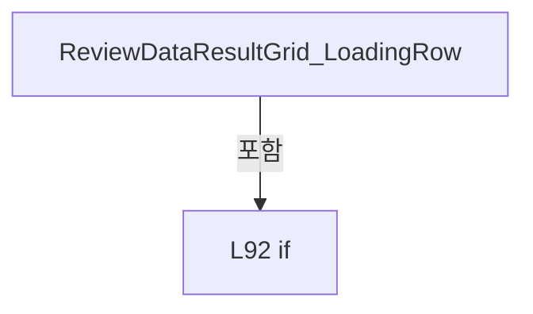
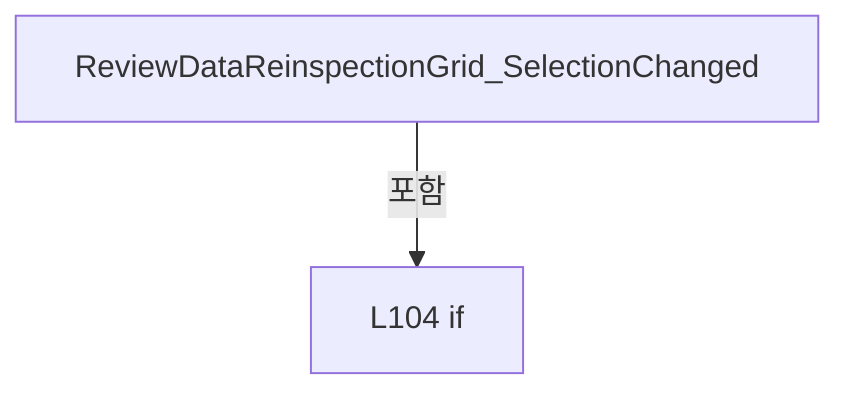
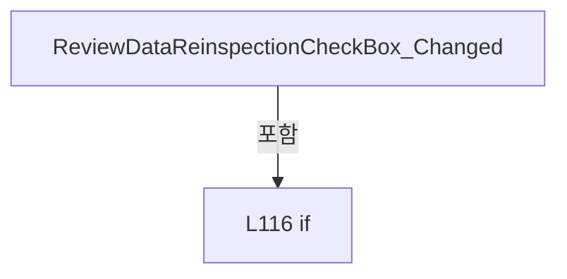
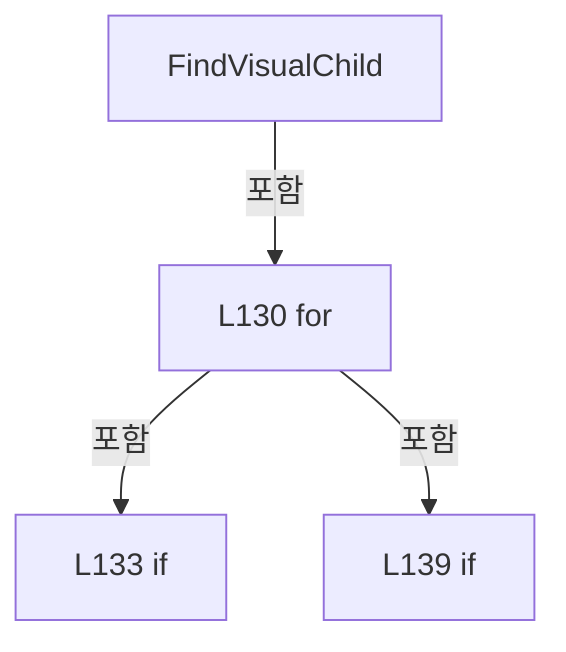

# Drilling.UI/Views/CReviewDataView.xaml.cs

| 항목 | 내용 |
| --- | --- |
| 원본 저장소 | https://github.com/kjuws10-rgb/A3Drilling.git |
| 원본 Commit | 5aee8e58439c9b455cae7c9593c9be986c3e682e |
| 원본 SHA256 | 040bc15b58e00817463b96266a9bd5c9cf55643d247654c0090758c50b56d1d9 |
| 파일 분류 | code |
| 원본 크기/행 | 5,072 bytes / 148 physical lines |
| 인코딩 | utf-8-sig |
| 검토 범위 | 구문/부분 의미 분석에서 추출한 사실. 동작·물리 단위·실장비 합격을 보증하지 않습니다. |
| 원본 링크 | [고정 Commit 원본](https://github.com/kjuws10-rgb/A3Drilling/blob/5aee8e58439c9b455cae7c9593c9be986c3e682e/Drilling.UI/Views/CReviewDataView.xaml.cs) |

## 파일의 역할과 읽는 순서

WPF 화면·사용자 명령·표시 상태를 구성합니다. XAML 이벤트와 코드 비하인드, RootView의 조립 경로를 함께 추적합니다.

## 네임스페이스·타입·상속

| 타입 | 구분 | 원본 범위 | 선언/상속 |
| --- | --- | --- | --- |
| CBindingProxy | ClassDeclaration | 10–27 | CBindingProxy: Freezable |
| CReviewDataView | ClassDeclaration | 29–147 | CReviewDataView: UserControl |

## 멤버 빠른 목록

| 이름 | 종류 | 범위 | 서명 |
| --- | --- | --- | --- |
| DataProperty | FieldDeclaration | L12–15 | DependencyProperty Drilling.UI.Views.CBindingProxy.DataProperty |
| Data | PropertyDeclaration | L17–21 | object? Drilling.UI.Views.CBindingProxy.Data |
| get_Data | GetAccessorDeclaration | L19–19 | object? Drilling.UI.Views.CBindingProxy.Data.get |
| set_Data | SetAccessorDeclaration | L20–20 | void Drilling.UI.Views.CBindingProxy.Data.set |
| CreateInstanceCore | MethodDeclaration | L23–26 | Freezable Drilling.UI.Views.CBindingProxy.CreateInstanceCore() |
| .ctor | ConstructorDeclaration | L31–34 | Drilling.UI.Views.CReviewDataView.CReviewDataView() |
| ReviewDataView_IsVisibleChanged | MethodDeclaration | L36–44 | void Drilling.UI.Views.CReviewDataView.ReviewDataView_IsVisibleChanged(object, DependencyPropertyChangedEventArgs) |
| ReviewResultsTree_SelectedItemChanged | MethodDeclaration | L46–59 | void Drilling.UI.Views.CReviewDataView.ReviewResultsTree_SelectedItemChanged(object, RoutedPropertyChangedEventArgs<object>) |
| ReviewDataShotMap_MouseLeftButtonDown | MethodDeclaration | L61–71 | void Drilling.UI.Views.CReviewDataView.ReviewDataShotMap_MouseLeftButtonDown(object, MouseButtonEventArgs) |
| ReviewDataResultGrid_SelectionChanged | MethodDeclaration | L73–88 | void Drilling.UI.Views.CReviewDataView.ReviewDataResultGrid_SelectionChanged(object, SelectionChangedEventArgs) |
| ReviewDataResultGrid_LoadingRow | MethodDeclaration | L90–98 | void Drilling.UI.Views.CReviewDataView.ReviewDataResultGrid_LoadingRow(object, DataGridRowEventArgs) |
| ReviewDataReinspectionGrid_SelectionChanged | MethodDeclaration | L100–112 | void Drilling.UI.Views.CReviewDataView.ReviewDataReinspectionGrid_SelectionChanged(object, SelectionChangedEventArgs) |
| ReviewDataReinspectionCheckBox_Changed | MethodDeclaration | L114–125 | void Drilling.UI.Views.CReviewDataView.ReviewDataReinspectionCheckBox_Changed(object, RoutedEventArgs) |
| FindVisualChild | MethodDeclaration | L127–146 | T? Drilling.UI.Views.CReviewDataView.FindVisualChild<T>(DependencyObject) |

## 멤버별 상세 계약·호출·처리 해설

### FieldDeclaration `DataProperty` · L12–15

[Drilling.UI/Views/CReviewDataView.xaml.cs:12–15](https://github.com/kjuws10-rgb/A3Drilling/blob/5aee8e58439c9b455cae7c9593c9be986c3e682e/Drilling.UI/Views/CReviewDataView.xaml.cs#L12-L15)

| 항목 | 실제 추출 값 |
| --- | --- |
| 서명 | DependencyProperty Drilling.UI.Views.CBindingProxy.DataProperty |
| 접근/수식자 | Public / public, static, readonly |
| 반환/값 타입 | DependencyProperty |
| 소속 타입 | NamedType:Drilling.UI.Views.CBindingProxy |

현재 부분 분석에서 직접 연결된 호출자는 없습니다. XAML/이벤트/인터페이스·델리게이트·외부 진입을 추가 확인해야 하며, 미사용으로 판정한 것이 아닙니다.

호출하는 대상과 해석 범위:

| 원본 행 | 표현식 | 분석 상태 | 대상/소스 위치 |
| --- | --- | --- | --- |
| 12 | DependencyProperty.Register | unresolved | None |
| 13 | nameof | unresolved | None |

본문의 실제 연산·분기·예외·반환 순서(원문 위치 순):

| 원본 행 | 종류 | 주석 해설 |
| --- | --- | --- |
| 12 | call | 함수·델리게이트 또는 객체 생성자를 호출합니다: DependencyProperty.Register( nameof(Data), typeof(object), typeof(CBindingProxy)) |
| 12 | variable-initializer | 변수의 초기값을 지정합니다: DataProperty = DependencyProperty.Register( nameof(Data), typeof(object), typeof(CBindingProxy)) |
| 13 | call | 함수·델리게이트 또는 객체 생성자를 호출합니다: nameof(Data) |

변경 전 점검: 입력/반환 타입, 위 호출자, 예외/취소 경로, 공유 상태와 저장·전송 소비자를 함께 확인합니다. 값의 단위나 물리 방향을 이름만으로 확정하지 않습니다.

### PropertyDeclaration `Data` · L17–21

[Drilling.UI/Views/CReviewDataView.xaml.cs:17–21](https://github.com/kjuws10-rgb/A3Drilling/blob/5aee8e58439c9b455cae7c9593c9be986c3e682e/Drilling.UI/Views/CReviewDataView.xaml.cs#L17-L21)

| 항목 | 실제 추출 값 |
| --- | --- |
| 서명 | object? Drilling.UI.Views.CBindingProxy.Data |
| 접근/수식자 | Public / public |
| 반환/값 타입 | object? |
| 소속 타입 | NamedType:Drilling.UI.Views.CBindingProxy |

현재 부분 분석에서 직접 연결된 호출자는 없습니다. XAML/이벤트/인터페이스·델리게이트·외부 진입을 추가 확인해야 하며, 미사용으로 판정한 것이 아닙니다.

변경 전 점검: 입력/반환 타입, 위 호출자, 예외/취소 경로, 공유 상태와 저장·전송 소비자를 함께 확인합니다. 값의 단위나 물리 방향을 이름만으로 확정하지 않습니다.

### GetAccessorDeclaration `get_Data` · L19–19

[Drilling.UI/Views/CReviewDataView.xaml.cs:19–19](https://github.com/kjuws10-rgb/A3Drilling/blob/5aee8e58439c9b455cae7c9593c9be986c3e682e/Drilling.UI/Views/CReviewDataView.xaml.cs#L19-L19)

| 항목 | 실제 추출 값 |
| --- | --- |
| 서명 | object? Drilling.UI.Views.CBindingProxy.Data.get |
| 접근/수식자 | Public / get |
| 반환/값 타입 | object? |
| 소속 타입 | NamedType:Drilling.UI.Views.CBindingProxy |

현재 부분 분석에서 직접 연결된 호출자는 없습니다. XAML/이벤트/인터페이스·델리게이트·외부 진입을 추가 확인해야 하며, 미사용으로 판정한 것이 아닙니다.

호출하는 대상과 해석 범위:

| 원본 행 | 표현식 | 분석 상태 | 대상/소스 위치 |
| --- | --- | --- | --- |
| 19 | GetValue | unresolved | None |

본문의 실제 연산·분기·예외·반환 순서(원문 위치 순):

| 원본 행 | 종류 | 주석 해설 |
| --- | --- | --- |
| 19 | call | 함수·델리게이트 또는 객체 생성자를 호출합니다: GetValue(DataProperty) |

변경 전 점검: 입력/반환 타입, 위 호출자, 예외/취소 경로, 공유 상태와 저장·전송 소비자를 함께 확인합니다. 값의 단위나 물리 방향을 이름만으로 확정하지 않습니다.

### SetAccessorDeclaration `set_Data` · L20–20

[Drilling.UI/Views/CReviewDataView.xaml.cs:20–20](https://github.com/kjuws10-rgb/A3Drilling/blob/5aee8e58439c9b455cae7c9593c9be986c3e682e/Drilling.UI/Views/CReviewDataView.xaml.cs#L20-L20)

| 항목 | 실제 추출 값 |
| --- | --- |
| 서명 | void Drilling.UI.Views.CBindingProxy.Data.set |
| 접근/수식자 | Public / set |
| 반환/값 타입 | void |
| 소속 타입 | NamedType:Drilling.UI.Views.CBindingProxy |

입력 계약:

| 이름 | 타입 | 전달 | 선택/기본값 |
| --- | --- | --- | --- |
| value | object? | None | False /  |

현재 부분 분석에서 직접 연결된 호출자는 없습니다. XAML/이벤트/인터페이스·델리게이트·외부 진입을 추가 확인해야 하며, 미사용으로 판정한 것이 아닙니다.

호출하는 대상과 해석 범위:

| 원본 행 | 표현식 | 분석 상태 | 대상/소스 위치 |
| --- | --- | --- | --- |
| 20 | SetValue | unresolved | None |

본문의 실제 연산·분기·예외·반환 순서(원문 위치 순):

| 원본 행 | 종류 | 주석 해설 |
| --- | --- | --- |
| 20 | call | 함수·델리게이트 또는 객체 생성자를 호출합니다: SetValue(DataProperty, value) |

변경 전 점검: 입력/반환 타입, 위 호출자, 예외/취소 경로, 공유 상태와 저장·전송 소비자를 함께 확인합니다. 값의 단위나 물리 방향을 이름만으로 확정하지 않습니다.

### MethodDeclaration `CreateInstanceCore` · L23–26

[Drilling.UI/Views/CReviewDataView.xaml.cs:23–26](https://github.com/kjuws10-rgb/A3Drilling/blob/5aee8e58439c9b455cae7c9593c9be986c3e682e/Drilling.UI/Views/CReviewDataView.xaml.cs#L23-L26)

| 항목 | 실제 추출 값 |
| --- | --- |
| 서명 | Freezable Drilling.UI.Views.CBindingProxy.CreateInstanceCore() |
| 접근/수식자 | Protected / protected, override |
| 반환/값 타입 | Freezable |
| 소속 타입 | NamedType:Drilling.UI.Views.CBindingProxy |

현재 부분 분석에서 직접 연결된 호출자는 없습니다. XAML/이벤트/인터페이스·델리게이트·외부 진입을 추가 확인해야 하며, 미사용으로 판정한 것이 아닙니다.

호출하는 대상과 해석 범위:

| 원본 행 | 표현식 | 분석 상태 | 대상/소스 위치 |
| --- | --- | --- | --- |
| 25 | new CBindingProxy | resolved | Drilling.UI.Views.CBindingProxy.CBindingProxy() · Drilling.UI/Views/CReviewDataView.xaml.cs:10 |

본문의 실제 연산·분기·예외·반환 순서(원문 위치 순):

| 원본 행 | 종류 | 주석 해설 |
| --- | --- | --- |
| 25 | call | 함수·델리게이트 또는 객체 생성자를 호출합니다: new CBindingProxy() |
| 25 | return | 호출자에게 값 또는 제어를 반환합니다: return new CBindingProxy(); |

변경 전 점검: 입력/반환 타입, 위 호출자, 예외/취소 경로, 공유 상태와 저장·전송 소비자를 함께 확인합니다. 값의 단위나 물리 방향을 이름만으로 확정하지 않습니다.

### ConstructorDeclaration `.ctor` · L31–34

[Drilling.UI/Views/CReviewDataView.xaml.cs:31–34](https://github.com/kjuws10-rgb/A3Drilling/blob/5aee8e58439c9b455cae7c9593c9be986c3e682e/Drilling.UI/Views/CReviewDataView.xaml.cs#L31-L34)

| 항목 | 실제 추출 값 |
| --- | --- |
| 서명 | Drilling.UI.Views.CReviewDataView.CReviewDataView() |
| 접근/수식자 | Public / public |
| 반환/값 타입 | void |
| 소속 타입 | NamedType:Drilling.UI.Views.CReviewDataView |

현재 부분 분석에서 직접 연결된 호출자는 없습니다. XAML/이벤트/인터페이스·델리게이트·외부 진입을 추가 확인해야 하며, 미사용으로 판정한 것이 아닙니다.

호출하는 대상과 해석 범위:

| 원본 행 | 표현식 | 분석 상태 | 대상/소스 위치 |
| --- | --- | --- | --- |
| 33 | InitializeComponent | unresolved | None |

본문의 실제 연산·분기·예외·반환 순서(원문 위치 순):

| 원본 행 | 종류 | 주석 해설 |
| --- | --- | --- |
| 33 | call | 함수·델리게이트 또는 객체 생성자를 호출합니다: InitializeComponent() |

변경 전 점검: 입력/반환 타입, 위 호출자, 예외/취소 경로, 공유 상태와 저장·전송 소비자를 함께 확인합니다. 값의 단위나 물리 방향을 이름만으로 확정하지 않습니다.

### MethodDeclaration `ReviewDataView_IsVisibleChanged` · L36–44

[Drilling.UI/Views/CReviewDataView.xaml.cs:36–44](https://github.com/kjuws10-rgb/A3Drilling/blob/5aee8e58439c9b455cae7c9593c9be986c3e682e/Drilling.UI/Views/CReviewDataView.xaml.cs#L36-L44)

| 항목 | 실제 추출 값 |
| --- | --- |
| 서명 | void Drilling.UI.Views.CReviewDataView.ReviewDataView_IsVisibleChanged(object, DependencyPropertyChangedEventArgs) |
| 접근/수식자 | Private / private, async |
| 반환/값 타입 | void |
| 소속 타입 | NamedType:Drilling.UI.Views.CReviewDataView |

입력 계약:

| 이름 | 타입 | 전달 | 선택/기본값 |
| --- | --- | --- | --- |
| sender | object | None | False /  |
| eventArgs | DependencyPropertyChangedEventArgs | None | False /  |

현재 부분 분석에서 직접 연결된 호출자는 없습니다. XAML/이벤트/인터페이스·델리게이트·외부 진입을 추가 확인해야 하며, 미사용으로 판정한 것이 아닙니다.

호출하는 대상과 해석 범위:

| 원본 행 | 표현식 | 분석 상태 | 대상/소스 위치 |
| --- | --- | --- | --- |
| 42 | panel.Reload | resolved | System.Threading.Tasks.Task Drilling.UI.Menu.Menus.CMenuCorrection.CReviewDataPanel.Reload(System.Threading.CancellationToken) · Drilling.UI/Menu/Menus/CMenuCorrection.ReviewData.cs:93 |

본문의 실제 연산·분기·예외·반환 순서(원문 위치 순):

| 원본 행 | 종류 | 주석 해설 |
| --- | --- | --- |
| 40 | if | 조건에 따라 분기합니다: if (IsVisible && DataContext is CMenuCorrection.CReviewDataPanel panel) |
| 42 | await | 비동기 완료를 기다립니다: await panel.Reload() |
| 42 | call | 함수·델리게이트 또는 객체 생성자를 호출합니다: panel.Reload() |

제어 구문의 포함 구조(실제 실행 순서/CFG가 아닌 구문 탐색 그림):

변경 전 점검: 입력/반환 타입, 위 호출자, 예외/취소 경로, 공유 상태와 저장·전송 소비자를 함께 확인합니다. 값의 단위나 물리 방향을 이름만으로 확정하지 않습니다.

### MethodDeclaration `ReviewResultsTree_SelectedItemChanged` · L46–59

[Drilling.UI/Views/CReviewDataView.xaml.cs:46–59](https://github.com/kjuws10-rgb/A3Drilling/blob/5aee8e58439c9b455cae7c9593c9be986c3e682e/Drilling.UI/Views/CReviewDataView.xaml.cs#L46-L59)

| 항목 | 실제 추출 값 |
| --- | --- |
| 서명 | void Drilling.UI.Views.CReviewDataView.ReviewResultsTree_SelectedItemChanged(object, RoutedPropertyChangedEventArgs<object>) |
| 접근/수식자 | Private / private |
| 반환/값 타입 | void |
| 소속 타입 | NamedType:Drilling.UI.Views.CReviewDataView |

입력 계약:

| 이름 | 타입 | 전달 | 선택/기본값 |
| --- | --- | --- | --- |
| sender | object | None | False /  |
| eventArgs | RoutedPropertyChangedEventArgs<object> | None | False /  |

현재 부분 분석에서 직접 연결된 호출자는 없습니다. XAML/이벤트/인터페이스·델리게이트·외부 진입을 추가 확인해야 하며, 미사용으로 판정한 것이 아닙니다.

호출하는 대상과 해석 범위:

| 원본 행 | 표현식 | 분석 상태 | 대상/소스 위치 |
| --- | --- | --- | --- |
| 53 | panel.Select | resolved | void Drilling.UI.Menu.Menus.CMenuCorrection.CReviewDataPanel.Select(Drilling.UI.Menu.Menus.CMenuCorrection.ST_REVIEW_RESULT_TREE_NODE) · Drilling.UI/Menu/Menus/CMenuCorrection.ReviewData.cs:98 |
| 56 | ReviewResultsTree.Dispatcher.BeginInvoke | unresolved | None |
| 58 | new Action | unresolved | None |
| 58 | FindVisualChild<ScrollViewer> | candidate | OverloadResolutionFailure |
| 58 | .ScrollToLeftEnd | unresolved | None |

본문의 실제 연산·분기·예외·반환 순서(원문 위치 순):

| 원본 행 | 종류 | 주석 해설 |
| --- | --- | --- |
| 50 | if | 조건에 따라 분기합니다: if (DataContext is CMenuCorrection.CReviewDataPanel panel && eventArgs.NewValue is CMenuCorrection.ST_REVIEW_RESULT_TREE_NODE node) |
| 53 | call | 함수·델리게이트 또는 객체 생성자를 호출합니다: panel.Select(node) |
| 56 | call | 함수·델리게이트 또는 객체 생성자를 호출합니다: ReviewResultsTree.Dispatcher.BeginInvoke( DispatcherPriority.ContextIdle, new Action(() => FindVisualChild<ScrollViewer>(ReviewResultsTree)?.ScrollToLeftEnd())) |
| 58 | call | 함수·델리게이트 또는 객체 생성자를 호출합니다: new Action(() => FindVisualChild<ScrollViewer>(ReviewResultsTree)?.ScrollToLeftEnd()) |
| 58 | call | 함수·델리게이트 또는 객체 생성자를 호출합니다: FindVisualChild<ScrollViewer>(ReviewResultsTree) |
| 58 | call | 함수·델리게이트 또는 객체 생성자를 호출합니다: .ScrollToLeftEnd() |

제어 구문의 포함 구조(실제 실행 순서/CFG가 아닌 구문 탐색 그림):

변경 전 점검: 입력/반환 타입, 위 호출자, 예외/취소 경로, 공유 상태와 저장·전송 소비자를 함께 확인합니다. 값의 단위나 물리 방향을 이름만으로 확정하지 않습니다.

### MethodDeclaration `ReviewDataShotMap_MouseLeftButtonDown` · L61–71

[Drilling.UI/Views/CReviewDataView.xaml.cs:61–71](https://github.com/kjuws10-rgb/A3Drilling/blob/5aee8e58439c9b455cae7c9593c9be986c3e682e/Drilling.UI/Views/CReviewDataView.xaml.cs#L61-L71)

| 항목 | 실제 추출 값 |
| --- | --- |
| 서명 | void Drilling.UI.Views.CReviewDataView.ReviewDataShotMap_MouseLeftButtonDown(object, MouseButtonEventArgs) |
| 접근/수식자 | Private / private |
| 반환/값 타입 | void |
| 소속 타입 | NamedType:Drilling.UI.Views.CReviewDataView |

입력 계약:

| 이름 | 타입 | 전달 | 선택/기본값 |
| --- | --- | --- | --- |
| sender | object | None | False /  |
| eventArgs | MouseButtonEventArgs | None | False /  |

현재 부분 분석에서 직접 연결된 호출자는 없습니다. XAML/이벤트/인터페이스·델리게이트·외부 진입을 추가 확인해야 하며, 미사용으로 판정한 것이 아닙니다.

호출하는 대상과 해석 범위:

| 원본 행 | 표현식 | 분석 상태 | 대상/소스 위치 |
| --- | --- | --- | --- |
| 68 | eventArgs.GetPosition | unresolved | None |
| 69 | panel.SelectShotAt | candidate | OverloadResolutionFailure |

본문의 실제 연산·분기·예외·반환 순서(원문 위치 순):

| 원본 행 | 종류 | 주석 해설 |
| --- | --- | --- |
| 63 | if | 조건에 따라 분기합니다: if (sender is not FrameworkElement map &#124;&#124; DataContext is not CMenuCorrection.CReviewDataPanel panel) |
| 65 | return | 호출자에게 값 또는 제어를 반환합니다: return; |
| 68 | call | 함수·델리게이트 또는 객체 생성자를 호출합니다: eventArgs.GetPosition(map) |
| 68 | local-declaration | 지역 변수를 선언합니다: var point = eventArgs.GetPosition(map); |
| 68 | variable-initializer | 변수의 초기값을 지정합니다: point = eventArgs.GetPosition(map) |
| 69 | call | 함수·델리게이트 또는 객체 생성자를 호출합니다: panel.SelectShotAt(point.X, point.Y) |
| 70 | assignment | 값을 대상에 대입합니다: eventArgs.Handled = true |

제어 구문의 포함 구조(실제 실행 순서/CFG가 아닌 구문 탐색 그림):

변경 전 점검: 입력/반환 타입, 위 호출자, 예외/취소 경로, 공유 상태와 저장·전송 소비자를 함께 확인합니다. 값의 단위나 물리 방향을 이름만으로 확정하지 않습니다.

### MethodDeclaration `ReviewDataResultGrid_SelectionChanged` · L73–88

[Drilling.UI/Views/CReviewDataView.xaml.cs:73–88](https://github.com/kjuws10-rgb/A3Drilling/blob/5aee8e58439c9b455cae7c9593c9be986c3e682e/Drilling.UI/Views/CReviewDataView.xaml.cs#L73-L88)

| 항목 | 실제 추출 값 |
| --- | --- |
| 서명 | void Drilling.UI.Views.CReviewDataView.ReviewDataResultGrid_SelectionChanged(object, SelectionChangedEventArgs) |
| 접근/수식자 | Private / private |
| 반환/값 타입 | void |
| 소속 타입 | NamedType:Drilling.UI.Views.CReviewDataView |

입력 계약:

| 이름 | 타입 | 전달 | 선택/기본값 |
| --- | --- | --- | --- |
| sender | object | None | False /  |
| eventArgs | SelectionChangedEventArgs | None | False /  |

현재 부분 분석에서 직접 연결된 호출자는 없습니다. XAML/이벤트/인터페이스·델리게이트·외부 진입을 추가 확인해야 하며, 미사용으로 판정한 것이 아닙니다.

호출하는 대상과 해석 범위:

| 원본 행 | 표현식 | 분석 상태 | 대상/소스 위치 |
| --- | --- | --- | --- |
| 81 | panel.SelectRow | resolved | void Drilling.UI.Menu.Menus.CMenuCorrection.CReviewDataPanel.SelectRow(Drilling.UI.Menu.Menus.CMenuCorrection.ST_REVIEW_DATA_GRID_ROW) · Drilling.UI/Menu/Menus/CMenuCorrection.ReviewData.Display.cs:516 |
| 84 | ReviewDataResultGrid.Dispatcher.BeginInvoke | unresolved | None |
| 86 | new Action | unresolved | None |
| 86 | ReviewDataResultGrid.ScrollIntoView | unresolved | None |

본문의 실제 연산·분기·예외·반환 순서(원문 위치 순):

| 원본 행 | 종류 | 주석 해설 |
| --- | --- | --- |
| 75 | if | 조건에 따라 분기합니다: if (sender is not DataGrid { SelectedItem: CMenuCorrection.ST_REVIEW_DATA_GRID_ROW row } &#124;&#124; DataContext is not CMenuCorrection.CReviewDataPanel panel) |
| 78 | return | 호출자에게 값 또는 제어를 반환합니다: return; |
| 81 | call | 함수·델리게이트 또는 객체 생성자를 호출합니다: panel.SelectRow(row) |
| 82 | if | 조건에 따라 분기합니다: if (panel.SelectedRow is { } selectedRow) |
| 84 | call | 함수·델리게이트 또는 객체 생성자를 호출합니다: ReviewDataResultGrid.Dispatcher.BeginInvoke( DispatcherPriority.Background, new Action(() => ReviewDataResultGrid.ScrollIntoView(selectedRow))) |
| 86 | call | 함수·델리게이트 또는 객체 생성자를 호출합니다: new Action(() => ReviewDataResultGrid.ScrollIntoView(selectedRow)) |
| 86 | call | 함수·델리게이트 또는 객체 생성자를 호출합니다: ReviewDataResultGrid.ScrollIntoView(selectedRow) |

제어 구문의 포함 구조(실제 실행 순서/CFG가 아닌 구문 탐색 그림):

변경 전 점검: 입력/반환 타입, 위 호출자, 예외/취소 경로, 공유 상태와 저장·전송 소비자를 함께 확인합니다. 값의 단위나 물리 방향을 이름만으로 확정하지 않습니다.

### MethodDeclaration `ReviewDataResultGrid_LoadingRow` · L90–98

[Drilling.UI/Views/CReviewDataView.xaml.cs:90–98](https://github.com/kjuws10-rgb/A3Drilling/blob/5aee8e58439c9b455cae7c9593c9be986c3e682e/Drilling.UI/Views/CReviewDataView.xaml.cs#L90-L98)

| 항목 | 실제 추출 값 |
| --- | --- |
| 서명 | void Drilling.UI.Views.CReviewDataView.ReviewDataResultGrid_LoadingRow(object, DataGridRowEventArgs) |
| 접근/수식자 | Private / private |
| 반환/값 타입 | void |
| 소속 타입 | NamedType:Drilling.UI.Views.CReviewDataView |

입력 계약:

| 이름 | 타입 | 전달 | 선택/기본값 |
| --- | --- | --- | --- |
| sender | object | None | False /  |
| eventArgs | DataGridRowEventArgs | None | False /  |

현재 부분 분석에서 직접 연결된 호출자는 없습니다. XAML/이벤트/인터페이스·델리게이트·외부 진입을 추가 확인해야 하며, 미사용으로 판정한 것이 아닙니다.

호출하는 대상과 해석 범위:

| 원본 행 | 표현식 | 분석 상태 | 대상/소스 위치 |
| --- | --- | --- | --- |
| 94 | eventArgs.Row.SetCurrentValue | unresolved | None |
| 96 | ReferenceEquals | candidate | OverloadResolutionFailure |

본문의 실제 연산·분기·예외·반환 순서(원문 위치 순):

| 원본 행 | 종류 | 주석 해설 |
| --- | --- | --- |
| 92 | if | 조건에 따라 분기합니다: if (DataContext is CMenuCorrection.CReviewDataPanel panel) |
| 94 | call | 함수·델리게이트 또는 객체 생성자를 호출합니다: eventArgs.Row.SetCurrentValue( DataGridRow.IsSelectedProperty, ReferenceEquals(eventArgs.Row.Item, panel.SelectedRow)) |
| 96 | call | 함수·델리게이트 또는 객체 생성자를 호출합니다: ReferenceEquals(eventArgs.Row.Item, panel.SelectedRow) |

제어 구문의 포함 구조(실제 실행 순서/CFG가 아닌 구문 탐색 그림):

변경 전 점검: 입력/반환 타입, 위 호출자, 예외/취소 경로, 공유 상태와 저장·전송 소비자를 함께 확인합니다. 값의 단위나 물리 방향을 이름만으로 확정하지 않습니다.

### MethodDeclaration `ReviewDataReinspectionGrid_SelectionChanged` · L100–112

[Drilling.UI/Views/CReviewDataView.xaml.cs:100–112](https://github.com/kjuws10-rgb/A3Drilling/blob/5aee8e58439c9b455cae7c9593c9be986c3e682e/Drilling.UI/Views/CReviewDataView.xaml.cs#L100-L112)

| 항목 | 실제 추출 값 |
| --- | --- |
| 서명 | void Drilling.UI.Views.CReviewDataView.ReviewDataReinspectionGrid_SelectionChanged(object, SelectionChangedEventArgs) |
| 접근/수식자 | Private / private |
| 반환/값 타입 | void |
| 소속 타입 | NamedType:Drilling.UI.Views.CReviewDataView |

입력 계약:

| 이름 | 타입 | 전달 | 선택/기본값 |
| --- | --- | --- | --- |
| sender | object | None | False /  |
| eventArgs | SelectionChangedEventArgs | None | False /  |

현재 부분 분석에서 직접 연결된 호출자는 없습니다. XAML/이벤트/인터페이스·델리게이트·외부 진입을 추가 확인해야 하며, 미사용으로 판정한 것이 아닙니다.

호출하는 대상과 해석 범위:

| 원본 행 | 표현식 | 분석 상태 | 대상/소스 위치 |
| --- | --- | --- | --- |
| 110 | panel.SelectReinspectionShot | resolved | void Drilling.UI.Menu.Menus.CMenuCorrection.CReviewDataPanel.SelectReinspectionShot(Drilling.UI.Menu.Menus.CMenuCorrection.ST_REVIEW_DATA_REINSPECTION_ITEM) · Drilling.UI/Menu/Menus/CMenuCorrection.ReviewData.Reinspection.cs:626 |

본문의 실제 연산·분기·예외·반환 순서(원문 위치 순):

| 원본 행 | 종류 | 주석 해설 |
| --- | --- | --- |
| 104 | if | 조건에 따라 분기합니다: if (sender is DataGrid { SelectedItem: CMenuCorrection.ST_REVIEW_DATA_REINSPECTION_ITEM item } && DataContext is CMenuCorrection.CReviewDataPanel panel) |
| 110 | call | 함수·델리게이트 또는 객체 생성자를 호출합니다: panel.SelectReinspectionShot(item) |

제어 구문의 포함 구조(실제 실행 순서/CFG가 아닌 구문 탐색 그림):

변경 전 점검: 입력/반환 타입, 위 호출자, 예외/취소 경로, 공유 상태와 저장·전송 소비자를 함께 확인합니다. 값의 단위나 물리 방향을 이름만으로 확정하지 않습니다.

### MethodDeclaration `ReviewDataReinspectionCheckBox_Changed` · L114–125

[Drilling.UI/Views/CReviewDataView.xaml.cs:114–125](https://github.com/kjuws10-rgb/A3Drilling/blob/5aee8e58439c9b455cae7c9593c9be986c3e682e/Drilling.UI/Views/CReviewDataView.xaml.cs#L114-L125)

| 항목 | 실제 추출 값 |
| --- | --- |
| 서명 | void Drilling.UI.Views.CReviewDataView.ReviewDataReinspectionCheckBox_Changed(object, RoutedEventArgs) |
| 접근/수식자 | Private / private |
| 반환/값 타입 | void |
| 소속 타입 | NamedType:Drilling.UI.Views.CReviewDataView |

입력 계약:

| 이름 | 타입 | 전달 | 선택/기본값 |
| --- | --- | --- | --- |
| sender | object | None | False /  |
| eventArgs | RoutedEventArgs | None | False /  |

현재 부분 분석에서 직접 연결된 호출자는 없습니다. XAML/이벤트/인터페이스·델리게이트·외부 진입을 추가 확인해야 하며, 미사용으로 판정한 것이 아닙니다.

호출하는 대상과 해석 범위:

| 원본 행 | 표현식 | 분석 상태 | 대상/소스 위치 |
| --- | --- | --- | --- |
| 123 | panel.SetReinspectionRowSelection | resolved | void Drilling.UI.Menu.Menus.CMenuCorrection.CReviewDataPanel.SetReinspectionRowSelection(Drilling.UI.Menu.Menus.CMenuCorrection.ST_REVIEW_DATA_GRID_ROW, bool) · Drilling.UI/Menu/Menus/CMenuCorrection.ReviewData.Reinspection.cs:620 |

본문의 실제 연산·분기·예외·반환 순서(원문 위치 순):

| 원본 행 | 종류 | 주석 해설 |
| --- | --- | --- |
| 116 | if | 조건에 따라 분기합니다: if (sender is CheckBox { DataContext: CMenuCorrection.ST_REVIEW_DATA_GRID_ROW row, IsChecked: var isChecked } && DataContext is CMenuCorrection.CReviewDataPanel panel) |
| 123 | call | 함수·델리게이트 또는 객체 생성자를 호출합니다: panel.SetReinspectionRowSelection(row, isChecked == true) |

제어 구문의 포함 구조(실제 실행 순서/CFG가 아닌 구문 탐색 그림):

변경 전 점검: 입력/반환 타입, 위 호출자, 예외/취소 경로, 공유 상태와 저장·전송 소비자를 함께 확인합니다. 값의 단위나 물리 방향을 이름만으로 확정하지 않습니다.

### MethodDeclaration `FindVisualChild` · L127–146

[Drilling.UI/Views/CReviewDataView.xaml.cs:127–146](https://github.com/kjuws10-rgb/A3Drilling/blob/5aee8e58439c9b455cae7c9593c9be986c3e682e/Drilling.UI/Views/CReviewDataView.xaml.cs#L127-L146)

| 항목 | 실제 추출 값 |
| --- | --- |
| 서명 | T? Drilling.UI.Views.CReviewDataView.FindVisualChild<T>(DependencyObject) |
| 접근/수식자 | Private / private, static |
| 반환/값 타입 | T? |
| 소속 타입 | NamedType:Drilling.UI.Views.CReviewDataView |

입력 계약:

| 이름 | 타입 | 전달 | 선택/기본값 |
| --- | --- | --- | --- |
| parent | DependencyObject | None | False /  |

현재 부분 분석에서 직접 연결된 호출자는 없습니다. XAML/이벤트/인터페이스·델리게이트·외부 진입을 추가 확인해야 하며, 미사용으로 판정한 것이 아닙니다.

호출하는 대상과 해석 범위:

| 원본 행 | 표현식 | 분석 상태 | 대상/소스 위치 |
| --- | --- | --- | --- |
| 130 | VisualTreeHelper.GetChildrenCount | unresolved | None |
| 132 | VisualTreeHelper.GetChild | unresolved | None |
| 138 | FindVisualChild<T> | candidate | OverloadResolutionFailure |

본문의 실제 연산·분기·예외·반환 순서(원문 위치 순):

| 원본 행 | 종류 | 주석 해설 |
| --- | --- | --- |
| 130 | call | 함수·델리게이트 또는 객체 생성자를 호출합니다: VisualTreeHelper.GetChildrenCount(parent) |
| 130 | variable-initializer | 변수의 초기값을 지정합니다: index = 0 |
| 130 | for | 초기화·조건·증감이 있는 반복입니다: for (var index = 0; index < VisualTreeHelper.GetChildrenCount(parent); index++) |
| 132 | call | 함수·델리게이트 또는 객체 생성자를 호출합니다: VisualTreeHelper.GetChild(parent, index) |
| 132 | local-declaration | 지역 변수를 선언합니다: var child = VisualTreeHelper.GetChild(parent, index); |
| 132 | variable-initializer | 변수의 초기값을 지정합니다: child = VisualTreeHelper.GetChild(parent, index) |
| 133 | if | 조건에 따라 분기합니다: if (child is T match) |
| 135 | return | 호출자에게 값 또는 제어를 반환합니다: return match; |
| 138 | call | 함수·델리게이트 또는 객체 생성자를 호출합니다: FindVisualChild<T>(child) |
| 138 | local-declaration | 지역 변수를 선언합니다: var descendant = FindVisualChild<T>(child); |
| 138 | variable-initializer | 변수의 초기값을 지정합니다: descendant = FindVisualChild<T>(child) |
| 139 | if | 조건에 따라 분기합니다: if (descendant is not null) |
| 141 | return | 호출자에게 값 또는 제어를 반환합니다: return descendant; |
| 145 | return | 호출자에게 값 또는 제어를 반환합니다: return null; |

제어 구문의 포함 구조(실제 실행 순서/CFG가 아닌 구문 탐색 그림):

변경 전 점검: 입력/반환 타입, 위 호출자, 예외/취소 경로, 공유 상태와 저장·전송 소비자를 함께 확인합니다. 값의 단위나 물리 방향을 이름만으로 확정하지 않습니다.

## 구문·바인딩 한계

전체 WPF/벤더 SDK/프로젝트별 빌드 조건을 로드한 정식 빌드가 아닙니다. `resolved`는 이 부분 컴파일에서의 심볼 연결이며 virtual/interface/delegate/이벤트/Reflection/XAML의 실제 런타임 구현을 확정하지 않습니다. `candidate`와 `unresolved`는 후속 확인 대상으로 남깁니다.

## 원문 전체 주석 해설본

[원본 모든 행과 행별 해설 보기](../../../annotated/Drilling.UI/Views/CReviewDataView.xaml.cs.annotated.txt)

원본을 빠뜨리거나 임의로 줄이지 않았습니다. `L000001 |` 표시는 원본 행 번호, `// 해설`은 별도 설명입니다. 실행용 소스가 아닌 문서입니다.

## 수정·재검증 체크

- 원본 Commit과 현재 작업 파일 SHA가 같은지 먼저 확인합니다. 다르면 이 문서를 과거 버전 자료로 취급합니다.
- 선언·직접 호출·이벤트/인터페이스 경계·설정 소비를 함께 확인합니다. 정적 연결의 빈 곳을 정상 경로로 추정하지 않습니다.
- 저장 형식/단위/식별자·재시도·취소·예외·롤백에 영향을 주는 변경은 상세 해설장과 호출자를 다시 검토합니다.
- 도구의 구문 추출과 별도 정적 추적 해설, 실제 빌드·시뮬레이션·실장비 검증 결과를 분리합니다.
