# Drilling.UI/Views/CReviewShotMapControl.cs

| 항목 | 내용 |
| --- | --- |
| 원본 저장소 | https://github.com/kjuws10-rgb/A3Drilling.git |
| 원본 Commit | 0219666f9053b907d96d7e0aa7d0c6c1be3a73d4 |
| 원본 SHA256 | 4b948d74cec87fc29244a8bbec94452a92aa3b70e04a1f1ea6b59876d3bd1223 |
| 파일 분류 | code |
| 원본 크기/행 | 13,031 bytes / 364 physical lines |
| 인코딩 | utf-8-sig |
| 검토 범위 | 구문/부분 의미 분석에서 추출한 사실. 동작·물리 단위·실장비 합격을 보증하지 않습니다. |
| 원본 링크 | [고정 Commit 원본](https://github.com/kjuws10-rgb/A3Drilling/blob/0219666f9053b907d96d7e0aa7d0c6c1be3a73d4/Drilling.UI/Views/CReviewShotMapControl.cs) |

## 파일의 역할과 읽는 순서

WPF 화면·사용자 명령·표시 상태를 구성합니다. XAML 이벤트와 코드 비하인드, RootView의 조립 경로를 함께 추적합니다.

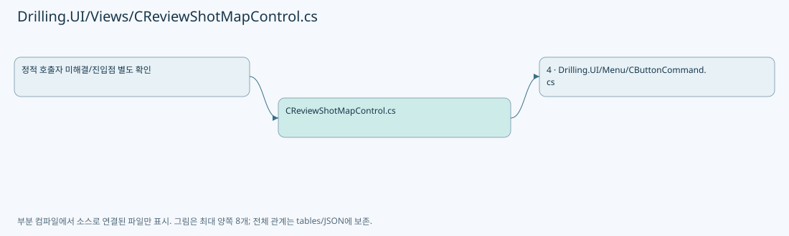

## 네임스페이스·타입·상속

| 타입 | 구분 | 원본 범위 | 선언/상속 |
| --- | --- | --- | --- |
| CReviewShotMapControl | ClassDeclaration | 13–364 | CReviewShotMapControl: FrameworkElement |

## 멤버 빠른 목록

| 이름 | 종류 | 범위 | 서명 |
| --- | --- | --- | --- |
| CellSize | FieldDeclaration | L15–15 | double Drilling.UI.Views.CReviewShotMapControl.CellSize |
| CellMargin | FieldDeclaration | L16–16 | double Drilling.UI.Views.CReviewShotMapControl.CellMargin |
| CellPitch | FieldDeclaration | L17–17 | double Drilling.UI.Views.CReviewShotMapControl.CellPitch |
| BeamSelectionBackground | FieldDeclaration | L19–19 | Brush Drilling.UI.Views.CReviewShotMapControl.BeamSelectionBackground |
| BeamSelectionBorder | FieldDeclaration | L20–20 | Brush Drilling.UI.Views.CReviewShotMapControl.BeamSelectionBorder |
| CurrentBackground | FieldDeclaration | L21–21 | Brush Drilling.UI.Views.CReviewShotMapControl.CurrentBackground |
| CurrentBorder | FieldDeclaration | L22–22 | Brush Drilling.UI.Views.CReviewShotMapControl.CurrentBorder |
| MaskingBackground | FieldDeclaration | L23–23 | Brush Drilling.UI.Views.CReviewShotMapControl.MaskingBackground |
| MaskingBorder | FieldDeclaration | L24–24 | Brush Drilling.UI.Views.CReviewShotMapControl.MaskingBorder |
| ActiveSelectionBorder | FieldDeclaration | L25–25 | Brush Drilling.UI.Views.CReviewShotMapControl.ActiveSelectionBorder |
| SelectionMarkerBackground | FieldDeclaration | L26–26 | Brush Drilling.UI.Views.CReviewShotMapControl.SelectionMarkerBackground |
| SelectionMarkerForeground | FieldDeclaration | L27–27 | Brush Drilling.UI.Views.CReviewShotMapControl.SelectionMarkerForeground |
| White | FieldDeclaration | L28–28 | Brush Drilling.UI.Views.CReviewShotMapControl.White |
| _pens | FieldDeclaration | L30–30 | System.Collections.Generic.Dictionary<Brush, System.Collections.Generic.Dictionary<double, Pen>> Drilling.UI.Views.CReviewShotMapControl._pens |
| _blinkTimer | FieldDeclaration | L31–34 | DispatcherTimer Drilling.UI.Views.CReviewShotMapControl._blinkTimer |
| _toolTip | FieldDeclaration | L35–35 | ToolTip Drilling.UI.Views.CReviewShotMapControl._toolTip |
| _toolTipTitle | FieldDeclaration | L36–36 | TextBlock Drilling.UI.Views.CReviewShotMapControl._toolTipTitle |
| _toolTipDetail | FieldDeclaration | L37–37 | TextBlock Drilling.UI.Views.CReviewShotMapControl._toolTipDetail |
| _blinkVisible | FieldDeclaration | L38–38 | bool Drilling.UI.Views.CReviewShotMapControl._blinkVisible |
| _rowsAttached | FieldDeclaration | L39–39 | bool Drilling.UI.Views.CReviewShotMapControl._rowsAttached |
| _hoveredShot | FieldDeclaration | L40–40 | Drilling.UI.Menu.Menus.ST_REVIEW_RUN_SHOT_ROW? Drilling.UI.Views.CReviewShotMapControl._hoveredShot |
| RowsProperty | FieldDeclaration | L42–49 | DependencyProperty Drilling.UI.Views.CReviewShotMapControl.RowsProperty |
| IsBeamInspectionModeProperty | FieldDeclaration | L51–55 | DependencyProperty Drilling.UI.Views.CReviewShotMapControl.IsBeamInspectionModeProperty |
| .ctor | ConstructorDeclaration | L57–100 | Drilling.UI.Views.CReviewShotMapControl.CReviewShotMapControl() |
| Rows | PropertyDeclaration | L102–106 | System.Collections.Generic.IReadOnlyList<Drilling.UI.Menu.Menus.ST_REVIEW_RUN_SHOT_MATRIX_ROW> Drilling.UI.Views.CReviewShotMapControl.Rows |
| get_Rows | GetAccessorDeclaration | L104–104 | System.Collections.Generic.IReadOnlyList<Drilling.UI.Menu.Menus.ST_REVIEW_RUN_SHOT_MATRIX_ROW> Drilling.UI.Views.CReviewShotMapControl.Rows.get |
| set_Rows | SetAccessorDeclaration | L105–105 | void Drilling.UI.Views.CReviewShotMapControl.Rows.set |
| IsBeamInspectionMode | PropertyDeclaration | L108–112 | bool Drilling.UI.Views.CReviewShotMapControl.IsBeamInspectionMode |
| get_IsBeamInspectionMode | GetAccessorDeclaration | L110–110 | bool Drilling.UI.Views.CReviewShotMapControl.IsBeamInspectionMode.get |
| set_IsBeamInspectionMode | SetAccessorDeclaration | L111–111 | void Drilling.UI.Views.CReviewShotMapControl.IsBeamInspectionMode.set |
| MeasureOverride | MethodDeclaration | L114–119 | Size Drilling.UI.Views.CReviewShotMapControl.MeasureOverride(Size) |
| OnRender | MethodDeclaration | L121–133 | void Drilling.UI.Views.CReviewShotMapControl.OnRender(DrawingContext) |
| OnMouseMove | MethodDeclaration | L135–147 | void Drilling.UI.Views.CReviewShotMapControl.OnMouseMove(MouseEventArgs) |
| OnMouseLeave | MethodDeclaration | L149–154 | void Drilling.UI.Views.CReviewShotMapControl.OnMouseLeave(MouseEventArgs) |
| OnMouseLeftButtonDown | MethodDeclaration | L156–165 | void Drilling.UI.Views.CReviewShotMapControl.OnMouseLeftButtonDown(MouseButtonEventArgs) |
| OnMouseRightButtonDown | MethodDeclaration | L167–177 | void Drilling.UI.Views.CReviewShotMapControl.OnMouseRightButtonDown(MouseButtonEventArgs) |
| OnRowsChanged | MethodDeclaration | L179–190 | void Drilling.UI.Views.CReviewShotMapControl.OnRowsChanged(DependencyObject, DependencyPropertyChangedEventArgs) |
| AttachRows | MethodDeclaration | L192–203 | void Drilling.UI.Views.CReviewShotMapControl.AttachRows(System.Collections.Generic.IReadOnlyList<Drilling.UI.Menu.Menus.ST_REVIEW_RUN_SHOT_MATRIX_ROW>?) |
| DetachRows | MethodDeclaration | L205–216 | void Drilling.UI.Views.CReviewShotMapControl.DetachRows(System.Collections.Generic.IReadOnlyList<Drilling.UI.Menu.Menus.ST_REVIEW_RUN_SHOT_MATRIX_ROW>?) |
| Shot_VisualChanged | MethodDeclaration | L218–229 | void Drilling.UI.Views.CReviewShotMapControl.Shot_VisualChanged(object?, System.EventArgs) |
| BlinkTimer_Tick | MethodDeclaration | L231–241 | void Drilling.UI.Views.CReviewShotMapControl.BlinkTimer_Tick(object?, System.EventArgs) |
| DrawShot | MethodDeclaration | L243–300 | void Drilling.UI.Views.CReviewShotMapControl.DrawShot(DrawingContext, Drilling.UI.Menu.Menus.ST_REVIEW_RUN_SHOT_ROW, int, int) |
| DrawSelectionMarker | MethodDeclaration | L302–315 | void Drilling.UI.Views.CReviewShotMapControl.DrawSelectionMarker(DrawingContext, Rect) |
| DrawCross | MethodDeclaration | L317–322 | void Drilling.UI.Views.CReviewShotMapControl.DrawCross(DrawingContext, Rect, Brush, double, double) |
| HitTestShot | MethodDeclaration | L324–336 | Drilling.UI.Menu.Menus.ST_REVIEW_RUN_SHOT_ROW? Drilling.UI.Views.CReviewShotMapControl.HitTestShot(Point) |
| GetPen | MethodDeclaration | L338–354 | Pen Drilling.UI.Views.CReviewShotMapControl.GetPen(Brush, double) |
| FrozenBrush | MethodDeclaration | L356–356 | Brush Drilling.UI.Views.CReviewShotMapControl.FrozenBrush(byte, byte, byte) |
| FrozenBrush | MethodDeclaration | L358–363 | Brush Drilling.UI.Views.CReviewShotMapControl.FrozenBrush(byte, byte, byte, byte) |

## 멤버별 상세 계약·호출·처리 해설

### FieldDeclaration `CellSize` · L15–15

[Drilling.UI/Views/CReviewShotMapControl.cs:15–15](https://github.com/kjuws10-rgb/A3Drilling/blob/0219666f9053b907d96d7e0aa7d0c6c1be3a73d4/Drilling.UI/Views/CReviewShotMapControl.cs#L15-L15)

| 항목 | 실제 추출 값 |
| --- | --- |
| 서명 | double Drilling.UI.Views.CReviewShotMapControl.CellSize |
| 접근/수식자 | Private / private, const |
| 반환/값 타입 | double |
| 소속 타입 | NamedType:Drilling.UI.Views.CReviewShotMapControl |

현재 부분 분석에서 직접 연결된 호출자는 없습니다. XAML/이벤트/인터페이스·델리게이트·외부 진입을 추가 확인해야 하며, 미사용으로 판정한 것이 아닙니다.

본문의 실제 연산·분기·예외·반환 순서(원문 위치 순):

| 원본 행 | 종류 | 주석 해설 |
| --- | --- | --- |
| 15 | variable-initializer | 변수의 초기값을 지정합니다: CellSize = 18.0 |

변경 전 점검: 입력/반환 타입, 위 호출자, 예외/취소 경로, 공유 상태와 저장·전송 소비자를 함께 확인합니다. 값의 단위나 물리 방향을 이름만으로 확정하지 않습니다.

### FieldDeclaration `CellMargin` · L16–16

[Drilling.UI/Views/CReviewShotMapControl.cs:16–16](https://github.com/kjuws10-rgb/A3Drilling/blob/0219666f9053b907d96d7e0aa7d0c6c1be3a73d4/Drilling.UI/Views/CReviewShotMapControl.cs#L16-L16)

| 항목 | 실제 추출 값 |
| --- | --- |
| 서명 | double Drilling.UI.Views.CReviewShotMapControl.CellMargin |
| 접근/수식자 | Private / private, const |
| 반환/값 타입 | double |
| 소속 타입 | NamedType:Drilling.UI.Views.CReviewShotMapControl |

현재 부분 분석에서 직접 연결된 호출자는 없습니다. XAML/이벤트/인터페이스·델리게이트·외부 진입을 추가 확인해야 하며, 미사용으로 판정한 것이 아닙니다.

본문의 실제 연산·분기·예외·반환 순서(원문 위치 순):

| 원본 행 | 종류 | 주석 해설 |
| --- | --- | --- |
| 16 | variable-initializer | 변수의 초기값을 지정합니다: CellMargin = 0.5 |

변경 전 점검: 입력/반환 타입, 위 호출자, 예외/취소 경로, 공유 상태와 저장·전송 소비자를 함께 확인합니다. 값의 단위나 물리 방향을 이름만으로 확정하지 않습니다.

### FieldDeclaration `CellPitch` · L17–17

[Drilling.UI/Views/CReviewShotMapControl.cs:17–17](https://github.com/kjuws10-rgb/A3Drilling/blob/0219666f9053b907d96d7e0aa7d0c6c1be3a73d4/Drilling.UI/Views/CReviewShotMapControl.cs#L17-L17)

| 항목 | 실제 추출 값 |
| --- | --- |
| 서명 | double Drilling.UI.Views.CReviewShotMapControl.CellPitch |
| 접근/수식자 | Private / private, const |
| 반환/값 타입 | double |
| 소속 타입 | NamedType:Drilling.UI.Views.CReviewShotMapControl |

현재 부분 분석에서 직접 연결된 호출자는 없습니다. XAML/이벤트/인터페이스·델리게이트·외부 진입을 추가 확인해야 하며, 미사용으로 판정한 것이 아닙니다.

본문의 실제 연산·분기·예외·반환 순서(원문 위치 순):

| 원본 행 | 종류 | 주석 해설 |
| --- | --- | --- |
| 17 | variable-initializer | 변수의 초기값을 지정합니다: CellPitch = CellSize + (CellMargin * 2.0) |

변경 전 점검: 입력/반환 타입, 위 호출자, 예외/취소 경로, 공유 상태와 저장·전송 소비자를 함께 확인합니다. 값의 단위나 물리 방향을 이름만으로 확정하지 않습니다.

### FieldDeclaration `BeamSelectionBackground` · L19–19

[Drilling.UI/Views/CReviewShotMapControl.cs:19–19](https://github.com/kjuws10-rgb/A3Drilling/blob/0219666f9053b907d96d7e0aa7d0c6c1be3a73d4/Drilling.UI/Views/CReviewShotMapControl.cs#L19-L19)

| 항목 | 실제 추출 값 |
| --- | --- |
| 서명 | Brush Drilling.UI.Views.CReviewShotMapControl.BeamSelectionBackground |
| 접근/수식자 | Private / private, static, readonly |
| 반환/값 타입 | Brush |
| 소속 타입 | NamedType:Drilling.UI.Views.CReviewShotMapControl |

현재 부분 분석에서 직접 연결된 호출자는 없습니다. XAML/이벤트/인터페이스·델리게이트·외부 진입을 추가 확인해야 하며, 미사용으로 판정한 것이 아닙니다.

호출하는 대상과 해석 범위:

| 원본 행 | 표현식 | 분석 상태 | 대상/소스 위치 |
| --- | --- | --- | --- |
| 19 | FrozenBrush | resolved | Brush Drilling.UI.Views.CReviewShotMapControl.FrozenBrush(byte, byte, byte) · Drilling.UI/Views/CReviewShotMapControl.cs:356 |

본문의 실제 연산·분기·예외·반환 순서(원문 위치 순):

| 원본 행 | 종류 | 주석 해설 |
| --- | --- | --- |
| 19 | call | 함수·델리게이트 또는 객체 생성자를 호출합니다: FrozenBrush(0x25, 0x63, 0xEB) |
| 19 | variable-initializer | 변수의 초기값을 지정합니다: BeamSelectionBackground = FrozenBrush(0x25, 0x63, 0xEB) |

변경 전 점검: 입력/반환 타입, 위 호출자, 예외/취소 경로, 공유 상태와 저장·전송 소비자를 함께 확인합니다. 값의 단위나 물리 방향을 이름만으로 확정하지 않습니다.

### FieldDeclaration `BeamSelectionBorder` · L20–20

[Drilling.UI/Views/CReviewShotMapControl.cs:20–20](https://github.com/kjuws10-rgb/A3Drilling/blob/0219666f9053b907d96d7e0aa7d0c6c1be3a73d4/Drilling.UI/Views/CReviewShotMapControl.cs#L20-L20)

| 항목 | 실제 추출 값 |
| --- | --- |
| 서명 | Brush Drilling.UI.Views.CReviewShotMapControl.BeamSelectionBorder |
| 접근/수식자 | Private / private, static, readonly |
| 반환/값 타입 | Brush |
| 소속 타입 | NamedType:Drilling.UI.Views.CReviewShotMapControl |

현재 부분 분석에서 직접 연결된 호출자는 없습니다. XAML/이벤트/인터페이스·델리게이트·외부 진입을 추가 확인해야 하며, 미사용으로 판정한 것이 아닙니다.

호출하는 대상과 해석 범위:

| 원본 행 | 표현식 | 분석 상태 | 대상/소스 위치 |
| --- | --- | --- | --- |
| 20 | FrozenBrush | resolved | Brush Drilling.UI.Views.CReviewShotMapControl.FrozenBrush(byte, byte, byte) · Drilling.UI/Views/CReviewShotMapControl.cs:356 |

본문의 실제 연산·분기·예외·반환 순서(원문 위치 순):

| 원본 행 | 종류 | 주석 해설 |
| --- | --- | --- |
| 20 | call | 함수·델리게이트 또는 객체 생성자를 호출합니다: FrozenBrush(0x1E, 0x3A, 0x8A) |
| 20 | variable-initializer | 변수의 초기값을 지정합니다: BeamSelectionBorder = FrozenBrush(0x1E, 0x3A, 0x8A) |

변경 전 점검: 입력/반환 타입, 위 호출자, 예외/취소 경로, 공유 상태와 저장·전송 소비자를 함께 확인합니다. 값의 단위나 물리 방향을 이름만으로 확정하지 않습니다.

### FieldDeclaration `CurrentBackground` · L21–21

[Drilling.UI/Views/CReviewShotMapControl.cs:21–21](https://github.com/kjuws10-rgb/A3Drilling/blob/0219666f9053b907d96d7e0aa7d0c6c1be3a73d4/Drilling.UI/Views/CReviewShotMapControl.cs#L21-L21)

| 항목 | 실제 추출 값 |
| --- | --- |
| 서명 | Brush Drilling.UI.Views.CReviewShotMapControl.CurrentBackground |
| 접근/수식자 | Private / private, static, readonly |
| 반환/값 타입 | Brush |
| 소속 타입 | NamedType:Drilling.UI.Views.CReviewShotMapControl |

현재 부분 분석에서 직접 연결된 호출자는 없습니다. XAML/이벤트/인터페이스·델리게이트·외부 진입을 추가 확인해야 하며, 미사용으로 판정한 것이 아닙니다.

호출하는 대상과 해석 범위:

| 원본 행 | 표현식 | 분석 상태 | 대상/소스 위치 |
| --- | --- | --- | --- |
| 21 | FrozenBrush | resolved | Brush Drilling.UI.Views.CReviewShotMapControl.FrozenBrush(byte, byte, byte) · Drilling.UI/Views/CReviewShotMapControl.cs:356 |

본문의 실제 연산·분기·예외·반환 순서(원문 위치 순):

| 원본 행 | 종류 | 주석 해설 |
| --- | --- | --- |
| 21 | call | 함수·델리게이트 또는 객체 생성자를 호출합니다: FrozenBrush(0x35, 0xC7, 0x7A) |
| 21 | variable-initializer | 변수의 초기값을 지정합니다: CurrentBackground = FrozenBrush(0x35, 0xC7, 0x7A) |

변경 전 점검: 입력/반환 타입, 위 호출자, 예외/취소 경로, 공유 상태와 저장·전송 소비자를 함께 확인합니다. 값의 단위나 물리 방향을 이름만으로 확정하지 않습니다.

### FieldDeclaration `CurrentBorder` · L22–22

[Drilling.UI/Views/CReviewShotMapControl.cs:22–22](https://github.com/kjuws10-rgb/A3Drilling/blob/0219666f9053b907d96d7e0aa7d0c6c1be3a73d4/Drilling.UI/Views/CReviewShotMapControl.cs#L22-L22)

| 항목 | 실제 추출 값 |
| --- | --- |
| 서명 | Brush Drilling.UI.Views.CReviewShotMapControl.CurrentBorder |
| 접근/수식자 | Private / private, static, readonly |
| 반환/값 타입 | Brush |
| 소속 타입 | NamedType:Drilling.UI.Views.CReviewShotMapControl |

현재 부분 분석에서 직접 연결된 호출자는 없습니다. XAML/이벤트/인터페이스·델리게이트·외부 진입을 추가 확인해야 하며, 미사용으로 판정한 것이 아닙니다.

호출하는 대상과 해석 범위:

| 원본 행 | 표현식 | 분석 상태 | 대상/소스 위치 |
| --- | --- | --- | --- |
| 22 | FrozenBrush | resolved | Brush Drilling.UI.Views.CReviewShotMapControl.FrozenBrush(byte, byte, byte) · Drilling.UI/Views/CReviewShotMapControl.cs:356 |

본문의 실제 연산·분기·예외·반환 순서(원문 위치 순):

| 원본 행 | 종류 | 주석 해설 |
| --- | --- | --- |
| 22 | call | 함수·델리게이트 또는 객체 생성자를 호출합니다: FrozenBrush(0x13, 0x7A, 0x47) |
| 22 | variable-initializer | 변수의 초기값을 지정합니다: CurrentBorder = FrozenBrush(0x13, 0x7A, 0x47) |

변경 전 점검: 입력/반환 타입, 위 호출자, 예외/취소 경로, 공유 상태와 저장·전송 소비자를 함께 확인합니다. 값의 단위나 물리 방향을 이름만으로 확정하지 않습니다.

### FieldDeclaration `MaskingBackground` · L23–23

[Drilling.UI/Views/CReviewShotMapControl.cs:23–23](https://github.com/kjuws10-rgb/A3Drilling/blob/0219666f9053b907d96d7e0aa7d0c6c1be3a73d4/Drilling.UI/Views/CReviewShotMapControl.cs#L23-L23)

| 항목 | 실제 추출 값 |
| --- | --- |
| 서명 | Brush Drilling.UI.Views.CReviewShotMapControl.MaskingBackground |
| 접근/수식자 | Private / private, static, readonly |
| 반환/값 타입 | Brush |
| 소속 타입 | NamedType:Drilling.UI.Views.CReviewShotMapControl |

현재 부분 분석에서 직접 연결된 호출자는 없습니다. XAML/이벤트/인터페이스·델리게이트·외부 진입을 추가 확인해야 하며, 미사용으로 판정한 것이 아닙니다.

호출하는 대상과 해석 범위:

| 원본 행 | 표현식 | 분석 상태 | 대상/소스 위치 |
| --- | --- | --- | --- |
| 23 | FrozenBrush | resolved | Brush Drilling.UI.Views.CReviewShotMapControl.FrozenBrush(byte, byte, byte) · Drilling.UI/Views/CReviewShotMapControl.cs:356 |

본문의 실제 연산·분기·예외·반환 순서(원문 위치 순):

| 원본 행 | 종류 | 주석 해설 |
| --- | --- | --- |
| 23 | call | 함수·델리게이트 또는 객체 생성자를 호출합니다: FrozenBrush(0xEF, 0x44, 0x44) |
| 23 | variable-initializer | 변수의 초기값을 지정합니다: MaskingBackground = FrozenBrush(0xEF, 0x44, 0x44) |

변경 전 점검: 입력/반환 타입, 위 호출자, 예외/취소 경로, 공유 상태와 저장·전송 소비자를 함께 확인합니다. 값의 단위나 물리 방향을 이름만으로 확정하지 않습니다.

### FieldDeclaration `MaskingBorder` · L24–24

[Drilling.UI/Views/CReviewShotMapControl.cs:24–24](https://github.com/kjuws10-rgb/A3Drilling/blob/0219666f9053b907d96d7e0aa7d0c6c1be3a73d4/Drilling.UI/Views/CReviewShotMapControl.cs#L24-L24)

| 항목 | 실제 추출 값 |
| --- | --- |
| 서명 | Brush Drilling.UI.Views.CReviewShotMapControl.MaskingBorder |
| 접근/수식자 | Private / private, static, readonly |
| 반환/값 타입 | Brush |
| 소속 타입 | NamedType:Drilling.UI.Views.CReviewShotMapControl |

현재 부분 분석에서 직접 연결된 호출자는 없습니다. XAML/이벤트/인터페이스·델리게이트·외부 진입을 추가 확인해야 하며, 미사용으로 판정한 것이 아닙니다.

호출하는 대상과 해석 범위:

| 원본 행 | 표현식 | 분석 상태 | 대상/소스 위치 |
| --- | --- | --- | --- |
| 24 | FrozenBrush | resolved | Brush Drilling.UI.Views.CReviewShotMapControl.FrozenBrush(byte, byte, byte) · Drilling.UI/Views/CReviewShotMapControl.cs:356 |

본문의 실제 연산·분기·예외·반환 순서(원문 위치 순):

| 원본 행 | 종류 | 주석 해설 |
| --- | --- | --- |
| 24 | call | 함수·델리게이트 또는 객체 생성자를 호출합니다: FrozenBrush(0xB9, 0x1C, 0x1C) |
| 24 | variable-initializer | 변수의 초기값을 지정합니다: MaskingBorder = FrozenBrush(0xB9, 0x1C, 0x1C) |

변경 전 점검: 입력/반환 타입, 위 호출자, 예외/취소 경로, 공유 상태와 저장·전송 소비자를 함께 확인합니다. 값의 단위나 물리 방향을 이름만으로 확정하지 않습니다.

### FieldDeclaration `ActiveSelectionBorder` · L25–25

[Drilling.UI/Views/CReviewShotMapControl.cs:25–25](https://github.com/kjuws10-rgb/A3Drilling/blob/0219666f9053b907d96d7e0aa7d0c6c1be3a73d4/Drilling.UI/Views/CReviewShotMapControl.cs#L25-L25)

| 항목 | 실제 추출 값 |
| --- | --- |
| 서명 | Brush Drilling.UI.Views.CReviewShotMapControl.ActiveSelectionBorder |
| 접근/수식자 | Private / private, static, readonly |
| 반환/값 타입 | Brush |
| 소속 타입 | NamedType:Drilling.UI.Views.CReviewShotMapControl |

현재 부분 분석에서 직접 연결된 호출자는 없습니다. XAML/이벤트/인터페이스·델리게이트·외부 진입을 추가 확인해야 하며, 미사용으로 판정한 것이 아닙니다.

호출하는 대상과 해석 범위:

| 원본 행 | 표현식 | 분석 상태 | 대상/소스 위치 |
| --- | --- | --- | --- |
| 25 | FrozenBrush | resolved | Brush Drilling.UI.Views.CReviewShotMapControl.FrozenBrush(byte, byte, byte) · Drilling.UI/Views/CReviewShotMapControl.cs:356 |

본문의 실제 연산·분기·예외·반환 순서(원문 위치 순):

| 원본 행 | 종류 | 주석 해설 |
| --- | --- | --- |
| 25 | call | 함수·델리게이트 또는 객체 생성자를 호출합니다: FrozenBrush(0xF5, 0x9E, 0x0B) |
| 25 | variable-initializer | 변수의 초기값을 지정합니다: ActiveSelectionBorder = FrozenBrush(0xF5, 0x9E, 0x0B) |

변경 전 점검: 입력/반환 타입, 위 호출자, 예외/취소 경로, 공유 상태와 저장·전송 소비자를 함께 확인합니다. 값의 단위나 물리 방향을 이름만으로 확정하지 않습니다.

### FieldDeclaration `SelectionMarkerBackground` · L26–26

[Drilling.UI/Views/CReviewShotMapControl.cs:26–26](https://github.com/kjuws10-rgb/A3Drilling/blob/0219666f9053b907d96d7e0aa7d0c6c1be3a73d4/Drilling.UI/Views/CReviewShotMapControl.cs#L26-L26)

| 항목 | 실제 추출 값 |
| --- | --- |
| 서명 | Brush Drilling.UI.Views.CReviewShotMapControl.SelectionMarkerBackground |
| 접근/수식자 | Private / private, static, readonly |
| 반환/값 타입 | Brush |
| 소속 타입 | NamedType:Drilling.UI.Views.CReviewShotMapControl |

현재 부분 분석에서 직접 연결된 호출자는 없습니다. XAML/이벤트/인터페이스·델리게이트·외부 진입을 추가 확인해야 하며, 미사용으로 판정한 것이 아닙니다.

호출하는 대상과 해석 범위:

| 원본 행 | 표현식 | 분석 상태 | 대상/소스 위치 |
| --- | --- | --- | --- |
| 26 | FrozenBrush | resolved | Brush Drilling.UI.Views.CReviewShotMapControl.FrozenBrush(byte, byte, byte, byte) · Drilling.UI/Views/CReviewShotMapControl.cs:358 |

본문의 실제 연산·분기·예외·반환 순서(원문 위치 순):

| 원본 행 | 종류 | 주석 해설 |
| --- | --- | --- |
| 26 | call | 함수·델리게이트 또는 객체 생성자를 호출합니다: FrozenBrush(0xF2, 0xFF, 0xFF, 0xFF) |
| 26 | variable-initializer | 변수의 초기값을 지정합니다: SelectionMarkerBackground = FrozenBrush(0xF2, 0xFF, 0xFF, 0xFF) |

변경 전 점검: 입력/반환 타입, 위 호출자, 예외/취소 경로, 공유 상태와 저장·전송 소비자를 함께 확인합니다. 값의 단위나 물리 방향을 이름만으로 확정하지 않습니다.

### FieldDeclaration `SelectionMarkerForeground` · L27–27

[Drilling.UI/Views/CReviewShotMapControl.cs:27–27](https://github.com/kjuws10-rgb/A3Drilling/blob/0219666f9053b907d96d7e0aa7d0c6c1be3a73d4/Drilling.UI/Views/CReviewShotMapControl.cs#L27-L27)

| 항목 | 실제 추출 값 |
| --- | --- |
| 서명 | Brush Drilling.UI.Views.CReviewShotMapControl.SelectionMarkerForeground |
| 접근/수식자 | Private / private, static, readonly |
| 반환/값 타입 | Brush |
| 소속 타입 | NamedType:Drilling.UI.Views.CReviewShotMapControl |

현재 부분 분석에서 직접 연결된 호출자는 없습니다. XAML/이벤트/인터페이스·델리게이트·외부 진입을 추가 확인해야 하며, 미사용으로 판정한 것이 아닙니다.

호출하는 대상과 해석 범위:

| 원본 행 | 표현식 | 분석 상태 | 대상/소스 위치 |
| --- | --- | --- | --- |
| 27 | FrozenBrush | resolved | Brush Drilling.UI.Views.CReviewShotMapControl.FrozenBrush(byte, byte, byte) · Drilling.UI/Views/CReviewShotMapControl.cs:356 |

본문의 실제 연산·분기·예외·반환 순서(원문 위치 순):

| 원본 행 | 종류 | 주석 해설 |
| --- | --- | --- |
| 27 | call | 함수·델리게이트 또는 객체 생성자를 호출합니다: FrozenBrush(0x92, 0x40, 0x0E) |
| 27 | variable-initializer | 변수의 초기값을 지정합니다: SelectionMarkerForeground = FrozenBrush(0x92, 0x40, 0x0E) |

변경 전 점검: 입력/반환 타입, 위 호출자, 예외/취소 경로, 공유 상태와 저장·전송 소비자를 함께 확인합니다. 값의 단위나 물리 방향을 이름만으로 확정하지 않습니다.

### FieldDeclaration `White` · L28–28

[Drilling.UI/Views/CReviewShotMapControl.cs:28–28](https://github.com/kjuws10-rgb/A3Drilling/blob/0219666f9053b907d96d7e0aa7d0c6c1be3a73d4/Drilling.UI/Views/CReviewShotMapControl.cs#L28-L28)

| 항목 | 실제 추출 값 |
| --- | --- |
| 서명 | Brush Drilling.UI.Views.CReviewShotMapControl.White |
| 접근/수식자 | Private / private, static, readonly |
| 반환/값 타입 | Brush |
| 소속 타입 | NamedType:Drilling.UI.Views.CReviewShotMapControl |

현재 부분 분석에서 직접 연결된 호출자는 없습니다. XAML/이벤트/인터페이스·델리게이트·외부 진입을 추가 확인해야 하며, 미사용으로 판정한 것이 아닙니다.

본문의 실제 연산·분기·예외·반환 순서(원문 위치 순):

| 원본 행 | 종류 | 주석 해설 |
| --- | --- | --- |
| 28 | variable-initializer | 변수의 초기값을 지정합니다: White = Brushes.White |

변경 전 점검: 입력/반환 타입, 위 호출자, 예외/취소 경로, 공유 상태와 저장·전송 소비자를 함께 확인합니다. 값의 단위나 물리 방향을 이름만으로 확정하지 않습니다.

### FieldDeclaration `_pens` · L30–30

[Drilling.UI/Views/CReviewShotMapControl.cs:30–30](https://github.com/kjuws10-rgb/A3Drilling/blob/0219666f9053b907d96d7e0aa7d0c6c1be3a73d4/Drilling.UI/Views/CReviewShotMapControl.cs#L30-L30)

| 항목 | 실제 추출 값 |
| --- | --- |
| 서명 | System.Collections.Generic.Dictionary<Brush, System.Collections.Generic.Dictionary<double, Pen>> Drilling.UI.Views.CReviewShotMapControl._pens |
| 접근/수식자 | Private / private, readonly |
| 반환/값 타입 | System.Collections.Generic.Dictionary<Brush, System.Collections.Generic.Dictionary<double, Pen>> |
| 소속 타입 | NamedType:Drilling.UI.Views.CReviewShotMapControl |

현재 부분 분석에서 직접 연결된 호출자는 없습니다. XAML/이벤트/인터페이스·델리게이트·외부 진입을 추가 확인해야 하며, 미사용으로 판정한 것이 아닙니다.

본문의 실제 연산·분기·예외·반환 순서(원문 위치 순):

| 원본 행 | 종류 | 주석 해설 |
| --- | --- | --- |
| 30 | variable-initializer | 변수의 초기값을 지정합니다: _pens = [] |

변경 전 점검: 입력/반환 타입, 위 호출자, 예외/취소 경로, 공유 상태와 저장·전송 소비자를 함께 확인합니다. 값의 단위나 물리 방향을 이름만으로 확정하지 않습니다.

### FieldDeclaration `_blinkTimer` · L31–34

[Drilling.UI/Views/CReviewShotMapControl.cs:31–34](https://github.com/kjuws10-rgb/A3Drilling/blob/0219666f9053b907d96d7e0aa7d0c6c1be3a73d4/Drilling.UI/Views/CReviewShotMapControl.cs#L31-L34)

| 항목 | 실제 추출 값 |
| --- | --- |
| 서명 | DispatcherTimer Drilling.UI.Views.CReviewShotMapControl._blinkTimer |
| 접근/수식자 | Private / private, readonly |
| 반환/값 타입 | DispatcherTimer |
| 소속 타입 | NamedType:Drilling.UI.Views.CReviewShotMapControl |

현재 부분 분석에서 직접 연결된 호출자는 없습니다. XAML/이벤트/인터페이스·델리게이트·외부 진입을 추가 확인해야 하며, 미사용으로 판정한 것이 아닙니다.

호출하는 대상과 해석 범위:

| 원본 행 | 표현식 | 분석 상태 | 대상/소스 위치 |
| --- | --- | --- | --- |
| 31 | new | unresolved | None |
| 33 | TimeSpan.FromMilliseconds | resolved | System.TimeSpan System.TimeSpan.FromMilliseconds(long) |

본문의 실제 연산·분기·예외·반환 순서(원문 위치 순):

| 원본 행 | 종류 | 주석 해설 |
| --- | --- | --- |
| 31 | call | 함수·델리게이트 또는 객체 생성자를 호출합니다: new(DispatcherPriority.Background) { Interval = TimeSpan.FromMilliseconds(400) } |
| 31 | variable-initializer | 변수의 초기값을 지정합니다: _blinkTimer = new(DispatcherPriority.Background) { Interval = TimeSpan.FromMilliseconds(400) } |
| 33 | assignment | 값을 대상에 대입합니다: Interval = TimeSpan.FromMilliseconds(400) |
| 33 | call | 함수·델리게이트 또는 객체 생성자를 호출합니다: TimeSpan.FromMilliseconds(400) |

변경 전 점검: 입력/반환 타입, 위 호출자, 예외/취소 경로, 공유 상태와 저장·전송 소비자를 함께 확인합니다. 값의 단위나 물리 방향을 이름만으로 확정하지 않습니다.

### FieldDeclaration `_toolTip` · L35–35

[Drilling.UI/Views/CReviewShotMapControl.cs:35–35](https://github.com/kjuws10-rgb/A3Drilling/blob/0219666f9053b907d96d7e0aa7d0c6c1be3a73d4/Drilling.UI/Views/CReviewShotMapControl.cs#L35-L35)

| 항목 | 실제 추출 값 |
| --- | --- |
| 서명 | ToolTip Drilling.UI.Views.CReviewShotMapControl._toolTip |
| 접근/수식자 | Private / private, readonly |
| 반환/값 타입 | ToolTip |
| 소속 타입 | NamedType:Drilling.UI.Views.CReviewShotMapControl |

현재 부분 분석에서 직접 연결된 호출자는 없습니다. XAML/이벤트/인터페이스·델리게이트·외부 진입을 추가 확인해야 하며, 미사용으로 판정한 것이 아닙니다.

변경 전 점검: 입력/반환 타입, 위 호출자, 예외/취소 경로, 공유 상태와 저장·전송 소비자를 함께 확인합니다. 값의 단위나 물리 방향을 이름만으로 확정하지 않습니다.

### FieldDeclaration `_toolTipTitle` · L36–36

[Drilling.UI/Views/CReviewShotMapControl.cs:36–36](https://github.com/kjuws10-rgb/A3Drilling/blob/0219666f9053b907d96d7e0aa7d0c6c1be3a73d4/Drilling.UI/Views/CReviewShotMapControl.cs#L36-L36)

| 항목 | 실제 추출 값 |
| --- | --- |
| 서명 | TextBlock Drilling.UI.Views.CReviewShotMapControl._toolTipTitle |
| 접근/수식자 | Private / private, readonly |
| 반환/값 타입 | TextBlock |
| 소속 타입 | NamedType:Drilling.UI.Views.CReviewShotMapControl |

현재 부분 분석에서 직접 연결된 호출자는 없습니다. XAML/이벤트/인터페이스·델리게이트·외부 진입을 추가 확인해야 하며, 미사용으로 판정한 것이 아닙니다.

변경 전 점검: 입력/반환 타입, 위 호출자, 예외/취소 경로, 공유 상태와 저장·전송 소비자를 함께 확인합니다. 값의 단위나 물리 방향을 이름만으로 확정하지 않습니다.

### FieldDeclaration `_toolTipDetail` · L37–37

[Drilling.UI/Views/CReviewShotMapControl.cs:37–37](https://github.com/kjuws10-rgb/A3Drilling/blob/0219666f9053b907d96d7e0aa7d0c6c1be3a73d4/Drilling.UI/Views/CReviewShotMapControl.cs#L37-L37)

| 항목 | 실제 추출 값 |
| --- | --- |
| 서명 | TextBlock Drilling.UI.Views.CReviewShotMapControl._toolTipDetail |
| 접근/수식자 | Private / private, readonly |
| 반환/값 타입 | TextBlock |
| 소속 타입 | NamedType:Drilling.UI.Views.CReviewShotMapControl |

현재 부분 분석에서 직접 연결된 호출자는 없습니다. XAML/이벤트/인터페이스·델리게이트·외부 진입을 추가 확인해야 하며, 미사용으로 판정한 것이 아닙니다.

변경 전 점검: 입력/반환 타입, 위 호출자, 예외/취소 경로, 공유 상태와 저장·전송 소비자를 함께 확인합니다. 값의 단위나 물리 방향을 이름만으로 확정하지 않습니다.

### FieldDeclaration `_blinkVisible` · L38–38

[Drilling.UI/Views/CReviewShotMapControl.cs:38–38](https://github.com/kjuws10-rgb/A3Drilling/blob/0219666f9053b907d96d7e0aa7d0c6c1be3a73d4/Drilling.UI/Views/CReviewShotMapControl.cs#L38-L38)

| 항목 | 실제 추출 값 |
| --- | --- |
| 서명 | bool Drilling.UI.Views.CReviewShotMapControl._blinkVisible |
| 접근/수식자 | Private / private |
| 반환/값 타입 | bool |
| 소속 타입 | NamedType:Drilling.UI.Views.CReviewShotMapControl |

현재 부분 분석에서 직접 연결된 호출자는 없습니다. XAML/이벤트/인터페이스·델리게이트·외부 진입을 추가 확인해야 하며, 미사용으로 판정한 것이 아닙니다.

본문의 실제 연산·분기·예외·반환 순서(원문 위치 순):

| 원본 행 | 종류 | 주석 해설 |
| --- | --- | --- |
| 38 | variable-initializer | 변수의 초기값을 지정합니다: _blinkVisible = true |

변경 전 점검: 입력/반환 타입, 위 호출자, 예외/취소 경로, 공유 상태와 저장·전송 소비자를 함께 확인합니다. 값의 단위나 물리 방향을 이름만으로 확정하지 않습니다.

### FieldDeclaration `_rowsAttached` · L39–39

[Drilling.UI/Views/CReviewShotMapControl.cs:39–39](https://github.com/kjuws10-rgb/A3Drilling/blob/0219666f9053b907d96d7e0aa7d0c6c1be3a73d4/Drilling.UI/Views/CReviewShotMapControl.cs#L39-L39)

| 항목 | 실제 추출 값 |
| --- | --- |
| 서명 | bool Drilling.UI.Views.CReviewShotMapControl._rowsAttached |
| 접근/수식자 | Private / private |
| 반환/값 타입 | bool |
| 소속 타입 | NamedType:Drilling.UI.Views.CReviewShotMapControl |

현재 부분 분석에서 직접 연결된 호출자는 없습니다. XAML/이벤트/인터페이스·델리게이트·외부 진입을 추가 확인해야 하며, 미사용으로 판정한 것이 아닙니다.

변경 전 점검: 입력/반환 타입, 위 호출자, 예외/취소 경로, 공유 상태와 저장·전송 소비자를 함께 확인합니다. 값의 단위나 물리 방향을 이름만으로 확정하지 않습니다.

### FieldDeclaration `_hoveredShot` · L40–40

[Drilling.UI/Views/CReviewShotMapControl.cs:40–40](https://github.com/kjuws10-rgb/A3Drilling/blob/0219666f9053b907d96d7e0aa7d0c6c1be3a73d4/Drilling.UI/Views/CReviewShotMapControl.cs#L40-L40)

| 항목 | 실제 추출 값 |
| --- | --- |
| 서명 | Drilling.UI.Menu.Menus.ST_REVIEW_RUN_SHOT_ROW? Drilling.UI.Views.CReviewShotMapControl._hoveredShot |
| 접근/수식자 | Private / private |
| 반환/값 타입 | Drilling.UI.Menu.Menus.ST_REVIEW_RUN_SHOT_ROW? |
| 소속 타입 | NamedType:Drilling.UI.Views.CReviewShotMapControl |

현재 부분 분석에서 직접 연결된 호출자는 없습니다. XAML/이벤트/인터페이스·델리게이트·외부 진입을 추가 확인해야 하며, 미사용으로 판정한 것이 아닙니다.

변경 전 점검: 입력/반환 타입, 위 호출자, 예외/취소 경로, 공유 상태와 저장·전송 소비자를 함께 확인합니다. 값의 단위나 물리 방향을 이름만으로 확정하지 않습니다.

### FieldDeclaration `RowsProperty` · L42–49

[Drilling.UI/Views/CReviewShotMapControl.cs:42–49](https://github.com/kjuws10-rgb/A3Drilling/blob/0219666f9053b907d96d7e0aa7d0c6c1be3a73d4/Drilling.UI/Views/CReviewShotMapControl.cs#L42-L49)

| 항목 | 실제 추출 값 |
| --- | --- |
| 서명 | DependencyProperty Drilling.UI.Views.CReviewShotMapControl.RowsProperty |
| 접근/수식자 | Public / public, static, readonly |
| 반환/값 타입 | DependencyProperty |
| 소속 타입 | NamedType:Drilling.UI.Views.CReviewShotMapControl |

현재 부분 분석에서 직접 연결된 호출자는 없습니다. XAML/이벤트/인터페이스·델리게이트·외부 진입을 추가 확인해야 하며, 미사용으로 판정한 것이 아닙니다.

호출하는 대상과 해석 범위:

| 원본 행 | 표현식 | 분석 상태 | 대상/소스 위치 |
| --- | --- | --- | --- |
| 42 | DependencyProperty.Register | unresolved | None |
| 43 | nameof | unresolved | None |
| 46 | new FrameworkPropertyMetadata | unresolved | None |
| 47 | Array.Empty<ST_REVIEW_RUN_SHOT_MATRIX_ROW> | resolved | Drilling.UI.Menu.Menus.ST_REVIEW_RUN_SHOT_MATRIX_ROW[] System.Array.Empty<Drilling.UI.Menu.Menus.ST_REVIEW_RUN_SHOT_MATRIX_ROW>() |

본문의 실제 연산·분기·예외·반환 순서(원문 위치 순):

| 원본 행 | 종류 | 주석 해설 |
| --- | --- | --- |
| 42 | call | 함수·델리게이트 또는 객체 생성자를 호출합니다: DependencyProperty.Register( nameof(Rows), typeof(IReadOnlyList<ST_REVIEW_RUN_SHOT_MATRIX_ROW>), typeof(CReviewShotMapControl), new FrameworkPropertyMetadata( Array.Empty<ST_REVIEW_RUN_SHOT_MATRIX_ROW>(), FrameworkProper… |
| 42 | variable-initializer | 변수의 초기값을 지정합니다: RowsProperty = DependencyProperty.Register( nameof(Rows), typeof(IReadOnlyList<ST_REVIEW_RUN_SHOT_MATRIX_ROW>), typeof(CReviewShotMapControl), new FrameworkPropertyMetadata( Array.Empty<ST_REVIEW_RUN_SHOT_MATRIX_ROW>(), FrameworkP |
| 43 | call | 함수·델리게이트 또는 객체 생성자를 호출합니다: nameof(Rows) |
| 46 | call | 함수·델리게이트 또는 객체 생성자를 호출합니다: new FrameworkPropertyMetadata( Array.Empty<ST_REVIEW_RUN_SHOT_MATRIX_ROW>(), FrameworkPropertyMetadataOptions.AffectsMeasure &#124; FrameworkPropertyMetadataOptions.AffectsRender, OnRowsChanged) |
| 47 | call | 함수·델리게이트 또는 객체 생성자를 호출합니다: Array.Empty<ST_REVIEW_RUN_SHOT_MATRIX_ROW>() |

변경 전 점검: 입력/반환 타입, 위 호출자, 예외/취소 경로, 공유 상태와 저장·전송 소비자를 함께 확인합니다. 값의 단위나 물리 방향을 이름만으로 확정하지 않습니다.

### FieldDeclaration `IsBeamInspectionModeProperty` · L51–55

[Drilling.UI/Views/CReviewShotMapControl.cs:51–55](https://github.com/kjuws10-rgb/A3Drilling/blob/0219666f9053b907d96d7e0aa7d0c6c1be3a73d4/Drilling.UI/Views/CReviewShotMapControl.cs#L51-L55)

| 항목 | 실제 추출 값 |
| --- | --- |
| 서명 | DependencyProperty Drilling.UI.Views.CReviewShotMapControl.IsBeamInspectionModeProperty |
| 접근/수식자 | Public / public, static, readonly |
| 반환/값 타입 | DependencyProperty |
| 소속 타입 | NamedType:Drilling.UI.Views.CReviewShotMapControl |

현재 부분 분석에서 직접 연결된 호출자는 없습니다. XAML/이벤트/인터페이스·델리게이트·외부 진입을 추가 확인해야 하며, 미사용으로 판정한 것이 아닙니다.

호출하는 대상과 해석 범위:

| 원본 행 | 표현식 | 분석 상태 | 대상/소스 위치 |
| --- | --- | --- | --- |
| 51 | DependencyProperty.Register | unresolved | None |
| 52 | nameof | unresolved | None |
| 55 | new FrameworkPropertyMetadata | unresolved | None |

본문의 실제 연산·분기·예외·반환 순서(원문 위치 순):

| 원본 행 | 종류 | 주석 해설 |
| --- | --- | --- |
| 51 | call | 함수·델리게이트 또는 객체 생성자를 호출합니다: DependencyProperty.Register( nameof(IsBeamInspectionMode), typeof(bool), typeof(CReviewShotMapControl), new FrameworkPropertyMetadata(false, FrameworkPropertyMetadataOptions.AffectsRender)) |
| 51 | variable-initializer | 변수의 초기값을 지정합니다: IsBeamInspectionModeProperty = DependencyProperty.Register( nameof(IsBeamInspectionMode), typeof(bool), typeof(CReviewShotMapControl), new FrameworkPropertyMetadata(false, FrameworkPropertyMetadataOptions.AffectsRender)) |
| 52 | call | 함수·델리게이트 또는 객체 생성자를 호출합니다: nameof(IsBeamInspectionMode) |
| 55 | call | 함수·델리게이트 또는 객체 생성자를 호출합니다: new FrameworkPropertyMetadata(false, FrameworkPropertyMetadataOptions.AffectsRender) |

변경 전 점검: 입력/반환 타입, 위 호출자, 예외/취소 경로, 공유 상태와 저장·전송 소비자를 함께 확인합니다. 값의 단위나 물리 방향을 이름만으로 확정하지 않습니다.

### ConstructorDeclaration `.ctor` · L57–100

[Drilling.UI/Views/CReviewShotMapControl.cs:57–100](https://github.com/kjuws10-rgb/A3Drilling/blob/0219666f9053b907d96d7e0aa7d0c6c1be3a73d4/Drilling.UI/Views/CReviewShotMapControl.cs#L57-L100)

| 항목 | 실제 추출 값 |
| --- | --- |
| 서명 | Drilling.UI.Views.CReviewShotMapControl.CReviewShotMapControl() |
| 접근/수식자 | Public / public |
| 반환/값 타입 | void |
| 소속 타입 | NamedType:Drilling.UI.Views.CReviewShotMapControl |

현재 부분 분석에서 직접 연결된 호출자는 없습니다. XAML/이벤트/인터페이스·델리게이트·외부 진입을 추가 확인해야 하며, 미사용으로 판정한 것이 아닙니다.

호출하는 대상과 해석 범위:

| 원본 행 | 표현식 | 분석 상태 | 대상/소스 위치 |
| --- | --- | --- | --- |
| 63 | new TextBlock | unresolved | None |
| 64 | new TextBlock | unresolved | None |
| 64 | new Thickness | unresolved | None |
| 65 | new ToolTip | unresolved | None |
| 67 | new StackPanel | unresolved | None |
| 77 | ToolTipService.SetInitialShowDelay | unresolved | None |
| 78 | ToolTipService.SetShowDuration | unresolved | None |
| 85 | AttachRows | resolved | void Drilling.UI.Views.CReviewShotMapControl.AttachRows(System.Collections.Generic.IReadOnlyList<Drilling.UI.Menu.Menus.ST_REVIEW_RUN_SHOT_MATRIX_ROW>?) · Drilling.UI/Views/CReviewShotMapControl.cs:192 |
| 89 | _blinkTimer.Start | unresolved | None |
| 93 | _blinkTimer.Stop | unresolved | None |
| 96 | DetachRows | resolved | void Drilling.UI.Views.CReviewShotMapControl.DetachRows(System.Collections.Generic.IReadOnlyList<Drilling.UI.Menu.Menus.ST_REVIEW_RUN_SHOT_MATRIX_ROW>?) · Drilling.UI/Views/CReviewShotMapControl.cs:205 |

본문의 실제 연산·분기·예외·반환 순서(원문 위치 순):

| 원본 행 | 종류 | 주석 해설 |
| --- | --- | --- |
| 59 | assignment | 값을 대상에 대입합니다: Cursor = Cursors.Hand |
| 60 | assignment | 값을 대상에 대입합니다: Focusable = false |
| 61 | assignment | 값을 대상에 대입합니다: SnapsToDevicePixels = true |
| 63 | assignment | 값을 대상에 대입합니다: _toolTipTitle = new TextBlock { FontWeight = FontWeights.Bold } |
| 63 | assignment | 값을 대상에 대입합니다: FontWeight = FontWeights.Bold |
| 63 | call | 함수·델리게이트 또는 객체 생성자를 호출합니다: new TextBlock { FontWeight = FontWeights.Bold } |
| 64 | assignment | 값을 대상에 대입합니다: _toolTipDetail = new TextBlock { Margin = new Thickness(0, 2, 0, 0) } |
| 64 | assignment | 값을 대상에 대입합니다: Margin = new Thickness(0, 2, 0, 0) |
| 64 | call | 함수·델리게이트 또는 객체 생성자를 호출합니다: new TextBlock { Margin = new Thickness(0, 2, 0, 0) } |
| 64 | call | 함수·델리게이트 또는 객체 생성자를 호출합니다: new Thickness(0, 2, 0, 0) |
| 65 | assignment | 값을 대상에 대입합니다: _toolTip = new ToolTip { Content = new StackPanel { Children = { _toolTipTitle, _toolTipDetail } } } |
| 65 | call | 함수·델리게이트 또는 객체 생성자를 호출합니다: new ToolTip { Content = new StackPanel { Children = { _toolTipTitle, _toolTipDetail } } } |
| 67 | assignment | 값을 대상에 대입합니다: Content = new StackPanel { Children = { _toolTipTitle, _toolTipDetail } } |
| 67 | call | 함수·델리게이트 또는 객체 생성자를 호출합니다: new StackPanel { Children = { _toolTipTitle, _toolTipDetail } } |
| 69 | assignment | 값을 대상에 대입합니다: Children = { _toolTipTitle, _toolTipDetail } |
| 76 | assignment | 값을 대상에 대입합니다: ToolTip = _toolTip |
| 77 | call | 함수·델리게이트 또는 객체 생성자를 호출합니다: ToolTipService.SetInitialShowDelay(this, 350) |
| 78 | call | 함수·델리게이트 또는 객체 생성자를 호출합니다: ToolTipService.SetShowDuration(this, 15000) |
| 80 | compound-assignment-or-event-subscription | 복합 대입 또는 이벤트 구독/해지 표현입니다: _blinkTimer.Tick += BlinkTimer_Tick |
| 81 | compound-assignment-or-event-subscription | 복합 대입 또는 이벤트 구독/해지 표현입니다: Loaded += (_, _) => { if (!_rowsAttached) { AttachRows(Rows); _rowsAttached = true; } _blinkTimer.Start(); } |
| 83 | if | 조건에 따라 분기합니다: if (!_rowsAttached) |
| 85 | call | 함수·델리게이트 또는 객체 생성자를 호출합니다: AttachRows(Rows) |
| 86 | assignment | 값을 대상에 대입합니다: _rowsAttached = true |
| 89 | call | 함수·델리게이트 또는 객체 생성자를 호출합니다: _blinkTimer.Start() |
| 91 | compound-assignment-or-event-subscription | 복합 대입 또는 이벤트 구독/해지 표현입니다: Unloaded += (_, _) => { _blinkTimer.Stop(); if (_rowsAttached) { DetachRows(Rows); _rowsAttached = false; } } |
| 93 | call | 함수·델리게이트 또는 객체 생성자를 호출합니다: _blinkTimer.Stop() |
| 94 | if | 조건에 따라 분기합니다: if (_rowsAttached) |
| 96 | call | 함수·델리게이트 또는 객체 생성자를 호출합니다: DetachRows(Rows) |
| 97 | assignment | 값을 대상에 대입합니다: _rowsAttached = false |

제어 구문의 포함 구조(실제 실행 순서/CFG가 아닌 구문 탐색 그림):

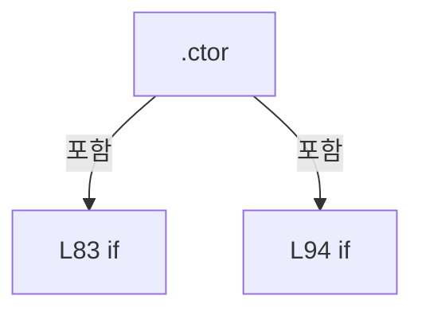

변경 전 점검: 입력/반환 타입, 위 호출자, 예외/취소 경로, 공유 상태와 저장·전송 소비자를 함께 확인합니다. 값의 단위나 물리 방향을 이름만으로 확정하지 않습니다.

### PropertyDeclaration `Rows` · L102–106

[Drilling.UI/Views/CReviewShotMapControl.cs:102–106](https://github.com/kjuws10-rgb/A3Drilling/blob/0219666f9053b907d96d7e0aa7d0c6c1be3a73d4/Drilling.UI/Views/CReviewShotMapControl.cs#L102-L106)

| 항목 | 실제 추출 값 |
| --- | --- |
| 서명 | System.Collections.Generic.IReadOnlyList<Drilling.UI.Menu.Menus.ST_REVIEW_RUN_SHOT_MATRIX_ROW> Drilling.UI.Views.CReviewShotMapControl.Rows |
| 접근/수식자 | Public / public |
| 반환/값 타입 | System.Collections.Generic.IReadOnlyList<Drilling.UI.Menu.Menus.ST_REVIEW_RUN_SHOT_MATRIX_ROW> |
| 소속 타입 | NamedType:Drilling.UI.Views.CReviewShotMapControl |

현재 부분 분석에서 직접 연결된 호출자는 없습니다. XAML/이벤트/인터페이스·델리게이트·외부 진입을 추가 확인해야 하며, 미사용으로 판정한 것이 아닙니다.

변경 전 점검: 입력/반환 타입, 위 호출자, 예외/취소 경로, 공유 상태와 저장·전송 소비자를 함께 확인합니다. 값의 단위나 물리 방향을 이름만으로 확정하지 않습니다.

### GetAccessorDeclaration `get_Rows` · L104–104

[Drilling.UI/Views/CReviewShotMapControl.cs:104–104](https://github.com/kjuws10-rgb/A3Drilling/blob/0219666f9053b907d96d7e0aa7d0c6c1be3a73d4/Drilling.UI/Views/CReviewShotMapControl.cs#L104-L104)

| 항목 | 실제 추출 값 |
| --- | --- |
| 서명 | System.Collections.Generic.IReadOnlyList<Drilling.UI.Menu.Menus.ST_REVIEW_RUN_SHOT_MATRIX_ROW> Drilling.UI.Views.CReviewShotMapControl.Rows.get |
| 접근/수식자 | Public / get |
| 반환/값 타입 | System.Collections.Generic.IReadOnlyList<Drilling.UI.Menu.Menus.ST_REVIEW_RUN_SHOT_MATRIX_ROW> |
| 소속 타입 | NamedType:Drilling.UI.Views.CReviewShotMapControl |

현재 부분 분석에서 직접 연결된 호출자는 없습니다. XAML/이벤트/인터페이스·델리게이트·외부 진입을 추가 확인해야 하며, 미사용으로 판정한 것이 아닙니다.

호출하는 대상과 해석 범위:

| 원본 행 | 표현식 | 분석 상태 | 대상/소스 위치 |
| --- | --- | --- | --- |
| 104 | GetValue | unresolved | None |

본문의 실제 연산·분기·예외·반환 순서(원문 위치 순):

| 원본 행 | 종류 | 주석 해설 |
| --- | --- | --- |
| 104 | call | 함수·델리게이트 또는 객체 생성자를 호출합니다: GetValue(RowsProperty) |

변경 전 점검: 입력/반환 타입, 위 호출자, 예외/취소 경로, 공유 상태와 저장·전송 소비자를 함께 확인합니다. 값의 단위나 물리 방향을 이름만으로 확정하지 않습니다.

### SetAccessorDeclaration `set_Rows` · L105–105

[Drilling.UI/Views/CReviewShotMapControl.cs:105–105](https://github.com/kjuws10-rgb/A3Drilling/blob/0219666f9053b907d96d7e0aa7d0c6c1be3a73d4/Drilling.UI/Views/CReviewShotMapControl.cs#L105-L105)

| 항목 | 실제 추출 값 |
| --- | --- |
| 서명 | void Drilling.UI.Views.CReviewShotMapControl.Rows.set |
| 접근/수식자 | Public / set |
| 반환/값 타입 | void |
| 소속 타입 | NamedType:Drilling.UI.Views.CReviewShotMapControl |

입력 계약:

| 이름 | 타입 | 전달 | 선택/기본값 |
| --- | --- | --- | --- |
| value | System.Collections.Generic.IReadOnlyList<Drilling.UI.Menu.Menus.ST_REVIEW_RUN_SHOT_MATRIX_ROW> | None | False /  |

현재 부분 분석에서 직접 연결된 호출자는 없습니다. XAML/이벤트/인터페이스·델리게이트·외부 진입을 추가 확인해야 하며, 미사용으로 판정한 것이 아닙니다.

호출하는 대상과 해석 범위:

| 원본 행 | 표현식 | 분석 상태 | 대상/소스 위치 |
| --- | --- | --- | --- |
| 105 | SetValue | unresolved | None |

본문의 실제 연산·분기·예외·반환 순서(원문 위치 순):

| 원본 행 | 종류 | 주석 해설 |
| --- | --- | --- |
| 105 | call | 함수·델리게이트 또는 객체 생성자를 호출합니다: SetValue(RowsProperty, value) |

변경 전 점검: 입력/반환 타입, 위 호출자, 예외/취소 경로, 공유 상태와 저장·전송 소비자를 함께 확인합니다. 값의 단위나 물리 방향을 이름만으로 확정하지 않습니다.

### PropertyDeclaration `IsBeamInspectionMode` · L108–112

[Drilling.UI/Views/CReviewShotMapControl.cs:108–112](https://github.com/kjuws10-rgb/A3Drilling/blob/0219666f9053b907d96d7e0aa7d0c6c1be3a73d4/Drilling.UI/Views/CReviewShotMapControl.cs#L108-L112)

| 항목 | 실제 추출 값 |
| --- | --- |
| 서명 | bool Drilling.UI.Views.CReviewShotMapControl.IsBeamInspectionMode |
| 접근/수식자 | Public / public |
| 반환/값 타입 | bool |
| 소속 타입 | NamedType:Drilling.UI.Views.CReviewShotMapControl |

현재 부분 분석에서 직접 연결된 호출자는 없습니다. XAML/이벤트/인터페이스·델리게이트·외부 진입을 추가 확인해야 하며, 미사용으로 판정한 것이 아닙니다.

변경 전 점검: 입력/반환 타입, 위 호출자, 예외/취소 경로, 공유 상태와 저장·전송 소비자를 함께 확인합니다. 값의 단위나 물리 방향을 이름만으로 확정하지 않습니다.

### GetAccessorDeclaration `get_IsBeamInspectionMode` · L110–110

[Drilling.UI/Views/CReviewShotMapControl.cs:110–110](https://github.com/kjuws10-rgb/A3Drilling/blob/0219666f9053b907d96d7e0aa7d0c6c1be3a73d4/Drilling.UI/Views/CReviewShotMapControl.cs#L110-L110)

| 항목 | 실제 추출 값 |
| --- | --- |
| 서명 | bool Drilling.UI.Views.CReviewShotMapControl.IsBeamInspectionMode.get |
| 접근/수식자 | Public / get |
| 반환/값 타입 | bool |
| 소속 타입 | NamedType:Drilling.UI.Views.CReviewShotMapControl |

현재 부분 분석에서 직접 연결된 호출자는 없습니다. XAML/이벤트/인터페이스·델리게이트·외부 진입을 추가 확인해야 하며, 미사용으로 판정한 것이 아닙니다.

호출하는 대상과 해석 범위:

| 원본 행 | 표현식 | 분석 상태 | 대상/소스 위치 |
| --- | --- | --- | --- |
| 110 | GetValue | unresolved | None |

본문의 실제 연산·분기·예외·반환 순서(원문 위치 순):

| 원본 행 | 종류 | 주석 해설 |
| --- | --- | --- |
| 110 | call | 함수·델리게이트 또는 객체 생성자를 호출합니다: GetValue(IsBeamInspectionModeProperty) |

변경 전 점검: 입력/반환 타입, 위 호출자, 예외/취소 경로, 공유 상태와 저장·전송 소비자를 함께 확인합니다. 값의 단위나 물리 방향을 이름만으로 확정하지 않습니다.

### SetAccessorDeclaration `set_IsBeamInspectionMode` · L111–111

[Drilling.UI/Views/CReviewShotMapControl.cs:111–111](https://github.com/kjuws10-rgb/A3Drilling/blob/0219666f9053b907d96d7e0aa7d0c6c1be3a73d4/Drilling.UI/Views/CReviewShotMapControl.cs#L111-L111)

| 항목 | 실제 추출 값 |
| --- | --- |
| 서명 | void Drilling.UI.Views.CReviewShotMapControl.IsBeamInspectionMode.set |
| 접근/수식자 | Public / set |
| 반환/값 타입 | void |
| 소속 타입 | NamedType:Drilling.UI.Views.CReviewShotMapControl |

입력 계약:

| 이름 | 타입 | 전달 | 선택/기본값 |
| --- | --- | --- | --- |
| value | bool | None | False /  |

현재 부분 분석에서 직접 연결된 호출자는 없습니다. XAML/이벤트/인터페이스·델리게이트·외부 진입을 추가 확인해야 하며, 미사용으로 판정한 것이 아닙니다.

호출하는 대상과 해석 범위:

| 원본 행 | 표현식 | 분석 상태 | 대상/소스 위치 |
| --- | --- | --- | --- |
| 111 | SetValue | unresolved | None |

본문의 실제 연산·분기·예외·반환 순서(원문 위치 순):

| 원본 행 | 종류 | 주석 해설 |
| --- | --- | --- |
| 111 | call | 함수·델리게이트 또는 객체 생성자를 호출합니다: SetValue(IsBeamInspectionModeProperty, value) |

변경 전 점검: 입력/반환 타입, 위 호출자, 예외/취소 경로, 공유 상태와 저장·전송 소비자를 함께 확인합니다. 값의 단위나 물리 방향을 이름만으로 확정하지 않습니다.

### MethodDeclaration `MeasureOverride` · L114–119

[Drilling.UI/Views/CReviewShotMapControl.cs:114–119](https://github.com/kjuws10-rgb/A3Drilling/blob/0219666f9053b907d96d7e0aa7d0c6c1be3a73d4/Drilling.UI/Views/CReviewShotMapControl.cs#L114-L119)

| 항목 | 실제 추출 값 |
| --- | --- |
| 서명 | Size Drilling.UI.Views.CReviewShotMapControl.MeasureOverride(Size) |
| 접근/수식자 | Protected / protected, override |
| 반환/값 타입 | Size |
| 소속 타입 | NamedType:Drilling.UI.Views.CReviewShotMapControl |

입력 계약:

| 이름 | 타입 | 전달 | 선택/기본값 |
| --- | --- | --- | --- |
| availableSize | Size | None | False /  |

현재 부분 분석에서 직접 연결된 호출자는 없습니다. XAML/이벤트/인터페이스·델리게이트·외부 진입을 추가 확인해야 하며, 미사용으로 판정한 것이 아닙니다.

호출하는 대상과 해석 범위:

| 원본 행 | 표현식 | 분석 상태 | 대상/소스 위치 |
| --- | --- | --- | --- |
| 117 | Rows.Max | resolved | int System.Collections.Generic.IEnumerable<Drilling.UI.Menu.Menus.ST_REVIEW_RUN_SHOT_MATRIX_ROW>.Max<Drilling.UI.Menu.Menus.ST_REVIEW_RUN_SHOT_MATRIX_ROW>(System.Func<Drilling.UI.Menu.Menus.ST_REVIEW_RUN_SHOT_MATRIX_ROW, int>) |
| 118 | new Size | unresolved | None |

본문의 실제 연산·분기·예외·반환 순서(원문 위치 순):

| 원본 행 | 종류 | 주석 해설 |
| --- | --- | --- |
| 116 | local-declaration | 지역 변수를 선언합니다: var rowCount = Rows.Count; |
| 116 | variable-initializer | 변수의 초기값을 지정합니다: rowCount = Rows.Count |
| 117 | call | 함수·델리게이트 또는 객체 생성자를 호출합니다: Rows.Max(row => row.Shots.Count) |
| 117 | conditional-expression | 조건에 따라 결과식을 선택합니다: rowCount == 0 ? 0 : Rows.Max(row => row.Shots.Count) |
| 117 | local-declaration | 지역 변수를 선언합니다: var columnCount = rowCount == 0 ? 0 : Rows.Max(row => row.Shots.Count); |
| 117 | variable-initializer | 변수의 초기값을 지정합니다: columnCount = rowCount == 0 ? 0 : Rows.Max(row => row.Shots.Count) |
| 118 | call | 함수·델리게이트 또는 객체 생성자를 호출합니다: new Size(columnCount * CellPitch, rowCount * CellPitch) |
| 118 | return | 호출자에게 값 또는 제어를 반환합니다: return new Size(columnCount * CellPitch, rowCount * CellPitch); |

변경 전 점검: 입력/반환 타입, 위 호출자, 예외/취소 경로, 공유 상태와 저장·전송 소비자를 함께 확인합니다. 값의 단위나 물리 방향을 이름만으로 확정하지 않습니다.

### MethodDeclaration `OnRender` · L121–133

[Drilling.UI/Views/CReviewShotMapControl.cs:121–133](https://github.com/kjuws10-rgb/A3Drilling/blob/0219666f9053b907d96d7e0aa7d0c6c1be3a73d4/Drilling.UI/Views/CReviewShotMapControl.cs#L121-L133)

| 항목 | 실제 추출 값 |
| --- | --- |
| 서명 | void Drilling.UI.Views.CReviewShotMapControl.OnRender(DrawingContext) |
| 접근/수식자 | Protected / protected, override |
| 반환/값 타입 | void |
| 소속 타입 | NamedType:Drilling.UI.Views.CReviewShotMapControl |

입력 계약:

| 이름 | 타입 | 전달 | 선택/기본값 |
| --- | --- | --- | --- |
| drawingContext | DrawingContext | None | False /  |

현재 부분 분석에서 직접 연결된 호출자는 없습니다. XAML/이벤트/인터페이스·델리게이트·외부 진입을 추가 확인해야 하며, 미사용으로 판정한 것이 아닙니다.

호출하는 대상과 해석 범위:

| 원본 행 | 표현식 | 분석 상태 | 대상/소스 위치 |
| --- | --- | --- | --- |
| 123 | base.OnRender | unresolved | None |
| 130 | DrawShot | resolved | void Drilling.UI.Views.CReviewShotMapControl.DrawShot(DrawingContext, Drilling.UI.Menu.Menus.ST_REVIEW_RUN_SHOT_ROW, int, int) · Drilling.UI/Views/CReviewShotMapControl.cs:243 |

본문의 실제 연산·분기·예외·반환 순서(원문 위치 순):

| 원본 행 | 종류 | 주석 해설 |
| --- | --- | --- |
| 123 | call | 함수·델리게이트 또는 객체 생성자를 호출합니다: base.OnRender(drawingContext) |
| 125 | variable-initializer | 변수의 초기값을 지정합니다: rowIndex = 0 |
| 125 | for | 초기화·조건·증감이 있는 반복입니다: for (var rowIndex = 0; rowIndex < Rows.Count; rowIndex++) |
| 127 | local-declaration | 지역 변수를 선언합니다: var shots = Rows[rowIndex].Shots; |
| 127 | variable-initializer | 변수의 초기값을 지정합니다: shots = Rows[rowIndex].Shots |
| 128 | variable-initializer | 변수의 초기값을 지정합니다: columnIndex = 0 |
| 128 | for | 초기화·조건·증감이 있는 반복입니다: for (var columnIndex = 0; columnIndex < shots.Count; columnIndex++) |
| 130 | call | 함수·델리게이트 또는 객체 생성자를 호출합니다: DrawShot(drawingContext, shots[columnIndex], rowIndex, columnIndex) |

제어 구문의 포함 구조(실제 실행 순서/CFG가 아닌 구문 탐색 그림):

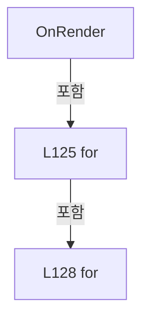

변경 전 점검: 입력/반환 타입, 위 호출자, 예외/취소 경로, 공유 상태와 저장·전송 소비자를 함께 확인합니다. 값의 단위나 물리 방향을 이름만으로 확정하지 않습니다.

### MethodDeclaration `OnMouseMove` · L135–147

[Drilling.UI/Views/CReviewShotMapControl.cs:135–147](https://github.com/kjuws10-rgb/A3Drilling/blob/0219666f9053b907d96d7e0aa7d0c6c1be3a73d4/Drilling.UI/Views/CReviewShotMapControl.cs#L135-L147)

| 항목 | 실제 추출 값 |
| --- | --- |
| 서명 | void Drilling.UI.Views.CReviewShotMapControl.OnMouseMove(MouseEventArgs) |
| 접근/수식자 | Protected / protected, override |
| 반환/값 타입 | void |
| 소속 타입 | NamedType:Drilling.UI.Views.CReviewShotMapControl |

입력 계약:

| 이름 | 타입 | 전달 | 선택/기본값 |
| --- | --- | --- | --- |
| eventArgs | MouseEventArgs | None | False /  |

현재 부분 분석에서 직접 연결된 호출자는 없습니다. XAML/이벤트/인터페이스·델리게이트·외부 진입을 추가 확인해야 하며, 미사용으로 판정한 것이 아닙니다.

호출하는 대상과 해석 범위:

| 원본 행 | 표현식 | 분석 상태 | 대상/소스 위치 |
| --- | --- | --- | --- |
| 137 | base.OnMouseMove | unresolved | None |
| 138 | HitTestShot | candidate | OverloadResolutionFailure |
| 138 | eventArgs.GetPosition | unresolved | None |
| 139 | ReferenceEquals | resolved | bool object.ReferenceEquals(object?, object?) |

본문의 실제 연산·분기·예외·반환 순서(원문 위치 순):

| 원본 행 | 종류 | 주석 해설 |
| --- | --- | --- |
| 137 | call | 함수·델리게이트 또는 객체 생성자를 호출합니다: base.OnMouseMove(eventArgs) |
| 138 | call | 함수·델리게이트 또는 객체 생성자를 호출합니다: HitTestShot(eventArgs.GetPosition(this)) |
| 138 | call | 함수·델리게이트 또는 객체 생성자를 호출합니다: eventArgs.GetPosition(this) |
| 138 | local-declaration | 지역 변수를 선언합니다: var shot = HitTestShot(eventArgs.GetPosition(this)); |
| 138 | variable-initializer | 변수의 초기값을 지정합니다: shot = HitTestShot(eventArgs.GetPosition(this)) |
| 139 | call | 함수·델리게이트 또는 객체 생성자를 호출합니다: ReferenceEquals(_hoveredShot, shot) |
| 139 | if | 조건에 따라 분기합니다: if (ReferenceEquals(_hoveredShot, shot)) |
| 140 | return | 호출자에게 값 또는 제어를 반환합니다: return; |
| 142 | assignment | 값을 대상에 대입합니다: _hoveredShot = shot |
| 143 | assignment | 값을 대상에 대입합니다: _toolTipTitle.Text = shot?.ShotName ?? "" |
| 144 | assignment | 값을 대상에 대입합니다: _toolTipDetail.Text = shot?.Detail ?? "" |
| 145 | if | 조건에 따라 분기합니다: if (shot is null) |
| 146 | assignment | 값을 대상에 대입합니다: _toolTip.IsOpen = false |

제어 구문의 포함 구조(실제 실행 순서/CFG가 아닌 구문 탐색 그림):

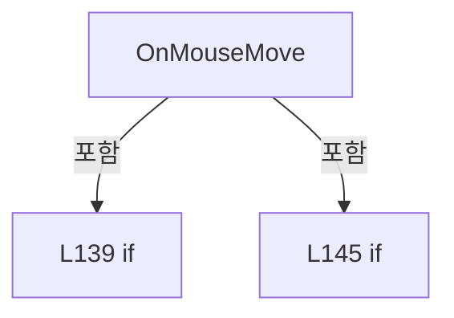

변경 전 점검: 입력/반환 타입, 위 호출자, 예외/취소 경로, 공유 상태와 저장·전송 소비자를 함께 확인합니다. 값의 단위나 물리 방향을 이름만으로 확정하지 않습니다.

### MethodDeclaration `OnMouseLeave` · L149–154

[Drilling.UI/Views/CReviewShotMapControl.cs:149–154](https://github.com/kjuws10-rgb/A3Drilling/blob/0219666f9053b907d96d7e0aa7d0c6c1be3a73d4/Drilling.UI/Views/CReviewShotMapControl.cs#L149-L154)

| 항목 | 실제 추출 값 |
| --- | --- |
| 서명 | void Drilling.UI.Views.CReviewShotMapControl.OnMouseLeave(MouseEventArgs) |
| 접근/수식자 | Protected / protected, override |
| 반환/값 타입 | void |
| 소속 타입 | NamedType:Drilling.UI.Views.CReviewShotMapControl |

입력 계약:

| 이름 | 타입 | 전달 | 선택/기본값 |
| --- | --- | --- | --- |
| eventArgs | MouseEventArgs | None | False /  |

현재 부분 분석에서 직접 연결된 호출자는 없습니다. XAML/이벤트/인터페이스·델리게이트·외부 진입을 추가 확인해야 하며, 미사용으로 판정한 것이 아닙니다.

호출하는 대상과 해석 범위:

| 원본 행 | 표현식 | 분석 상태 | 대상/소스 위치 |
| --- | --- | --- | --- |
| 151 | base.OnMouseLeave | unresolved | None |

본문의 실제 연산·분기·예외·반환 순서(원문 위치 순):

| 원본 행 | 종류 | 주석 해설 |
| --- | --- | --- |
| 151 | call | 함수·델리게이트 또는 객체 생성자를 호출합니다: base.OnMouseLeave(eventArgs) |
| 152 | assignment | 값을 대상에 대입합니다: _hoveredShot = null |
| 153 | assignment | 값을 대상에 대입합니다: _toolTip.IsOpen = false |

변경 전 점검: 입력/반환 타입, 위 호출자, 예외/취소 경로, 공유 상태와 저장·전송 소비자를 함께 확인합니다. 값의 단위나 물리 방향을 이름만으로 확정하지 않습니다.

### MethodDeclaration `OnMouseLeftButtonDown` · L156–165

[Drilling.UI/Views/CReviewShotMapControl.cs:156–165](https://github.com/kjuws10-rgb/A3Drilling/blob/0219666f9053b907d96d7e0aa7d0c6c1be3a73d4/Drilling.UI/Views/CReviewShotMapControl.cs#L156-L165)

| 항목 | 실제 추출 값 |
| --- | --- |
| 서명 | void Drilling.UI.Views.CReviewShotMapControl.OnMouseLeftButtonDown(MouseButtonEventArgs) |
| 접근/수식자 | Protected / protected, override |
| 반환/값 타입 | void |
| 소속 타입 | NamedType:Drilling.UI.Views.CReviewShotMapControl |

입력 계약:

| 이름 | 타입 | 전달 | 선택/기본값 |
| --- | --- | --- | --- |
| eventArgs | MouseButtonEventArgs | None | False /  |

현재 부분 분석에서 직접 연결된 호출자는 없습니다. XAML/이벤트/인터페이스·델리게이트·외부 진입을 추가 확인해야 하며, 미사용으로 판정한 것이 아닙니다.

호출하는 대상과 해석 범위:

| 원본 행 | 표현식 | 분석 상태 | 대상/소스 위치 |
| --- | --- | --- | --- |
| 158 | base.OnMouseLeftButtonDown | unresolved | None |
| 159 | HitTestShot | candidate | OverloadResolutionFailure |
| 159 | eventArgs.GetPosition | unresolved | None |
| 160 | shot.SelectCommand.CanExecute | resolved | bool Drilling.UI.Menu.CButtonCommand.CanExecute(object?) · Drilling.UI/Menu/CButtonCommand.cs:14 |
| 163 | shot.SelectCommand.Execute | resolved | void Drilling.UI.Menu.CButtonCommand.Execute(object?) · Drilling.UI/Menu/CButtonCommand.cs:19 |

본문의 실제 연산·분기·예외·반환 순서(원문 위치 순):

| 원본 행 | 종류 | 주석 해설 |
| --- | --- | --- |
| 158 | call | 함수·델리게이트 또는 객체 생성자를 호출합니다: base.OnMouseLeftButtonDown(eventArgs) |
| 159 | call | 함수·델리게이트 또는 객체 생성자를 호출합니다: HitTestShot(eventArgs.GetPosition(this)) |
| 159 | call | 함수·델리게이트 또는 객체 생성자를 호출합니다: eventArgs.GetPosition(this) |
| 159 | local-declaration | 지역 변수를 선언합니다: var shot = HitTestShot(eventArgs.GetPosition(this)); |
| 159 | variable-initializer | 변수의 초기값을 지정합니다: shot = HitTestShot(eventArgs.GetPosition(this)) |
| 160 | call | 함수·델리게이트 또는 객체 생성자를 호출합니다: shot.SelectCommand.CanExecute(shot.ShotKey) |
| 160 | if | 조건에 따라 분기합니다: if (shot is null &#124;&#124; !shot.SelectCommand.CanExecute(shot.ShotKey)) |
| 161 | return | 호출자에게 값 또는 제어를 반환합니다: return; |
| 163 | call | 함수·델리게이트 또는 객체 생성자를 호출합니다: shot.SelectCommand.Execute(shot.ShotKey) |
| 164 | assignment | 값을 대상에 대입합니다: eventArgs.Handled = true |

제어 구문의 포함 구조(실제 실행 순서/CFG가 아닌 구문 탐색 그림):

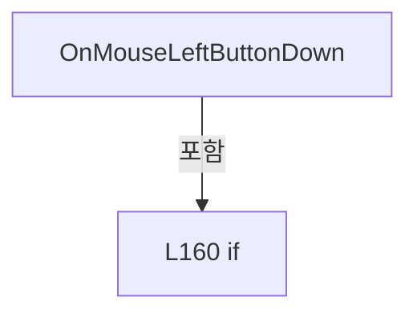

변경 전 점검: 입력/반환 타입, 위 호출자, 예외/취소 경로, 공유 상태와 저장·전송 소비자를 함께 확인합니다. 값의 단위나 물리 방향을 이름만으로 확정하지 않습니다.

### MethodDeclaration `OnMouseRightButtonDown` · L167–177

[Drilling.UI/Views/CReviewShotMapControl.cs:167–177](https://github.com/kjuws10-rgb/A3Drilling/blob/0219666f9053b907d96d7e0aa7d0c6c1be3a73d4/Drilling.UI/Views/CReviewShotMapControl.cs#L167-L177)

| 항목 | 실제 추출 값 |
| --- | --- |
| 서명 | void Drilling.UI.Views.CReviewShotMapControl.OnMouseRightButtonDown(MouseButtonEventArgs) |
| 접근/수식자 | Protected / protected, override |
| 반환/값 타입 | void |
| 소속 타입 | NamedType:Drilling.UI.Views.CReviewShotMapControl |

입력 계약:

| 이름 | 타입 | 전달 | 선택/기본값 |
| --- | --- | --- | --- |
| eventArgs | MouseButtonEventArgs | None | False /  |

현재 부분 분석에서 직접 연결된 호출자는 없습니다. XAML/이벤트/인터페이스·델리게이트·외부 진입을 추가 확인해야 하며, 미사용으로 판정한 것이 아닙니다.

호출하는 대상과 해석 범위:

| 원본 행 | 표현식 | 분석 상태 | 대상/소스 위치 |
| --- | --- | --- | --- |
| 169 | base.OnMouseRightButtonDown | unresolved | None |
| 170 | HitTestShot | candidate | OverloadResolutionFailure |
| 170 | eventArgs.GetPosition | unresolved | None |
| 172 | command.CanExecute | resolved | bool Drilling.UI.Menu.CButtonCommand.CanExecute(object?) · Drilling.UI/Menu/CButtonCommand.cs:14 |
| 175 | command.Execute | resolved | void Drilling.UI.Menu.CButtonCommand.Execute(object?) · Drilling.UI/Menu/CButtonCommand.cs:19 |

본문의 실제 연산·분기·예외·반환 순서(원문 위치 순):

| 원본 행 | 종류 | 주석 해설 |
| --- | --- | --- |
| 169 | call | 함수·델리게이트 또는 객체 생성자를 호출합니다: base.OnMouseRightButtonDown(eventArgs) |
| 170 | call | 함수·델리게이트 또는 객체 생성자를 호출합니다: HitTestShot(eventArgs.GetPosition(this)) |
| 170 | call | 함수·델리게이트 또는 객체 생성자를 호출합니다: eventArgs.GetPosition(this) |
| 170 | local-declaration | 지역 변수를 선언합니다: var shot = HitTestShot(eventArgs.GetPosition(this)); |
| 170 | variable-initializer | 변수의 초기값을 지정합니다: shot = HitTestShot(eventArgs.GetPosition(this)) |
| 171 | local-declaration | 지역 변수를 선언합니다: var command = shot?.ShowBeamPositionsCommand; |
| 171 | variable-initializer | 변수의 초기값을 지정합니다: command = shot?.ShowBeamPositionsCommand |
| 172 | call | 함수·델리게이트 또는 객체 생성자를 호출합니다: command.CanExecute(shot.ShotKey) |
| 172 | if | 조건에 따라 분기합니다: if (shot is null &#124;&#124; command is null &#124;&#124; !command.CanExecute(shot.ShotKey)) |
| 173 | return | 호출자에게 값 또는 제어를 반환합니다: return; |
| 175 | call | 함수·델리게이트 또는 객체 생성자를 호출합니다: command.Execute(shot.ShotKey) |
| 176 | assignment | 값을 대상에 대입합니다: eventArgs.Handled = true |

제어 구문의 포함 구조(실제 실행 순서/CFG가 아닌 구문 탐색 그림):

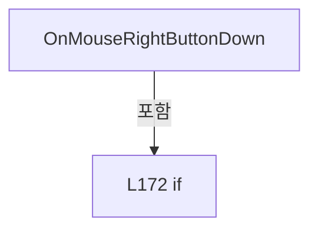

변경 전 점검: 입력/반환 타입, 위 호출자, 예외/취소 경로, 공유 상태와 저장·전송 소비자를 함께 확인합니다. 값의 단위나 물리 방향을 이름만으로 확정하지 않습니다.

### MethodDeclaration `OnRowsChanged` · L179–190

[Drilling.UI/Views/CReviewShotMapControl.cs:179–190](https://github.com/kjuws10-rgb/A3Drilling/blob/0219666f9053b907d96d7e0aa7d0c6c1be3a73d4/Drilling.UI/Views/CReviewShotMapControl.cs#L179-L190)

| 항목 | 실제 추출 값 |
| --- | --- |
| 서명 | void Drilling.UI.Views.CReviewShotMapControl.OnRowsChanged(DependencyObject, DependencyPropertyChangedEventArgs) |
| 접근/수식자 | Private / private, static |
| 반환/값 타입 | void |
| 소속 타입 | NamedType:Drilling.UI.Views.CReviewShotMapControl |

입력 계약:

| 이름 | 타입 | 전달 | 선택/기본값 |
| --- | --- | --- | --- |
| dependencyObject | DependencyObject | None | False /  |
| eventArgs | DependencyPropertyChangedEventArgs | None | False /  |

현재 부분 분석에서 직접 연결된 호출자는 없습니다. XAML/이벤트/인터페이스·델리게이트·외부 진입을 추가 확인해야 하며, 미사용으로 판정한 것이 아닙니다.

호출하는 대상과 해석 범위:

| 원본 행 | 표현식 | 분석 상태 | 대상/소스 위치 |
| --- | --- | --- | --- |
| 184 | control.DetachRows | resolved | void Drilling.UI.Views.CReviewShotMapControl.DetachRows(System.Collections.Generic.IReadOnlyList<Drilling.UI.Menu.Menus.ST_REVIEW_RUN_SHOT_MATRIX_ROW>?) · Drilling.UI/Views/CReviewShotMapControl.cs:205 |
| 185 | control.AttachRows | resolved | void Drilling.UI.Views.CReviewShotMapControl.AttachRows(System.Collections.Generic.IReadOnlyList<Drilling.UI.Menu.Menus.ST_REVIEW_RUN_SHOT_MATRIX_ROW>?) · Drilling.UI/Views/CReviewShotMapControl.cs:192 |
| 188 | control.InvalidateMeasure | unresolved | None |
| 189 | control.InvalidateVisual | unresolved | None |

본문의 실제 연산·분기·예외·반환 순서(원문 위치 순):

| 원본 행 | 종류 | 주석 해설 |
| --- | --- | --- |
| 181 | local-declaration | 지역 변수를 선언합니다: var control = (CReviewShotMapControl)dependencyObject; |
| 181 | variable-initializer | 변수의 초기값을 지정합니다: control = (CReviewShotMapControl)dependencyObject |
| 182 | if | 조건에 따라 분기합니다: if (control._rowsAttached) |
| 184 | call | 함수·델리게이트 또는 객체 생성자를 호출합니다: control.DetachRows(eventArgs.OldValue as IReadOnlyList<ST_REVIEW_RUN_SHOT_MATRIX_ROW>) |
| 185 | call | 함수·델리게이트 또는 객체 생성자를 호출합니다: control.AttachRows(eventArgs.NewValue as IReadOnlyList<ST_REVIEW_RUN_SHOT_MATRIX_ROW>) |
| 187 | assignment | 값을 대상에 대입합니다: control._hoveredShot = null |
| 188 | call | 함수·델리게이트 또는 객체 생성자를 호출합니다: control.InvalidateMeasure() |
| 189 | call | 함수·델리게이트 또는 객체 생성자를 호출합니다: control.InvalidateVisual() |

제어 구문의 포함 구조(실제 실행 순서/CFG가 아닌 구문 탐색 그림):

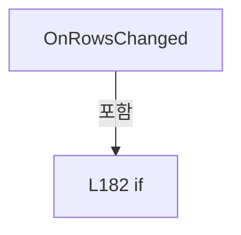

변경 전 점검: 입력/반환 타입, 위 호출자, 예외/취소 경로, 공유 상태와 저장·전송 소비자를 함께 확인합니다. 값의 단위나 물리 방향을 이름만으로 확정하지 않습니다.

### MethodDeclaration `AttachRows` · L192–203

[Drilling.UI/Views/CReviewShotMapControl.cs:192–203](https://github.com/kjuws10-rgb/A3Drilling/blob/0219666f9053b907d96d7e0aa7d0c6c1be3a73d4/Drilling.UI/Views/CReviewShotMapControl.cs#L192-L203)

| 항목 | 실제 추출 값 |
| --- | --- |
| 서명 | void Drilling.UI.Views.CReviewShotMapControl.AttachRows(System.Collections.Generic.IReadOnlyList<Drilling.UI.Menu.Menus.ST_REVIEW_RUN_SHOT_MATRIX_ROW>?) |
| 접근/수식자 | Private / private |
| 반환/값 타입 | void |
| 소속 타입 | NamedType:Drilling.UI.Views.CReviewShotMapControl |

입력 계약:

| 이름 | 타입 | 전달 | 선택/기본값 |
| --- | --- | --- | --- |
| rows | System.Collections.Generic.IReadOnlyList<Drilling.UI.Menu.Menus.ST_REVIEW_RUN_SHOT_MATRIX_ROW>? | None | False /  |

정적 호출자로 확인된 위치:

| 호출 파일/행 | 호출 표현식 | 런타임 분기 가능 |
| --- | --- | --- |
| [Drilling.UI/Views/CReviewShotMapControl.cs:85–85](https://github.com/kjuws10-rgb/A3Drilling/blob/0219666f9053b907d96d7e0aa7d0c6c1be3a73d4/Drilling.UI/Views/CReviewShotMapControl.cs#L85-L85) | AttachRows | False |
| [Drilling.UI/Views/CReviewShotMapControl.cs:185–185](https://github.com/kjuws10-rgb/A3Drilling/blob/0219666f9053b907d96d7e0aa7d0c6c1be3a73d4/Drilling.UI/Views/CReviewShotMapControl.cs#L185-L185) | control.AttachRows | False |

호출하는 대상과 해석 범위:

| 원본 행 | 표현식 | 분석 상태 | 대상/소스 위치 |
| --- | --- | --- | --- |
| 197 | rows.SelectMany | resolved | System.Collections.Generic.IEnumerable<Drilling.UI.Menu.Menus.ST_REVIEW_RUN_SHOT_ROW> System.Collections.Generic.IEnumerable<Drilling.UI.Menu.Menus.ST_REVIEW_RUN_SHOT_MATRIX_ROW>.SelectMany<Drilling.UI.Menu.Menus.ST_REVIEW_RUN_SHOT_MATRIX_ROW, Drilling.UI.Menu.Menus.ST_REVIEW_RUN_SHOT_ROW>(System.Func<Drilling.UI.Menu.Menus.ST_REVIEW_RUN_SHOT_MATRIX_ROW, System.Collections.Generic.IEnumerable<Drilling.UI.Menu.Menus.ST_REVIEW_RUN_SHOT_ROW>>) |

본문의 실제 연산·분기·예외·반환 순서(원문 위치 순):

| 원본 행 | 종류 | 주석 해설 |
| --- | --- | --- |
| 194 | if | 조건에 따라 분기합니다: if (rows is null) |
| 195 | return | 호출자에게 값 또는 제어를 반환합니다: return; |
| 197 | call | 함수·델리게이트 또는 객체 생성자를 호출합니다: rows.SelectMany(row => row.Shots) |
| 197 | foreach | 컬렉션 요소를 순회합니다: foreach (var shot in rows.SelectMany(row => row.Shots)) |
| 199 | compound-assignment-or-event-subscription | 복합 대입 또는 이벤트 구독/해지 표현입니다: shot.BackgroundBrushChanged += Shot_VisualChanged |
| 200 | compound-assignment-or-event-subscription | 복합 대입 또는 이벤트 구독/해지 표현입니다: shot.BorderBrushChanged += Shot_VisualChanged |
| 201 | compound-assignment-or-event-subscription | 복합 대입 또는 이벤트 구독/해지 표현입니다: shot.DetailChanged += Shot_VisualChanged |

제어 구문의 포함 구조(실제 실행 순서/CFG가 아닌 구문 탐색 그림):

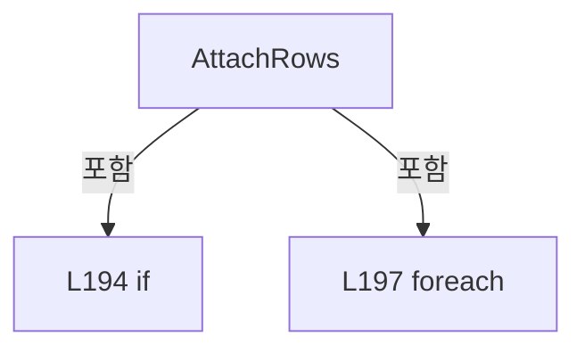

변경 전 점검: 입력/반환 타입, 위 호출자, 예외/취소 경로, 공유 상태와 저장·전송 소비자를 함께 확인합니다. 값의 단위나 물리 방향을 이름만으로 확정하지 않습니다.

### MethodDeclaration `DetachRows` · L205–216

[Drilling.UI/Views/CReviewShotMapControl.cs:205–216](https://github.com/kjuws10-rgb/A3Drilling/blob/0219666f9053b907d96d7e0aa7d0c6c1be3a73d4/Drilling.UI/Views/CReviewShotMapControl.cs#L205-L216)

| 항목 | 실제 추출 값 |
| --- | --- |
| 서명 | void Drilling.UI.Views.CReviewShotMapControl.DetachRows(System.Collections.Generic.IReadOnlyList<Drilling.UI.Menu.Menus.ST_REVIEW_RUN_SHOT_MATRIX_ROW>?) |
| 접근/수식자 | Private / private |
| 반환/값 타입 | void |
| 소속 타입 | NamedType:Drilling.UI.Views.CReviewShotMapControl |

입력 계약:

| 이름 | 타입 | 전달 | 선택/기본값 |
| --- | --- | --- | --- |
| rows | System.Collections.Generic.IReadOnlyList<Drilling.UI.Menu.Menus.ST_REVIEW_RUN_SHOT_MATRIX_ROW>? | None | False /  |

정적 호출자로 확인된 위치:

| 호출 파일/행 | 호출 표현식 | 런타임 분기 가능 |
| --- | --- | --- |
| [Drilling.UI/Views/CReviewShotMapControl.cs:96–96](https://github.com/kjuws10-rgb/A3Drilling/blob/0219666f9053b907d96d7e0aa7d0c6c1be3a73d4/Drilling.UI/Views/CReviewShotMapControl.cs#L96-L96) | DetachRows | False |
| [Drilling.UI/Views/CReviewShotMapControl.cs:184–184](https://github.com/kjuws10-rgb/A3Drilling/blob/0219666f9053b907d96d7e0aa7d0c6c1be3a73d4/Drilling.UI/Views/CReviewShotMapControl.cs#L184-L184) | control.DetachRows | False |

호출하는 대상과 해석 범위:

| 원본 행 | 표현식 | 분석 상태 | 대상/소스 위치 |
| --- | --- | --- | --- |
| 210 | rows.SelectMany | resolved | System.Collections.Generic.IEnumerable<Drilling.UI.Menu.Menus.ST_REVIEW_RUN_SHOT_ROW> System.Collections.Generic.IEnumerable<Drilling.UI.Menu.Menus.ST_REVIEW_RUN_SHOT_MATRIX_ROW>.SelectMany<Drilling.UI.Menu.Menus.ST_REVIEW_RUN_SHOT_MATRIX_ROW, Drilling.UI.Menu.Menus.ST_REVIEW_RUN_SHOT_ROW>(System.Func<Drilling.UI.Menu.Menus.ST_REVIEW_RUN_SHOT_MATRIX_ROW, System.Collections.Generic.IEnumerable<Drilling.UI.Menu.Menus.ST_REVIEW_RUN_SHOT_ROW>>) |

본문의 실제 연산·분기·예외·반환 순서(원문 위치 순):

| 원본 행 | 종류 | 주석 해설 |
| --- | --- | --- |
| 207 | if | 조건에 따라 분기합니다: if (rows is null) |
| 208 | return | 호출자에게 값 또는 제어를 반환합니다: return; |
| 210 | call | 함수·델리게이트 또는 객체 생성자를 호출합니다: rows.SelectMany(row => row.Shots) |
| 210 | foreach | 컬렉션 요소를 순회합니다: foreach (var shot in rows.SelectMany(row => row.Shots)) |
| 212 | compound-assignment-or-event-subscription | 복합 대입 또는 이벤트 구독/해지 표현입니다: shot.BackgroundBrushChanged -= Shot_VisualChanged |
| 213 | compound-assignment-or-event-subscription | 복합 대입 또는 이벤트 구독/해지 표현입니다: shot.BorderBrushChanged -= Shot_VisualChanged |
| 214 | compound-assignment-or-event-subscription | 복합 대입 또는 이벤트 구독/해지 표현입니다: shot.DetailChanged -= Shot_VisualChanged |

제어 구문의 포함 구조(실제 실행 순서/CFG가 아닌 구문 탐색 그림):

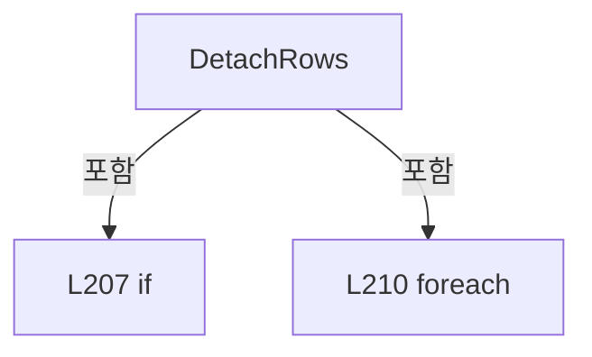

변경 전 점검: 입력/반환 타입, 위 호출자, 예외/취소 경로, 공유 상태와 저장·전송 소비자를 함께 확인합니다. 값의 단위나 물리 방향을 이름만으로 확정하지 않습니다.

### MethodDeclaration `Shot_VisualChanged` · L218–229

[Drilling.UI/Views/CReviewShotMapControl.cs:218–229](https://github.com/kjuws10-rgb/A3Drilling/blob/0219666f9053b907d96d7e0aa7d0c6c1be3a73d4/Drilling.UI/Views/CReviewShotMapControl.cs#L218-L229)

| 항목 | 실제 추출 값 |
| --- | --- |
| 서명 | void Drilling.UI.Views.CReviewShotMapControl.Shot_VisualChanged(object?, System.EventArgs) |
| 접근/수식자 | Private / private |
| 반환/값 타입 | void |
| 소속 타입 | NamedType:Drilling.UI.Views.CReviewShotMapControl |

입력 계약:

| 이름 | 타입 | 전달 | 선택/기본값 |
| --- | --- | --- | --- |
| sender | object? | None | False /  |
| eventArgs | System.EventArgs | None | False /  |

현재 부분 분석에서 직접 연결된 호출자는 없습니다. XAML/이벤트/인터페이스·델리게이트·외부 진입을 추가 확인해야 하며, 미사용으로 판정한 것이 아닙니다.

호출하는 대상과 해석 범위:

| 원본 행 | 표현식 | 분석 상태 | 대상/소스 위치 |
| --- | --- | --- | --- |
| 220 | Dispatcher.CheckAccess | unresolved | None |
| 222 | ReferenceEquals | resolved | bool object.ReferenceEquals(object?, object?) |
| 224 | InvalidateVisual | unresolved | None |
| 228 | Dispatcher.BeginInvoke | unresolved | None |

본문의 실제 연산·분기·예외·반환 순서(원문 위치 순):

| 원본 행 | 종류 | 주석 해설 |
| --- | --- | --- |
| 220 | call | 함수·델리게이트 또는 객체 생성자를 호출합니다: Dispatcher.CheckAccess() |
| 220 | if | 조건에 따라 분기합니다: if (Dispatcher.CheckAccess()) |
| 222 | call | 함수·델리게이트 또는 객체 생성자를 호출합니다: ReferenceEquals(_hoveredShot, sender) |
| 222 | if | 조건에 따라 분기합니다: if (ReferenceEquals(_hoveredShot, sender) && sender is ST_REVIEW_RUN_SHOT_ROW shot) |
| 223 | assignment | 값을 대상에 대입합니다: _toolTipDetail.Text = shot.Detail |
| 224 | call | 함수·델리게이트 또는 객체 생성자를 호출합니다: InvalidateVisual() |
| 225 | return | 호출자에게 값 또는 제어를 반환합니다: return; |
| 228 | assignment | 값을 대상에 대입합니다: _ = Dispatcher.BeginInvoke(DispatcherPriority.Render, InvalidateVisual) |
| 228 | call | 함수·델리게이트 또는 객체 생성자를 호출합니다: Dispatcher.BeginInvoke(DispatcherPriority.Render, InvalidateVisual) |

제어 구문의 포함 구조(실제 실행 순서/CFG가 아닌 구문 탐색 그림):

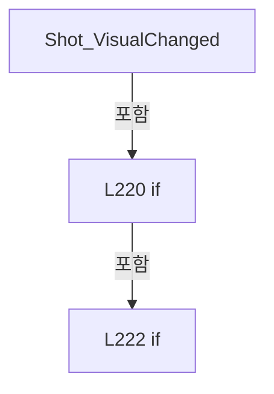

변경 전 점검: 입력/반환 타입, 위 호출자, 예외/취소 경로, 공유 상태와 저장·전송 소비자를 함께 확인합니다. 값의 단위나 물리 방향을 이름만으로 확정하지 않습니다.

### MethodDeclaration `BlinkTimer_Tick` · L231–241

[Drilling.UI/Views/CReviewShotMapControl.cs:231–241](https://github.com/kjuws10-rgb/A3Drilling/blob/0219666f9053b907d96d7e0aa7d0c6c1be3a73d4/Drilling.UI/Views/CReviewShotMapControl.cs#L231-L241)

| 항목 | 실제 추출 값 |
| --- | --- |
| 서명 | void Drilling.UI.Views.CReviewShotMapControl.BlinkTimer_Tick(object?, System.EventArgs) |
| 접근/수식자 | Private / private |
| 반환/값 타입 | void |
| 소속 타입 | NamedType:Drilling.UI.Views.CReviewShotMapControl |

입력 계약:

| 이름 | 타입 | 전달 | 선택/기본값 |
| --- | --- | --- | --- |
| sender | object? | None | False /  |
| eventArgs | System.EventArgs | None | False /  |

현재 부분 분석에서 직접 연결된 호출자는 없습니다. XAML/이벤트/인터페이스·델리게이트·외부 진입을 추가 확인해야 하며, 미사용으로 판정한 것이 아닙니다.

호출하는 대상과 해석 범위:

| 원본 행 | 표현식 | 분석 상태 | 대상/소스 위치 |
| --- | --- | --- | --- |
| 233 | Rows.SelectMany(row => row.Shots).Any | resolved | bool System.Collections.Generic.IEnumerable<Drilling.UI.Menu.Menus.ST_REVIEW_RUN_SHOT_ROW>.Any<Drilling.UI.Menu.Menus.ST_REVIEW_RUN_SHOT_ROW>(System.Func<Drilling.UI.Menu.Menus.ST_REVIEW_RUN_SHOT_ROW, bool>) |
| 233 | Rows.SelectMany | resolved | System.Collections.Generic.IEnumerable<Drilling.UI.Menu.Menus.ST_REVIEW_RUN_SHOT_ROW> System.Collections.Generic.IEnumerable<Drilling.UI.Menu.Menus.ST_REVIEW_RUN_SHOT_MATRIX_ROW>.SelectMany<Drilling.UI.Menu.Menus.ST_REVIEW_RUN_SHOT_MATRIX_ROW, Drilling.UI.Menu.Menus.ST_REVIEW_RUN_SHOT_ROW>(System.Func<Drilling.UI.Menu.Menus.ST_REVIEW_RUN_SHOT_MATRIX_ROW, System.Collections.Generic.IEnumerable<Drilling.UI.Menu.Menus.ST_REVIEW_RUN_SHOT_ROW>>) |
| 240 | InvalidateVisual | unresolved | None |

본문의 실제 연산·분기·예외·반환 순서(원문 위치 순):

| 원본 행 | 종류 | 주석 해설 |
| --- | --- | --- |
| 233 | call | 함수·델리게이트 또는 객체 생성자를 호출합니다: Rows.SelectMany(row => row.Shots).Any(shot => shot.IsCurrent) |
| 233 | call | 함수·델리게이트 또는 객체 생성자를 호출합니다: Rows.SelectMany(row => row.Shots) |
| 233 | if | 조건에 따라 분기합니다: if (!Rows.SelectMany(row => row.Shots).Any(shot => shot.IsCurrent)) |
| 235 | assignment | 값을 대상에 대입합니다: _blinkVisible = true |
| 236 | return | 호출자에게 값 또는 제어를 반환합니다: return; |
| 239 | assignment | 값을 대상에 대입합니다: _blinkVisible = !_blinkVisible |
| 240 | call | 함수·델리게이트 또는 객체 생성자를 호출합니다: InvalidateVisual() |

제어 구문의 포함 구조(실제 실행 순서/CFG가 아닌 구문 탐색 그림):

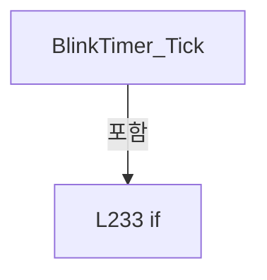

변경 전 점검: 입력/반환 타입, 위 호출자, 예외/취소 경로, 공유 상태와 저장·전송 소비자를 함께 확인합니다. 값의 단위나 물리 방향을 이름만으로 확정하지 않습니다.

### MethodDeclaration `DrawShot` · L243–300

[Drilling.UI/Views/CReviewShotMapControl.cs:243–300](https://github.com/kjuws10-rgb/A3Drilling/blob/0219666f9053b907d96d7e0aa7d0c6c1be3a73d4/Drilling.UI/Views/CReviewShotMapControl.cs#L243-L300)

| 항목 | 실제 추출 값 |
| --- | --- |
| 서명 | void Drilling.UI.Views.CReviewShotMapControl.DrawShot(DrawingContext, Drilling.UI.Menu.Menus.ST_REVIEW_RUN_SHOT_ROW, int, int) |
| 접근/수식자 | Private / private |
| 반환/값 타입 | void |
| 소속 타입 | NamedType:Drilling.UI.Views.CReviewShotMapControl |

입력 계약:

| 이름 | 타입 | 전달 | 선택/기본값 |
| --- | --- | --- | --- |
| drawingContext | DrawingContext | None | False /  |
| shot | Drilling.UI.Menu.Menus.ST_REVIEW_RUN_SHOT_ROW | None | False /  |
| row | int | None | False /  |
| column | int | None | False /  |

정적 호출자로 확인된 위치:

| 호출 파일/행 | 호출 표현식 | 런타임 분기 가능 |
| --- | --- | --- |
| [Drilling.UI/Views/CReviewShotMapControl.cs:130–130](https://github.com/kjuws10-rgb/A3Drilling/blob/0219666f9053b907d96d7e0aa7d0c6c1be3a73d4/Drilling.UI/Views/CReviewShotMapControl.cs#L130-L130) | DrawShot | False |

호출하는 대상과 해석 범위:

| 원본 행 | 표현식 | 분석 상태 | 대상/소스 위치 |
| --- | --- | --- | --- |
| 245 | new Rect | unresolved | None |
| 255 | shot.ExclusionReason.Equals | resolved | bool string.Equals(string?, System.StringComparison) |
| 287 | drawingContext.PushOpacity | unresolved | None |
| 290 | drawingContext.DrawRectangle | unresolved | None |
| 290 | GetPen | resolved | Pen Drilling.UI.Views.CReviewShotMapControl.GetPen(Brush, double) · Drilling.UI/Views/CReviewShotMapControl.cs:338 |
| 293 | DrawCross | resolved | void Drilling.UI.Views.CReviewShotMapControl.DrawCross(DrawingContext, Rect, Brush, double, double) · Drilling.UI/Views/CReviewShotMapControl.cs:317 |
| 296 | DrawSelectionMarker | resolved | void Drilling.UI.Views.CReviewShotMapControl.DrawSelectionMarker(DrawingContext, Rect) · Drilling.UI/Views/CReviewShotMapControl.cs:302 |
| 299 | drawingContext.Pop | unresolved | None |

본문의 실제 연산·분기·예외·반환 순서(원문 위치 순):

| 원본 행 | 종류 | 주석 해설 |
| --- | --- | --- |
| 245 | call | 함수·델리게이트 또는 객체 생성자를 호출합니다: new Rect( column * CellPitch + CellMargin, row * CellPitch + CellMargin, CellSize, CellSize) |
| 245 | local-declaration | 지역 변수를 선언합니다: var rect = new Rect( column * CellPitch + CellMargin, row * CellPitch + CellMargin, CellSize, CellSize); |
| 245 | variable-initializer | 변수의 초기값을 지정합니다: rect = new Rect( column * CellPitch + CellMargin, row * CellPitch + CellMargin, CellSize, CellSize) |
| 251 | local-declaration | 지역 변수를 선언합니다: var background = shot.BackgroundBrush; |
| 251 | variable-initializer | 변수의 초기값을 지정합니다: background = shot.BackgroundBrush |
| 252 | local-declaration | 지역 변수를 선언합니다: var border = shot.BorderBrush; |
| 252 | variable-initializer | 변수의 초기값을 지정합니다: border = shot.BorderBrush |
| 253 | conditional-expression | 조건에 따라 결과식을 선택합니다: shot.HasResult ? 1.2 : 0.7 |
| 253 | local-declaration | 지역 변수를 선언합니다: var borderThickness = shot.HasResult ? 1.2 : 0.7; |
| 253 | variable-initializer | 변수의 초기값을 지정합니다: borderThickness = shot.HasResult ? 1.2 : 0.7 |
| 255 | call | 함수·델리게이트 또는 객체 생성자를 호출합니다: shot.ExclusionReason.Equals("CHESS", StringComparison.OrdinalIgnoreCase) |
| 255 | local-declaration | 지역 변수를 선언합니다: var isMasking = shot.IsExcluded && !shot.ExclusionReason.Equals("CHESS", StringComparison.OrdinalIgnoreCase); |
| 255 | variable-initializer | 변수의 초기값을 지정합니다: isMasking = shot.IsExcluded && !shot.ExclusionReason.Equals("CHESS", StringComparison.OrdinalIgnoreCase) |
| 256 | if | 조건에 따라 분기합니다: if (shot.IsExcluded) |
| 258 | assignment | 값을 대상에 대입합니다: borderThickness = isMasking ? 1.6 : 1.2 |
| 258 | conditional-expression | 조건에 따라 결과식을 선택합니다: isMasking ? 1.6 : 1.2 |
| 259 | if | 조건에 따라 분기합니다: if (isMasking) |
| 261 | assignment | 값을 대상에 대입합니다: background = MaskingBackground |
| 262 | assignment | 값을 대상에 대입합니다: border = MaskingBorder |
| 266 | if | 조건에 따라 분기합니다: if (shot.IsSelected) |
| 268 | assignment | 값을 대상에 대입합니다: borderThickness = 2.0 |
| 269 | if | 조건에 따라 분기합니다: if (IsBeamInspectionMode) |
| 271 | assignment | 값을 대상에 대입합니다: background = BeamSelectionBackground |
| 272 | assignment | 값을 대상에 대입합니다: border = BeamSelectionBorder |
| 276 | if | 조건에 따라 분기합니다: if (shot.IsActiveSelection) |
| 278 | assignment | 값을 대상에 대입합니다: border = ActiveSelectionBorder |
| 279 | assignment | 값을 대상에 대입합니다: borderThickness = 3.0 |
| 282 | if | 조건에 따라 분기합니다: if (shot.IsCurrent) |
| 284 | assignment | 값을 대상에 대입합니다: background = CurrentBackground |
| 285 | assignment | 값을 대상에 대입합니다: border = CurrentBorder |
| 286 | assignment | 값을 대상에 대입합니다: borderThickness = 2.0 |
| 287 | call | 함수·델리게이트 또는 객체 생성자를 호출합니다: drawingContext.PushOpacity(_blinkVisible ? 1.0 : 0.38) |
| 287 | conditional-expression | 조건에 따라 결과식을 선택합니다: _blinkVisible ? 1.0 : 0.38 |
| 290 | call | 함수·델리게이트 또는 객체 생성자를 호출합니다: drawingContext.DrawRectangle(background, GetPen(border, borderThickness), rect) |
| 290 | call | 함수·델리게이트 또는 객체 생성자를 호출합니다: GetPen(border, borderThickness) |
| 292 | if | 조건에 따라 분기합니다: if (isMasking) |
| 293 | call | 함수·델리게이트 또는 객체 생성자를 호출합니다: DrawCross(drawingContext, rect, White, 2.4, 3.0) |
| 295 | if | 조건에 따라 분기합니다: if (shot.IsActiveSelection &#124;&#124; (shot.IsSelected && !IsBeamInspectionMode)) |
| 296 | call | 함수·델리게이트 또는 객체 생성자를 호출합니다: DrawSelectionMarker(drawingContext, rect) |
| 298 | if | 조건에 따라 분기합니다: if (shot.IsCurrent) |
| 299 | call | 함수·델리게이트 또는 객체 생성자를 호출합니다: drawingContext.Pop() |

제어 구문의 포함 구조(실제 실행 순서/CFG가 아닌 구문 탐색 그림):

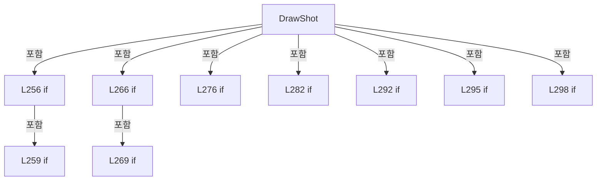

변경 전 점검: 입력/반환 타입, 위 호출자, 예외/취소 경로, 공유 상태와 저장·전송 소비자를 함께 확인합니다. 값의 단위나 물리 방향을 이름만으로 확정하지 않습니다.

### MethodDeclaration `DrawSelectionMarker` · L302–315

[Drilling.UI/Views/CReviewShotMapControl.cs:302–315](https://github.com/kjuws10-rgb/A3Drilling/blob/0219666f9053b907d96d7e0aa7d0c6c1be3a73d4/Drilling.UI/Views/CReviewShotMapControl.cs#L302-L315)

| 항목 | 실제 추출 값 |
| --- | --- |
| 서명 | void Drilling.UI.Views.CReviewShotMapControl.DrawSelectionMarker(DrawingContext, Rect) |
| 접근/수식자 | Private / private |
| 반환/값 타입 | void |
| 소속 타입 | NamedType:Drilling.UI.Views.CReviewShotMapControl |

입력 계약:

| 이름 | 타입 | 전달 | 선택/기본값 |
| --- | --- | --- | --- |
| drawingContext | DrawingContext | None | False /  |
| cellRect | Rect | None | False /  |

정적 호출자로 확인된 위치:

| 호출 파일/행 | 호출 표현식 | 런타임 분기 가능 |
| --- | --- | --- |
| [Drilling.UI/Views/CReviewShotMapControl.cs:296–296](https://github.com/kjuws10-rgb/A3Drilling/blob/0219666f9053b907d96d7e0aa7d0c6c1be3a73d4/Drilling.UI/Views/CReviewShotMapControl.cs#L296-L296) | DrawSelectionMarker | False |

호출하는 대상과 해석 범위:

| 원본 행 | 표현식 | 분석 상태 | 대상/소스 위치 |
| --- | --- | --- | --- |
| 305 | new Rect | unresolved | None |
| 310 | drawingContext.DrawRectangle | unresolved | None |
| 310 | GetPen | resolved | Pen Drilling.UI.Views.CReviewShotMapControl.GetPen(Brush, double) · Drilling.UI/Views/CReviewShotMapControl.cs:338 |
| 312 | GetPen | resolved | Pen Drilling.UI.Views.CReviewShotMapControl.GetPen(Brush, double) · Drilling.UI/Views/CReviewShotMapControl.cs:338 |
| 313 | drawingContext.DrawLine | unresolved | None |
| 313 | new Point | unresolved | None |
| 313 | new Point | unresolved | None |
| 314 | drawingContext.DrawLine | unresolved | None |
| 314 | new Point | unresolved | None |
| 314 | new Point | unresolved | None |

본문의 실제 연산·분기·예외·반환 순서(원문 위치 순):

| 원본 행 | 종류 | 주석 해설 |
| --- | --- | --- |
| 304 | local-declaration | 지역 변수를 선언합니다: const double markerSize = 12.0; |
| 304 | variable-initializer | 변수의 초기값을 지정합니다: markerSize = 12.0 |
| 305 | call | 함수·델리게이트 또는 객체 생성자를 호출합니다: new Rect( cellRect.Left + ((cellRect.Width - markerSize) / 2.0), cellRect.Top + ((cellRect.Height - markerSize) / 2.0), markerSize, markerSize) |
| 305 | local-declaration | 지역 변수를 선언합니다: var marker = new Rect( cellRect.Left + ((cellRect.Width - markerSize) / 2.0), cellRect.Top + ((cellRect.Height - markerSize) / 2.0), markerSize, markerSize); |
| 305 | variable-initializer | 변수의 초기값을 지정합니다: marker = new Rect( cellRect.Left + ((cellRect.Width - markerSize) / 2.0), cellRect.Top + ((cellRect.Height - markerSize) / 2.0), markerSize, markerSize) |
| 310 | call | 함수·델리게이트 또는 객체 생성자를 호출합니다: drawingContext.DrawRectangle(SelectionMarkerBackground, GetPen(ActiveSelectionBorder, 2.0), marker) |
| 310 | call | 함수·델리게이트 또는 객체 생성자를 호출합니다: GetPen(ActiveSelectionBorder, 2.0) |
| 312 | call | 함수·델리게이트 또는 객체 생성자를 호출합니다: GetPen(SelectionMarkerForeground, 1.4) |
| 312 | local-declaration | 지역 변수를 선언합니다: var pen = GetPen(SelectionMarkerForeground, 1.4); |
| 312 | variable-initializer | 변수의 초기값을 지정합니다: pen = GetPen(SelectionMarkerForeground, 1.4) |
| 313 | call | 함수·델리게이트 또는 객체 생성자를 호출합니다: drawingContext.DrawLine(pen, new Point(marker.Left + 3.0, marker.Top + 4.5), new Point(marker.Left + 5.4, marker.Bottom - 3.0)) |
| 313 | call | 함수·델리게이트 또는 객체 생성자를 호출합니다: new Point(marker.Left + 3.0, marker.Top + 4.5) |
| 313 | call | 함수·델리게이트 또는 객체 생성자를 호출합니다: new Point(marker.Left + 5.4, marker.Bottom - 3.0) |
| 314 | call | 함수·델리게이트 또는 객체 생성자를 호출합니다: drawingContext.DrawLine(pen, new Point(marker.Left + 5.4, marker.Bottom - 3.0), new Point(marker.Right - 2.5, marker.Top + 2.5)) |
| 314 | call | 함수·델리게이트 또는 객체 생성자를 호출합니다: new Point(marker.Left + 5.4, marker.Bottom - 3.0) |
| 314 | call | 함수·델리게이트 또는 객체 생성자를 호출합니다: new Point(marker.Right - 2.5, marker.Top + 2.5) |

변경 전 점검: 입력/반환 타입, 위 호출자, 예외/취소 경로, 공유 상태와 저장·전송 소비자를 함께 확인합니다. 값의 단위나 물리 방향을 이름만으로 확정하지 않습니다.

### MethodDeclaration `DrawCross` · L317–322

[Drilling.UI/Views/CReviewShotMapControl.cs:317–322](https://github.com/kjuws10-rgb/A3Drilling/blob/0219666f9053b907d96d7e0aa7d0c6c1be3a73d4/Drilling.UI/Views/CReviewShotMapControl.cs#L317-L322)

| 항목 | 실제 추출 값 |
| --- | --- |
| 서명 | void Drilling.UI.Views.CReviewShotMapControl.DrawCross(DrawingContext, Rect, Brush, double, double) |
| 접근/수식자 | Private / private |
| 반환/값 타입 | void |
| 소속 타입 | NamedType:Drilling.UI.Views.CReviewShotMapControl |

입력 계약:

| 이름 | 타입 | 전달 | 선택/기본값 |
| --- | --- | --- | --- |
| drawingContext | DrawingContext | None | False /  |
| rect | Rect | None | False /  |
| brush | Brush | None | False /  |
| thickness | double | None | False /  |
| inset | double | None | False /  |

정적 호출자로 확인된 위치:

| 호출 파일/행 | 호출 표현식 | 런타임 분기 가능 |
| --- | --- | --- |
| [Drilling.UI/Views/CReviewShotMapControl.cs:293–293](https://github.com/kjuws10-rgb/A3Drilling/blob/0219666f9053b907d96d7e0aa7d0c6c1be3a73d4/Drilling.UI/Views/CReviewShotMapControl.cs#L293-L293) | DrawCross | False |

호출하는 대상과 해석 범위:

| 원본 행 | 표현식 | 분석 상태 | 대상/소스 위치 |
| --- | --- | --- | --- |
| 319 | GetPen | resolved | Pen Drilling.UI.Views.CReviewShotMapControl.GetPen(Brush, double) · Drilling.UI/Views/CReviewShotMapControl.cs:338 |
| 320 | drawingContext.DrawLine | unresolved | None |
| 320 | new Point | unresolved | None |
| 320 | new Point | unresolved | None |
| 321 | drawingContext.DrawLine | unresolved | None |
| 321 | new Point | unresolved | None |
| 321 | new Point | unresolved | None |

본문의 실제 연산·분기·예외·반환 순서(원문 위치 순):

| 원본 행 | 종류 | 주석 해설 |
| --- | --- | --- |
| 319 | call | 함수·델리게이트 또는 객체 생성자를 호출합니다: GetPen(brush, thickness) |
| 319 | local-declaration | 지역 변수를 선언합니다: var pen = GetPen(brush, thickness); |
| 319 | variable-initializer | 변수의 초기값을 지정합니다: pen = GetPen(brush, thickness) |
| 320 | call | 함수·델리게이트 또는 객체 생성자를 호출합니다: drawingContext.DrawLine(pen, new Point(rect.Left + inset, rect.Top + inset), new Point(rect.Right - inset, rect.Bottom - inset)) |
| 320 | call | 함수·델리게이트 또는 객체 생성자를 호출합니다: new Point(rect.Left + inset, rect.Top + inset) |
| 320 | call | 함수·델리게이트 또는 객체 생성자를 호출합니다: new Point(rect.Right - inset, rect.Bottom - inset) |
| 321 | call | 함수·델리게이트 또는 객체 생성자를 호출합니다: drawingContext.DrawLine(pen, new Point(rect.Right - inset, rect.Top + inset), new Point(rect.Left + inset, rect.Bottom - inset)) |
| 321 | call | 함수·델리게이트 또는 객체 생성자를 호출합니다: new Point(rect.Right - inset, rect.Top + inset) |
| 321 | call | 함수·델리게이트 또는 객체 생성자를 호출합니다: new Point(rect.Left + inset, rect.Bottom - inset) |

변경 전 점검: 입력/반환 타입, 위 호출자, 예외/취소 경로, 공유 상태와 저장·전송 소비자를 함께 확인합니다. 값의 단위나 물리 방향을 이름만으로 확정하지 않습니다.

### MethodDeclaration `HitTestShot` · L324–336

[Drilling.UI/Views/CReviewShotMapControl.cs:324–336](https://github.com/kjuws10-rgb/A3Drilling/blob/0219666f9053b907d96d7e0aa7d0c6c1be3a73d4/Drilling.UI/Views/CReviewShotMapControl.cs#L324-L336)

| 항목 | 실제 추출 값 |
| --- | --- |
| 서명 | Drilling.UI.Menu.Menus.ST_REVIEW_RUN_SHOT_ROW? Drilling.UI.Views.CReviewShotMapControl.HitTestShot(Point) |
| 접근/수식자 | Private / private |
| 반환/값 타입 | Drilling.UI.Menu.Menus.ST_REVIEW_RUN_SHOT_ROW? |
| 소속 타입 | NamedType:Drilling.UI.Views.CReviewShotMapControl |

입력 계약:

| 이름 | 타입 | 전달 | 선택/기본값 |
| --- | --- | --- | --- |
| point | Point | None | False /  |

현재 부분 분석에서 직접 연결된 호출자는 없습니다. XAML/이벤트/인터페이스·델리게이트·외부 진입을 추가 확인해야 하며, 미사용으로 판정한 것이 아닙니다.

본문의 실제 연산·분기·예외·반환 순서(원문 위치 순):

| 원본 행 | 종류 | 주석 해설 |
| --- | --- | --- |
| 326 | if | 조건에 따라 분기합니다: if (point.X < 0 &#124;&#124; point.Y < 0) |
| 327 | return | 호출자에게 값 또는 제어를 반환합니다: return null; |
| 329 | local-declaration | 지역 변수를 선언합니다: var rowIndex = (int)(point.Y / CellPitch); |
| 329 | variable-initializer | 변수의 초기값을 지정합니다: rowIndex = (int)(point.Y / CellPitch) |
| 330 | local-declaration | 지역 변수를 선언합니다: var columnIndex = (int)(point.X / CellPitch); |
| 330 | variable-initializer | 변수의 초기값을 지정합니다: columnIndex = (int)(point.X / CellPitch) |
| 331 | if | 조건에 따라 분기합니다: if (rowIndex < 0 &#124;&#124; rowIndex >= Rows.Count) |
| 332 | return | 호출자에게 값 또는 제어를 반환합니다: return null; |
| 334 | local-declaration | 지역 변수를 선언합니다: var shots = Rows[rowIndex].Shots; |
| 334 | variable-initializer | 변수의 초기값을 지정합니다: shots = Rows[rowIndex].Shots |
| 335 | conditional-expression | 조건에 따라 결과식을 선택합니다: columnIndex >= 0 && columnIndex < shots.Count ? shots[columnIndex] : null |
| 335 | return | 호출자에게 값 또는 제어를 반환합니다: return columnIndex >= 0 && columnIndex < shots.Count ? shots[columnIndex] : null; |

제어 구문의 포함 구조(실제 실행 순서/CFG가 아닌 구문 탐색 그림):

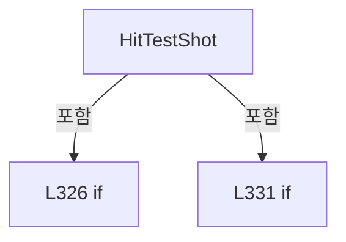

변경 전 점검: 입력/반환 타입, 위 호출자, 예외/취소 경로, 공유 상태와 저장·전송 소비자를 함께 확인합니다. 값의 단위나 물리 방향을 이름만으로 확정하지 않습니다.

### MethodDeclaration `GetPen` · L338–354

[Drilling.UI/Views/CReviewShotMapControl.cs:338–354](https://github.com/kjuws10-rgb/A3Drilling/blob/0219666f9053b907d96d7e0aa7d0c6c1be3a73d4/Drilling.UI/Views/CReviewShotMapControl.cs#L338-L354)

| 항목 | 실제 추출 값 |
| --- | --- |
| 서명 | Pen Drilling.UI.Views.CReviewShotMapControl.GetPen(Brush, double) |
| 접근/수식자 | Private / private |
| 반환/값 타입 | Pen |
| 소속 타입 | NamedType:Drilling.UI.Views.CReviewShotMapControl |

입력 계약:

| 이름 | 타입 | 전달 | 선택/기본값 |
| --- | --- | --- | --- |
| brush | Brush | None | False /  |
| thickness | double | None | False /  |

정적 호출자로 확인된 위치:

| 호출 파일/행 | 호출 표현식 | 런타임 분기 가능 |
| --- | --- | --- |
| [Drilling.UI/Views/CReviewShotMapControl.cs:290–290](https://github.com/kjuws10-rgb/A3Drilling/blob/0219666f9053b907d96d7e0aa7d0c6c1be3a73d4/Drilling.UI/Views/CReviewShotMapControl.cs#L290-L290) | GetPen | False |
| [Drilling.UI/Views/CReviewShotMapControl.cs:310–310](https://github.com/kjuws10-rgb/A3Drilling/blob/0219666f9053b907d96d7e0aa7d0c6c1be3a73d4/Drilling.UI/Views/CReviewShotMapControl.cs#L310-L310) | GetPen | False |
| [Drilling.UI/Views/CReviewShotMapControl.cs:312–312](https://github.com/kjuws10-rgb/A3Drilling/blob/0219666f9053b907d96d7e0aa7d0c6c1be3a73d4/Drilling.UI/Views/CReviewShotMapControl.cs#L312-L312) | GetPen | False |
| [Drilling.UI/Views/CReviewShotMapControl.cs:319–319](https://github.com/kjuws10-rgb/A3Drilling/blob/0219666f9053b907d96d7e0aa7d0c6c1be3a73d4/Drilling.UI/Views/CReviewShotMapControl.cs#L319-L319) | GetPen | False |

호출하는 대상과 해석 범위:

| 원본 행 | 표현식 | 분석 상태 | 대상/소스 위치 |
| --- | --- | --- | --- |
| 340 | _pens.TryGetValue | resolved | bool System.Collections.Generic.Dictionary<Brush, System.Collections.Generic.Dictionary<double, Pen>>.TryGetValue(Brush, out System.Collections.Generic.Dictionary<double, Pen>) |
| 343 | _pens.Add | resolved | void System.Collections.Generic.Dictionary<Brush, System.Collections.Generic.Dictionary<double, Pen>>.Add(Brush, System.Collections.Generic.Dictionary<double, Pen>) |
| 346 | byThickness.TryGetValue | resolved | bool System.Collections.Generic.Dictionary<double, Pen>.TryGetValue(double, out Pen) |
| 349 | new Pen | unresolved | None |
| 351 | pen.Freeze | unresolved | None |
| 352 | byThickness.Add | resolved | void System.Collections.Generic.Dictionary<double, Pen>.Add(double, Pen) |

본문의 실제 연산·분기·예외·반환 순서(원문 위치 순):

| 원본 행 | 종류 | 주석 해설 |
| --- | --- | --- |
| 340 | call | 함수·델리게이트 또는 객체 생성자를 호출합니다: _pens.TryGetValue(brush, out var byThickness) |
| 340 | if | 조건에 따라 분기합니다: if (!_pens.TryGetValue(brush, out var byThickness)) |
| 342 | assignment | 값을 대상에 대입합니다: byThickness = [] |
| 343 | call | 함수·델리게이트 또는 객체 생성자를 호출합니다: _pens.Add(brush, byThickness) |
| 346 | call | 함수·델리게이트 또는 객체 생성자를 호출합니다: byThickness.TryGetValue(thickness, out var pen) |
| 346 | if | 조건에 따라 분기합니다: if (byThickness.TryGetValue(thickness, out var pen)) |
| 347 | return | 호출자에게 값 또는 제어를 반환합니다: return pen; |
| 349 | assignment | 값을 대상에 대입합니다: pen = new Pen(brush, thickness) |
| 349 | call | 함수·델리게이트 또는 객체 생성자를 호출합니다: new Pen(brush, thickness) |
| 350 | if | 조건에 따라 분기합니다: if (pen.CanFreeze) |
| 351 | call | 함수·델리게이트 또는 객체 생성자를 호출합니다: pen.Freeze() |
| 352 | call | 함수·델리게이트 또는 객체 생성자를 호출합니다: byThickness.Add(thickness, pen) |
| 353 | return | 호출자에게 값 또는 제어를 반환합니다: return pen; |

제어 구문의 포함 구조(실제 실행 순서/CFG가 아닌 구문 탐색 그림):

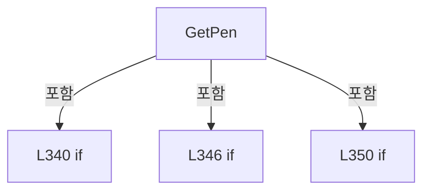

변경 전 점검: 입력/반환 타입, 위 호출자, 예외/취소 경로, 공유 상태와 저장·전송 소비자를 함께 확인합니다. 값의 단위나 물리 방향을 이름만으로 확정하지 않습니다.

### MethodDeclaration `FrozenBrush` · L356–356

[Drilling.UI/Views/CReviewShotMapControl.cs:356–356](https://github.com/kjuws10-rgb/A3Drilling/blob/0219666f9053b907d96d7e0aa7d0c6c1be3a73d4/Drilling.UI/Views/CReviewShotMapControl.cs#L356-L356)

| 항목 | 실제 추출 값 |
| --- | --- |
| 서명 | Brush Drilling.UI.Views.CReviewShotMapControl.FrozenBrush(byte, byte, byte) |
| 접근/수식자 | Private / private, static |
| 반환/값 타입 | Brush |
| 소속 타입 | NamedType:Drilling.UI.Views.CReviewShotMapControl |

입력 계약:

| 이름 | 타입 | 전달 | 선택/기본값 |
| --- | --- | --- | --- |
| red | byte | None | False /  |
| green | byte | None | False /  |
| blue | byte | None | False /  |

정적 호출자로 확인된 위치:

| 호출 파일/행 | 호출 표현식 | 런타임 분기 가능 |
| --- | --- | --- |
| [Drilling.UI/Views/CReviewShotMapControl.cs:19–19](https://github.com/kjuws10-rgb/A3Drilling/blob/0219666f9053b907d96d7e0aa7d0c6c1be3a73d4/Drilling.UI/Views/CReviewShotMapControl.cs#L19-L19) | FrozenBrush | False |
| [Drilling.UI/Views/CReviewShotMapControl.cs:20–20](https://github.com/kjuws10-rgb/A3Drilling/blob/0219666f9053b907d96d7e0aa7d0c6c1be3a73d4/Drilling.UI/Views/CReviewShotMapControl.cs#L20-L20) | FrozenBrush | False |
| [Drilling.UI/Views/CReviewShotMapControl.cs:21–21](https://github.com/kjuws10-rgb/A3Drilling/blob/0219666f9053b907d96d7e0aa7d0c6c1be3a73d4/Drilling.UI/Views/CReviewShotMapControl.cs#L21-L21) | FrozenBrush | False |
| [Drilling.UI/Views/CReviewShotMapControl.cs:22–22](https://github.com/kjuws10-rgb/A3Drilling/blob/0219666f9053b907d96d7e0aa7d0c6c1be3a73d4/Drilling.UI/Views/CReviewShotMapControl.cs#L22-L22) | FrozenBrush | False |
| [Drilling.UI/Views/CReviewShotMapControl.cs:23–23](https://github.com/kjuws10-rgb/A3Drilling/blob/0219666f9053b907d96d7e0aa7d0c6c1be3a73d4/Drilling.UI/Views/CReviewShotMapControl.cs#L23-L23) | FrozenBrush | False |
| [Drilling.UI/Views/CReviewShotMapControl.cs:24–24](https://github.com/kjuws10-rgb/A3Drilling/blob/0219666f9053b907d96d7e0aa7d0c6c1be3a73d4/Drilling.UI/Views/CReviewShotMapControl.cs#L24-L24) | FrozenBrush | False |
| [Drilling.UI/Views/CReviewShotMapControl.cs:25–25](https://github.com/kjuws10-rgb/A3Drilling/blob/0219666f9053b907d96d7e0aa7d0c6c1be3a73d4/Drilling.UI/Views/CReviewShotMapControl.cs#L25-L25) | FrozenBrush | False |
| [Drilling.UI/Views/CReviewShotMapControl.cs:27–27](https://github.com/kjuws10-rgb/A3Drilling/blob/0219666f9053b907d96d7e0aa7d0c6c1be3a73d4/Drilling.UI/Views/CReviewShotMapControl.cs#L27-L27) | FrozenBrush | False |

호출하는 대상과 해석 범위:

| 원본 행 | 표현식 | 분석 상태 | 대상/소스 위치 |
| --- | --- | --- | --- |
| 356 | FrozenBrush | resolved | Brush Drilling.UI.Views.CReviewShotMapControl.FrozenBrush(byte, byte, byte, byte) · Drilling.UI/Views/CReviewShotMapControl.cs:358 |

본문의 실제 연산·분기·예외·반환 순서(원문 위치 순):

| 원본 행 | 종류 | 주석 해설 |
| --- | --- | --- |
| 356 | call | 함수·델리게이트 또는 객체 생성자를 호출합니다: FrozenBrush(0xFF, red, green, blue) |

변경 전 점검: 입력/반환 타입, 위 호출자, 예외/취소 경로, 공유 상태와 저장·전송 소비자를 함께 확인합니다. 값의 단위나 물리 방향을 이름만으로 확정하지 않습니다.

### MethodDeclaration `FrozenBrush` · L358–363

[Drilling.UI/Views/CReviewShotMapControl.cs:358–363](https://github.com/kjuws10-rgb/A3Drilling/blob/0219666f9053b907d96d7e0aa7d0c6c1be3a73d4/Drilling.UI/Views/CReviewShotMapControl.cs#L358-L363)

| 항목 | 실제 추출 값 |
| --- | --- |
| 서명 | Brush Drilling.UI.Views.CReviewShotMapControl.FrozenBrush(byte, byte, byte, byte) |
| 접근/수식자 | Private / private, static |
| 반환/값 타입 | Brush |
| 소속 타입 | NamedType:Drilling.UI.Views.CReviewShotMapControl |

입력 계약:

| 이름 | 타입 | 전달 | 선택/기본값 |
| --- | --- | --- | --- |
| alpha | byte | None | False /  |
| red | byte | None | False /  |
| green | byte | None | False /  |
| blue | byte | None | False /  |

정적 호출자로 확인된 위치:

| 호출 파일/행 | 호출 표현식 | 런타임 분기 가능 |
| --- | --- | --- |
| [Drilling.UI/Views/CReviewShotMapControl.cs:26–26](https://github.com/kjuws10-rgb/A3Drilling/blob/0219666f9053b907d96d7e0aa7d0c6c1be3a73d4/Drilling.UI/Views/CReviewShotMapControl.cs#L26-L26) | FrozenBrush | False |
| [Drilling.UI/Views/CReviewShotMapControl.cs:356–356](https://github.com/kjuws10-rgb/A3Drilling/blob/0219666f9053b907d96d7e0aa7d0c6c1be3a73d4/Drilling.UI/Views/CReviewShotMapControl.cs#L356-L356) | FrozenBrush | False |

호출하는 대상과 해석 범위:

| 원본 행 | 표현식 | 분석 상태 | 대상/소스 위치 |
| --- | --- | --- | --- |
| 360 | new SolidColorBrush | unresolved | None |
| 360 | Color.FromArgb | unresolved | None |
| 361 | brush.Freeze | unresolved | None |

본문의 실제 연산·분기·예외·반환 순서(원문 위치 순):

| 원본 행 | 종류 | 주석 해설 |
| --- | --- | --- |
| 360 | call | 함수·델리게이트 또는 객체 생성자를 호출합니다: new SolidColorBrush(Color.FromArgb(alpha, red, green, blue)) |
| 360 | call | 함수·델리게이트 또는 객체 생성자를 호출합니다: Color.FromArgb(alpha, red, green, blue) |
| 360 | local-declaration | 지역 변수를 선언합니다: var brush = new SolidColorBrush(Color.FromArgb(alpha, red, green, blue)); |
| 360 | variable-initializer | 변수의 초기값을 지정합니다: brush = new SolidColorBrush(Color.FromArgb(alpha, red, green, blue)) |
| 361 | call | 함수·델리게이트 또는 객체 생성자를 호출합니다: brush.Freeze() |
| 362 | return | 호출자에게 값 또는 제어를 반환합니다: return brush; |

변경 전 점검: 입력/반환 타입, 위 호출자, 예외/취소 경로, 공유 상태와 저장·전송 소비자를 함께 확인합니다. 값의 단위나 물리 방향을 이름만으로 확정하지 않습니다.

## 구문·바인딩 한계

전체 WPF/벤더 SDK/프로젝트별 빌드 조건을 로드한 정식 빌드가 아닙니다. `resolved`는 이 부분 컴파일에서의 심볼 연결이며 virtual/interface/delegate/이벤트/Reflection/XAML의 실제 런타임 구현을 확정하지 않습니다. `candidate`와 `unresolved`는 후속 확인 대상으로 남깁니다.

## 원문 전체 주석 해설본

[원본 모든 행과 행별 해설 보기](../../../annotated/Drilling.UI/Views/CReviewShotMapControl.cs.annotated.txt)

원본을 빠뜨리거나 임의로 줄이지 않았습니다. `L000001 |` 표시는 원본 행 번호, `// 해설`은 별도 설명입니다. 실행용 소스가 아닌 문서입니다.

## 수정·재검증 체크

- 원본 Commit과 현재 작업 파일 SHA가 같은지 먼저 확인합니다. 다르면 이 문서를 과거 버전 자료로 취급합니다.
- 선언·직접 호출·이벤트/인터페이스 경계·설정 소비를 함께 확인합니다. 정적 연결의 빈 곳을 정상 경로로 추정하지 않습니다.
- 저장 형식/단위/식별자·재시도·취소·예외·롤백에 영향을 주는 변경은 상세 해설장과 호출자를 다시 검토합니다.
- 도구의 구문 추출과 별도 정적 추적 해설, 실제 빌드·시뮬레이션·실장비 검증 결과를 분리합니다.
