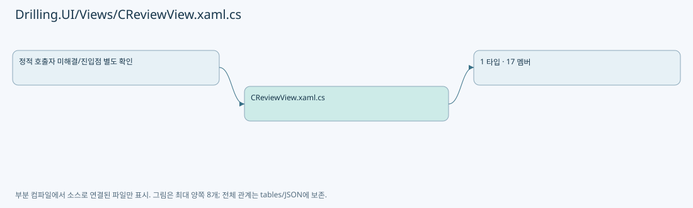
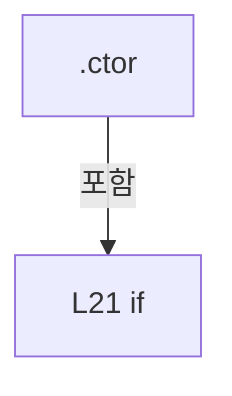
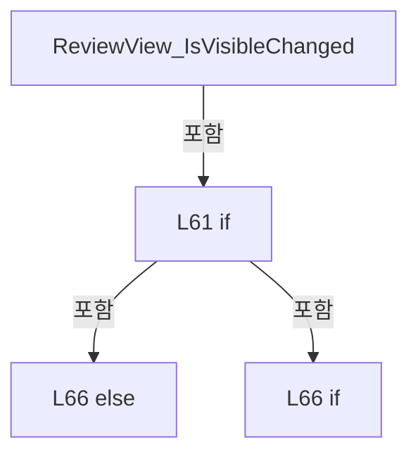
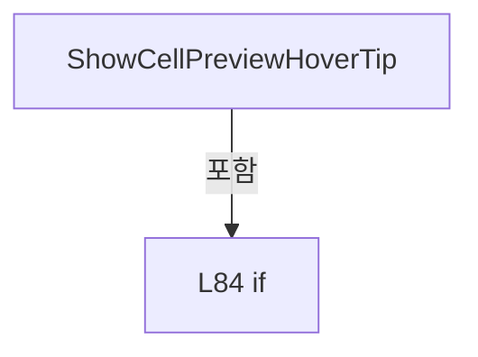
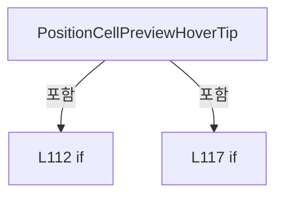
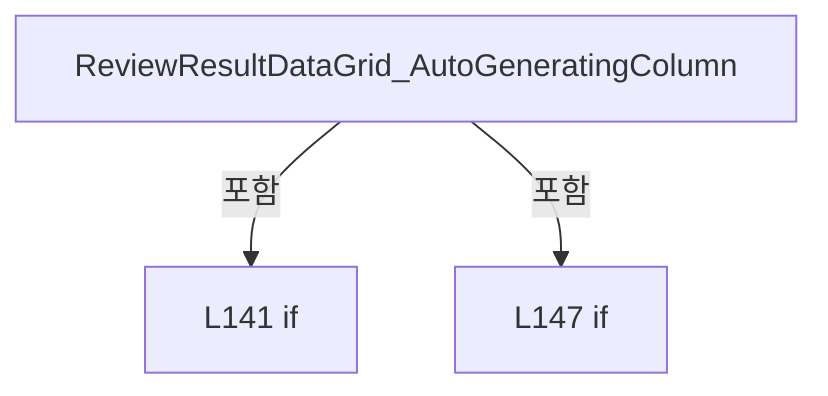

# Drilling.UI/Views/CReviewView.xaml.cs

| 항목 | 내용 |
| --- | --- |
| 원본 저장소 | https://github.com/kjuws10-rgb/A3Drilling.git |
| 원본 Commit | 5aee8e58439c9b455cae7c9593c9be986c3e682e |
| 원본 SHA256 | 0ab06bd9f08351e557d249886da47b070add6ee80358b08fb7ef3da76da0268d |
| 파일 분류 | code |
| 원본 크기/행 | 4,849 bytes / 153 physical lines |
| 인코딩 | utf-8-sig |
| 검토 범위 | 구문/부분 의미 분석에서 추출한 사실. 동작·물리 단위·실장비 합격을 보증하지 않습니다. |
| 원본 링크 | [고정 Commit 원본](https://github.com/kjuws10-rgb/A3Drilling/blob/5aee8e58439c9b455cae7c9593c9be986c3e682e/Drilling.UI/Views/CReviewView.xaml.cs) |

## 파일의 역할과 읽는 순서

WPF 화면·사용자 명령·표시 상태를 구성합니다. XAML 이벤트와 코드 비하인드, RootView의 조립 경로를 함께 추적합니다.

## 네임스페이스·타입·상속

| 타입 | 구분 | 원본 범위 | 선언/상속 |
| --- | --- | --- | --- |
| CReviewView | ClassDeclaration | 10–153 | CReviewView: UserControl |

## 멤버 빠른 목록

| 이름 | 종류 | 범위 | 서명 |
| --- | --- | --- | --- |
| ReviewMenuProperty | FieldDeclaration | L12–13 | DependencyProperty Drilling.UI.Views.CReviewView.ReviewMenuProperty |
| ReviewMenu | PropertyDeclaration | L14–14 | Drilling.UI.Menu.Menus.CMenuReview? Drilling.UI.Views.CReviewView.ReviewMenu |
| get_ReviewMenu | GetAccessorDeclaration | L14–14 | Drilling.UI.Menu.Menus.CMenuReview? Drilling.UI.Views.CReviewView.ReviewMenu.get |
| set_ReviewMenu | SetAccessorDeclaration | L14–14 | void Drilling.UI.Views.CReviewView.ReviewMenu.set |
| _cameraTimer | FieldDeclaration | L15–15 | DispatcherTimer Drilling.UI.Views.CReviewView._cameraTimer |
| .ctor | ConstructorDeclaration | L16–23 | Drilling.UI.Views.CReviewView.CReviewView() |
| ReviewPreview_SizeChanged | MethodDeclaration | L25–25 | void Drilling.UI.Views.CReviewView.ReviewPreview_SizeChanged(object, SizeChangedEventArgs) |
| RefreshCamera | MethodDeclaration | L26–29 | void Drilling.UI.Views.CReviewView.RefreshCamera() |
| RunCellPreviewLabel_MouseMove | MethodDeclaration | L31–47 | void Drilling.UI.Views.CReviewView.RunCellPreviewLabel_MouseMove(object, MouseEventArgs) |
| RunCellPreviewLabel_MouseLeave | MethodDeclaration | L49–52 | void Drilling.UI.Views.CReviewView.RunCellPreviewLabel_MouseLeave(object, MouseEventArgs) |
| CellPreviewLabel_PreviewMouseLeftButtonDown | MethodDeclaration | L54–57 | void Drilling.UI.Views.CReviewView.CellPreviewLabel_PreviewMouseLeftButtonDown(object, MouseButtonEventArgs) |
| ReviewView_IsVisibleChanged | MethodDeclaration | L59–67 | void Drilling.UI.Views.CReviewView.ReviewView_IsVisibleChanged(object, DependencyPropertyChangedEventArgs) |
| ShowCellPreviewHoverTip | MethodDeclaration | L69–97 | void Drilling.UI.Views.CReviewView.ShowCellPreviewHoverTip(object, MouseEventArgs, FrameworkElement, Border, TextBlock, TranslateTransform) |
| PositionCellPreviewHoverTip | MethodDeclaration | L99–124 | void Drilling.UI.Views.CReviewView.PositionCellPreviewHoverTip(Point, FrameworkElement, FrameworkElement, TranslateTransform) |
| HideCellPreviewHoverTip | MethodDeclaration | L126–130 | void Drilling.UI.Views.CReviewView.HideCellPreviewHoverTip(Border, TextBlock) |
| HideCellPreviewHoverTips | MethodDeclaration | L132–135 | void Drilling.UI.Views.CReviewView.HideCellPreviewHoverTips() |
| ReviewResultDataGrid_AutoGeneratingColumn | MethodDeclaration | L137–151 | void Drilling.UI.Views.CReviewView.ReviewResultDataGrid_AutoGeneratingColumn(object?, DataGridAutoGeneratingColumnEventArgs) |

## 멤버별 상세 계약·호출·처리 해설

### FieldDeclaration `ReviewMenuProperty` · L12–13

[Drilling.UI/Views/CReviewView.xaml.cs:12–13](https://github.com/kjuws10-rgb/A3Drilling/blob/5aee8e58439c9b455cae7c9593c9be986c3e682e/Drilling.UI/Views/CReviewView.xaml.cs#L12-L13)

| 항목 | 실제 추출 값 |
| --- | --- |
| 서명 | DependencyProperty Drilling.UI.Views.CReviewView.ReviewMenuProperty |
| 접근/수식자 | Public / public, static, readonly |
| 반환/값 타입 | DependencyProperty |
| 소속 타입 | NamedType:Drilling.UI.Views.CReviewView |

현재 부분 분석에서 직접 연결된 호출자는 없습니다. XAML/이벤트/인터페이스·델리게이트·외부 진입을 추가 확인해야 하며, 미사용으로 판정한 것이 아닙니다.

호출하는 대상과 해석 범위:

| 원본 행 | 표현식 | 분석 상태 | 대상/소스 위치 |
| --- | --- | --- | --- |
| 12 | DependencyProperty.Register | unresolved | None |
| 13 | nameof | unresolved | None |

본문의 실제 연산·분기·예외·반환 순서(원문 위치 순):

| 원본 행 | 종류 | 주석 해설 |
| --- | --- | --- |
| 12 | call | 함수·델리게이트 또는 객체 생성자를 호출합니다: DependencyProperty.Register( nameof(ReviewMenu), typeof(CMenuReview), typeof(CReviewView)) |
| 12 | variable-initializer | 변수의 초기값을 지정합니다: ReviewMenuProperty = DependencyProperty.Register( nameof(ReviewMenu), typeof(CMenuReview), typeof(CReviewView)) |
| 13 | call | 함수·델리게이트 또는 객체 생성자를 호출합니다: nameof(ReviewMenu) |

변경 전 점검: 입력/반환 타입, 위 호출자, 예외/취소 경로, 공유 상태와 저장·전송 소비자를 함께 확인합니다. 값의 단위나 물리 방향을 이름만으로 확정하지 않습니다.

### PropertyDeclaration `ReviewMenu` · L14–14

[Drilling.UI/Views/CReviewView.xaml.cs:14–14](https://github.com/kjuws10-rgb/A3Drilling/blob/5aee8e58439c9b455cae7c9593c9be986c3e682e/Drilling.UI/Views/CReviewView.xaml.cs#L14-L14)

| 항목 | 실제 추출 값 |
| --- | --- |
| 서명 | Drilling.UI.Menu.Menus.CMenuReview? Drilling.UI.Views.CReviewView.ReviewMenu |
| 접근/수식자 | Public / public |
| 반환/값 타입 | Drilling.UI.Menu.Menus.CMenuReview? |
| 소속 타입 | NamedType:Drilling.UI.Views.CReviewView |

현재 부분 분석에서 직접 연결된 호출자는 없습니다. XAML/이벤트/인터페이스·델리게이트·외부 진입을 추가 확인해야 하며, 미사용으로 판정한 것이 아닙니다.

변경 전 점검: 입력/반환 타입, 위 호출자, 예외/취소 경로, 공유 상태와 저장·전송 소비자를 함께 확인합니다. 값의 단위나 물리 방향을 이름만으로 확정하지 않습니다.

### GetAccessorDeclaration `get_ReviewMenu` · L14–14

[Drilling.UI/Views/CReviewView.xaml.cs:14–14](https://github.com/kjuws10-rgb/A3Drilling/blob/5aee8e58439c9b455cae7c9593c9be986c3e682e/Drilling.UI/Views/CReviewView.xaml.cs#L14-L14)

| 항목 | 실제 추출 값 |
| --- | --- |
| 서명 | Drilling.UI.Menu.Menus.CMenuReview? Drilling.UI.Views.CReviewView.ReviewMenu.get |
| 접근/수식자 | Public / get |
| 반환/값 타입 | Drilling.UI.Menu.Menus.CMenuReview? |
| 소속 타입 | NamedType:Drilling.UI.Views.CReviewView |

현재 부분 분석에서 직접 연결된 호출자는 없습니다. XAML/이벤트/인터페이스·델리게이트·외부 진입을 추가 확인해야 하며, 미사용으로 판정한 것이 아닙니다.

호출하는 대상과 해석 범위:

| 원본 행 | 표현식 | 분석 상태 | 대상/소스 위치 |
| --- | --- | --- | --- |
| 14 | GetValue | unresolved | None |

본문의 실제 연산·분기·예외·반환 순서(원문 위치 순):

| 원본 행 | 종류 | 주석 해설 |
| --- | --- | --- |
| 14 | call | 함수·델리게이트 또는 객체 생성자를 호출합니다: GetValue(ReviewMenuProperty) |

변경 전 점검: 입력/반환 타입, 위 호출자, 예외/취소 경로, 공유 상태와 저장·전송 소비자를 함께 확인합니다. 값의 단위나 물리 방향을 이름만으로 확정하지 않습니다.

### SetAccessorDeclaration `set_ReviewMenu` · L14–14

[Drilling.UI/Views/CReviewView.xaml.cs:14–14](https://github.com/kjuws10-rgb/A3Drilling/blob/5aee8e58439c9b455cae7c9593c9be986c3e682e/Drilling.UI/Views/CReviewView.xaml.cs#L14-L14)

| 항목 | 실제 추출 값 |
| --- | --- |
| 서명 | void Drilling.UI.Views.CReviewView.ReviewMenu.set |
| 접근/수식자 | Public / set |
| 반환/값 타입 | void |
| 소속 타입 | NamedType:Drilling.UI.Views.CReviewView |

입력 계약:

| 이름 | 타입 | 전달 | 선택/기본값 |
| --- | --- | --- | --- |
| value | Drilling.UI.Menu.Menus.CMenuReview? | None | False /  |

현재 부분 분석에서 직접 연결된 호출자는 없습니다. XAML/이벤트/인터페이스·델리게이트·외부 진입을 추가 확인해야 하며, 미사용으로 판정한 것이 아닙니다.

호출하는 대상과 해석 범위:

| 원본 행 | 표현식 | 분석 상태 | 대상/소스 위치 |
| --- | --- | --- | --- |
| 14 | SetValue | unresolved | None |

본문의 실제 연산·분기·예외·반환 순서(원문 위치 순):

| 원본 행 | 종류 | 주석 해설 |
| --- | --- | --- |
| 14 | call | 함수·델리게이트 또는 객체 생성자를 호출합니다: SetValue(ReviewMenuProperty, value) |

변경 전 점검: 입력/반환 타입, 위 호출자, 예외/취소 경로, 공유 상태와 저장·전송 소비자를 함께 확인합니다. 값의 단위나 물리 방향을 이름만으로 확정하지 않습니다.

### FieldDeclaration `_cameraTimer` · L15–15

[Drilling.UI/Views/CReviewView.xaml.cs:15–15](https://github.com/kjuws10-rgb/A3Drilling/blob/5aee8e58439c9b455cae7c9593c9be986c3e682e/Drilling.UI/Views/CReviewView.xaml.cs#L15-L15)

| 항목 | 실제 추출 값 |
| --- | --- |
| 서명 | DispatcherTimer Drilling.UI.Views.CReviewView._cameraTimer |
| 접근/수식자 | Private / private, readonly |
| 반환/값 타입 | DispatcherTimer |
| 소속 타입 | NamedType:Drilling.UI.Views.CReviewView |

현재 부분 분석에서 직접 연결된 호출자는 없습니다. XAML/이벤트/인터페이스·델리게이트·외부 진입을 추가 확인해야 하며, 미사용으로 판정한 것이 아닙니다.

호출하는 대상과 해석 범위:

| 원본 행 | 표현식 | 분석 상태 | 대상/소스 위치 |
| --- | --- | --- | --- |
| 15 | new | unresolved | None |
| 15 | TimeSpan.FromMilliseconds | resolved | System.TimeSpan System.TimeSpan.FromMilliseconds(long) |

본문의 실제 연산·분기·예외·반환 순서(원문 위치 순):

| 원본 행 | 종류 | 주석 해설 |
| --- | --- | --- |
| 15 | assignment | 값을 대상에 대입합니다: Interval = TimeSpan.FromMilliseconds(200) |
| 15 | call | 함수·델리게이트 또는 객체 생성자를 호출합니다: new(DispatcherPriority.Background) { Interval = TimeSpan.FromMilliseconds(200) } |
| 15 | call | 함수·델리게이트 또는 객체 생성자를 호출합니다: TimeSpan.FromMilliseconds(200) |
| 15 | variable-initializer | 변수의 초기값을 지정합니다: _cameraTimer = new(DispatcherPriority.Background) { Interval = TimeSpan.FromMilliseconds(200) } |

변경 전 점검: 입력/반환 타입, 위 호출자, 예외/취소 경로, 공유 상태와 저장·전송 소비자를 함께 확인합니다. 값의 단위나 물리 방향을 이름만으로 확정하지 않습니다.

### ConstructorDeclaration `.ctor` · L16–23

[Drilling.UI/Views/CReviewView.xaml.cs:16–23](https://github.com/kjuws10-rgb/A3Drilling/blob/5aee8e58439c9b455cae7c9593c9be986c3e682e/Drilling.UI/Views/CReviewView.xaml.cs#L16-L23)

| 항목 | 실제 추출 값 |
| --- | --- |
| 서명 | Drilling.UI.Views.CReviewView.CReviewView() |
| 접근/수식자 | Public / public |
| 반환/값 타입 | void |
| 소속 타입 | NamedType:Drilling.UI.Views.CReviewView |

현재 부분 분석에서 직접 연결된 호출자는 없습니다. XAML/이벤트/인터페이스·델리게이트·외부 진입을 추가 확인해야 하며, 미사용으로 판정한 것이 아닙니다.

호출하는 대상과 해석 범위:

| 원본 행 | 표현식 | 분석 상태 | 대상/소스 위치 |
| --- | --- | --- | --- |
| 18 | InitializeComponent | unresolved | None |
| 19 | SetBinding | unresolved | None |
| 19 | new Binding | unresolved | None |
| 20 | RefreshCamera | resolved | void Drilling.UI.Views.CReviewView.RefreshCamera() · Drilling.UI/Views/CReviewView.xaml.cs:26 |
| 21 | RefreshCamera | resolved | void Drilling.UI.Views.CReviewView.RefreshCamera() · Drilling.UI/Views/CReviewView.xaml.cs:26 |
| 21 | _cameraTimer.Start | unresolved | None |
| 22 | _cameraTimer.Stop | unresolved | None |

본문의 실제 연산·분기·예외·반환 순서(원문 위치 순):

| 원본 행 | 종류 | 주석 해설 |
| --- | --- | --- |
| 18 | call | 함수·델리게이트 또는 객체 생성자를 호출합니다: InitializeComponent() |
| 19 | call | 함수·델리게이트 또는 객체 생성자를 호출합니다: SetBinding(ReviewMenuProperty, new Binding("CurrentScreen.Review")) |
| 19 | call | 함수·델리게이트 또는 객체 생성자를 호출합니다: new Binding("CurrentScreen.Review") |
| 20 | call | 함수·델리게이트 또는 객체 생성자를 호출합니다: RefreshCamera() |
| 20 | compound-assignment-or-event-subscription | 복합 대입 또는 이벤트 구독/해지 표현입니다: _cameraTimer.Tick += (_, _) => RefreshCamera() |
| 21 | call | 함수·델리게이트 또는 객체 생성자를 호출합니다: RefreshCamera() |
| 21 | call | 함수·델리게이트 또는 객체 생성자를 호출합니다: _cameraTimer.Start() |
| 21 | compound-assignment-or-event-subscription | 복합 대입 또는 이벤트 구독/해지 표현입니다: Loaded += (_, _) => { RefreshCamera(); if (IsVisible) _cameraTimer.Start(); } |
| 21 | if | 조건에 따라 분기합니다: if (IsVisible) |
| 22 | call | 함수·델리게이트 또는 객체 생성자를 호출합니다: _cameraTimer.Stop() |
| 22 | compound-assignment-or-event-subscription | 복합 대입 또는 이벤트 구독/해지 표현입니다: Unloaded += (_, _) => _cameraTimer.Stop() |

제어 구문의 포함 구조(실제 실행 순서/CFG가 아닌 구문 탐색 그림):

변경 전 점검: 입력/반환 타입, 위 호출자, 예외/취소 경로, 공유 상태와 저장·전송 소비자를 함께 확인합니다. 값의 단위나 물리 방향을 이름만으로 확정하지 않습니다.

### MethodDeclaration `ReviewPreview_SizeChanged` · L25–25

[Drilling.UI/Views/CReviewView.xaml.cs:25–25](https://github.com/kjuws10-rgb/A3Drilling/blob/5aee8e58439c9b455cae7c9593c9be986c3e682e/Drilling.UI/Views/CReviewView.xaml.cs#L25-L25)

| 항목 | 실제 추출 값 |
| --- | --- |
| 서명 | void Drilling.UI.Views.CReviewView.ReviewPreview_SizeChanged(object, SizeChangedEventArgs) |
| 접근/수식자 | Private / private |
| 반환/값 타입 | void |
| 소속 타입 | NamedType:Drilling.UI.Views.CReviewView |

입력 계약:

| 이름 | 타입 | 전달 | 선택/기본값 |
| --- | --- | --- | --- |
| sender | object | None | False /  |
| e | SizeChangedEventArgs | None | False /  |

현재 부분 분석에서 직접 연결된 호출자는 없습니다. XAML/이벤트/인터페이스·델리게이트·외부 진입을 추가 확인해야 하며, 미사용으로 판정한 것이 아닙니다.

호출하는 대상과 해석 범위:

| 원본 행 | 표현식 | 분석 상태 | 대상/소스 위치 |
| --- | --- | --- | --- |
| 25 | RefreshCamera | resolved | void Drilling.UI.Views.CReviewView.RefreshCamera() · Drilling.UI/Views/CReviewView.xaml.cs:26 |

본문의 실제 연산·분기·예외·반환 순서(원문 위치 순):

| 원본 행 | 종류 | 주석 해설 |
| --- | --- | --- |
| 25 | call | 함수·델리게이트 또는 객체 생성자를 호출합니다: RefreshCamera() |

변경 전 점검: 입력/반환 타입, 위 호출자, 예외/취소 경로, 공유 상태와 저장·전송 소비자를 함께 확인합니다. 값의 단위나 물리 방향을 이름만으로 확정하지 않습니다.

### MethodDeclaration `RefreshCamera` · L26–29

[Drilling.UI/Views/CReviewView.xaml.cs:26–29](https://github.com/kjuws10-rgb/A3Drilling/blob/5aee8e58439c9b455cae7c9593c9be986c3e682e/Drilling.UI/Views/CReviewView.xaml.cs#L26-L29)

| 항목 | 실제 추출 값 |
| --- | --- |
| 서명 | void Drilling.UI.Views.CReviewView.RefreshCamera() |
| 접근/수식자 | Private / private |
| 반환/값 타입 | void |
| 소속 타입 | NamedType:Drilling.UI.Views.CReviewView |

정적 호출자로 확인된 위치:

| 호출 파일/행 | 호출 표현식 | 런타임 분기 가능 |
| --- | --- | --- |
| [Drilling.UI/Views/CReviewView.xaml.cs:20–20](https://github.com/kjuws10-rgb/A3Drilling/blob/5aee8e58439c9b455cae7c9593c9be986c3e682e/Drilling.UI/Views/CReviewView.xaml.cs#L20-L20) | RefreshCamera | False |
| [Drilling.UI/Views/CReviewView.xaml.cs:21–21](https://github.com/kjuws10-rgb/A3Drilling/blob/5aee8e58439c9b455cae7c9593c9be986c3e682e/Drilling.UI/Views/CReviewView.xaml.cs#L21-L21) | RefreshCamera | False |
| [Drilling.UI/Views/CReviewView.xaml.cs:25–25](https://github.com/kjuws10-rgb/A3Drilling/blob/5aee8e58439c9b455cae7c9593c9be986c3e682e/Drilling.UI/Views/CReviewView.xaml.cs#L25-L25) | RefreshCamera | False |
| [Drilling.UI/Views/CReviewView.xaml.cs:66–66](https://github.com/kjuws10-rgb/A3Drilling/blob/5aee8e58439c9b455cae7c9593c9be986c3e682e/Drilling.UI/Views/CReviewView.xaml.cs#L66-L66) | RefreshCamera | False |

호출하는 대상과 해석 범위:

| 원본 행 | 표현식 | 분석 상태 | 대상/소스 위치 |
| --- | --- | --- | --- |
| 28 | .RefreshCameraFeedback | candidate | OverloadResolutionFailure |

본문의 실제 연산·분기·예외·반환 순서(원문 위치 순):

| 원본 행 | 종류 | 주석 해설 |
| --- | --- | --- |
| 28 | call | 함수·델리게이트 또는 객체 생성자를 호출합니다: .RefreshCameraFeedback(RunGlassPreviewViewport.ActualWidth, RunGlassPreviewViewport.ActualHeight) |

변경 전 점검: 입력/반환 타입, 위 호출자, 예외/취소 경로, 공유 상태와 저장·전송 소비자를 함께 확인합니다. 값의 단위나 물리 방향을 이름만으로 확정하지 않습니다.

### MethodDeclaration `RunCellPreviewLabel_MouseMove` · L31–47

[Drilling.UI/Views/CReviewView.xaml.cs:31–47](https://github.com/kjuws10-rgb/A3Drilling/blob/5aee8e58439c9b455cae7c9593c9be986c3e682e/Drilling.UI/Views/CReviewView.xaml.cs#L31-L47)

| 항목 | 실제 추출 값 |
| --- | --- |
| 서명 | void Drilling.UI.Views.CReviewView.RunCellPreviewLabel_MouseMove(object, MouseEventArgs) |
| 접근/수식자 | Private / private |
| 반환/값 타입 | void |
| 소속 타입 | NamedType:Drilling.UI.Views.CReviewView |

입력 계약:

| 이름 | 타입 | 전달 | 선택/기본값 |
| --- | --- | --- | --- |
| sender | object | None | False /  |
| e | MouseEventArgs | None | False /  |

현재 부분 분석에서 직접 연결된 호출자는 없습니다. XAML/이벤트/인터페이스·델리게이트·외부 진입을 추가 확인해야 하며, 미사용으로 판정한 것이 아닙니다.

호출하는 대상과 해석 범위:

| 원본 행 | 표현식 | 분석 상태 | 대상/소스 위치 |
| --- | --- | --- | --- |
| 33 | ShowCellPreviewHoverTip | candidate | OverloadResolutionFailure |

본문의 실제 연산·분기·예외·반환 순서(원문 위치 순):

| 원본 행 | 종류 | 주석 해설 |
| --- | --- | --- |
| 33 | call | 함수·델리게이트 또는 객체 생성자를 호출합니다: ShowCellPreviewHoverTip( sender, e, RunGlassPreviewViewport, RunGlassPreviewHoverTip, RunGlassPreviewHoverTipText, RunGlassPreviewHoverTipTranslateTransform ) |

변경 전 점검: 입력/반환 타입, 위 호출자, 예외/취소 경로, 공유 상태와 저장·전송 소비자를 함께 확인합니다. 값의 단위나 물리 방향을 이름만으로 확정하지 않습니다.

### MethodDeclaration `RunCellPreviewLabel_MouseLeave` · L49–52

[Drilling.UI/Views/CReviewView.xaml.cs:49–52](https://github.com/kjuws10-rgb/A3Drilling/blob/5aee8e58439c9b455cae7c9593c9be986c3e682e/Drilling.UI/Views/CReviewView.xaml.cs#L49-L52)

| 항목 | 실제 추출 값 |
| --- | --- |
| 서명 | void Drilling.UI.Views.CReviewView.RunCellPreviewLabel_MouseLeave(object, MouseEventArgs) |
| 접근/수식자 | Private / private |
| 반환/값 타입 | void |
| 소속 타입 | NamedType:Drilling.UI.Views.CReviewView |

입력 계약:

| 이름 | 타입 | 전달 | 선택/기본값 |
| --- | --- | --- | --- |
| sender | object | None | False /  |
| e | MouseEventArgs | None | False /  |

현재 부분 분석에서 직접 연결된 호출자는 없습니다. XAML/이벤트/인터페이스·델리게이트·외부 진입을 추가 확인해야 하며, 미사용으로 판정한 것이 아닙니다.

호출하는 대상과 해석 범위:

| 원본 행 | 표현식 | 분석 상태 | 대상/소스 위치 |
| --- | --- | --- | --- |
| 51 | HideCellPreviewHoverTip | candidate | OverloadResolutionFailure |

본문의 실제 연산·분기·예외·반환 순서(원문 위치 순):

| 원본 행 | 종류 | 주석 해설 |
| --- | --- | --- |
| 51 | call | 함수·델리게이트 또는 객체 생성자를 호출합니다: HideCellPreviewHoverTip(RunGlassPreviewHoverTip, RunGlassPreviewHoverTipText) |

변경 전 점검: 입력/반환 타입, 위 호출자, 예외/취소 경로, 공유 상태와 저장·전송 소비자를 함께 확인합니다. 값의 단위나 물리 방향을 이름만으로 확정하지 않습니다.

### MethodDeclaration `CellPreviewLabel_PreviewMouseLeftButtonDown` · L54–57

[Drilling.UI/Views/CReviewView.xaml.cs:54–57](https://github.com/kjuws10-rgb/A3Drilling/blob/5aee8e58439c9b455cae7c9593c9be986c3e682e/Drilling.UI/Views/CReviewView.xaml.cs#L54-L57)

| 항목 | 실제 추출 값 |
| --- | --- |
| 서명 | void Drilling.UI.Views.CReviewView.CellPreviewLabel_PreviewMouseLeftButtonDown(object, MouseButtonEventArgs) |
| 접근/수식자 | Private / private |
| 반환/값 타입 | void |
| 소속 타입 | NamedType:Drilling.UI.Views.CReviewView |

입력 계약:

| 이름 | 타입 | 전달 | 선택/기본값 |
| --- | --- | --- | --- |
| sender | object | None | False /  |
| e | MouseButtonEventArgs | None | False /  |

현재 부분 분석에서 직접 연결된 호출자는 없습니다. XAML/이벤트/인터페이스·델리게이트·외부 진입을 추가 확인해야 하며, 미사용으로 판정한 것이 아닙니다.

호출하는 대상과 해석 범위:

| 원본 행 | 표현식 | 분석 상태 | 대상/소스 위치 |
| --- | --- | --- | --- |
| 56 | HideCellPreviewHoverTips | resolved | void Drilling.UI.Views.CReviewView.HideCellPreviewHoverTips() · Drilling.UI/Views/CReviewView.xaml.cs:132 |

본문의 실제 연산·분기·예외·반환 순서(원문 위치 순):

| 원본 행 | 종류 | 주석 해설 |
| --- | --- | --- |
| 56 | call | 함수·델리게이트 또는 객체 생성자를 호출합니다: HideCellPreviewHoverTips() |

변경 전 점검: 입력/반환 타입, 위 호출자, 예외/취소 경로, 공유 상태와 저장·전송 소비자를 함께 확인합니다. 값의 단위나 물리 방향을 이름만으로 확정하지 않습니다.

### MethodDeclaration `ReviewView_IsVisibleChanged` · L59–67

[Drilling.UI/Views/CReviewView.xaml.cs:59–67](https://github.com/kjuws10-rgb/A3Drilling/blob/5aee8e58439c9b455cae7c9593c9be986c3e682e/Drilling.UI/Views/CReviewView.xaml.cs#L59-L67)

| 항목 | 실제 추출 값 |
| --- | --- |
| 서명 | void Drilling.UI.Views.CReviewView.ReviewView_IsVisibleChanged(object, DependencyPropertyChangedEventArgs) |
| 접근/수식자 | Private / private |
| 반환/값 타입 | void |
| 소속 타입 | NamedType:Drilling.UI.Views.CReviewView |

입력 계약:

| 이름 | 타입 | 전달 | 선택/기본값 |
| --- | --- | --- | --- |
| sender | object | None | False /  |
| e | DependencyPropertyChangedEventArgs | None | False /  |

현재 부분 분석에서 직접 연결된 호출자는 없습니다. XAML/이벤트/인터페이스·델리게이트·외부 진입을 추가 확인해야 하며, 미사용으로 판정한 것이 아닙니다.

호출하는 대상과 해석 범위:

| 원본 행 | 표현식 | 분석 상태 | 대상/소스 위치 |
| --- | --- | --- | --- |
| 63 | HideCellPreviewHoverTips | resolved | void Drilling.UI.Views.CReviewView.HideCellPreviewHoverTips() · Drilling.UI/Views/CReviewView.xaml.cs:132 |
| 64 | _cameraTimer.Stop | unresolved | None |
| 66 | RefreshCamera | resolved | void Drilling.UI.Views.CReviewView.RefreshCamera() · Drilling.UI/Views/CReviewView.xaml.cs:26 |
| 66 | _cameraTimer.Start | unresolved | None |

본문의 실제 연산·분기·예외·반환 순서(원문 위치 순):

| 원본 행 | 종류 | 주석 해설 |
| --- | --- | --- |
| 61 | if | 조건에 따라 분기합니다: if (e.NewValue is false) |
| 63 | call | 함수·델리게이트 또는 객체 생성자를 호출합니다: HideCellPreviewHoverTips() |
| 64 | call | 함수·델리게이트 또는 객체 생성자를 호출합니다: _cameraTimer.Stop() |
| 66 | call | 함수·델리게이트 또는 객체 생성자를 호출합니다: RefreshCamera() |
| 66 | call | 함수·델리게이트 또는 객체 생성자를 호출합니다: _cameraTimer.Start() |
| 66 | else | 앞 조건이 거짓인 경로입니다: else |
| 66 | if | 조건에 따라 분기합니다: if (IsLoaded) |

제어 구문의 포함 구조(실제 실행 순서/CFG가 아닌 구문 탐색 그림):

변경 전 점검: 입력/반환 타입, 위 호출자, 예외/취소 경로, 공유 상태와 저장·전송 소비자를 함께 확인합니다. 값의 단위나 물리 방향을 이름만으로 확정하지 않습니다.

### MethodDeclaration `ShowCellPreviewHoverTip` · L69–97

[Drilling.UI/Views/CReviewView.xaml.cs:69–97](https://github.com/kjuws10-rgb/A3Drilling/blob/5aee8e58439c9b455cae7c9593c9be986c3e682e/Drilling.UI/Views/CReviewView.xaml.cs#L69-L97)

| 항목 | 실제 추출 값 |
| --- | --- |
| 서명 | void Drilling.UI.Views.CReviewView.ShowCellPreviewHoverTip(object, MouseEventArgs, FrameworkElement, Border, TextBlock, TranslateTransform) |
| 접근/수식자 | Private / private, static |
| 반환/값 타입 | void |
| 소속 타입 | NamedType:Drilling.UI.Views.CReviewView |

입력 계약:

| 이름 | 타입 | 전달 | 선택/기본값 |
| --- | --- | --- | --- |
| sender | object | None | False /  |
| e | MouseEventArgs | None | False /  |
| viewport | FrameworkElement | None | False /  |
| hoverTip | Border | None | False /  |
| hoverTipText | TextBlock | None | False /  |
| translateTransform | TranslateTransform | None | False /  |

현재 부분 분석에서 직접 연결된 호출자는 없습니다. XAML/이벤트/인터페이스·델리게이트·외부 진입을 추가 확인해야 하며, 미사용으로 판정한 것이 아닙니다.

호출하는 대상과 해석 범위:

| 원본 행 | 표현식 | 분석 상태 | 대상/소스 위치 |
| --- | --- | --- | --- |
| 86 | HideCellPreviewHoverTip | resolved | void Drilling.UI.Views.CReviewView.HideCellPreviewHoverTip(Border, TextBlock) · Drilling.UI/Views/CReviewView.xaml.cs:126 |
| 92 | PositionCellPreviewHoverTip | candidate | OverloadResolutionFailure |
| 93 | e.GetPosition | unresolved | None |

본문의 실제 연산·분기·예외·반환 순서(원문 위치 순):

| 원본 행 | 종류 | 주석 해설 |
| --- | --- | --- |
| 84 | if | 조건에 따라 분기합니다: if (sender is not FrameworkElement { DataContext: ST_CELL_PREVIEW_LABEL label }) |
| 86 | call | 함수·델리게이트 또는 객체 생성자를 호출합니다: HideCellPreviewHoverTip(hoverTip, hoverTipText) |
| 87 | return | 호출자에게 값 또는 제어를 반환합니다: return; |
| 90 | assignment | 값을 대상에 대입합니다: hoverTipText.Text = label.DisplayText |
| 91 | assignment | 값을 대상에 대입합니다: hoverTip.Visibility = Visibility.Visible |
| 92 | call | 함수·델리게이트 또는 객체 생성자를 호출합니다: PositionCellPreviewHoverTip( e.GetPosition(viewport), viewport, hoverTip, translateTransform) |
| 93 | call | 함수·델리게이트 또는 객체 생성자를 호출합니다: e.GetPosition(viewport) |

제어 구문의 포함 구조(실제 실행 순서/CFG가 아닌 구문 탐색 그림):

변경 전 점검: 입력/반환 타입, 위 호출자, 예외/취소 경로, 공유 상태와 저장·전송 소비자를 함께 확인합니다. 값의 단위나 물리 방향을 이름만으로 확정하지 않습니다.

### MethodDeclaration `PositionCellPreviewHoverTip` · L99–124

[Drilling.UI/Views/CReviewView.xaml.cs:99–124](https://github.com/kjuws10-rgb/A3Drilling/blob/5aee8e58439c9b455cae7c9593c9be986c3e682e/Drilling.UI/Views/CReviewView.xaml.cs#L99-L124)

| 항목 | 실제 추출 값 |
| --- | --- |
| 서명 | void Drilling.UI.Views.CReviewView.PositionCellPreviewHoverTip(Point, FrameworkElement, FrameworkElement, TranslateTransform) |
| 접근/수식자 | Private / private, static |
| 반환/값 타입 | void |
| 소속 타입 | NamedType:Drilling.UI.Views.CReviewView |

입력 계약:

| 이름 | 타입 | 전달 | 선택/기본값 |
| --- | --- | --- | --- |
| pointer | Point | None | False /  |
| viewport | FrameworkElement | None | False /  |
| hoverTip | FrameworkElement | None | False /  |
| translateTransform | TranslateTransform | None | False /  |

현재 부분 분석에서 직접 연결된 호출자는 없습니다. XAML/이벤트/인터페이스·델리게이트·외부 진입을 추가 확인해야 하며, 미사용으로 판정한 것이 아닙니다.

호출하는 대상과 해석 범위:

| 원본 행 | 표현식 | 분석 상태 | 대상/소스 위치 |
| --- | --- | --- | --- |
| 108 | hoverTip.Measure | unresolved | None |
| 108 | new Size | unresolved | None |
| 114 | Math.Clamp | candidate | OverloadResolutionFailure |
| 114 | Math.Max | candidate | OverloadResolutionFailure |
| 119 | Math.Clamp | candidate | OverloadResolutionFailure |
| 119 | Math.Max | candidate | OverloadResolutionFailure |

본문의 실제 연산·분기·예외·반환 순서(원문 위치 순):

| 원본 행 | 종류 | 주석 해설 |
| --- | --- | --- |
| 105 | local-declaration | 지역 변수를 선언합니다: const double margin = 4.0; |
| 105 | variable-initializer | 변수의 초기값을 지정합니다: margin = 4.0 |
| 106 | local-declaration | 지역 변수를 선언합니다: const double offsetX = 12.0; |
| 106 | variable-initializer | 변수의 초기값을 지정합니다: offsetX = 12.0 |
| 107 | local-declaration | 지역 변수를 선언합니다: const double offsetY = 14.0; |
| 107 | variable-initializer | 변수의 초기값을 지정합니다: offsetY = 14.0 |
| 108 | call | 함수·델리게이트 또는 객체 생성자를 호출합니다: hoverTip.Measure(new Size(double.PositiveInfinity, double.PositiveInfinity)) |
| 108 | call | 함수·델리게이트 또는 객체 생성자를 호출합니다: new Size(double.PositiveInfinity, double.PositiveInfinity) |
| 109 | local-declaration | 지역 변수를 선언합니다: var tipSize = hoverTip.DesiredSize; |
| 109 | variable-initializer | 변수의 초기값을 지정합니다: tipSize = hoverTip.DesiredSize |
| 110 | local-declaration | 지역 변수를 선언합니다: var x = pointer.X + offsetX; |
| 110 | variable-initializer | 변수의 초기값을 지정합니다: x = pointer.X + offsetX |
| 111 | local-declaration | 지역 변수를 선언합니다: var y = pointer.Y + offsetY; |
| 111 | variable-initializer | 변수의 초기값을 지정합니다: y = pointer.Y + offsetY |
| 112 | if | 조건에 따라 분기합니다: if (viewport.ActualWidth > 0) |
| 114 | assignment | 값을 대상에 대입합니다: x = Math.Clamp(x, margin, Math.Max(margin, viewport.ActualWidth - tipSize.Width - margin)) |
| 114 | call | 함수·델리게이트 또는 객체 생성자를 호출합니다: Math.Clamp(x, margin, Math.Max(margin, viewport.ActualWidth - tipSize.Width - margin)) |
| 114 | call | 함수·델리게이트 또는 객체 생성자를 호출합니다: Math.Max(margin, viewport.ActualWidth - tipSize.Width - margin) |
| 117 | if | 조건에 따라 분기합니다: if (viewport.ActualHeight > 0) |
| 119 | assignment | 값을 대상에 대입합니다: y = Math.Clamp(y, margin, Math.Max(margin, viewport.ActualHeight - tipSize.Height - margin)) |
| 119 | call | 함수·델리게이트 또는 객체 생성자를 호출합니다: Math.Clamp(y, margin, Math.Max(margin, viewport.ActualHeight - tipSize.Height - margin)) |
| 119 | call | 함수·델리게이트 또는 객체 생성자를 호출합니다: Math.Max(margin, viewport.ActualHeight - tipSize.Height - margin) |
| 122 | assignment | 값을 대상에 대입합니다: translateTransform.X = x |
| 123 | assignment | 값을 대상에 대입합니다: translateTransform.Y = y |

제어 구문의 포함 구조(실제 실행 순서/CFG가 아닌 구문 탐색 그림):

변경 전 점검: 입력/반환 타입, 위 호출자, 예외/취소 경로, 공유 상태와 저장·전송 소비자를 함께 확인합니다. 값의 단위나 물리 방향을 이름만으로 확정하지 않습니다.

### MethodDeclaration `HideCellPreviewHoverTip` · L126–130

[Drilling.UI/Views/CReviewView.xaml.cs:126–130](https://github.com/kjuws10-rgb/A3Drilling/blob/5aee8e58439c9b455cae7c9593c9be986c3e682e/Drilling.UI/Views/CReviewView.xaml.cs#L126-L130)

| 항목 | 실제 추출 값 |
| --- | --- |
| 서명 | void Drilling.UI.Views.CReviewView.HideCellPreviewHoverTip(Border, TextBlock) |
| 접근/수식자 | Private / private, static |
| 반환/값 타입 | void |
| 소속 타입 | NamedType:Drilling.UI.Views.CReviewView |

입력 계약:

| 이름 | 타입 | 전달 | 선택/기본값 |
| --- | --- | --- | --- |
| hoverTip | Border | None | False /  |
| hoverTipText | TextBlock | None | False /  |

정적 호출자로 확인된 위치:

| 호출 파일/행 | 호출 표현식 | 런타임 분기 가능 |
| --- | --- | --- |
| [Drilling.UI/Views/CReviewView.xaml.cs:86–86](https://github.com/kjuws10-rgb/A3Drilling/blob/5aee8e58439c9b455cae7c9593c9be986c3e682e/Drilling.UI/Views/CReviewView.xaml.cs#L86-L86) | HideCellPreviewHoverTip | False |

본문의 실제 연산·분기·예외·반환 순서(원문 위치 순):

| 원본 행 | 종류 | 주석 해설 |
| --- | --- | --- |
| 128 | assignment | 값을 대상에 대입합니다: hoverTip.Visibility = Visibility.Collapsed |
| 129 | assignment | 값을 대상에 대입합니다: hoverTipText.Text = "" |

변경 전 점검: 입력/반환 타입, 위 호출자, 예외/취소 경로, 공유 상태와 저장·전송 소비자를 함께 확인합니다. 값의 단위나 물리 방향을 이름만으로 확정하지 않습니다.

### MethodDeclaration `HideCellPreviewHoverTips` · L132–135

[Drilling.UI/Views/CReviewView.xaml.cs:132–135](https://github.com/kjuws10-rgb/A3Drilling/blob/5aee8e58439c9b455cae7c9593c9be986c3e682e/Drilling.UI/Views/CReviewView.xaml.cs#L132-L135)

| 항목 | 실제 추출 값 |
| --- | --- |
| 서명 | void Drilling.UI.Views.CReviewView.HideCellPreviewHoverTips() |
| 접근/수식자 | Private / private |
| 반환/값 타입 | void |
| 소속 타입 | NamedType:Drilling.UI.Views.CReviewView |

정적 호출자로 확인된 위치:

| 호출 파일/행 | 호출 표현식 | 런타임 분기 가능 |
| --- | --- | --- |
| [Drilling.UI/Views/CReviewView.xaml.cs:56–56](https://github.com/kjuws10-rgb/A3Drilling/blob/5aee8e58439c9b455cae7c9593c9be986c3e682e/Drilling.UI/Views/CReviewView.xaml.cs#L56-L56) | HideCellPreviewHoverTips | False |
| [Drilling.UI/Views/CReviewView.xaml.cs:63–63](https://github.com/kjuws10-rgb/A3Drilling/blob/5aee8e58439c9b455cae7c9593c9be986c3e682e/Drilling.UI/Views/CReviewView.xaml.cs#L63-L63) | HideCellPreviewHoverTips | False |

호출하는 대상과 해석 범위:

| 원본 행 | 표현식 | 분석 상태 | 대상/소스 위치 |
| --- | --- | --- | --- |
| 134 | HideCellPreviewHoverTip | candidate | OverloadResolutionFailure |

본문의 실제 연산·분기·예외·반환 순서(원문 위치 순):

| 원본 행 | 종류 | 주석 해설 |
| --- | --- | --- |
| 134 | call | 함수·델리게이트 또는 객체 생성자를 호출합니다: HideCellPreviewHoverTip(RunGlassPreviewHoverTip, RunGlassPreviewHoverTipText) |

변경 전 점검: 입력/반환 타입, 위 호출자, 예외/취소 경로, 공유 상태와 저장·전송 소비자를 함께 확인합니다. 값의 단위나 물리 방향을 이름만으로 확정하지 않습니다.

### MethodDeclaration `ReviewResultDataGrid_AutoGeneratingColumn` · L137–151

[Drilling.UI/Views/CReviewView.xaml.cs:137–151](https://github.com/kjuws10-rgb/A3Drilling/blob/5aee8e58439c9b455cae7c9593c9be986c3e682e/Drilling.UI/Views/CReviewView.xaml.cs#L137-L151)

| 항목 | 실제 추출 값 |
| --- | --- |
| 서명 | void Drilling.UI.Views.CReviewView.ReviewResultDataGrid_AutoGeneratingColumn(object?, DataGridAutoGeneratingColumnEventArgs) |
| 접근/수식자 | Private / private |
| 반환/값 타입 | void |
| 소속 타입 | NamedType:Drilling.UI.Views.CReviewView |

입력 계약:

| 이름 | 타입 | 전달 | 선택/기본값 |
| --- | --- | --- | --- |
| sender | object? | None | False /  |
| e | DataGridAutoGeneratingColumnEventArgs | None | False /  |

현재 부분 분석에서 직접 연결된 호출자는 없습니다. XAML/이벤트/인터페이스·델리게이트·외부 진입을 추가 확인해야 하며, 미사용으로 판정한 것이 아닙니다.

호출하는 대상과 해석 범위:

| 원본 행 | 표현식 | 분석 상태 | 대상/소스 위치 |
| --- | --- | --- | --- |
| 142 | e.PropertyName.Equals | unresolved | None |

본문의 실제 연산·분기·예외·반환 순서(원문 위치 순):

| 원본 행 | 종류 | 주석 해설 |
| --- | --- | --- |
| 141 | if | 조건에 따라 분기합니다: if (e.Column is not DataGridTextColumn textColumn &#124;&#124; e.PropertyName.Equals("LINE", StringComparison.OrdinalIgnoreCase)) |
| 142 | call | 함수·델리게이트 또는 객체 생성자를 호출합니다: e.PropertyName.Equals("LINE", StringComparison.OrdinalIgnoreCase) |
| 144 | return | 호출자에게 값 또는 제어를 반환합니다: return; |
| 147 | if | 조건에 따라 분기합니다: if (textColumn.Binding is Binding binding) |
| 149 | assignment | 값을 대상에 대입합니다: binding.StringFormat = "0.0000" |

제어 구문의 포함 구조(실제 실행 순서/CFG가 아닌 구문 탐색 그림):

변경 전 점검: 입력/반환 타입, 위 호출자, 예외/취소 경로, 공유 상태와 저장·전송 소비자를 함께 확인합니다. 값의 단위나 물리 방향을 이름만으로 확정하지 않습니다.

## 구문·바인딩 한계

전체 WPF/벤더 SDK/프로젝트별 빌드 조건을 로드한 정식 빌드가 아닙니다. `resolved`는 이 부분 컴파일에서의 심볼 연결이며 virtual/interface/delegate/이벤트/Reflection/XAML의 실제 런타임 구현을 확정하지 않습니다. `candidate`와 `unresolved`는 후속 확인 대상으로 남깁니다.

## 원문 전체 주석 해설본

[원본 모든 행과 행별 해설 보기](../../../annotated/Drilling.UI/Views/CReviewView.xaml.cs.annotated.txt)

원본을 빠뜨리거나 임의로 줄이지 않았습니다. `L000001 |` 표시는 원본 행 번호, `// 해설`은 별도 설명입니다. 실행용 소스가 아닌 문서입니다.

## 수정·재검증 체크

- 원본 Commit과 현재 작업 파일 SHA가 같은지 먼저 확인합니다. 다르면 이 문서를 과거 버전 자료로 취급합니다.
- 선언·직접 호출·이벤트/인터페이스 경계·설정 소비를 함께 확인합니다. 정적 연결의 빈 곳을 정상 경로로 추정하지 않습니다.
- 저장 형식/단위/식별자·재시도·취소·예외·롤백에 영향을 주는 변경은 상세 해설장과 호출자를 다시 검토합니다.
- 도구의 구문 추출과 별도 정적 추적 해설, 실제 빌드·시뮬레이션·실장비 검증 결과를 분리합니다.
