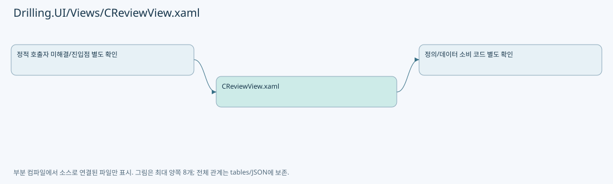

# Drilling.UI/Views/CReviewView.xaml

| 항목 | 내용 |
| --- | --- |
| 원본 저장소 | https://github.com/kjuws10-rgb/A3Drilling.git |
| 원본 Commit | 5aee8e58439c9b455cae7c9593c9be986c3e682e |
| 원본 SHA256 | 982f436a21e12fa74070dea3092b7fbdc4269feeb58cc487fee1996775525e07 |
| 파일 분류 | code |
| 원본 크기/행 | 94,045 bytes / 1,341 physical lines |
| 인코딩 | utf-8-sig |
| 검토 범위 | 구문/부분 의미 분석에서 추출한 사실. 동작·물리 단위·실장비 합격을 보증하지 않습니다. |
| 원본 링크 | [고정 Commit 원본](https://github.com/kjuws10-rgb/A3Drilling/blob/5aee8e58439c9b455cae7c9593c9be986c3e682e/Drilling.UI/Views/CReviewView.xaml) |

## 파일의 역할과 읽는 순서

WPF 화면·사용자 명령·표시 상태를 구성합니다. XAML 이벤트와 코드 비하인드, RootView의 조립 경로를 함께 추적합니다.

## 화면 구성과 코드 비하인드 연결

| 항목 | 추출 값 |
| --- | --- |
| 코드 비하인드 후보 | Drilling.UI/Views/CReviewView.xaml.cs |
| 이름 있는 요소 | ButtonChrome, ButtonContent, ItemBorder, ToggleButton, Shell, PART_Popup, ReviewCurrentShotBlink, OpenReviewCorrectionButton, ReviewHeadCards, RunGlassPreviewViewport, RunGlassPreviewHoverTip, RunGlassPreviewHoverTipTranslateTransform, RunGlassPreviewHoverTipText, ReviewBeamSelectionPanel, BeamInspectionRunCommands, BeamInspectionStartButton, BeamInspectionStopButton, BeamInspectionLoadCommands, OneShotActionPanel, OneShotSelectionText, OneShotMethodCombo, OneShotMoveButton, OneShotInspectionButton, OneShotMoveInspectionButton, OneShotStopButton, AllShotRunCommands, AllShotStartButton, AllShotStopButton, ReviewResultsPanel, OneShotResultText, ReviewResultGrid |
| 이벤트 개수 | 1 |
| Binding 표현 개수 | 154 |

| 이벤트 | 핸들러 이름 | 해석 |
| --- | --- | --- |
| MouseMove | RunCellPreviewLabel_MouseMove | 코드 비하인드/이벤트 라우팅에서 실제 연결 확인 필요 |

| Binding 표현 |
| --- |
| RelativeSource={RelativeSource Self |
| IsDropDownOpen, RelativeSource={RelativeSource TemplatedParent |
| SelectionBoxItem, RelativeSource={RelativeSource AncestorType=ComboBox |
| SelectionBoxItemTemplate, RelativeSource={RelativeSource AncestorType=ComboBox |
| SelectionBoxItemStringFormat, RelativeSource={RelativeSource AncestorType=ComboBox |
| ActualWidth, ElementName=ToggleButton |
| BackgroundBrush |
| BorderBrush |
| IsCurrent |
| IsSelected |
| DataContext.CurrentScreen.Review.IsBeamInspectionMode, RelativeSource={RelativeSource AncestorType=UserControl |
| Use |
| IsExcluded |
| ExclusionReason |
| CurrentScreen.Review.IsOneShotReviewMode |
| CurrentScreen.Review.IsRunTab, Converter={StaticResource BooleanToVisibilityConverter |
| CurrentScreen.Review.Modes |
| SelectCommand |
| Name |
| IsSelected |
| DisplayName |
| RelativeSource={RelativeSource AncestorType=Button |
| CurrentScreen.Review.OpenCorrectionReviewCommand |
| CurrentScreen.Review.TargetItems |
| Name |
| Value |
| Value |
| CurrentScreen.Review.RunWorkspaceTitle |
| CurrentScreen.Review.RunWorkspaceSummary |
| CurrentScreen.Review.IsBeamInspectionMode |
| CurrentScreen.Review.IsInspectionSelectionControlsVisible, Converter={StaticResource BooleanToVisibilityConverter |
| CurrentScreen.Review.ShowSelectedInspectionShotsCommand |
| CurrentScreen.Review.ClearInspectionShotsCommand |
| CurrentScreen.Review.InspectionHeadRows |
| CurrentScreen.Review.IsShotSelectionMode, Converter={StaticResource BooleanToVisibilityConverter |
| Summary |
| HasSelectedShots |
| Name |
| HasSelectedShots |
| CurrentScreen.Review.IsRunGlassPreviewVisible, Converter={StaticResource BooleanToVisibilityConverter |
| CurrentScreen.Review.RunGlassPreviewImage |
| CurrentScreen.Review.RunCellPreviewLabels |
| Width |
| Height |
| DataContext.CurrentScreen.Review.SelectRunCellCommand, RelativeSource={RelativeSource AncestorType=UserControl |
| CellNo |
| CurrentScreen.Review.RunGlassPreviewInspectionOverlayImage |
| CurrentScreen.Review.Camera |
| CurrentScreen.Review.IsRunCellDetailVisible, Converter={StaticResource BooleanToVisibilityConverter |
| CurrentScreen.Review.BackToRunGlassPreviewCommand |
| CurrentScreen.Review.IsRunShotMapVisible, Converter={StaticResource BooleanToVisibilityConverter |
| CurrentScreen.Review.BackToRunShotMapCommand |
| CurrentScreen.Review.IsRunBeamDetailVisible, Converter={StaticResource BooleanToVisibilityConverter |
| CurrentScreen.Review.RunCellShotMatrixRows |
| CurrentScreen.Review.IsRunShotMapVisible, Converter={StaticResource BooleanToVisibilityConverter |
| Shots |
| SelectCommand |
| ShotKey |
| ShowBeamPositionsCommand |
| ShotKey |
| ShotName |
| Foreground, RelativeSource={RelativeSource AncestorType=Button |
| Detail |
| StateBrush |
| IsSelected |
| DataContext.CurrentScreen.Review.IsBeamInspectionMode, RelativeSource={RelativeSource AncestorType=UserControl |
| CurrentScreen.Review.IsRunBeamDetailVisible, Converter={StaticResource BooleanToVisibilityConverter |
| CurrentScreen.Review.RunBeamRows |
| Beams |
| SelectCommand |
| BeamNo |
| BeamName |
| Detail |
| StateBrush |
| CurrentScreen.Review.IsAllShotReviewMode |
| ActualWidth, ElementName=ReviewBeamSelectionPanel |
| CurrentScreen.Review.IsBeamInspectionMode |
| CurrentScreen.Review.IsOneShotReviewMode |
| ActualWidth, ElementName=ReviewBeamSelectionPanel |
| CurrentScreen.Review.IsAllShotReviewMode |
| CurrentScreen.Review.IsBeamInspectionMode |
| CurrentScreen.Review.IsOneShotReviewMode |
| CurrentScreen.Review.IsBeamSelectionVisible, Converter={StaticResource BooleanToVisibilityConverter |
| CurrentScreen.Review.BeamSelectionSummary |
| CurrentScreen.Review.IsInspectionExecutionViewVisible, Converter={StaticResource BooleanToVisibilityConverter |
| CurrentScreen.Review.PreviousInspectionShotCommand |
| CurrentScreen.Review.InspectionShotSummary |
| CurrentScreen.Review.NextInspectionShotCommand |
| CurrentScreen.Review.InspectionProgressText |
| CurrentScreen.Review.InspectionProgressText |
| CurrentScreen.Review.IsBeamInspectionMode |
| ActualWidth, RelativeSource={RelativeSource Self |
| CurrentScreen.Review.RunBeamRows |
| CurrentScreen.Review.CanSelectBeam |
| Beams |
| SelectCommand |
| BeamNo |
| BackgroundBrush |
| BorderBrush |
| DataContext.CurrentScreen.Review.IsBeamInspectionMode, RelativeSource={RelativeSource AncestorType=UserControl |
| DataContext.CurrentScreen.Review.IsOneShotReviewMode, RelativeSource={RelativeSource AncestorType=UserControl |
| BeamName |
| TextBrush |
| DataContext.CurrentScreen.Review.IsBeamInspectionMode, RelativeSource={RelativeSource AncestorType=UserControl |
| DataContext.CurrentScreen.Review.IsOneShotReviewMode, RelativeSource={RelativeSource AncestorType=UserControl |
| DataContext.CurrentScreen.Review.IsOneShotReviewMode, RelativeSource={RelativeSource AncestorType=UserControl |
| TextBrush |
| TargetX, Mode=OneWay |
| TextBrush |
| TargetY, Mode=OneWay |
| DataContext.CurrentScreen.Review.IsInspectionExecutionViewVisible, RelativeSource={RelativeSource AncestorType=UserControl |
| InspectionStatus |
| TextBrush |
| InspectionResultText |
| TextBrush |
| CurrentScreen.Review.CanSelectBeam |
| CurrentScreen.Review.IsInspectionSelectionControlsVisible, Converter={StaticResource BooleanToVisibilityConverter |
| CurrentScreen.Review.SelectAllInspectionBeamsCommand |
| CurrentScreen.Review.ClearInspectionBeamsCommand |
| CurrentScreen.Review.IsBeamInspectionMode, Converter={StaticResource BooleanToVisibilityConverter |
| CurrentScreen.Review.StartCommand |
| CurrentScreen.Review.StopCommand |
| CurrentScreen.Review.LoadLastBeamInspectionResultCommand |
| CurrentScreen.Review.CanLoadBeamInspectionResult |
| CurrentScreen.Review.ClearLoadedBeamInspectionResultCommand |
| CurrentScreen.Review.CanClearLoadedBeamInspectionResult |
| CurrentScreen.Review.IsAllShotReviewMode, Converter={StaticResource BooleanToVisibilityConverter |
| CurrentScreen.Review.SelectedInspectionMethod |
| CurrentScreen.Review.InspectionMethodItems |
| CurrentScreen.Review.CanSelectInspectionMethod |
| SelectCommand |
| Name |
| BackgroundBrush |
| BorderBrush |
| DisplayName |
| TextBrush |
| CurrentScreen.Review.IsOneShotReviewMode, Converter={StaticResource BooleanToVisibilityConverter |
| CurrentScreen.Review.OneShotSelection |
| CurrentScreen.Review.OneShotMethods |
| CurrentScreen.Review.SelectedOneShotMethod, Mode=TwoWay, UpdateSourceTrigger=PropertyChanged |
| CurrentScreen.Review.CanSelectBeam |
| CurrentScreen.Review.OneShotActionCommand |
| CurrentScreen.Review.OneShotActionCommand |
| CurrentScreen.Review.OneShotActionCommand |
| CurrentScreen.Review.StopCommand |
| CurrentScreen.Review.CanStopOneShot |
| CurrentScreen.Review.IsAllShotReviewMode, Converter={StaticResource BooleanToVisibilityConverter |
| CurrentScreen.Review.StartCommand |
| CurrentScreen.Review.StopCommand |
| CurrentScreen.Review.IsRunTab, Converter={StaticResource BooleanToVisibilityConverter |
| CurrentScreen.Review.IsReviewResultDeferred, Converter={StaticResource BooleanToVisibilityConverter |
| CurrentScreen.Review.OneShotResultText |
| CurrentScreen.Review.IsOneShotReviewMode, Converter={StaticResource BooleanToVisibilityConverter |
| CurrentScreen.Review.ResultMatrix |

## 원문 전체 주석 해설본

[원본 모든 행과 행별 해설 보기](../../../annotated/Drilling.UI/Views/CReviewView.xaml.annotated.txt)

원본을 빠뜨리거나 임의로 줄이지 않았습니다. `L000001 |` 표시는 원본 행 번호, `// 해설`은 별도 설명입니다. 실행용 소스가 아닌 문서입니다.

## 수정·재검증 체크

- 원본 Commit과 현재 작업 파일 SHA가 같은지 먼저 확인합니다. 다르면 이 문서를 과거 버전 자료로 취급합니다.
- 선언·직접 호출·이벤트/인터페이스 경계·설정 소비를 함께 확인합니다. 정적 연결의 빈 곳을 정상 경로로 추정하지 않습니다.
- 저장 형식/단위/식별자·재시도·취소·예외·롤백에 영향을 주는 변경은 상세 해설장과 호출자를 다시 검토합니다.
- 도구의 구문 추출과 별도 정적 추적 해설, 실제 빌드·시뮬레이션·실장비 검증 결과를 분리합니다.
