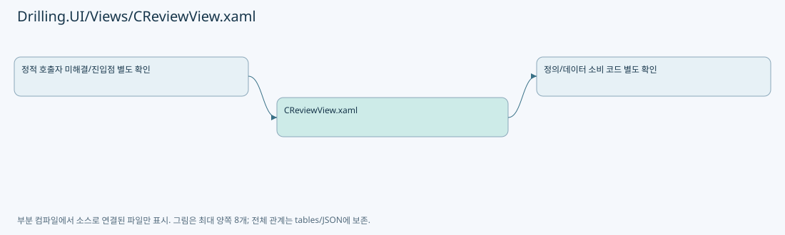

# Drilling.UI/Views/CReviewView.xaml

| 항목 | 내용 |
| --- | --- |
| 원본 저장소 | https://github.com/kjuws10-rgb/A3Drilling.git |
| 원본 Commit | dfa5920e6301d9ec4b0eab1452ae59521aafc986 |
| 원본 SHA256 | cf25ef28dc0b2c33f9ac69f56757e9c134f1a1da8a5bf647b255c62b7c511a97 |
| 파일 분류 | code |
| 원본 크기/행 | 96,904 bytes / 1,373 physical lines |
| 인코딩 | utf-8-sig |
| 검토 범위 | 구문/부분 의미 분석에서 추출한 사실. 동작·물리 단위·실장비 합격을 보증하지 않습니다. |
| 원본 링크 | [고정 Commit 원본](https://github.com/kjuws10-rgb/A3Drilling/blob/dfa5920e6301d9ec4b0eab1452ae59521aafc986/Drilling.UI/Views/CReviewView.xaml) |

## 파일의 역할과 읽는 순서

WPF 화면·사용자 명령·표시 상태를 구성합니다. XAML 이벤트와 코드 비하인드, RootView의 조립 경로를 함께 추적합니다.

## 화면 구성과 코드 비하인드 연결

| 항목 | 추출 값 |
| --- | --- |
| 코드 비하인드 후보 | Drilling.UI/Views/CReviewView.xaml.cs |
| 이름 있는 요소 | ButtonChrome, ButtonContent, ItemBorder, ToggleButton, Shell, PART_Popup, ReviewCurrentShotBlink, OpenReviewCorrectionButton, ReviewHeadCards, RunGlassPreviewViewport, RunGlassPreviewHoverTip, RunGlassPreviewHoverTipTranslateTransform, RunGlassPreviewHoverTipText, ReviewBeamSelectionPanel, BeamInspectionRunCommands, BeamInspectionStartButton, BeamInspectionStopButton, BeamInspectionLoadCommands, OneShotActionPanel, OneShotSelectionText, OneShotMethodCombo, OneShotMoveButton, OneShotInspectionButton, OneShotMoveInspectionButton, OneShotStopButton, AllShotRunCommands, AllShotStartButton, AllShotStopButton, ReviewResultsPanel, OneShotResultText, ReviewResultGrid |
| 이벤트 개수 | 5 |
| Binding 표현 개수 | 160 |

이름 있는 요소는 WPF가 필드를 생성할 수 있는 XAML 선언입니다. 문서 추출기는 WPF 생성 코드를 만들거나 로드하지 않으므로 C# 원문 멤버 수에 합산하지 않습니다.

| 요소 이름 | 원본 범위 |
| --- | --- |
| ButtonChrome | L141–141 |
| ButtonContent | L146–146 |
| ItemBorder | L233–233 |
| ToggleButton | L273–273 |
| Shell | L279–279 |
| PART_Popup | L318–318 |
| ReviewCurrentShotBlink | L379–379 |
| OpenReviewCorrectionButton | L536–536 |
| ReviewHeadCards | L649–649 |
| RunGlassPreviewViewport | L698–698 |
| RunGlassPreviewHoverTip | L727–727 |
| RunGlassPreviewHoverTipTranslateTransform | L739–739 |
| RunGlassPreviewHoverTipText | L741–741 |
| ReviewBeamSelectionPanel | L979–979 |
| BeamInspectionRunCommands | L1189–1189 |
| BeamInspectionStartButton | L1193–1193 |
| BeamInspectionStopButton | L1196–1196 |
| BeamInspectionLoadCommands | L1200–1200 |
| OneShotActionPanel | L1293–1293 |
| OneShotSelectionText | L1296–1296 |
| OneShotMethodCombo | L1299–1299 |
| OneShotMoveButton | L1304–1304 |
| OneShotInspectionButton | L1306–1306 |
| OneShotMoveInspectionButton | L1309–1309 |
| OneShotStopButton | L1311–1311 |
| AllShotRunCommands | L1318–1318 |
| AllShotStartButton | L1324–1324 |
| AllShotStopButton | L1327–1327 |
| ReviewResultsPanel | L1335–1335 |
| OneShotResultText | L1348–1348 |
| ReviewResultGrid | L1352–1352 |

| 이벤트 | 핸들러 이름 | 원본 범위 | 해석 |
| --- | --- | --- | --- |
| IsVisibleChanged | ReviewView_IsVisibleChanged | L9–9 | 코드 비하인드/이벤트 라우팅에서 실제 연결 확인 필요 |
| SizeChanged | ReviewPreview_SizeChanged | L698–698 | 코드 비하인드/이벤트 라우팅에서 실제 연결 확인 필요 |
| MouseMove | RunCellPreviewLabel_MouseMove | L713–713 | 코드 비하인드/이벤트 라우팅에서 실제 연결 확인 필요 |
| MouseLeave | RunCellPreviewLabel_MouseLeave | L714–714 | 코드 비하인드/이벤트 라우팅에서 실제 연결 확인 필요 |
| PreviewMouseLeftButtonDown | CellPreviewLabel_PreviewMouseLeftButtonDown | L715–715 | 코드 비하인드/이벤트 라우팅에서 실제 연결 확인 필요 |

| Binding 표현 | 원본 범위 |
| --- | --- |
| {Binding RelativeSource={RelativeSource Self}, Path=Tag} | L113–113 |
| {Binding IsDropDownOpen, RelativeSource={RelativeSource TemplatedParent}, Mode=TwoWay} | L276–276 |
| {Binding SelectionBoxItem, RelativeSource={RelativeSource AncestorType=ComboBox}} | L290–290 |
| {Binding SelectionBoxItemTemplate, RelativeSource={RelativeSource AncestorType=ComboBox}} | L291–291 |
| {Binding SelectionBoxItemStringFormat, RelativeSource={RelativeSource AncestorType=ComboBox}} | L292–292 |
| {Binding ActualWidth, ElementName=ToggleButton} | L327–327 |
| {Binding BackgroundBrush} | L347–347 |
| {Binding BorderBrush} | L348–348 |
| {Binding IsCurrent} | L376–376 |
| {Binding IsSelected} | L394–394 |
| {Binding DataContext.CurrentScreen.Review.IsShotSelectionMode, RelativeSource={RelativeSource AncestorType=UserControl}} | L395–395 |
| {Binding Use} | L430–430 |
| {Binding IsExcluded} | L448–448 |
| {Binding ExclusionReason} | L454–454 |
| {Binding CurrentScreen.Review.IsRunTab, Converter={StaticResource BooleanToVisibilityConverter}} | L478–478 |
| {Binding CurrentScreen.Review.Modes} | L503–503 |
| {Binding SelectCommand} | L511–511 |
| {Binding Name} | L512–512 |
| {Binding IsSelected} | L516–516 |
| {Binding DisplayName} | L525–525 |
| {Binding RelativeSource={RelativeSource AncestorType=Button}, Path=Foreground} | L526–526 |
| {Binding CurrentScreen.Review.OpenCorrectionReviewCommand} | L538–538 |
| {Binding CurrentScreen.Review.TargetItems} | L558–558 |
| {Binding Name} | L566–566 |
| {Binding Value} | L571–571 |
| {Binding Value} | L577–577 |
| {Binding CurrentScreen.Review.RunWorkspaceTitle} | L604–604 |
| {Binding CurrentScreen.Review.RunWorkspaceSummary} | L607–607 |
| {Binding CurrentScreen.Review.IsBeamInspectionMode} | L615–615 |
| {Binding CurrentScreen.Review.IsInspectionSelectionControlsVisible, Converter={StaticResource BooleanToVisibilityConverter}} | L626–626 |
| {Binding CurrentScreen.Review.ShowSelectedInspectionShotsCommand} | L633–633 |
| {Binding CurrentScreen.Review.ClearInspectionShotsCommand} | L641–641 |
| {Binding CurrentScreen.Review.InspectionHeadRows} | L649–649 |
| {Binding CurrentScreen.Review.IsReviewHeadCardsVisible, Converter={StaticResource BooleanToVisibilityConverter}} | L651–651 |
| {Binding Summary} | L660–660 |
| {Binding HasSelectedShots} | L666–666 |
| {Binding Name} | L672–672 |
| {Binding HasSelectedShots} | L678–678 |
| {Binding CurrentScreen.Review.IsRunGlassPreviewVisible, Converter={StaticResource BooleanToVisibilityConverter}} | L693–693 |
| {Binding CurrentScreen.Review.RunGlassPreviewImage} | L699–699 |
| {Binding CurrentScreen.Review.RunCellPreviewLabels} | L703–703 |
| {Binding Width} | L708–708 |
| {Binding Height} | L709–709 |
| {Binding DataContext.CurrentScreen.Review.IsShotSelectionMode, RelativeSource={RelativeSource AncestorType=UserControl}} | L710–710 |
| {Binding DataContext.CurrentScreen.Review.SelectRunCellCommand, RelativeSource={RelativeSource AncestorType=UserControl}} | L711–711 |
| {Binding CellNo} | L712–712 |
| {Binding CurrentScreen.Review.RunGlassPreviewInspectionOverlayImage} | L720–720 |
| {Binding CurrentScreen.Review.Camera} | L726–726 |
| {Binding CurrentScreen.Review.IsRunCellDetailVisible, Converter={StaticResource BooleanToVisibilityConverter}} | L751–751 |
| {Binding CurrentScreen.Review.BackToRunGlassPreviewCommand} | L763–763 |
| {Binding CurrentScreen.Review.IsRunShotMapVisible, Converter={StaticResource BooleanToVisibilityConverter}} | L765–765 |
| {Binding CurrentScreen.Review.BackToRunShotMapCommand} | L774–774 |
| {Binding CurrentScreen.Review.IsRunBeamDetailVisible, Converter={StaticResource BooleanToVisibilityConverter}} | L776–776 |
| {Binding CurrentScreen.Review.RunCellShotMatrixRows} | L785–785 |
| {Binding CurrentScreen.Review.IsRunShotMapVisible, Converter={StaticResource BooleanToVisibilityConverter}} | L786–786 |
| {Binding Shots} | L811–811 |
| {Binding SelectCommand} | L821–821 |
| {Binding ShotKey} | L822–822 |
| {Binding ShowBeamPositionsCommand} | L829–829 |
| {Binding ShotKey} | L830–830 |
| {Binding ShotName} | L837–837 |
| {Binding Foreground, RelativeSource={RelativeSource AncestorType=Button}} | L838–838 |
| {Binding Detail} | L843–843 |
| {Binding StateBrush} | L852–852 |
| {Binding IsSelected} | L856–856 |
| {Binding DataContext.CurrentScreen.Review.IsShotSelectionMode, RelativeSource={RelativeSource AncestorType=UserControl}} | L857–857 |
| {Binding CurrentScreen.Review.IsRunBeamDetailVisible, Converter={StaticResource BooleanToVisibilityConverter}} | L875–875 |
| {Binding CurrentScreen.Review.RunBeamRows} | L878–878 |
| {Binding Beams} | L882–882 |
| {Binding SelectCommand} | L891–891 |
| {Binding BeamNo} | L892–892 |
| {Binding BeamName} | L898–898 |
| {Binding Detail} | L902–902 |
| {Binding StateBrush} | L905–905 |
| {Binding CurrentScreen.Review.IsAllShotReviewMode} | L931–931 |
| {Binding ActualWidth, ElementName=ReviewBeamSelectionPanel} | L933–933 |
| {Binding CurrentScreen.Review.IsOneLineReviewMode} | L935–935 |
| {Binding ActualWidth, ElementName=ReviewBeamSelectionPanel} | L937–937 |
| {Binding CurrentScreen.Review.IsBeamInspectionMode} | L939–939 |
| {Binding CurrentScreen.Review.IsOneShotReviewMode} | L942–942 |
| {Binding ActualWidth, ElementName=ReviewBeamSelectionPanel} | L944–944 |
| {Binding CurrentScreen.Review.IsAllShotReviewMode} | L957–957 |
| {Binding CurrentScreen.Review.IsOneLineReviewMode} | L961–961 |
| {Binding CurrentScreen.Review.IsBeamInspectionMode} | L965–965 |
| {Binding CurrentScreen.Review.IsOneShotReviewMode} | L969–969 |
| {Binding CurrentScreen.Review.IsBeamSelectionVisible, Converter={StaticResource BooleanToVisibilityConverter}} | L982–982 |
| {Binding CurrentScreen.Review.IsRunStageStatusVisible, Converter={StaticResource BooleanToVisibilityConverter}} | L996–996 |
| {Binding CurrentScreen.Review.Camera.StageY} | L1005–1005 |
| {Binding CurrentScreen.Review.Camera.ReviewX} | L1010–1010 |
| {Binding CurrentScreen.Review.Camera.Mode} | L1014–1014 |
| {Binding CurrentScreen.Review.BeamSelectionSummary} | L1028–1028 |
| {Binding CurrentScreen.Review.IsInspectionExecutionViewVisible, Converter={StaticResource BooleanToVisibilityConverter}} | L1034–1034 |
| {Binding CurrentScreen.Review.PreviousInspectionShotCommand} | L1041–1041 |
| {Binding CurrentScreen.Review.InspectionShotSummary} | L1042–1042 |
| {Binding CurrentScreen.Review.NextInspectionShotCommand} | L1045–1045 |
| {Binding CurrentScreen.Review.InspectionProgressText} | L1047–1047 |
| {Binding CurrentScreen.Review.InspectionProgressText} | L1049–1049 |
| {Binding CurrentScreen.Review.IsBeamInspectionMode} | L1060–1060 |
| {Binding ActualWidth, RelativeSource={RelativeSource Self}} | L1061–1061 |
| {Binding CurrentScreen.Review.RunBeamRows} | L1066–1066 |
| {Binding CurrentScreen.Review.CanSelectBeam} | L1069–1069 |
| {Binding Beams} | L1077–1077 |
| {Binding SelectCommand} | L1087–1087 |
| {Binding BeamNo} | L1088–1088 |
| {Binding BackgroundBrush} | L1093–1093 |
| {Binding BorderBrush} | L1094–1094 |
| {Binding DataContext.CurrentScreen.Review.IsBeamInspectionMode, RelativeSource={RelativeSource AncestorType=UserControl}} | L1101–1101 |
| {Binding DataContext.CurrentScreen.Review.IsOneShotReviewMode, RelativeSource={RelativeSource AncestorType=UserControl}} | L1104–1104 |
| {Binding BeamName} | L1122–1122 |
| {Binding TextBrush} | L1123–1123 |
| {Binding DataContext.CurrentScreen.Review.IsBeamInspectionMode, RelativeSource={RelativeSource AncestorType=UserControl}} | L1131–1131 |
| {Binding DataContext.CurrentScreen.Review.IsOneShotReviewMode, RelativeSource={RelativeSource AncestorType=UserControl}} | L1134–1134 |
| {Binding DataContext.CurrentScreen.Review.IsOneShotReviewMode, RelativeSource={RelativeSource AncestorType=UserControl}, Converter={StaticResource BooleanToVisibilityConverter}} | L1143–1143 |
| {Binding TextBrush} | L1144–1144 |
| {Binding TargetX, Mode=OneWay} | L1145–1145 |
| {Binding TextBrush} | L1147–1147 |
| {Binding TargetY, Mode=OneWay} | L1148–1148 |
| {Binding DataContext.CurrentScreen.Review.IsInspectionExecutionViewVisible, RelativeSource={RelativeSource AncestorType=UserControl}, Converter={StaticResource BooleanToVisibilityConverter}} | L1151–1151 |
| {Binding InspectionStatus} | L1152–1152 |
| {Binding TextBrush} | L1152–1152 |
| {Binding InspectionResultText} | L1154–1154 |
| {Binding TextBrush} | L1154–1154 |
| {Binding CurrentScreen.Review.CanSelectBeam} | L1169–1169 |
| {Binding CurrentScreen.Review.IsInspectionSelectionControlsVisible, Converter={StaticResource BooleanToVisibilityConverter}} | L1170–1170 |
| {Binding CurrentScreen.Review.SelectAllInspectionBeamsCommand} | L1172–1172 |
| {Binding CurrentScreen.Review.ClearInspectionBeamsCommand} | L1179–1179 |
| {Binding CurrentScreen.Review.IsBeamInspectionMode, Converter={StaticResource BooleanToVisibilityConverter}} | L1191–1191 |
| {Binding CurrentScreen.Review.StartCommand} | L1193–1193 |
| {Binding CurrentScreen.Review.StopCommand} | L1196–1196 |
| {Binding CurrentScreen.Review.LoadLastBeamInspectionResultCommand} | L1207–1207 |
| {Binding CurrentScreen.Review.CanLoadBeamInspectionResult} | L1208–1208 |
| {Binding CurrentScreen.Review.ClearLoadedBeamInspectionResultCommand} | L1216–1216 |
| {Binding CurrentScreen.Review.CanClearLoadedBeamInspectionResult} | L1217–1217 |
| {Binding CurrentScreen.Review.IsAllShotStyleReviewMode, Converter={StaticResource BooleanToVisibilityConverter}} | L1230–1230 |
| {Binding CurrentScreen.Review.SelectedInspectionMethod} | L1241–1241 |
| {Binding CurrentScreen.Review.InspectionMethodItems} | L1248–1248 |
| {Binding CurrentScreen.Review.CanSelectInspectionMethod} | L1249–1249 |
| {Binding SelectCommand} | L1259–1259 |
| {Binding Name} | L1260–1260 |
| {Binding BackgroundBrush} | L1264–1264 |
| {Binding BorderBrush} | L1265–1265 |
| {Binding DisplayName} | L1280–1280 |
| {Binding TextBrush} | L1281–1281 |
| {Binding CurrentScreen.Review.IsOneShotReviewMode, Converter={StaticResource BooleanToVisibilityConverter}} | L1294–1294 |
| {Binding CurrentScreen.Review.OneShotSelection} | L1296–1296 |
| {Binding CurrentScreen.Review.OneShotMethods} | L1299–1299 |
| {Binding CurrentScreen.Review.SelectedOneShotMethod, Mode=TwoWay, UpdateSourceTrigger=PropertyChanged} | L1300–1300 |
| {Binding CurrentScreen.Review.CanSelectBeam} | L1301–1301 |
| {Binding CurrentScreen.Review.OneShotActionCommand} | L1304–1304 |
| {Binding CurrentScreen.Review.OneShotActionCommand} | L1306–1306 |
| {Binding CurrentScreen.Review.OneShotActionCommand} | L1309–1309 |
| {Binding CurrentScreen.Review.StopCommand} | L1311–1311 |
| {Binding CurrentScreen.Review.CanStopOneShot} | L1312–1312 |
| {Binding CurrentScreen.Review.IsAllShotStyleReviewMode, Converter={StaticResource BooleanToVisibilityConverter}} | L1322–1322 |
| {Binding CurrentScreen.Review.StartCommand} | L1324–1324 |
| {Binding CurrentScreen.Review.StopCommand} | L1327–1327 |
| {Binding CurrentScreen.Review.IsReviewResultDeferred, Converter={StaticResource BooleanToVisibilityConverter}} | L1347–1347 |
| {Binding CurrentScreen.Review.OneShotResultText} | L1348–1348 |
| {Binding CurrentScreen.Review.IsOneShotReviewMode, Converter={StaticResource BooleanToVisibilityConverter}} | L1350–1350 |
| {Binding CurrentScreen.Review.ResultMatrix} | L1355–1355 |

## 원문 전체 주석 해설본

[원본 모든 행과 행별 해설 보기](../../../annotated/Drilling.UI/Views/CReviewView.xaml.annotated.txt)

원본을 빠뜨리거나 임의로 줄이지 않았습니다. `L000001 |` 표시는 원본 행 번호, `// 해설`은 별도 설명입니다. 실행용 소스가 아닌 문서입니다.

## 수정·재검증 체크

- 원본 Commit과 현재 작업 파일 SHA가 같은지 먼저 확인합니다. 다르면 이 문서를 과거 버전 자료로 취급합니다.
- 선언·직접 호출·이벤트/인터페이스 경계·설정 소비를 함께 확인합니다. 정적 연결의 빈 곳을 정상 경로로 추정하지 않습니다.
- 저장 형식/단위/식별자·재시도·취소·예외·롤백에 영향을 주는 변경은 상세 해설장과 호출자를 다시 검토합니다.
- 도구의 구문 추출과 별도 정적 추적 해설, 실제 빌드·시뮬레이션·실장비 검증 결과를 분리합니다.
