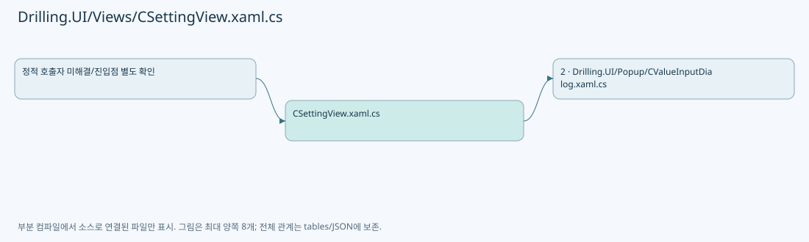
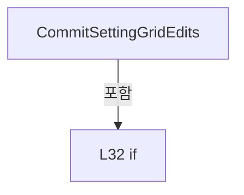
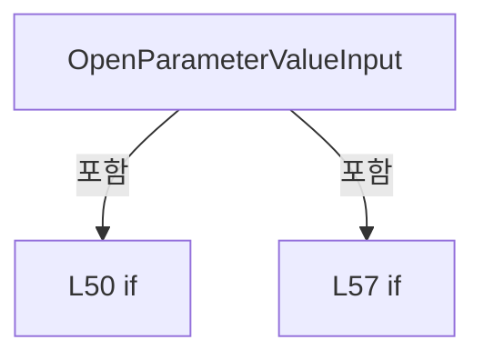
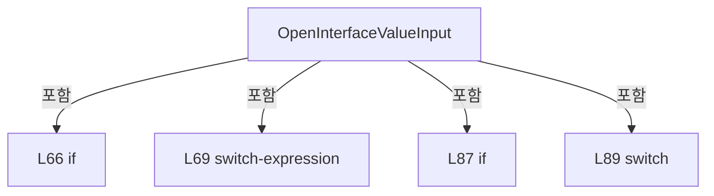

# Drilling.UI/Views/CSettingView.xaml.cs

| 항목 | 내용 |
| --- | --- |
| 원본 저장소 | https://github.com/kjuws10-rgb/A3Drilling.git |
| 원본 Commit | 5aee8e58439c9b455cae7c9593c9be986c3e682e |
| 원본 SHA256 | f2587e20f619e65e44bd005eb4e53ca55d6aee17bb3ad78ac8edcc3b0a9d9380 |
| 파일 분류 | code |
| 원본 크기/행 | 4,141 bytes / 123 physical lines |
| 인코딩 | utf-8-sig |
| 검토 범위 | 구문/부분 의미 분석에서 추출한 사실. 동작·물리 단위·실장비 합격을 보증하지 않습니다. |
| 원본 링크 | [고정 Commit 원본](https://github.com/kjuws10-rgb/A3Drilling/blob/5aee8e58439c9b455cae7c9593c9be986c3e682e/Drilling.UI/Views/CSettingView.xaml.cs) |

## 파일의 역할과 읽는 순서

WPF 화면·사용자 명령·표시 상태를 구성합니다. XAML 이벤트와 코드 비하인드, RootView의 조립 경로를 함께 추적합니다.

## 네임스페이스·타입·상속

| 타입 | 구분 | 원본 범위 | 선언/상속 |
| --- | --- | --- | --- |
| CSettingView | ClassDeclaration | 9–123 | CSettingView: UserControl |

## 멤버 빠른 목록

| 이름 | 종류 | 범위 | 서명 |
| --- | --- | --- | --- |
| _isHistoryExpanded | FieldDeclaration | L11–11 | bool Drilling.UI.Views.CSettingView._isHistoryExpanded |
| .ctor | ConstructorDeclaration | L13–16 | Drilling.UI.Views.CSettingView.CSettingView() |
| ToggleHistory_Click | MethodDeclaration | L18–28 | void Drilling.UI.Views.CSettingView.ToggleHistory_Click(object, RoutedEventArgs) |
| CommitSettingGridEdits | MethodDeclaration | L30–40 | void Drilling.UI.Views.CSettingView.CommitSettingGridEdits(object, RoutedEventArgs) |
| CommitGridEdit | MethodDeclaration | L42–46 | void Drilling.UI.Views.CSettingView.CommitGridEdit(DataGrid) |
| OpenParameterValueInput | MethodDeclaration | L48–62 | void Drilling.UI.Views.CSettingView.OpenParameterValueInput(object, RoutedEventArgs) |
| OpenInterfaceValueInput | MethodDeclaration | L64–122 | void Drilling.UI.Views.CSettingView.OpenInterfaceValueInput(object, RoutedEventArgs) |

## 멤버별 상세 계약·호출·처리 해설

### FieldDeclaration `_isHistoryExpanded` · L11–11

[Drilling.UI/Views/CSettingView.xaml.cs:11–11](https://github.com/kjuws10-rgb/A3Drilling/blob/5aee8e58439c9b455cae7c9593c9be986c3e682e/Drilling.UI/Views/CSettingView.xaml.cs#L11-L11)

| 항목 | 실제 추출 값 |
| --- | --- |
| 서명 | bool Drilling.UI.Views.CSettingView._isHistoryExpanded |
| 접근/수식자 | Private / private |
| 반환/값 타입 | bool |
| 소속 타입 | NamedType:Drilling.UI.Views.CSettingView |

현재 부분 분석에서 직접 연결된 호출자는 없습니다. XAML/이벤트/인터페이스·델리게이트·외부 진입을 추가 확인해야 하며, 미사용으로 판정한 것이 아닙니다.

변경 전 점검: 입력/반환 타입, 위 호출자, 예외/취소 경로, 공유 상태와 저장·전송 소비자를 함께 확인합니다. 값의 단위나 물리 방향을 이름만으로 확정하지 않습니다.

### ConstructorDeclaration `.ctor` · L13–16

[Drilling.UI/Views/CSettingView.xaml.cs:13–16](https://github.com/kjuws10-rgb/A3Drilling/blob/5aee8e58439c9b455cae7c9593c9be986c3e682e/Drilling.UI/Views/CSettingView.xaml.cs#L13-L16)

| 항목 | 실제 추출 값 |
| --- | --- |
| 서명 | Drilling.UI.Views.CSettingView.CSettingView() |
| 접근/수식자 | Public / public |
| 반환/값 타입 | void |
| 소속 타입 | NamedType:Drilling.UI.Views.CSettingView |

현재 부분 분석에서 직접 연결된 호출자는 없습니다. XAML/이벤트/인터페이스·델리게이트·외부 진입을 추가 확인해야 하며, 미사용으로 판정한 것이 아닙니다.

호출하는 대상과 해석 범위:

| 원본 행 | 표현식 | 분석 상태 | 대상/소스 위치 |
| --- | --- | --- | --- |
| 15 | InitializeComponent | unresolved | None |

본문의 실제 연산·분기·예외·반환 순서(원문 위치 순):

| 원본 행 | 종류 | 주석 해설 |
| --- | --- | --- |
| 15 | call | 함수·델리게이트 또는 객체 생성자를 호출합니다: InitializeComponent() |

변경 전 점검: 입력/반환 타입, 위 호출자, 예외/취소 경로, 공유 상태와 저장·전송 소비자를 함께 확인합니다. 값의 단위나 물리 방향을 이름만으로 확정하지 않습니다.

### MethodDeclaration `ToggleHistory_Click` · L18–28

[Drilling.UI/Views/CSettingView.xaml.cs:18–28](https://github.com/kjuws10-rgb/A3Drilling/blob/5aee8e58439c9b455cae7c9593c9be986c3e682e/Drilling.UI/Views/CSettingView.xaml.cs#L18-L28)

| 항목 | 실제 추출 값 |
| --- | --- |
| 서명 | void Drilling.UI.Views.CSettingView.ToggleHistory_Click(object, RoutedEventArgs) |
| 접근/수식자 | Private / private |
| 반환/값 타입 | void |
| 소속 타입 | NamedType:Drilling.UI.Views.CSettingView |

입력 계약:

| 이름 | 타입 | 전달 | 선택/기본값 |
| --- | --- | --- | --- |
| sender | object | None | False /  |
| e | RoutedEventArgs | None | False /  |

현재 부분 분석에서 직접 연결된 호출자는 없습니다. XAML/이벤트/인터페이스·델리게이트·외부 진입을 추가 확인해야 하며, 미사용으로 판정한 것이 아닙니다.

호출하는 대상과 해석 범위:

| 원본 행 | 표현식 | 분석 상태 | 대상/소스 위치 |
| --- | --- | --- | --- |
| 20 | CommitSettingGridEdits | resolved | void Drilling.UI.Views.CSettingView.CommitSettingGridEdits(object, RoutedEventArgs) · Drilling.UI/Views/CSettingView.xaml.cs:30 |
| 23 | Grid.SetRow | unresolved | None |
| 24 | Grid.SetRowSpan | unresolved | None |
| 25 | new Thickness | unresolved | None |
| 25 | new Thickness | unresolved | None |

본문의 실제 연산·분기·예외·반환 순서(원문 위치 순):

| 원본 행 | 종류 | 주석 해설 |
| --- | --- | --- |
| 20 | call | 함수·델리게이트 또는 객체 생성자를 호출합니다: CommitSettingGridEdits(sender, e) |
| 21 | assignment | 값을 대상에 대입합니다: _isHistoryExpanded = !_isHistoryExpanded |
| 22 | assignment | 값을 대상에 대입합니다: SettingEditorPanel.Visibility = _isHistoryExpanded ? Visibility.Collapsed : Visibility.Visible |
| 22 | conditional-expression | 조건에 따라 결과식을 선택합니다: _isHistoryExpanded ? Visibility.Collapsed : Visibility.Visible |
| 23 | call | 함수·델리게이트 또는 객체 생성자를 호출합니다: Grid.SetRow(HistoryPanel, _isHistoryExpanded ? 0 : 1) |
| 23 | conditional-expression | 조건에 따라 결과식을 선택합니다: _isHistoryExpanded ? 0 : 1 |
| 24 | call | 함수·델리게이트 또는 객체 생성자를 호출합니다: Grid.SetRowSpan(HistoryPanel, _isHistoryExpanded ? 2 : 1) |
| 24 | conditional-expression | 조건에 따라 결과식을 선택합니다: _isHistoryExpanded ? 2 : 1 |
| 25 | assignment | 값을 대상에 대입합니다: HistoryPanel.Margin = _isHistoryExpanded ? new Thickness(0) : new Thickness(0, 12, 0, 0) |
| 25 | call | 함수·델리게이트 또는 객체 생성자를 호출합니다: new Thickness(0) |
| 25 | call | 함수·델리게이트 또는 객체 생성자를 호출합니다: new Thickness(0, 12, 0, 0) |
| 25 | conditional-expression | 조건에 따라 결과식을 선택합니다: _isHistoryExpanded ? new Thickness(0) : new Thickness(0, 12, 0, 0) |
| 26 | assignment | 값을 대상에 대입합니다: HistoryExpandButton.Content = _isHistoryExpanded ? "COLLAPSE" : "EXPAND" |
| 26 | conditional-expression | 조건에 따라 결과식을 선택합니다: _isHistoryExpanded ? "COLLAPSE" : "EXPAND" |
| 27 | assignment | 값을 대상에 대입합니다: e.Handled = true |

변경 전 점검: 입력/반환 타입, 위 호출자, 예외/취소 경로, 공유 상태와 저장·전송 소비자를 함께 확인합니다. 값의 단위나 물리 방향을 이름만으로 확정하지 않습니다.

### MethodDeclaration `CommitSettingGridEdits` · L30–40

[Drilling.UI/Views/CSettingView.xaml.cs:30–40](https://github.com/kjuws10-rgb/A3Drilling/blob/5aee8e58439c9b455cae7c9593c9be986c3e682e/Drilling.UI/Views/CSettingView.xaml.cs#L30-L40)

| 항목 | 실제 추출 값 |
| --- | --- |
| 서명 | void Drilling.UI.Views.CSettingView.CommitSettingGridEdits(object, RoutedEventArgs) |
| 접근/수식자 | Private / private |
| 반환/값 타입 | void |
| 소속 타입 | NamedType:Drilling.UI.Views.CSettingView |

입력 계약:

| 이름 | 타입 | 전달 | 선택/기본값 |
| --- | --- | --- | --- |
| sender | object | None | False /  |
| e | RoutedEventArgs | None | False /  |

정적 호출자로 확인된 위치:

| 호출 파일/행 | 호출 표현식 | 런타임 분기 가능 |
| --- | --- | --- |
| [Drilling.UI/Views/CSettingView.xaml.cs:20–20](https://github.com/kjuws10-rgb/A3Drilling/blob/5aee8e58439c9b455cae7c9593c9be986c3e682e/Drilling.UI/Views/CSettingView.xaml.cs#L20-L20) | CommitSettingGridEdits | False |

호출하는 대상과 해석 범위:

| 원본 행 | 표현식 | 분석 상태 | 대상/소스 위치 |
| --- | --- | --- | --- |
| 34 | textBox.GetBindingExpression | unresolved | None |
| 34 | .UpdateSource | unresolved | None |
| 37 | Keyboard.ClearFocus | unresolved | None |
| 38 | CommitGridEdit | candidate | OverloadResolutionFailure |
| 39 | CommitGridEdit | candidate | OverloadResolutionFailure |

본문의 실제 연산·분기·예외·반환 순서(원문 위치 순):

| 원본 행 | 종류 | 주석 해설 |
| --- | --- | --- |
| 32 | if | 조건에 따라 분기합니다: if (Keyboard.FocusedElement is TextBox textBox) |
| 34 | call | 함수·델리게이트 또는 객체 생성자를 호출합니다: textBox.GetBindingExpression(TextBox.TextProperty) |
| 34 | call | 함수·델리게이트 또는 객체 생성자를 호출합니다: .UpdateSource() |
| 37 | call | 함수·델리게이트 또는 객체 생성자를 호출합니다: Keyboard.ClearFocus() |
| 38 | call | 함수·델리게이트 또는 객체 생성자를 호출합니다: CommitGridEdit(ParameterGrid) |
| 39 | call | 함수·델리게이트 또는 객체 생성자를 호출합니다: CommitGridEdit(InterfaceGrid) |

제어 구문의 포함 구조(실제 실행 순서/CFG가 아닌 구문 탐색 그림):

변경 전 점검: 입력/반환 타입, 위 호출자, 예외/취소 경로, 공유 상태와 저장·전송 소비자를 함께 확인합니다. 값의 단위나 물리 방향을 이름만으로 확정하지 않습니다.

### MethodDeclaration `CommitGridEdit` · L42–46

[Drilling.UI/Views/CSettingView.xaml.cs:42–46](https://github.com/kjuws10-rgb/A3Drilling/blob/5aee8e58439c9b455cae7c9593c9be986c3e682e/Drilling.UI/Views/CSettingView.xaml.cs#L42-L46)

| 항목 | 실제 추출 값 |
| --- | --- |
| 서명 | void Drilling.UI.Views.CSettingView.CommitGridEdit(DataGrid) |
| 접근/수식자 | Private / private, static |
| 반환/값 타입 | void |
| 소속 타입 | NamedType:Drilling.UI.Views.CSettingView |

입력 계약:

| 이름 | 타입 | 전달 | 선택/기본값 |
| --- | --- | --- | --- |
| grid | DataGrid | None | False /  |

현재 부분 분석에서 직접 연결된 호출자는 없습니다. XAML/이벤트/인터페이스·델리게이트·외부 진입을 추가 확인해야 하며, 미사용으로 판정한 것이 아닙니다.

호출하는 대상과 해석 범위:

| 원본 행 | 표현식 | 분석 상태 | 대상/소스 위치 |
| --- | --- | --- | --- |
| 44 | grid.CommitEdit | unresolved | None |
| 45 | grid.CommitEdit | unresolved | None |

본문의 실제 연산·분기·예외·반환 순서(원문 위치 순):

| 원본 행 | 종류 | 주석 해설 |
| --- | --- | --- |
| 44 | call | 함수·델리게이트 또는 객체 생성자를 호출합니다: grid.CommitEdit(DataGridEditingUnit.Cell, true) |
| 45 | call | 함수·델리게이트 또는 객체 생성자를 호출합니다: grid.CommitEdit(DataGridEditingUnit.Row, true) |

변경 전 점검: 입력/반환 타입, 위 호출자, 예외/취소 경로, 공유 상태와 저장·전송 소비자를 함께 확인합니다. 값의 단위나 물리 방향을 이름만으로 확정하지 않습니다.

### MethodDeclaration `OpenParameterValueInput` · L48–62

[Drilling.UI/Views/CSettingView.xaml.cs:48–62](https://github.com/kjuws10-rgb/A3Drilling/blob/5aee8e58439c9b455cae7c9593c9be986c3e682e/Drilling.UI/Views/CSettingView.xaml.cs#L48-L62)

| 항목 | 실제 추출 값 |
| --- | --- |
| 서명 | void Drilling.UI.Views.CSettingView.OpenParameterValueInput(object, RoutedEventArgs) |
| 접근/수식자 | Private / private |
| 반환/값 타입 | void |
| 소속 타입 | NamedType:Drilling.UI.Views.CSettingView |

입력 계약:

| 이름 | 타입 | 전달 | 선택/기본값 |
| --- | --- | --- | --- |
| sender | object | None | False /  |
| e | RoutedEventArgs | None | False /  |

현재 부분 분석에서 직접 연결된 호출자는 없습니다. XAML/이벤트/인터페이스·델리게이트·외부 진입을 추가 확인해야 하며, 미사용으로 판정한 것이 아닙니다.

호출하는 대상과 해석 범위:

| 원본 행 | 표현식 | 분석 상태 | 대상/소스 위치 |
| --- | --- | --- | --- |
| 53 | new CValueInputDialog | resolved | Drilling.UI.Popup.CValueInputDialog.CValueInputDialog(string, string, Drilling.Common.Managers.EN_RECIPE_DATA_TYPE, double, double) · Drilling.UI/Popup/CValueInputDialog.xaml.cs:13 |
| 55 | Window.GetWindow | unresolved | None |
| 57 | dialog.ShowDialog | unresolved | None |
| 60 | CommitGridEdit | candidate | OverloadResolutionFailure |

본문의 실제 연산·분기·예외·반환 순서(원문 위치 순):

| 원본 행 | 종류 | 주석 해설 |
| --- | --- | --- |
| 50 | if | 조건에 따라 분기합니다: if (sender is not FrameworkElement { DataContext: ST_SYSTEM_PARAMETER_ROW row }) |
| 51 | return | 호출자에게 값 또는 제어를 반환합니다: return; |
| 52 | assignment | 값을 대상에 대입합니다: e.Handled = true |
| 53 | call | 함수·델리게이트 또는 객체 생성자를 호출합니다: new CValueInputDialog(row.Parameter, row.Value, row.DataType, row.Min, row.Max) { Owner = Window.GetWindow(this) } |
| 53 | local-declaration | 지역 변수를 선언합니다: var dialog = new CValueInputDialog(row.Parameter, row.Value, row.DataType, row.Min, row.Max) { Owner = Window.GetWindow(this) }; |
| 53 | variable-initializer | 변수의 초기값을 지정합니다: dialog = new CValueInputDialog(row.Parameter, row.Value, row.DataType, row.Min, row.Max) { Owner = Window.GetWindow(this) } |
| 55 | assignment | 값을 대상에 대입합니다: Owner = Window.GetWindow(this) |
| 55 | call | 함수·델리게이트 또는 객체 생성자를 호출합니다: Window.GetWindow(this) |
| 57 | call | 함수·델리게이트 또는 객체 생성자를 호출합니다: dialog.ShowDialog() |
| 57 | if | 조건에 따라 분기합니다: if (dialog.ShowDialog() == true) |
| 59 | assignment | 값을 대상에 대입합니다: row.Value = dialog.ResultValue |
| 60 | call | 함수·델리게이트 또는 객체 생성자를 호출합니다: CommitGridEdit(ParameterGrid) |

제어 구문의 포함 구조(실제 실행 순서/CFG가 아닌 구문 탐색 그림):

변경 전 점검: 입력/반환 타입, 위 호출자, 예외/취소 경로, 공유 상태와 저장·전송 소비자를 함께 확인합니다. 값의 단위나 물리 방향을 이름만으로 확정하지 않습니다.

### MethodDeclaration `OpenInterfaceValueInput` · L64–122

[Drilling.UI/Views/CSettingView.xaml.cs:64–122](https://github.com/kjuws10-rgb/A3Drilling/blob/5aee8e58439c9b455cae7c9593c9be986c3e682e/Drilling.UI/Views/CSettingView.xaml.cs#L64-L122)

| 항목 | 실제 추출 값 |
| --- | --- |
| 서명 | void Drilling.UI.Views.CSettingView.OpenInterfaceValueInput(object, RoutedEventArgs) |
| 접근/수식자 | Private / private |
| 반환/값 타입 | void |
| 소속 타입 | NamedType:Drilling.UI.Views.CSettingView |

입력 계약:

| 이름 | 타입 | 전달 | 선택/기본값 |
| --- | --- | --- | --- |
| sender | object | None | False /  |
| e | RoutedEventArgs | None | False /  |

현재 부분 분석에서 직접 연결된 호출자는 없습니다. XAML/이벤트/인터페이스·델리게이트·외부 진입을 추가 확인해야 하며, 미사용으로 판정한 것이 아닙니다.

호출하는 대상과 해석 범위:

| 원본 행 | 표현식 | 분석 상태 | 대상/소스 위치 |
| --- | --- | --- | --- |
| 83 | new CValueInputDialog | resolved | Drilling.UI.Popup.CValueInputDialog.CValueInputDialog(string, string, Drilling.Common.Managers.EN_RECIPE_DATA_TYPE, double, double) · Drilling.UI/Popup/CValueInputDialog.xaml.cs:13 |
| 85 | Window.GetWindow | unresolved | None |
| 87 | dialog.ShowDialog | unresolved | None |
| 121 | CommitGridEdit | candidate | OverloadResolutionFailure |

본문의 실제 연산·분기·예외·반환 순서(원문 위치 순):

| 원본 행 | 종류 | 주석 해설 |
| --- | --- | --- |
| 66 | if | 조건에 따라 분기합니다: if (sender is not Button { DataContext: ST_SETTING_INTERFACE_ROW row, Tag: string field } button) |
| 67 | return | 호출자에게 값 또는 제어를 반환합니다: return; |
| 68 | assignment | 값을 대상에 대입합니다: e.Handled = true |
| 69 | local-declaration | 지역 변수를 선언합니다: var currentValue = field switch { "DEVICE" => row.Device, "NUMBER" => row.Number, "NICKNAME" => row.NickName, "SYSTEM_SECTION" => row.SystemSection, "ARG1" => row.Arg1, "ARG2" => row.Arg2, "ARG3" => row.Arg3, "ARG4" => row.Arg4, " |
| 69 | switch-expression | 값별 결과식을 선택합니다: field switch { "DEVICE" => row.Device, "NUMBER" => row.Number, "NICKNAME" => row.NickName, "SYSTEM_SECTION" => row.SystemSection, "ARG1" => row.Arg1, "ARG2" => row.Arg2, "ARG3" => row.Arg3, "ARG4" => row.Arg4, "ARG5" => row.Arg5,  |
| 69 | variable-initializer | 변수의 초기값을 지정합니다: currentValue = field switch { "DEVICE" => row.Device, "NUMBER" => row.Number, "NICKNAME" => row.NickName, "SYSTEM_SECTION" => row.SystemSection, "ARG1" => row.Arg1, "ARG2" => row.Arg2, "ARG3" => row.Arg3, "ARG4" => row.Arg4, "ARG5 |
| 82 | conditional-expression | 조건에 따라 결과식을 선택합니다: field == "NUMBER" ? EN_RECIPE_DATA_TYPE.Int : EN_RECIPE_DATA_TYPE.String |
| 82 | local-declaration | 지역 변수를 선언합니다: var dataType = field == "NUMBER" ? EN_RECIPE_DATA_TYPE.Int : EN_RECIPE_DATA_TYPE.String; |
| 82 | variable-initializer | 변수의 초기값을 지정합니다: dataType = field == "NUMBER" ? EN_RECIPE_DATA_TYPE.Int : EN_RECIPE_DATA_TYPE.String |
| 83 | call | 함수·델리게이트 또는 객체 생성자를 호출합니다: new CValueInputDialog(field, currentValue, dataType, 0, int.MaxValue) { Owner = Window.GetWindow(this) } |
| 83 | local-declaration | 지역 변수를 선언합니다: var dialog = new CValueInputDialog(field, currentValue, dataType, 0, int.MaxValue) { Owner = Window.GetWindow(this) }; |
| 83 | variable-initializer | 변수의 초기값을 지정합니다: dialog = new CValueInputDialog(field, currentValue, dataType, 0, int.MaxValue) { Owner = Window.GetWindow(this) } |
| 85 | assignment | 값을 대상에 대입합니다: Owner = Window.GetWindow(this) |
| 85 | call | 함수·델리게이트 또는 객체 생성자를 호출합니다: Window.GetWindow(this) |
| 87 | call | 함수·델리게이트 또는 객체 생성자를 호출합니다: dialog.ShowDialog() |
| 87 | if | 조건에 따라 분기합니다: if (dialog.ShowDialog() != true) |
| 88 | return | 호출자에게 값 또는 제어를 반환합니다: return; |
| 89 | switch | 값에 따라 분기합니다: switch (field) |
| 91 | case | 분기값/패턴의 구간입니다: case "DEVICE": |
| 92 | assignment | 값을 대상에 대입합니다: row.Device = dialog.ResultValue |
| 93 | break | 해당 반복/분기 구간을 종료합니다: break; |
| 94 | case | 분기값/패턴의 구간입니다: case "NUMBER": |
| 95 | assignment | 값을 대상에 대입합니다: row.Number = dialog.ResultValue |
| 96 | break | 해당 반복/분기 구간을 종료합니다: break; |
| 97 | case | 분기값/패턴의 구간입니다: case "NICKNAME": |
| 98 | assignment | 값을 대상에 대입합니다: row.NickName = dialog.ResultValue |
| 99 | break | 해당 반복/분기 구간을 종료합니다: break; |
| 100 | case | 분기값/패턴의 구간입니다: case "SYSTEM_SECTION": |
| 101 | assignment | 값을 대상에 대입합니다: row.SystemSection = dialog.ResultValue |
| 102 | break | 해당 반복/분기 구간을 종료합니다: break; |
| 103 | case | 분기값/패턴의 구간입니다: case "ARG1": |
| 104 | assignment | 값을 대상에 대입합니다: row.Arg1 = dialog.ResultValue |
| 105 | break | 해당 반복/분기 구간을 종료합니다: break; |
| 106 | case | 분기값/패턴의 구간입니다: case "ARG2": |
| 107 | assignment | 값을 대상에 대입합니다: row.Arg2 = dialog.ResultValue |
| 108 | break | 해당 반복/분기 구간을 종료합니다: break; |
| 109 | case | 분기값/패턴의 구간입니다: case "ARG3": |
| 110 | assignment | 값을 대상에 대입합니다: row.Arg3 = dialog.ResultValue |
| 111 | break | 해당 반복/분기 구간을 종료합니다: break; |
| 112 | case | 분기값/패턴의 구간입니다: case "ARG4": |
| 113 | assignment | 값을 대상에 대입합니다: row.Arg4 = dialog.ResultValue |
| 114 | break | 해당 반복/분기 구간을 종료합니다: break; |
| 115 | case | 분기값/패턴의 구간입니다: case "ARG5": |
| 116 | assignment | 값을 대상에 대입합니다: row.Arg5 = dialog.ResultValue |
| 117 | break | 해당 반복/분기 구간을 종료합니다: break; |
| 120 | assignment | 값을 대상에 대입합니다: button.Content = dialog.ResultValue |
| 121 | call | 함수·델리게이트 또는 객체 생성자를 호출합니다: CommitGridEdit(InterfaceGrid) |

제어 구문의 포함 구조(실제 실행 순서/CFG가 아닌 구문 탐색 그림):

변경 전 점검: 입력/반환 타입, 위 호출자, 예외/취소 경로, 공유 상태와 저장·전송 소비자를 함께 확인합니다. 값의 단위나 물리 방향을 이름만으로 확정하지 않습니다.

## 구문·바인딩 한계

전체 WPF/벤더 SDK/프로젝트별 빌드 조건을 로드한 정식 빌드가 아닙니다. `resolved`는 이 부분 컴파일에서의 심볼 연결이며 virtual/interface/delegate/이벤트/Reflection/XAML의 실제 런타임 구현을 확정하지 않습니다. `candidate`와 `unresolved`는 후속 확인 대상으로 남깁니다.

## 원문 전체 주석 해설본

[원본 모든 행과 행별 해설 보기](../../../annotated/Drilling.UI/Views/CSettingView.xaml.cs.annotated.txt)

원본을 빠뜨리거나 임의로 줄이지 않았습니다. `L000001 |` 표시는 원본 행 번호, `// 해설`은 별도 설명입니다. 실행용 소스가 아닌 문서입니다.

## 수정·재검증 체크

- 원본 Commit과 현재 작업 파일 SHA가 같은지 먼저 확인합니다. 다르면 이 문서를 과거 버전 자료로 취급합니다.
- 선언·직접 호출·이벤트/인터페이스 경계·설정 소비를 함께 확인합니다. 정적 연결의 빈 곳을 정상 경로로 추정하지 않습니다.
- 저장 형식/단위/식별자·재시도·취소·예외·롤백에 영향을 주는 변경은 상세 해설장과 호출자를 다시 검토합니다.
- 도구의 구문 추출과 별도 정적 추적 해설, 실제 빌드·시뮬레이션·실장비 검증 결과를 분리합니다.
