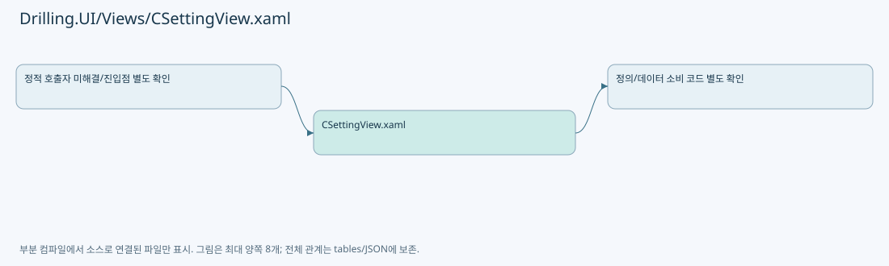

# Drilling.UI/Views/CSettingView.xaml

| 항목 | 내용 |
| --- | --- |
| 원본 저장소 | https://github.com/kjuws10-rgb/A3Drilling.git |
| 원본 Commit | dfa5920e6301d9ec4b0eab1452ae59521aafc986 |
| 원본 SHA256 | 7f1dfe45cfa6659a53e3be1e20d7e9d5add0b8006af014942c64dbeba58b4469 |
| 파일 분류 | code |
| 원본 크기/행 | 66,599 bytes / 844 physical lines |
| 인코딩 | utf-8-sig |
| 검토 범위 | 구문/부분 의미 분석에서 추출한 사실. 동작·물리 단위·실장비 합격을 보증하지 않습니다. |
| 원본 링크 | [고정 Commit 원본](https://github.com/kjuws10-rgb/A3Drilling/blob/dfa5920e6301d9ec4b0eab1452ae59521aafc986/Drilling.UI/Views/CSettingView.xaml) |

## 파일의 역할과 읽는 순서

WPF 화면·사용자 명령·표시 상태를 구성합니다. XAML 이벤트와 코드 비하인드, RootView의 조립 경로를 함께 추적합니다.

## 화면 구성과 코드 비하인드 연결

| 항목 | 추출 값 |
| --- | --- |
| 코드 비하인드 후보 | Drilling.UI/Views/CSettingView.xaml.cs |
| 이름 있는 요소 | ButtonChrome, ButtonContent, ItemBorder, ToggleButton, Shell, PART_Popup, SettingEditorPanel, ParameterGrid, InterfaceGrid, HistoryPanel, HistoryExpandButton, ChangeHistoryGrid |
| 이벤트 개수 | 13 |
| Binding 표현 개수 | 81 |

이름 있는 요소는 WPF가 필드를 생성할 수 있는 XAML 선언입니다. 문서 추출기는 WPF 생성 코드를 만들거나 로드하지 않으므로 C# 원문 멤버 수에 합산하지 않습니다.

| 요소 이름 | 원본 범위 |
| --- | --- |
| ButtonChrome | L100–100 |
| ButtonContent | L105–105 |
| ItemBorder | L151–151 |
| ToggleButton | L197–197 |
| Shell | L203–203 |
| PART_Popup | L254–254 |
| SettingEditorPanel | L313–313 |
| ParameterGrid | L604–604 |
| InterfaceGrid | L717–717 |
| HistoryPanel | L795–795 |
| HistoryExpandButton | L812–812 |
| ChangeHistoryGrid | L817–817 |

| 이벤트 | 핸들러 이름 | 원본 범위 | 해석 |
| --- | --- | --- | --- |
| PreviewMouseDown | CommitSettingGridEdits | L524–524 | 코드 비하인드/이벤트 라우팅에서 실제 연결 확인 필요 |
| Click | CommitSettingGridEdits | L525–525 | 코드 비하인드/이벤트 라우팅에서 실제 연결 확인 필요 |
| PreviewMouseLeftButtonDown | OpenParameterValueInput | L625–625 | 코드 비하인드/이벤트 라우팅에서 실제 연결 확인 필요 |
| PreviewMouseLeftButtonDown | OpenParameterValueInput | L667–667 | 코드 비하인드/이벤트 라우팅에서 실제 연결 확인 필요 |
| PreviewMouseLeftButtonDown | OpenInterfaceValueInput | L775–775 | 코드 비하인드/이벤트 라우팅에서 실제 연결 확인 필요 |
| PreviewMouseLeftButtonDown | OpenInterfaceValueInput | L776–776 | 코드 비하인드/이벤트 라우팅에서 실제 연결 확인 필요 |
| PreviewMouseLeftButtonDown | OpenInterfaceValueInput | L777–777 | 코드 비하인드/이벤트 라우팅에서 실제 연결 확인 필요 |
| PreviewMouseLeftButtonDown | OpenInterfaceValueInput | L780–780 | 코드 비하인드/이벤트 라우팅에서 실제 연결 확인 필요 |
| PreviewMouseLeftButtonDown | OpenInterfaceValueInput | L781–781 | 코드 비하인드/이벤트 라우팅에서 실제 연결 확인 필요 |
| PreviewMouseLeftButtonDown | OpenInterfaceValueInput | L782–782 | 코드 비하인드/이벤트 라우팅에서 실제 연결 확인 필요 |
| PreviewMouseLeftButtonDown | OpenInterfaceValueInput | L783–783 | 코드 비하인드/이벤트 라우팅에서 실제 연결 확인 필요 |
| PreviewMouseLeftButtonDown | OpenInterfaceValueInput | L784–784 | 코드 비하인드/이벤트 라우팅에서 실제 연결 확인 필요 |
| Click | ToggleHistory_Click | L813–813 | 코드 비하인드/이벤트 라우팅에서 실제 연결 확인 필요 |

| Binding 표현 | 원본 범위 |
| --- | --- |
| {Binding IsDropDownOpen, Mode=TwoWay, RelativeSource={RelativeSource TemplatedParent}} | L200–200 |
| {Binding SelectionBoxItem, RelativeSource={RelativeSource AncestorType=ComboBox}} | L214–214 |
| {Binding SelectionBoxItemTemplate, RelativeSource={RelativeSource AncestorType=ComboBox}} | L215–215 |
| {Binding SelectionBoxItemStringFormat, RelativeSource={RelativeSource AncestorType=ComboBox}} | L216–216 |
| {Binding ActualWidth, ElementName=ToggleButton} | L263–263 |
| {Binding CurrentScreen.IsSettingLayout, Converter={StaticResource BooleanToVisibilityConverter}} | L291–291 |
| {Binding CurrentScreen.Setting.TabItems} | L320–320 |
| {Binding DisplayName} | L328–328 |
| {Binding DataContext.CurrentScreen.Setting.SelectTabCommand, RelativeSource={RelativeSource AncestorType=UserControl}} | L329–329 |
| {Binding Name} | L330–330 |
| {Binding IsSelected} | L335–335 |
| {Binding CurrentScreen.Setting.GroupItems} | L363–363 |
| {Binding DataContext.CurrentScreen.Setting.SelectGroupCommand, RelativeSource={RelativeSource AncestorType=UserControl}} | L366–366 |
| {Binding Name} | L367–367 |
| {Binding IsSelected} | L378–378 |
| {Binding IsSelected} | L396–396 |
| {Binding Name} | L403–403 |
| {Binding IsSelected} | L413–413 |
| {Binding IsSelected, Converter={StaticResource BooleanToVisibilityConverter}} | L429–429 |
| {Binding CurrentScreen.Setting.SelectedTab, StringFormat={}{0} Parameter} | L455–455 |
| {Binding CurrentScreen.Setting.SelectedTab} | L457–457 |
| {Binding CurrentScreen.Setting.CanOperateSelectedInterface} | L472–472 |
| {Binding CurrentScreen.Setting.ConnectInterfaceCommand} | L473–473 |
| {Binding CurrentScreen.Setting.IsInterfaceTab, Converter={StaticResource BooleanToVisibilityConverter}} | L474–474 |
| {Binding CurrentScreen.Setting.CanOperateSelectedInterface} | L498–498 |
| {Binding CurrentScreen.Setting.DisconnectInterfaceCommand} | L499–499 |
| {Binding CurrentScreen.Setting.IsInterfaceTab, Converter={StaticResource BooleanToVisibilityConverter}} | L500–500 |
| {Binding CurrentScreen.Setting.SaveCommand} | L526–526 |
| {Binding CurrentScreen.Setting.IsInterfaceTab, Converter={StaticResource BooleanToVisibilityConverter}} | L542–542 |
| {Binding CurrentScreen.Setting.ReloadCommand} | L546–546 |
| {Binding CurrentScreen.Setting.HeadFilterItems} | L574–574 |
| {Binding CurrentScreen.Setting.IsHeadFilterVisible, Converter={StaticResource BooleanToVisibilityConverter}} | L575–575 |
| {Binding Name} | L583–583 |
| {Binding DataContext.CurrentScreen.Setting.SelectHeadCommand, RelativeSource={RelativeSource AncestorType=UserControl}} | L586–586 |
| {Binding Name} | L587–587 |
| {Binding IsSelected} | L591–591 |
| {Binding CurrentScreen.Setting.ParameterRows} | L606–606 |
| {Binding CurrentScreen.Setting.IsParameterTab, Converter={StaticResource BooleanToVisibilityConverter}} | L612–612 |
| {Binding Group} | L614–614 |
| {Binding HeadFilter} | L615–615 |
| {Binding Parameter} | L616–616 |
| {Binding Value} | L621–621 |
| {Binding UsesSelectionEditor} | L630–630 |
| {Binding ValueOptions} | L637–637 |
| {Binding Value, Mode=TwoWay, UpdateSourceTrigger=PropertyChanged} | L638–638 |
| {Binding UsesSelectionEditor} | L650–650 |
| {Binding Value} | L663–663 |
| {Binding UsesSelectionEditor} | L672–672 |
| {Binding ValueOptions} | L679–679 |
| {Binding Value, Mode=TwoWay, UpdateSourceTrigger=PropertyChanged} | L680–680 |
| {Binding UsesSelectionEditor} | L692–692 |
| {Binding Unit} | L703–703 |
| {Binding Description} | L704–704 |
| {Binding CurrentScreen.Setting.IsInterfaceTab, Converter={StaticResource BooleanToVisibilityConverter}} | L711–711 |
| {Binding CurrentScreen.Setting.InterfaceRows} | L718–718 |
| {Binding CurrentScreen.Setting.SelectedInterfaceRow, Mode=TwoWay} | L719–719 |
| {Binding No, Mode=OneWay} | L768–768 |
| {Binding TypeOptions} | L772–772 |
| {Binding Type, Mode=TwoWay, UpdateSourceTrigger=PropertyChanged} | L772–772 |
| {Binding DeviceOptions} | L774–774 |
| {Binding Device, Mode=TwoWay, UpdateSourceTrigger=PropertyChanged} | L774–774 |
| {Binding Number} | L775–775 |
| {Binding NickName} | L776–776 |
| {Binding SystemSection} | L777–777 |
| {Binding AutoConnectionOptions} | L778–778 |
| {Binding AutoConnection, Mode=TwoWay, UpdateSourceTrigger=PropertyChanged} | L778–778 |
| {Binding AutoConnectionOptions} | L779–779 |
| {Binding Simul, Mode=TwoWay, UpdateSourceTrigger=PropertyChanged} | L779–779 |
| {Binding Arg1} | L780–780 |
| {Binding Arg2} | L781–781 |
| {Binding Arg3} | L782–782 |
| {Binding Arg4} | L783–783 |
| {Binding Arg5} | L784–784 |
| {Binding CurrentScreen.Setting.ChangeHistory} | L818–818 |
| {Binding Time} | L825–825 |
| {Binding User} | L826–826 |
| {Binding Tab} | L827–827 |
| {Binding Parameter} | L828–828 |
| {Binding Before} | L829–829 |
| {Binding After} | L830–830 |
| {Binding AfterBrush} | L833–833 |

## 원문 전체 주석 해설본

[원본 모든 행과 행별 해설 보기](../../../annotated/Drilling.UI/Views/CSettingView.xaml.annotated.txt)

원본을 빠뜨리거나 임의로 줄이지 않았습니다. `L000001 |` 표시는 원본 행 번호, `// 해설`은 별도 설명입니다. 실행용 소스가 아닌 문서입니다.

## 수정·재검증 체크

- 원본 Commit과 현재 작업 파일 SHA가 같은지 먼저 확인합니다. 다르면 이 문서를 과거 버전 자료로 취급합니다.
- 선언·직접 호출·이벤트/인터페이스 경계·설정 소비를 함께 확인합니다. 정적 연결의 빈 곳을 정상 경로로 추정하지 않습니다.
- 저장 형식/단위/식별자·재시도·취소·예외·롤백에 영향을 주는 변경은 상세 해설장과 호출자를 다시 검토합니다.
- 도구의 구문 추출과 별도 정적 추적 해설, 실제 빌드·시뮬레이션·실장비 검증 결과를 분리합니다.
