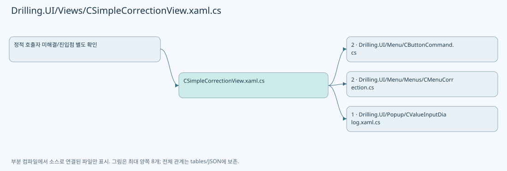
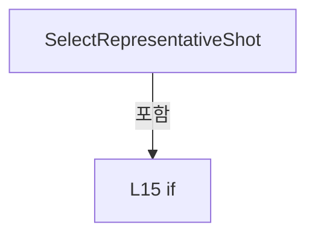
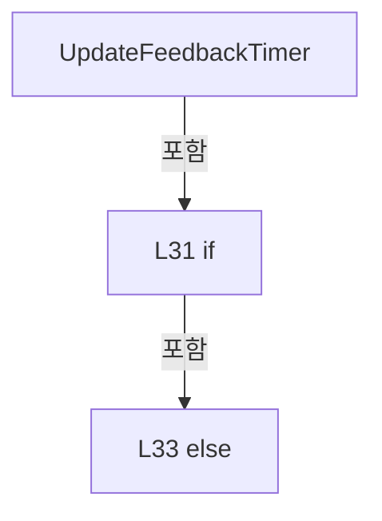
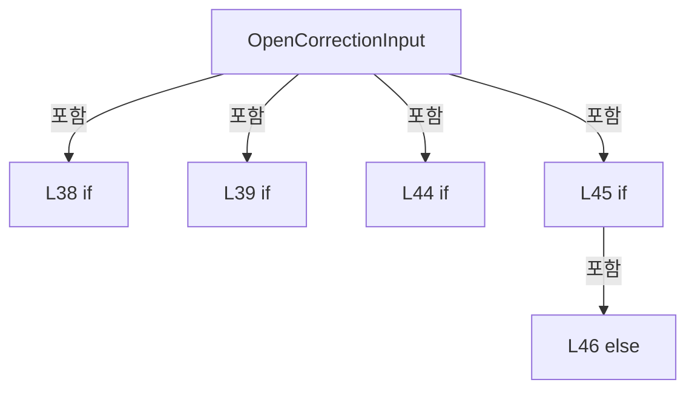
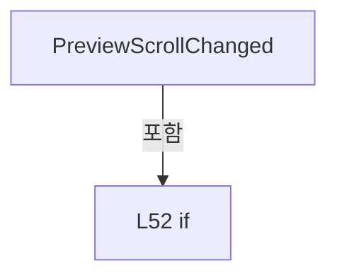
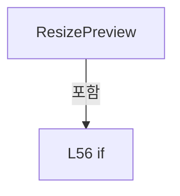

# Drilling.UI/Views/CSimpleCorrectionView.xaml.cs

| 항목 | 내용 |
| --- | --- |
| 원본 저장소 | https://github.com/kjuws10-rgb/A3Drilling.git |
| 원본 Commit | 5aee8e58439c9b455cae7c9593c9be986c3e682e |
| 원본 SHA256 | 629ffaf17c54a3f3da2799dae7fb55b0777a5f289b473105d7146dc062b7da86 |
| 파일 분류 | code |
| 원본 크기/행 | 2,910 bytes / 60 physical lines |
| 인코딩 | utf-8-sig |
| 검토 범위 | 구문/부분 의미 분석에서 추출한 사실. 동작·물리 단위·실장비 합격을 보증하지 않습니다. |
| 원본 링크 | [고정 Commit 원본](https://github.com/kjuws10-rgb/A3Drilling/blob/5aee8e58439c9b455cae7c9593c9be986c3e682e/Drilling.UI/Views/CSimpleCorrectionView.xaml.cs) |

## 파일의 역할과 읽는 순서

WPF 화면·사용자 명령·표시 상태를 구성합니다. XAML 이벤트와 코드 비하인드, RootView의 조립 경로를 함께 추적합니다.

## 네임스페이스·타입·상속

| 타입 | 구분 | 원본 범위 | 선언/상속 |
| --- | --- | --- | --- |
| CSimpleCorrectionView | ClassDeclaration | 11–60 | CSimpleCorrectionView: UserControl |

## 멤버 빠른 목록

| 이름 | 종류 | 범위 | 서명 |
| --- | --- | --- | --- |
| SelectRepresentativeShot | MethodDeclaration | L13–18 | void Drilling.UI.Views.CSimpleCorrectionView.SelectRepresentativeShot(object, MouseButtonEventArgs) |
| _feedbackTimer | FieldDeclaration | L19–19 | DispatcherTimer Drilling.UI.Views.CSimpleCorrectionView._feedbackTimer |
| .ctor | ConstructorDeclaration | L20–27 | Drilling.UI.Views.CSimpleCorrectionView.CSimpleCorrectionView() |
| UpdateFeedbackTimer | MethodDeclaration | L29–34 | void Drilling.UI.Views.CSimpleCorrectionView.UpdateFeedbackTimer() |
| OpenCorrectionInput | MethodDeclaration | L36–47 | void Drilling.UI.Views.CSimpleCorrectionView.OpenCorrectionInput(object, MouseButtonEventArgs) |
| PreviewSizeChanged | MethodDeclaration | L49–49 | void Drilling.UI.Views.CSimpleCorrectionView.PreviewSizeChanged(object, SizeChangedEventArgs) |
| PreviewScrollChanged | MethodDeclaration | L50–53 | void Drilling.UI.Views.CSimpleCorrectionView.PreviewScrollChanged(object, ScrollChangedEventArgs) |
| ResizePreview | MethodDeclaration | L54–59 | void Drilling.UI.Views.CSimpleCorrectionView.ResizePreview() |

## 멤버별 상세 계약·호출·처리 해설

### MethodDeclaration `SelectRepresentativeShot` · L13–18

[Drilling.UI/Views/CSimpleCorrectionView.xaml.cs:13–18](https://github.com/kjuws10-rgb/A3Drilling/blob/5aee8e58439c9b455cae7c9593c9be986c3e682e/Drilling.UI/Views/CSimpleCorrectionView.xaml.cs#L13-L18)

| 항목 | 실제 추출 값 |
| --- | --- |
| 서명 | void Drilling.UI.Views.CSimpleCorrectionView.SelectRepresentativeShot(object, MouseButtonEventArgs) |
| 접근/수식자 | Private / private |
| 반환/값 타입 | void |
| 소속 타입 | NamedType:Drilling.UI.Views.CSimpleCorrectionView |

입력 계약:

| 이름 | 타입 | 전달 | 선택/기본값 |
| --- | --- | --- | --- |
| sender | object | None | False /  |
| e | MouseButtonEventArgs | None | False /  |

현재 부분 분석에서 직접 연결된 호출자는 없습니다. XAML/이벤트/인터페이스·델리게이트·외부 진입을 추가 확인해야 하며, 미사용으로 판정한 것이 아닙니다.

호출하는 대상과 해석 범위:

| 원본 행 | 표현식 | 분석 상태 | 대상/소스 위치 |
| --- | --- | --- | --- |
| 16 | panel.SelectCorrectionShotCommand.CanExecute | resolved | bool Drilling.UI.Menu.CButtonCommand.CanExecute(object?) · Drilling.UI/Menu/CButtonCommand.cs:14 |
| 17 | panel.SelectCorrectionShotCommand.Execute | resolved | void Drilling.UI.Menu.CButtonCommand.Execute(object?) · Drilling.UI/Menu/CButtonCommand.cs:19 |

본문의 실제 연산·분기·예외·반환 순서(원문 위치 순):

| 원본 행 | 종류 | 주석 해설 |
| --- | --- | --- |
| 15 | if | 조건에 따라 분기합니다: if (DataContext is CSimpleCorrectionPanel { IsRough: true } panel && sender is FrameworkElement { DataContext: ST_SIMPLE_CORRECTION_SHOT shot } && shot.CanProcess && panel.SelectCorrectionShotCommand.CanExecute(shot.Key)) |
| 16 | call | 함수·델리게이트 또는 객체 생성자를 호출합니다: panel.SelectCorrectionShotCommand.CanExecute(shot.Key) |
| 17 | assignment | 값을 대상에 대입합니다: e.Handled = true |
| 17 | call | 함수·델리게이트 또는 객체 생성자를 호출합니다: panel.SelectCorrectionShotCommand.Execute(shot.Key) |

제어 구문의 포함 구조(실제 실행 순서/CFG가 아닌 구문 탐색 그림):

변경 전 점검: 입력/반환 타입, 위 호출자, 예외/취소 경로, 공유 상태와 저장·전송 소비자를 함께 확인합니다. 값의 단위나 물리 방향을 이름만으로 확정하지 않습니다.

### FieldDeclaration `_feedbackTimer` · L19–19

[Drilling.UI/Views/CSimpleCorrectionView.xaml.cs:19–19](https://github.com/kjuws10-rgb/A3Drilling/blob/5aee8e58439c9b455cae7c9593c9be986c3e682e/Drilling.UI/Views/CSimpleCorrectionView.xaml.cs#L19-L19)

| 항목 | 실제 추출 값 |
| --- | --- |
| 서명 | DispatcherTimer Drilling.UI.Views.CSimpleCorrectionView._feedbackTimer |
| 접근/수식자 | Private / private, readonly |
| 반환/값 타입 | DispatcherTimer |
| 소속 타입 | NamedType:Drilling.UI.Views.CSimpleCorrectionView |

현재 부분 분석에서 직접 연결된 호출자는 없습니다. XAML/이벤트/인터페이스·델리게이트·외부 진입을 추가 확인해야 하며, 미사용으로 판정한 것이 아닙니다.

호출하는 대상과 해석 범위:

| 원본 행 | 표현식 | 분석 상태 | 대상/소스 위치 |
| --- | --- | --- | --- |
| 19 | new | unresolved | None |
| 19 | TimeSpan.FromMilliseconds | resolved | System.TimeSpan System.TimeSpan.FromMilliseconds(long) |

본문의 실제 연산·분기·예외·반환 순서(원문 위치 순):

| 원본 행 | 종류 | 주석 해설 |
| --- | --- | --- |
| 19 | assignment | 값을 대상에 대입합니다: Interval = TimeSpan.FromMilliseconds(200) |
| 19 | call | 함수·델리게이트 또는 객체 생성자를 호출합니다: new(DispatcherPriority.Background) { Interval = TimeSpan.FromMilliseconds(200) } |
| 19 | call | 함수·델리게이트 또는 객체 생성자를 호출합니다: TimeSpan.FromMilliseconds(200) |
| 19 | variable-initializer | 변수의 초기값을 지정합니다: _feedbackTimer = new(DispatcherPriority.Background) { Interval = TimeSpan.FromMilliseconds(200) } |

변경 전 점검: 입력/반환 타입, 위 호출자, 예외/취소 경로, 공유 상태와 저장·전송 소비자를 함께 확인합니다. 값의 단위나 물리 방향을 이름만으로 확정하지 않습니다.

### ConstructorDeclaration `.ctor` · L20–27

[Drilling.UI/Views/CSimpleCorrectionView.xaml.cs:20–27](https://github.com/kjuws10-rgb/A3Drilling/blob/5aee8e58439c9b455cae7c9593c9be986c3e682e/Drilling.UI/Views/CSimpleCorrectionView.xaml.cs#L20-L27)

| 항목 | 실제 추출 값 |
| --- | --- |
| 서명 | Drilling.UI.Views.CSimpleCorrectionView.CSimpleCorrectionView() |
| 접근/수식자 | Public / public |
| 반환/값 타입 | void |
| 소속 타입 | NamedType:Drilling.UI.Views.CSimpleCorrectionView |

현재 부분 분석에서 직접 연결된 호출자는 없습니다. XAML/이벤트/인터페이스·델리게이트·외부 진입을 추가 확인해야 하며, 미사용으로 판정한 것이 아닙니다.

호출하는 대상과 해석 범위:

| 원본 행 | 표현식 | 분석 상태 | 대상/소스 위치 |
| --- | --- | --- | --- |
| 22 | InitializeComponent | unresolved | None |
| 23 | ResizePreview | resolved | void Drilling.UI.Views.CSimpleCorrectionView.ResizePreview() · Drilling.UI/Views/CSimpleCorrectionView.xaml.cs:54 |
| 23 | UpdateFeedbackTimer | resolved | void Drilling.UI.Views.CSimpleCorrectionView.UpdateFeedbackTimer() · Drilling.UI/Views/CSimpleCorrectionView.xaml.cs:29 |
| 24 | .RefreshFeedback | resolved | void Drilling.UI.Menu.Menus.CSimpleCorrectionPanel.RefreshFeedback() · Drilling.UI/Menu/Menus/CMenuCorrection.cs:7465 |
| 25 | UpdateFeedbackTimer | resolved | void Drilling.UI.Views.CSimpleCorrectionView.UpdateFeedbackTimer() · Drilling.UI/Views/CSimpleCorrectionView.xaml.cs:29 |
| 26 | _feedbackTimer.Stop | unresolved | None |

본문의 실제 연산·분기·예외·반환 순서(원문 위치 순):

| 원본 행 | 종류 | 주석 해설 |
| --- | --- | --- |
| 22 | call | 함수·델리게이트 또는 객체 생성자를 호출합니다: InitializeComponent() |
| 23 | call | 함수·델리게이트 또는 객체 생성자를 호출합니다: ResizePreview() |
| 23 | call | 함수·델리게이트 또는 객체 생성자를 호출합니다: UpdateFeedbackTimer() |
| 23 | compound-assignment-or-event-subscription | 복합 대입 또는 이벤트 구독/해지 표현입니다: DataContextChanged += (_, _) => { ResizePreview(); UpdateFeedbackTimer(); } |
| 24 | call | 함수·델리게이트 또는 객체 생성자를 호출합니다: .RefreshFeedback() |
| 24 | compound-assignment-or-event-subscription | 복합 대입 또는 이벤트 구독/해지 표현입니다: _feedbackTimer.Tick += (_, _) => (DataContext as CSimpleCorrectionPanel)?.RefreshFeedback() |
| 25 | call | 함수·델리게이트 또는 객체 생성자를 호출합니다: UpdateFeedbackTimer() |
| 25 | compound-assignment-or-event-subscription | 복합 대입 또는 이벤트 구독/해지 표현입니다: Loaded += (_, _) => UpdateFeedbackTimer() |
| 26 | call | 함수·델리게이트 또는 객체 생성자를 호출합니다: _feedbackTimer.Stop() |
| 26 | compound-assignment-or-event-subscription | 복합 대입 또는 이벤트 구독/해지 표현입니다: Unloaded += (_, _) => _feedbackTimer.Stop() |

변경 전 점검: 입력/반환 타입, 위 호출자, 예외/취소 경로, 공유 상태와 저장·전송 소비자를 함께 확인합니다. 값의 단위나 물리 방향을 이름만으로 확정하지 않습니다.

### MethodDeclaration `UpdateFeedbackTimer` · L29–34

[Drilling.UI/Views/CSimpleCorrectionView.xaml.cs:29–34](https://github.com/kjuws10-rgb/A3Drilling/blob/5aee8e58439c9b455cae7c9593c9be986c3e682e/Drilling.UI/Views/CSimpleCorrectionView.xaml.cs#L29-L34)

| 항목 | 실제 추출 값 |
| --- | --- |
| 서명 | void Drilling.UI.Views.CSimpleCorrectionView.UpdateFeedbackTimer() |
| 접근/수식자 | Private / private |
| 반환/값 타입 | void |
| 소속 타입 | NamedType:Drilling.UI.Views.CSimpleCorrectionView |

정적 호출자로 확인된 위치:

| 호출 파일/행 | 호출 표현식 | 런타임 분기 가능 |
| --- | --- | --- |
| [Drilling.UI/Views/CSimpleCorrectionView.xaml.cs:23–23](https://github.com/kjuws10-rgb/A3Drilling/blob/5aee8e58439c9b455cae7c9593c9be986c3e682e/Drilling.UI/Views/CSimpleCorrectionView.xaml.cs#L23-L23) | UpdateFeedbackTimer | False |
| [Drilling.UI/Views/CSimpleCorrectionView.xaml.cs:25–25](https://github.com/kjuws10-rgb/A3Drilling/blob/5aee8e58439c9b455cae7c9593c9be986c3e682e/Drilling.UI/Views/CSimpleCorrectionView.xaml.cs#L25-L25) | UpdateFeedbackTimer | False |

호출하는 대상과 해석 범위:

| 원본 행 | 표현식 | 분석 상태 | 대상/소스 위치 |
| --- | --- | --- | --- |
| 32 | panel.RefreshFeedback | resolved | void Drilling.UI.Menu.Menus.CSimpleCorrectionPanel.RefreshFeedback() · Drilling.UI/Menu/Menus/CMenuCorrection.cs:7465 |
| 32 | _feedbackTimer.Start | unresolved | None |
| 33 | _feedbackTimer.Stop | unresolved | None |

본문의 실제 연산·분기·예외·반환 순서(원문 위치 순):

| 원본 행 | 종류 | 주석 해설 |
| --- | --- | --- |
| 31 | if | 조건에 따라 분기합니다: if (IsLoaded && DataContext is CSimpleCorrectionPanel { IsRough: true } panel) |
| 32 | call | 함수·델리게이트 또는 객체 생성자를 호출합니다: panel.RefreshFeedback() |
| 32 | call | 함수·델리게이트 또는 객체 생성자를 호출합니다: _feedbackTimer.Start() |
| 33 | call | 함수·델리게이트 또는 객체 생성자를 호출합니다: _feedbackTimer.Stop() |
| 33 | else | 앞 조건이 거짓인 경로입니다: else |

제어 구문의 포함 구조(실제 실행 순서/CFG가 아닌 구문 탐색 그림):

변경 전 점검: 입력/반환 타입, 위 호출자, 예외/취소 경로, 공유 상태와 저장·전송 소비자를 함께 확인합니다. 값의 단위나 물리 방향을 이름만으로 확정하지 않습니다.

### MethodDeclaration `OpenCorrectionInput` · L36–47

[Drilling.UI/Views/CSimpleCorrectionView.xaml.cs:36–47](https://github.com/kjuws10-rgb/A3Drilling/blob/5aee8e58439c9b455cae7c9593c9be986c3e682e/Drilling.UI/Views/CSimpleCorrectionView.xaml.cs#L36-L47)

| 항목 | 실제 추출 값 |
| --- | --- |
| 서명 | void Drilling.UI.Views.CSimpleCorrectionView.OpenCorrectionInput(object, MouseButtonEventArgs) |
| 접근/수식자 | Private / private |
| 반환/값 타입 | void |
| 소속 타입 | NamedType:Drilling.UI.Views.CSimpleCorrectionView |

입력 계약:

| 이름 | 타입 | 전달 | 선택/기본값 |
| --- | --- | --- | --- |
| sender | object | None | False /  |
| e | MouseButtonEventArgs | None | False /  |

현재 부분 분석에서 직접 연결된 호출자는 없습니다. XAML/이벤트/인터페이스·델리게이트·외부 진입을 추가 확인해야 하며, 미사용으로 판정한 것이 아닙니다.

호출하는 대상과 해석 범위:

| 원본 행 | 표현식 | 분석 상태 | 대상/소스 위치 |
| --- | --- | --- | --- |
| 42 | new CValueInputDialog | resolved | Drilling.UI.Popup.CValueInputDialog.CValueInputDialog(string, string, Drilling.Common.Managers.EN_RECIPE_DATA_TYPE, double, double) · Drilling.UI/Popup/CValueInputDialog.xaml.cs:13 |
| 43 | Window.GetWindow | unresolved | None |
| 44 | dialog.ShowDialog | unresolved | None |

본문의 실제 연산·분기·예외·반환 순서(원문 위치 순):

| 원본 행 | 종류 | 주석 해설 |
| --- | --- | --- |
| 38 | assignment | 값을 대상에 대입합니다: e.Handled = true |
| 38 | if | 조건에 따라 분기합니다: if (DataContext is CSimpleCorrectionPanel { IsOffsetOperationRunning: true }) |
| 38 | return | 호출자에게 값 또는 제어를 반환합니다: return; |
| 39 | if | 조건에 따라 분기합니다: if (sender is not TextBox { DataContext: CSimpleCorrectionInput row } input) |
| 39 | return | 호출자에게 값 또는 제어를 반환합니다: return; |
| 40 | assignment | 값을 대상에 대입합니다: e.Handled = true |
| 41 | local-declaration | 지역 변수를 선언합니다: var isX = input.Tag as string == "X"; |
| 41 | variable-initializer | 변수의 초기값을 지정합니다: isX = input.Tag as string == "X" |
| 42 | conditional-expression | 조건에 따라 결과식을 선택합니다: isX ? "X" : "Y" |
| 42 | call | 함수·델리게이트 또는 객체 생성자를 호출합니다: new CValueInputDialog($"{row.Title} · {(isX ? "X" : "Y")} (mm)", isX ? row.InputX : row.InputY, EN_RECIPE_DATA_TYPE.Double, 0, 0) { Owner = Window.GetWindow(this) } |
| 42 | local-declaration | 지역 변수를 선언합니다: var dialog = new CValueInputDialog($"{row.Title} · {(isX ? "X" : "Y")} (mm)", isX ? row.InputX : row.InputY, EN_RECIPE_DATA_TYPE.Double, 0, 0) { Owner = Window.GetWindow(this) }; |
| 42 | variable-initializer | 변수의 초기값을 지정합니다: dialog = new CValueInputDialog($"{row.Title} · {(isX ? "X" : "Y")} (mm)", isX ? row.InputX : row.InputY, EN_RECIPE_DATA_TYPE.Double, 0, 0) { Owner = Window.GetWindow(this) } |
| 43 | assignment | 값을 대상에 대입합니다: Owner = Window.GetWindow(this) |
| 43 | call | 함수·델리게이트 또는 객체 생성자를 호출합니다: Window.GetWindow(this) |
| 43 | conditional-expression | 조건에 따라 결과식을 선택합니다: isX ? row.InputX : row.InputY |
| 44 | call | 함수·델리게이트 또는 객체 생성자를 호출합니다: dialog.ShowDialog() |
| 44 | if | 조건에 따라 분기합니다: if (dialog.ShowDialog() != true) |
| 44 | return | 호출자에게 값 또는 제어를 반환합니다: return; |
| 45 | assignment | 값을 대상에 대입합니다: row.InputX = dialog.ResultValue |
| 45 | if | 조건에 따라 분기합니다: if (isX) |
| 46 | assignment | 값을 대상에 대입합니다: row.InputY = dialog.ResultValue |
| 46 | else | 앞 조건이 거짓인 경로입니다: else |

제어 구문의 포함 구조(실제 실행 순서/CFG가 아닌 구문 탐색 그림):

변경 전 점검: 입력/반환 타입, 위 호출자, 예외/취소 경로, 공유 상태와 저장·전송 소비자를 함께 확인합니다. 값의 단위나 물리 방향을 이름만으로 확정하지 않습니다.

### MethodDeclaration `PreviewSizeChanged` · L49–49

[Drilling.UI/Views/CSimpleCorrectionView.xaml.cs:49–49](https://github.com/kjuws10-rgb/A3Drilling/blob/5aee8e58439c9b455cae7c9593c9be986c3e682e/Drilling.UI/Views/CSimpleCorrectionView.xaml.cs#L49-L49)

| 항목 | 실제 추출 값 |
| --- | --- |
| 서명 | void Drilling.UI.Views.CSimpleCorrectionView.PreviewSizeChanged(object, SizeChangedEventArgs) |
| 접근/수식자 | Private / private |
| 반환/값 타입 | void |
| 소속 타입 | NamedType:Drilling.UI.Views.CSimpleCorrectionView |

입력 계약:

| 이름 | 타입 | 전달 | 선택/기본값 |
| --- | --- | --- | --- |
| sender | object | None | False /  |
| e | SizeChangedEventArgs | None | False /  |

현재 부분 분석에서 직접 연결된 호출자는 없습니다. XAML/이벤트/인터페이스·델리게이트·외부 진입을 추가 확인해야 하며, 미사용으로 판정한 것이 아닙니다.

호출하는 대상과 해석 범위:

| 원본 행 | 표현식 | 분석 상태 | 대상/소스 위치 |
| --- | --- | --- | --- |
| 49 | ResizePreview | resolved | void Drilling.UI.Views.CSimpleCorrectionView.ResizePreview() · Drilling.UI/Views/CSimpleCorrectionView.xaml.cs:54 |

본문의 실제 연산·분기·예외·반환 순서(원문 위치 순):

| 원본 행 | 종류 | 주석 해설 |
| --- | --- | --- |
| 49 | call | 함수·델리게이트 또는 객체 생성자를 호출합니다: ResizePreview() |

변경 전 점검: 입력/반환 타입, 위 호출자, 예외/취소 경로, 공유 상태와 저장·전송 소비자를 함께 확인합니다. 값의 단위나 물리 방향을 이름만으로 확정하지 않습니다.

### MethodDeclaration `PreviewScrollChanged` · L50–53

[Drilling.UI/Views/CSimpleCorrectionView.xaml.cs:50–53](https://github.com/kjuws10-rgb/A3Drilling/blob/5aee8e58439c9b455cae7c9593c9be986c3e682e/Drilling.UI/Views/CSimpleCorrectionView.xaml.cs#L50-L53)

| 항목 | 실제 추출 값 |
| --- | --- |
| 서명 | void Drilling.UI.Views.CSimpleCorrectionView.PreviewScrollChanged(object, ScrollChangedEventArgs) |
| 접근/수식자 | Private / private |
| 반환/값 타입 | void |
| 소속 타입 | NamedType:Drilling.UI.Views.CSimpleCorrectionView |

입력 계약:

| 이름 | 타입 | 전달 | 선택/기본값 |
| --- | --- | --- | --- |
| sender | object | None | False /  |
| e | ScrollChangedEventArgs | None | False /  |

현재 부분 분석에서 직접 연결된 호출자는 없습니다. XAML/이벤트/인터페이스·델리게이트·외부 진입을 추가 확인해야 하며, 미사용으로 판정한 것이 아닙니다.

호출하는 대상과 해석 범위:

| 원본 행 | 표현식 | 분석 상태 | 대상/소스 위치 |
| --- | --- | --- | --- |
| 52 | ResizePreview | resolved | void Drilling.UI.Views.CSimpleCorrectionView.ResizePreview() · Drilling.UI/Views/CSimpleCorrectionView.xaml.cs:54 |

본문의 실제 연산·분기·예외·반환 순서(원문 위치 순):

| 원본 행 | 종류 | 주석 해설 |
| --- | --- | --- |
| 52 | call | 함수·델리게이트 또는 객체 생성자를 호출합니다: ResizePreview() |
| 52 | if | 조건에 따라 분기합니다: if (e.ViewportWidthChange != 0 &#124;&#124; e.ViewportHeightChange != 0) |

제어 구문의 포함 구조(실제 실행 순서/CFG가 아닌 구문 탐색 그림):

변경 전 점검: 입력/반환 타입, 위 호출자, 예외/취소 경로, 공유 상태와 저장·전송 소비자를 함께 확인합니다. 값의 단위나 물리 방향을 이름만으로 확정하지 않습니다.

### MethodDeclaration `ResizePreview` · L54–59

[Drilling.UI/Views/CSimpleCorrectionView.xaml.cs:54–59](https://github.com/kjuws10-rgb/A3Drilling/blob/5aee8e58439c9b455cae7c9593c9be986c3e682e/Drilling.UI/Views/CSimpleCorrectionView.xaml.cs#L54-L59)

| 항목 | 실제 추출 값 |
| --- | --- |
| 서명 | void Drilling.UI.Views.CSimpleCorrectionView.ResizePreview() |
| 접근/수식자 | Private / private |
| 반환/값 타입 | void |
| 소속 타입 | NamedType:Drilling.UI.Views.CSimpleCorrectionView |

정적 호출자로 확인된 위치:

| 호출 파일/행 | 호출 표현식 | 런타임 분기 가능 |
| --- | --- | --- |
| [Drilling.UI/Views/CSimpleCorrectionView.xaml.cs:23–23](https://github.com/kjuws10-rgb/A3Drilling/blob/5aee8e58439c9b455cae7c9593c9be986c3e682e/Drilling.UI/Views/CSimpleCorrectionView.xaml.cs#L23-L23) | ResizePreview | False |
| [Drilling.UI/Views/CSimpleCorrectionView.xaml.cs:49–49](https://github.com/kjuws10-rgb/A3Drilling/blob/5aee8e58439c9b455cae7c9593c9be986c3e682e/Drilling.UI/Views/CSimpleCorrectionView.xaml.cs#L49-L49) | ResizePreview | False |
| [Drilling.UI/Views/CSimpleCorrectionView.xaml.cs:52–52](https://github.com/kjuws10-rgb/A3Drilling/blob/5aee8e58439c9b455cae7c9593c9be986c3e682e/Drilling.UI/Views/CSimpleCorrectionView.xaml.cs#L52-L52) | ResizePreview | False |

호출하는 대상과 해석 범위:

| 원본 행 | 표현식 | 분석 상태 | 대상/소스 위치 |
| --- | --- | --- | --- |
| 57 | panel.ResizePreview | candidate | OverloadResolutionFailure |

본문의 실제 연산·분기·예외·반환 순서(원문 위치 순):

| 원본 행 | 종류 | 주석 해설 |
| --- | --- | --- |
| 56 | if | 조건에 따라 분기합니다: if (DataContext is CSimpleCorrectionPanel panel && SimplePreviewScroll is not null) |
| 57 | conditional-expression | 조건에 따라 결과식을 선택합니다: SimplePreviewScroll.ViewportWidth > 0 ? SimplePreviewScroll.ViewportWidth : SimplePreviewScroll.ActualWidth |
| 57 | call | 함수·델리게이트 또는 객체 생성자를 호출합니다: panel.ResizePreview(SimplePreviewScroll.ViewportWidth > 0 ? SimplePreviewScroll.ViewportWidth : SimplePreviewScroll.ActualWidth, SimplePreviewScroll.ViewportHeight > 0 ? SimplePreviewScroll.ViewportHeight : SimplePreview… |
| 58 | conditional-expression | 조건에 따라 결과식을 선택합니다: SimplePreviewScroll.ViewportHeight > 0 ? SimplePreviewScroll.ViewportHeight : SimplePreviewScroll.ActualHeight |

제어 구문의 포함 구조(실제 실행 순서/CFG가 아닌 구문 탐색 그림):

변경 전 점검: 입력/반환 타입, 위 호출자, 예외/취소 경로, 공유 상태와 저장·전송 소비자를 함께 확인합니다. 값의 단위나 물리 방향을 이름만으로 확정하지 않습니다.

## 구문·바인딩 한계

전체 WPF/벤더 SDK/프로젝트별 빌드 조건을 로드한 정식 빌드가 아닙니다. `resolved`는 이 부분 컴파일에서의 심볼 연결이며 virtual/interface/delegate/이벤트/Reflection/XAML의 실제 런타임 구현을 확정하지 않습니다. `candidate`와 `unresolved`는 후속 확인 대상으로 남깁니다.

## 원문 전체 주석 해설본

[원본 모든 행과 행별 해설 보기](../../../annotated/Drilling.UI/Views/CSimpleCorrectionView.xaml.cs.annotated.txt)

원본을 빠뜨리거나 임의로 줄이지 않았습니다. `L000001 |` 표시는 원본 행 번호, `// 해설`은 별도 설명입니다. 실행용 소스가 아닌 문서입니다.

## 수정·재검증 체크

- 원본 Commit과 현재 작업 파일 SHA가 같은지 먼저 확인합니다. 다르면 이 문서를 과거 버전 자료로 취급합니다.
- 선언·직접 호출·이벤트/인터페이스 경계·설정 소비를 함께 확인합니다. 정적 연결의 빈 곳을 정상 경로로 추정하지 않습니다.
- 저장 형식/단위/식별자·재시도·취소·예외·롤백에 영향을 주는 변경은 상세 해설장과 호출자를 다시 검토합니다.
- 도구의 구문 추출과 별도 정적 추적 해설, 실제 빌드·시뮬레이션·실장비 검증 결과를 분리합니다.
