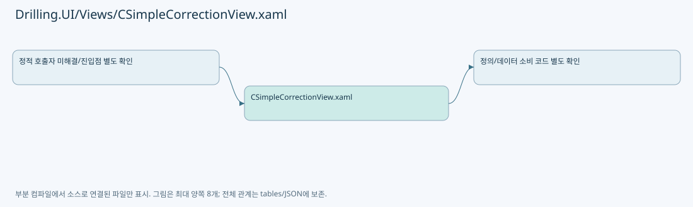

# Drilling.UI/Views/CSimpleCorrectionView.xaml

| 항목 | 내용 |
| --- | --- |
| 원본 저장소 | https://github.com/kjuws10-rgb/A3Drilling.git |
| 원본 Commit | 5aee8e58439c9b455cae7c9593c9be986c3e682e |
| 원본 SHA256 | 5425655e3db541303168239d60bba5ccd9536438b10d2687c731600d3231700a |
| 파일 분류 | code |
| 원본 크기/행 | 41,600 bytes / 371 physical lines |
| 인코딩 | utf-8-sig |
| 검토 범위 | 구문/부분 의미 분석에서 추출한 사실. 동작·물리 단위·실장비 합격을 보증하지 않습니다. |
| 원본 링크 | [고정 Commit 원본](https://github.com/kjuws10-rgb/A3Drilling/blob/5aee8e58439c9b455cae7c9593c9be986c3e682e/Drilling.UI/Views/CSimpleCorrectionView.xaml) |

## 파일의 역할과 읽는 순서

WPF 화면·사용자 명령·표시 상태를 구성합니다. XAML 이벤트와 코드 비하인드, RootView의 조립 경로를 함께 추적합니다.

## 화면 구성과 코드 비하인드 연결

| 항목 | 추출 값 |
| --- | --- |
| 코드 비하인드 후보 | Drilling.UI/Views/CSimpleCorrectionView.xaml.cs |
| 이름 있는 요소 | StatusColorBorder, RoughCardBlink, SimplePreviewPanel, SimpleGlassViewport, SimplePreviewScroll, SimpleFirstShotCallouts, CalloutMarker, CalloutLeader, CalloutLabel, RoughPreviewBlink, SimpleCellViewport, SimpleCurrentRecipePanel, SimpleHeadSelectPanel, SimpleCorrectionPanel, SimpleCorrectionScroll |
| 이벤트 개수 | 0 |
| Binding 표현 개수 | 125 |

| 이벤트 | 핸들러 이름 | 해석 |
| --- | --- | --- |

| Binding 표현 |
| --- |
| StateBrush |
| State |
| DataContext.SelectHeadCommand, RelativeSource={RelativeSource AncestorType=UserControl |
| HeadNo |
| IsSelected |
| Name |
| IsRough, Converter={StaticResource BooleanToVisibilityConverter |
| BackToGlassCommand |
| CellVisibility |
| PreviewTitle |
| GlassVisibility |
| PreviewContentWidth |
| PreviewContentHeight |
| PreviewTransform |
| GlassFrame.CanvasLeft |
| GlassFrame.CanvasTop |
| GlassFrame.Width |
| GlassFrame.Height |
| PreviewImage |
| CellLabels |
| Width |
| Height |
| DisplayText |
| DataContext.SelectCellCommand, RelativeSource={RelativeSource AncestorType=UserControl |
| CellNo |
| PreviewContentWidth |
| PreviewContentHeight |
| FirstShotCallouts |
| DataContext.PreviewContentWidth, RelativeSource={RelativeSource AncestorType=UserControl |
| DataContext.PreviewContentHeight, RelativeSource={RelativeSource AncestorType=UserControl |
| CellBounds.X |
| CellBounds.Y |
| CellBounds.Width |
| CellBounds.Height |
| LeaderPoints |
| LabelLeft |
| LabelTop |
| LabelWidth |
| LabelHeight |
| Label |
| Detail |
| DataContext.SelectCorrectionShotCommand, RelativeSource={RelativeSource AncestorType=UserControl |
| ShotKey |
| IsSelected |
| HasInspectionState |
| InspectionBrush |
| InspectionBrush |
| InspectionBrush |
| InspectionBrush |
| InspectionBrush |
| InspectionState |
| Camera |
| DataContext.IsRough, RelativeSource={RelativeSource AncestorType=views:CSimpleCorrectionView |
| DataContext.PreviewContentWidth, RelativeSource={RelativeSource AncestorType=UserControl |
| DataContext.PreviewContentHeight, RelativeSource={RelativeSource AncestorType=UserControl |
| SelectHeadHintVisibility |
| CellVisibility |
| CellSummary |
| ShotRows |
| Shots |
| State |
| CanProcess |
| DataContext.IsRough, RelativeSource={RelativeSource AncestorType=views:CSimpleCorrectionView |
| IsReference |
| IsMasked |
| IsChessSkipped |
| Name |
| Head |
| State |
| Summary |
| RecipeName |
| RecipeId |
| ErrorText |
| ErrorText |
| IsRough, Converter={StaticResource BooleanToVisibilityConverter |
| Inspection.StageY |
| Inspection.ReviewX |
| Inspection.Mode |
| HeadSelectionTitle |
| HeadSelections |
| SelectScopeCommand |
| IsHeadScope |
| SelectScopeCommand |
| IsHeadCellScope |
| IsRough, Converter={StaticResource BooleanToVisibilityConverter |
| Inspection.BeamNumbers |
| Inspection.SelectedBeam, Mode=TwoWay |
| Inspection.CanConfigure |
| IsSimple, Converter={StaticResource BooleanToVisibilityConverter |
| CorrectionRows |
| Title |
| CurrentX |
| CurrentY |
| InputX, Mode=OneWay |
| InputY, Mode=OneWay |
| IsSimple, Converter={StaticResource BooleanToVisibilityConverter |
| CorrectionEmptyText |
| CorrectionEmptyVisibility |
| IsRough, Converter={StaticResource BooleanToVisibilityConverter |
| Inspection.Summary |
| Inspection.Rows |
| Title |
| State |
| ReviewX, StringFormat='X {0 |
| StageY, StringFormat='Y {0 |
| CurrentX |
| CurrentY |
| DeltaX |
| DeltaY |
| ConvertedX |
| ConvertedY |
| IsRough, Converter={StaticResource BooleanToVisibilityConverter |
| Inspection.Status |
| OffsetActionCommand |
| OffsetActionCommand |
| OffsetActionCommand |
| OffsetActionCommand |
| OffsetActionCommand |
| OffsetActionCommand |
| OffsetActionCommand |
| IsSimple, Converter={StaticResource BooleanToVisibilityConverter |
| OffsetActionCommand |
| OffsetActionCommand |
| OffsetActionCommand |
| OffsetActionCommand |

## 원문 전체 주석 해설본

[원본 모든 행과 행별 해설 보기](../../../annotated/Drilling.UI/Views/CSimpleCorrectionView.xaml.annotated.txt)

원본을 빠뜨리거나 임의로 줄이지 않았습니다. `L000001 |` 표시는 원본 행 번호, `// 해설`은 별도 설명입니다. 실행용 소스가 아닌 문서입니다.

## 수정·재검증 체크

- 원본 Commit과 현재 작업 파일 SHA가 같은지 먼저 확인합니다. 다르면 이 문서를 과거 버전 자료로 취급합니다.
- 선언·직접 호출·이벤트/인터페이스 경계·설정 소비를 함께 확인합니다. 정적 연결의 빈 곳을 정상 경로로 추정하지 않습니다.
- 저장 형식/단위/식별자·재시도·취소·예외·롤백에 영향을 주는 변경은 상세 해설장과 호출자를 다시 검토합니다.
- 도구의 구문 추출과 별도 정적 추적 해설, 실제 빌드·시뮬레이션·실장비 검증 결과를 분리합니다.
