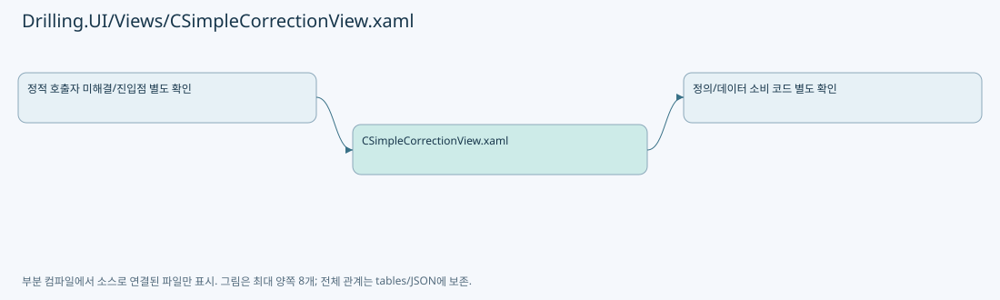

# Drilling.UI/Views/CSimpleCorrectionView.xaml

| 항목 | 내용 |
| --- | --- |
| 원본 저장소 | https://github.com/kjuws10-rgb/A3Drilling.git |
| 원본 Commit | 0219666f9053b907d96d7e0aa7d0c6c1be3a73d4 |
| 원본 SHA256 | 5425655e3db541303168239d60bba5ccd9536438b10d2687c731600d3231700a |
| 파일 분류 | code |
| 원본 크기/행 | 41,600 bytes / 371 physical lines |
| 인코딩 | utf-8-sig |
| 검토 범위 | 구문/부분 의미 분석에서 추출한 사실. 동작·물리 단위·실장비 합격을 보증하지 않습니다. |
| 원본 링크 | [고정 Commit 원본](https://github.com/kjuws10-rgb/A3Drilling/blob/0219666f9053b907d96d7e0aa7d0c6c1be3a73d4/Drilling.UI/Views/CSimpleCorrectionView.xaml) |

## 파일의 역할과 읽는 순서

WPF 화면·사용자 명령·표시 상태를 구성합니다. XAML 이벤트와 코드 비하인드, RootView의 조립 경로를 함께 추적합니다.

## 화면 구성과 코드 비하인드 연결

| 항목 | 추출 값 |
| --- | --- |
| 코드 비하인드 후보 | Drilling.UI/Views/CSimpleCorrectionView.xaml.cs |
| 이름 있는 요소 | StatusColorBorder, RoughCardBlink, SimplePreviewPanel, SimpleGlassViewport, SimplePreviewScroll, SimpleFirstShotCallouts, CalloutMarker, CalloutLeader, CalloutLabel, RoughPreviewBlink, SimpleCellViewport, SimpleCurrentRecipePanel, SimpleHeadSelectPanel, SimpleCorrectionPanel, SimpleCorrectionScroll |
| 이벤트 개수 | 5 |
| Binding 표현 개수 | 125 |

이름 있는 요소는 WPF가 필드를 생성할 수 있는 XAML 선언입니다. 문서 추출기는 WPF 생성 코드를 만들거나 로드하지 않으므로 C# 원문 멤버 수에 합산하지 않습니다.

| 요소 이름 | 원본 범위 |
| --- | --- |
| StatusColorBorder | L8–8 |
| RoughCardBlink | L17–17 |
| SimplePreviewPanel | L59–59 |
| SimpleGlassViewport | L75–75 |
| SimplePreviewScroll | L76–76 |
| SimpleFirstShotCallouts | L96–96 |
| CalloutMarker | L101–101 |
| CalloutLeader | L104–104 |
| CalloutLabel | L105–105 |
| RoughPreviewBlink | L139–139 |
| SimpleCellViewport | L159–159 |
| SimpleCurrentRecipePanel | L214–214 |
| SimpleHeadSelectPanel | L232–232 |
| SimpleCorrectionPanel | L264–264 |
| SimpleCorrectionScroll | L268–268 |

| 이벤트 | 핸들러 이름 | 원본 범위 | 해석 |
| --- | --- | --- | --- |
| SizeChanged | PreviewSizeChanged | L77–77 | 코드 비하인드/이벤트 라우팅에서 실제 연결 확인 필요 |
| ScrollChanged | PreviewScrollChanged | L77–77 | 코드 비하인드/이벤트 라우팅에서 실제 연결 확인 필요 |
| MouseLeftButtonUp | SelectRepresentativeShot | L173–173 | 코드 비하인드/이벤트 라우팅에서 실제 연결 확인 필요 |
| PreviewMouseLeftButtonDown | OpenCorrectionInput | L283–283 | 코드 비하인드/이벤트 라우팅에서 실제 연결 확인 필요 |
| PreviewMouseLeftButtonDown | OpenCorrectionInput | L285–285 | 코드 비하인드/이벤트 라우팅에서 실제 연결 확인 필요 |

| Binding 표현 | 원본 범위 |
| --- | --- |
| {Binding StateBrush} | L14–14 |
| {Binding State} | L16–16 |
| {Binding DataContext.SelectHeadCommand, RelativeSource={RelativeSource AncestorType=UserControl}} | L40–40 |
| {Binding HeadNo} | L41–41 |
| {Binding IsSelected} | L46–46 |
| {Binding Name} | L53–53 |
| {Binding IsRough, Converter={StaticResource BooleanToVisibilityConverter}} | L65–65 |
| {Binding BackToGlassCommand} | L69–69 |
| {Binding CellVisibility} | L70–70 |
| {Binding PreviewTitle} | L71–71 |
| {Binding GlassVisibility} | L75–75 |
| {Binding PreviewContentWidth} | L78–78 |
| {Binding PreviewContentHeight} | L78–78 |
| {Binding PreviewTransform} | L79–79 |
| {Binding GlassFrame.CanvasLeft} | L80–80 |
| {Binding GlassFrame.CanvasTop} | L80–80 |
| {Binding GlassFrame.Width} | L81–81 |
| {Binding GlassFrame.Height} | L81–81 |
| {Binding PreviewImage} | L83–83 |
| {Binding CellLabels} | L84–84 |
| {Binding Width} | L88–88 |
| {Binding Height} | L88–88 |
| {Binding DisplayText} | L89–89 |
| {Binding DataContext.SelectCellCommand, RelativeSource={RelativeSource AncestorType=UserControl}} | L90–90 |
| {Binding CellNo} | L91–91 |
| {Binding PreviewContentWidth} | L96–96 |
| {Binding PreviewContentHeight} | L96–96 |
| {Binding FirstShotCallouts} | L96–96 |
| {Binding DataContext.PreviewContentWidth, RelativeSource={RelativeSource AncestorType=UserControl}} | L99–99 |
| {Binding DataContext.PreviewContentHeight, RelativeSource={RelativeSource AncestorType=UserControl}} | L100–100 |
| {Binding CellBounds.X} | L101–101 |
| {Binding CellBounds.Y} | L101–101 |
| {Binding CellBounds.Width} | L102–102 |
| {Binding CellBounds.Height} | L102–102 |
| {Binding LeaderPoints} | L104–104 |
| {Binding LabelLeft} | L105–105 |
| {Binding LabelTop} | L105–105 |
| {Binding LabelWidth} | L107–107 |
| {Binding LabelHeight} | L107–107 |
| {Binding Label} | L108–108 |
| {Binding Detail} | L108–108 |
| {Binding DataContext.SelectCorrectionShotCommand, RelativeSource={RelativeSource AncestorType=UserControl}} | L112–112 |
| {Binding ShotKey} | L113–113 |
| {Binding IsSelected} | L121–121 |
| {Binding HasInspectionState} | L132–132 |
| {Binding InspectionBrush} | L133–133 |
| {Binding InspectionBrush} | L133–133 |
| {Binding InspectionBrush} | L134–134 |
| {Binding InspectionBrush} | L134–134 |
| {Binding InspectionBrush} | L135–135 |
| {Binding InspectionState} | L137–137 |
| {Binding Camera} | L149–149 |
| {Binding DataContext.IsRough, RelativeSource={RelativeSource AncestorType=views:CSimpleCorrectionView}, Converter={StaticResource BooleanToVisibilityConverter}} | L150–150 |
| {Binding DataContext.PreviewContentWidth, RelativeSource={RelativeSource AncestorType=UserControl}} | L151–151 |
| {Binding DataContext.PreviewContentHeight, RelativeSource={RelativeSource AncestorType=UserControl}} | L152–152 |
| {Binding SelectHeadHintVisibility} | L155–155 |
| {Binding CellVisibility} | L159–159 |
| {Binding CellSummary} | L161–161 |
| {Binding ShotRows} | L163–163 |
| {Binding Shots} | L170–170 |
| {Binding State} | L173–173 |
| {Binding CanProcess} | L181–181 |
| {Binding DataContext.IsRough, RelativeSource={RelativeSource AncestorType=views:CSimpleCorrectionView}} | L182–182 |
| {Binding IsReference} | L184–184 |
| {Binding IsMasked} | L188–188 |
| {Binding IsChessSkipped} | L191–191 |
| {Binding Name} | L197–197 |
| {Binding Head} | L198–198 |
| {Binding State} | L199–199 |
| {Binding Summary} | L208–208 |
| {Binding RecipeName} | L219–219 |
| {Binding RecipeId} | L219–219 |
| {Binding ErrorText} | L221–221 |
| {Binding ErrorText} | L222–222 |
| {Binding IsRough, Converter={StaticResource BooleanToVisibilityConverter}} | L224–224 |
| {Binding Inspection.StageY} | L226–226 |
| {Binding Inspection.ReviewX} | L227–227 |
| {Binding Inspection.Mode} | L228–228 |
| {Binding HeadSelectionTitle} | L234–234 |
| {Binding HeadSelections} | L235–235 |
| {Binding SelectScopeCommand} | L242–242 |
| {Binding IsHeadScope} | L244–244 |
| {Binding SelectScopeCommand} | L250–250 |
| {Binding IsHeadCellScope} | L252–252 |
| {Binding IsRough, Converter={StaticResource BooleanToVisibilityConverter}} | L258–258 |
| {Binding Inspection.BeamNumbers} | L260–260 |
| {Binding Inspection.SelectedBeam, Mode=TwoWay} | L260–260 |
| {Binding Inspection.CanConfigure} | L260–260 |
| {Binding IsSimple, Converter={StaticResource BooleanToVisibilityConverter}} | L268–268 |
| {Binding CorrectionRows} | L269–269 |
| {Binding Title} | L275–275 |
| {Binding CurrentX} | L279–279 |
| {Binding CurrentY} | L280–280 |
| {Binding InputX, Mode=OneWay} | L282–282 |
| {Binding InputY, Mode=OneWay} | L284–284 |
| {Binding IsSimple, Converter={StaticResource BooleanToVisibilityConverter}} | L291–291 |
| {Binding CorrectionEmptyText} | L292–292 |
| {Binding CorrectionEmptyVisibility} | L292–292 |
| {Binding IsRough, Converter={StaticResource BooleanToVisibilityConverter}} | L295–295 |
| {Binding Inspection.Summary} | L297–297 |
| {Binding Inspection.Rows} | L299–299 |
| {Binding Title} | L305–305 |
| {Binding State} | L306–306 |
| {Binding ReviewX, StringFormat='X {0}'} | L308–308 |
| {Binding StageY, StringFormat='Y {0}'} | L309–309 |
| {Binding CurrentX} | L311–311 |
| {Binding CurrentY} | L312–312 |
| {Binding DeltaX} | L314–314 |
| {Binding DeltaY} | L315–315 |
| {Binding ConvertedX} | L317–317 |
| {Binding ConvertedY} | L318–318 |
| {Binding IsRough, Converter={StaticResource BooleanToVisibilityConverter}} | L325–325 |
| {Binding Inspection.Status} | L326–326 |
| {Binding OffsetActionCommand} | L328–328 |
| {Binding OffsetActionCommand} | L329–329 |
| {Binding OffsetActionCommand} | L345–345 |
| {Binding OffsetActionCommand} | L348–348 |
| {Binding OffsetActionCommand} | L349–349 |
| {Binding OffsetActionCommand} | L350–350 |
| {Binding OffsetActionCommand} | L352–352 |
| {Binding IsSimple, Converter={StaticResource BooleanToVisibilityConverter}} | L354–354 |
| {Binding OffsetActionCommand} | L358–358 |
| {Binding OffsetActionCommand} | L360–360 |
| {Binding OffsetActionCommand} | L362–362 |
| {Binding OffsetActionCommand} | L365–365 |

## 원문 전체 주석 해설본

[원본 모든 행과 행별 해설 보기](../../../annotated/Drilling.UI/Views/CSimpleCorrectionView.xaml.annotated.txt)

원본을 빠뜨리거나 임의로 줄이지 않았습니다. `L000001 |` 표시는 원본 행 번호, `// 해설`은 별도 설명입니다. 실행용 소스가 아닌 문서입니다.

## 수정·재검증 체크

- 원본 Commit과 현재 작업 파일 SHA가 같은지 먼저 확인합니다. 다르면 이 문서를 과거 버전 자료로 취급합니다.
- 선언·직접 호출·이벤트/인터페이스 경계·설정 소비를 함께 확인합니다. 정적 연결의 빈 곳을 정상 경로로 추정하지 않습니다.
- 저장 형식/단위/식별자·재시도·취소·예외·롤백에 영향을 주는 변경은 상세 해설장과 호출자를 다시 검토합니다.
- 도구의 구문 추출과 별도 정적 추적 해설, 실제 빌드·시뮬레이션·실장비 검증 결과를 분리합니다.
