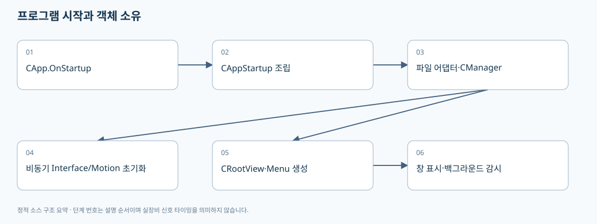
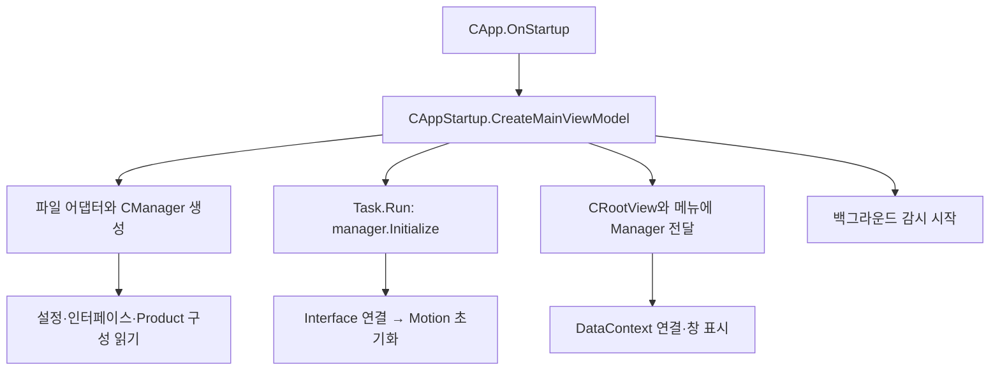

# 01. 프로그램은 어떻게 시작되고 누가 무엇을 소유하는가

> 기준: `A3Drilling/master` · `5aee8e58439c9b455cae7c9593c9be986c3e682e`. 본 장은 해당 Commit의 소스를 정적으로 읽어 설명합니다. 장비 연결·가공·컴파일을 실행한 결과가 아닙니다.

처음 보는 개발자는 `CApp → CAppStartup → CManager → CRootView` 순서로 읽으면 됩니다. 화면과 파일 저장, 장비 통신을 한 클래스에서 모두 수행하는 구조가 아니라, 시작 지점에서 객체를 만들고 같은 Manager를 여러 메뉴에 전달합니다. 실제 객체 구성은 아래 근거로 확인할 수 있습니다.

## 1. 시작 시점의 실제 호출 순서

| 단계 | 실제 진입점 | 입력·결과 | 확인할 문제 |
|---|---|---|---|
| 예외 처리 준비 | `CApp.OnStartup → RegisterExceptionHandlers` | Dispatcher/AppDomain/UnobservedTask 예외를 로그에 연결 | 로그 등록과 예외 복구는 다릅니다. 등록했다고 실행이 안전하게 계속된다는 뜻은 아닙니다. |
| 루트 창 읽기 | `LoadComponent(CRootView.xaml)` | WPF Window 인스턴스 | XAML 로드 실패와 ViewModel 생성 실패를 구분합니다. |
| 구성 객체 생성 | `CAppStartup.CreateMainViewModel` | 파일 어댑터, CManager, CRootView | 파일 경로·스키마 오류는 시작 실패 또는 시작 상태 메시지로 드러날 수 있습니다. |
| 화면 연결 | `window.DataContext = _rootView` | 화면이 RootView 속성·명령을 참조 | Manager를 UI에서 다시 만들면 캐시·상태 소유권이 갈라집니다. |
| 표시 | `window.Show()` | 화면 표시 | 표시 완료를 장비 연결 완료로 해석하면 안 됩니다. |

근거: [OnStartup의 창 생성·표시·실패 처리](https://github.com/kjuws10-rgb/A3Drilling/blob/5aee8e58439c9b455cae7c9593c9be986c3e682e/Drilling.UI/CApp.xaml.cs#L23-L45), [전역 예외 로그 등록](https://github.com/kjuws10-rgb/A3Drilling/blob/5aee8e58439c9b455cae7c9593c9be986c3e682e/Drilling.UI/CApp.xaml.cs#L53-L71), [CreateMainViewModel 전체 조립부](https://github.com/kjuws10-rgb/A3Drilling/blob/5aee8e58439c9b455cae7c9593c9be986c3e682e/Drilling.UI/CAppStartup.cs#L14-L69).

`CreateMainViewModel`은 `manager.Initialize()`를 `Task.Run`으로 시작하고 기다리지 않은 채 RootView를 반환합니다. 따라서 **구성 로드 → 창 표시 → 장비 초기화 완료**가 하나의 동기 함수처럼 끝나는 것으로 가정하면 안 됩니다. 이는 소스에서 확인되는 비동기 경계입니다. 실제 장비 준비 완료 판단은 연결 상태와 시작 단계 결과, 인터락을 따로 확인해야 합니다. [비동기 Initialize와 BackgroundMonitoring 시작](https://github.com/kjuws10-rgb/A3Drilling/blob/5aee8e58439c9b455cae7c9593c9be986c3e682e/Drilling.UI/CAppStartup.cs#L36-L68).

## 2. CManager 생성자가 만드는 소유 관계

| 객체 | 생성 목적 | 주로 소비하는 곳 | 바꾸면 함께 읽을 곳 |
|---|---|---|---|
| `CSettingManager` | Setting 파일을 읽고 메모리 캐시·검증을 제공 | 메뉴, 좌표 준비, 인터페이스·인터락 | `CSettingFile`, Setting UI, `BuildRuntimeParameters` |
| `CInterfaceManager` | 등록된 장치별 통신·상태·장치 명령의 공통 입구 | Automation, Review, Station, Monitor | `CComm`, 장치별 Comm, JHMI Interface 정의 |
| `CAutomationManager` | Automation1 명령·Script 경로·상태 취득을 묶음 | Station, Manual, Monitor | Automation1 Comm, Script 생성기 |
| `CMotionManager` | 축 정의와 컨트롤러를 연결하고 축 명령을 처리 | Station 및 수동 이동 UI | Motor 정의·컨트롤러별 구현 |
| `CProductManager` | 현재 Glass/Product의 상태·결과·스냅샷 관리 | Station, Review, Monitor | `CProductFile`의 compact 저장 형식 |
| `CReviewManager` | 리뷰 결과/측정 영역의 서비스 객체 | Review·Correction 및 Stage 연동 | 리뷰 전용 상세 장과 파일 레퍼런스 |
| `CRecipeManager` | 레시피 읽기·저장·이력·동시성 관리 | Recipe UI, Station, Review | `CJhmiRecipeFile`, JHMI_RCP 정의 |
| `CStationManager` | Process Station을 UI/상위 요청에 노출 | RootView, 수동/자동 기능 | `CStationProcess` 및 partial 파일 |

이 표는 실제 `CManager` 생성 순서를 요약한 것입니다. 모든 Manager가 임의로 직접 연결되는 것이 아니라 앞서 만들어진 객체가 뒤 객체의 생성자에 전달됩니다. `ProductManager`와 `RecipeManager`는 다른 책임을 갖고 같은 데이터를 저장하는 대체재가 아닙니다. [Manager 생성·주입과 실패 이벤트 연결](https://github.com/kjuws10-rgb/A3Drilling/blob/5aee8e58439c9b455cae7c9593c9be986c3e682e/Drilling.Common/Managers/CManager.cs#L93-L141).

## 3. 파일 객체를 인터페이스처럼 주입하는 이유

`CAppStartup`은 `CJhmiRecipeFile`, `CSettingFile`, `CProductFile`, `CReviewResultFile`, `CReviewOffsetFile`, `CAutomation1ScriptFile` 등 구체 파일 객체를 만듭니다. Common 영역의 Manager가 파일 저장 방식을 직접 결정하기보다 주입받은 파일 객체에 작업을 요청하도록 구성되어 있습니다. 예를 들어 레시피 저장 흐름을 이해하려면 **UI의 Save 버튼 → CRecipeManager → CJhmiRecipeFile → CCsvParser**를 따라야 합니다. UI 파일만 읽고 실제 저장 형식을 확정하면 안 됩니다. [파일 어댑터 생성](https://github.com/kjuws10-rgb/A3Drilling/blob/5aee8e58439c9b455cae7c9593c9be986c3e682e/Drilling.UI/CAppStartup.cs#L16-L35), [Recipe 파일 추상 계약](https://github.com/kjuws10-rgb/A3Drilling/blob/5aee8e58439c9b455cae7c9593c9be986c3e682e/Drilling.Common/Managers/CRecipeManager.cs#L406-L418).

이 분리는 수정 범위 판단에도 유용합니다. 화면 이름만 바꾸는 변경은 UI에 머물 수 있지만, 새 Parameter를 실제 저장하고 Script까지 사용하려면 정의 CSV와 File·Manager·계산기·UI의 연결을 함께 검토해야 합니다. 이 문장은 구조에서 도출한 변경 검토 방법이며, 자동으로 모든 의존성을 찾아주는 기능이 구현되어 있다는 뜻은 아닙니다.

## 4. ConfigRoot와 Script 경로가 정해지는 방식

`GetConfigRoot`는 실행 파일 위치에서 상위 폴더를 거슬러 `Drilling.sln`을 찾으면 그 폴더의 `Config`를 선택합니다. 찾지 못하면 현재 작업 디렉터리의 `Config`를 사용합니다. 실행 EXE 위치와 작업 디렉터리가 다르면 예상과 다른 Config를 읽을 수 있으므로, 경로 문제는 실제 선택된 `ConfigRoot`부터 확인해야 합니다. [ConfigRoot 탐색](https://github.com/kjuws10-rgb/A3Drilling/blob/5aee8e58439c9b455cae7c9593c9be986c3e682e/Drilling.UI/CAppStartup.cs#L121-L135).

`GetScriptDirectory`는 Option Setting의 `LocalScriptPath`를 Key 또는 Name으로 찾습니다. 값이 없으면 논리 경로 `Data/Script`를 사용하며, 상대 경로는 Config의 부모 프로젝트 경로를 기준으로 해석합니다. **로컬 Script 폴더와 Controller에 업로드되는 파일명은 별개**입니다. [Script 폴더 결정](https://github.com/kjuws10-rgb/A3Drilling/blob/5aee8e58439c9b455cae7c9593c9be986c3e682e/Drilling.UI/CAppStartup.cs#L137-L151), [로컬 경로와 Controller 파일명 전달](https://github.com/kjuws10-rgb/A3Drilling/blob/5aee8e58439c9b455cae7c9593c9be986c3e682e/Drilling.Common/Automation/CAutomationManager.cs#L315-L333).

## 5. 초기화·상태 취득·종료를 구분하기

| 동작 | 의미 | 소스 근거 |
|---|---|---|
| 생성자 | 객체·정의·캐시·Product를 준비 | `CManager` 생성부 |
| `Initialize` | Interface 연결 후 Motion Controller 초기화 | [Initialize 순서](https://github.com/kjuws10-rgb/A3Drilling/blob/5aee8e58439c9b455cae7c9593c9be986c3e682e/Drilling.Common/Managers/CManager.cs#L204-L218) |
| `StartBackgroundMonitoring` | 0선 대기·보호윈도우·스냅샷·알람 감시를 시작 | [백그라운드 감시](https://github.com/kjuws10-rgb/A3Drilling/blob/5aee8e58439c9b455cae7c9593c9be986c3e682e/Drilling.Common/Managers/CManager.cs#L259-L268) |
| `StopBackgroundMonitoring` | Stage 요청·감시·스냅샷 취득을 멈춤 | [감시 중지](https://github.com/kjuws10-rgb/A3Drilling/blob/5aee8e58439c9b455cae7c9593c9be986c3e682e/Drilling.Common/Managers/CManager.cs#L270-L278) |
| `Destroy` | 감시 중지 외에 이력 flush·PowerMeasure dispose·Motion/Interface 종료·로그 정리를 수행 | [전체 종료 경로](https://github.com/kjuws10-rgb/A3Drilling/blob/5aee8e58439c9b455cae7c9593c9be986c3e682e/Drilling.Common/Managers/CManager.cs#L220-L257) |

앱 종료 시 보이는 경로는 `CApp.OnExit → CRootView.StopAutomationStatusAcquisition → CManager.StopBackgroundMonitoring`입니다. `Destroy`라는 별도 메서드가 존재한다는 이유만으로 이 경로가 `Destroy` 전체를 호출한다고 설명하면 틀립니다. 종료 시 장치 연결 해제까지 원하는 경우 호출 지점을 별도로 추적해야 합니다. [OnExit](https://github.com/kjuws10-rgb/A3Drilling/blob/5aee8e58439c9b455cae7c9593c9be986c3e682e/Drilling.UI/CApp.xaml.cs#L47-L51), [RootView 종료 처리](https://github.com/kjuws10-rgb/A3Drilling/blob/5aee8e58439c9b455cae7c9593c9be986c3e682e/Drilling.UI/CRootView.cs#L248-L255).

## 6. UI 개발 시 주의할 실제 형태

`CRootView`는 Menu 목록을 만들고 선택한 메뉴를 활성화하며 알람 이벤트를 구독하고 초기 ProcessModel 준비 Task를 시작합니다. Menu 클래스는 같은 Manager 인스턴스를 주입받습니다. [RootView 생성자 입력과 선택 Recipe](https://github.com/kjuws10-rgb/A3Drilling/blob/5aee8e58439c9b455cae7c9593c9be986c3e682e/Drilling.UI/CRootView.cs#L128-L165), [메뉴·이벤트·초기 모델 연결](https://github.com/kjuws10-rgb/A3Drilling/blob/5aee8e58439c9b455cae7c9593c9be986c3e682e/Drilling.UI/CRootView.cs#L230-L235).

`CBindingBase`는 속성별 `...Changed` 이벤트와 `OnPropertyChanged`의 switch를 사용하는 구조입니다. 통상적인 MVVM 프레임워크의 `INotifyPropertyChanged` 구현이라고 단정해 새 Property만 추가하면 화면이 자동 갱신된다고 가정하면 안 됩니다. `SetProperty`와 `SetSequenceProperty`가 어떤 이벤트를 발생시키는지도 함께 맞춰야 합니다. [Property 변경 알림 구조](https://github.com/kjuws10-rgb/A3Drilling/blob/5aee8e58439c9b455cae7c9593c9be986c3e682e/Drilling.UI/Menu/CBindingBase.cs#L735-L788).

## 7. 권장 검증 시나리오

아래는 실행 완료 결과가 아니라 앞으로 수행할 검증 절차입니다.

1. **경로 탐색**: 솔루션 폴더 안/밖에서 실행한 경우 선택된 ConfigRoot와 Script 경로가 설계한 위치인지 시작 로그로 확인합니다.
2. **초기화 지연**: 가짜 Interface 초기화가 지연되도록 한 격리 테스트에서 창이 먼저 열리는지, 준비 전 명령이 UI/인터락에서 차단되는지 확인합니다.
3. **잘못된 정의 파일**: 별도 복사본에서 필수 헤더를 제거하고 실패 단계와 사용자 메시지가 어느 위치에서 생성되는지 확인합니다.
4. **종료 중 지연 통신**: polling과 로그 flush가 진행 중일 때 종료하여 반환 시간·스레드 생존·연결 해제 여부를 기록합니다. 소스상 Stop 경로와 Destroy 경로를 각각 구분합니다.
5. **중복 객체 방지**: 새 메뉴를 추가할 때 기존 CManager를 받아 사용하고 별도 Manager를 몰래 생성하지 않는지 확인합니다.

다음 읽기: [02. Recipe·Setting·저장 형식](02-recipe-settings-and-csv.md), [06. 스레드·상태 취득·로그](06-threading-snapshots-and-logs.md).
