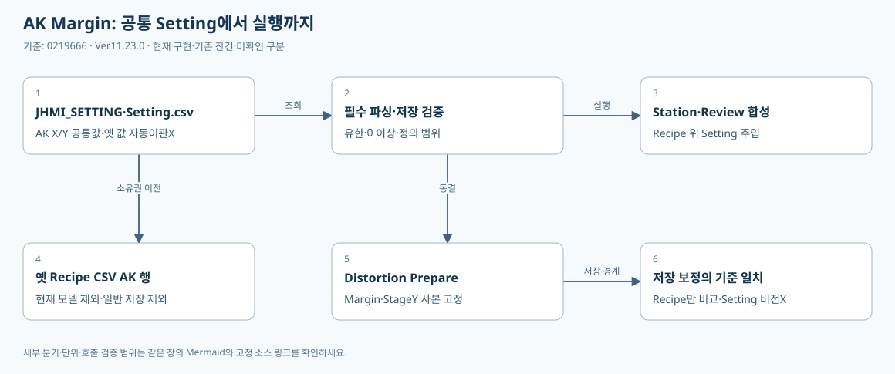
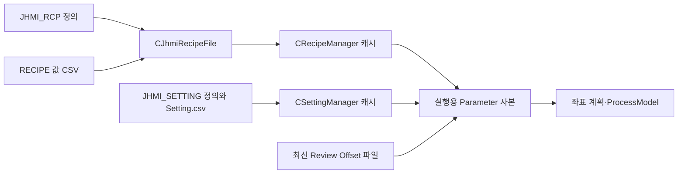
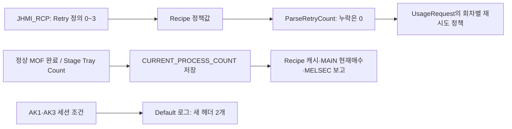
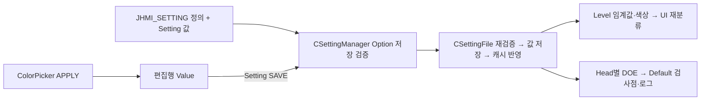
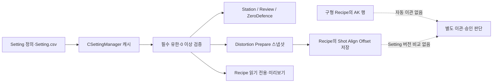

# 02. Recipe·Setting·JHMI·CSV를 함께 이해하기

> 기준: `A3Drilling/master` · `334b3599651b2e8e0181fd4459bafaf3cddafff3`. 본 장은 해당 Commit의 소스를 정적으로 읽어 설명합니다. 정식 설비 빌드·장비 연결·가공을 실행한 결과가 아닙니다.

**JHMI 정의 파일은 화면 항목의 설계도, Recipe/Setting 값 파일은 그 항목에 들어간 값, ProcessModel은 실행에 사용할 합성 스냅샷**입니다. 같은 Parameter 이름이 보여도 어느 층에 있는지 구분해야 변경이 누락되지 않습니다.

## 1. 세 가지 저장 형식을 혼동하지 않기

| 파일 계층 | 실제 읽기/쓰기 형태 | 대표 필드 | 주의점 |
|---|---|---|---|
| Recipe 항목 정의 | `LoadFormItems → CCsvParser.Read`의 헤더형 CSV | `TAB,GROUP,NAME,DISPLAY NAME,CIM NAME,DATA TYPE,UNIT,SHOW,USE,VALUE,SCALE,CHANGE LIMIT,MIN,MAX,DESCRIPTION,ORDER` | `CIM NAME`이 있다는 사실만으로 고객 Host PPID/Sub PPID 계약이 완성됐다고 말할 수 없습니다. |
| Recipe 값 | `ReadRecipeValues → ParseRecipeLine`이 라인별 첫 3필드를 읽음 | `Tab,Name,Value`, 이후 필드는 Extra | 정의 파일의 헤더 전체를 값 파일의 열 구조로 착각하지 않습니다. 3필드 미만인 행은 파서에서 null로 제외됩니다. |
| Setting 값 | 헤더가 있는 `Setting.csv` | `TAB,NAME,VALUE` | Recipe 값 파서를 그대로 적용하면 안 됩니다. |
| Active Product | 별도의 compact CSV | `TYPE,NAME,VALUE` | PRODUCT/RECIPE/ALIGN/REVIEW 등의 구역 이름이 TYPE에 들어갑니다. [04장](04-product-and-station-lifecycle.md)에서 설명합니다. |

근거: [Recipe 정의 헤더와 저장 폴더](https://github.com/kjuws10-rgb/A3Drilling/blob/334b3599651b2e8e0181fd4459bafaf3cddafff3/Drilling.File/JHMI/CJhmiRecipeFile.cs#L26-L30), [정의 항목 읽기](https://github.com/kjuws10-rgb/A3Drilling/blob/334b3599651b2e8e0181fd4459bafaf3cddafff3/Drilling.File/JHMI/CJhmiRecipeFile.cs#L848-L887), [Recipe 값 파서](https://github.com/kjuws10-rgb/A3Drilling/blob/334b3599651b2e8e0181fd4459bafaf3cddafff3/Drilling.File/JHMI/CJhmiRecipeFile.cs#L890-L924), [Setting 헤더와 값 쓰기](https://github.com/kjuws10-rgb/A3Drilling/blob/334b3599651b2e8e0181fd4459bafaf3cddafff3/Drilling.File/JHMI/CSettingFile.cs#L328-L385), [Product 헤더](https://github.com/kjuws10-rgb/A3Drilling/blob/334b3599651b2e8e0181fd4459bafaf3cddafff3/Drilling.File/Product/CProductFile.cs#L8-L11).

## 2. 실제 CoreData 레코드의 역할

| 타입 | 주요 필드 | 생명주기와 의미 |
|---|---|---|
| `ST_RECIPE_FORM_ITEM` | Tab, Group, Name, DisplayName, CimName, DataType, Unit, Show, Use, DefaultValue, Scale, ChangeLimit, Min, Max, Description, DisplayOrder, Extra | 정의 CSV에서 만들어지는 항목의 메타데이터입니다. 화면 이름과 영속 Key를 분리할 수 있습니다. |
| `ST_RECIPE_PARAMETER` | Name, Value, Unit, Range, DefaultValue, Tab, Group, Key, Description, Show, Use, DisplayOrder, DataType, ChangeLimit, Min, Max, Extra | 현재 Recipe 한 개의 편집/조회 항목입니다. Name과 Key가 같은 의미라고 강제하지 않습니다. |
| `ST_RECIPE_DEFINITION` | Id, Name, Parameters, History | Manager가 로드·저장하는 Recipe 단위입니다. 단순 문자열 딕셔너리와 다릅니다. |
| `ST_RECIPE_VALUE` | Tab, Name, Value, Extra | 값 CSV 한 행을 표현합니다. |
| `ST_RECIPE_HISTORY` | ChangedAt, ItemName, OldValue, NewValue, OperatorId, RecipeName, Action, Tab, Group | 변경 전후와 맥락을 보관합니다. |

근거: [Recipe CoreData 정의](https://github.com/kjuws10-rgb/A3Drilling/blob/334b3599651b2e8e0181fd4459bafaf3cddafff3/Drilling.Common/Managers/CRecipeManager.cs#L357-L407). `EN_RECIPE_DATA_TYPE`은 String/Int/Double/Bool입니다. 문자열 Value를 사용하더라도 숫자·논리 타입 검증을 생략해도 된다는 뜻은 아닙니다. [Recipe 타입 enum](https://github.com/kjuws10-rgb/A3Drilling/blob/334b3599651b2e8e0181fd4459bafaf3cddafff3/Drilling.Common/Managers/CRecipeManager.cs#L349-L355).

Setting 쪽의 `ST_SYSTEM_PARAMETER`는 Section, Name, Value, Unit, Description, Group, Key, DefaultValue, DataType, Min/Max, Show/Use, DisplayOrder, Extra를 갖습니다. `EN_SETTING_TAB`은 Option/Interface/Io/Motor/Alarm입니다. “Setting 탭 전체가 한 종류의 단순 옵션”이 아니라 인터페이스·축·알람 정의와 연결되는 분류라는 점을 알아두면 경로를 찾기 쉽습니다. [Setting CoreData와 파일 계약](https://github.com/kjuws10-rgb/A3Drilling/blob/334b3599651b2e8e0181fd4459bafaf3cddafff3/Drilling.Common/Managers/CSettingManager.cs#L254-L286).

## 3. Recipe 저장을 코드 순서로 따라가기

1. UI가 `ST_RECIPE_DEFINITION`을 만들어 `CRecipeManager.SaveRecipe`에 전달합니다.
2. Manager는 Recipe 작업 gate로 직렬화하고 기존 Recipe/Offset 정보를 유지하는 저장 경로를 사용합니다.
3. `CJhmiRecipeFile.SaveCore`는 정의 항목을 읽고 `Use` 조건과 활성 Cell/Shot 범위에 맞춰 저장할 항목을 고릅니다.
4. `DEFAULT/RECIPE_NAME`, `DEFAULT/RECIPE_ID`를 먼저 기록하고, 일반 항목과 Cell 범위 항목을 별도로 이어 씁니다.
5. 쓰기 후 `ValidateSavedRecipeFile`을 호출하고, 조건에 따라 생성/수정/저장 이력을 남깁니다.

근거: [Manager 저장 진입과 변경 확인](https://github.com/kjuws10-rgb/A3Drilling/blob/334b3599651b2e8e0181fd4459bafaf3cddafff3/Drilling.Common/Managers/CRecipeManager.cs#L73-L93), [저장 후 재조회·캐시](https://github.com/kjuws10-rgb/A3Drilling/blob/334b3599651b2e8e0181fd4459bafaf3cddafff3/Drilling.Common/Managers/CRecipeManager.cs#L148-L170), [SaveCore 항목 선택](https://github.com/kjuws10-rgb/A3Drilling/blob/334b3599651b2e8e0181fd4459bafaf3cddafff3/Drilling.File/JHMI/CJhmiRecipeFile.cs#L120-L165), [Recipe 직렬화·재검증·이력](https://github.com/kjuws10-rgb/A3Drilling/blob/334b3599651b2e8e0181fd4459bafaf3cddafff3/Drilling.File/JHMI/CJhmiRecipeFile.cs#L166-L242).

중요한 예외가 `CURRENT_PROCESS_COUNT`입니다. 편집 화면을 연 뒤 실제 가공이 진행될 수 있으므로, 저장 시 기존 파일의 현재 가공매수를 보존합니다. 오래된 편집 초안이 실제 생산 카운터를 되돌리면 안 되기 때문입니다. 보정값 저장의 변경 비교에서도 이 키를 제외합니다. [런타임 소유 카운터 보존](https://github.com/kjuws10-rgb/A3Drilling/blob/334b3599651b2e8e0181fd4459bafaf3cddafff3/Drilling.File/JHMI/CJhmiRecipeFile.cs#L188-L206), [동시 수정 비교의 카운터 예외](https://github.com/kjuws10-rgb/A3Drilling/blob/334b3599651b2e8e0181fd4459bafaf3cddafff3/Drilling.Common/Managers/CRecipeManager.cs#L74-L93).

`SaveParametersIfUnchanged(expected, changes)`는 측정 당시 Recipe와 현재 파일을 비교한 뒤 수정합니다. 측정 후 다른 작업자가 레시피를 바꾸었다면 예상한 기준과 다르므로 예외를 내는 구조입니다. 저장이 반환된 뒤 재조회와 이력 새로고침은 `CancellationToken.None`을 사용합니다. **저장 전 취소**와 **이미 저장된 뒤 화면 갱신 실패**를 같은 실패로 처리하면 사용자가 같은 보정을 두 번 적용할 위험이 있습니다. [보정 저장의 비교 및 commit 이후 처리](https://github.com/kjuws10-rgb/A3Drilling/blob/334b3599651b2e8e0181fd4459bafaf3cddafff3/Drilling.Common/Managers/CRecipeManager.cs#L74-L110).

## 4. Setting의 실제 캐시·검증·저장 순서

`CSettingManager.LoadSection`은 캐시가 있으면 그대로 반환합니다. `ReloadSection`은 파일을 다시 읽어 캐시에 넣습니다. `SetValue`는 Key 또는 Name으로 기존 항목을 찾고 항목이 없으면 예외를 내므로, 정의에도 없는 키를 SetValue만 호출해 추가하는 방식은 성립하지 않습니다. [Setting 조회·기본값](https://github.com/kjuws10-rgb/A3Drilling/blob/334b3599651b2e8e0181fd4459bafaf3cddafff3/Drilling.Common/Managers/CSettingManager.cs#L26-L71), [SetValue와 저장](https://github.com/kjuws10-rgb/A3Drilling/blob/334b3599651b2e8e0181fd4459bafaf3cddafff3/Drilling.Common/Managers/CSettingManager.cs#L73-L103).

`SaveSection`은 Option의 카메라 해상도·허용치·AK Margin·Level 값을 검증하고, 특정 RunOption 변경은 MELSEC의 캐시된 Review Able 상태로 차단합니다. 파일 저장이 성공한 후에만 캐시를 교체합니다. 캐시값을 먼저 바꾸고 파일 저장 실패를 무시하는 흐름으로 고치면 메모리/디스크가 불일치합니다. [실시간 용량·해상도·RunOption 저장 검증](https://github.com/kjuws10-rgb/A3Drilling/blob/334b3599651b2e8e0181fd4459bafaf3cddafff3/Drilling.Common/Managers/CSettingManager.cs#L105-L156).

파일 계층은 정의에 존재하고 Use인 항목을 정규화하고, 다른 탭의 값까지 포함한 Setting 값 전체를 다시 씁니다. 이후 저장 파일을 재로딩하여 기대 Key/Value와 비교합니다. [정규화와 저장](https://github.com/kjuws10-rgb/A3Drilling/blob/334b3599651b2e8e0181fd4459bafaf3cddafff3/Drilling.File/JHMI/CSettingFile.cs#L53-L123), [저장 후 재검증](https://github.com/kjuws10-rgb/A3Drilling/blob/334b3599651b2e8e0181fd4459bafaf3cddafff3/Drilling.File/JHMI/CSettingFile.cs#L367-L406).

| Setting 개념 | 현재 코드에서 확인되는 조건 | 변경 시 확인 |
|---|---|---|
| Review camera resolution | 유한한 양수 mm/pixel로 파싱 | pixel→mm 변환에 ×1000을 중복 적용하지 않는지 |
| Align camera resolution | Review와 별도로 검증 | Align/Review 해상도 키를 서로 바꾸어 쓰지 않는지 |
| Wapage AlignBase tolerance | 유한한 0 이상 값 | 물리 길이와 pixel 범위 변환의 단위 |
| Vision line capacity | 공급 함수를 통해 현재 캐시값 사용 | 한 번 시작할 때만 읽는 값으로 바꿀 때 런타임 변경 의미 |

코드의 default는 설치된 장비의 최종 교정값이 아닙니다. 실제 설정값과 출하 기준은 별도 승인 자료로 확인해야 합니다. [키와 코드 기본값](https://github.com/kjuws10-rgb/A3Drilling/blob/334b3599651b2e8e0181fd4459bafaf3cddafff3/Drilling.Common/Managers/CSettingManager.cs#L16-L22), [값의 검증 범위](https://github.com/kjuws10-rgb/A3Drilling/blob/334b3599651b2e8e0181fd4459bafaf3cddafff3/Drilling.Common/Managers/CSettingManager.cs#L105-L156).

## 5. Recipe와 Setting은 실행 시 어떻게 합쳐지는가

`CStationProcess.BuildRuntimeParameters`는 Recipe 입력 딕셔너리의 **사본**을 만든 뒤 Option과 Motor Setting을 순회하여 `parameters[setting.Key] = setting.Value`로 덮어씁니다. 이후 최신 Review Offset 파일을 로드하여 합칩니다. 이름이 충돌하면 이 경로에서는 **Setting이 Recipe를 덮어쓰는 우선순위**가 존재합니다. 모든 프로그램 경로가 같은 우선순위를 쓴다는 보장은 아니므로 Review·수동 동작은 해당 경로도 따로 봐야 합니다. [실행 Parameter 합성](https://github.com/kjuws10-rgb/A3Drilling/blob/334b3599651b2e8e0181fd4459bafaf3cddafff3/Drilling.Common/Station/CStationProcess.cs#L1528-L1563).

따라서 항목을 Recipe에서 Setting으로 이전하려면 UI 위치만 옮기면 부족합니다.

| 검토 단계 | 확인 내용 |
|---|---|
| 정의 | JHMI_RCP와 JHMI_SETTING 중 어느 쪽에 정의를 둘 것인가 |
| 이관 | 기존 Recipe 값과 새 Setting 값이 다르면 어떤 값을 한 번 가져올 것인가 |
| 기본값 | 항목 부재·구버전 키에 대한 fallback을 유지할 것인가 |
| 소유권 | 장비 공통 교정값인가, PPID/모델별 공정값인가, Product 실행 시점 값인가 |
| 소비 | Process/Review/Manual/UI 미리보기가 같은 값과 좌표 기준을 쓰는가 |
| 검증 | 재시작·Recipe 변경·제품 교체 시 값이 뜻대로 유지되는가 |

## 6. 고객이 원하는 분류와 현재 구현을 구분하기

**현재 구현 사실**: Recipe는 Geometry·공정 Parameter·Cell별 항목·런타임 카운터를 담을 수 있고, Setting은 별도 공통값을 보관하며 실행 시 합성됩니다. **회의상의 희망 구조**: Recipe 메뉴를 PPID와 관련된 항목 중심으로 정리하고 장비 공통 교정값을 Setting에서 관리하자는 방향입니다. 두 내용은 같지 않습니다. 현재 diff에서는 AK Margin 두 키의 공통 Setting 이전이 구현됐습니다(10절). Recipe 전체 재분류, RecipeSet/실제 Job Change, 조건부 파워 보정, 미확정 I/F와 구버전 값 자동 이관까지 완료된 것으로 확대하지 않습니다.

PPID/Sub PPID·Host 구분자·Auto Job Change 계약은 이 장에서 확정하지 않습니다. 소스의 `CIM NAME`, Product `PPID` 문자열이나 `PAIR_PPID` 필드만으로 고객 자동화 규약의 의미/길이/요청 응답 순서까지 추론할 수 없습니다. 현재 Stage Process 요청 생성부에는 Glass/Lot 매핑 합의 후 교체하라는 TODO도 있습니다. [현재 선택 Recipe와 제품 식별자 fallback](https://github.com/kjuws10-rgb/A3Drilling/blob/334b3599651b2e8e0181fd4459bafaf3cddafff3/Drilling.UI/CRootView.cs#L3280-L3293), [Product PPID 입력](https://github.com/kjuws10-rgb/A3Drilling/blob/334b3599651b2e8e0181fd4459bafaf3cddafff3/Drilling.Common/Product/CProductManager.cs#L822-L846).

## 7. CSV 공통 구현에서 꼭 확인할 점

`CCsvParser`는 UTF-8 BOM을 인식하고, BOM이 없으면 먼저 엄격 UTF-8로 읽은 뒤 디코딩 실패 시 CP949로 읽습니다. 쓰기는 공통 Escape 로직과 UTF-8 BOM 설정을 사용합니다. 인코딩 호환이 있다는 사실이 모든 잘못된 CSV를 정상 복구한다는 뜻은 아닙니다. [CSV 인코딩 설정](https://github.com/kjuws10-rgb/A3Drilling/blob/334b3599651b2e8e0181fd4459bafaf3cddafff3/Drilling.File/Parser/CCsvParser.cs#L8-L10), [헤더·열 확장과 Escape 쓰기](https://github.com/kjuws10-rgb/A3Drilling/blob/334b3599651b2e8e0181fd4459bafaf3cddafff3/Drilling.File/Parser/CCsvParser.cs#L58-L93), [UTF-8와 CP949 읽기](https://github.com/kjuws10-rgb/A3Drilling/blob/334b3599651b2e8e0181fd4459bafaf3cddafff3/Drilling.File/Parser/CCsvParser.cs#L432-L475).

검증 시에는 한국어 항목명, 쉼표·따옴표가 들어간 값, 알 수 없는 Extra 열, 중복 Key, 필수 헤더 누락, 빈 파일, 쓰기 권한 오류, 저장 직후 취소를 각각 나눠 확인합니다. Recipe와 Setting이 모두 CSV라고 같은 테스트 데이터 형식을 쓰지 않습니다.

## 8. 11.13.0에서 추가된 정의·값·저장 계약

| 변경 | 생산자 → 소비자 | 저장·호환 의미 |
|---|---|---|
| `PROTECT_WINDOW_RETRY_COUNT` 추가 | JHMI_RCP의 INT 정의 → Recipe 항목 → `ParseRetryCount` → 보호윈도우 요청 서비스·MAIN 표시 | 0~3은 **최초 교체 요청 뒤의 추가 횟수**입니다. 누락·공백은 0으로 읽습니다. 일반 생산매수 `CURRENT_PROCESS_COUNT`와 다른 편집 가능한 정책값입니다. |
| `CURRENT_PROCESS_COUNT` 정의 순서 조정 | Recipe 정의 → 숨김 런타임 카운터 | 키와 런타임 소유권은 유지됩니다. 새 Retry 키를 이 카운터처럼 저장 비교에서 제외하는 변경은 없습니다. |
| Setting 값 4개 변경 | Setting.csv → Option 캐시 → RunOption·Review 측정 변환 | `RUNOPTION_ZERO_DEFENCE_USE`, `RUNOPTION_FOLLOWUP_USE`, `Review_Camera_Resolution`, `Wapage_AlignBase_Tolerance` 값 변경입니다. 이 diff는 새 Setting 스키마나 교정 승인 근거가 아닙니다. 운영값 원문은 싣지 않습니다. |
| Default 보정 로그 열 추가 | `ST_DEFAULT_OFFSET_OPTIONS` → `CDefaultOffsetLogFile.Write` | `ALIGN_KEY1_REVIEW_X`, `ALIGN_KEY3_REVIEW_X`를 `BOARD_CENTER_X` 앞에 추가합니다. 열 번호에 의존하는 외부 소비자는 밀린 열을 잘못 읽을 수 있으므로 헤더로 읽어야 합니다. |
| Product Review 메모리 필드 추가 | Review 측정 → `ST_PRODUCT_REVIEW_RESULT` | ReviewResult CSV와 Active Product compact CSV는 별도 계약입니다. 새 필드의 영속 범위는 [04장](04-product-and-station-lifecycle.md)에서 구분합니다. |

근거: [Recipe 정의의 최대매수·추가 재시도·현재매수](https://github.com/kjuws10-rgb/A3Drilling/blob/334b3599651b2e8e0181fd4459bafaf3cddafff3/Config/JHMI_RCP.csv#L175-L177), [누락·범위 처리](https://github.com/kjuws10-rgb/A3Drilling/blob/334b3599651b2e8e0181fd4459bafaf3cddafff3/Drilling.Common/Managers/CRecipeManager.cs#L427-L451), [Default 로그의 헤더·행 생산](https://github.com/kjuws10-rgb/A3Drilling/blob/334b3599651b2e8e0181fd4459bafaf3cddafff3/Drilling.File/Correction/CAlignOffsetLogFile.cs#L14-L35). Setting의 변경 범위는 이전 Commit과 현재 Commit의 해당 파일 diff로 확인했으며 실제 값은 공개하지 않습니다.

**마이그레이션 검증**: Retry 키 없는 구형 Recipe, 0·1·3, 음수·소수·4·NaN을 나누어 읽기 결과를 확인합니다. 오래 열린 편집 화면을 저장해도 최신 Current Count가 보존되는지 확인합니다. Default 로그는 구형/신형 헤더를 각각 가진 합성 CSV로 열 기반 소비자를 검증합니다. 새 로그 열 두 개는 장비 공통 Setting을 자동 수정하는 기능이 아닙니다.

## 9. Ver11.17.0: 등급·색상·Head별 DOE는 Setting의 서로 다른 계약입니다

| 설정 묶음 | 생산·검증 | 소비·저장 범위 |
|---|---|---|
| `REVIEW_LEVEL1_MAX`~`3_MAX` | 양의 유한 mm, L1 < L2 < L3 | `max(abs(ResultX),abs(ResultY))`를 상한 포함으로 4등급 분류합니다. 측정 JUDGE·허용오차·보정량을 바꾸지 않습니다. |
| `REVIEW_LEVEL1_COLOR`~`4_COLOR` | 6자리 hex 또는 #RRGGBB를 읽어 대문자 #RRGGBB로 정규화 | 색상 picker APPLY는 편집행만 바꾸며 Setting SAVE가 영속화 경계입니다. 정규화 reader 호출이 모든 외부 입력 문자열을 자동 재저장하는 것은 아닙니다. |
| `H01_DOE_EXIST`~`H08_DOE_EXIST` | Bool 정의; Default는 ON/1/TRUE, OFF/0/FALSE를 명시 파싱 | Default 검사에서 Head별 중앙 1점/DOE 격자를 선택합니다. 일반 가공과 다른 Review의 선택 Beam 정책은 별도입니다. |
| Default 로그 | `DOE_EXIST`, `DEFAULT_INSPECTION_POINT_COUNT`를 `DOE_ANGLE` 뒤에 추가 | 실제 결과의 `DoeExists`와 `Marks.Count`를 씁니다. 설정상 기대점수와 로그의 실제 기록점수는 비교 대상입니다. |

근거: [Level 계산과 색상 선택](https://github.com/kjuws10-rgb/A3Drilling/blob/334b3599651b2e8e0181fd4459bafaf3cddafff3/Drilling.Common/Review/CReviewResultLevelSettings.cs#L23-L55), [키·기본값과 Read·정규화](https://github.com/kjuws10-rgb/A3Drilling/blob/334b3599651b2e8e0181fd4459bafaf3cddafff3/Drilling.Common/Review/CReviewResultLevelSettings.cs#L59-L174), [Head별 DOE 파싱](https://github.com/kjuws10-rgb/A3Drilling/blob/334b3599651b2e8e0181fd4459bafaf3cddafff3/Drilling.Common/Correction/CDefaultOffsetCalibration.cs#L29-L62), [로그 헤더와 행](https://github.com/kjuws10-rgb/A3Drilling/blob/334b3599651b2e8e0181fd4459bafaf3cddafff3/Drilling.File/Correction/CAlignOffsetLogFile.cs#L14-L35).

Level 7개 키는 `AppendBuiltInFormItems`에서 구형 정의에도 보충됩니다. **DOE_EXIST 8개 키는 같은 built-in 보충 목록에 없습니다.** 따라서 구형 JHMI_SETTING만 남아 있으면 Setting 값 파일에 키가 있어도 사용 항목으로 로드되지 않을 수 있습니다. Default 화면은 8개 Head의 DoeExists를 읽으므로 비활성 Head 키 누락도 전체 준비를 막는지 확인해야 합니다. 정의 CSV와 값 CSV를 함께 배포하는 검증이 필요합니다. [정의 보충 목록](https://github.com/kjuws10-rgb/A3Drilling/blob/334b3599651b2e8e0181fd4459bafaf3cddafff3/Drilling.File/JHMI/CSettingFile.cs#L196-L220), [실제 built-in Scanner 항목](https://github.com/kjuws10-rgb/A3Drilling/blob/334b3599651b2e8e0181fd4459bafaf3cddafff3/Drilling.File/JHMI/CSettingFile.cs#L290-L326), [모든 Head 설정 읽기](https://github.com/kjuws10-rgb/A3Drilling/blob/334b3599651b2e8e0181fd4459bafaf3cddafff3/Drilling.UI/Menu/Menus/CMenuCorrection.cs#L4572-L4590).

Level은 Manager 저장과 File 저장 양쪽에서 순서·색상 형식을 검사합니다. 다만 helper 자체의 상한 검사는 양수·유한·순서뿐이고, 정의 기반 File 검증은 MIN/MAX도 적용합니다. 직접 helper 호출과 정상 저장 전체 경로의 허용 범위를 혼동하지 않습니다. [Manager의 Level 검증](https://github.com/kjuws10-rgb/A3Drilling/blob/334b3599651b2e8e0181fd4459bafaf3cddafff3/Drilling.Common/Managers/CSettingManager.cs#L133-L150), [File의 타입·Level 재검증](https://github.com/kjuws10-rgb/A3Drilling/blob/334b3599651b2e8e0181fd4459bafaf3cddafff3/Drilling.File/JHMI/CSettingFile.cs#L408-L451).

후속 검증: 임계값 바로 아래/같음/바로 위, 음수오차·NaN/Infinity, 같은 상한·역순·0, 색상 소문자·#없는6자리·잘못된길이, picker CANCEL/APPLY와 SAVE/재시작, 구형 정의+새 값 조합, DOE OFF/ON 혼합을 합성 자료로 나눕니다. 운영 Setting 값과 측정 CSV 행은 복제하지 않았습니다.

다음 읽기: [03. 좌표와 Script](03-coordinate-script-and-mof.md), [04. Product와 Station](04-product-and-station-lifecycle.md).

## 10. Ver11.19.0: AK Margin의 원본은 공통 Setting입니다

**AK Margin X/Y는 Glass 가장자리에서 Align Key 중심까지의 공통 설계 거리(mm)**입니다. JHMI_RCP에서 두 정의가 제거되고 JHMI_SETTING의 OPTION/ALIGN으로 이동했습니다. Recipe 화면은 편집기 대신 공통값 텍스트를 표시합니다. 이름이 같은 키를 계속 사용하지만 소유자와 저장 파일이 바뀐 변경입니다. [현재 Recipe 정의 경계](https://github.com/kjuws10-rgb/A3Drilling/blob/334b3599651b2e8e0181fd4459bafaf3cddafff3/Config/JHMI_RCP.csv#L26-L36), [Setting built-in 정의](https://github.com/kjuws10-rgb/A3Drilling/blob/334b3599651b2e8e0181fd4459bafaf3cddafff3/Drilling.File/JHMI/CSettingFile.cs#L272-L287), [Recipe 읽기 전용 표시](https://github.com/kjuws10-rgb/A3Drilling/blob/334b3599651b2e8e0181fd4459bafaf3cddafff3/Drilling.UI/Menu/Menus/CMenuRecipe.cs#L331-L335), [표시값 생산자](https://github.com/kjuws10-rgb/A3Drilling/blob/334b3599651b2e8e0181fd4459bafaf3cddafff3/Drilling.UI/Menu/Menus/CMenuRecipe.cs#L567-L575), [텍스트 소비자](https://github.com/kjuws10-rgb/A3Drilling/blob/334b3599651b2e8e0181fd4459bafaf3cddafff3/Drilling.UI/Views/CRecipeView.xaml#L763-L790)

| 층 | 생산·변환 | 소비·저장 영향 |
|---|---|---|
| 공통 정의·값 | CSettingFile이 AK 두 built-in 항목을 보충하고 Setting.csv 값을 우선, 값 부재 시 코드 기본값 사용 | 기본값은 설치 교정값이나 옛 Recipe 이관값이라는 뜻이 아님 |
| 입력 검증 | CAlignKeyMarginSettings.Read는 대소문자 무시 Key/Name, invariant 숫자, 유한·0 이상 필수 | 누락/음수/NaN/Infinity는 예외. 정상 파일 저장은 정의의 0~3000 범위도 검사 |
| Recipe 파일 | 현재 정의에서 로드한 항목과 CELL 확장만 Parameter로 구성 | 옛 PROCESS/AK_MARGIN 행이 파일에 남아도 일반 로드 모델에 없고 다음 일반 저장 목록에서 빠짐 |
| 실행 | Station이 Recipe 사본 위에 Option/Motor를 덮어쓰고 보정을 합침 | 모든 Recipe의 새 준비 모델에서 같은 공통 Margin 사용 |
| 보정·화면 | Review, Distortion, Fine, ZeroDefence, Recipe/Correction 미리보기가 공통 Margin을 명시적으로 받음 | 호출자에서 Setting을 빠뜨리면 계산/미리보기 오류로 드러나는 경로가 늘어남 |

근거: [정의와 값의 로드](https://github.com/kjuws10-rgb/A3Drilling/blob/334b3599651b2e8e0181fd4459bafaf3cddafff3/Drilling.File/JHMI/CSettingFile.cs#L20-L50), [built-in 보충](https://github.com/kjuws10-rgb/A3Drilling/blob/334b3599651b2e8e0181fd4459bafaf3cddafff3/Drilling.File/JHMI/CSettingFile.cs#L196-L219), [공통 파싱 계약](https://github.com/kjuws10-rgb/A3Drilling/blob/334b3599651b2e8e0181fd4459bafaf3cddafff3/Drilling.Common/Managers/CAlignKeyMarginSettings.cs#L6-L51), [조회·저장 검증·캐시](https://github.com/kjuws10-rgb/A3Drilling/blob/334b3599651b2e8e0181fd4459bafaf3cddafff3/Drilling.Common/Managers/CSettingManager.cs#L116-L155), [정의 기반 숫자·범위 검증](https://github.com/kjuws10-rgb/A3Drilling/blob/334b3599651b2e8e0181fd4459bafaf3cddafff3/Drilling.File/JHMI/CSettingFile.cs#L469-L486), [정의 기반 Recipe 로드](https://github.com/kjuws10-rgb/A3Drilling/blob/334b3599651b2e8e0181fd4459bafaf3cddafff3/Drilling.File/JHMI/CJhmiRecipeFile.cs#L481-L529), [정의 기반 Recipe 저장](https://github.com/kjuws10-rgb/A3Drilling/blob/334b3599651b2e8e0181fd4459bafaf3cddafff3/Drilling.File/JHMI/CJhmiRecipeFile.cs#L148-L206), [실행 합성](https://github.com/kjuws10-rgb/A3Drilling/blob/334b3599651b2e8e0181fd4459bafaf3cddafff3/Drilling.Common/Station/CStationProcess.cs#L1528-L1563)

**높은 검증 우선순위**는 기존 Recipe별 Margin이 서로 달랐던 설치입니다. 소스에서 옛 Recipe를 순회해 하나의 승인 공통값으로 이관하는 코드는 확인하지 못했습니다. 공통값 변경은 Recipe 파일이 바뀌지 않아도 설계점·Head 배정·Review 목표·저장 보정의 기준 적합성에 영향을 줍니다. Distortion은 측정 전에 Margin을 고정하지만 저장 비교는 Recipe.Parameters에 한정됩니다. 준비 후 Setting 변경, 저장된 Align/Review Offset 재사용, 과거 결과 재적용을 같은 Recipe ID만으로 승인하면 되는지 검증해야 합니다. [측정 조건 동결](https://github.com/kjuws10-rgb/A3Drilling/blob/334b3599651b2e8e0181fd4459bafaf3cddafff3/Drilling.Common/Correction/CAlignInterpolation.cs#L276-L308), [저장 비교 범위](https://github.com/kjuws10-rgb/A3Drilling/blob/334b3599651b2e8e0181fd4459bafaf3cddafff3/Drilling.Common/Managers/CRecipeManager.cs#L94-L109), [계산용 Setting 재주입](https://github.com/kjuws10-rgb/A3Drilling/blob/334b3599651b2e8e0181fd4459bafaf3cddafff3/Drilling.Common/Recipe/CShotCoordinatePlanBuilder.cs#L716-L728)

CIM 영향도 정의 수준과 Host 실행 계약을 나눕니다. 삭제된 Recipe 정의에는 CIM NAME이 있었으므로 정의 기반 항목 열거의 출력 범위가 바뀝니다. 현재 Setting 스키마에는 같은 CIM NAME 열이 없으며, 그 값이 Host로 자동 대체 전송된다고 확정할 수 없습니다. 고객 PPID/RecipeSet/Job Change 재분류의 완성 증거로 쓰지 않습니다. [Recipe 정의 헤더](https://github.com/kjuws10-rgb/A3Drilling/blob/334b3599651b2e8e0181fd4459bafaf3cddafff3/Drilling.File/JHMI/CJhmiRecipeFile.cs#L26-L30), [CIM 이름 로드](https://github.com/kjuws10-rgb/A3Drilling/blob/334b3599651b2e8e0181fd4459bafaf3cddafff3/Drilling.File/JHMI/CJhmiRecipeFile.cs#L850-L872), [Setting 정의 헤더](https://github.com/kjuws10-rgb/A3Drilling/blob/334b3599651b2e8e0181fd4459bafaf3cddafff3/Drilling.File/JHMI/CSettingFile.cs#L14-L19)

## 11. Distortion 설계 Y와 촬영 Stage Y를 구분합니다

DISTORTION_PAIR0/1/2_Y는 Recipe 화면에서 다시 표시·편집되는 **AK1 기준 설계 Y 거리**입니다. 실제 촬영 Stage Y가 아니며 현재 보간·이동 계산에는 쓰지 않는다는 정의가 명시됐습니다. 실제 Key Y는 Motor DK0/1/2 StageY와 공통 Margin으로 계산합니다. 이 세 값을 편집해 촬영 위치가 옮겨졌다고 판단하면 안 됩니다. [설계 Y 정의](https://github.com/kjuws10-rgb/A3Drilling/blob/334b3599651b2e8e0181fd4459bafaf3cddafff3/Config/JHMI_RCP.csv#L32-L36), [설계 Y 편집기 연결](https://github.com/kjuws10-rgb/A3Drilling/blob/334b3599651b2e8e0181fd4459bafaf3cddafff3/Drilling.UI/Menu/Menus/CMenuRecipe.cs#L1976-L1984), [실제 StageY·Key 기하](https://github.com/kjuws10-rgb/A3Drilling/blob/334b3599651b2e8e0181fd4459bafaf3cddafff3/Drilling.Common/Correction/CAlignInterpolation.cs#L181-L214)

후속 검증은 구형 정의/새 정의×Setting 값 유무, 서로 다른 옛 Recipe 값, 누락·음수·비유한·3000 경계, 저장/재시작, 준비/측정/저장 사이 공통값 변경, Recipe 변경과 보정파일 재사용으로 나눕니다. 운영 CSV 실기록은 테스트 예제로 복제하지 않습니다.
