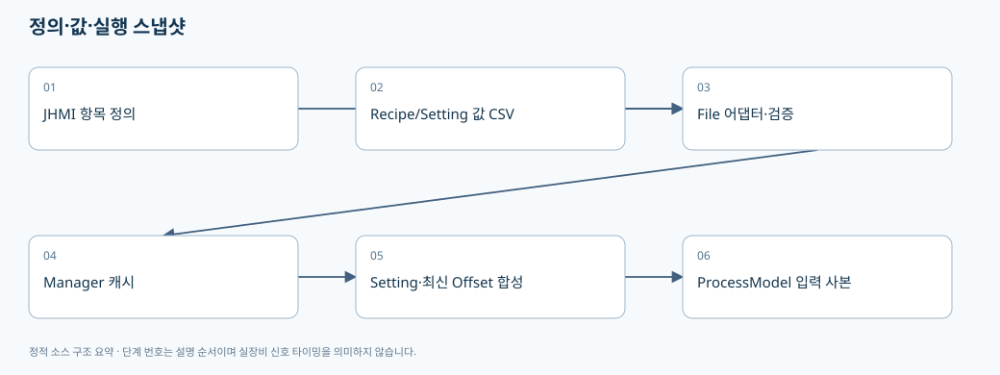
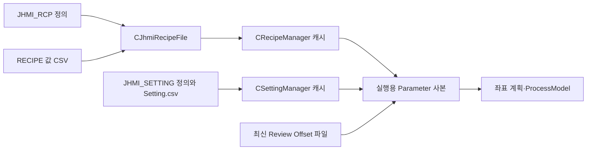

# 02. Recipe·Setting·JHMI·CSV를 함께 이해하기

> 기준: `A3Drilling/master` · `5aee8e58439c9b455cae7c9593c9be986c3e682e`. 본 장은 해당 Commit의 소스를 정적으로 읽어 설명합니다. 장비 연결·가공·컴파일을 실행한 결과가 아닙니다.

**JHMI 정의 파일은 화면 항목의 설계도, Recipe/Setting 값 파일은 그 항목에 들어간 값, ProcessModel은 실행에 사용할 합성 스냅샷**입니다. 같은 Parameter 이름이 보여도 어느 층에 있는지 구분해야 변경이 누락되지 않습니다.

## 1. 세 가지 저장 형식을 혼동하지 않기

| 파일 계층 | 실제 읽기/쓰기 형태 | 대표 필드 | 주의점 |
|---|---|---|---|
| Recipe 항목 정의 | `LoadFormItems → CCsvParser.Read`의 헤더형 CSV | `TAB,GROUP,NAME,DISPLAY NAME,CIM NAME,DATA TYPE,UNIT,SHOW,USE,VALUE,SCALE,CHANGE LIMIT,MIN,MAX,DESCRIPTION,ORDER` | `CIM NAME`이 있다는 사실만으로 고객 Host PPID/Sub PPID 계약이 완성됐다고 말할 수 없습니다. |
| Recipe 값 | `ReadRecipeValues → ParseRecipeLine`이 라인별 첫 3필드를 읽음 | `Tab,Name,Value`, 이후 필드는 Extra | 정의 파일의 헤더 전체를 값 파일의 열 구조로 착각하지 않습니다. 3필드 미만인 행은 파서에서 null로 제외됩니다. |
| Setting 값 | 헤더가 있는 `Setting.csv` | `TAB,NAME,VALUE` | Recipe 값 파서를 그대로 적용하면 안 됩니다. |
| Active Product | 별도의 compact CSV | `TYPE,NAME,VALUE` | PRODUCT/RECIPE/ALIGN/REVIEW 등의 구역 이름이 TYPE에 들어갑니다. [04장](04-product-and-station-lifecycle.md)에서 설명합니다. |

근거: [Recipe 정의 헤더와 저장 폴더](https://github.com/kjuws10-rgb/A3Drilling/blob/5aee8e58439c9b455cae7c9593c9be986c3e682e/Drilling.File/JHMI/CJhmiRecipeFile.cs#L26-L30), [정의 항목 읽기](https://github.com/kjuws10-rgb/A3Drilling/blob/5aee8e58439c9b455cae7c9593c9be986c3e682e/Drilling.File/JHMI/CJhmiRecipeFile.cs#L847-L886), [Recipe 값 파서](https://github.com/kjuws10-rgb/A3Drilling/blob/5aee8e58439c9b455cae7c9593c9be986c3e682e/Drilling.File/JHMI/CJhmiRecipeFile.cs#L889-L923), [Setting 헤더와 값 쓰기](https://github.com/kjuws10-rgb/A3Drilling/blob/5aee8e58439c9b455cae7c9593c9be986c3e682e/Drilling.File/JHMI/CSettingFile.cs#L289-L346), [Product 헤더](https://github.com/kjuws10-rgb/A3Drilling/blob/5aee8e58439c9b455cae7c9593c9be986c3e682e/Drilling.File/Product/CProductFile.cs#L8-L11).

## 2. 실제 CoreData 레코드의 역할

| 타입 | 주요 필드 | 생명주기와 의미 |
|---|---|---|
| `ST_RECIPE_FORM_ITEM` | Tab, Group, Name, DisplayName, CimName, DataType, Unit, Show, Use, DefaultValue, Scale, ChangeLimit, Min, Max, Description, DisplayOrder, Extra | 정의 CSV에서 만들어지는 항목의 메타데이터입니다. 화면 이름과 영속 Key를 분리할 수 있습니다. |
| `ST_RECIPE_PARAMETER` | Name, Value, Unit, Range, DefaultValue, Tab, Group, Key, Description, Show, Use, DisplayOrder, DataType, ChangeLimit, Min, Max, Extra | 현재 Recipe 한 개의 편집/조회 항목입니다. Name과 Key가 같은 의미라고 강제하지 않습니다. |
| `ST_RECIPE_DEFINITION` | Id, Name, Parameters, History | Manager가 로드·저장하는 Recipe 단위입니다. 단순 문자열 딕셔너리와 다릅니다. |
| `ST_RECIPE_VALUE` | Tab, Name, Value, Extra | 값 CSV 한 행을 표현합니다. |
| `ST_RECIPE_HISTORY` | ChangedAt, ItemName, OldValue, NewValue, OperatorId, RecipeName, Action, Tab, Group | 변경 전후와 맥락을 보관합니다. |

근거: [Recipe CoreData 정의](https://github.com/kjuws10-rgb/A3Drilling/blob/5aee8e58439c9b455cae7c9593c9be986c3e682e/Drilling.Common/Managers/CRecipeManager.cs#L355-L405). `EN_RECIPE_DATA_TYPE`은 String/Int/Double/Bool입니다. 문자열 Value를 사용하더라도 숫자·논리 타입 검증을 생략해도 된다는 뜻은 아닙니다. [Recipe 타입 enum](https://github.com/kjuws10-rgb/A3Drilling/blob/5aee8e58439c9b455cae7c9593c9be986c3e682e/Drilling.Common/Managers/CRecipeManager.cs#L347-L353).

Setting 쪽의 `ST_SYSTEM_PARAMETER`는 Section, Name, Value, Unit, Description, Group, Key, DefaultValue, DataType, Min/Max, Show/Use, DisplayOrder, Extra를 갖습니다. `EN_SETTING_TAB`은 Option/Interface/Io/Motor/Alarm입니다. “Setting 탭 전체가 한 종류의 단순 옵션”이 아니라 인터페이스·축·알람 정의와 연결되는 분류라는 점을 알아두면 경로를 찾기 쉽습니다. [Setting CoreData와 파일 계약](https://github.com/kjuws10-rgb/A3Drilling/blob/5aee8e58439c9b455cae7c9593c9be986c3e682e/Drilling.Common/Managers/CSettingManager.cs#L246-L278).
+
+## 3. Recipe 저장을 코드 순서로 따라가기

1. UI가 `ST_RECIPE_DEFINITION`을 만들어 `CRecipeManager.SaveRecipe`에 전달합니다.
2. Manager는 Recipe 작업 gate로 직렬화하고 기존 Recipe/Offset 정보를 유지하는 저장 경로를 사용합니다.
3. `CJhmiRecipeFile.SaveCore`는 정의 항목을 읽고 `Use` 조건과 활성 Cell/Shot 범위에 맞춰 저장할 항목을 고릅니다.
4. `DEFAULT/RECIPE_NAME`, `DEFAULT/RECIPE_ID`를 먼저 기록하고, 일반 항목과 Cell 범위 항목을 별도로 이어 씁니다.
5. 쓰기 후 `ValidateSavedRecipeFile`을 호출하고, 조건에 따라 생성/수정/저장 이력을 남깁니다.

근거: [Manager 저장 진입과 변경 확인](https://github.com/kjuws10-rgb/A3Drilling/blob/5aee8e58439c9b455cae7c9593c9be986c3e682e/Drilling.Common/Managers/CRecipeManager.cs#L73-L93), [저장 후 재조회·캐시](https://github.com/kjuws10-rgb/A3Drilling/blob/5aee8e58439c9b455cae7c9593c9be986c3e682e/Drilling.Common/Managers/CRecipeManager.cs#L147-L168), [SaveCore 항목 선택](https://github.com/kjuws10-rgb/A3Drilling/blob/5aee8e58439c9b455cae7c9593c9be986c3e682e/Drilling.File/JHMI/CJhmiRecipeFile.cs#L120-L165), [Recipe 직렬화·재검증·이력](https://github.com/kjuws10-rgb/A3Drilling/blob/5aee8e58439c9b455cae7c9593c9be986c3e682e/Drilling.File/JHMI/CJhmiRecipeFile.cs#L166-L241).

중요한 예외가 `CURRENT_PROCESS_COUNT`입니다. 편집 화면을 연 뒤 실제 가공이 진행될 수 있으므로, 저장 시 기존 파일의 현재 가공매수를 보존합니다. 오래된 편집 초안이 실제 생산 카운터를 되돌리면 안 되기 때문입니다. 보정값 저장의 변경 비교에서도 이 키를 제외합니다. [런타임 소유 카운터 보존](https://github.com/kjuws10-rgb/A3Drilling/blob/5aee8e58439c9b455cae7c9593c9be986c3e682e/Drilling.File/JHMI/CJhmiRecipeFile.cs#L188-L206), [동시 수정 비교의 카운터 예외](https://github.com/kjuws10-rgb/A3Drilling/blob/5aee8e58439c9b455cae7c9593c9be986c3e682e/Drilling.Common/Managers/CRecipeManager.cs#L74-L93).

`SaveParametersIfUnchanged(expected, changes)`는 측정 당시 Recipe와 현재 파일을 비교한 뒤 수정합니다. 측정 후 다른 작업자가 레시피를 바꾸었다면 예상한 기준과 다르므로 예외를 내는 구조입니다. 저장이 반환된 뒤 재조회와 이력 새로고침은 `CancellationToken.None`을 사용합니다. **저장 전 취소**와 **이미 저장된 뒤 화면 갱신 실패**를 같은 실패로 처리하면 사용자가 같은 보정을 두 번 적용할 위험이 있습니다. [보정 저장의 비교 및 commit 이후 처리](https://github.com/kjuws10-rgb/A3Drilling/blob/5aee8e58439c9b455cae7c9593c9be986c3e682e/Drilling.Common/Managers/CRecipeManager.cs#L74-L109).

## 4. Setting의 실제 캐시·검증·저장 순서

`CSettingManager.LoadSection`은 캐시가 있으면 그대로 반환합니다. `ReloadSection`은 파일을 다시 읽어 캐시에 넣습니다. `SetValue`는 Key 또는 Name으로 기존 항목을 찾고 항목이 없으면 예외를 내므로, 정의에도 없는 키를 SetValue만 호출해 추가하는 방식은 성립하지 않습니다. [Setting 조회·기본값](https://github.com/kjuws10-rgb/A3Drilling/blob/5aee8e58439c9b455cae7c9593c9be986c3e682e/Drilling.Common/Managers/CSettingManager.cs#L26-L70), [SetValue와 저장](https://github.com/kjuws10-rgb/A3Drilling/blob/5aee8e58439c9b455cae7c9593c9be986c3e682e/Drilling.Common/Managers/CSettingManager.cs#L72-L102).

`SaveSection`은 Option의 카메라 해상도·허용치 값을 검증하고, 특정 RunOption 변경은 MELSEC의 캐시된 Review Able 상태로 차단합니다. 파일 저장이 성공한 후에만 캐시를 교체합니다. 캐시값을 먼저 바꾸고 파일 저장 실패를 무시하는 흐름으로 고치면 메모리/디스크가 불일치합니다. [실시간 용량·해상도·RunOption 저장 검증](https://github.com/kjuws10-rgb/A3Drilling/blob/5aee8e58439c9b455cae7c9593c9be986c3e682e/Drilling.Common/Managers/CSettingManager.cs#L104-L148).

파일 계층은 정의에 존재하고 Use인 항목을 정규화하고, 다른 탭의 값까지 포함한 Setting 값 전체를 다시 씁니다. 이후 저장 파일을 재로딩하여 기대 Key/Value와 비교합니다. [정규화와 저장](https://github.com/kjuws10-rgb/A3Drilling/blob/5aee8e58439c9b455cae7c9593c9be986c3e682e/Drilling.File/JHMI/CSettingFile.cs#L52-L120), [저장 후 재검증](https://github.com/kjuws10-rgb/A3Drilling/blob/5aee8e58439c9b455cae7c9593c9be986c3e682e/Drilling.File/JHMI/CSettingFile.cs#L328-L367).

| Setting 개념 | 현재 코드에서 확인되는 조건 | 변경 시 확인 |
|---|---|---|
| Review camera resolution | 유한한 양수 mm/pixel로 파싱 | pixel→mm 변환에 ×1000을 중복 적용하지 않는지 |
| Align camera resolution | Review와 별도로 검증 | Align/Review 해상도 키를 서로 바꾸어 쓰지 않는지 |
| Wapage AlignBase tolerance | 유한한 0 이상 값 | 물리 길이와 pixel 범위 변환의 단위 |
| Vision line capacity | 공급 함수를 통해 현재 캐시값 사용 | 한 번 시작할 때만 읽는 값으로 바꿀 때 런타임 변경 의미 |

코드의 default는 설치된 장비의 최종 교정값이 아닙니다. 실제 설정값과 출하 기준은 별도 승인 자료로 확인해야 합니다. [키와 코드 기본값](https://github.com/kjuws10-rgb/A3Drilling/blob/5aee8e58439c9b455cae7c9593c9be986c3e682e/Drilling.Common/Managers/CSettingManager.cs#L16-L22), [값의 검증 범위](https://github.com/kjuws10-rgb/A3Drilling/blob/5aee8e58439c9b455cae7c9593c9be986c3e682e/Drilling.Common/Managers/CSettingManager.cs#L104-L148).

## 5. Recipe와 Setting은 실행 시 어떻게 합쳐지는가

`CStationProcess.BuildRuntimeParameters`는 Recipe 입력 딕셔너리의 **사본**을 만든 뒤 Option과 Motor Setting을 순회하여 `parameters[setting.Key] = setting.Value`로 덮어씁니다. 이후 최신 Review Offset 파일을 로드하여 합칩니다. 이름이 충돌하면 이 경로에서는 **Setting이 Recipe를 덮어쓰는 우선순위**가 존재합니다. 모든 프로그램 경로가 같은 우선순위를 쓴다는 보장은 아니므로 Review·수동 동작은 해당 경로도 따로 봐야 합니다. [실행 Parameter 합성](https://github.com/kjuws10-rgb/A3Drilling/blob/5aee8e58439c9b455cae7c9593c9be986c3e682e/Drilling.Common/Station/CStationProcess.cs#L1526-L1559).

따라서 항목을 Recipe에서 Setting으로 이전하려면 UI 위치만 옮기면 부족합니다.

| 검토 단계 | 확인 내용 |
|---|---|
| 정의 | JHMI_RCP와 JHMI_SETTING 중 어느 쪽에 정의를 둘 것인가 |
| 이관 | 기존 Recipe 값과 새 Setting 값이 다르면 어떤 값을 한 번 가져올 것인가 |
| 기본값 | 항목 부재·구버전 키에 대한 fallback을 유지할 것인가 |
| 소유권 | 장비 공통 교정값인가, PPID/모델별 공정값인가, Product 실행 시점 값인가 |
| 소비 | Process/Review/Manual/UI 미리보기가 같은 값과 좌표 기준을 쓰는가 |
| 검증 | 재시작·Recipe 변경·제품 교체 시 값이 뜻대로 유지되는가 |

## 6. 고객이 원하는 분류와 현재 구현을 구분하기

**현재 구현 사실**: Recipe는 Geometry·공정 Parameter·Cell별 항목·런타임 카운터를 담을 수 있고, Setting은 별도 공통값을 보관하며 실행 시 합성됩니다. **회의상의 희망 구조**: Recipe 메뉴를 PPID와 관련된 항목 중심으로 정리하고 장비 공통 교정값을 Setting에서 관리하자는 방향입니다. 두 내용은 같지 않습니다. 본 문서는 메뉴 재분류나 데이터 마이그레이션이 이미 완료되었다고 주장하지 않습니다.

PPID/Sub PPID·Host 구분자·Auto Job Change 계약은 이 장에서 확정하지 않습니다. 소스의 `CIM NAME`, Product `PPID` 문자열이나 `PAIR_PPID` 필드만으로 고객 자동화 규약의 의미/길이/요청 응답 순서까지 추론할 수 없습니다. 현재 Stage Process 요청 생성부에는 Glass/Lot 매핑 합의 후 교체하라는 TODO도 있습니다. [현재 선택 Recipe와 제품 식별자 fallback](https://github.com/kjuws10-rgb/A3Drilling/blob/5aee8e58439c9b455cae7c9593c9be986c3e682e/Drilling.UI/CRootView.cs#L2892-L2905), [Product PPID 입력](https://github.com/kjuws10-rgb/A3Drilling/blob/5aee8e58439c9b455cae7c9593c9be986c3e682e/Drilling.Common/Product/CProductManager.cs#L822-L846).

## 7. CSV 공통 구현에서 꼭 확인할 점

`CCsvParser`는 UTF-8 BOM을 인식하고, BOM이 없으면 먼저 엄격 UTF-8로 읽은 뒤 디코딩 실패 시 CP949로 읽습니다. 쓰기는 공통 Escape 로직과 UTF-8 BOM 설정을 사용합니다. 인코딩 호환이 있다는 사실이 모든 잘못된 CSV를 정상 복구한다는 뜻은 아닙니다. [CSV 인코딩 설정](https://github.com/kjuws10-rgb/A3Drilling/blob/5aee8e58439c9b455cae7c9593c9be986c3e682e/Drilling.File/Parser/CCsvParser.cs#L8-L10), [헤더·열 확장과 Escape 쓰기](https://github.com/kjuws10-rgb/A3Drilling/blob/5aee8e58439c9b455cae7c9593c9be986c3e682e/Drilling.File/Parser/CCsvParser.cs#L58-L93), [UTF-8와 CP949 읽기](https://github.com/kjuws10-rgb/A3Drilling/blob/5aee8e58439c9b455cae7c9593c9be986c3e682e/Drilling.File/Parser/CCsvParser.cs#L432-L475).

검증 시에는 한국어 항목명, 쉼표·따옴표가 들어간 값, 알 수 없는 Extra 열, 중복 Key, 필수 헤더 누락, 빈 파일, 쓰기 권한 오류, 저장 직후 취소를 각각 나눠 확인합니다. Recipe와 Setting이 모두 CSV라고 같은 테스트 데이터 형식을 쓰지 않습니다.

다음 읽기: [03. 좌표와 Script](03-coordinate-script-and-mof.md), [04. Product와 Station](04-product-and-station-lifecycle.md).
