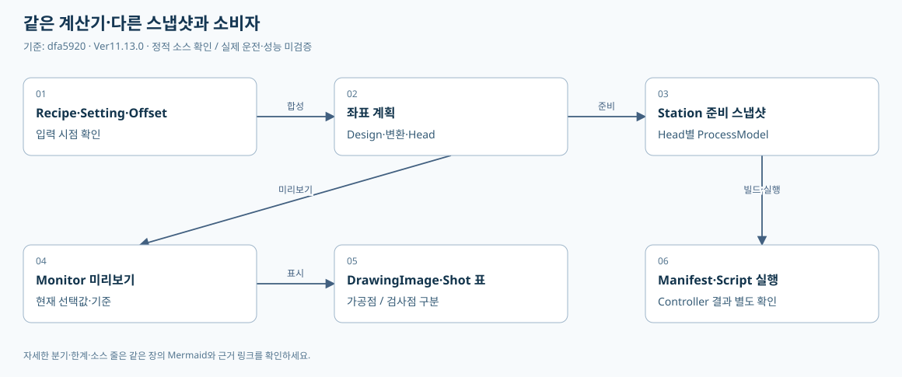
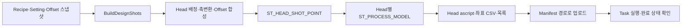
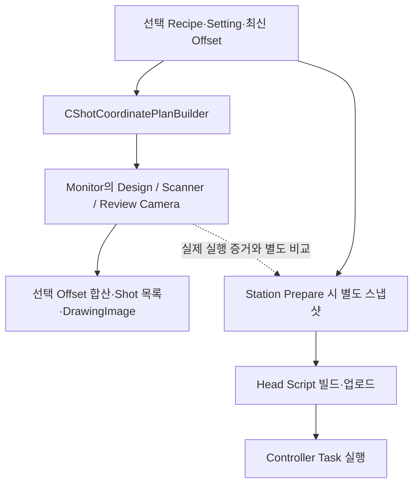
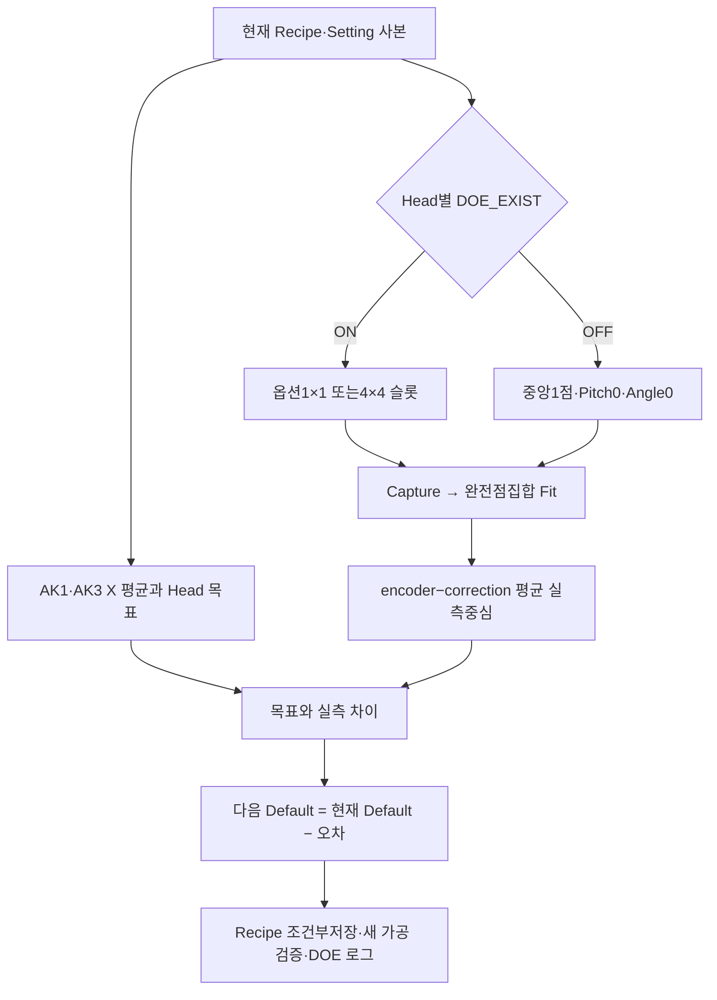

# 03. Recipe 좌표가 Head Script와 MOF 실행 입력이 되기까지

> 최신 원본 기준: **2026-11-25 · master Ver11.23.0 · `0219666f9053b907d96d7e0aa7d0c6c1be3a73d4`**. 이전 버전의 변경 설명은 연혁으로 보존하며, 이번 Stage Glass Data·Product 필드 변경은 [상세장](10-stage-glass-data-and-product-fields.md)에서 다룹니다.

> 기준: `A3Drilling/master` · `0219666f9053b907d96d7e0aa7d0c6c1be3a73d4`. 본 장은 해당 Commit의 소스를 정적으로 읽어 설명합니다. 정식 설비 빌드·장비 연결·가공을 실행한 결과가 아닙니다.

좌표 문제는 **설계점 → Head 배정 → 좌표축 변환 → Offset 합성 → Encoder 대기 위치 → Script → Controller 실행**을 나누면 추적하기 쉽습니다. 표에 표시되는 최종 숫자만 비교하면 어느 층에서 부호나 단위가 달라졌는지 찾기 어렵습니다.





## 1. 계산 진입점과 입력의 성격

`CShotCoordinatePlanBuilder.Build(parameters)`의 입력은 문자열 Key/Value 딕셔너리입니다. 이미 Recipe와 Setting/Offset이 합쳐졌을 수 있으므로 원래 Recipe 파일의 Value와 입력 값이 동일하다고 가정하면 안 됩니다. 실제 합성 지점은 [02장](02-recipe-settings-and-csv.md)에 설명했습니다.

| 입력 Key/개념 | 코드상 사용 | 주의점 |
|---|---|---|
| `HEAD_COUNT` | 1~8로 clamp | 요청 수와 실제 활성 Head 수는 다를 수 있습니다. |
| `MAX_CELL_NUMBER` | 최소 Cell 수 검증 | 유효하지 않으면 계산을 중단합니다. |
| `GLASS_SIZE_X/Y` | 계획 데이터에 기록 | 이것만으로 모든 설계점 범위 검증이 완료된다고 단정하지 않습니다. |
| `SCAN_ENCODER_SCALE` | 공통 Encoder scale 기본 입력 | Head별 scale로 달라질 수 있습니다. 절댓값·방향 처리가 분리되어 있습니다. |
| `STAGE_SCAN_DIRECTION_Y` | 진행 방향과 대기 위치·정렬 순서에 사용 | Scanner축의 +Y와 같은 뜻이 아닙니다. |
| `SHIFT_OFFSET_X/Y` | X는 Scanner 변환, Y는 대기 거리에도 반영 | 단순히 최종 Gx/Gy에 두 숫자를 더하는 구조가 아닙니다. |
| `ALIGN_OFFSET_SCALE`, `REVIEW_OFFSET_SCALE` | 현재 실행 기여분의 % | 저장된 Offset 자체를 누적 배율로 바꾸지 않습니다. |

근거: [계획 입력](https://github.com/kjuws10-rgb/A3Drilling/blob/0219666f9053b907d96d7e0aa7d0c6c1be3a73d4/Drilling.Common/Recipe/CShotCoordinatePlanBuilder.cs#L11-L36), [Offset scale의 정수 % 파싱](https://github.com/kjuws10-rgb/A3Drilling/blob/0219666f9053b907d96d7e0aa7d0c6c1be3a73d4/Drilling.Common/Recipe/CShotCoordinatePlanBuilder.cs#L204-L210).

### 같은 Shift 계산기라도 진입 경로의 입력이 다릅니다

위 표는 `Build`가 **전달받은** Shift를 어떻게 계산하는지 설명한 것입니다. 현재 AUTO(Stage PC 요청) 경로는 `StartStageRequests`의 준비 callback에서 입력 사본을 만든 다음 `SHIFT_OFFSET_X`, `SHIFT_OFFSET_Y`를 각각 `0.000000`으로 덮어쓰고 `PrepareProcess`에 전달합니다. 따라서 이 Commit에서 “좌표 계산기에 Shift 수식이 있다”는 사실만으로 **AUTO 가공에서도 입력된 Shift가 유지된다**고 설명하면 안 됩니다. [AUTO 준비의 Shift 0 정규화](https://github.com/kjuws10-rgb/A3Drilling/blob/0219666f9053b907d96d7e0aa7d0c6c1be3a73d4/Drilling.Common/Station/CStationProcess.cs#L4039-L4051).

반면 MAIN START는 MANUAL 모드에서 실행하는 Semi Auto 경로이며 `PrepareInitialProcess(applyShiftOffset: true)` 후 `Station.Start`를 호출합니다. 두 진입점의 구분과 확인할 함수는 [04장](04-product-and-station-lifecycle.md)에 정리했습니다. AUTO에서 Shift 유지·확인 팝업·양산 초기화 옵션을 제공하려면 이 준비 경로의 정책을 별도로 변경·검증해야 합니다. 본 문서는 그러한 정책이 구현 완료되었다고 판정하지 않습니다. [MAIN START의 Shift 준비와 Station 시작](https://github.com/kjuws10-rgb/A3Drilling/blob/0219666f9053b907d96d7e0aa7d0c6c1be3a73d4/Drilling.UI/CRootView.cs#L1992-L2018).

## 2. 설계점과 가공점은 같은 목록이 아니다

`BuildDesignShots`는 주석상 비활성 Head 및 Masking/Chess 제외점까지 포함하는 설계 Geometry를 만드는 진입점입니다. 반면 `Build`는 활성 Head 집합을 만들고 Head 배정 결과가 비활성이면 그 점을 계산 결과에서 제외합니다. 따라서 설계점 개수, 가공점 개수, 리뷰 측정점 개수는 목적이 달라 일치하지 않을 수 있습니다. [활성 Head와 배정](https://github.com/kjuws10-rgb/A3Drilling/blob/0219666f9053b907d96d7e0aa7d0c6c1be3a73d4/Drilling.Common/Recipe/CShotCoordinatePlanBuilder.cs#L23-L57), [설계 Geometry와 가공 변환의 구분](https://github.com/kjuws10-rgb/A3Drilling/blob/0219666f9053b907d96d7e0aa7d0c6c1be3a73d4/Drilling.Common/Recipe/CShotCoordinatePlanBuilder.cs#L213-L215).

`BuildProcessModel`은 좌표 계획을 받은 뒤 Chess 제외점을 거르고 Head별로 묶습니다. 활성 Head가 전혀 없으면 예외를 냅니다. Masking이 있다는 이유만으로 이 한 줄에서 모든 Hole/Beam/Review 이동까지 제외됐다고 결론내려서는 안 됩니다. 가공용 Masking과 Flying Review 이동 경로의 검증은 서로 다른 소비자를 확인해야 합니다. [ProcessModel의 Chess 필터와 Head 그룹](https://github.com/kjuws10-rgb/A3Drilling/blob/0219666f9053b907d96d7e0aa7d0c6c1be3a73d4/Drilling.Common/Station/CStationProcess.cs#L1608-L1644).

## 3. 한 Shot 계산을 중간값별로 읽기

| 단계 | 소스 변수 | 계산의 의미 |
|---|---|---|
| 설계 X 기준 | `scannerReferenceX = DesignX + scannerReferenceOffsetX` | 설계 X에 Scanner 참조 이동량을 반영한 후 Head를 배정합니다. |
| Head 기준 | `ReadHeadCenterX/Y`, `CScannerAxisTransform.Read` | Head마다 중심과 축 교환/방향 조건을 읽습니다. |
| Stage Y 기준 | `designDistanceYFromAlignKey = DesignY - akMarginY` | Align Key 기준의 설계 거리에서 Stage Y로 변환합니다. |
| 첫 Shot | `firstShotStageY` | 진행 방향에 따라 시작 쪽 Shot을 고릅니다. 단순 인덱스 0 고정이 아닙니다. |
| Scan 시작 | `scanStartStageY = firstShotStageY - direction × delayLength` | 시작 여유 거리를 고려합니다. |
| Encoder 대기 거리 | `baseStageWaitDistanceY`, `stageWaitDistanceY` | 기준 거리에서 ShiftY를 뺀 후 대기 위치 계산에 사용합니다. |
| Scanner 기본 위치 | `baseScannerX/Y` | Stage follow 보상 때문에 Y에는 Stage 기준 반대 방향이 사용됩니다. |

근거: [Head 중심과 Stage 기준](https://github.com/kjuws10-rgb/A3Drilling/blob/0219666f9053b907d96d7e0aa7d0c6c1be3a73d4/Drilling.Common/Recipe/CShotCoordinatePlanBuilder.cs#L52-L89), [첫 점·시작 거리·기본 Scanner좌표](https://github.com/kjuws10-rgb/A3Drilling/blob/0219666f9053b907d96d7e0aa7d0c6c1be3a73d4/Drilling.Common/Recipe/CShotCoordinatePlanBuilder.cs#L92-L140).

## 4. Offset 종류는 저장 기준과 실행 기준을 구분해야 한다

`Build`에서 확인되는 합성식은 다음과 같습니다. 기호는 설명을 위한 것이며 원본 함수명은 아래 소스 링크에서 확인합니다.

```text
defaultScanner = transform(DefaultX, ConvertRecipeYToStageY(DefaultY))
firstScanner   = transform(FirstBeamX, ConvertRecipeYToStageY(FirstBeamY))
alignScanner   = DesignOffsetToScanner(AlignX, AlignY) × AlignScale
reviewScanner  = ToScanner(ReviewX, ReviewY, ReviewOffsetIsDesign) × ReviewScale

finalOffset = RecipeOffset + defaultScanner + firstScanner + reviewScanner + alignScanner
ScannerGx/Gy = scannerBase + finalOffset + X방향 Shift의 변환분
encoderWaitPosition = stageWaitDistanceY × abs(headEncoderScale) × stageDirectionY
```

근거: [Offset 기준변환·합산·Encoder대기식](https://github.com/kjuws10-rgb/A3Drilling/blob/0219666f9053b907d96d7e0aa7d0c6c1be3a73d4/Drilling.Common/Recipe/CShotCoordinatePlanBuilder.cs#L141-L157). 이 식은 이 Commit의 해당 계산 경로를 설명합니다. 정지 가공·Default Offset 평가·Vision 이미지좌표 등 다른 목적의 숫자에 그대로 같은 부호를 적용하라는 뜻이 아닙니다.

`ST_HEAD_SHOT_POINT`에는 최종 Gx/Gy뿐 아니라 설계좌표, Stage 기준점, Recipe/Default/FirstBeam/Review/Shift Offset, 최종 Offset, EncoderWaitPosition을 함께 넣습니다. Align 설계 Offset과 Scanner 변환분도 초기화 속성에 들어갑니다. **중간값이 남는 이유는 최종 결과가 어떤 항목의 합인지 설명하기 위해서**라고 해석할 수 있습니다. 이는 데이터 구조에 근거한 설명이며 실제 화면이 모든 항목을 표시한다는 뜻은 아닙니다. [Shot 결과 레코드 생성](https://github.com/kjuws10-rgb/A3Drilling/blob/0219666f9053b907d96d7e0aa7d0c6c1be3a73d4/Drilling.Common/Recipe/CShotCoordinatePlanBuilder.cs#L158-L201).

## 5. ProcessModel은 실행 조건의 스냅샷이다

`BuildProcessModel`은 입력을 새 딕셔너리로 복사하고, 좌표 계획으로 Head별 Shot을 묶은 뒤 레이저 Power/Frequency/ShotCount, Mark/Jump speed, X/Y/Z RampRate, Z speed, AccLimit, DOE Z target을 `ST_HEAD_PROCESS_PLAN`에 담습니다. Head마다 AutomationNo/TaskNo와 `PROCESS_Hxx.ascript` 파일명을 지정합니다. [Head 계획과 ProcessModel 생성](https://github.com/kjuws10-rgb/A3Drilling/blob/0219666f9053b907d96d7e0aa7d0c6c1be3a73d4/Drilling.Common/Station/CStationProcess.cs#L1608-L1678).

| 식별자 | 구분해야 할 이유 |
|---|---|
| `HeadNo` | 물리/논리 Head 번호와 계획을 식별합니다. |
| `AutomationNo` | 어느 Automation1 연결 대상으로 보낼지 지정합니다. |
| `TaskNo` | Controller 안에서 어느 Task로 실행할지 지정합니다. |
| `ScriptFileName` | Controller에서 실행할 파일 이름입니다. |
| `FilePath` | PC에 생성된 이번 회차 파일의 실제 경로입니다. |

HeadNo=AutomationNo=TaskNo라고 가정해 코드를 단순화하면 다중 Head/Controller 배정이 깨질 수 있습니다.

실제 선언에서 `ST_PROCESS_MODEL`은 ProcessId/RecipeId/GlassId/LotId/HeadPlans/Parameters/CreatedAt을 갖고, `ST_HEAD_PROCESS_PLAN`은 공정 조건과 Shots를 갖습니다. 기본 TaskNo는 HeadNo이지만 실행 모델을 만들 때 다시 지정할 수 있습니다. `ST_SCRIPT_BUILD_RESULT`의 MofReadyRunId는 파일명과 별도로 이번 회차 준비 상태를 식별합니다. [Process·Head·Script CoreData 선언](https://github.com/kjuws10-rgb/A3Drilling/blob/0219666f9053b907d96d7e0aa7d0c6c1be3a73d4/Drilling.Common/Station/CStationManager.cs#L301-L339).

## 6. Script 파일 생성과 추적 산출물

`CAutomation1ScriptFile.Build`는 Standard 또는 지정 모드 하위에 이번 회차의 격리 디렉터리를 만듭니다. 활성 Head 중 실제 Shot이 있는 Head만 남기고 검증한 다음, 좌표 CSV와 Head별 AeroScript를 생성하고 마지막에 `PROCESS.txt` 목록을 생성합니다. 반환하는 `ST_SCRIPT_BUILD_RESULT`에는 Head별 FilePath/Task/Head/점수와 `MofReadyRunId`가 있습니다. [산출물 이름](https://github.com/kjuws10-rgb/A3Drilling/blob/0219666f9053b907d96d7e0aa7d0c6c1be3a73d4/Drilling.File/Script/CAutomation1ScriptFile.cs#L9-L19), [회차별 생성과 Manifest 반환](https://github.com/kjuws10-rgb/A3Drilling/blob/0219666f9053b907d96d7e0aa7d0c6c1be3a73d4/Drilling.File/Script/CAutomation1ScriptFile.cs#L51-L108).

| 파일 | 목적 | 포함 데이터 |
|---|---|---|
| `PROCESS_Hxx.ascript` | 각 Head의 Controller 실행용 명령 | 축/속도/가속도/추종/대기/가공 명령 |
| `PROCESS_COORDINATES.csv` | 실행 회차 좌표·Offset 추적 | RecipeId, GlassId, 생성시간, Simulator 여부, Head/Automation/Task, Shot/Cell/Row/Col, Design/Scanner/Offset/가공여부 |
| `PROCESS.txt` | 좌표·Head Script 목록을 묶는 산출물 | 이번 빌드와 Head별 파일 연결 정보 |

CSV 필드 근거: [좌표 CSV 헤더](https://github.com/kjuws10-rgb/A3Drilling/blob/0219666f9053b907d96d7e0aa7d0c6c1be3a73d4/Drilling.File/Script/CAutomation1ScriptFile.cs#L175-L244). 현장 실측 행은 본 문서에 복제하지 않습니다.

## 7. MOF 준비와 실행은 생성 성공 다음의 별도 단계다

MOF Script에는 `CMofReadiness`의 Task별 GlobalInteger 인덱스와 RunId 표시가 기록됩니다. 소스는 Scanner 중심화·보조 피드백 초기화·레이저 설정과 MotionDone 대기 후 준비 표시를 발행하도록 구성되어 있으며, StartFollow 쪽은 이미 Stage Encoder 움직임을 기다릴 수 있다는 주석이 있습니다. 준비 신호를 단순히 Run 명령 반환과 같다고 취급하면 안 됩니다. [MOF 준비 식별자·준비 위치와 follow 시작](https://github.com/kjuws10-rgb/A3Drilling/blob/0219666f9053b907d96d7e0aa7d0c6c1be3a73d4/Drilling.File/Script/CAutomation1ScriptFile.cs#L433-L514).

Station에서는 Script 빌드 후 반환된 Head별 **Manifest FilePath**로 업로드하고 응답을 검사합니다. 표준 실행에서는 Head Task Run을 보낸 뒤 `WaitAutomationHeadScriptsComplete`를 호출합니다. Buffered Run은 다른 실행 분기를 사용합니다. 따라서 `Run command accepted` 로그는 모든 가공점이 정상 완료되었다는 결과가 아닙니다. [빌드·업로드](https://github.com/kjuws10-rgb/A3Drilling/blob/0219666f9053b907d96d7e0aa7d0c6c1be3a73d4/Drilling.Common/Station/CStationProcess.cs#L658-L690), [표준/Buffered 실행 분기·실패 정리](https://github.com/kjuws10-rgb/A3Drilling/blob/0219666f9053b907d96d7e0aa7d0c6c1be3a73d4/Drilling.Common/Station/CStationProcess.cs#L693-L750).

`AUTOMATION1_SIMULATOR_USE` 조건에서는 Script Y 위치를 `FinalScannerOffsetY + ShiftScannerOffsetY`로 읽는 별도 처리가 있습니다. Simulator 결과를 실제 MOF의 Stage follow GY와 숫자만 같은지 비교하면 틀릴 수 있습니다. [실장비와 Simulator Script 좌표 선택](https://github.com/kjuws10-rgb/A3Drilling/blob/0219666f9053b907d96d7e0aa7d0c6c1be3a73d4/Drilling.File/Script/CAutomation1ScriptFile.cs#L703-L715).

## 8. 변경별 검증 계획

| 변경 | 격리된 계산 검증 | 연동/장비에서 나중에 확인할 것 |
|---|---|---|
| Offset 방향 | Offset를 하나만 +값으로 바꾸고 Design/Stage/Scanner/Encoder 중간값을 비교 | 실제 이동·가공 흔적의 방향, Vision 부호 |
| Axis swap/flip | Head별 transform 조합과 역변환 오차 | 모션 표시 방향·SDK 축 이름의 일치 |
| Shift | X만/Y만/혼합 입력에서 대기 위치와 최종 좌표를 각각 비교 | 검사 좌표에도 같은 공정 Shift 기준이 반영되는지 |
| 활성 Head | 동일 설계점에서 Hxx_USE만 변경하여 배정·제외·Head별 점수 비교 | Controller/Task가 중복되거나 비활성 Head가 실행되는지 |
| Masking/Chess | 경계선 위·안·밖을 나누고 설계/가공/리뷰 계획 개수를 별도 비교 | 이동 회피와 Trigger 억제의 실제 차이 |
| Buffered | 같은 ProcessModel로 생성된 표준·Buffered 산출물의 점·Offset 비교 | Queue 부족/Stop/통신 단절·완료 신호 |

이 장의 계획은 정적 분석에서 도출한 검증 항목입니다. 성능 수치·가공 정밀도·Stage 최대속도는 실제 계측 없이 판정하지 않습니다.

## 9. 새 Monitor 좌표 미리보기와 실제 실행 좌표의 경계

Monitor는 **선택 Recipe + Option/Motor Setting + 최신 Review Offset**을 합쳐 좌표 계획을 계산합니다. 준비된 Station 모델이나 이미 업로드한 Script를 읽는 경로가 아닙니다. 따라서 새 Offset 파일을 선택한 직후 Monitor 값은 바뀌어도, 이전 준비 모델이 같은 값으로 실행된다고 확정할 수 없습니다. [미리보기 입력 합성과 계획 생성](https://github.com/kjuws10-rgb/A3Drilling/blob/0219666f9053b907d96d7e0aa7d0c6c1be3a73d4/Drilling.UI/Menu/Menus/CMenuMonitor.cs#L3104-L3161), [Recipe와 Setting Key/Name 덮어쓰기](https://github.com/kjuws10-rgb/A3Drilling/blob/0219666f9053b907d96d7e0aa7d0c6c1be3a73d4/Drilling.UI/Menu/Menus/CMenuMonitor.cs#L3344-L3371).



| 미리보기 선택 | 소스상 계산과 단위 | 판정할 때의 범위 |
|---|---|---|
| Design | 설계 mm 기준으로 Offset를 변환해 표시 | 화면에 더하거나 뺀 선택은 미리보기 상태입니다. Recipe 파일에 저장하지 않습니다. |
| Scanner | 최종 ScannerGx/Gy에서 기존 Offset를 뺀 기본점 + 선택한 Scanner Offset | Head별 swap/flip에 따라 축 화살표도 변환됩니다. GX/GY 값을 그대로 Review Camera 좌표로 쓰면 안 됩니다. |
| Review Camera | 기준 CameraX/StageY + 선택한 **Shift만** 검사 위치에 반영 | 다른 5종 Offset는 가공점 비교에만 합산합니다. 가공점과 검사 목표를 따로 표시합니다. |
| Shot Map | GroupColumn/GroupRow를 사각 격자로 그린 논리 선택 지도 | 물리 mm 비율의 기판 도면이나 실제 가공 완료표가 아닙니다. Masking/Chess 상태를 구분합니다. |

근거: [Offset 성분·기준 변환](https://github.com/kjuws10-rgb/A3Drilling/blob/0219666f9053b907d96d7e0aa7d0c6c1be3a73d4/Drilling.UI/Menu/Menus/CMenuMonitor.cs#L3474-L3514), [Review Camera의 Shift 제한과 별도 가공점](https://github.com/kjuws10-rgb/A3Drilling/blob/0219666f9053b907d96d7e0aa7d0c6c1be3a73d4/Drilling.UI/Menu/Menus/CMenuMonitor.cs#L3558-L3622), [Camera 기준점](https://github.com/kjuws10-rgb/A3Drilling/blob/0219666f9053b907d96d7e0aa7d0c6c1be3a73d4/Drilling.UI/Menu/Menus/CMenuMonitor.cs#L4217-L4223), [Shot Map 격자와 클릭 역산](https://github.com/kjuws10-rgb/A3Drilling/blob/0219666f9053b907d96d7e0aa7d0c6c1be3a73d4/Drilling.UI/Menu/Menus/CCoordinateShotMapPreviewDrawing.cs#L29-L58), [클릭 좌표에서 행·열 복원](https://github.com/kjuws10-rgb/A3Drilling/blob/0219666f9053b907d96d7e0aa7d0c6c1be3a73d4/Drilling.UI/Menu/Menus/CCoordinateShotMapPreviewDrawing.cs#L116-L152).

MIN/MAX는 유한하고 `MIN < 0 < MAX`이어야 하며 20칸의 mm 눈금을 사용합니다. 범위를 벗어난 점은 화면 테두리로 잘라 그리면서 `OUT`으로 알립니다. 이것은 물리 이동 제한·안전 인터락이 아닙니다. 기준 선택 목록은 Design/Scanner/Review Camera 3개로 바뀌었으며, 남아 있는 `STAGE` 분기만 보고 독립 Stage 메뉴가 제공된다고 설명하지 않습니다. [범위 입력 검증](https://github.com/kjuws10-rgb/A3Drilling/blob/0219666f9053b907d96d7e0aa7d0c6c1be3a73d4/Drilling.UI/Menu/Menus/CMenuMonitor.cs#L2876-L2904), [20칸·클리핑 표시](https://github.com/kjuws10-rgb/A3Drilling/blob/0219666f9053b907d96d7e0aa7d0c6c1be3a73d4/Drilling.UI/Menu/Menus/CCoordinateOffsetPreviewDrawing.cs#L9-L43), [제공하는 기준 목록](https://github.com/kjuws10-rgb/A3Drilling/blob/0219666f9053b907d96d7e0aa7d0c6c1be3a73d4/Drilling.UI/Menu/Menus/CMenuMonitor.cs#L3829-L3836).

검증은 같은 합성 Recipe에서 Offset를 하나씩 바꿔 Design/Scanner/Camera의 중간값, Axis flip/swap, Stage 방향 ±1, Review scale 0/100, Shift Y를 비교합니다. 이후 **같은 입력의 Station 모델·좌표 CSV·Script**와 대조해야 합니다. 화면 축 단위 mm가 소스상 확인된다는 사실과 실제 엔코더 교정·가공 방향이 검증됐다는 사실은 구분합니다.

## 10. Default 보정: AK 중심은 유지하고 Head별 DOE 검사 수를 나눕니다

기존 기판 중심 식을 단일 숫자로 보관하던 옵션은 `AlignKey1ReviewX`, `AlignKey3ReviewX`를 보관하고 `BoardCenterX=(AK1+AK3)/2`를 계산하는 형태로 바뀌었습니다. AK1은 Recipe의 taught 위치를 읽고, AK3 기본값은 `AK1 + GLASS_SIZE_X - 2×AK_MARGIN_X`입니다. 조건 창에서 AK3를 세션값으로 수정할 수 있으며 그 값을 실제 엔코더값으로 확인했는지는 작업 기록에서 별도로 확인해야 합니다. [조건·AK3 설계 계산](https://github.com/kjuws10-rgb/A3Drilling/blob/0219666f9053b907d96d7e0aa7d0c6c1be3a73d4/Drilling.Common/Correction/CDefaultOffsetCalibration.cs#L64-L91), [조건 창 AK3 입력과 설계값 버튼](https://github.com/kjuws10-rgb/A3Drilling/blob/0219666f9053b907d96d7e0aa7d0c6c1be3a73d4/Drilling.UI/Views/CDefaultOffsetView.xaml.cs#L78-L114).

11.13.0에서 전역 `SPLITED_BEAM_COUNT` 1/4를 지원한 데 이어, 11.17.0에서 `Hxx_DOE_EXIST`로 **Default 검사만** Head별로 분기합니다. DOE ON이면 옵션 격자 크기(1 또는4)를 사용하고, OFF이면 격자1·Pitch0·Angle0·중앙1점입니다. 설정 창의 `ON · 4×4` 문구만으로 실제 계산이 항상16점이라고 단정하지 않습니다. 실제 소비자는 `DefaultInspectionGridSize`를 사용합니다. [Head별 검사 정책](https://github.com/kjuws10-rgb/A3Drilling/blob/0219666f9053b907d96d7e0aa7d0c6c1be3a73d4/Drilling.Common/Correction/CDefaultOffsetCalibration.cs#L29-L62), [옵션의 명목 점수와 검사 방식](https://github.com/kjuws10-rgb/A3Drilling/blob/0219666f9053b907d96d7e0aa7d0c6c1be3a73d4/Drilling.Common/Correction/CDefaultOffsetCalibration.cs#L299-L321), [실제 Capture·Fit·결과](https://github.com/kjuws10-rgb/A3Drilling/blob/0219666f9053b907d96d7e0aa7d0c6c1be3a73d4/Drilling.UI/Menu/Menus/CMenuCorrection.cs#L3893-L3924).

샷·십자는 같은 Head별 점수 정책을 사용하고, 십자는 Setting mark 명령을 사용합니다. Default CENTER의 scanner 목표는 현재 Head Default를 축 변환한 위치이며 First Beam·Cell·Align·Review·Shift를 더하는 일반 공정점과 다릅니다. DOE OFF에서는 이 중앙을 1번 검사합니다. 1점 Fit이 반환하는 잔차·Pitch0은 다점 배열의 실측 Pitch 합격이 아닙니다. [CENTER 목표 생성](https://github.com/kjuws10-rgb/A3Drilling/blob/0219666f9053b907d96d7e0aa7d0c6c1be3a73d4/Drilling.Common/Correction/CDefaultOffsetCalibration.cs#L146-L159), [1점·16점 Fit 계약](https://github.com/kjuws10-rgb/A3Drilling/blob/0219666f9053b907d96d7e0aa7d0c6c1be3a73d4/Drilling.Common/Correction/CDefaultOffsetCalibration.cs#L193-L235).



AK1/AK3 중점·HeadGap 기반 목표와 `currentDefault−error` 추천식은 이전부터 유지되는 수식입니다. X 입력 평균이 새 AK 자동촬영·2D 회전 피팅으로 확장됐다는 근거도 없습니다. DOE 장착은 설정값이므로 실제 광학 장착 확인을 대신하지 않습니다. [유지되는 목표·실측·추천식](https://github.com/kjuws10-rgb/A3Drilling/blob/0219666f9053b907d96d7e0aa7d0c6c1be3a73d4/Drilling.Common/Correction/CDefaultOffsetCalibration.cs#L241-L294).

후속 검증은 샷/십자 × DOE ON/OFF × 전역격자1/4, 활성/비활성 Head의 키 누락, ON/OFF 혼합, AK1=AK3·역방향·비유한 입력, 점 누락·중복·NG, `DOE_EXIST/DEFAULT_INSPECTION_POINT_COUNT` 로그와 실제 Capture 수의 일치를 포함합니다. OFF Head도 공통 Geometry·Recipe 조건 검증을 완전히 생략하는 경로는 아니므로 'OFF이면 다른 설정 불필요'라고 가정하지 않습니다. DOE 광학 분기·정밀도는 이 소스 분석으로 실증하지 않습니다.

## 11. Shift 입력 그림은 계산량을 줄였지만 거리 도면은 아닙니다

RootView의 Head별 Shift 표는 입력마다 전체 좌표 계획을 두 번 만들고 차이를 구하던 방식에서, `DesignOffsetToScanner(parameters, head, shiftX, shiftY)`를 한 번 적용하는 방식으로 바뀌었습니다. Head 수만큼 변환하고 활성 Shot 유무와 무관하게 행을 만들므로, 예전에 `-`이던 비활성/무점 Head의 표시도 확인해야 합니다. [현재 변환 경로](https://github.com/kjuws10-rgb/A3Drilling/blob/0219666f9053b907d96d7e0aa7d0c6c1be3a73d4/Drilling.UI/CRootView.cs#L1798-L1814).

Shift popup은 여러 Cell 사각형 대신 BEFORE/AFTER 점과 방향 화살표를 그립니다. 벡터 길이를 화면에서 24~82로 제한하므로 화살표 길이의 비율은 실제 mm 비율을 항상 유지하지 않습니다. 숫자 caption의 mm값과 방향 설명을 함께 읽습니다. 적용 검증은 여전히 전체 좌표 계획과 Masking을 만들어 가공 가능한 Glass/Head 범위를 검사합니다. 미리보기 계산 단축이 이 검증 삭제를 뜻하지 않습니다. [그림의 방향·길이 제한](https://github.com/kjuws10-rgb/A3Drilling/blob/0219666f9053b907d96d7e0aa7d0c6c1be3a73d4/Drilling.UI/Popup/CShiftOffsetDialog.xaml.cs#L91-L159), [적용 전 전체 범위검증](https://github.com/kjuws10-rgb/A3Drilling/blob/0219666f9053b907d96d7e0aa7d0c6c1be3a73d4/Drilling.UI/CRootView.cs#L1825-L1861).

검증은 축 swap/flip·X/Y 부호·0·아주 작은 값·범위 밖 큰 값·활성 Shot 없는 Head를 비교하고, 새 직접 변환과 같은 입력의 좌표 계획 차이가 일치하는지 확인합니다. 그림 응답성 개선 의도는 소스에서 확인되지만 실제 응답시간·FPS는 미측정입니다.

## 12. Ver11.19.0: 같은 수식의 입력 원본이 공통 Margin으로 바뀝니다

CShotCoordinatePlanBuilder.Build와 BuildDesignShots는 입구에서 AK X/Y 모두를 필수 파싱합니다. 설계 Cell/Shot 원점, Head 중심 X=MarginX+H01_AK_POSITION_X+(Head−1)×HeadGapX, Head 배정, Stage Y 기준에 공통값이 쓰입니다. 숫자0 기본값으로 누락을 통과시키던 경로와 다릅니다. 합성 맵을 받는 계산기 자체는 값이 Setting에서 왔는지 인증하지 않으므로 호출자의 주입 책임도 추적해야 합니다. [계획 입구·Head 배정](https://github.com/kjuws10-rgb/A3Drilling/blob/0219666f9053b907d96d7e0aa7d0c6c1be3a73d4/Drilling.Common/Recipe/CShotCoordinatePlanBuilder.cs#L11-L66), [설계 Shot 입력](https://github.com/kjuws10-rgb/A3Drilling/blob/0219666f9053b907d96d7e0aa7d0c6c1be3a73d4/Drilling.Common/Recipe/CShotCoordinatePlanBuilder.cs#L223-L249), [Head 중심 공식](https://github.com/kjuws10-rgb/A3Drilling/blob/0219666f9053b907d96d7e0aa7d0c6c1be3a73d4/Drilling.Common/Recipe/CShotCoordinatePlanBuilder.cs#L455-L463)

| 호출 경로 | Margin을 확정하는 시점 | 소비·주의 |
|---|---|---|
| Station 가공 | Prepare의 Recipe→Option/Motor 합성 | ProcessModel·Script는 준비 시점 사본. Margin 편집을 기존 준비 모델에 자동 반영한 증거는 없음 |
| 일반 Review·Beam 목표 | CreatePlan의 현재 Setting 및 명시적 인자 | 설계 좌표와 Review/Stage 목표를 분리. 이미 만든 Plan과 나중 읽은 Margin의 혼합 검증 필요 |
| AUTO Fine·0선 후속 | 합성 후 frozen 맵 | 후속0선은 원 가공값을 보존하고 새 Setting은 누락 키만 채우는 기존 규칙 유지 |
| ZeroDefence | 생성 시 settings Read와 좌표 계획 | Beam을 Glass 안으로 검증할 때 같은 공통 Margin 사용 |
| Distortion | Prepare에서 Option Margin·Motor StageY 복사 | Key 위치와 Shot 보정 계산에 같은 사본 사용. 저장 시 Setting 재비교는 없음 |
| Recipe/Correction 미리보기 | Build/Update에서 Setting 또는 명시 Margin | 실제 실행 회차·실측 장치 위치를 증명하는 화면은 아님 |

근거: [가공 합성](https://github.com/kjuws10-rgb/A3Drilling/blob/0219666f9053b907d96d7e0aa7d0c6c1be3a73d4/Drilling.Common/Station/CStationProcess.cs#L1528-L1545), [Review 계획 입력](https://github.com/kjuws10-rgb/A3Drilling/blob/0219666f9053b907d96d7e0aa7d0c6c1be3a73d4/Drilling.Common/Review/CReviewManager.cs#L505-L536), [Beam 계산기 인자](https://github.com/kjuws10-rgb/A3Drilling/blob/0219666f9053b907d96d7e0aa7d0c6c1be3a73d4/Drilling.Common/Review/CReviewManager.cs#L140-L172), [AUTO 고정 맵](https://github.com/kjuws10-rgb/A3Drilling/blob/0219666f9053b907d96d7e0aa7d0c6c1be3a73d4/Drilling.Common/Review/CAutoFineReviewCoordinator.cs#L203-L231), [0선 입력](https://github.com/kjuws10-rgb/A3Drilling/blob/0219666f9053b907d96d7e0aa7d0c6c1be3a73d4/Drilling.Common/Review/CZeroDefenceRecipePlan.cs#L18-L39), [0선 Beam Glass 검증](https://github.com/kjuws10-rgb/A3Drilling/blob/0219666f9053b907d96d7e0aa7d0c6c1be3a73d4/Drilling.Common/Review/CZeroDefenceRecipePlan.cs#L65-L80), [Distortion 동결](https://github.com/kjuws10-rgb/A3Drilling/blob/0219666f9053b907d96d7e0aa7d0c6c1be3a73d4/Drilling.Common/Correction/CAlignInterpolation.cs#L276-L308), [계산·저장·다음 준비값](https://github.com/kjuws10-rgb/A3Drilling/blob/0219666f9053b907d96d7e0aa7d0c6c1be3a73d4/Drilling.Common/Correction/CAlignInterpolation.cs#L334-L370)

Distortion의 Key 위치는 Glass 반폭/반높이로 Margin을 clamp하지만 일반 Shot 원점은 공통 Margin을 그대로 사용합니다. helper의 0 이상 검사만으로 모든 Glass 크기에 맞는 기하가 보장되지는 않습니다. 작은 Glass·반폭 경계·큰 Margin의 Key/Shot/Head 배정을 각각 대조해야 합니다. [Key clamp](https://github.com/kjuws10-rgb/A3Drilling/blob/0219666f9053b907d96d7e0aa7d0c6c1be3a73d4/Drilling.Common/Correction/CAlignInterpolation.cs#L190-L214), [Shot 원점 소비](https://github.com/kjuws10-rgb/A3Drilling/blob/0219666f9053b907d96d7e0aa7d0c6c1be3a73d4/Drilling.Common/Recipe/CShotCoordinatePlanBuilder.cs#L223-L249)

Script 파일의 Build는 **가공 입력 파일 생성**입니다. 이번 diff의 CAutomation1ScriptFile 변경은 설명 주석 보강이며, 회차 폴더·Manifest·MofReadyRunId·준비된 Controller 파일 실행 계약을 새 기능으로 세지 않습니다. 문서 추출기가 성공한 것, 장비 앱이 빌드된 것, AeroScript가 Controller에서 컴파일·실행된 것은 각각 별도 증거입니다. 이번 작업은 뒤 두 가지를 수행하지 않았습니다. [회차 파일 생성](https://github.com/kjuws10-rgb/A3Drilling/blob/0219666f9053b907d96d7e0aa7d0c6c1be3a73d4/Drilling.File/Script/CAutomation1ScriptFile.cs#L51-L108), [준비된 Controller 파일 실행](https://github.com/kjuws10-rgb/A3Drilling/blob/0219666f9053b907d96d7e0aa7d0c6c1be3a73d4/Drilling.Common/Automation/CAutomationManager.cs#L365-L370)

Default의 Parameters와 화면 Update는 여전히 Setting 후 Recipe를 덮어쓰는 경로입니다. 최신 JHMI_RCP에서 AK가 빠져 정상 로드에서는 공통값을 쓰지만, 구형/수동 생성 Recipe 객체까지 모든 경로가 같은 우선순위라고 일반화하지 않습니다. [Default 합성 순서](https://github.com/kjuws10-rgb/A3Drilling/blob/0219666f9053b907d96d7e0aa7d0c6c1be3a73d4/Drilling.Common/Correction/CDefaultOffsetCalibration.cs#L14-L19), [Default 화면 합성](https://github.com/kjuws10-rgb/A3Drilling/blob/0219666f9053b907d96d7e0aa7d0c6c1be3a73d4/Drilling.UI/Menu/Menus/CMenuCorrection.cs#L4572-L4584)

Review의 목표식은 CameraAK+(Design−Margin)+Beam+Shift입니다. 같은 공통 Margin으로 Design도 함께 재생성되면 Margin 이동분이 상쇄될 수 있으므로 모든 실제 검사목표가 반드시 이동한다고 단정하지 않습니다. 반면 과거 결과의 Design 좌표나 다른 시점의 Margin을 섞으면 같은 조건이 아닙니다. [Review 목표식](https://github.com/kjuws10-rgb/A3Drilling/blob/0219666f9053b907d96d7e0aa7d0c6c1be3a73d4/Drilling.Common/Review/CReviewManager.cs#L177-L196).
