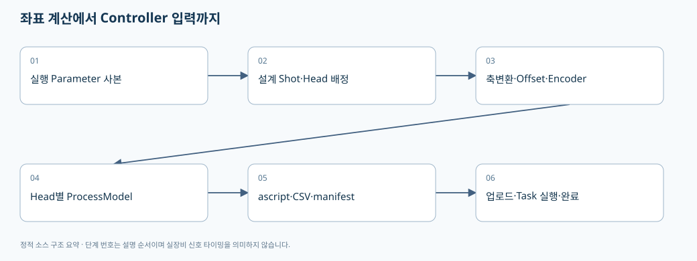
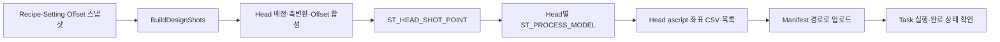

# 03. Recipe 좌표가 Head Script와 MOF 실행 입력이 되기까지

> 기준: `A3Drilling/master` · `5aee8e58439c9b455cae7c9593c9be986c3e682e`. 본 장은 해당 Commit의 소스를 정적으로 읽어 설명합니다. 장비 연결·가공·컴파일을 실행한 결과가 아닙니다.

좌표 문제는 **설계점 → Head 배정 → 좌표축 변환 → Offset 합성 → Encoder 대기 위치 → Script → Controller 실행**을 나누면 추적하기 쉽습니다. 표에 표시되는 최종 숫자만 비교하면 어느 층에서 부호나 단위가 달라졌는지 찾기 어렵습니다.





## 1. 계산 진입점과 입력의 성격

`CShotCoordinatePlanBuilder.Build(parameters)`의 입력은 문자열 Key/Value 딕셔너리입니다. 이미 Recipe와 Setting/Offset이 합쳐졌을 수 있으므로 원래 Recipe 파일의 Value와 입력 값이 동일하다고 가정하면 안 됩니다. 실제 합성 지점은 [02장](02-recipe-settings-and-csv.md)에 설명했습니다.

| 입력 Key/개념 | 코드상 사용 | 주의점 |
|---|---|---|
| `HEAD_COUNT` | 1~8로 clamp | 요청 수와 실제 활성 Head 수는 다를 수 있습니다. |
| `MAX_CELL_NUMBER` | 최소 Cell 수 검증 | 유효하지 않으면 계산을 중단합니다. |
| `GLASS_SIZE_X/Y` | 계획 데이터에 기록 | 이것만으로 모든 설계점 범위 검증이 완료된다고 단정하지 않습니다. |
| `SCAN_ENCODER_SCALE` | 공통 Encoder scale 기본 입력 | Head별 scale로 달라질 수 있습니다. 절댓값·방향 처리가 분리되어 있습니다. |
| `STAGE_SCAN_DIRECTION_Y` | 진행 방향과 대기 위치·정렬 순서에 사용 | Scanner축의 +Y와 같은 뜻이 아닙니다. |
| `SHIFT_OFFSET_X/Y` | X는 Scanner 변환, Y는 대기 거리에도 반영 | 단순히 최종 Gx/Gy에 두 숫자를 더하는 구조가 아닙니다. |
| `ALIGN_OFFSET_SCALE`, `REVIEW_OFFSET_SCALE` | 현재 실행 기여분의 % | 저장된 Offset 자체를 누적 배율로 바꾸지 않습니다. |

근거: [계획 입력](https://github.com/kjuws10-rgb/A3Drilling/blob/5aee8e58439c9b455cae7c9593c9be986c3e682e/Drilling.Common/Recipe/CShotCoordinatePlanBuilder.cs#L11-L34), [Offset scale의 정수 % 파싱](https://github.com/kjuws10-rgb/A3Drilling/blob/5aee8e58439c9b455cae7c9593c9be986c3e682e/Drilling.Common/Recipe/CShotCoordinatePlanBuilder.cs#L203-L209).

### 같은 Shift 계산기라도 진입 경로의 입력이 다릅니다

위 표는 `Build`가 **전달받은** Shift를 어떻게 계산하는지 설명한 것입니다. 현재 AUTO(Stage PC 요청) 경로는 `StartStageRequests`의 준비 callback에서 입력 사본을 만든 다음 `SHIFT_OFFSET_X`, `SHIFT_OFFSET_Y`를 각각 `0.000000`으로 덮어쓰고 `PrepareProcess`에 전달합니다. 따라서 이 Commit에서 “좌표 계산기에 Shift 수식이 있다”는 사실만으로 **AUTO 가공에서도 입력된 Shift가 유지된다**고 설명하면 안 됩니다. [AUTO 준비의 Shift 0 정규화](https://github.com/kjuws10-rgb/A3Drilling/blob/5aee8e58439c9b455cae7c9593c9be986c3e682e/Drilling.Common/Station/CStationProcess.cs#L3983-L3995).

반면 MAIN START는 MANUAL 모드에서 실행하는 Semi Auto 경로이며 `PrepareInitialProcess(applyShiftOffset: true)` 후 `Station.Start`를 호출합니다. 두 진입점의 구분과 확인할 함수는 [04장](04-product-and-station-lifecycle.md)에 정리했습니다. AUTO에서 Shift 유지·확인 팝업·양산 초기화 옵션을 제공하려면 이 준비 경로의 정책을 별도로 변경·검증해야 합니다. 본 문서는 그러한 정책이 구현 완료되었다고 판정하지 않습니다. [MAIN START의 Shift 준비와 Station 시작](https://github.com/kjuws10-rgb/A3Drilling/blob/5aee8e58439c9b455cae7c9593c9be986c3e682e/Drilling.UI/CRootView.cs#L1621-L1647).

## 2. 설계점과 가공점은 같은 목록이 아니다

`BuildDesignShots`는 주석상 비활성 Head 및 Masking/Chess 제외점까지 포함하는 설계 Geometry를 만드는 진입점입니다. 반면 `Build`는 활성 Head 집합을 만들고 Head 배정 결과가 비활성이면 그 점을 계산 결과에서 제외합니다. 따라서 설계점 개수, 가공점 개수, 리뷰 측정점 개수는 목적이 달라 일치하지 않을 수 있습니다. [활성 Head와 배정](https://github.com/kjuws10-rgb/A3Drilling/blob/5aee8e58439c9b455cae7c9593c9be986c3e682e/Drilling.Common/Recipe/CShotCoordinatePlanBuilder.cs#L21-L55), [설계 Geometry와 가공 변환의 구분](https://github.com/kjuws10-rgb/A3Drilling/blob/5aee8e58439c9b455cae7c9593c9be986c3e682e/Drilling.Common/Recipe/CShotCoordinatePlanBuilder.cs#L212-L214).

`BuildProcessModel`은 좌표 계획을 받은 뒤 Chess 제외점을 거르고 Head별로 묶습니다. 활성 Head가 전혀 없으면 예외를 냅니다. Masking이 있다는 이유만으로 이 한 줄에서 모든 Hole/Beam/Review 이동까지 제외됐다고 결론내려서는 안 됩니다. 가공용 Masking과 Flying Review 이동 경로의 검증은 서로 다른 소비자를 확인해야 합니다. [ProcessModel의 Chess 필터와 Head 그룹](https://github.com/kjuws10-rgb/A3Drilling/blob/5aee8e58439c9b455cae7c9593c9be986c3e682e/Drilling.Common/Station/CStationProcess.cs#L1603-L1639).

## 3. 한 Shot 계산을 중간값별로 읽기

| 단계 | 소스 변수 | 계산의 의미 |
|---|---|---|
| 설계 X 기준 | `scannerReferenceX = DesignX + scannerReferenceOffsetX` | 설계 X에 Scanner 참조 이동량을 반영한 후 Head를 배정합니다. |
| Head 기준 | `ReadHeadCenterX/Y`, `CScannerAxisTransform.Read` | Head마다 중심과 축 교환/방향 조건을 읽습니다. |
| Stage Y 기준 | `designDistanceYFromAlignKey = DesignY - akMarginY` | Align Key 기준의 설계 거리에서 Stage Y로 변환합니다. |
| 첫 Shot | `firstShotStageY` | 진행 방향에 따라 시작 쪽 Shot을 고릅니다. 단순 인덱스 0 고정이 아닙니다. |
| Scan 시작 | `scanStartStageY = firstShotStageY - direction × delayLength` | 시작 여유 거리를 고려합니다. |
| Encoder 대기 거리 | `baseStageWaitDistanceY`, `stageWaitDistanceY` | 기준 거리에서 ShiftY를 뺀 후 대기 위치 계산에 사용합니다. |
| Scanner 기본 위치 | `baseScannerX/Y` | Stage follow 보상 때문에 Y에는 Stage 기준 반대 방향이 사용됩니다. |

근거: [Head 중심과 Stage 기준](https://github.com/kjuws10-rgb/A3Drilling/blob/5aee8e58439c9b455cae7c9593c9be986c3e682e/Drilling.Common/Recipe/CShotCoordinatePlanBuilder.cs#L50-L87), [첫 점·시작 거리·기본 Scanner좌표](https://github.com/kjuws10-rgb/A3Drilling/blob/5aee8e58439c9b455cae7c9593c9be986c3e682e/Drilling.Common/Recipe/CShotCoordinatePlanBuilder.cs#L90-L138).

## 4. Offset 종류는 저장 기준과 실행 기준을 구분해야 한다

`Build`에서 확인되는 합성식은 다음과 같습니다. 기호는 설명을 위한 것이며 원본 함수명은 아래 소스 링크에서 확인합니다.

```text
defaultScanner = transform(DefaultX, ConvertRecipeYToStageY(DefaultY))
firstScanner   = transform(FirstBeamX, ConvertRecipeYToStageY(FirstBeamY))
alignScanner   = DesignOffsetToScanner(AlignX, AlignY) × AlignScale
reviewScanner  = ToScanner(ReviewX, ReviewY, ReviewOffsetIsDesign) × ReviewScale

finalOffset = RecipeOffset + defaultScanner + firstScanner + reviewScanner + alignScanner
ScannerGx/Gy = scannerBase + finalOffset + X방향 Shift의 변환분
encoderWaitPosition = stageWaitDistanceY × abs(headEncoderScale) × stageDirectionY
```

근거: [Offset 기준변환·합산·Encoder대기식](https://github.com/kjuws10-rgb/A3Drilling/blob/5aee8e58439c9b455cae7c9593c9be986c3e682e/Drilling.Common/Recipe/CShotCoordinatePlanBuilder.cs#L139-L156). 이 식은 이 Commit의 해당 계산 경로를 설명합니다. 정지 가공·Default Offset 평가·Vision 이미지좌표 등 다른 목적의 숫자에 그대로 같은 부호를 적용하라는 뜻이 아닙니다.

`ST_HEAD_SHOT_POINT`에는 최종 Gx/Gy뿐 아니라 설계좌표, Stage 기준점, Recipe/Default/FirstBeam/Review/Shift Offset, 최종 Offset, EncoderWaitPosition을 함께 넣습니다. Align 설계 Offset과 Scanner 변환분도 초기화 속성에 들어갑니다. **중간값이 남는 이유는 최종 결과가 어떤 항목의 합인지 설명하기 위해서**라고 해석할 수 있습니다. 이는 데이터 구조에 근거한 설명이며 실제 화면이 모든 항목을 표시한다는 뜻은 아닙니다. [Shot 결과 레코드 생성](https://github.com/kjuws10-rgb/A3Drilling/blob/5aee8e58439c9b455cae7c9593c9be986c3e682e/Drilling.Common/Recipe/CShotCoordinatePlanBuilder.cs#L157-L200).

## 5. ProcessModel은 실행 조건의 스냅샷이다

`BuildProcessModel`은 입력을 새 딕셔너리로 복사하고, 좌표 계획으로 Head별 Shot을 묶은 뒤 레이저 Power/Frequency/ShotCount, Mark/Jump speed, X/Y/Z RampRate, Z speed, AccLimit, DOE Z target을 `ST_HEAD_PROCESS_PLAN`에 담습니다. Head마다 AutomationNo/TaskNo와 `PROCESS_Hxx.ascript` 파일명을 지정합니다. [Head 계획과 ProcessModel 생성](https://github.com/kjuws10-rgb/A3Drilling/blob/5aee8e58439c9b455cae7c9593c9be986c3e682e/Drilling.Common/Station/CStationProcess.cs#L1603-L1673).

| 식별자 | 구분해야 할 이유 |
|---|---|
| `HeadNo` | 물리/논리 Head 번호와 계획을 식별합니다. |
| `AutomationNo` | 어느 Automation1 연결 대상으로 보낼지 지정합니다. |
| `TaskNo` | Controller 안에서 어느 Task로 실행할지 지정합니다. |
| `ScriptFileName` | Controller에서 실행할 파일 이름입니다. |
| `FilePath` | PC에 생성된 이번 회차 파일의 실제 경로입니다. |

HeadNo=AutomationNo=TaskNo라고 가정해 코드를 단순화하면 다중 Head/Controller 배정이 깨질 수 있습니다.

실제 선언에서 `ST_PROCESS_MODEL`은 ProcessId/RecipeId/GlassId/LotId/HeadPlans/Parameters/CreatedAt을 갖고, `ST_HEAD_PROCESS_PLAN`은 공정 조건과 Shots를 갖습니다. 기본 TaskNo는 HeadNo이지만 실행 모델을 만들 때 다시 지정할 수 있습니다. `ST_SCRIPT_BUILD_RESULT`의 MofReadyRunId는 파일명과 별도로 이번 회차 준비 상태를 식별합니다. [Process·Head·Script CoreData 선언](https://github.com/kjuws10-rgb/A3Drilling/blob/5aee8e58439c9b455cae7c9593c9be986c3e682e/Drilling.Common/Station/CStationManager.cs#L298-L336).
+
+## 6. Script 파일 생성과 추적 산출물

`CAutomation1ScriptFile.Build`는 Standard 또는 지정 모드 하위에 이번 회차의 격리 디렉터리를 만듭니다. 활성 Head 중 실제 Shot이 있는 Head만 남기고 검증한 다음, 좌표 CSV와 Head별 AeroScript를 생성하고 마지막에 `PROCESS.txt` 목록을 생성합니다. 반환하는 `ST_SCRIPT_BUILD_RESULT`에는 Head별 FilePath/Task/Head/점수와 `MofReadyRunId`가 있습니다. [산출물 이름](https://github.com/kjuws10-rgb/A3Drilling/blob/5aee8e58439c9b455cae7c9593c9be986c3e682e/Drilling.File/Script/CAutomation1ScriptFile.cs#L9-L19), [회차별 생성과 Manifest 반환](https://github.com/kjuws10-rgb/A3Drilling/blob/5aee8e58439c9b455cae7c9593c9be986c3e682e/Drilling.File/Script/CAutomation1ScriptFile.cs#L51-L107).

| 파일 | 목적 | 포함 데이터 |
|---|---|---|
| `PROCESS_Hxx.ascript` | 각 Head의 Controller 실행용 명령 | 축/속도/가속도/추종/대기/가공 명령 |
| `PROCESS_COORDINATES.csv` | 실행 회차 좌표·Offset 추적 | RecipeId, GlassId, 생성시간, Simulator 여부, Head/Automation/Task, Shot/Cell/Row/Col, Design/Scanner/Offset/가공여부 |
| `PROCESS.txt` | 좌표·Head Script 목록을 묶는 산출물 | 이번 빌드와 Head별 파일 연결 정보 |

CSV 필드 근거: [좌표 CSV 헤더](https://github.com/kjuws10-rgb/A3Drilling/blob/5aee8e58439c9b455cae7c9593c9be986c3e682e/Drilling.File/Script/CAutomation1ScriptFile.cs#L174-L243). 현장 실측 행은 본 문서에 복제하지 않습니다.

## 7. MOF 준비와 실행은 생성 성공 다음의 별도 단계다

MOF Script에는 `CMofReadiness`의 Task별 GlobalInteger 인덱스와 RunId 표시가 기록됩니다. 소스는 Scanner 중심화·보조 피드백 초기화·레이저 설정과 MotionDone 대기 후 준비 표시를 발행하도록 구성되어 있으며, StartFollow 쪽은 이미 Stage Encoder 움직임을 기다릴 수 있다는 주석이 있습니다. 준비 신호를 단순히 Run 명령 반환과 같다고 취급하면 안 됩니다. [MOF 준비 식별자·준비 위치와 follow 시작](https://github.com/kjuws10-rgb/A3Drilling/blob/5aee8e58439c9b455cae7c9593c9be986c3e682e/Drilling.File/Script/CAutomation1ScriptFile.cs#L431-L512).

Station에서는 Script 빌드 후 반환된 Head별 **Manifest FilePath**로 업로드하고 응답을 검사합니다. 표준 실행에서는 Head Task Run을 보낸 뒤 `WaitAutomationHeadScriptsComplete`를 호출합니다. Buffered Run은 다른 실행 분기를 사용합니다. 따라서 `Run command accepted` 로그는 모든 가공점이 정상 완료되었다는 결과가 아닙니다. [빌드·업로드](https://github.com/kjuws10-rgb/A3Drilling/blob/5aee8e58439c9b455cae7c9593c9be986c3e682e/Drilling.Common/Station/CStationProcess.cs#L656-L688), [표준/Buffered 실행 분기·실패 정리](https://github.com/kjuws10-rgb/A3Drilling/blob/5aee8e58439c9b455cae7c9593c9be986c3e682e/Drilling.Common/Station/CStationProcess.cs#L691-L748).

`AUTOMATION1_SIMULATOR_USE` 조건에서는 Script Y 위치를 `FinalScannerOffsetY + ShiftScannerOffsetY`로 읽는 별도 처리가 있습니다. Simulator 결과를 실제 MOF의 Stage follow GY와 숫자만 같은지 비교하면 틀릴 수 있습니다. [실장비와 Simulator Script 좌표 선택](https://github.com/kjuws10-rgb/A3Drilling/blob/5aee8e58439c9b455cae7c9593c9be986c3e682e/Drilling.File/Script/CAutomation1ScriptFile.cs#L701-L713).

## 8. 변경별 검증 계획

| 변경 | 격리된 계산 검증 | 연동/장비에서 나중에 확인할 것 |
|---|---|---|
| Offset 방향 | Offset를 하나만 +값으로 바꾸고 Design/Stage/Scanner/Encoder 중간값을 비교 | 실제 이동·가공 흔적의 방향, Vision 부호 |
| Axis swap/flip | Head별 transform 조합과 역변환 오차 | 모션 표시 방향·SDK 축 이름의 일치 |
| Shift | X만/Y만/혼합 입력에서 대기 위치와 최종 좌표를 각각 비교 | 검사 좌표에도 같은 공정 Shift 기준이 반영되는지 |
| 활성 Head | 동일 설계점에서 Hxx_USE만 변경하여 배정·제외·Head별 점수 비교 | Controller/Task가 중복되거나 비활성 Head가 실행되는지 |
| Masking/Chess | 경계선 위·안·밖을 나누고 설계/가공/리뷰 계획 개수를 별도 비교 | 이동 회피와 Trigger 억제의 실제 차이 |
| Buffered | 같은 ProcessModel로 생성된 표준·Buffered 산출물의 점·Offset 비교 | Queue 부족/Stop/통신 단절·완료 신호 |

이 장의 계획은 정적 분석에서 도출한 검증 항목입니다. 성능 수치·가공 정밀도·Stage 최대속도는 실제 계측 없이 판정하지 않습니다.
