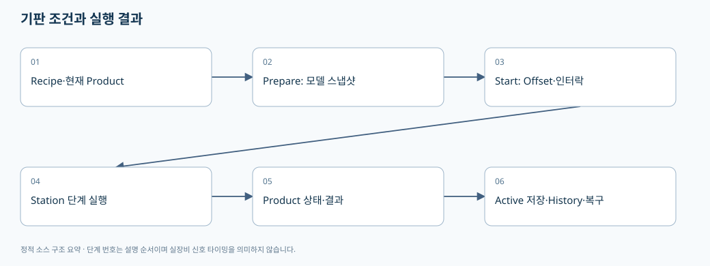
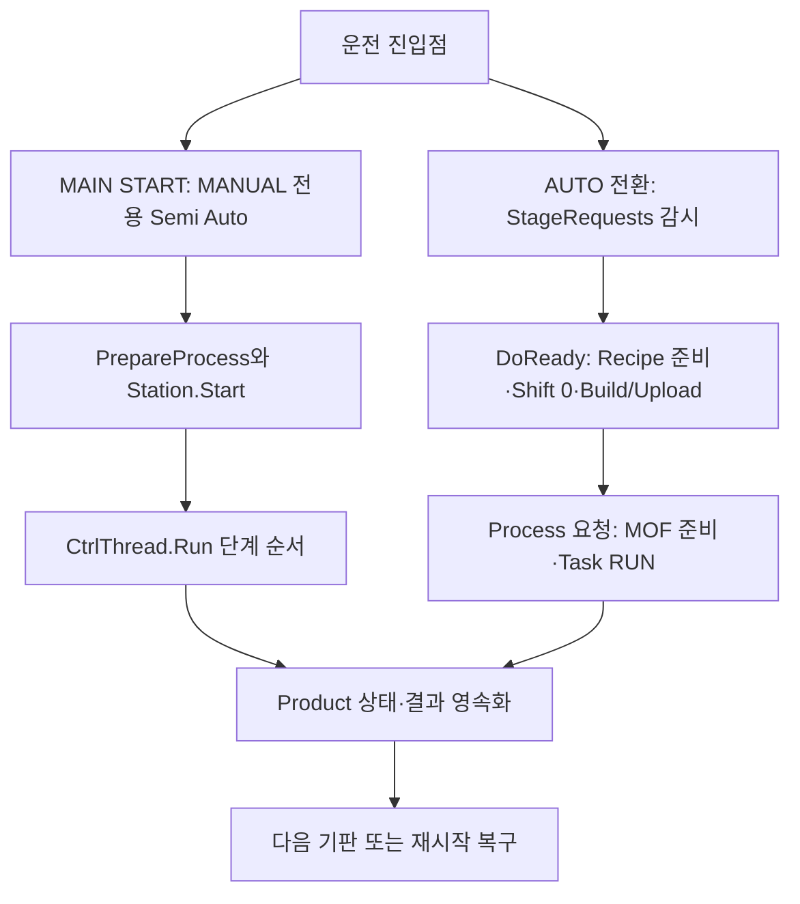

# 04. Product와 Station: 기판 한 장을 끝까지 추적하기

> 기준: `A3Drilling/master` · `5aee8e58439c9b455cae7c9593c9be986c3e682e`. 본 장은 해당 Commit의 소스를 정적으로 읽어 설명합니다. 장비 연결·가공·컴파일을 실행한 결과가 아닙니다.

**Recipe는 앞으로 쓸 조건, Product는 지금 또는 과거 기판에 적용한 조건과 결과, Station은 동작 순서**입니다. 세 객체를 나누어 보면 “Recipe는 바꿨는데 왜 현재 Product에 옛값이 남는가”, “Run을 눌렀는데 왜 아직 완료가 아닌가”를 이해할 수 있습니다.

위 SVG는 MAIN START의 Product 흐름을 단순화한 그림입니다. 실제 AUTO(Stage 요청)와의 분기는 아래 Mermaid와 6절에서 구분합니다.

## 1. Product 데이터는 무엇을 담는가

| CoreData | 필드/내용 | 의미 |
|---|---|---|
| `ST_PRODUCT_INFO` | `Values` 딕셔너리, Get/Set helper | Glass/Lot/PPID/상태 등 공통 식별·표시 항목 |
| `ST_PRODUCT_RECIPE_DATA` | Parameters 사본 | 기판의 실행 조건을 남기는 스냅샷 |
| `ST_PRODUCT_ALIGN_DATA` | State, Result, OffsetX, OffsetY, Rotation | Align 수행 상태와 결과 |
| `ST_PRODUCT_DISTORTION_DATA` | State, Result, MaxDa | Distortion 상태·결과 요약 |
| `ST_PRODUCT_REVIEW_DATA` | State, SavedAt, Results + Method/Rule/Beam/Reference 등 | 리뷰 결과와 어느 방식의 검사인지 구분하는 메타데이터 |
| `ST_PRODUCT_HEAD_RESULT` | HeadNo, State, Total/CompletedPoints, Result, ErrorCode, Message, 시각 | Head별 런타임 진행 정보 |
| `ST_PRODUCT_DATA` | Product, Recipe, Align, Distortion, Review, Runtime | 위 자료를 한 기판 단위로 결합 |

근거: [Product CoreData](https://github.com/kjuws10-rgb/A3Drilling/blob/5aee8e58439c9b455cae7c9593c9be986c3e682e/Drilling.Common/Product/CProductManager.cs#L996-L1049). `ST_PRODUCT_REVIEW_RESULT`는 ShotKey/HeadNo/CellNo/BeamNo/ErrorX/ErrorY/Judge를 갖습니다. 이 타입에 있다는 사실과 파일에 저장·복구되는 범위는 별도로 확인해야 합니다.

## 2. 상태와 결과는 서로 다른 축이다

| 구분 | 실제 enum 값 |
|---|---|
| 기판 상태 `EN_PRODUCT_STATE` | Created, Running, Completed, Stopped, Error, Scrapped |
| 판정 `EN_PRODUCT_RESULT` | Pending, Skipped, OK, NG |
| Head 상태 `EN_PRODUCT_HEAD_STATE` | Ready, Running, Completed, Stopped, Error, Disabled |
| Align/Distortion/Review 수행 상태 `EN_PRODUCT_PROCESS_STATE` | NotStarted, Running, Completed, Stopped, Error |

근거: [Product 상태 enum](https://github.com/kjuws10-rgb/A3Drilling/blob/5aee8e58439c9b455cae7c9593c9be986c3e682e/Drilling.Common/Product/CProductManager.cs#L959-L994). 예를 들어 `Completed`라고 해서 `OK`라는 뜻은 아닙니다. `CompleteProduct`는 공정 미수행이면 Skipped를 저장하며, `processExecuted=true`에서 isOk 값에 따라 OK/NG를 정합니다. [완료와 판정 조합](https://github.com/kjuws10-rgb/A3Drilling/blob/5aee8e58439c9b455cae7c9593c9be986c3e682e/Drilling.Common/Product/CProductManager.cs#L558-L602).

## 3. Product 생성부터 저장까지

`CreateProduct(processId, glassId, lotId, recipeId, parameters, headPointCounts)`는 다음을 수행합니다.

1. `_updateGate`로 상태 갱신을 직렬화합니다.
2. ActiveProduct를 읽는 중 오류가 있었으면 새 Product 생성을 거부합니다. 깨진 기존 기록을 덮어버리지 않으려는 경계입니다.
3. 현재 제품이 없으면 파일에서 다시 확인합니다.
4. 현재 제품이 Completed가 아니면 다른 Glass를 새로 만들지 못하게 합니다.
5. Head 점수가 0이면 Disabled, 양수면 Ready로 만듭니다.
6. 입력 Parameters를 새 딕셔너리로 복사하고 초기 상태를 묶어 저장합니다.

근거: [Product 생성·중복 방지·스냅샷](https://github.com/kjuws10-rgb/A3Drilling/blob/5aee8e58439c9b455cae7c9593c9be986c3e682e/Drilling.Common/Product/CProductManager.cs#L129-L199).

`PersistAndLog`는 **Active 파일 저장 → 메모리 현재 Product 공개 → History 기록 → 일반 로그** 순서입니다. Active 저장 후 History/로그 쓰기가 실패하면 이미 커밋된 상태를 실패한 전이로 뒤집지 않도록 catch합니다. 이 경우 상태 전이는 성공했지만 부가 이력이 불완전할 수 있으므로 진단 시 두 결과를 나누어 봐야 합니다. [Product commit 경계](https://github.com/kjuws10-rgb/A3Drilling/blob/5aee8e58439c9b455cae7c9593c9be986c3e682e/Drilling.Common/Product/CProductManager.cs#L789-L819).

## 4. ActiveProduct.csv는 객체 전체의 자동 직렬화가 아니다

`CProductFile`은 `Data/Product/ActiveProduct.csv`와 날짜별 History 파일을 사용합니다. 저장 형식은 `TYPE,NAME,VALUE`이고, 각 구역의 필드를 명시적으로 씁니다. [헤더와 Product 루트](https://github.com/kjuws10-rgb/A3Drilling/blob/5aee8e58439c9b455cae7c9593c9be986c3e682e/Drilling.File/Product/CProductFile.cs#L8-L11), [Active·History 상대 경로](https://github.com/kjuws10-rgb/A3Drilling/blob/5aee8e58439c9b455cae7c9593c9be986c3e682e/Drilling.File/Product/CProductFile.cs#L258-L265).

| TYPE | 주요 저장 항목 |
|---|---|
| PRODUCT | `CProductManager.ProductFieldNames` 목록의 값 |
| RECIPE | 공통 Product 핵심 이름을 제외한 Parameters |
| ALIGN | STATE, RESULT, OFFSET_X/Y, ROTATION |
| DISTORTION | STATE, RESULT, MAX_DA |
| REVIEW | 상태, 검사방식, RecipeId, Rule/Scope, Beam, 기준 Cell/Shot, 줄 수, 총 수 |
| REVIEW_RESULT | SavedAt 및 ShotKey별 HEAD_NO/CELL_NO/BEAM_NO/ERROR_X/ERROR_Y/JUDGE |

근거: [compact 저장 목록](https://github.com/kjuws10-rgb/A3Drilling/blob/5aee8e58439c9b455cae7c9593c9be986c3e682e/Drilling.File/Product/CProductFile.cs#L109-L178). 로드할 때 `Runtime`은 `new ST_PRODUCT_RUNTIME_DATA([])`로 구성됩니다. 따라서 “현재 메모리의 모든 Head 런타임 필드가 파일에 그대로 보존된다”고 설명하면 안 됩니다. [compact 로드와 Runtime 초기값](https://github.com/kjuws10-rgb/A3Drilling/blob/5aee8e58439c9b455cae7c9593c9be986c3e682e/Drilling.File/Product/CProductFile.cs#L73-L106).

Active 저장은 고유 임시파일에 쓰고 기존 파일이 있으면 `File.Replace`, 없으면 `File.Move`를 사용하며 finally에서 임시파일을 정리합니다. 모든 파일 저장기가 같은 원자적 교체 방식을 쓴다고 확대 해석하지 않습니다. [Active 파일 교체 방식](https://github.com/kjuws10-rgb/A3Drilling/blob/5aee8e58439c9b455cae7c9593c9be986c3e682e/Drilling.File/Product/CProductFile.cs#L182-L201).

## 5. 재시작 복구는 자동 재가공이 아니다

`LoadActive`는 읽기 성공/실패 플래그를 관리합니다. `RecoverInterrupted`는 기판 또는 Align/Distortion/Review/Head 중 Running 상태가 있는지 확인합니다. 코드 주석처럼 단지 Created 상태인 제품은 실행 중단으로 보지 않으며, Running이던 부분을 중단 상태로 복구하는 경로입니다. **전원 복구 후 중간 Shot부터 자동 재개**한다는 뜻이 아닙니다. [Active 로드 실패 상태](https://github.com/kjuws10-rgb/A3Drilling/blob/5aee8e58439c9b455cae7c9593c9be986c3e682e/Drilling.Common/Product/CProductManager.cs#L25-L47), [재시작 시 중단 판정](https://github.com/kjuws10-rgb/A3Drilling/blob/5aee8e58439c9b455cae7c9593c9be986c3e682e/Drilling.Common/Product/CProductManager.cs#L49-L88).

## 6. MAIN START(Semi Auto)와 AUTO(Stage 요청)는 다른 진입점입니다

화면에 `START`가 있고 내부 함수에 `AutoStep`이라는 이름이 있다는 이유로 현재 AUTO 운전 전체를 `CStationProcess.Start → Run` 한 경로로 설명하면 안 됩니다. 실제 RootView는 다음 두 경로를 구분합니다.

| 운전 진입점 | 실제 호출 | 실행을 시작하는 조건 | 다음에 읽을 함수 |
|---|---|---|---|
| MAIN START / Semi Auto | MANUAL 모드 확인 → 초기 모델 준비 → `PrepareInitialProcess(applyShiftOffset:true)` → `CStationManager.Start` | 사용자가 MAIN START를 누름. AUTO 모드에서는 이 버튼 경로를 거부 | `CStationProcess.Start`, `Run`, `RunSequenceStep` |
| AUTO / Stage PC 요청 감시 | AUTO 전환 시 `StartStageRequests(CreateStageProcessRequest, Review/Power/Distortion actions)` | AUTO로 바꾼 뒤 Stage의 요청과 handshake를 기다림. 전환 자체가 즉시 가공 명령은 아님 | `CStationProcess.StartStageRequests`, `CStageRequestSequence.Start/Run`, `RunStageTasks` |

근거: [AUTO 전환의 Stage 요청 감시와 중지](https://github.com/kjuws10-rgb/A3Drilling/blob/5aee8e58439c9b455cae7c9593c9be986c3e682e/Drilling.UI/CRootView.cs#L608-L619), [MANUAL 전용 MAIN START](https://github.com/kjuws10-rgb/A3Drilling/blob/5aee8e58439c9b455cae7c9593c9be986c3e682e/Drilling.UI/CRootView.cs#L1621-L1647), [AUTO 시작 전 소유권 확인](https://github.com/kjuws10-rgb/A3Drilling/blob/5aee8e58439c9b455cae7c9593c9be986c3e682e/Drilling.Common/Station/CStationProcess.cs#L3971-L3983).

`StartStageRequests`는 Manual MOF, Stage/Review의 동작·정리, 현재 Station sequence, 이전 AUTO Task/Buffered 실행의 소유권을 확인한 다음 감시를 시작합니다. `CStageRequestSequence.Start`는 별도의 stop CTS와 worker Task를 만들며 이전 worker/cleanup이 끝나지 않았으면 시작을 거부합니다. 즉 이 경로는 앞서 설명한 CtrlThread의 tick sequence와 같은 시작 함수가 아닙니다. [Station/Task 소유권 gate](https://github.com/kjuws10-rgb/A3Drilling/blob/5aee8e58439c9b455cae7c9593c9be986c3e682e/Drilling.Common/Station/CStationProcess.cs#L3971-L3983), [Stage 요청 worker 구성](https://github.com/kjuws10-rgb/A3Drilling/blob/5aee8e58439c9b455cae7c9593c9be986c3e682e/Drilling.Common/Station/CStationProcess.cs#L4935-L4970).

### AUTO의 DoReady와 Process 준비 경계

1. DoReady 요청을 받으면 Process ABLE을 쓰고 Stage START를 기다린 뒤 요청 Recipe·좌표를 준비합니다.
2. `prepare` callback은 이전 0선 후속검사 완료를 확인하고 요청 데이터를 가져옵니다. 여기서 Shift X/Y를 0으로 정규화하여 ProcessModel을 준비합니다.
3. `buildUpload` callback은 이번 모델의 Script를 만들고 업로드합니다. 이 단계가 끝났다고 Task RUN까지 실행된 것은 아닙니다.
4. Stage DoReady COMPLETE와 양측 신호 OFF를 확인한 다음 Process 요청을 기다립니다. MOF zero/Task RUN은 Process 준비의 책임으로 분리되어 있습니다.

근거: [AUTO 준비·빌드·zero·RUN callback](https://github.com/kjuws10-rgb/A3Drilling/blob/5aee8e58439c9b455cae7c9593c9be986c3e682e/Drilling.Common/Station/CStationProcess.cs#L3983-L4015), [DoReady 준비와 Build/Upload](https://github.com/kjuws10-rgb/A3Drilling/blob/5aee8e58439c9b455cae7c9593c9be986c3e682e/Drilling.Common/Station/CStationProcess.cs#L5105-L5122), [DoReady 해제 후 Process 준비](https://github.com/kjuws10-rgb/A3Drilling/blob/5aee8e58439c9b455cae7c9593c9be986c3e682e/Drilling.Common/Station/CStationProcess.cs#L5150-L5177). 이것은 해당 경로의 소스 책임을 설명한 것이며 모든 신호의 현장 타이밍을 실측 검증했다는 뜻이 아닙니다.

현재 AUTO의 Shift 0 정규화는 실제 코드 사실입니다. Shift를 유지하면서 가공할지 묻는 정책이나 양산 자동 초기화 옵션은 회의 요구와 별도로 구현 여부를 비교해야 합니다. 수동 Shift를 평가할 때 성공했다고 AUTO에서도 유지된다고 보고하지 않습니다.

## 7. PrepareProcess가 하는 일과 MAIN START의 Start가 하는 일

| 메서드 | 핵심 동작 | 방지하는 오류 |
|---|---|---|
| `PrepareProcess` | sequence lock 아래 Ready와 Manual MOF 상태 확인 | 진행 중 모델 교체 |
| `PrepareProcessCore` | runtime Parameter 합성, ProcessModel·Preview·통계·상태 스냅샷 생성 | Recipe와 실행 조건의 무분별한 공유 |
| `Start` | 준비 모델·Offset 최신성·인터락 확인 후 linked CTS 생성 | 준비 후 Offset가 바뀐 상태의 실행 |
| `base.Start(10, "StationProcess")` | CtrlThread의 주기 실행 시작 | Start 함수 반환과 실제 한 사이클 완료의 혼동 |

근거: [PrepareProcess](https://github.com/kjuws10-rgb/A3Drilling/blob/5aee8e58439c9b455cae7c9593c9be986c3e682e/Drilling.Common/Station/CStationProcess.cs#L209-L267), [Start와 이중 상태 확인](https://github.com/kjuws10-rgb/A3Drilling/blob/5aee8e58439c9b455cae7c9593c9be986c3e682e/Drilling.Common/Station/CStationProcess.cs#L270-L320). Start는 lock 밖에서 Offset/인터락을 확인한 뒤 lock 안에서 상태를 다시 확인합니다. 첫 확인과 실제 전이 사이에 상태가 바뀔 수 있기 때문이라고 해석할 수 있습니다.

Review Offset 롤백/변경은 준비된 모델을 무효화할 수 있습니다. `EnsurePreparedReviewOffsetIsCurrent`는 파일 경로와 저장시각이 준비 당시와 같은지 확인하고 다르면 DoReady를 다시 요구합니다. UI에서 바뀐 Offset을 표시했다고 이미 준비한 Script/ProcessModel이 저절로 바뀌는 것으로 가정하면 안 됩니다. [준비 모델 무효화·최신성 확인](https://github.com/kjuws10-rgb/A3Drilling/blob/5aee8e58439c9b455cae7c9593c9be986c3e682e/Drilling.Common/Station/CStationProcess.cs#L1563-L1595).

## 8. MAIN START의 단계 순서와 실패 순서

MAIN START에서 호출되는 `Run`의 정상 전이는 `Ready → PowerCheck → Align → Process → Inspection → Complete → Ready`입니다. Stop, Reset, Error는 별도 case입니다. 취소 예외는 Stop으로, 명시된 InvalidOperation/Timeout/IO/KeyNotFound 예외는 Error로 전환합니다. 그 외 예외는 상위 CtrlThread의 오류 처리와 함께 확인해야 하므로 “모든 예외가 동일한 Station Error 결과를 남긴다”고 말할 수 없습니다. [Station Run 상태기계](https://github.com/kjuws10-rgb/A3Drilling/blob/5aee8e58439c9b455cae7c9593c9be986c3e682e/Drilling.Common/Station/CStationProcess.cs#L323-L379).

`RunSequenceStep`은 기대한 상태에서 다음 상태로 이동했는지 확인하고, 중간에 Stop이 들어오면 Interrupted 경로를 탑니다. `FinishSequence`는 Ready로 돌리고 sequence CTS를 해제합니다. UI가 표시하는 `EN_STATION_STATE`, 단계 `EN_PROCESS_STEP`, 이 내부 순서 `EN_STATION_SEQUENCE`와 Script status는 목적이 다르므로 하나의 bool IsRunning으로 합치지 않는 편이 안전합니다. [단계 전이·정리](https://github.com/kjuws10-rgb/A3Drilling/blob/5aee8e58439c9b455cae7c9593c9be986c3e682e/Drilling.Common/Station/CStationProcess.cs#L382-L430).

`EN_STATION_SEQUENCE.PowerCheck`에는 명시값 3이 지정되어 있습니다. 이를 화면 정렬 순서나 Host I/O 값으로 자동 재사용하면 안 됩니다. `EN_STATION_STATE`는 Idle/Check/Process/Complete/Alarm/Stopped이고, 내부 sequence enum과 항목/목적이 다릅니다. [Station enum 선언](https://github.com/kjuws10-rgb/A3Drilling/blob/5aee8e58439c9b455cae7c9593c9be986c3e682e/Drilling.Common/Station/CStationManager.cs#L261-L295).
+
+## 9. 상위 자동화 연결에서 아직 확정하지 말아야 할 것

RootView의 Stage Process 요청 생성은 현재 선택 Recipe를 찾고, 현재 Product의 Glass/Lot을 사용하며 없으면 SIM/DUMMY 식별자를 만듭니다. `Stage Glass/Lot mapping is agreed` 후 fallback을 교체하라는 TODO가 남아 있습니다. 따라서 이 부분을 고객 Host PPID/Sub PPID 자동 Job Change의 완성 계약이라고 설명하면 안 됩니다. [Stage 요청의 현재 식별자 생성](https://github.com/kjuws10-rgb/A3Drilling/blob/5aee8e58439c9b455cae7c9593c9be986c3e682e/Drilling.UI/CRootView.cs#L2892-L2905).

검토할 후속 계약은 다음과 같습니다. 이는 제안 목록이며 이 소스가 구현 완료했다는 뜻은 아닙니다.

- Host PPID와 설비 RecipeId/Sub PPID의 관계와 길이·허용문자·미등록 처리.
- Job Change 요청 중인 Product 처리, 편집 중 Recipe 처리, 선택·검증·적용 완료 시점.
- 동일 요청 재전송에 대한 중복 적용 방지와 요청 번호.
- Recipe/Setting/Offset 버전이 실제 가공에 사용된 스냅샷과 연결되는 방식.

## 10. 검증 계획

| 조건 | 확인해야 할 결과 |
|---|---|
| Active 파일이 깨진 채 새 Product 생성 | 생성 거부·기존 파일 보존·오류 안내 |
| Created 상태에서 앱 재시작 | Running 중단과 구분하여 불필요한 실패 판정이 없는지 |
| Running 기판/Review 상태로 재시작 | 중단 흔적 보존·자동 재가공 미실행 |
| Active 저장 성공, History 실패 | 현재 상태는 한 번만 전이하고 이력 오류가 진단 가능한지 |
| Prepare 후 Offset 변경/롤백 | Start 차단, 재준비 후 최신값 사용 |
| Start 연속 클릭·Stop과 동시 요청 | 한 실행 소유자 유지·CTS 해제·UI 갱신 |
| 공정 Skip 후 Complete | Completed/Skipped와 OK를 혼동하지 않는지 |
| MANUAL MAIN START와 AUTO Stage 요청 비교 | 서로 다른 시작 함수·worker·신호 순서인지 구분하여 확인 |
| Shift가 있는 상태의 두 경로 | MAIN START의 Shift 반영과 AUTO 준비의 0 정규화를 각각 현재 구현 기대값으로 확인 |

다음 읽기: [05. 장비 통신 경계](05-device-interfaces-and-drivers.md), [06. 스레드와 로그](06-threading-snapshots-and-logs.md).
