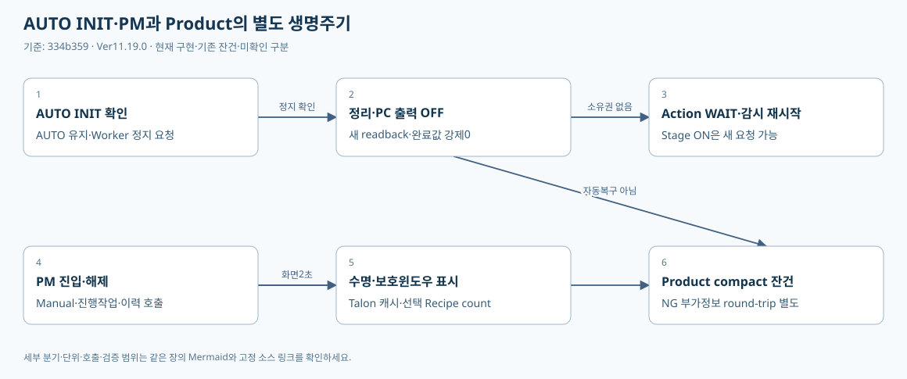
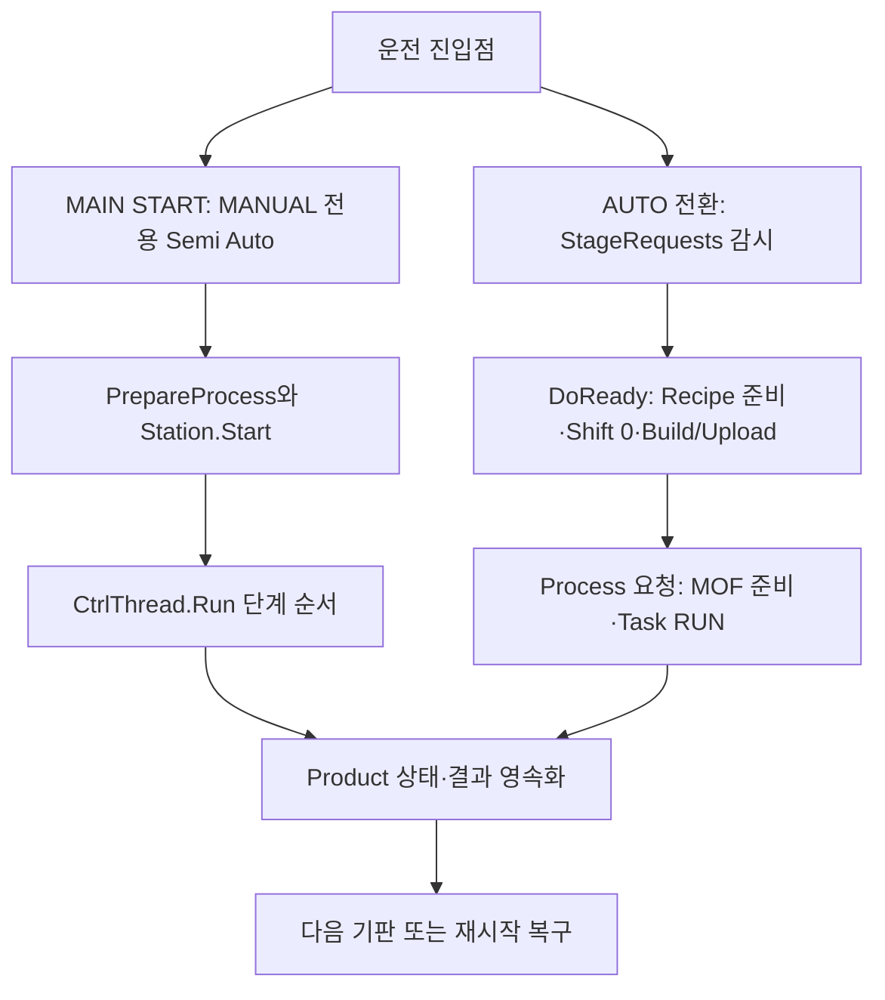
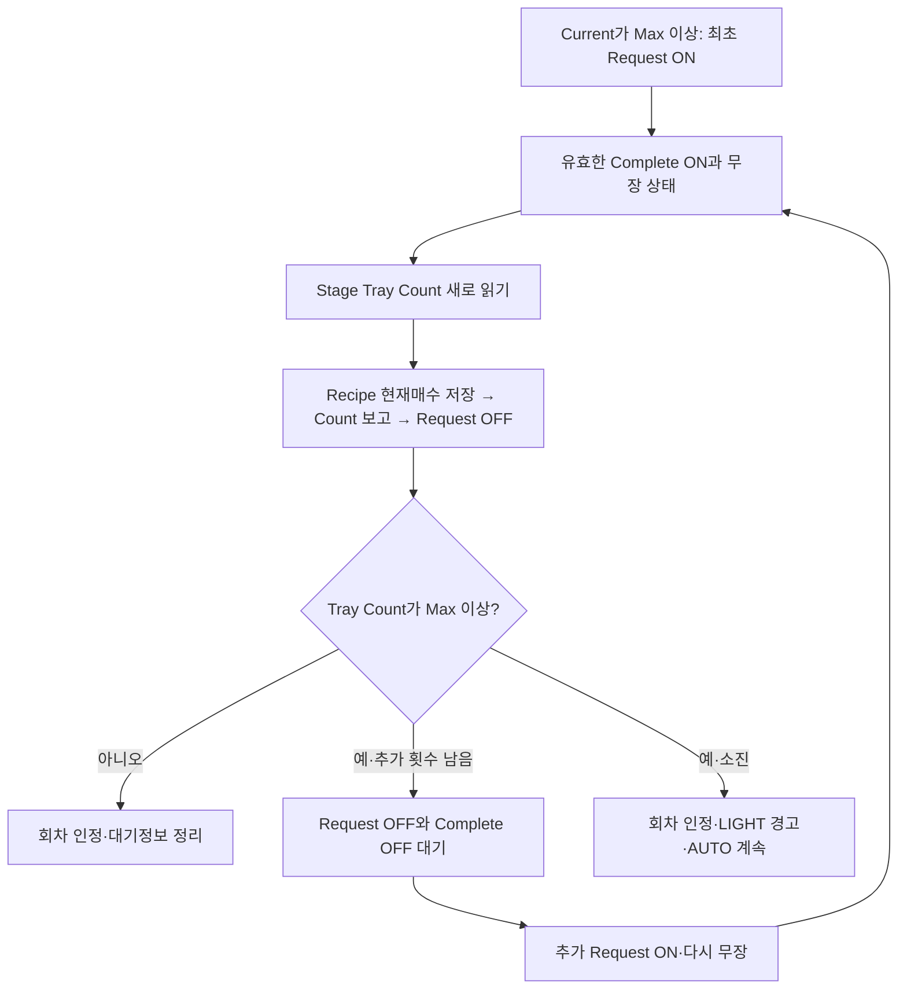
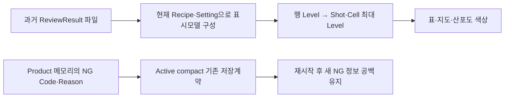
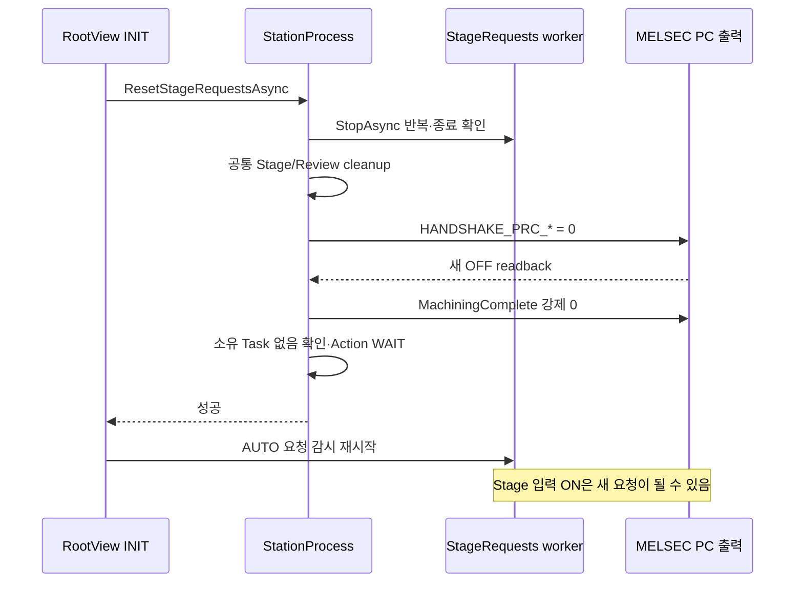

# 04. Product와 Station: 기판 한 장을 끝까지 추적하기

> 최신 원본 기준: **2026-11-25 · master Ver11.23.0 · `0219666f9053b907d96d7e0aa7d0c6c1be3a73d4`**. 이전 버전의 변경 설명은 연혁으로 보존하며, 이번 Stage Glass Data·Product 필드 변경은 [상세장](10-stage-glass-data-and-product-fields.md)에서 다룹니다.

> 기준: `A3Drilling/master` · `0219666f9053b907d96d7e0aa7d0c6c1be3a73d4`. 본 장은 해당 Commit의 소스를 정적으로 읽어 설명합니다. 정식 설비 빌드·장비 연결·가공을 실행한 결과가 아닙니다.

**Recipe는 앞으로 쓸 조건, Product는 지금 또는 과거 기판에 적용한 조건과 결과, Station은 동작 순서**입니다. 세 객체를 나누어 보면 “Recipe는 바꿨는데 왜 현재 Product에 옛값이 남는가”, “Run을 눌렀는데 왜 아직 완료가 아닌가”를 이해할 수 있습니다.

위 SVG는 11.13.0에서 추가되어 현재 유지되는 보호윈도우 교체·추가 요청 경계를 요약합니다. MAIN START와 실제 AUTO(Stage 요청)의 시작 분기는 아래 Mermaid와 6절에서 구분합니다.

## 1. Product 데이터는 무엇을 담는가

| CoreData | 필드/내용 | 의미 |
|---|---|---|
| `ST_PRODUCT_INFO` | `Values` 딕셔너리, Get/Set helper | Glass/Lot/PPID/상태 등 공통 식별·표시 항목 |
| `ST_PRODUCT_RECIPE_DATA` | Parameters 사본 | 기판의 실행 조건을 남기는 스냅샷 |
| `ST_PRODUCT_ALIGN_DATA` | State, Result, OffsetX, OffsetY, Rotation | Align 수행 상태와 결과 |
| `ST_PRODUCT_DISTORTION_DATA` | State, Result, MaxDa | Distortion 상태·결과 요약 |
| `ST_PRODUCT_REVIEW_DATA` | State, SavedAt, Results + Method/Rule/Beam/Reference 등 | 리뷰 결과와 어느 방식의 검사인지 구분하는 메타데이터 |
| `ST_PRODUCT_HEAD_RESULT` | HeadNo, State, Total/CompletedPoints, Result, ErrorCode, Message, 시각 | Head별 런타임 진행 정보 |
| `ST_PRODUCT_DATA` | Product, Recipe, Align, Distortion, Review, Runtime | 위 자료를 한 기판 단위로 결합 |

근거: [Product CoreData](https://github.com/kjuws10-rgb/A3Drilling/blob/0219666f9053b907d96d7e0aa7d0c6c1be3a73d4/Drilling.Common/Product/CProductManager.cs#L940-L997). `ST_PRODUCT_REVIEW_RESULT`는 ShotKey/HeadNo/CellNo/BeamNo/ErrorX/ErrorY/Judge와 새 초기화 속성 VisionResultCode/NgReason을 갖습니다. 타입 선언과 실제 파일의 저장·복구 범위는 다릅니다. 12절에서 그 공백을 설명합니다.

## 2. 상태와 결과는 서로 다른 축이다

| 구분 | 실제 enum 값 |
|---|---|
| 기판 상태 `EN_PRODUCT_STATE` | Created, Running, Completed, Stopped, Error, Scrapped |
| 판정 `EN_PRODUCT_RESULT` | Pending, Skipped, OK, NG |
| Head 상태 `EN_PRODUCT_HEAD_STATE` | Ready, Running, Completed, Stopped, Error, Disabled |
| Align/Distortion/Review 수행 상태 `EN_PRODUCT_PROCESS_STATE` | NotStarted, Running, Completed, Stopped, Error |

근거: [Product 상태 enum](https://github.com/kjuws10-rgb/A3Drilling/blob/0219666f9053b907d96d7e0aa7d0c6c1be3a73d4/Drilling.Common/Product/CProductManager.cs#L903-L938). 예를 들어 `Completed`라고 해서 `OK`라는 뜻은 아닙니다. `CompleteProduct`는 공정 미수행이면 Skipped를 저장하며, `processExecuted=true`에서 isOk 값에 따라 OK/NG를 정합니다. [완료와 판정 조합](https://github.com/kjuws10-rgb/A3Drilling/blob/0219666f9053b907d96d7e0aa7d0c6c1be3a73d4/Drilling.Common/Product/CProductManager.cs#L559-L603).

## 3. Product 생성부터 저장까지

`CreateProduct(processId, glassId, lotId, recipeId, parameters, headPointCounts, cancellationToken, productFields)`는 다음을 수행합니다. 마지막 `productFields`는 선택 매개변수이며, 생략하면 기존 호출과 같이 `parameters`에서 외부 기판 필드를 찾습니다.

1. `_updateGate`로 상태 갱신을 직렬화합니다.
2. ActiveProduct를 읽는 중 오류가 있었으면 새 Product 생성을 거부합니다. 깨진 기존 기록을 덮어버리지 않으려는 경계입니다.
3. 현재 제품이 없으면 파일에서 다시 확인합니다.
4. 현재 제품이 Completed가 아니면 다른 Glass를 새로 만들지 못하게 합니다.
5. Head 점수가 0이면 Disabled, 양수면 Ready로 만듭니다.
6. 입력 Parameters를 새 딕셔너리로 복사하고 초기 상태를 묶어 저장합니다. Ver11.23.0부터 외부 Glass 정보는 `productFields ?? parameters`, 실행 Recipe 조건은 `parameters` 사본으로 분리합니다.

근거: [Product 생성·중복 방지·스냅샷](https://github.com/kjuws10-rgb/A3Drilling/blob/0219666f9053b907d96d7e0aa7d0c6c1be3a73d4/Drilling.Common/Product/CProductManager.cs#L129-L200).

`PersistAndLog`는 **Active 파일 저장 → 메모리 현재 Product 공개 → History 기록 → 일반 로그** 순서입니다. Active 저장 후 History/로그 쓰기가 실패하면 이미 커밋된 상태를 실패한 전이로 뒤집지 않도록 catch합니다. 이 경우 상태 전이는 성공했지만 부가 이력이 불완전할 수 있으므로 진단 시 두 결과를 나누어 봐야 합니다. [Product commit 경계](https://github.com/kjuws10-rgb/A3Drilling/blob/0219666f9053b907d96d7e0aa7d0c6c1be3a73d4/Drilling.Common/Product/CProductManager.cs#L790-L820).

## 4. ActiveProduct.csv는 객체 전체의 자동 직렬화가 아니다

`CProductFile`은 `Data/Product/ActiveProduct.csv`와 날짜별 History 파일을 사용합니다. 저장 형식은 `TYPE,NAME,VALUE`이고, 각 구역의 필드를 명시적으로 씁니다. [헤더와 Product 루트](https://github.com/kjuws10-rgb/A3Drilling/blob/0219666f9053b907d96d7e0aa7d0c6c1be3a73d4/Drilling.File/Product/CProductFile.cs#L8-L11), [Active·History 상대 경로](https://github.com/kjuws10-rgb/A3Drilling/blob/0219666f9053b907d96d7e0aa7d0c6c1be3a73d4/Drilling.File/Product/CProductFile.cs#L247-L254).

| TYPE | 주요 저장 항목 |
|---|---|
| PRODUCT | `CProductManager.ProductFieldNames` 목록의 값 |
| RECIPE | 공통 Product 핵심 이름을 제외한 Parameters |
| ALIGN | STATE, RESULT, OFFSET_X/Y, ROTATION |
| DISTORTION | STATE, RESULT, MAX_DA |
| REVIEW | 상태, 검사방식, RecipeId, Rule/Scope, Beam, 기준 Cell/Shot, 줄 수, 총 수 |
| REVIEW_RESULT | SavedAt 및 ShotKey별 HEAD_NO/CELL_NO/BEAM_NO/ERROR_X/ERROR_Y/JUDGE |

근거: [compact 저장 목록](https://github.com/kjuws10-rgb/A3Drilling/blob/0219666f9053b907d96d7e0aa7d0c6c1be3a73d4/Drilling.File/Product/CProductFile.cs#L98-L167). 로드할 때 `Runtime`은 `new ST_PRODUCT_RUNTIME_DATA([])`로 구성됩니다. 따라서 “현재 메모리의 모든 Head 런타임 필드가 파일에 그대로 보존된다”고 설명하면 안 됩니다. [compact 로드와 Runtime 초기값](https://github.com/kjuws10-rgb/A3Drilling/blob/0219666f9053b907d96d7e0aa7d0c6c1be3a73d4/Drilling.File/Product/CProductFile.cs#L62-L95).

Active 저장은 고유 임시파일에 쓰고 기존 파일이 있으면 `File.Replace`, 없으면 `File.Move`를 사용하며 finally에서 임시파일을 정리합니다. 모든 파일 저장기가 같은 원자적 교체 방식을 쓴다고 확대 해석하지 않습니다. [Active 파일 교체 방식](https://github.com/kjuws10-rgb/A3Drilling/blob/0219666f9053b907d96d7e0aa7d0c6c1be3a73d4/Drilling.File/Product/CProductFile.cs#L171-L190).

## 5. 재시작 복구는 자동 재가공이 아니다

`LoadActive`는 읽기 성공/실패 플래그를 관리합니다. `RecoverInterrupted`는 기판 또는 Align/Distortion/Review/Head 중 Running 상태가 있는지 확인합니다. 코드 주석처럼 단지 Created 상태인 제품은 실행 중단으로 보지 않으며, Running이던 부분을 중단 상태로 복구하는 경로입니다. **전원 복구 후 중간 Shot부터 자동 재개**한다는 뜻이 아닙니다. [Active 로드 실패 상태](https://github.com/kjuws10-rgb/A3Drilling/blob/0219666f9053b907d96d7e0aa7d0c6c1be3a73d4/Drilling.Common/Product/CProductManager.cs#L25-L47), [재시작 시 중단 판정](https://github.com/kjuws10-rgb/A3Drilling/blob/0219666f9053b907d96d7e0aa7d0c6c1be3a73d4/Drilling.Common/Product/CProductManager.cs#L49-L88).

## 6. MAIN START(Semi Auto)와 AUTO(Stage 요청)는 다른 진입점입니다

화면에 `START`가 있고 내부 함수에 `AutoStep`이라는 이름이 있다는 이유로 현재 AUTO 운전 전체를 `CStationProcess.Start → Run` 한 경로로 설명하면 안 됩니다. 실제 RootView는 다음 두 경로를 구분합니다.

| 운전 진입점 | 실제 호출 | 실행을 시작하는 조건 | 다음에 읽을 함수 |
|---|---|---|---|
| MAIN START / Semi Auto | MANUAL 모드 확인 → 초기 모델 준비 → `PrepareInitialProcess(applyShiftOffset:true)` → `CStationManager.Start` | 사용자가 MAIN START를 누름. AUTO 모드에서는 이 버튼 경로를 거부 | `CStationProcess.Start`, `Run`, `RunSequenceStep` |
| AUTO / Stage PC 요청 감시 | AUTO 전환 시 `StartStageRequests(CreateStageProcessRequest, Review/Power/Distortion actions)` | AUTO로 바꾼 뒤 Stage의 요청과 handshake를 기다림. 전환 자체가 즉시 가공 명령은 아님 | `CStationProcess.StartStageRequests`, `CStageRequestSequence.Start/Run`, `RunStageTasks` |

근거: [AUTO 전환의 Stage 요청 감시와 중지](https://github.com/kjuws10-rgb/A3Drilling/blob/0219666f9053b907d96d7e0aa7d0c6c1be3a73d4/Drilling.UI/CRootView.cs#L724-L735), [MANUAL 전용 MAIN START](https://github.com/kjuws10-rgb/A3Drilling/blob/0219666f9053b907d96d7e0aa7d0c6c1be3a73d4/Drilling.UI/CRootView.cs#L1992-L2018), [AUTO 시작 전 소유권 확인](https://github.com/kjuws10-rgb/A3Drilling/blob/0219666f9053b907d96d7e0aa7d0c6c1be3a73d4/Drilling.Common/Station/CStationProcess.cs#L4026-L4039).

`StartStageRequests`는 Manual MOF, Stage/Review의 동작·정리, 현재 Station sequence, 이전 AUTO Task/Buffered 실행의 소유권을 확인한 다음 감시를 시작합니다. `CStageRequestSequence.Start`는 별도의 stop CTS와 worker Task를 만들며 이전 worker/cleanup이 끝나지 않았으면 시작을 거부합니다. 즉 이 경로는 앞서 설명한 CtrlThread의 tick sequence와 같은 시작 함수가 아닙니다. [Station/Task 소유권 gate](https://github.com/kjuws10-rgb/A3Drilling/blob/0219666f9053b907d96d7e0aa7d0c6c1be3a73d4/Drilling.Common/Station/CStationProcess.cs#L4026-L4039), [Stage 요청 worker 구성](https://github.com/kjuws10-rgb/A3Drilling/blob/0219666f9053b907d96d7e0aa7d0c6c1be3a73d4/Drilling.Common/Station/CStationProcess.cs#L5088-L5123).

### AUTO의 DoReady와 Process 준비 경계

1. DoReady 요청을 받으면 Process ABLE을 쓰고 Stage START를 기다린 뒤 요청 Recipe·좌표를 준비합니다.
2. `prepare` callback은 이전 0선 후속검사 완료를 확인하고 요청 데이터를 가져옵니다. 여기서 Shift X/Y를 0으로 정규화하여 ProcessModel을 준비합니다.
3. `buildUpload` callback은 이번 모델의 Script를 만들고 업로드합니다. 이 단계가 끝났다고 Task RUN까지 실행된 것은 아닙니다.
4. Stage DoReady COMPLETE와 양측 신호 OFF를 확인한 다음 Process 요청을 기다립니다. MOF zero/Task RUN은 Process 준비의 책임으로 분리되어 있습니다.

근거: [AUTO 준비·빌드·zero·RUN callback](https://github.com/kjuws10-rgb/A3Drilling/blob/0219666f9053b907d96d7e0aa7d0c6c1be3a73d4/Drilling.Common/Station/CStationProcess.cs#L4039-L4071), [DoReady 준비와 Build/Upload](https://github.com/kjuws10-rgb/A3Drilling/blob/0219666f9053b907d96d7e0aa7d0c6c1be3a73d4/Drilling.Common/Station/CStationProcess.cs#L5258-L5275), [DoReady 해제 후 Process 준비](https://github.com/kjuws10-rgb/A3Drilling/blob/0219666f9053b907d96d7e0aa7d0c6c1be3a73d4/Drilling.Common/Station/CStationProcess.cs#L5303-L5330). 이것은 해당 경로의 소스 책임을 설명한 것이며 모든 신호의 현장 타이밍을 실측 검증했다는 뜻이 아닙니다.

현재 AUTO의 Shift 0 정규화는 실제 코드 사실입니다. Shift를 유지하면서 가공할지 묻는 정책이나 양산 자동 초기화 옵션은 회의 요구와 별도로 구현 여부를 비교해야 합니다. 수동 Shift를 평가할 때 성공했다고 AUTO에서도 유지된다고 보고하지 않습니다.

## 7. PrepareProcess가 하는 일과 MAIN START의 Start가 하는 일

| 메서드 | 핵심 동작 | 방지하는 오류 |
|---|---|---|
| `PrepareProcess` | sequence lock 아래 Ready와 Manual MOF 상태 확인 | 진행 중 모델 교체 |
| `PrepareProcessCore` | runtime Parameter 합성, ProcessModel·Preview·통계·상태 스냅샷 생성 | Recipe와 실행 조건의 무분별한 공유 |
| `Start` | 준비 모델·Offset 최신성·인터락 확인 후 linked CTS 생성 | 준비 후 Offset가 바뀐 상태의 실행 |
| `base.Start(10, "StationProcess")` | CtrlThread의 주기 실행 시작 | Start 함수 반환과 실제 한 사이클 완료의 혼동 |

근거: [PrepareProcess](https://github.com/kjuws10-rgb/A3Drilling/blob/0219666f9053b907d96d7e0aa7d0c6c1be3a73d4/Drilling.Common/Station/CStationProcess.cs#L211-L269), [Start와 이중 상태 확인](https://github.com/kjuws10-rgb/A3Drilling/blob/0219666f9053b907d96d7e0aa7d0c6c1be3a73d4/Drilling.Common/Station/CStationProcess.cs#L272-L322). Start는 lock 밖에서 Offset/인터락을 확인한 뒤 lock 안에서 상태를 다시 확인합니다. 첫 확인과 실제 전이 사이에 상태가 바뀔 수 있기 때문이라고 해석할 수 있습니다.

Review Offset 롤백/변경은 준비된 모델을 무효화할 수 있습니다. `EnsurePreparedReviewOffsetIsCurrent`는 파일 경로와 저장시각이 준비 당시와 같은지 확인하고 다르면 DoReady를 다시 요구합니다. UI에서 바뀐 Offset을 표시했다고 이미 준비한 Script/ProcessModel이 저절로 바뀌는 것으로 가정하면 안 됩니다. [준비 모델 무효화·최신성 확인](https://github.com/kjuws10-rgb/A3Drilling/blob/0219666f9053b907d96d7e0aa7d0c6c1be3a73d4/Drilling.Common/Station/CStationProcess.cs#L1567-L1600).

## 8. MAIN START의 단계 순서와 실패 순서

MAIN START에서 호출되는 `Run`의 정상 전이는 `Ready → PowerCheck → Align → Process → Inspection → Complete → Ready`입니다. Stop, Reset, Error는 별도 case입니다. 취소 예외는 Stop으로, 명시된 InvalidOperation/Timeout/IO/KeyNotFound 예외는 Error로 전환합니다. 그 외 예외는 상위 CtrlThread의 오류 처리와 함께 확인해야 하므로 “모든 예외가 동일한 Station Error 결과를 남긴다”고 말할 수 없습니다. [Station Run 상태기계](https://github.com/kjuws10-rgb/A3Drilling/blob/0219666f9053b907d96d7e0aa7d0c6c1be3a73d4/Drilling.Common/Station/CStationProcess.cs#L325-L381).

`RunSequenceStep`은 기대한 상태에서 다음 상태로 이동했는지 확인하고, 중간에 Stop이 들어오면 Interrupted 경로를 탑니다. `FinishSequence`는 Ready로 돌리고 sequence CTS를 해제합니다. UI가 표시하는 `EN_STATION_STATE`, 단계 `EN_PROCESS_STEP`, 이 내부 순서 `EN_STATION_SEQUENCE`와 Script status는 목적이 다르므로 하나의 bool IsRunning으로 합치지 않는 편이 안전합니다. [단계 전이·정리](https://github.com/kjuws10-rgb/A3Drilling/blob/0219666f9053b907d96d7e0aa7d0c6c1be3a73d4/Drilling.Common/Station/CStationProcess.cs#L384-L432).

`EN_STATION_SEQUENCE.PowerCheck`에는 명시값 3이 지정되어 있습니다. 이를 화면 정렬 순서나 Host I/O 값으로 자동 재사용하면 안 됩니다. `EN_STATION_STATE`는 Idle/Check/Process/Complete/Alarm/Stopped이고, 내부 sequence enum과 항목/목적이 다릅니다. [Station enum 선언](https://github.com/kjuws10-rgb/A3Drilling/blob/0219666f9053b907d96d7e0aa7d0c6c1be3a73d4/Drilling.Common/Station/CStationManager.cs#L264-L298).

## 9. 상위 자동화 연결에서 아직 확정하지 말아야 할 것

RootView의 Stage Process 요청 생성은 현재 선택 Recipe를 찾고, 현재 Product의 Glass/Lot을 사용하며 없으면 SIM/DUMMY 식별자를 만듭니다. `Stage Glass/Lot mapping is agreed` 후 fallback을 교체하라는 TODO가 남아 있습니다. 따라서 이 부분을 고객 Host PPID/Sub PPID 자동 Job Change의 완성 계약이라고 설명하면 안 됩니다. [Stage 요청의 현재 식별자 생성](https://github.com/kjuws10-rgb/A3Drilling/blob/0219666f9053b907d96d7e0aa7d0c6c1be3a73d4/Drilling.UI/CRootView.cs#L3280-L3293).

검토할 후속 계약은 다음과 같습니다. 이는 제안 목록이며 이 소스가 구현 완료했다는 뜻은 아닙니다.

- Host PPID와 설비 RecipeId/Sub PPID의 관계와 길이·허용문자·미등록 처리.
- Job Change 요청 중인 Product 처리, 편집 중 Recipe 처리, 선택·검증·적용 완료 시점.
- 동일 요청 재전송에 대한 중복 적용 방지와 요청 번호.
- Recipe/Setting/Offset 버전이 실제 가공에 사용된 스냅샷과 연결되는 방식.

## 10. 검증 계획

| 조건 | 확인해야 할 결과 |
|---|---|
| Active 파일이 깨진 채 새 Product 생성 | 생성 거부·기존 파일 보존·오류 안내 |
| Created 상태에서 앱 재시작 | Running 중단과 구분하여 불필요한 실패 판정이 없는지 |
| Running 기판/Review 상태로 재시작 | 중단 흔적 보존·자동 재가공 미실행 |
| Active 저장 성공, History 실패 | 현재 상태는 한 번만 전이하고 이력 오류가 진단 가능한지 |
| Prepare 후 Offset 변경/롤백 | Start 차단, 재준비 후 최신값 사용 |
| Start 연속 클릭·Stop과 동시 요청 | 한 실행 소유자 유지·CTS 해제·UI 갱신 |
| 공정 Skip 후 Complete | Completed/Skipped와 OK를 혼동하지 않는지 |
| MANUAL MAIN START와 AUTO Stage 요청 비교 | 서로 다른 시작 함수·worker·신호 순서인지 구분하여 확인 |
| Shift가 있는 상태의 두 경로 | MAIN START의 Shift 반영과 AUTO 준비의 0 정규화를 각각 현재 구현 기대값으로 확인 |

## 11. 보호윈도우는 매수 저장과 추가 교체 요청을 함께 추적합니다

정상 MOF 완료 시 현재매수를 증가시키는 경로와, Stage가 교체완료를 보냈을 때 공식 Tray Count를 받아 **현재매수로 인계**하는 경로는 다릅니다. 교체완료라고 매수를 무조건 0으로 만들지 않습니다. 11.13.0에서 추가된 정책은 인계 매수가 Max 이상이면 Recipe에 정한 0~3회만큼 추가 교체를 요청합니다. [정상 완료 증가와 회차 중복 억제](https://github.com/kjuws10-rgb/A3Drilling/blob/0219666f9053b907d96d7e0aa7d0c6c1be3a73d4/Drilling.Common/Station/CStationProcess.cs#L3770-L3795), [시작 임계값·재시도 정책 보관](https://github.com/kjuws10-rgb/A3Drilling/blob/0219666f9053b907d96d7e0aa7d0c6c1be3a73d4/Drilling.Common/Station/CStationProcess.cs#L4422-L4461).

교체완료 처리는 `_gate`로 직렬화하며, 이미 저장한 Tray Count는 `_committedHandoverCount`에 남겨 뒤 보고/Request OFF가 실패했을 때 다시 저장하는 일을 줄입니다. 추가 요청은 두 신호가 모두 OFF로 관측된 뒤 보냅니다. 같은 Complete ON을 여러 번 새 완료로 읽지 않도록 하는 구조입니다. [OFF 대기와 재요청](https://github.com/kjuws10-rgb/A3Drilling/blob/0219666f9053b907d96d7e0aa7d0c6c1be3a73d4/Drilling.Common/Station/CStationProcess.cs#L4659-L4674), [인계 저장·보고·정리·소진](https://github.com/kjuws10-rgb/A3Drilling/blob/0219666f9053b907d96d7e0aa7d0c6c1be3a73d4/Drilling.Common/Station/CStationProcess.cs#L4708-L4761).

**운전 의미**: `RetryCount=0`도 최초 교체는 요청합니다. 그 첫 완료의 Tray Count가 여전히 Max 이상이면 추가 요청 없이 소진 경고를 냅니다. `Max=0`이면 모든 유효한 비음수 Tray Count가 임계값 이상이므로 설정한 횟수까지 진행한 뒤 소진될 수 있습니다. 소진은 `PROTECT_WINDOW_RETRY_EXHAUSTED` LIGHT 알람이며 코드와 정의가 AUTO 계속 의도를 명시합니다. 이를 HEAVY 정지 기능으로 설명하지 않습니다. [LIGHT 정의](https://github.com/kjuws10-rgb/A3Drilling/blob/0219666f9053b907d96d7e0aa7d0c6c1be3a73d4/Config/JHMI_ALARMLIST.csv#L320), [알림 callback과 예외 격리](https://github.com/kjuws10-rgb/A3Drilling/blob/0219666f9053b907d96d7e0aa7d0c6c1be3a73d4/Drilling.Common/Station/CStationProcess.cs#L4787-L4797).

정책·시도횟수·완료 무장·회차 객체는 메모리 상태입니다. 재시작 시 Request가 ON인 경우 선택 Recipe로 정책을 다시 읽고 시도횟수를 0으로 복구하므로, **재시작을 가로지른 총 추가 요청 횟수**가 3으로 제한된다고 보장하지 않습니다. [Request ON 복구](https://github.com/kjuws10-rgb/A3Drilling/blob/0219666f9053b907d96d7e0aa7d0c6c1be3a73d4/Drilling.Common/Station/CStationProcess.cs#L4687-L4698).

검증은 Retry 0/1/3 × TrayCount의 Max-1/Max/Max+1, Max=0, Complete ON 고정·OFF 지연·통신 끊김, 저장 성공 뒤 보고 실패, 교체 중 Recipe 변경·재시작으로 나눕니다. Request ON 횟수, Current Count의 파일·캐시·보고값, LIGHT 발생, AUTO 지속 여부를 각각 관측해야 합니다. 이번 작업에서는 이러한 장비/상태기계 테스트를 실행하지 않았습니다.

## 12. 새 Review NG 필드는 메모리와 영속 파일의 범위가 다릅니다

`ST_PRODUCT_REVIEW_RESULT`에는 nullable `VisionResultCode`와 기본 빈 문자열 `NgReason`가 추가됐고 Review 결과 생성/복구 경로에서 이를 전달합니다. 하지만 Active Product compact 파일의 writer는 `HEAD_NO,CELL_NO,BEAM_NO,ERROR_X,ERROR_Y,JUDGE`만 쓰고 reader도 이 여섯 필드로 레코드를 다시 만듭니다. **새 메타데이터가 Active Product 재시작 복구까지 보존된다고 설명하면 틀립니다.** ReviewResult CSV에는 별도의 새 열이 있으므로 해당 전문 장과 함께 확인합니다. [새 Product 필드](https://github.com/kjuws10-rgb/A3Drilling/blob/0219666f9053b907d96d7e0aa7d0c6c1be3a73d4/Drilling.Common/Product/CProductManager.cs#L940-L947), [Review에서 Product로 전달](https://github.com/kjuws10-rgb/A3Drilling/blob/0219666f9053b907d96d7e0aa7d0c6c1be3a73d4/Drilling.Common/Review/CReviewManager.cs#L1664-L1680), [compact 저장 범위](https://github.com/kjuws10-rgb/A3Drilling/blob/0219666f9053b907d96d7e0aa7d0c6c1be3a73d4/Drilling.File/Product/CProductFile.cs#L157-L165), [compact 읽기 범위](https://github.com/kjuws10-rgb/A3Drilling/blob/0219666f9053b907d96d7e0aa7d0c6c1be3a73d4/Drilling.File/Product/CProductFile.cs#L287-L314).

합성 결과에 Vision 실패·X/Y 허용오차 실패를 각각 넣고 `ReviewResult 저장/로드`, `Product Active 저장/로드`, `체크포인트 복구`를 나눠 검증해야 합니다. 현재 구조에서는 Active 복구 후 새 필드가 null/빈값으로 돌아오는 정적 저장 공백이 보이며, 실제 파일 round-trip 테스트는 수행하지 않았습니다.

## 13. 11.17에서 도입된 Level 표시와 기존 Product 영속 잔건

11.17.0은 결과 오차의 **표시 등급**을 도입했습니다. Review Data는 결과 행별 Level을 계산하고 같은 Shot의 여러 Beam과 같은 Cell의 행을 최대 Level로 묶어 그림 색에 반영합니다. 파일에 저장된 JUDGE를 이 등급으로 다시 판정하거나 Product 상태를 Completed/OK로 바꾸는 경로가 아닙니다. 같은 결과 파일도 나중에 적용한 Setting 임계값·색상에 따라 다시 표시될 수 있습니다. [행·Cell·Shot 등급 집계](https://github.com/kjuws10-rgb/A3Drilling/blob/0219666f9053b907d96d7e0aa7d0c6c1be3a73d4/Drilling.UI/Menu/Menus/CMenuCorrection.ReviewData.Display.cs#L252-L336), [등급별 기판 색](https://github.com/kjuws10-rgb/A3Drilling/blob/0219666f9053b907d96d7e0aa7d0c6c1be3a73d4/Drilling.UI/Menu/Menus/CMenuCorrection.ReviewData.Display.cs#L1078-L1093).

Product compact의 새 NG 정보 누락과 보호윈도우 재시작 시 재시도 상태 초기화는 11.19 diff에서도 고쳐진 항목이 아닙니다. 현재 serializer·요청 복구 코드가 이전 기준과 동일함을 대조해 **기존 잔건**으로 유지합니다. 새 색상으로 보인다는 사실이 그 저장 공백을 해소하지 않습니다. 12절의 저장/복구 근거와 11절의 요청 복구 근거를 따릅니다.

후속 검증은 같은 파일을 다른 Level Setting으로 다시 로드해 JUDGE·오차·Product 상태는 어떤 경로에서 유지되는지, 편집 Revision/미측정/Vision Find NG의 표시가 live 화면과 같은지, Active 재시작 복구와 결과 CSV 재로드를 혼동하지 않는지 나눕니다.

다음 읽기: [05. 장비 통신 경계](05-device-interfaces-and-drivers.md), [06. 스레드와 로그](06-threading-snapshots-and-logs.md), [08. 알람 원인 분석](08-alarm-cause-analysis.md).

## 14. Ver11.19.0 AUTO INIT: PC 시퀀스 정리 후 감시 재시작

새 INIT 명령은 AUTO 모드·MAIN Cycle Ready·다른 INIT 없음일 때 확인창을 엽니다. 창이 열린 동안 상태가 바뀌었는지도 다시 확인합니다. 확인 후에는 Start/Stop/모드 변경 명령을 일시 차단하고 StationManager.ResetStageRequestsAsync를 기다립니다. 성공하면 같은 AUTO 모드에서 요청 감시를 다시 시작합니다. [INIT Command 조건](https://github.com/kjuws10-rgb/A3Drilling/blob/0219666f9053b907d96d7e0aa7d0c6c1be3a73d4/Drilling.UI/CRootView.cs#L233-L249), [확인·재확인·정리·감시 재시작](https://github.com/kjuws10-rgb/A3Drilling/blob/0219666f9053b907d96d7e0aa7d0c6c1be3a73d4/Drilling.UI/CRootView.cs#L758-L799), [Manager 진입점](https://github.com/kjuws10-rgb/A3Drilling/blob/0219666f9053b907d96d7e0aa7d0c6c1be3a73d4/Drilling.Common/Station/CStationManager.cs#L28-L32)

| 단계 | 실제 범위·실패 처리 |
|---|---|
| 직렬화·정지 확인 | INIT gate로 중복 정리를 직렬화. StopAsync와 공통 실행 Session 종료를 반복 확인하며 15초 시각 기준 사용 |
| 출력 정리 | 공통 cleanup 후 활성·쓰기 가능 HANDSHAKE_PRC_* 출력에 0 Write와 새 Readback 확인. 실패들을 모아 예외 |
| 완료값 초기화 | Process MachiningComplete는 캐시가 이미0이어도 forceWrite하여 새 피드백 확인 |
| Action 초기화 | 공통 소유권/Stage Task/BufferedRun이 남으면 Action을 Reset하지 않고 실패 |
| 재시작 | 성공 후 RootView가 감시 재시작. 실패는 상태 메시지·경고창으로 표시하고 감시 재시작 성공으로 처리하지 않음 |

근거: [INIT 전체 단계](https://github.com/kjuws10-rgb/A3Drilling/blob/0219666f9053b907d96d7e0aa7d0c6c1be3a73d4/Drilling.Common/Station/CStationProcess.cs#L3912-L3958), [출력 선택·OFF 확인](https://github.com/kjuws10-rgb/A3Drilling/blob/0219666f9053b907d96d7e0aa7d0c6c1be3a73d4/Drilling.Common/Station/CStationProcess.cs#L4340-L4385), [강제 완료값 Write·새 피드백](https://github.com/kjuws10-rgb/A3Drilling/blob/0219666f9053b907d96d7e0aa7d0c6c1be3a73d4/Drilling.Common/Station/CStationProcess.cs#L4843-L4897), [요청 감시와 Stage 입력 소비](https://github.com/kjuws10-rgb/A3Drilling/blob/0219666f9053b907d96d7e0aa7d0c6c1be3a73d4/Drilling.Common/Station/CStationProcess.cs#L5166-L5220)

**INIT는 Home, PLC 전체 초기화, Stage 입력 OFF, 비상정지, 모든 장치의 물리 정지를 보증하는 함수가 아닙니다.** 코드가 수행하는 정지 요청·cleanup·출력 readback 경계와 실제 장치 정지의 승인 시험을 구분합니다. 15초는 앞의 정지 대기 루프 기준이며 이후 모든 파일·통신까지 합친 전체 INIT 제한시간으로 설명하지 않습니다. Stage의 ABLE가 남으면 감시 재시작 후 자동으로 새 요청을 처리할 수 있다는 경고가 UI 확인문에 있습니다. [재시작 경고 문구](https://github.com/kjuws10-rgb/A3Drilling/blob/0219666f9053b907d96d7e0aa7d0c6c1be3a73d4/Drilling.UI/CRootView.cs#L763-L771)

후속 검증은 대기/DoReady/Process/Review/TPM/Distortion에서 INIT, Task STOP 지연, 공통 cleanup 실패, OFF readback 실패, 강제 완료값0, Stage ABLE/START/COMPLETE 잔류, 연속 클릭·확인 중 모드 변경으로 나눕니다. 출력만 내려간 상태에서 Action이 완료로 표시되거나 실패 후 감시가 자동 재시작되는지 각각 관측합니다.

## 15. PM 잠금·이력·수명 표시는 서로 다른 책임입니다

PM 진입은 Manual·MAIN Ready 조건에 더해 Stage 요청/cleanup, Manual MOF, 공통 이동, Review Running/Stopping, PowerMeasure, Manual 보조동작, Correction 보정, Monitor Tune 실행 여부를 확인합니다. 사유는 비어 있지 않은 200자 이하 한 줄이며 이력 시작 호출이 성공한 뒤 잠급니다. 이는 UI가 관측하는 소프트웨어 작업 상태의 점검이고 물리 에너지 격리나 별도 정비 안전장치의 증거가 아닙니다. [PM 진입·진행동작 점검·사유](https://github.com/kjuws10-rgb/A3Drilling/blob/0219666f9053b907d96d7e0aa7d0c6c1be3a73d4/Drilling.UI/CRootView.cs#L1272-L1390), [Manual 진행동작 집계](https://github.com/kjuws10-rgb/A3Drilling/blob/0219666f9053b907d96d7e0aa7d0c6c1be3a73d4/Drilling.UI/Menu/Menus/CMenuManual.cs#L137-L146)

해제는 Setting에서 읽은 비밀번호를 비교한 뒤 현재 PM 세션의 CompletePmSession을 호출합니다. 값 누락·불일치·세션 없음·이력 저장 예외이면 잠금을 유지합니다. 인증값은 문서에 싣지 않습니다. 잠금 상태와 활성 세션 참조는 RootView 메모리 필드로 초기화되며, 이번에 읽은 호출부에서는 재시작 시 열린 세션 복원 경로를 찾지 못했습니다. [메모리 PM 상태](https://github.com/kjuws10-rgb/A3Drilling/blob/0219666f9053b907d96d7e0aa7d0c6c1be3a73d4/Drilling.UI/CRootView.cs#L127-L130), [해제 순서·실패 유지](https://github.com/kjuws10-rgb/A3Drilling/blob/0219666f9053b907d96d7e0aa7d0c6c1be3a73d4/Drilling.UI/CRootView.cs#L1442-L1499)

PM Build는 선택 Recipe의 현재/최대 보호윈도우 매수, Head1~8→Talon0~7의 캐시 ThgHour, 공통 수명 제한값과 이력을 표시합니다. PM 화면은2초 주기로 재조립 대상으로 선택됩니다. 이 코드는 수명 사용량을 리셋하거나 한계 초과를 자동 차단하지 않습니다. 또한 Snapshot.Value가 있으면 State가 STALE/ERROR여도 캐시 숫자를 표시하는 경로이므로 숫자가 곧 최신 실측값이라는 판단은 피해야 합니다. [PM 화면 생산자](https://github.com/kjuws10-rgb/A3Drilling/blob/0219666f9053b907d96d7e0aa7d0c6c1be3a73d4/Drilling.UI/Menu/Menus/CMenuPm.cs#L34-L56), [수명·보호윈도우 표시](https://github.com/kjuws10-rgb/A3Drilling/blob/0219666f9053b907d96d7e0aa7d0c6c1be3a73d4/Drilling.UI/Menu/Menus/CMenuPm.cs#L80-L140), [PM 갱신 선택](https://github.com/kjuws10-rgb/A3Drilling/blob/0219666f9053b907d96d7e0aa7d0c6c1be3a73d4/Drilling.UI/CRootView.cs#L2313-L2345)

**2026-11-21 근거 갱신**: 새 tracked `CLogManager.cs`에서 PM 저장 구현과 `ST_PM_HISTORY_ENTRY` 선언을 확인했습니다. Start는 사유 검증 후 `Log/PM/yyyy/MM/dd/PM_<SessionId>.json`에 UTF-8 임시 파일을 쓰고 `Move(..., true)`로 게시합니다. Complete는 기존 파일·세션 ID를 다시 확인하고 해제 시각을 저장합니다. Read는 첫 조회의 목록을 인스턴스 캐시에 보관합니다. 이는 파일 교체 방식의 구현 확인이며 정전 시 내구성·동시 프로세스·외부 수정 캐시 갱신을 검증한 결과가 아닙니다. RootView의 활성 PM 세션/Lock은 메모리 상태이므로, JSON의 미완료 세션을 다음 실행의 활성 잠금으로 복구하는 호출은 여전히 없습니다. [CLogManager.cs:72–173](https://github.com/kjuws10-rgb/A3Drilling/blob/0219666f9053b907d96d7e0aa7d0c6c1be3a73d4/Drilling.Common/Log/CLogManager.cs#L72-L173) [CLogManager.cs:1503–1508](https://github.com/kjuws10-rgb/A3Drilling/blob/0219666f9053b907d96d7e0aa7d0c6c1be3a73d4/Drilling.Common/Log/CLogManager.cs#L1503-L1508) 자세한 실패·재시작 경계는 [09장](09_Log_PM_큐와_이력추적.md)에서 이어집니다.

## 16. Ver11.23.0: 외부 Glass 필드와 내부 공정 결과를 분리

이번 master는 Monitor Glass 생성에 STAGE PC DATA/DUMMY/취소 선택을 추가한다. Stage를 고르면 WF600~WF767의 44개 수신 값을 검사해 43개 Product 필드로 만든다. DUMMY는 로컬 Glass ID와 빈 외부 항목을 사용한다. 두 경로 모두 이 버튼에서 전달하는 Recipe Parameters와 Head 점수 사전은 비어 있다. 따라서 PPID 수신이나 Product 생성 성공을 Recipe 선택·Head 배정·DoReady 완료라고 해석하면 안 된다. [생성 분기](https://github.com/kjuws10-rgb/A3Drilling/blob/0219666f9053b907d96d7e0aa7d0c6c1be3a73d4/Drilling.UI/Menu/Menus/CMenuMonitor.cs#L4429-L4496)

`JUDGEMENT`는 외부 Stage 판정 문자열로 남고, 내부 공정 판정은 새 `PRODUCT_RESULT`에 기록한다. `ST_PRODUCT_DATA.Result`는 새 필드가 비었을 때만 이전 JUDGEMENT를 읽는 호환 경로를 가진다. ProductFieldNames는 Stage 공통 43개와 내부 항목을 합쳐 만들며, compact 파일 로더·저장기도 같은 목록을 사용한다. 기존 Review CSV의 측정 판정이나 보정값이 이 이름 변경으로 바뀌는 것은 아니다. [필드 생성·상태 쓰기](https://github.com/kjuws10-rgb/A3Drilling/blob/0219666f9053b907d96d7e0aa7d0c6c1be3a73d4/Drilling.Common/Product/CProductManager.cs#L823-L878), [이전 Result 호환](https://github.com/kjuws10-rgb/A3Drilling/blob/0219666f9053b907d96d7e0aa7d0c6c1be3a73d4/Drilling.Common/Product/CProductManager.cs#L1050-L1058)

기본 Poll Block의 신선도·문자열 길이·빈 PPID·고객 규격 대조·파일 round-trip 과제는 [Stage Glass Data 상세장](10-stage-glass-data-and-product-fields.md)을 따른다. 본문의 이전 AUTO INIT·PM·Review compact 잔건도 계속 남는 별도 경계다.

## 17. 기존에 남아 있는 가공 Process ID와 Product 연결 공백

Monitor의 Glass 생성은 `CreateProduct`의 Process ID에 빈 문자열을 전달한다. 반면 Root의 가공 준비는 새 `SCAN-...-GUID` Process ID를 만들고 기존 Product에서는 Glass ID·Lot ID만 재사용한다. `GetCurrentProcessProductId`는 Product와 ProcessModel의 Process ID가 일치할 때만 기판 ID를 반환하며, 완료·정지 등의 Product 갱신은 이 ID가 없으면 저장 없이 반환하는 직접 경로가 있다. [Monitor Product 생성의 빈 Process ID](https://github.com/kjuws10-rgb/A3Drilling/blob/0219666f9053b907d96d7e0aa7d0c6c1be3a73d4/Drilling.UI/Menu/Menus/CMenuMonitor.cs#L4480-L4488) [새 SCAN Process ID와 기존 Glass/Lot만 재사용](https://github.com/kjuws10-rgb/A3Drilling/blob/0219666f9053b907d96d7e0aa7d0c6c1be3a73d4/Drilling.UI/CRootView.cs#L1641-L1653) [Process ID 일치 검사와 완료/정지 Product 갱신의 null 반환 경계](https://github.com/kjuws10-rgb/A3Drilling/blob/0219666f9053b907d96d7e0aa7d0c6c1be3a73d4/Drilling.Common/Station/CStationProcess.cs#L1415-L1516)

이는 `0219666`의 추적 가능한 C# 직접 호출 경로에서 확인한 기존 연결 공백이다. 이번 Stage 정보 입력 추가 때문에 새로 생긴 회귀라고 단정하지 않으며, 다른 런타임 호스트·Reflection 연결의 부재나 고객 설비에서 실제로 어떤 결과가 발생하는지까지 검증한 것은 아니다. Stage Glass 정보 저장 성공을 가공 상태·결과의 Product 연결 완료로 취급하지 말고 별도 확인해야 한다.
