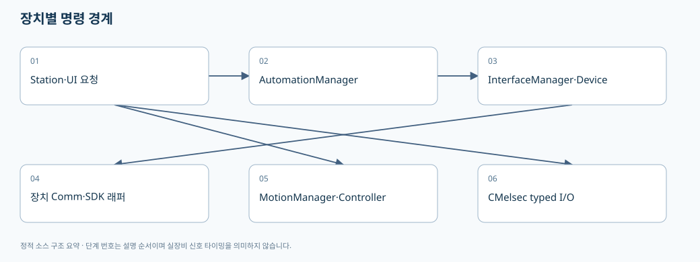
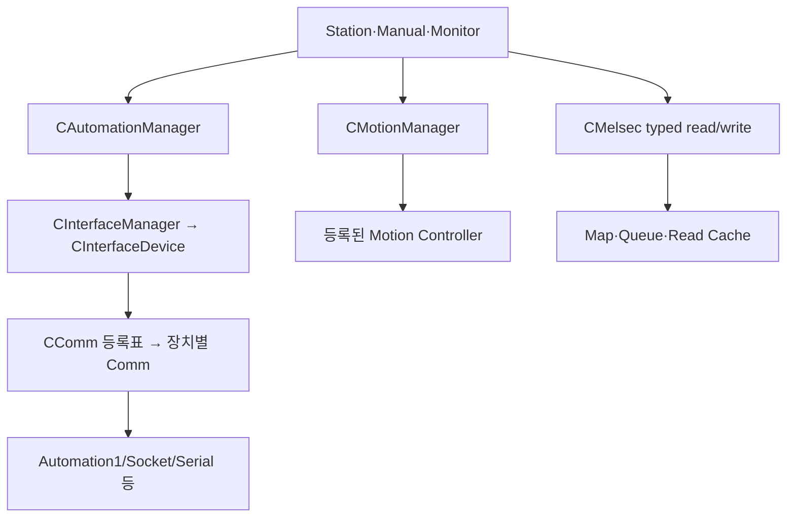

# 05. Device Interface·Automation1·Motion·MELSEC의 경계

> 기준: `A3Drilling/master` · `5aee8e58439c9b455cae7c9593c9be986c3e682e`. 본 장은 해당 Commit의 소스를 정적으로 읽어 설명합니다. 장비 연결·가공·컴파일을 실행한 결과가 아닙니다.

화면 버튼에서 DLL을 직접 호출한다고 생각하면 추적이 어렵습니다. 이 프로그램은 통신 등록, 장치 명령, Motion 축 제어, MELSEC typed I/O를 나누어 다룹니다. 오류가 났을 때 **어느 대상/번호의 어느 경로**였는지 먼저 정해야 합니다.

## 1. InterfaceManager의 책임

`CInterfaceManager`는 장치 정의를 바탕으로 `CInterfaceDevice`를 만들고, 모듈+번호 또는 NickName으로 장치를 찾으며, 연결/명령/통신 상태를 묶습니다. 등록되지 않은 모듈/번호는 KeyNotFoundException, 중복 NickName은 명시적 InvalidOperationException이 될 수 있습니다. 번호가 있는 장치에서는 이름만으로 호출하는 코드를 새로 넣을 때 중복 가능성을 확인해야 합니다. [장치 찾기와 중복 이름 처리](https://github.com/kjuws10-rgb/A3Drilling/blob/5aee8e58439c9b455cae7c9593c9be986c3e682e/Drilling.Common/Interface/CInterfaceManager.cs#L658-L695).

`ExecuteDeviceFunction`은 device.ExecuteFunction을 호출하고 명령/응답 로그를 남깁니다. Vision line count 초과 예외는 알람 callback도 시도한 뒤 다시 던집니다. 통신 예외를 단순히 빈 문자열로 바꿔 UI에서 OK처럼 보이게 처리하는 변경은 원래 오류 경계를 약화시킬 수 있습니다. [명령 로그·예외·Vision 용량 알람](https://github.com/kjuws10-rgb/A3Drilling/blob/5aee8e58439c9b455cae7c9593c9be986c3e682e/Drilling.Common/Interface/CInterfaceManager.cs#L630-L655).

## 2. 장치별 Comm은 어떻게 선택되는가

`CInterfaceDevice`는 연결 옵션을 파싱하고 `CComm.Create(Data, ConnectOption)`으로 실제 Comm을 구성합니다. Comm 팩토리는 같은 Assembly에서 `CCommBase` 하위 타입과 `CCommTypeAttribute`를 찾아 InterfaceType/DeviceName 매칭으로 선택합니다. DeviceNames가 구체적인 등록을 먼저 고릅니다. 맞는 타입이 없으면 `CReadyOnlyComm`을 반환합니다. [장치 Comm 생성](https://github.com/kjuws10-rgb/A3Drilling/blob/5aee8e58439c9b455cae7c9593c9be986c3e682e/Drilling.Common/Interface/CInterfaceManager.cs#L2984-L3003), [Attribute 기반 Comm 등록](https://github.com/kjuws10-rgb/A3Drilling/blob/5aee8e58439c9b455cae7c9593c9be986c3e682e/Drilling.Common/Interface/CComm.cs#L12-L60).

| 단계 | 확인 내용 |
|---|---|
| 정의 | JHMI Interface에 모듈·번호·InterfaceType·옵션이 올바른지 |
| 파싱 | `CInterfaceConnectOption.Parse` 결과가 의도한 대상인지 |
| 등록 | 해당 Comm 클래스의 Attribute와 Device enum 문자열이 맞는지 |
| 생성 | CReadyOnlyComm으로 fallback하지 않았는지 |
| 연결 | Online/Offline/Simulation과 마지막 오류를 별도로 확인 |
| 응답 | Execute 반환값이 장치별 성공 계약과 일치하는지 |

`CReadyOnlyComm`은 Connect/Execute 때 “Live ... not ready” 오류 상태를 설정합니다. 타입 생성에 성공했다는 사실만으로 실제 통신 드라이버가 지원된다고 설명하면 안 됩니다. [fallback 동작](https://github.com/kjuws10-rgb/A3Drilling/blob/5aee8e58439c9b455cae7c9593c9be986c3e682e/Drilling.Common/Interface/CComm.cs#L138-L153).

## 3. Simulation은 통신/모션/Script 조건이 분리되어 있다

| 계층 | 확인되는 처리 | 해석상 주의 |
|---|---|---|
| `CInterfaceDevice` | simulation이면 `SIM:...:OK` 응답 생성 | 장비가 실행된 성공이 아닙니다. |
| `CInterfaceManager.IsSimulation` | 등록 장치 전부의 simulation 상태를 집계 | 장치별 혼합 구성과 전체 boolean의 차이 |
| `CMotionManager` | global 및 controller/axis simulation을 고려 | 축의 상태 갱신과 실제 모션 실행을 구분 |
| `CAutomationManager.RunScript` | simulation이면 합성 Task status 반환 | Controller compiler·queue·가공 결과를 검증하지 않습니다. |
| Script generator | `AUTOMATION1_SIMULATOR_USE`로 Y 출력 선택 | 통신 Simulation과 Script Simulator 조건이 동일하다고 가정하지 않습니다. |

근거: [Interface Simulation 집계](https://github.com/kjuws10-rgb/A3Drilling/blob/5aee8e58439c9b455cae7c9593c9be986c3e682e/Drilling.Common/Interface/CInterfaceManager.cs#L97-L107), [SIM 응답](https://github.com/kjuws10-rgb/A3Drilling/blob/5aee8e58439c9b455cae7c9593c9be986c3e682e/Drilling.Common/Interface/CInterfaceManager.cs#L3144-L3161), [모션 Simulation과 실제 실행 분기](https://github.com/kjuws10-rgb/A3Drilling/blob/5aee8e58439c9b455cae7c9593c9be986c3e682e/Drilling.Common/Motion/CMotionManager.cs#L376-L396), [RunScript Simulation](https://github.com/kjuws10-rgb/A3Drilling/blob/5aee8e58439c9b455cae7c9593c9be986c3e682e/Drilling.Common/Automation/CAutomationManager.cs#L323-L333), [Script simulator Y](https://github.com/kjuws10-rgb/A3Drilling/blob/5aee8e58439c9b455cae7c9593c9be986c3e682e/Drilling.File/Script/CAutomation1ScriptFile.cs#L711-L713).

## 4. AutomationManager와 Automation1Comm의 분업

`CAutomationManager.UploadScript`는 로컬 경로와 Controller 파일명을 정규화한 뒤 `AUTOMATION1:SCRIPT|UPLOAD|...` 내부 명령을 만듭니다. `RunScript`는 TaskIndex와 파일명을 검증하고 내부 RUN 명령으로 전달합니다. 이 문자열은 모든 외부 장비가 그대로 이해하는 공통 프로토콜이 아니라 A3 내부 Comm 계층으로 내려가는 표현입니다. [Script API와 내부 명령](https://github.com/kjuws10-rgb/A3Drilling/blob/5aee8e58439c9b455cae7c9593c9be986c3e682e/Drilling.Common/Automation/CAutomationManager.cs#L301-L343).

| API | 중요한 인자 | 호출 의미 |
|---|---|---|
| `UploadScript` | localScriptPath, scriptFileName, number, token | PC 파일을 특정 Automation 대상으로 전송 |
| `RunScript` | scriptFileName, taskIndex, number, token | Controller에 존재하는 파일 실행 요청 |
| `RunBufferedScripts` | scripts 목록, number, queueSize, linesPerCommand, timeoutMs, token | 업로드와 queue 기반 실행 경로 |
| `RunStagePreparedBufferedScripts` | 준비된 scripts, queue 조건 | 준비 때 올린 정확한 파일을 재업로드 없이 실행하는 stageSession 경로 |

`RunStagePreparedBufferedScripts`의 주석은 LocalScriptPath가 이 경로에서 쓰이지 않으며 큐를 완료/취소까지 소유한다고 명시합니다. 준비된 파일을 실행 시점의 임의 최신 파일로 대체하면 같은 회차라는 보장이 깨집니다. [Buffered API와 준비 파일 소유권](https://github.com/kjuws10-rgb/A3Drilling/blob/5aee8e58439c9b455cae7c9593c9be986c3e682e/Drilling.Common/Automation/CAutomationManager.cs#L346-L372).

`CAutomation1Comm`은 `_commLock → _statusReadLock` 순서를 명시합니다. 일반 명령과 연결/해제는 두 잠금을 통해 충돌을 막고, Buffered feed는 comm lock을 유지하되 read-only status lane을 열어 준비/피드백 조회를 허용합니다. 이 분리 경로에서 잠금 순서를 반대로 추가하면 교착을 만들 수 있습니다. [잠금과 실행상태 필드](https://github.com/kjuws10-rgb/A3Drilling/blob/5aee8e58439c9b455cae7c9593c9be986c3e682e/Drilling.Common/Interface/Automation1/CAutomation1Comm.cs#L13-L25), [일반/Buffered 실행과 finally 해제](https://github.com/kjuws10-rgb/A3Drilling/blob/5aee8e58439c9b455cae7c9593c9be986c3e682e/Drilling.Common/Interface/Automation1/CAutomation1Comm.cs#L76-L157).

Automation1 SDK ControllerOperationException은 연결 자체를 Offline으로 바꾸지 않고 명령 오류 응답을 돌려주는 분기가 있습니다. 다른 예외는 SetError를 통해 Offline 상태가 될 수 있습니다. **Task가 Fault인 것과 통신이 끊긴 것**을 같은 화면 문구로 합치지 않는 것이 좋습니다. [명령오류와 연결오류 분기](https://github.com/kjuws10-rgb/A3Drilling/blob/5aee8e58439c9b455cae7c9593c9be986c3e682e/Drilling.Common/Interface/Automation1/CAutomation1Comm.cs#L123-L143).

## 5. MotionManager는 논리 축과 실제 Controller를 연결한다

`ExecuteAxisCommand(axisId, command, parameter, token, parameter2)`는 AxisId를 정규화하고 등록 정보를 찾습니다. 정의나 축 상태가 없으면 예외를 내고, ValidateAxisCommand를 거쳐 해당 Controller에 명령을 보낸 뒤 내부 상태에 반영합니다. AxisId, DevType, DevNo, 물리 축 식별자를 혼동하면 다른 장치로 명령이 갈 수 있습니다. [축 명령 경로](https://github.com/kjuws10-rgb/A3Drilling/blob/5aee8e58439c9b455cae7c9593c9be986c3e682e/Drilling.Common/Motion/CMotionManager.cs#L362-L396).

초기화에서는 정의된 축을 Controller 단위로 묶어 각 Controller.Initialize에 전달합니다. 전체 Simulation 또는 개별 Controller Simulation이면 실제 초기화를 건너뜁니다. `Initialize` 반환만으로 모든 물리 축의 원점 완료를 의미한다고 설명하지 않습니다. [Controller별 초기화](https://github.com/kjuws10-rgb/A3Drilling/blob/5aee8e58439c9b455cae7c9593c9be986c3e682e/Drilling.Common/Motion/CMotionManager.cs#L96-L123).

## 6. MELSEC은 일반 문자열 Execute가 아니라 별도 typed I/O다

`CreateDevice`에서 MELSEC은 외부 통신 상태 경로로 표시됩니다. 해당 Device의 `ExecuteFunction`을 직접 호출하면 `MELSEC commands must use CMelsec typed read/write functions` 예외를 냅니다. 따라서 새 Stage 인터페이스를 일반 Socket처럼 `ExecuteFunction("...")`로 추가하면 안 됩니다. [MELSEC external 경로](https://github.com/kjuws10-rgb/A3Drilling/blob/5aee8e58439c9b455cae7c9593c9be986c3e682e/Drilling.Common/Interface/CInterfaceManager.cs#L168-L180), [typed I/O 강제](https://github.com/kjuws10-rgb/A3Drilling/blob/5aee8e58439c9b455cae7c9593c9be986c3e682e/Drilling.Common/Interface/CInterfaceManager.cs#L3144-L3149).

`CMelsec`에는 Map, 요청 Queue, Write Queue/상태, Read Snapshot, CachedValue, polling/backoff를 위한 상태가 분리되어 있습니다. 이는 소스 필드에서 확인되는 구조이며, 본 장이 모든 고객 주소와 신호 순서를 검증했다는 뜻은 아닙니다. [MELSEC 큐·맵·캐시·poll 상태](https://github.com/kjuws10-rgb/A3Drilling/blob/5aee8e58439c9b455cae7c9593c9be986c3e682e/Drilling.Common/Interface/Melsec/CMelsec.cs#L15-L58).

새 I/F 항목은 **맵 정의 → 타입·주소·권한 → 읽기 fresh/cache 기준 → 쓰기완료/상대응답 → timeout/reset → 로그**까지 연결해서 검토해야 합니다. 주소가 보인다는 이유만으로 고객 승인된 신호 계약이라고 확정하지 않습니다. Heartbeat, RunEnable, Auto 상태처럼 시간 의미가 있는 신호는 현재값 1만 확인하는 것과 갱신이 살아있다는 것을 구분하여 계약해야 합니다.

## 7. DLL이 보일 때 읽을 수 있는 것과 없는 것

SDK DLL은 C# 소스와 다릅니다. 이 문서에서는 Automation1/PicoMotor/ACS/XPS 등의 파일명·프로젝트 참조와 **공개된 래퍼 소스의 호출**을 분석 대상으로 삼습니다. DLL 본문 역컴파일·실행·장치 호출로 내부 동작을 확인하지 않았습니다. BinaryReference가 표시되는 것 자체가 “프로젝트 코드 전체가 인식되지 않았다”는 증거는 아닙니다. C# 래퍼 파일·설정·호출자까지 검색 결과에 연결되어야 실제 코드 이해에 도움이 됩니다.

Offline Studio에서 SDK 내부 동작을 답변해야 할 경우, 공식 API 문서와 사용자가 승인한 SDK 설명자료를 별도 지식 출처로 연결하고 그 버전을 남겨야 합니다. 래퍼에 없는 사양을 파일명만으로 만들어내면 안 됩니다.

## 8. 변경·오류별 검증 계획

| 조건 | 정적/격리 검증 | 장비 연결 전에 결정할 것 |
|---|---|---|
| 새 장치 타입 | Attribute 등록과 매칭/fallback 테스트 | 대상 프로토콜·응답 오류 코드 |
| 중복 NickName | 이름 호출 거부·모듈번호 호출 성공 | 운영 화면의 유일 식별 방식 |
| Buffered 중 status poll | 잠금 순서·취소·Disconnect 경합 | SDK 허용 동시 호출 범위 |
| 명령 Fault | 연결 Online 유지와 Task 오류 구분 | 사용자 복구/재시도 허용 여부 |
| MELSEC 캐시 stale | 마지막 성공시각·fresh 조회·timeout 구분 | 신호별 최대 허용 지연과 heartbeat 기준 |
| Simulation PASS | 실제 호출 횟수 0인지 확인 | 실장비 평가와 분리한 승인 절차 |

다음 읽기: [06. 동시성과 로그](06-threading-snapshots-and-logs.md).
