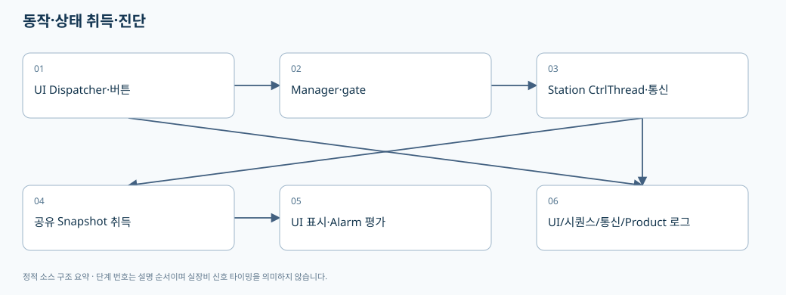
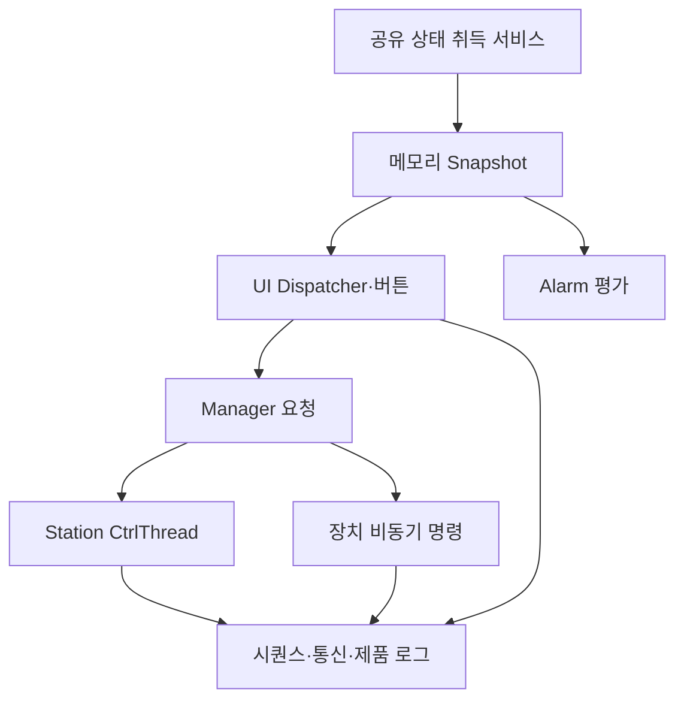

# 06. 스레드·스냅샷·취소·로그를 이용해 멈춤과 오동작 찾기

> 기준: `A3Drilling/master` · `5aee8e58439c9b455cae7c9593c9be986c3e682e`. 본 장은 해당 Commit의 소스를 정적으로 읽어 설명합니다. 장비 연결·가공·컴파일을 실행한 결과가 아닙니다.

현장에서는 “버튼을 눌렀는데 멈췄다”만으로 원인을 알기 어렵습니다. **UI 스레드, Station 주기 스레드, 비동기 통신, 캐시된 상태, 파일 저장** 중 어디가 기다리는지 나눠야 합니다.

## 1. CtrlThread는 Task.Run 한 번과 다르다

`CtrlThread`는 자체 Thread, pause/stop event, stopRequested, state, LastThreadError를 갖는 반복 실행 기반 클래스입니다. `ThreadProcess`는 stop까지 Run을 반복하고 delay 동안 stop event를 기다립니다. Run에서 예외가 나면 LastThreadError를 저장하고 OnThreadError를 호출합니다. 소스상 이 catch 자체가 즉시 while을 종료하지는 않습니다. [스레드 기본 필드](https://github.com/kjuws10-rgb/A3Drilling/blob/5aee8e58439c9b455cae7c9593c9be986c3e682e/Drilling.Common/Threading/CtrlThread.cs#L4-L15), [반복 실행과 예외 처리](https://github.com/kjuws10-rgb/A3Drilling/blob/5aee8e58439c9b455cae7c9593c9be986c3e682e/Drilling.Common/Threading/CtrlThread.cs#L232-L281).

| 상태 | 뜻 | 주의 |
|---|---|---|
| Stopped | 실행 스레드 정지 | 장치의 Motion 정지와 별개 |
| Running | 반복 Run 동작 | 내부 시퀀스가 Ready일 수도 있음 |
| Paused | 반복 스레드 일시정지 | 이미 보낸 하드웨어 명령을 자동 취소하는 뜻 아님 |
| Stopping | stop 요청 중 | 현재 SDK 호출이 끝나지 않으면 기다릴 수 있음 |
| Error | stop timeout 등 오류 상태 | LastThreadError와 상위 Station 상태를 같이 봄 |

근거: [CtrlThread 상태 enum](https://github.com/kjuws10-rgb/A3Drilling/blob/5aee8e58439c9b455cae7c9593c9be986c3e682e/Drilling.Common/Threading/CtrlThread.cs#L286-L293).

`Stop`은 stopRequested와 event를 설정하고 외부 스레드에서 호출했다면 최대 3초 Join합니다. 멈추지 못하면 TimeoutException과 Error 상태를 남깁니다. 현재 스레드 자신이 Stop을 호출한 경우 Join하지 않습니다. 따라서 “Stop 버튼은 즉시 모든 장비 작업을 취소한다”는 설명은 이 구현만으로 성립하지 않습니다. [Stop의 Join과 timeout](https://github.com/kjuws10-rgb/A3Drilling/blob/5aee8e58439c9b455cae7c9593c9be986c3e682e/Drilling.Common/Threading/CtrlThread.cs#L128-L186).

## 2. Station의 취소와 Thread의 정지는 다른 층이다

Station Start는 요청 token에 linked CancellationTokenSource를 만들고 sequence를 PowerCheck로 바꾼 다음 CtrlThread를 시작합니다. RunSequenceStep은 해당 token을 전달하며 OperationCanceledException은 Station Stop 전이로 이어집니다. [sequence CTS 생성](https://github.com/kjuws10-rgb/A3Drilling/blob/5aee8e58439c9b455cae7c9593c9be986c3e682e/Drilling.Common/Station/CStationProcess.cs#L295-L319), [취소와 단계 token](https://github.com/kjuws10-rgb/A3Drilling/blob/5aee8e58439c9b455cae7c9593c9be986c3e682e/Drilling.Common/Station/CStationProcess.cs#L371-L403).

취소를 지원하는 함수라도 이미 시작한 외부 SDK의 동기 호출을 즉시 중단할 수 있는지는 그 래퍼의 구현을 확인해야 합니다. 이 문장은 일반적 한계를 지적하는 검토 지침이며 이 소스의 특정 SDK가 반드시 중단 불가능하다고 단정하는 것은 아닙니다.

## 3. 잠금은 무엇을 보호하는가

| 소유자 | 동기화 장치 | 보호하는 데이터/작업 | 변경 시 위험 |
|---|---|---|---|
| CRecipeManager | Recipe operation SemaphoreSlim, cache lock, history gate | 파일 기반 작업·캐시·이력 순서 | 파일 저장 뒤 오래된 캐시를 다시 덮음 |
| CSettingManager | save lock, cache lock | section 저장과 캐시 publish | 저장 실패인데 UI만 새 값 |
| CProductManager | update gate | 한 Product의 전이·영속화 | 두 갱신이 이전 상태에서 출발하여 결과 유실 |
| CStationProcess | sequence lock | 시작/준비/수동 MOF와 sequence 상태 | 같은 모델의 이중 실행 |
| Automation1Comm | comm lock → status lock | Controller 수명·명령과 상태 조회 | 반대 순서 잠금으로 deadlock |
| Monitor polling | context/snapshot lock, motor poll gate | 선택 화면과 결과 사본 | 화면 전환과 이전 응답 혼합 |

근거: [Recipe gate](https://github.com/kjuws10-rgb/A3Drilling/blob/5aee8e58439c9b455cae7c9593c9be986c3e682e/Drilling.Common/Managers/CRecipeManager.cs#L11-L32), [Setting cache/save lock](https://github.com/kjuws10-rgb/A3Drilling/blob/5aee8e58439c9b455cae7c9593c9be986c3e682e/Drilling.Common/Managers/CSettingManager.cs#L23-L49), [Product gate](https://github.com/kjuws10-rgb/A3Drilling/blob/5aee8e58439c9b455cae7c9593c9be986c3e682e/Drilling.Common/Product/CProductManager.cs#L25-L45), [Station prepare lock](https://github.com/kjuws10-rgb/A3Drilling/blob/5aee8e58439c9b455cae7c9593c9be986c3e682e/Drilling.Common/Station/CStationProcess.cs#L219-L223), [Automation1 lock 순서](https://github.com/kjuws10-rgb/A3Drilling/blob/5aee8e58439c9b455cae7c9593c9be986c3e682e/Drilling.Common/Interface/Automation1/CAutomation1Comm.cs#L16-L25), [Monitor 동기화](https://github.com/kjuws10-rgb/A3Drilling/blob/5aee8e58439c9b455cae7c9593c9be986c3e682e/Drilling.UI/Menu/Menus/CMonitorStatusPollingService.cs#L17-L31).

설명용 주석을 추가할 때는 “스레드 안전”이라는 한 줄보다 **어떤 필드/시점/잠금 순서/잠금 밖 I/O**를 보호하는지 구체적으로 써야 합니다. lock이 있다는 사실만으로 객체 전체가 thread safe라고 표현하지 않습니다.

## 4. 상태 취득과 화면 표시를 분리하는 구조

`CManager.StartBackgroundMonitoring`은 공유 Motor/Laser/BET 상태 스냅샷을 시작하고 알람 평가에 `ReadAlarmDeviceSnapshot`을 공급합니다. 해당 함수는 “memory-only” 의도로 공유 Snapshot을 읽고 SnapshotError를 모읍니다. 느린 장치 SDK 호출이 알람 워커를 직접 붙잡지 않도록 분리한 구조입니다. [공유 취득과 알람 감시](https://github.com/kjuws10-rgb/A3Drilling/blob/5aee8e58439c9b455cae7c9593c9be986c3e682e/Drilling.Common/Managers/CManager.cs#L259-L268), [메모리 Snapshot을 이용한 알람 입력](https://github.com/kjuws10-rgb/A3Drilling/blob/5aee8e58439c9b455cae7c9593c9be986c3e682e/Drilling.Common/Managers/CManager.cs#L280-L303).

이 구조에서 표시한 값은 **현재 메모리에서 마지막으로 확인한 결과**일 수 있습니다. 값이 정상 범위여도 오래된 결과라면 안전 판단에 그대로 쓰면 안 되므로, 새 검증에서는 성공시각/오류/갱신 여부를 함께 확인합니다. 소스의 SnapshotError와 실제 서비스의 stale 규칙을 같이 읽어야 합니다.

`CMonitorStatusPollingService`는 LoopInterval 250 ms, ActiveInterval 0.5초, CommunicationInterval 1초 등의 주기를 정의하고 활성 화면 context에 따라 대상을 달리 선택합니다. `UpdateContext`는 선택 Tab/장치 번호/MELSEC group을 새 context로 저장하고 `GetSnapshot`은 lock 아래 결과를 반환합니다. [Monitor 주기·context·snapshot](https://github.com/kjuws10-rgb/A3Drilling/blob/5aee8e58439c9b455cae7c9593c9be986c3e682e/Drilling.UI/Menu/Menus/CMonitorStatusPollingService.cs#L9-L59).

주의할 실제 코드가 있습니다. PowerMeter의 두 Poll 호출은 확인한 범위에서 주석 처리되어 있습니다. 따라서 상수명이 `ActivePowerMeterMeasureInterval`이라고 모든 화면에서 PowerMeter를 그 주기로 실제 측정한다고 설명하면 틀립니다. [Tab별 실제 polling 분기](https://github.com/kjuws10-rgb/A3Drilling/blob/5aee8e58439c9b455cae7c9593c9be986c3e682e/Drilling.UI/Menu/Menus/CMonitorStatusPollingService.cs#L108-L136).

## 5. UI 변경 통지는 자동으로 모든 스레드를 보정해 주지 않는다

`CBindingBase`의 SetProperty는 값이 같으면 알리지 않고, SetSequenceProperty는 ReferenceEquals/SequenceEqual로 같은 목록 갱신을 피합니다. OnPropertyChanged는 속성명별 이벤트를 호출하는 switch입니다. 이 함수 자체가 Dispatcher로 이동하는 것은 아닙니다. [동일값 억제와 Property 이벤트](https://github.com/kjuws10-rgb/A3Drilling/blob/5aee8e58439c9b455cae7c9593c9be986c3e682e/Drilling.UI/Menu/CBindingBase.cs#L735-L788).

새 비동기 작업이 UI 속성이나 ObservableCollection을 바꾸는 경우 해당 경로의 Dispatcher 사용 여부를 확인해야 합니다. 한곳의 Dispatcher를 발견했다고 모든 await 이후 UI 접근이 안전하다고 판단하지 않습니다. RootView는 알람 갱신에 전용 Dispatcher를 보유하고 큐잉하는 경로가 있으므로, 유사 작업도 같은 패턴을 검토할 수 있습니다. (이 장은 전 UI 스레드 접근의 무결성을 검증한 보고서가 아닙니다.)

## 6. 로그는 사용자의 클릭·의도·실제 결과를 따로 연결해야 한다

`CUiLogService.Configure`는 WPF ButtonBase.ClickEvent의 class handler를 등록합니다. OnButtonClicked는 화면·Control·CommandParameter·Detail을 얻어 WriteClick에 넘깁니다. **클릭 로그가 있다는 것과 명령이 허용·실행·완료됐다는 것은 다릅니다.** 실제 명령/시퀀스/통신 결과 로그와 시간·식별자를 연결해야 합니다. [UI 클릭 로그 등록과 기록](https://github.com/kjuws10-rgb/A3Drilling/blob/5aee8e58439c9b455cae7c9593c9be986c3e682e/Drilling.UI/CUiLogService.cs#L17-L69).

키 입력 dialog와 password dialog의 일부 글자 버튼은 ShouldSkipButton에서 제외합니다. 따라서 모든 키 입력이 그대로 텍스트 로그에 남는다고 설명해서는 안 됩니다. 진단용 로그를 확장할 때도 비밀번호·키·민감한 원문을 추가하지 않습니다. [입력 버튼 로그 제외](https://github.com/kjuws10-rgb/A3Drilling/blob/5aee8e58439c9b455cae7c9593c9be986c3e682e/Drilling.UI/CUiLogService.cs#L72-L92).

| 진단 질문 | 우선 확인할 근거 |
|---|---|
| 사용자가 뭘 눌렀는가 | UI click의 화면·Control·parameter·시각 |
| 명령이 수락됐는가 | Station 전이/Interlock 판단/명령 accept |
| 어떤 파일·조건이었는가 | RecipeId/Product snapshot/Script manifest·RunId |
| 외부 장비가 뭘 응답했는가 | Interface command/response·MELSEC write/read 상태 |
| 실제 완료됐는가 | Task completion·Review 저장·Product 결과 |
| 완료 뒤 로그만 실패했는가 | commit 이후 History/Log error와 Active 파일 |

공통 로그의 의미는 각 호출부와 연결해 읽습니다. 예를 들어 Product는 Active 저장 이후 로그 실패가 상태 전이를 실패로 바꾸지 않도록 처리합니다. 클릭 로그가 없거나 이력이 실패했다고 실제 실행도 없었다고 단정하지 않습니다. [Product의 상태와 이력 분리](https://github.com/kjuws10-rgb/A3Drilling/blob/5aee8e58439c9b455cae7c9593c9be986c3e682e/Drilling.Common/Product/CProductManager.cs#L789-L819).

## 7. 현장 디버깅을 위한 검증 계획

1. **연속 클릭/교차 요청**: Start 두 번, Prepare 중 다른 Recipe 선택, Stop/Reset 동시 요청을 격리 테스트합니다. 실제 명령 수와 최종 상태를 기록합니다.
2. **응답 지연**: 가짜 SDK/파일 어댑터를 지연시켜 UI 응답성·snapshot 오류·Stop timeout을 각각 확인합니다.
3. **취소 시점 분리**: 파일 쓰기 전/후, upload 전/후, queue feeding 중의 취소를 나눠 부분 완료와 중복 재시도를 확인합니다.
4. **메모리/파일 불일치**: 저장 성공 후 이력 실패를 주입하고 새로고침/재시작이 올바른 현재값을 보여주는지 확인합니다.
5. **실행 식별자 연결**: 같은 Recipe를 연속 실행해도 Product/Glass/Script directory/RunId가 섞이지 않는지 확인합니다.
6. **원인 분석용 수집**: 알람 앞뒤의 UI/Station/Interface/Product/Script 상태를 같은 시간축으로 묶되 로그 반출 범위는 고객의 승인 조건을 따릅니다.

다음 읽기: [07. 변경 영향과 Offline Studio](07-change-impact-and-offline-reference.md).
