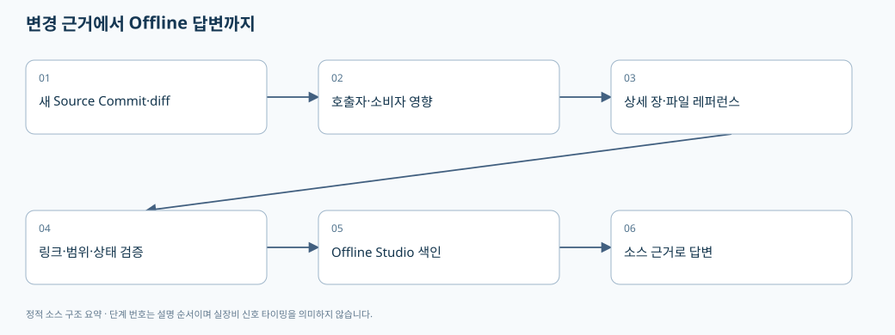
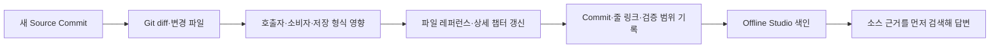

# 07. 변경 영향 검토와 Offline Studio에서 이 문서를 쓰는 방법

> 기준: `A3Drilling/master` · `5aee8e58439c9b455cae7c9593c9be986c3e682e`. 본 장은 해당 Commit의 소스를 정적으로 읽어 설명합니다. 장비 연결·가공·컴파일을 실행한 결과가 아닙니다.

코드 레퍼런스는 현재 소스를 대신하는 정답 모음이 아니라 **찾아갈 파일과 호출 연결을 제공하는 지도**입니다. 문서가 최신 소스와 다른 Commit이면 틀린 기준으로 코드를 고칠 수 있으므로, 질문할 때 소스 Commit과 문서 기준을 함께 확인합니다.





## 1. 가장 먼저 볼 문서

| 궁금한 내용 | 시작할 장 | 실제 소스 진입점 |
|---|---|---|
| 앱이 안 켜지거나 다른 Config를 읽음 | [01 시작](01-startup-and-composition.md) | CAppStartup.GetConfigRoot / CManager 구성 |
| Recipe 값이 저장되지 않음 | [02 Recipe·Setting](02-recipe-settings-and-csv.md) | CRecipeManager.Save → CJhmiRecipeFile.SaveCore |
| Offset가 원하는 방향으로 가지 않음 | [03 좌표·Script](03-coordinate-script-and-mof.md) | CShotCoordinatePlanBuilder.Build |
| 기판/결과가 이전 상태로 보임 | [04 Product·Station](04-product-and-station-lifecycle.md) | PersistAndLog / CProductFile.LoadCompactActive |
| 통신/SDK/모션 경로가 궁금함 | [05 장치](05-device-interfaces-and-drivers.md) | CInterfaceManager / CComm / CMotionManager |
| 화면 지연·중복 실행·취소 문제 | [06 스레드·로그](06-threading-snapshots-and-logs.md) | CtrlThread / Snapshot / gate·Dispatcher |

Review 좌표→Vision 요청→ReviewResult→보정 파일 연결은 별도의 리뷰 전문 챕터와 파일별 레퍼런스를 함께 읽습니다. 가공 ScannerGx/Gy를 찾았다는 이유만으로 그것이 Vision에 보내는 좌표라고 답변하면 안 됩니다.

## 2. 새 Parameter 하나가 거치는 영향 범위

| 단계 | 작성/검토할 항목 | 누락하면 생기는 현상 |
|---|---|---|
| 의미 정의 | 설비 공통/PPID별/Cell별/Shot별/런타임별 중 소유자, 단위·좌표기준 | 같은 이름을 서로 다른 기준으로 해석 |
| 정의 파일 | JHMI_RCP 또는 JHMI_SETTING, 타입·범위·표시·Use·Key | UI에 보이지 않거나 저장 때 제외 |
| 값 파서 | 기존 형식/legacy key/default/Extra 열 호환 | 구버전 Recipe를 못 읽음 |
| Manager | 캐시 갱신·변경 비교·gate·commit 이후 취소 | 화면과 파일이 달라짐·중복 보정 |
| 실행 합성 | Setting 덮어쓰기 우선순위·최신 Offset | 저장했는데 실행값이 다름 |
| 계산 | 단위 변환·axis flip/swap·Head 배정·Masking | 잘못된 위치 또는 다른 Head |
| Script/전송 | 스냅샷·manifest·controller/task 분리 | 이전 파일/다른 Controller 실행 |
| Product/결과 | 실제 적용값과 결과를 추적할 필드 | 사후 로그만으로 조건 재구성 불가 |
| UI | Property 변경 이벤트·선택상태·실행 중 편집 금지 | 수정값이 안 보이거나 도중 모델 교체 |
| 문서/색인 | 최신 Commit·파일 근거·용어·검증상태 | 개발도우미가 오래된 코드로 답변 |

현재 실행 합성의 Setting 우선순위는 [BuildRuntimeParameters](https://github.com/kjuws10-rgb/A3Drilling/blob/5aee8e58439c9b455cae7c9593c9be986c3e682e/Drilling.Common/Station/CStationProcess.cs#L1526-L1559), 저장/실행 기준의 분리는 [Offset 변환·합성](https://github.com/kjuws10-rgb/A3Drilling/blob/5aee8e58439c9b455cae7c9593c9be986c3e682e/Drilling.Common/Recipe/CShotCoordinatePlanBuilder.cs#L139-L156)에서 확인할 수 있습니다. 표는 그 구조를 확장해 적용하는 검토 절차입니다.

## 3. 기존 자료와 소스를 섞을 때의 신뢰도

| 출처 | 답변에 사용할 수 있는 범위 | 표기 방식 |
|---|---|---|
| 이번 Commit의 실제 소스 | 구현된 조건·필드·분기·저장 | 경로+함수+실제 줄 링크 |
| 회의 기록 | 사용자의 목적·희망 기능·평가 요구 | 구현 여부와 분리하여 요구로 설명 |
| 공식 SDK 설명자료 | 해당 버전 API 사양 | 자료명·버전·해당 항목 |
| 실행/빌드/실측 결과 | 실제 수행한 환경과 시나리오 | 명령·조건·결과·한계 |
| 자동 추출 호출 관계 | 찾아갈 후보와 연결 힌트 | 정적 후보, 오버로드/동적 호출 한계 |
| DLL 파일명 | 외부 의존성 존재 | 내부 로직은 미확인 |

문서에 `검증 계획`이라고 쓰인 항목은 실행 통과 항목이 아닙니다. 예를 들어 `RunScript`에는 Simulation 반환 분기가 있으므로 합성 응답을 받은 것만으로 실제 SDK·Controller compiler·물리 가공 검증까지 통과했다고 표현할 수 없습니다. [Simulation RunScript 분기](https://github.com/kjuws10-rgb/A3Drilling/blob/5aee8e58439c9b455cae7c9593c9be986c3e682e/Drilling.Common/Automation/CAutomationManager.cs#L323-L333).

## 4. Offline Studio가 먼저 검색해야 할 단위

아래는 문서 활용 권장 방식입니다. 이 문서 생성만으로 Studio의 검색 엔진이나 모델 가중치가 자동 변경되는 것은 아닙니다.

1. 질문에서 **행위+대상**을 뽑습니다. 예: Review/좌표/계산/Vision/전달.
2. 코드 원문에서 함수·타입·Key 이름을 찾고 그 호출자와 저장/전송 소비자를 확장합니다.
3. 파일별 레퍼런스로 역할을 확인한 후 이 상세 챕터에서 전체 흐름을 보충합니다.
4. 출처마다 sourceCommit/path/startLine/endLine을 유지하고, 같은 Commit의 소스 본문을 모델 context에 함께 넣습니다.
5. 최종 답변은 파일명·함수·핵심 인자·입출력·호출 순서·확인 한계를 포함합니다.

소스 전체 대신 HTML 설명자료 한 줄만 모델에 제공하면 코드 근거를 찾을 수 없습니다. 반대로 DLL 안내가 검색 상단을 차지해 C# 래퍼가 밀려나도 동문서답이 생길 수 있습니다. **코드 질문은 실제 C#/XAML/설정/Script 연결을 우선, 설명자료는 보충**이라는 검색 목적을 설정하는 것이 좋습니다. 이는 과거 오류에서 도출한 개선 지침이며 현재 Studio가 해당 우선순위를 이미 구현했다는 주장은 아닙니다.

## 5. 좋은 답변의 최소 형식

```text
요약: 이 기능은 A → B → C 순서로 처리됩니다.
1. [파일:줄] 함수 A: 입력과 호출자
2. [파일:줄] 함수 B: 단위/좌표 변환, 조건
3. [파일:줄] 함수 C: 저장/전송 대상과 응답 처리
변경 영향: 같은 데이터를 쓰는 다른 경로
검증: 실제 수행한 것 / 아직 해야 할 것
```

“자료에 없으니 못 찾는다”라고 끝내기 전에 색인된 소스 경로·파일 수·검색어·후보 누락 여부를 확인해야 합니다. 다만 실제 소스에 없는 계약을 억지로 추론해서 답변하지 않습니다. 예를 들어 Stage Glass/Lot 매핑 TODO가 남은 경로는 합의 완료로 설명하지 않습니다. [미합의 매핑 표시](https://github.com/kjuws10-rgb/A3Drilling/blob/5aee8e58439c9b455cae7c9593c9be986c3e682e/Drilling.UI/CRootView.cs#L2892-L2905).

## 6. 주석을 많이 쓸 때도 우선순위가 필요하다

각 소스파일의 주석형 레퍼런스를 작성할 때 아래 항목을 우선 설명합니다. 공개 레퍼런스의 설명은 원본 코드가 바뀐 것과 구분되어야 합니다.

| 위치 | 상세 주석에 담을 내용 |
|---|---|
| Public API/Command | 어떤 화면/시퀀스가 언제 호출하는가, 인자의 단위·허용범위 |
| 좌표 수식 | 설계/Stage/Scanner/Vision 기준, 부호·scale·반전 순서 |
| 필드/record | 현재 상태인지 스냅샷인지, 파일 영속 여부 |
| 저장 함수 | 검증·쓰기·재읽기·메모리 publish·이력의 순서와 실패 경계 |
| lock/gate | 보호 대상과 획득 순서, lock 안에서의 외부 호출 |
| 취소/finally | 취소 가능한 시점, 부분 적용 후 처리, cleanup 책임 |
| enum/state | 전이 조건과 정상/Stop/Error/Skipped 구분 |
| fallback/default | 구버전 호환인지 설치 기본값인지 임시 미합의값인지 |
| 미확인 | 코드에 근거가 없어 판정할 수 없는 조건 |

예시: Product `PersistAndLog`는 Active 저장 후 로그 실패가 전이를 뒤집지 않게 처리합니다. 여기에는 단순히 “로그 저장”이 아니라 **이미 커밋된 상태를 중복 실행시키지 않는 경계**를 설명하는 것이 유용합니다. [주석 우선순위가 높은 commit 경계](https://github.com/kjuws10-rgb/A3Drilling/blob/5aee8e58439c9b455cae7c9593c9be986c3e682e/Drilling.Common/Product/CProductManager.cs#L789-L819).

## 7. 주기적 업데이트의 완료 조건

- 새 원본 Commit을 확인하고 이전 문서 기준과 비교합니다.
- 변경 파일만 요약하지 않고 해당 함수의 호출자·데이터 소비자·저장 호환 영향을 추적합니다.
- sourceCommit이 다른 문서가 한 질문 context에서 섞이지 않게 표시합니다.
- 링크의 실제 파일·줄 범위, 내부 링크, Mermaid 코드 블록, 깨진 문자, 공백 오류를 검사합니다.
- 실행하지 않은 빌드·장비·실측은 미실행으로 남깁니다.
- 최신 자료의 생성과 Offline Studio의 재색인은 별도 단계로 기록합니다.

이 장은 유지보수 절차와 지식 사용 방법을 설명합니다. 예약 실행의 실제 등록·Push·최신화 결과는 이 문서 자체가 아니라 해당 작업 기록과 Shared Commit으로 확인해야 합니다.
