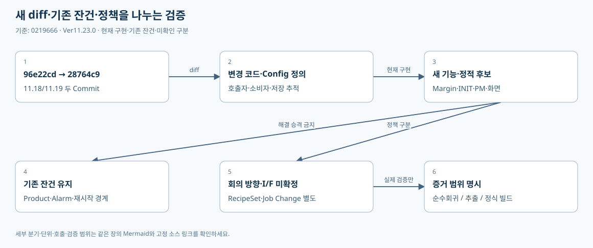
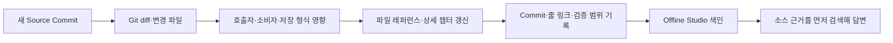
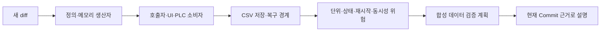

# 07. 변경 영향 검토와 Offline Studio에서 이 문서를 쓰는 방법

> 기준: `A3Drilling/master` · `28764c91d521777b8ee068dd7aaf2d3902ce9fe2`. 본 장은 해당 Commit의 소스를 정적으로 읽어 설명합니다. 정식 설비 빌드·장비 연결·가공을 실행한 결과가 아닙니다.

> 이번 갱신 범위: 이전 `96e22cd` → 현재 `28764c9`(Ver11.19.0), 두 Commit. 실제 diff와 현재 전체 소스의 관련 생산자·소비자·호출 경계를 대조했습니다. 11.13.0에서 남은 저장·재시작·알람 한계는 신규 변경과 구분해 유지합니다.

코드 레퍼런스는 현재 소스를 대신하는 정답 모음이 아니라 **찾아갈 파일과 호출 연결을 제공하는 지도**입니다. 문서가 최신 소스와 다른 Commit이면 틀린 기준으로 코드를 고칠 수 있으므로, 질문할 때 소스 Commit과 문서 기준을 함께 확인합니다.





## 1. 가장 먼저 볼 문서

| 궁금한 내용 | 시작할 장 | 실제 소스 진입점 |
|---|---|---|
| 앱이 안 켜지거나 다른 Config를 읽음 | [01 시작](01-startup-and-composition.md) | CAppStartup.GetConfigRoot / CManager 구성 |
| Recipe 값이 저장되지 않음 | [02 Recipe·Setting](02-recipe-settings-and-csv.md) | CRecipeManager.Save → CJhmiRecipeFile.SaveCore |
| Offset가 원하는 방향으로 가지 않음 | [03 좌표·Script](03-coordinate-script-and-mof.md) | CShotCoordinatePlanBuilder.Build |
| 기판/결과가 이전 상태로 보임 | [04 Product·Station](04-product-and-station-lifecycle.md) | PersistAndLog / CProductFile.LoadCompactActive |
| 통신/SDK/모션 경로가 궁금함 | [05 장치](05-device-interfaces-and-drivers.md) | CInterfaceManager / CComm / CMotionManager |
| 화면 지연·중복 실행·취소 문제 | [06 스레드·로그](06-threading-snapshots-and-logs.md) | CtrlThread / Snapshot / gate·Dispatcher |
| 알람 전후 후보·정상 비교·시간 커서의 뜻 | [08 알람 분석](08-alarm-cause-analysis.md) | CAlarmIncidentLogReader / CauseCandidateAnalyzer |

## Ver11.19.0에서 우선 확인할 변경

| 우선순위 | 현재 소스에서 바뀐 사실 | 검증·미확인 경계 |
|---|---|---|
| 높음 · 좌표·배포 | AK Margin X/Y가 Recipe에서 공통 Setting으로 이동하고 필수 파싱됨 | 옛 Recipe값 자동 이관 없음. 공통값 변경과 저장 Align/Review Offset·과거 결과의 기준 일치 검사 필요 |
| 높음 · 상태·PLC | AUTO INIT가 Worker 정지·공통 cleanup·PC 출력OFF/완료0 확인 후 Action WAIT와 감시 재시작 | Home/Stage 입력 초기화·물리 정지 보장 아님. 상대 ON은 새 요청이 될 수 있음 |
| 높음 · 배포 근거 | PM 세션 시작/종료/읽기 호출과 ST_PM_HISTORY_ENTRY 사용이 추가됨 | tracked source에 로그 타입/구현 선언이 없어 저장 계약·정식 빌드 성공 미확인 |
| 중간 · PM 수명 | 진입·해제 조건/사유/이력 호출·Manual 상태집계·캐시 수명 표 추가 | 재시작 세션복원·STALE 수치 표시·자동 수명차단과 구분 |
| 중간 · UI | 상위 SIMPLE0/INSPECTION1, RUN/RESULT와 두 결과패널, 메뉴 캐시·Build 취소 | 기존5탭 인덱스 무효, 캐시는 실행 스냅샷 아님, 통지 누락 후보·재바인딩 검증 |
| 개선 · 보정 파일 | RETAINED/EDITED까지 적용대상 확장, 결과 숫자F6, 날짜 전체 적용이력 색인 | 새 Offset 최종0.001mm, 경로 기준 이력·원본 품질/계보 한계는 별도 |
| 유지 · 기존 잔건 | Product NG 추가필드 compact 손실, 보호윈도우 재시작, Alarm 규칙·상관키·대용량 한계 | 이번 기능으로 해결됐다고 승격하지 않음 |

위험도는 **검증 순서**이며 발생 빈도·실기 재현 결과가 아닙니다. 자세한 데이터 흐름과 출처는 [02장](02-recipe-settings-and-csv.md), [04장](04-product-and-station-lifecycle.md), [06장](06-threading-snapshots-and-logs.md) 및 리뷰 전문 장을 함께 읽습니다. 공통 Margin을 장비 전체 기본값으로 옮긴 현재 구현과, 회의의 RecipeSet/실제 Job Change·조건부 파워 보정·미확정 I/F 방향은 분리합니다.

근거: [Margin 계약](https://github.com/kjuws10-rgb/A3Drilling/blob/28764c91d521777b8ee068dd7aaf2d3902ce9fe2/Drilling.Common/Managers/CAlignKeyMarginSettings.cs#L6-L51), [INIT](https://github.com/kjuws10-rgb/A3Drilling/blob/28764c91d521777b8ee068dd7aaf2d3902ce9fe2/Drilling.Common/Station/CStationProcess.cs#L3912-L3958), [PM 진입](https://github.com/kjuws10-rgb/A3Drilling/blob/28764c91d521777b8ee068dd7aaf2d3902ce9fe2/Drilling.UI/CRootView.cs#L1272-L1330), [결과패널 조립](https://github.com/kjuws10-rgb/A3Drilling/blob/28764c91d521777b8ee068dd7aaf2d3902ce9fe2/Drilling.UI/Menu/Menus/CMenuCorrection.cs#L139-L166), [전일자 적용이력 색인](https://github.com/kjuws10-rgb/A3Drilling/blob/28764c91d521777b8ee068dd7aaf2d3902ce9fe2/Drilling.File/ReviewOffset/CReviewOffsetFile.cs#L412-L448), [결과 파일 클래스](https://github.com/kjuws10-rgb/A3Drilling/blob/28764c91d521777b8ee068dd7aaf2d3902ce9fe2/Drilling.File/ReviewResult/CReviewResultFile.cs#L719-L722)

이전 Fine 재개 결과의 RETAINED가 파일 기반 보정에서 빠진다는 잔건은 이번 MeasuredRows 확장 범위만큼 대체합니다. 반면 날짜를 넘는 중복검사는 경로별 이력 색인으로 개선됐어도 내용 hash/공통 Setting 버전의 계보 검증까지 구현된 것은 아닙니다. [MeasuredRows·적용 경계](https://github.com/kjuws10-rgb/A3Drilling/blob/28764c91d521777b8ee068dd7aaf2d3902ce9fe2/Drilling.UI/Menu/Menus/CMenuCorrection.ReviewData.Offset.cs#L471-L480)

이번 검증 증거도 구분합니다. Root가 별도 폴더에서 현재 소스 수치 계산기·DTO를 복사해 수행한 순수 Margin 회귀는34/34 통과했고, Review 담당의 별도 순수회귀는23/23 통과했습니다. 이는 파일/수치 계약 검증이며 WPF 앱 정식 빌드, vendor SDK·Controller compiler·설비·물리 좌표·장시간 성능 검증이 아닙니다. 문서 추출기의 처리·부분 진단 수치도 정식 빌드 결과를 대신하지 않습니다. 빌드 및 실행 증거는 최종 보고의 실제 검증 기록을 따릅니다.

## 이전 11.13.0에서 추가되어 현재도 확인할 경계

| 우선순위·영향 | 지금 확인한 구조 | 다음 검증에서 확인할 결과 |
|---|---|---|
| 높음 · 상태·PLC | 보호윈도우 추가 요청 0~3, 인계 저장 후 OFF 확인, 소진 LIGHT·AUTO 계속 | 임계값과 재시작 경계에서 요청 횟수·파일·캐시·신호가 일치 |
| 높음 · 영속성 | Product 메모리 NG 필드 추가, Active compact의 새 필드 저장은 없음 | ReviewResult/Active/checkpoint 각각 round-trip하여 손실 범위 확인 |
| 높음 · 좌표 의미 | Monitor는 현재 입력의 미리보기, Station은 준비 스냅샷, Camera는 Shift만 검사목표에 적용 | 동일 입력·Axis 변환·실행 회차를 맞춘 모델/Script/Vision 대조 |
| 높음 · 보정 기준 | Default 중심은 AK1·AK3 중점, DOE 1×1/4×4, 로그 열 추가 | 세션 조건과 추천값 재현, 십자/샷의 실제 검사점 수 |
| 중간 · 통신 계약 | Stage Distortion 입력 맵 활성화·DWord scale | 실제 상대 신호·주소 승인·ON/OFF와 캐시 최신성 |
| 중간 · UI·운영 | Review 소유 메뉴가 Correction으로 이동, Alarm 원인 후보·비교구간 추가 | 메뉴 이동/취소·로그 누락·오탐·날짜 경계·큰 로그 응답성 |

위 위험도는 정적 영향 검토의 우선순위입니다. 현장 고장 발생 빈도나 재현 완료 등급이 아닙니다. 구체 근거는 각 장의 새 절과 [08장](08-alarm-cause-analysis.md)을 따릅니다. 운영 측정 CSV 행·현장 접속값은 문서의 예제 데이터로 복제하지 않았습니다.

## 이전 11.17.0에서 바뀌어 유지되는 범위

| 구분·우선순위 | 현재 구현과 영향 | 후속 검증 |
|---|---|---|
| 11.17 도입 · 높음 | Head별 DOE_EXIST로 Default 검사1점/옵션격자 분기. 구형 정의의 DOE 키 자동 보충은 없음 | 구형 정의+새값·비활성 Head 누락·ON/OFF 혼합·Capture 수·로그 수 일치 |
| 11.17 도입 · 높음 | Level은 maxabs mm 4등급. 실측 JUDGE·출처와 다른 표시 의미 | 경계값·VisionFind NG·미측정·EDITED의 live/로드 화면 비교 |
| 11.17 도입 · 중간 | Level·색상 저장 이중 검증과 picker, ColorBrush 통지 누락 후보 | CANCEL/APPLY/SAVE/재시작·손상값·swatch 즉시갱신 |
| 11.17 도입 · 중간 | INSPECTION 통합과 선택 탭만 Build, 단일 Shot Control | 탭 인덱스·결과 이동·취소·구독 해제·대용량 UI 응답 |
| 11.17 도입 · 중간 | Shift 표는 직접 축변환, popup은 길이를 제한한 방향그림 | 옛 full-plan 차이와 계산 동등성·활성 Shot 없는 Head·적용검증 유지 |
| 11.17 도입 · 저장형식 | Default 로그 DOE_EXIST/실제 검사점수 2열 추가 | 헤더 기반 구형/신형 소비자·Marks.Count와 설정 기대수 구분 |
| 기존 잔건 | Product 새 NG 필드 Active 누락, Retry 재시작 상태, 알람 후보·상관키·대용량 한계 | 고쳐졌다고 승격하지 않고 기존 검증표 유지 |

과거 보고의 'Level 사용자 설정 미확인'은 11.17에서 **임계값3개+색상4개와 UI 소비가 추가된 범위만큼** 대체합니다. 임의 N등급·다른 거리척도·JUDGE 재계산까지 완료됐다고 확대하지 않습니다. 이전의 '전역 격자만으로 Head별 Default DOE 혼합을 표현하지 못함'도 11.17 Head별 Default 검사 분기로 범위를 갱신하되, 일반 가공·모든 Review의 광학 계약까지 해결됐다고 하지 않습니다. [Level 계약](https://github.com/kjuws10-rgb/A3Drilling/blob/28764c91d521777b8ee068dd7aaf2d3902ce9fe2/Drilling.Common/Review/CReviewResultLevelSettings.cs#L23-L55), [Head별 적용 한계](https://github.com/kjuws10-rgb/A3Drilling/blob/28764c91d521777b8ee068dd7aaf2d3902ce9fe2/Drilling.Common/Correction/CDefaultOffsetCalibration.cs#L29-L62).



Review 좌표→Vision 요청→ReviewResult→보정 파일 연결은 별도의 리뷰 전문 챕터와 파일별 레퍼런스를 함께 읽습니다. 가공 ScannerGx/Gy를 찾았다는 이유만으로 그것이 Vision에 보내는 좌표라고 답변하면 안 됩니다.

## 2. 새 Parameter 하나가 거치는 영향 범위

| 단계 | 작성/검토할 항목 | 누락하면 생기는 현상 |
|---|---|---|
| 의미 정의 | 설비 공통/PPID별/Cell별/Shot별/런타임별 중 소유자, 단위·좌표기준 | 같은 이름을 서로 다른 기준으로 해석 |
| 정의 파일 | JHMI_RCP 또는 JHMI_SETTING, 타입·범위·표시·Use·Key | UI에 보이지 않거나 저장 때 제외 |
| 값 파서 | 기존 형식/legacy key/default/Extra 열 호환 | 구버전 Recipe를 못 읽음 |
| Manager | 캐시 갱신·변경 비교·gate·commit 이후 취소 | 화면과 파일이 달라짐·중복 보정 |
| 실행 합성 | Setting 덮어쓰기 우선순위·최신 Offset | 저장했는데 실행값이 다름 |
| 계산 | 단위 변환·axis flip/swap·Head 배정·Masking | 잘못된 위치 또는 다른 Head |
| Script/전송 | 스냅샷·manifest·controller/task 분리 | 이전 파일/다른 Controller 실행 |
| Product/결과 | 실제 적용값과 결과를 추적할 필드 | 사후 로그만으로 조건 재구성 불가 |
| UI | Property 변경 이벤트·선택상태·실행 중 편집 금지 | 수정값이 안 보이거나 도중 모델 교체 |
| 문서/색인 | 최신 Commit·파일 근거·용어·검증상태 | 개발도우미가 오래된 코드로 답변 |

현재 실행 합성의 Setting 우선순위는 [BuildRuntimeParameters](https://github.com/kjuws10-rgb/A3Drilling/blob/28764c91d521777b8ee068dd7aaf2d3902ce9fe2/Drilling.Common/Station/CStationProcess.cs#L1528-L1563), 저장/실행 기준의 분리는 [Offset 변환·합성](https://github.com/kjuws10-rgb/A3Drilling/blob/28764c91d521777b8ee068dd7aaf2d3902ce9fe2/Drilling.Common/Recipe/CShotCoordinatePlanBuilder.cs#L141-L157)에서 확인할 수 있습니다. 표는 그 구조를 확장해 적용하는 검토 절차입니다.

## 3. 기존 자료와 소스를 섞을 때의 신뢰도

| 출처 | 답변에 사용할 수 있는 범위 | 표기 방식 |
|---|---|---|
| 이번 Commit의 실제 소스 | 구현된 조건·필드·분기·저장 | 경로+함수+실제 줄 링크 |
| 회의 기록 | 사용자의 목적·희망 기능·평가 요구 | 구현 여부와 분리하여 요구로 설명 |
| 공식 SDK 설명자료 | 해당 버전 API 사양 | 자료명·버전·해당 항목 |
| 실행/빌드/실측 결과 | 실제 수행한 환경과 시나리오 | 명령·조건·결과·한계 |
| 자동 추출 호출 관계 | 찾아갈 후보와 연결 힌트 | 정적 후보, 오버로드/동적 호출 한계 |
| DLL 파일명 | 외부 의존성 존재 | 내부 로직은 미확인 |

문서에 `검증 계획`이라고 쓰인 항목은 실행 통과 항목이 아닙니다. 예를 들어 `RunScript`에는 Simulation 반환 분기가 있으므로 합성 응답을 받은 것만으로 실제 SDK·Controller compiler·물리 가공 검증까지 통과했다고 표현할 수 없습니다. [Simulation RunScript 분기](https://github.com/kjuws10-rgb/A3Drilling/blob/28764c91d521777b8ee068dd7aaf2d3902ce9fe2/Drilling.Common/Automation/CAutomationManager.cs#L324-L334).

## 4. Offline Studio가 먼저 검색해야 할 단위

아래는 문서 활용 권장 방식입니다. 이 문서 생성만으로 Studio의 검색 엔진이나 모델 가중치가 자동 변경되는 것은 아닙니다.

1. 질문에서 **행위+대상**을 뽑습니다. 예: Review/좌표/계산/Vision/전달.
2. 코드 원문에서 함수·타입·Key 이름을 찾고 그 호출자와 저장/전송 소비자를 확장합니다.
3. 파일별 레퍼런스로 역할을 확인한 후 이 상세 챕터에서 전체 흐름을 보충합니다.
4. 출처마다 sourceCommit/path/startLine/endLine을 유지하고, 같은 Commit의 소스 본문을 모델 context에 함께 넣습니다.
5. 최종 답변은 파일명·함수·핵심 인자·입출력·호출 순서·확인 한계를 포함합니다.

소스 전체 대신 HTML 설명자료 한 줄만 모델에 제공하면 코드 근거를 찾을 수 없습니다. 반대로 DLL 안내가 검색 상단을 차지해 C# 래퍼가 밀려나도 동문서답이 생길 수 있습니다. **코드 질문은 실제 C#/XAML/설정/Script 연결을 우선, 설명자료는 보충**이라는 검색 목적을 설정하는 것이 좋습니다. 이는 과거 오류에서 도출한 개선 지침이며 현재 Studio가 해당 우선순위를 이미 구현했다는 주장은 아닙니다.

## 5. 좋은 답변의 최소 형식

```text
요약: 이 기능은 A → B → C 순서로 처리됩니다.
1. [파일:줄] 함수 A: 입력과 호출자
2. [파일:줄] 함수 B: 단위/좌표 변환, 조건
3. [파일:줄] 함수 C: 저장/전송 대상과 응답 처리
변경 영향: 같은 데이터를 쓰는 다른 경로
검증: 실제 수행한 것 / 아직 해야 할 것
```

“자료에 없으니 못 찾는다”라고 끝내기 전에 색인된 소스 경로·파일 수·검색어·후보 누락 여부를 확인해야 합니다. 다만 실제 소스에 없는 계약을 억지로 추론해서 답변하지 않습니다. 예를 들어 Stage Glass/Lot 매핑 TODO가 남은 경로는 합의 완료로 설명하지 않습니다. [미합의 매핑 표시](https://github.com/kjuws10-rgb/A3Drilling/blob/28764c91d521777b8ee068dd7aaf2d3902ce9fe2/Drilling.UI/CRootView.cs#L3280-L3293).

## 6. 주석을 많이 쓸 때도 우선순위가 필요하다

각 소스파일의 주석형 레퍼런스를 작성할 때 아래 항목을 우선 설명합니다. 공개 레퍼런스의 설명은 원본 코드가 바뀐 것과 구분되어야 합니다.

| 위치 | 상세 주석에 담을 내용 |
|---|---|
| Public API/Command | 어떤 화면/시퀀스가 언제 호출하는가, 인자의 단위·허용범위 |
| 좌표 수식 | 설계/Stage/Scanner/Vision 기준, 부호·scale·반전 순서 |
| 필드/record | 현재 상태인지 스냅샷인지, 파일 영속 여부 |
| 저장 함수 | 검증·쓰기·재읽기·메모리 publish·이력의 순서와 실패 경계 |
| lock/gate | 보호 대상과 획득 순서, lock 안에서의 외부 호출 |
| 취소/finally | 취소 가능한 시점, 부분 적용 후 처리, cleanup 책임 |
| enum/state | 전이 조건과 정상/Stop/Error/Skipped 구분 |
| fallback/default | 구버전 호환인지 설치 기본값인지 임시 미합의값인지 |
| 미확인 | 코드에 근거가 없어 판정할 수 없는 조건 |

예시: Product `PersistAndLog`는 Active 저장 후 로그 실패가 전이를 뒤집지 않게 처리합니다. 여기에는 단순히 “로그 저장”이 아니라 **이미 커밋된 상태를 중복 실행시키지 않는 경계**를 설명하는 것이 유용합니다. [주석 우선순위가 높은 commit 경계](https://github.com/kjuws10-rgb/A3Drilling/blob/28764c91d521777b8ee068dd7aaf2d3902ce9fe2/Drilling.Common/Product/CProductManager.cs#L789-L819).

## 7. 주기적 업데이트의 완료 조건

- 새 원본 Commit을 확인하고 이전 문서 기준과 비교합니다.
- 변경 파일만 요약하지 않고 해당 함수의 호출자·데이터 소비자·저장 호환 영향을 추적합니다.
- sourceCommit이 다른 문서가 한 질문 context에서 섞이지 않게 표시합니다.
- 링크의 실제 파일·줄 범위, 내부 링크, Mermaid 코드 블록, 깨진 문자, 공백 오류를 검사합니다.
- 실행하지 않은 빌드·장비·실측은 미실행으로 남깁니다.
- 최신 자료의 생성과 Offline Studio의 재색인은 별도 단계로 기록합니다.

이 장은 유지보수 절차와 지식 사용 방법을 설명합니다. 예약 실행의 실제 등록·Push·최신화 결과는 이 문서 자체가 아니라 해당 작업 기록과 Shared Commit으로 확인해야 합니다.
