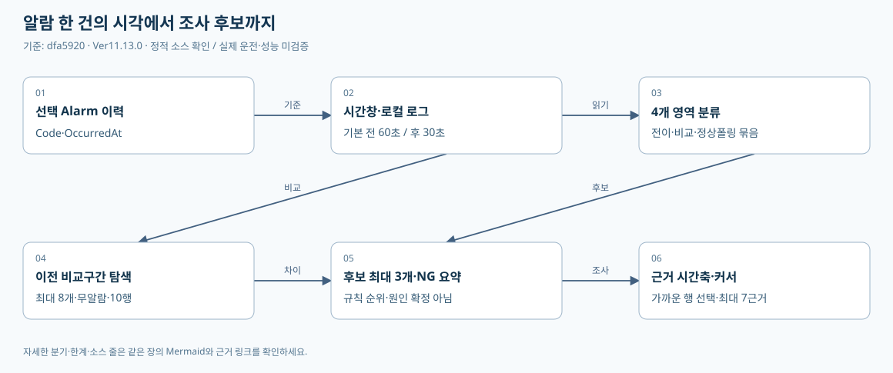
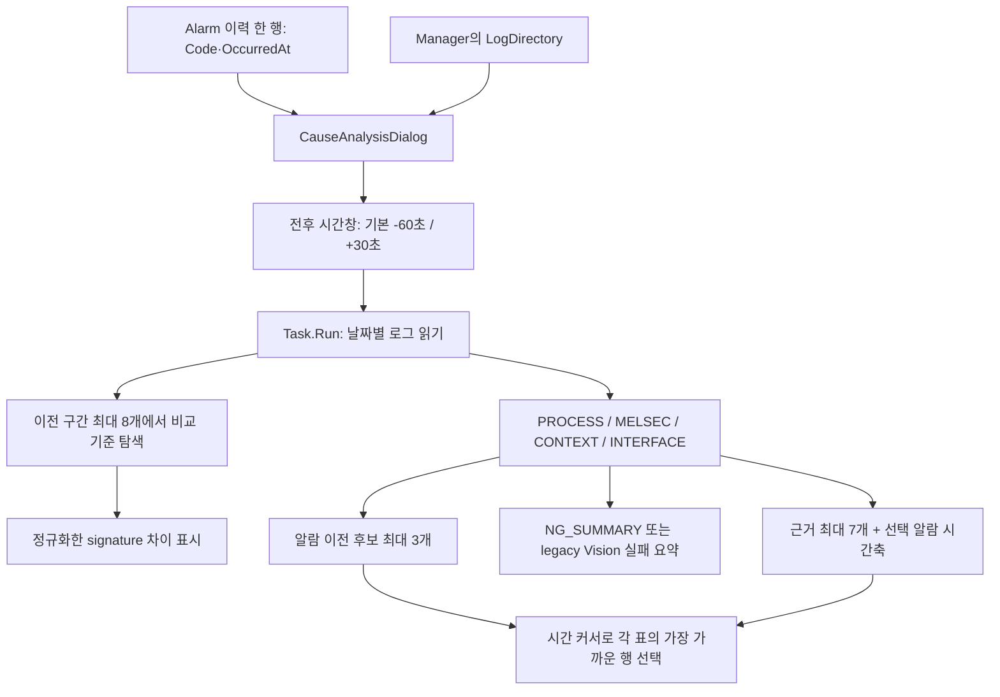
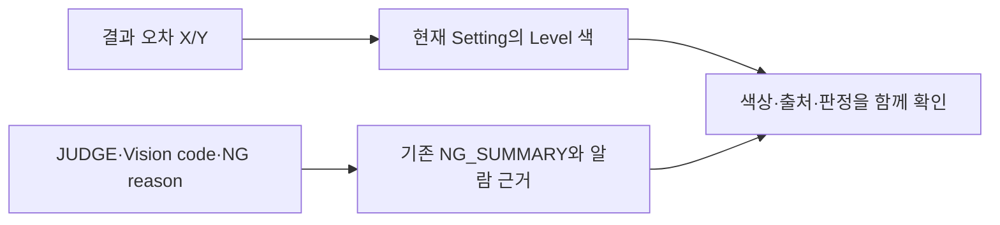

# 08. 알람 원인 분석: 전후 로그에서 무엇을 알 수 있는가

> 기준: `A3Drilling/master` · `28764c91d521777b8ee068dd7aaf2d3902ce9fe2`(Ver11.17.0). 실제 C#/XAML을 정적으로 읽었습니다. 설비 앱·Controller·벤더 DLL을 실행하거나 로그 원문을 공개하지 않았습니다.

새 기능은 **알람 한 건의 시각을 기준점으로, 서로 다른 로그를 한 시간축에 놓고 조사할 후보를 골라 주는 로컬 분석 화면**입니다. AI 서비스 호출이나 인과관계 증명 기능으로 읽으면 안 됩니다. 후보는 문자열·시간·영역 규칙으로 정하며 실제 원인은 원본 로그, 요청 회차, 장비 상태를 대조해 판정해야 합니다.

## 1. 화면을 여는 생산자와 받는 소비자

| 단계 | 실제 연결 | 의미 |
|---|---|---|
| 조립 | RootView → `CMenuAlarm(..., LogDirectory)` | 기존 LogManager의 로그 루트를 받습니다. 장치 연결을 새로 만들지 않습니다. |
| 조회 | AlarmManager의 history 결과 → `ST_ALARM_HISTORY_ROW` | 표시용 Time 문자열 외에 **DateTimeOffset OccurredAt**을 보존합니다. |
| 선택 | `SelectedRow` → `CauseAnalysisCommand` | 행 미선택·조회 중에는 명령을 비활성화합니다. |
| 팝업 | `ShowCauseAnalysis → CAlarmCauseAnalysisDialog` | 선택 행과 루트를 전달하고 modal 창을 엽니다. |
| 로드·종료 | Loaded에서 `LoadAsync`, Closed에서 `Dispose` | 중복 Loaded를 막고 취소 token을 정리합니다. |

근거: [RootView의 Alarm 의존성](https://github.com/kjuws10-rgb/A3Drilling/blob/28764c91d521777b8ee068dd7aaf2d3902ce9fe2/Drilling.UI/CRootView.cs#L2614-L2627), [명령·선택 행·팝업](https://github.com/kjuws10-rgb/A3Drilling/blob/28764c91d521777b8ee068dd7aaf2d3902ce9fe2/Drilling.UI/Menu/Menus/CMenuAlarm.cs#L289-L319), [조회 결과에 실제 시각 보존](https://github.com/kjuws10-rgb/A3Drilling/blob/28764c91d521777b8ee068dd7aaf2d3902ce9fe2/Drilling.UI/Menu/Menus/CMenuAlarm.cs#L418-L425), [팝업 수명과 취소](https://github.com/kjuws10-rgb/A3Drilling/blob/28764c91d521777b8ee068dd7aaf2d3902ce9fe2/Drilling.UI/Popup/CAlarmCauseAnalysisDialog.xaml.cs#L15-L37).

## 2. 기준시각·시간창·파일 배치를 먼저 확인합니다

기본 시간창은 알람 전 60초·후 30초이며, 각각 0~3600 정수초로 제한합니다. 로컬 날짜별로 파일을 찾고 시각은 DateTimeOffset으로 비교합니다. 표시 시각은 LocalDateTime입니다. PC 시간대·장비시각 불일치가 있다면 숫자만 가까운 로그를 같은 사건으로 묶을 수 있으므로 시간 동기 조건을 따로 기록해야 합니다. [기본값과 기준 알람](https://github.com/kjuws10-rgb/A3Drilling/blob/28764c91d521777b8ee068dd7aaf2d3902ce9fe2/Drilling.UI/Menu/Menus/CAlarmCauseAnalysis.cs#L14-L43), [시간창·비동기 로드](https://github.com/kjuws10-rgb/A3Drilling/blob/28764c91d521777b8ee068dd7aaf2d3902ce9fe2/Drilling.UI/Menu/Menus/CAlarmCauseAnalysis.cs#L209-L243), [시간창 범위 파싱](https://github.com/kjuws10-rgb/A3Drilling/blob/28764c91d521777b8ee068dd7aaf2d3902ce9fe2/Drilling.UI/Menu/Menus/CAlarmCauseAnalysis.cs#L316-L320).

| 화면 영역 | 찾는 논리 폴더 | 생산하는 사건 |
|---|---|---|
| PROCESS | `Sequence/<day>`, `Station/<day>` | 단계 시작·완료·중단·실패 |
| MELSEC | `Interface/MELSEC/<day>` | typed I/O 명령·응답·폴링·신호 |
| CONTEXT | `UI,Recipe,Setting,Product/<day>`와 `ProgramOpen` | 조작·조건 변경·제품 상태·프로그램 시작 |
| INTERFACE | 나머지 `Interface/<module>/<day>` | Vision·Automation 등 다른 장치 통신 |

지원 확장자는 txt/log/csv/jsonl입니다. 확장자가 csv여도 이 분석기는 일반 테이블 CSV parser를 사용하지 않고 **행 앞의 시각을 읽는 로그 parser**를 적용합니다. 선택 알람은 별도 이력 객체이고, `Alarm/<day>/Alarm_<day>.jsonl`은 비교 기준 구간에 알람이 있었는지 검사할 때 사용합니다. 모든 Alarm 파일이 네 패널에 통째로 추가된다는 설명은 잘못입니다. [분류·파일 열거](https://github.com/kjuws10-rgb/A3Drilling/blob/28764c91d521777b8ee068dd7aaf2d3902ce9fe2/Drilling.UI/Menu/Menus/CAlarmCauseAnalysis.cs#L790-L850), [Alarm 기준구간 검사](https://github.com/kjuws10-rgb/A3Drilling/blob/28764c91d521777b8ee068dd7aaf2d3902ce9fe2/Drilling.UI/Menu/Menus/CAlarmCauseAnalysis.cs#L571-L611).

파일은 공유 읽기/쓰기/삭제를 허용해 열고, 앞에서부터 읽습니다. 줄 앞의 날짜·시각이 없으면 이전 유효 시각을 상속해 예외의 여러 줄을 이어 읽습니다. 파일의 시간순 정렬을 전제로 범위 끝보다 늦은 행을 만나면 멈추며 메시지는 2000자로 줄입니다. ±500ms는 **시각적 강조**이고 인과 판정 범위가 아닙니다. [읽기와 메시지·시각 처리](https://github.com/kjuws10-rgb/A3Drilling/blob/28764c91d521777b8ee068dd7aaf2d3902ce9fe2/Drilling.UI/Menu/Menus/CAlarmCauseAnalysis.cs#L852-L887), [지원 시각 형식](https://github.com/kjuws10-rgb/A3Drilling/blob/28764c91d521777b8ee068dd7aaf2d3902ce9fe2/Drilling.UI/Menu/Menus/CAlarmCauseAnalysis.cs#L916-L946).

## 3. '정상 비교'는 정상 운전이 입증됐다는 뜻이 아닙니다

현재 분석창 바로 앞에서 같은 길이의 구간을 최대 8개 거슬러 찾습니다. Alarm 파일에서 알람이 검출되지 않고 관련 로그가 10행 이상인 첫 구간을 비교 기준으로 선택합니다. 이 조건은 **공정 성공·같은 Recipe·같은 Product·동일 모드**를 보장하지 않습니다. Alarm 파일이 없는 경우도 '알람을 찾지 못함'으로 취급되고, malformed JSON은 알람이 있는 것으로 보수 처리합니다. [탐색 조건과 횟수](https://github.com/kjuws10-rgb/A3Drilling/blob/28764c91d521777b8ee068dd7aaf2d3902ce9fe2/Drilling.UI/Menu/Menus/CAlarmCauseAnalysis.cs#L394-L405), [비교 구간 선택](https://github.com/kjuws10-rgb/A3Drilling/blob/28764c91d521777b8ee068dd7aaf2d3902ce9fe2/Drilling.UI/Menu/Menus/CAlarmCauseAnalysis.cs#L545-L611).

일반 로그의 비교 signature는 GUID·날짜·숫자를 정규화합니다. 정상 MELSEC 폴링은 ID와 READ/WRITE 분류를 사용하고, ID 이름에 STATE/READY/COMPLETE 같은 단어가 있으면 값을 비교합니다. 다른 아날로그 폴링값은 `ANALOG`로 묶습니다. 따라서 signature가 같아도 실제 오차·속도·좌표가 같다는 뜻이 아니며, 새로운 숫자 이상이 차이 표시에서 사라질 수 있습니다. 이 정규화는 비교용이며 비밀값을 안전하게 지우는 redaction 기능이 아닙니다. [signature와 상태변화 규칙](https://github.com/kjuws10-rgb/A3Drilling/blob/28764c91d521777b8ee068dd7aaf2d3902ce9fe2/Drilling.UI/Menu/Menus/CAlarmCauseAnalysis.cs#L633-L704).

상태변화 필터는 중요 단어·비교 기준 차이·이산 신호 변화·전이 단어를 사용합니다. 정상 MELSEC 폴링은 ID와 1초 단위로 묶어 첫값→끝값으로 보여 줍니다. 빠른 0→1→0 펄스는 요약만 보면 놓칠 수 있으므로 원본 로그와 따로 비교합니다. [1초 묶음](https://github.com/kjuws10-rgb/A3Drilling/blob/28764c91d521777b8ee068dd7aaf2d3902ce9fe2/Drilling.UI/Menu/Menus/CAlarmCauseAnalysis.cs#L711-L774).

## 4. 후보·실패 요약·시간축은 각각 다른 계산입니다

| 결과 | 입력·규칙 | 의미와 한계 |
|---|---|---|
| 원인 후보 최대 3개 | 알람 이전의 패널 행. 직접 실패 150, 인터락 130, Sequence 실패 120, 통신 100, 상태변화 80, UI 조작 60, 최초 이상 40 순 | 규칙 우선순위입니다. 확률·신뢰도 점수가 아닙니다. 같은 근거행은 중복 후보에서 제외합니다. |
| Review 실패 요약 | 알람 이전 최신 `NG_SUMMARY |` 구조 로그, 없으면 Review 알람에서 최근 60초 legacy `Mark[...] Result` | 새 로그는 Vision 실패와 X/Y/XY 허용오차 실패를 나눕니다. legacy는 Vision 코드 기준이라 허용오차 사유를 복원하지 못합니다. |
| 시간축 | 후보와 중요 이벤트를 모아 최대 7개 근거 + 선택 알람 | PROCESS는 최대 3개, 다른 영역은 최대 2개씩. 전체 사건의 무손실 재생이 아닙니다. |
| 시간 커서 | 클릭한 후보/시간축/행의 시각 → 각 표의 가장 가까운 행 | 가까운 시각을 맞추는 UI 동작입니다. 장치 명령을 보내거나 서로 같은 요청 ID임을 보장하지 않습니다. |

근거: [후보 규칙·순위·중복 억제](https://github.com/kjuws10-rgb/A3Drilling/blob/28764c91d521777b8ee068dd7aaf2d3902ce9fe2/Drilling.UI/Menu/Menus/CAlarmCauseAnalysis.cs#L1275-L1332), [구조 NG 요약과 legacy fallback](https://github.com/kjuws10-rgb/A3Drilling/blob/28764c91d521777b8ee068dd7aaf2d3902ce9fe2/Drilling.UI/Menu/Menus/CAlarmCauseAnalysis.cs#L1033-L1107), [legacy 60초 범위](https://github.com/kjuws10-rgb/A3Drilling/blob/28764c91d521777b8ee068dd7aaf2d3902ce9fe2/Drilling.UI/Menu/Menus/CAlarmCauseAnalysis.cs#L1145-L1161), [시간축 선택](https://github.com/kjuws10-rgb/A3Drilling/blob/28764c91d521777b8ee068dd7aaf2d3902ce9fe2/Drilling.UI/Menu/Menus/CAlarmCauseAnalysis.cs#L1475-L1534), [표의 가장 가까운 행 동기화](https://github.com/kjuws10-rgb/A3Drilling/blob/28764c91d521777b8ee068dd7aaf2d3902ce9fe2/Drilling.UI/Popup/CAlarmCauseAnalysisDialog.xaml.cs#L95-L139).

ReviewManager는 P2P/IOF/Fine 완료 지점에서 `NG_SUMMARY`를 생산합니다. Product의 새 메모리 필드와 ReviewResult CSV에도 NG 원인이 연결됩니다. 로그에 남는 요약·결과 CSV·Active Product의 보존 범위는 서로 다르므로 [04장 12절](04-product-and-station-lifecycle.md)을 함께 읽습니다. [NG 요약 생산](https://github.com/kjuws10-rgb/A3Drilling/blob/28764c91d521777b8ee068dd7aaf2d3902ce9fe2/Drilling.Common/Review/CReviewManager.cs#L1127-L1159).

## 5. 위험도와 구체적인 후속 검증

아래 위험도는 검토 우선순위입니다. 실제 장애가 발생했다는 뜻이 아닙니다.

| 위험도 | 확인된 조건·추론되는 위험 | 합성 자료로 검증할 시나리오 |
|---|---|---|
| 높음 | 후보는 패널당 1200행 선별 **이후**의 자료로 계산됩니다. 알람에서 멀지만 중요한 실패는 후보에서 누락될 수 있습니다. | 알람 직전 고빈도 로그 2000행과 더 이른 직접 실패를 넣고 표시·후보·전체 원본 결과를 비교합니다. |
| 높음 | 최신 NG_SUMMARY 선택은 Recipe/Glass/Run ID로 결합하지 않습니다. 다른 작업의 요약이 가까이 있으면 잘못 연결될 수 있습니다. | 서로 다른 두 Product의 NG_SUMMARY를 교차 배치하고 선택 알람과의 연결을 확인합니다. |
| 중간 | 비교 기준은 알람 부재·10행만 검사합니다. 무알람이 정상 가공을 뜻하지 않습니다. | 정지/다른 Recipe/Alarm 파일 누락 구간을 앞에 넣고 선택 기준·설명문을 확인합니다. |
| 중간 | timestamp가 역전되면 빠른 break 뒤의 해당 구간 행을 놓칠 수 있습니다. | 날짜 경계, 파일 중간 시간 역전, 이어쓰기·잘린 마지막 행을 각각 검증합니다. |
| 중간 | 숫자 정규화·아날로그 묶음·2000자 절단이 숫자 이상이나 뒤쪽 구조 필드를 숨길 수 있습니다. | 값만 바뀐 두 로그, 짧은 펄스, 긴 NG_SUMMARY를 넣고 원본과 비교합니다. |
| 중간 | 표시 cap은 전체 읽기·메모리 cap이 아닙니다. 8개 비교구간 탐색도 추가 I/O입니다. | 큰 일일 로그에서 취소 지연·peak 메모리·동시 분석창 수를 측정합니다. |
| 중간 | 원문 메시지가 화면에 들어갑니다. signature 정규화는 원문 비밀값 제거가 아닙니다. | 공유용 스크린샷·내보내기 전 토큰/IP/계정값이 남는지 승인된 합성 자료로 점검합니다. |

첫 두 항목 근거: [전체 읽기→패널 선별→후보 분석 순서](https://github.com/kjuws10-rgb/A3Drilling/blob/28764c91d521777b8ee068dd7aaf2d3902ce9fe2/Drilling.UI/Menu/Menus/CAlarmCauseAnalysis.cs#L451-L477), [1200행 선택](https://github.com/kjuws10-rgb/A3Drilling/blob/28764c91d521777b8ee068dd7aaf2d3902ce9fe2/Drilling.UI/Menu/Menus/CAlarmCauseAnalysis.cs#L485-L518), [최신 NG_SUMMARY 조건](https://github.com/kjuws10-rgb/A3Drilling/blob/28764c91d521777b8ee068dd7aaf2d3902ce9fe2/Drilling.UI/Menu/Menus/CAlarmCauseAnalysis.cs#L1038-L1044).

이번 검증 완료 범위는 소스의 호출·필드·분기·줄 인용 확인입니다. 위 실행 시나리오는 미수행이며, 실제 현장 로그 레코드는 예제로 복제하지 않았습니다.

## 6. 11.17의 등급 표시와 기존 알람 분석을 연결해 읽기

`CAlarmCauseAnalysis`·팝업·보호윈도우 알람 callback 자체는 11.17과 이번11.19의 두 Commit에서도 기능 변경이 확인되지 않았습니다. 앞 절의 후보 선별·Run/Glass 상관키·시간순 파일 가정·표시 cap 한계는 **기존 잔건**이며 이번에 재현하거나 수정한 결함으로 세지 않습니다. 현재 인용의 실제 소스 범위를 이전 기준과 대조해 유지했습니다.

새 Review Level 색상은 현재 오차 크기를 표시하는 규칙입니다. 알람의 Vision 실패·허용오차 NG 요약이나 Product JUDGE를 대체하지 않습니다. 특히 live Review는 VisionFind NG에 Level을 표시하지 않는 반면, Review Data는 로드한 각 행의 ErrorX/Y로 Level을 계산합니다. 작은 오차의 Find NG·미측정·편집 행이 낮은 Level 색으로 보이더라도 '원인 해소'나 '새 실측 합격'이라고 판단하지 않습니다. [Live의 Find NG 제외](https://github.com/kjuws10-rgb/A3Drilling/blob/28764c91d521777b8ee068dd7aaf2d3902ce9fe2/Drilling.UI/Menu/Menus/CMenuReview.cs#L4981-L5024), [REVIEW DATA 파일 로드의 Level 계산](https://github.com/kjuws10-rgb/A3Drilling/blob/28764c91d521777b8ee068dd7aaf2d3902ce9fe2/Drilling.UI/Menu/Menus/CMenuCorrection.ReviewData.Display.cs#L279-L301).

후속 검증은 같은 VisionFind NG·허용오차 NG·EDITED 결과에 대해 live·REVIEW DATA 파일 로드·NG_SUMMARY·알람 이력의 의미를 대조합니다. 이 문서의 새 등급 설명은 로그 분석의 인과관계 신뢰도나 대용량 성능을 향상시켰다는 실행 증거가 아닙니다.

이전 읽기: [06. 동시성과 로그](06-threading-snapshots-and-logs.md), [07. 변경 영향 검토](07-change-impact-and-offline-reference.md).

## 7. Ver11.19.0의 INIT·PM 기록과 연결할 때의 한계

이번 CAlarmManager diff는 중복 Code 억제·발생 순서 queue·외부 I/O 분리의 설명 주석 보강입니다. 앞 절의 원인 후보 규칙·기준구간·시간순 읽기·상관키 한계를 고친 새 알고리즘이 아닙니다. AUTO_INIT 실패는 Station Process 로그에 ERROR로 기록되지만 UI 경고창이 뜬다는 사실만으로 Alarm code 이력이 새로 만들어진다고 단정하지 않습니다. [활성 알람·queue](https://github.com/kjuws10-rgb/A3Drilling/blob/28764c91d521777b8ee068dd7aaf2d3902ce9fe2/Drilling.Common/Alarm/CAlarmManager.cs#L245-L268), [AUTO_INIT 기록](https://github.com/kjuws10-rgb/A3Drilling/blob/28764c91d521777b8ee068dd7aaf2d3902ce9fe2/Drilling.Common/Station/CStationProcess.cs#L3917-L3953), [INIT 사용자 표시](https://github.com/kjuws10-rgb/A3Drilling/blob/28764c91d521777b8ee068dd7aaf2d3902ce9fe2/Drilling.UI/CRootView.cs#L778-L799)

PM 진입/해제는 로그 서비스의 별도 세션 호출을 사용합니다. 그 이력이 실제 어느 파일/형식으로 저장되는지, 현재 분석기가 PM 전용 이력을 읽어 상관관계를 붙이는지까지는 확인하지 못했습니다. PM 이력과 Alarm 원인 후보를 자동 결합한 기능으로 설명하지 않습니다. [PM 시작 호출](https://github.com/kjuws10-rgb/A3Drilling/blob/28764c91d521777b8ee068dd7aaf2d3902ce9fe2/Drilling.UI/CRootView.cs#L1307-L1327), [PM 종료 호출](https://github.com/kjuws10-rgb/A3Drilling/blob/28764c91d521777b8ee068dd7aaf2d3902ce9fe2/Drilling.UI/CRootView.cs#L1467-L1495)

후속 검증은 INIT OFF readback 실패 시 Process/Interface/Alarm 이력의 차이, PM 이력 저장 실패와 실제 Lock 상태, 같은 시각의 별개 Glass/Recipe 기록을 분리하는 것입니다. 운영 로그 원문·비밀번호·접속값은 문서 예제로 수록하지 않습니다.
