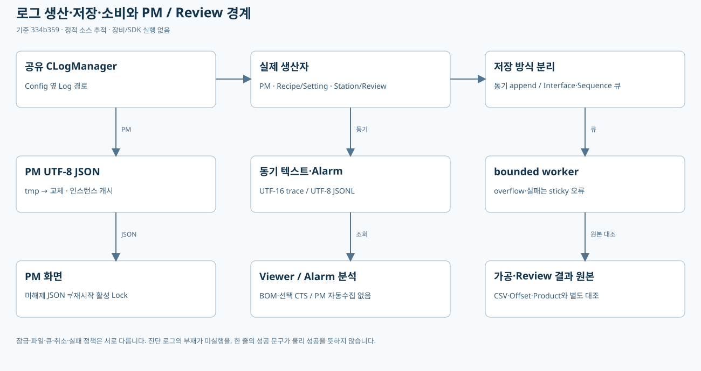
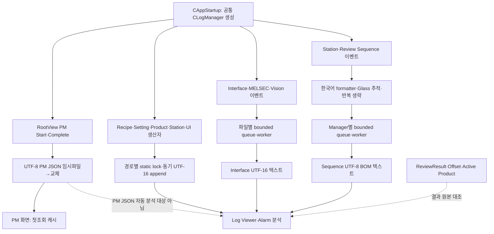
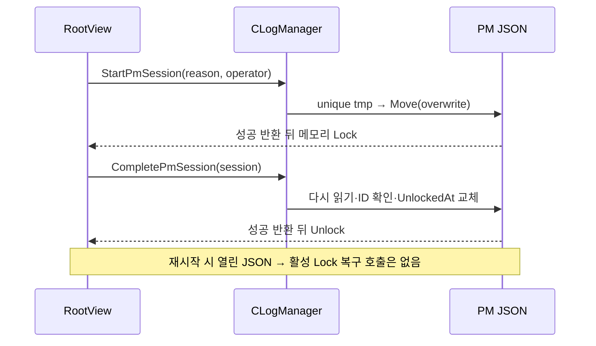

# 09. 로그 서비스·PM 이력·Review 추적을 끝까지 읽기

> 최신 원본 기준: **2026-11-25 · master Ver11.23.0 · `0219666f9053b907d96d7e0aa7d0c6c1be3a73d4`**. 이전 버전의 변경 설명은 연혁으로 보존하며, 이번 Stage Glass Data·Product 필드 변경은 [상세장](10-stage-glass-data-and-product-fields.md)에서 다룹니다.

> 이전 상세검토 이력(아래 링크는 최신 원본으로 재고정): 원본: A3Drilling/master · `334b3599651b2e8e0181fd4459bafaf3cddafff3` · 비교 `28764c91d521777b8ee068dd7aaf2d3902ce9fe2`. 이 장은 사람이 새 파일 1,562행 전체와 실제 생산자/소비자 코드를 추적한 수동 상세 설명입니다. 자동 구문/부분 의미 분석 자료와 구분합니다. 장비 프로그램·AeroScript·SDK/DLL을 실행하거나 로드하지 않았고, 운영 CSV·실제 로그·비밀번호 값을 복제하지 않았습니다. 정식 빌드 및 별도 회귀 결과는 전체 보고서의 검증 기록을 따릅니다.

새 파일은 기존 코드가 호출하던 `CLogManager`, PM DTO, 로그 Reader, 시작 실패 로그의 정의를 저장소 안에 제공합니다. **새 보정 알고리즘이나 새로운 측정 결과 형식이 추가된 diff는 아닙니다.** 이전 문서의 “PM 저장 구현을 확인하지 못함”은 이번 소스로 해소되지만, PM 잠금의 재시작 복원과 진단 손실 가능성이 자동으로 해결되는 것은 아닙니다.

## 1. 처음 찾을 생산자와 소비자

| 흐름 | 실제 호출/소비 | 왜 중요한가 |
|---|---|---|
| 객체 구성 | CAppStartup이 Config 옆 Log를 쓰는 CLogManager를 Manager에 전달하고 CUiLogService를 연결 | 로그 경로는 Git 저장소 이름이 아니라 실행 ConfigRoot 기준 |
| PM | RootView StartPmSession 성공 후 Lock, CompletePmSession 성공 후 Unlock; CMenuPm.ReadPmHistory | 이력 실패와 소프트웨어 잠금 전이가 직접 연결됨 |
| Recipe | CJhmiRecipeFile CSV 저장·재검증 다음 WriteRecipeModifyBatch/Save | 값 저장 성공 뒤 이력 실패가 호출 오류가 될 수 있음 |
| Setting | CSettingFile 전체 values 저장·재검증 다음 Modify/Save | 민감 항목 old/new도 별도 필터 없이 전달되는 위험 |
| 통신 | CInterfaceManager/CMelsec가 명령·에러·패킷을 전달 | enqueue 성공은 물리 명령 성공·디스크 반영 완료가 아님 |
| 가공 시퀀스 | Station.AddProcessLog→WriteSequence와 메모리 UI 이력; AddSequenceLog는 Station도 기록 | UI 이력 삭제와 디스크 이력 삭제는 다름 |
| Review | WriteReviewLog→Sequence+Station; Fine Publish→FINE_PROGRESS | 한 번의 측정/액션이 두 진단 파일에 보일 수 있음 |
| Product | SaveActive→현재 메모리 publish→History/진단 log를 별도 catch | 진단 실패만으로 이미 commit된 Product를 실패/재실행하면 안 됨 |
| Alarm | CAlarmManager의 이력 worker→IAlarmHistoryStore.Append/Read | 실시간 활성 알람 상태와 디스크 이력 성공은 별도 |
| 일반 로그 보기 | CLogFileScope→CLogTextReader.ReadAllAsync; 선택 버전/CTS 검사 후 publish | Log 밖·Alarm·링크를 제한. 전체 파일의 메모리 크기는 제한하지 않음 |

근거: [CAppStartup.cs:14–36](https://github.com/kjuws10-rgb/A3Drilling/blob/0219666f9053b907d96d7e0aa7d0c6c1be3a73d4/Drilling.UI/CAppStartup.cs#L14-L36), [CRootView.cs:1307–1321](https://github.com/kjuws10-rgb/A3Drilling/blob/0219666f9053b907d96d7e0aa7d0c6c1be3a73d4/Drilling.UI/CRootView.cs#L1307-L1321), [CRootView.cs:1467–1493](https://github.com/kjuws10-rgb/A3Drilling/blob/0219666f9053b907d96d7e0aa7d0c6c1be3a73d4/Drilling.UI/CRootView.cs#L1467-L1493), [CMenuPm.cs:34–56](https://github.com/kjuws10-rgb/A3Drilling/blob/0219666f9053b907d96d7e0aa7d0c6c1be3a73d4/Drilling.UI/Menu/Menus/CMenuPm.cs#L34-L56), [CJhmiRecipeFile.cs:226–242](https://github.com/kjuws10-rgb/A3Drilling/blob/0219666f9053b907d96d7e0aa7d0c6c1be3a73d4/Drilling.File/JHMI/CJhmiRecipeFile.cs#L226-L242), [CSettingFile.cs:121–133](https://github.com/kjuws10-rgb/A3Drilling/blob/0219666f9053b907d96d7e0aa7d0c6c1be3a73d4/Drilling.File/JHMI/CSettingFile.cs#L121-L133), [CInterfaceManager.cs:714–791](https://github.com/kjuws10-rgb/A3Drilling/blob/0219666f9053b907d96d7e0aa7d0c6c1be3a73d4/Drilling.Common/Interface/CInterfaceManager.cs#L714-L791), [CStationProcess.cs:2371–2418](https://github.com/kjuws10-rgb/A3Drilling/blob/0219666f9053b907d96d7e0aa7d0c6c1be3a73d4/Drilling.Common/Station/CStationProcess.cs#L2371-L2418), [CReviewManager.cs:1029–1045](https://github.com/kjuws10-rgb/A3Drilling/blob/0219666f9053b907d96d7e0aa7d0c6c1be3a73d4/Drilling.Common/Review/CReviewManager.cs#L1029-L1045), [CProductManager.cs:790–820](https://github.com/kjuws10-rgb/A3Drilling/blob/0219666f9053b907d96d7e0aa7d0c6c1be3a73d4/Drilling.Common/Product/CProductManager.cs#L790-L820), [CAlarmManager.cs:341–375](https://github.com/kjuws10-rgb/A3Drilling/blob/0219666f9053b907d96d7e0aa7d0c6c1be3a73d4/Drilling.Common/Alarm/CAlarmManager.cs#L341-L375), [CMonitorLogViewerPanel.cs:121–175](https://github.com/kjuws10-rgb/A3Drilling/blob/0219666f9053b907d96d7e0aa7d0c6c1be3a73d4/Drilling.UI/Menu/Menus/CMonitorLogViewerPanel.cs#L121-L175).

## 2. 파일 형식·단위·저장 완료를 구분하기

| 저장 대상 | 기본 상대 경로 | 인코딩·행 계약 | 쓰는 시점 |
|---|---|---|---|
| PM | `Log/PM/yyyy/MM/dd/PM_<SessionId>.json` | UTF-8 BOM 없음. SessionId/LockedAt/UnlockedAt/Reason/Operator | Start/Complete 동기, 임시파일 후 교체 |
| Alarm | `Log/Alarm/yyyyMMdd/Alarm_yyyyMMdd.jsonl` | UTF-8 BOM 없음. ST_ALARM_HISTORY_ENTRY 한 JSON/줄 | Alarm worker가 Append 호출; 경로별 lock |
| Recipe/Setting/Station/Product/UI | 각 `Log/<범주>/yyyyMMdd/*_Trace.txt` | UTF-16. 보통 `yy/MM/dd HH:mm:ss.fff`와 역슬래시 필드 | 호출 스레드에서 동기 append |
| Interface | `Log/Interface/<MODULE>/yyyyMMdd/Interface_*_Trace.txt` | UTF-16. 이벤트/수신 패킷 시각 포함 | 파일별 queue worker가 append |
| Sequence | `Log/Sequence/yyyyMMdd/Sequence_*_Trace.txt` | UTF-8 BOM. `HH:mm:ss.fff [GLASSID:…][Category][Message]` | Manager별 queue worker가 append |
| ProgramOpen | `Log/ProgramOpen/ProgramOpen_yyyyMMdd.log` | 일반 AppendAllText 기본 UTF-8 계약. 시작 제목·시각·본문 | 동기 best-effort, 모든 오류를 삼킴 |

PM 시간은 DateTimeOffset, 파일명/폴더와 일반 trace는 로컬 날짜·시각을 사용합니다. Process Move의 X/Y는 mm, Speed는 mm/sec, Protect Window Count는 매수이며 formatter는 전달받은 값을 번역할 뿐 단위를 재계산하지 않습니다. 로그 문자열만으로 좌표의 실제 기준점·부호·보정 적용 순서를 재구성하지 않습니다. [CLogManager.cs:54–66](https://github.com/kjuws10-rgb/A3Drilling/blob/0219666f9053b907d96d7e0aa7d0c6c1be3a73d4/Drilling.Common/Log/CLogManager.cs#L54-L66), [CLogManager.cs:168–183](https://github.com/kjuws10-rgb/A3Drilling/blob/0219666f9053b907d96d7e0aa7d0c6c1be3a73d4/Drilling.Common/Log/CLogManager.cs#L168-L183), [CLogManager.cs:318–419](https://github.com/kjuws10-rgb/A3Drilling/blob/0219666f9053b907d96d7e0aa7d0c6c1be3a73d4/Drilling.Common/Log/CLogManager.cs#L318-L419), [CLogManager.cs:793–831](https://github.com/kjuws10-rgb/A3Drilling/blob/0219666f9053b907d96d7e0aa7d0c6c1be3a73d4/Drilling.Common/Log/CLogManager.cs#L793-L831), [CLogManager.cs:1317–1367](https://github.com/kjuws10-rgb/A3Drilling/blob/0219666f9053b907d96d7e0aa7d0c6c1be3a73d4/Drilling.Common/Log/CLogManager.cs#L1317-L1367), [CLogManager.cs:1510–1544](https://github.com/kjuws10-rgb/A3Drilling/blob/0219666f9053b907d96d7e0aa7d0c6c1be3a73d4/Drilling.Common/Log/CLogManager.cs#L1510-L1544).

## 3. PM 한 회차의 실제 저장·실패·재시작

1. Start는 사유를 Trim하고 1~200자를 요구합니다. 시각+GUID SessionId와 아직 UnlockedAt이 없는 DTO를 만듭니다. 작업자 공백은 `-`로 정규화합니다.
2. 인스턴스 `_pmHistoryLock` 안에서 폴더 생성→고유 tmp에 UTF-8 JSON→Move(overwrite)→tmp 청소를 합니다. 이미 캐시가 있다면 성공 후에만 캐시에 추가합니다. RootView는 저장 성공 후에만 메모리 Lock을 켭니다.
3. Complete는 원파일 존재·역직렬화·동일 SessionId를 다시 확인합니다. 이미 해제 시각이 있으면 같은 결과를 반환하고, 없으면 해제 시각을 넣어 같은 경로에 교체합니다. 저장 실패 시 RootView는 Lock을 유지합니다.
4. ReadPmHistory는 최초에 PM_*.json을 전체 하위 폴더에서 읽어 LockedAt 내림차순 캐시를 만듭니다. 잘못된 JSON/읽기 실패는 Trace 후 목록에서 제외됩니다. 이후 조회는 캐시의 maxRows개 사본이므로 다른 인스턴스/외부 편집이 자동 반영되지 않습니다.
5. DTO에는 기판·Recipe·장비 상태·물리 안전 확인값이 없습니다. Start/Complete는 CancellationToken도 받지 않습니다. 이력 파일이 남는 것과 RootView의 활성 Lock이 재시작 후 복원되는 것은 별개입니다. 열린 JSON을 활성 세션으로 재결합하는 호출은 확인한 경로에 없습니다.

이는 tmp 교체 구현을 확인한 것이며 fsync/정전 내구성·프로세스 간 직렬화의 실행 증거가 아닙니다. [CLogManager.cs:72–173](https://github.com/kjuws10-rgb/A3Drilling/blob/0219666f9053b907d96d7e0aa7d0c6c1be3a73d4/Drilling.Common/Log/CLogManager.cs#L72-L173), [CLogManager.cs:1503–1508](https://github.com/kjuws10-rgb/A3Drilling/blob/0219666f9053b907d96d7e0aa7d0c6c1be3a73d4/Drilling.Common/Log/CLogManager.cs#L1503-L1508), [CRootView.cs:127–130](https://github.com/kjuws10-rgb/A3Drilling/blob/0219666f9053b907d96d7e0aa7d0c6c1be3a73d4/Drilling.UI/CRootView.cs#L127-L130), [CRootView.cs:1307–1321](https://github.com/kjuws10-rgb/A3Drilling/blob/0219666f9053b907d96d7e0aa7d0c6c1be3a73d4/Drilling.UI/CRootView.cs#L1307-L1321), [CRootView.cs:1467–1493](https://github.com/kjuws10-rgb/A3Drilling/blob/0219666f9053b907d96d7e0aa7d0c6c1be3a73d4/Drilling.UI/CRootView.cs#L1467-L1493).

## 4. 공유 상태·잠금·큐와 종료

| 상태/잠금 | 소유·보호 범위 | 보호하지 않는 것 |
|---|---|---|
| static FileLocks/GetFileLock | full path 대소문자 무시, 같은 프로세스의 여러 Manager가 동기 AppendText/Alarm 파일별 lock 공유 | 다른 프로세스, Sequence writer의 별도 append, 디스크 내구성 |
| `_pmHistoryLock`, `_pmHistoryCache` | 해당 Manager의 PM 읽기·쓰기·캐시 교체 | 다른 Manager/외부 파일 갱신, 앱 재시작 활성 세션 |
| `_interfaceLogLock`, `_interfaceWriters`, `_interfaceLoggingStopped` | 파일별 writer 생성·enqueue·종료 전이 | 여러 Manager/다른 프로세스, 날짜별 writer 수의 총량 |
| Interface writer `_queue`, `_worker`, `_queuedBytes` | 파일 하나의 단일 reader. 16,384개 항목 및 text UTF-16 byte 계산 16MiB | Channel/객체 오버헤드 포함 총 메모리, 모든 파일 합계 |
| `_sequenceLogLock`, `_sequenceText`, `_sequenceQueue`, `_sequenceWriter`, `_sequenceStopped` | formatter 상태와 Manager 하나의 enqueue/종료 직렬화 | 다른 Manager가 같은 Sequence 파일을 쓰는 상황 |
| `_sequenceLogError`, `_interfaceLogError` | Volatile/Interlocked로 마지막 오류 전달. 성공 후 자동 clear 없음 | 오류 메시지 하나만으로 누락 이벤트 개수 복원 |
| formatter 주소/신호/쓰기/Glass 사전 | Sequence lock 안에서만 Format. 최대 128 cycle→Glass 연결 유지 | 원시 이벤트의 완전 보존, 영구적인 Product/Run 계보 |

Interface의 FullMode=Wait 설정만 보고 생산자가 대기한다고 설명하면 틀립니다. 일반 생산자는 **TryWrite**라 용량 초과 시 기다리지 않고 실패 표시를 남깁니다. worker는 10ms Delay 뒤 최대 256개·StringBuilder 128Ki문자 조건으로 batch를 모읍니다. 10ms는 코드의 지연값이며 스케줄링/디스크 지연까지 포함한 실측 최대 가시 지연 보장이 아닙니다. 한 대형 entry가 batch 문자 기준을 넘을 수도 있습니다. [CLogManager.cs:421–537](https://github.com/kjuws10-rgb/A3Drilling/blob/0219666f9053b907d96d7e0aa7d0c6c1be3a73d4/Drilling.Common/Log/CLogManager.cs#L421-L537).

Sequence도 일반 이벤트는 TryWrite로 넣습니다. formatter CPU 작업은 호출자 lock 안에서 동기 수행하며, worker는 최대 256개를 날짜별로 묶어 UTF-8 append합니다. formatter가 null을 반환하는 반복 이벤트는 queue에도 들어가지 않습니다. count 한도가 모든 문자열 크기를 제한하지는 않습니다. Sequence 오류 보고의 Trace listener는 별도 전역 구성에 따라 동기 작업을 할 수 있으므로 “어떤 진단 callback도 제어 스레드에서 실행되지 않는다”로 일반화하지 않습니다. [CLogManager.cs:805–941](https://github.com/kjuws10-rgb/A3Drilling/blob/0219666f9053b907d96d7e0aa7d0c6c1be3a73d4/Drilling.Common/Log/CLogManager.cs#L805-L941).

Flush는 barrier를 enqueue하고 그 지점까지 worker가 처리하기를 기다립니다. worker는 append 실패도 catch한 뒤 barrier를 완료시키며, 상위 Flush/Stop이 sticky 오류를 검사하여 IOException을 냅니다. **barrier 완료만 확인하면 저장 성공을 잘못 판단할 수 있습니다.** token 취소는 WriteAsync/WaitAsync 대기를 끊지만 worker append 자체를 되돌리지 않습니다. Stop 이후 새 enqueue는 조용히 무시하며, 한 번 Stop한 인스턴스의 재시작 메서드는 없습니다. FlushInterface는 호출 순간의 writer 목록만 취하므로 동시에 생긴 새 파일 writer까지 모두 포함하는 전역 정지 경계도 아닙니다. [CLogManager.cs:426–537](https://github.com/kjuws10-rgb/A3Drilling/blob/0219666f9053b907d96d7e0aa7d0c6c1be3a73d4/Drilling.Common/Log/CLogManager.cs#L426-L537), [CLogManager.cs:843–941](https://github.com/kjuws10-rgb/A3Drilling/blob/0219666f9053b907d96d7e0aa7d0c6c1be3a73d4/Drilling.Common/Log/CLogManager.cs#L843-L941).

Manager.Destroy는 장치 정리의 finally에서 두 Stop을 각각 외부 5초 WaitAsync로 기다리고 실패를 ProgramOpen에 남기려 합니다. timeout은 남은 background I/O의 강제 종료나 재시도·회복 보장이 아닙니다. [CManager.cs:228–264](https://github.com/kjuws10-rgb/A3Drilling/blob/0219666f9053b907d96d7e0aa7d0c6c1be3a73d4/Drilling.Common/Managers/CManager.cs#L228-L264).

## 5. Sequence는 사람이 읽기 쉬운 요약이며 원시 재생 파일은 아닙니다

`Format`은 context/detail의 Cycle/Glass를 읽고, Review 계획이 들어오면 별도 Review Glass를 기억합니다. 새 Review 접수·AUTO monitor 시작·Review cycle 완료에 맞춰 별도 상태를 비우고, Review Glass가 아직 없을 때 다른 Process의 Glass를 붙이지 않도록 “미확정”을 사용합니다. 이 메모리 연계는 최대 128 cycle이고 파일/프로세스 재시작을 넘어 보존되지 않습니다. [CLogManager.cs:1045–1107](https://github.com/kjuws10-rgb/A3Drilling/blob/0219666f9053b907d96d7e0aa7d0c6c1be3a73d4/Drilling.Common/Log/CLogManager.cs#L1045-L1107).

`FormatCore`는 Action BEGIN/DONE/FAILED/CANCELED를 한국어 단계명으로 바꿉니다. Stage 초기 OFF/Pending·확인 중복·일부 polling은 생략합니다. Address/Logical을 먼저 기억했다가 확인된 Signal/Data에 붙입니다. 단순히 “출력 요청을 기록했다”와 “readback으로 확인했다”를 같은 것으로 설명하지 않습니다. CommonFlow는 Process Move 목표 mm·속도 mm/sec·도착/BUSY OFF·IOF 좌표 준비를 분리합니다. [CLogManager.cs:1011–1044](https://github.com/kjuws10-rgb/A3Drilling/blob/0219666f9053b907d96d7e0aa7d0c6c1be3a73d4/Drilling.Common/Log/CLogManager.cs#L1011-L1044), [CLogManager.cs:1109–1188](https://github.com/kjuws10-rgb/A3Drilling/blob/0219666f9053b907d96d7e0aa7d0c6c1be3a73d4/Drilling.Common/Log/CLogManager.cs#L1109-L1188), [CLogManager.cs:1275–1367](https://github.com/kjuws10-rgb/A3Drilling/blob/0219666f9053b907d96d7e0aa7d0c6c1be3a73d4/Drilling.Common/Log/CLogManager.cs#L1275-L1367).

Review 계열은 계획/NG 시도/결과 저장/저장 실패/Offset 저장의 label을 붙입니다. 최종 줄에는 원래 source·level·전체 context가 구조화된 필드로 전부 저장되지 않으며, ProcessText는 숫자 RunId 텍스트를 제거합니다. 따라서 한국어 Sequence 줄만으로 Raw Vision·원본 Script·모든 Recipe/Run/OffsetRevision을 재현할 수 있다고 안내하면 안 됩니다. 결과 저장 경로·실제 CSV·현재 Product·별도 Interface trace와 대조해야 합니다. [CLogManager.cs:1222–1272](https://github.com/kjuws10-rgb/A3Drilling/blob/0219666f9053b907d96d7e0aa7d0c6c1be3a73d4/Drilling.Common/Log/CLogManager.cs#L1222-L1272), [CLogManager.cs:1370–1398](https://github.com/kjuws10-rgb/A3Drilling/blob/0219666f9053b907d96d7e0aa7d0c6c1be3a73d4/Drilling.Common/Log/CLogManager.cs#L1370-L1398).

## 6. 파일 보기·알람 분석·PM 화면은 읽는 대상이 다릅니다

일반 Log Viewer는 CLogFileScope로 root 밖·Alarm 계열·reparse point를 거르고 txt/log/csv만 허용합니다. 이 타입 자체는 읽기 byte-stream의 동시 교체를 잠그는 클래스가 아닙니다. CLogTextReader는 BOM으로 UTF-8/16/32의 LE/BE를 판별하고 ReadAllAsync가 64Ki문자 buffer로 전체 내용을 StringBuilder에 모읍니다. 표시 진행률은 stream 바이트 위치 기준이고 decoder read-ahead 때문에 실제 표시 문자 비율과 같지 않을 수 있습니다. 128Ki문자 PageCharacterLimit는 legacy ReadPage에만 적용됩니다. [CLogManager.cs:945–995](https://github.com/kjuws10-rgb/A3Drilling/blob/0219666f9053b907d96d7e0aa7d0c6c1be3a73d4/Drilling.Common/Log/CLogManager.cs#L945-L995), [CLogManager.cs:1401–1500](https://github.com/kjuws10-rgb/A3Drilling/blob/0219666f9053b907d96d7e0aa7d0c6c1be3a73d4/Drilling.Common/Log/CLogManager.cs#L1401-L1500).

ReadPage의 offset/NextOffset/FileLength는 바이트 위치이고 문자 개수가 아닙니다. 가능한 한 마지막 줄바꿈까지 반환하며 surrogate pair를 자르지 않습니다. Reader는 ReadWrite/Delete 공유로 열어 살아 있는 로그를 읽지만, 읽기 시작 FileLength와 반환 시점 내용이 전역 원자 snapshot이라는 뜻은 아닙니다. 선택을 바꾸면 Viewer의 CTS/세대번호가 옛 응답 게시를 막습니다. [CLogManager.cs:1455–1499](https://github.com/kjuws10-rgb/A3Drilling/blob/0219666f9053b907d96d7e0aa7d0c6c1be3a73d4/Drilling.Common/Log/CLogManager.cs#L1455-L1499), [CMonitorLogViewerPanel.cs:121–175](https://github.com/kjuws10-rgb/A3Drilling/blob/0219666f9053b907d96d7e0aa7d0c6c1be3a73d4/Drilling.UI/Menu/Menus/CMonitorLogViewerPanel.cs#L121-L175).

PM 화면은 PM JSON을 DTO로 읽으며 일반 Viewer와 별도입니다. Alarm 원인 분석도 PM JSON을 열거하지 않습니다. Alarm JSONL은 Alarm History/Trend의 store를 이용하고, 분석기는 별도 로그 열거·시각 파서로 Sequence의 날짜 없는 시각을 파일 날짜와 합칩니다. 어떤 화면에서 파일이 안 보인다는 것과 파일이 없다는 것은 다릅니다. [CMenuPm.cs:34–56](https://github.com/kjuws10-rgb/A3Drilling/blob/0219666f9053b907d96d7e0aa7d0c6c1be3a73d4/Drilling.UI/Menu/Menus/CMenuPm.cs#L34-L56), [CAlarmCauseAnalysis.cs:790–849](https://github.com/kjuws10-rgb/A3Drilling/blob/0219666f9053b907d96d7e0aa7d0c6c1be3a73d4/Drilling.UI/Menu/Menus/CAlarmCauseAnalysis.cs#L790-L849), [CAlarmCauseAnalysis.cs:916–946](https://github.com/kjuws10-rgb/A3Drilling/blob/0219666f9053b907d96d7e0aa7d0c6c1be3a73d4/Drilling.UI/Menu/Menus/CAlarmCauseAnalysis.cs#L916-L946).

## 7. 전체 멤버의 수동 계약표

아래 표는 원문 행을 가리키는 수동 해설입니다. 자동 의미 분석의 resolved 호출 여부를 런타임 호출 성공으로 읽지 않습니다. 같은 이름의 overload는 각각 원본 행을 남기며, 모든 필드·프로퍼티·record 계약은 뒤 표에서 따로 정리합니다.

### CLogManager

| 서명 시작 · 원본 | 매개변수·반환·호출·실패/공유상태 설명 |
|---|---|
| `private static object GetFileLock(string path)` · [CLogManager.cs:32](https://github.com/kjuws10-rgb/A3Drilling/blob/0219666f9053b907d96d7e0aa7d0c6c1be3a73d4/Drilling.Common/Log/CLogManager.cs#L32) | full path를 key로 static gate를 얻음. 프로세스 내 동기 파일 append만 직렬화. |
| `public CLogManager(string configRoot)` · [CLogManager.cs:54](https://github.com/kjuws10-rgb/A3Drilling/blob/0219666f9053b907d96d7e0aa7d0c6c1be3a73d4/Drilling.Common/Log/CLogManager.cs#L54) | configRoot 부모 아래 Log 범주 경로를 결정. 생성 시 장치 호출·파일 쓰기 없음. |
| `public ST_PM_HISTORY_ENTRY StartPmSession(string reason, string operatorName)` · [CLogManager.cs:72](https://github.com/kjuws10-rgb/A3Drilling/blob/0219666f9053b907d96d7e0aa7d0c6c1be3a73d4/Drilling.Common/Log/CLogManager.cs#L72) | 사유 1~200자·작업자 정규화→미해제 DTO→동기 JSON 게시 성공 후 반환. |
| `public ST_PM_HISTORY_ENTRY CompletePmSession(ST_PM_HISTORY_ENTRY session)` · [CLogManager.cs:92](https://github.com/kjuws10-rgb/A3Drilling/blob/0219666f9053b907d96d7e0aa7d0c6c1be3a73d4/Drilling.Common/Log/CLogManager.cs#L92) | 원파일 다시 읽기·ID 검증. 이미 종료면 그대로 반환, 아니면 해제 시각 교체. |
| `public IReadOnlyList<ST_PM_HISTORY_ENTRY> ReadPmHistory(int maxRows = 200)` · [CLogManager.cs:114](https://github.com/kjuws10-rgb/A3Drilling/blob/0219666f9053b907d96d7e0aa7d0c6c1be3a73d4/Drilling.Common/Log/CLogManager.cs#L114) | maxRows≤0은 빈 목록. 첫 조회 전체 로드 캐시에서 사본 반환. |
| `private IReadOnlyList<ST_PM_HISTORY_ENTRY> LoadPmHistory()` · [CLogManager.cs:125](https://github.com/kjuws10-rgb/A3Drilling/blob/0219666f9053b907d96d7e0aa7d0c6c1be3a73d4/Drilling.Common/Log/CLogManager.cs#L125) | PM_*.json 재귀 열거→유효 DTO만 시간 내림차순. 캐시 재검증 기능 아님. |
| `private ST_PM_HISTORY_ENTRY? ReadPmHistoryEntry(string path)` · [CLogManager.cs:137](https://github.com/kjuws10-rgb/A3Drilling/blob/0219666f9053b907d96d7e0aa7d0c6c1be3a73d4/Drilling.Common/Log/CLogManager.cs#L137) | UTF-8 JSON 읽기. I/O/권한/JSON 오류는 Trace 후 null로 목록 제외. |
| `private void WritePmHistoryEntry(ST_PM_HISTORY_ENTRY entry)` · [CLogManager.cs:150](https://github.com/kjuws10-rgb/A3Drilling/blob/0219666f9053b907d96d7e0aa7d0c6c1be3a73d4/Drilling.Common/Log/CLogManager.cs#L150) | 고유 tmp JSON→Move(overwrite)→finally 청소. 실패 전파, fsync/프로세스 gate 없음. |
| `private string PmHistoryPath(ST_PM_HISTORY_ENTRY entry)` · [CLogManager.cs:168](https://github.com/kjuws10-rgb/A3Drilling/blob/0219666f9053b907d96d7e0aa7d0c6c1be3a73d4/Drilling.Common/Log/CLogManager.cs#L168) | LockedAt의 년/월/일 및 SessionId로 PM JSON 경로 결정. |
| `public void WriteStationState(string stationName, string stateName, string action, string detail)` · [CLogManager.cs:175](https://github.com/kjuws10-rgb/A3Drilling/blob/0219666f9053b907d96d7e0aa7d0c6c1be3a73d4/Drilling.Common/Log/CLogManager.cs#L175) | 현재 로컬 시각·station/state/action/detail→동기 UTF-16 trace. |
| `public IReadOnlyList<ST_RECIPE_HISTORY> ReadRecipeRecent(string recipeName, string recipeId, int maxRows = DefaultRecipeReadRows, int days = DefaultReadDays)` · [CLogManager.cs:185](https://github.com/kjuws10-rgb/A3Drilling/blob/0219666f9053b907d96d7e0aa7d0c6c1be3a73d4/Drilling.Common/Log/CLogManager.cs#L185) | 최근 days 날짜의 txt 전부 읽고 파싱·시간 정렬·Take. overload는 이름/ID 필터 유무가 다름. |
| `public void WriteRecipeCreate(string recipeName)` · [CLogManager.cs:210](https://github.com/kjuws10-rgb/A3Drilling/blob/0219666f9053b907d96d7e0aa7d0c6c1be3a73d4/Drilling.Common/Log/CLogManager.cs#L210) | CREATE wrapper. 기본 WriteRecipeAction으로 전달. |
| `public IReadOnlyList<ST_RECIPE_HISTORY> ReadRecipeRecent(int maxRows = 200, int days = DefaultReadDays)` · [CLogManager.cs:215](https://github.com/kjuws10-rgb/A3Drilling/blob/0219666f9053b907d96d7e0aa7d0c6c1be3a73d4/Drilling.Common/Log/CLogManager.cs#L215) | 최근 days 날짜의 txt 전부 읽고 파싱·시간 정렬·Take. overload는 이름/ID 필터 유무가 다름. |
| `public void WriteRecipeSelect(string previousRecipeName, string recipeName)` · [CLogManager.cs:220](https://github.com/kjuws10-rgb/A3Drilling/blob/0219666f9053b907d96d7e0aa7d0c6c1be3a73d4/Drilling.Common/Log/CLogManager.cs#L220) | SELECT wrapper. 빈 이전 이름을 -로 치환. |
| `public void WriteRecipeDelete(string recipeName)` · [CLogManager.cs:225](https://github.com/kjuws10-rgb/A3Drilling/blob/0219666f9053b907d96d7e0aa7d0c6c1be3a73d4/Drilling.Common/Log/CLogManager.cs#L225) | DELETE wrapper. 이전 Recipe 이름과 -를 전달. |
| `public void WriteRecipeSave(string recipeName)` · [CLogManager.cs:230](https://github.com/kjuws10-rgb/A3Drilling/blob/0219666f9053b907d96d7e0aa7d0c6c1be3a73d4/Drilling.Common/Log/CLogManager.cs#L230) | SAVE wrapper. CSV 저장의 원자 commit을 대신하지 않음. |
| `public void WriteRecipeModify(string recipeName, string itemName, string oldValue, string newValue)` · [CLogManager.cs:235](https://github.com/kjuws10-rgb/A3Drilling/blob/0219666f9053b907d96d7e0aa7d0c6c1be3a73d4/Drilling.Common/Log/CLogManager.cs#L235) | 기본 또는 tab/group 포함 MODIFY wrapper. overload별 escape 차이를 함께 확인. |
| `public void WriteRecipeModify(string recipeName, string tab, string group, string itemName, string oldValue, string newValue)` · [CLogManager.cs:240](https://github.com/kjuws10-rgb/A3Drilling/blob/0219666f9053b907d96d7e0aa7d0c6c1be3a73d4/Drilling.Common/Log/CLogManager.cs#L240) | 기본 또는 tab/group 포함 MODIFY wrapper. overload별 escape 차이를 함께 확인. |
| `public void WriteRecipeModifyBatch(string recipeName, IReadOnlyList<(string Tab, string Group, string ItemName, string OldValue, string NewValue)> changes)` · [CLogManager.cs:245](https://github.com/kjuws10-rgb/A3Drilling/blob/0219666f9053b907d96d7e0aa7d0c6c1be3a73d4/Drilling.Common/Log/CLogManager.cs#L245) | 빈 changes는 반환. 같은 시각·escaped 필드의 여러 줄을 한 AppendText로 기록. |
| `public void WriteRecipeRename(string oldRecipeName, string newRecipeName)` · [CLogManager.cs:267](https://github.com/kjuws10-rgb/A3Drilling/blob/0219666f9053b907d96d7e0aa7d0c6c1be3a73d4/Drilling.Common/Log/CLogManager.cs#L267) | RENAME wrapper. 새 이름을 RecipeName으로 사용. |
| `public IReadOnlyList<ST_SETTING_HISTORY> ReadSettingRecent(EN_SETTING_TAB section, int maxRows = DefaultSettingReadRows, int days = DefaultReadDays)` · [CLogManager.cs:272](https://github.com/kjuws10-rgb/A3Drilling/blob/0219666f9053b907d96d7e0aa7d0c6c1be3a73d4/Drilling.Common/Log/CLogManager.cs#L272) | 최근 날짜 txt→SETTING parser→section 필터·시간 정렬·상위 maxRows. |
| `public void WriteSettingModify(EN_SETTING_TAB section, string parameterName, string oldValue, string newValue)` · [CLogManager.cs:292](https://github.com/kjuws10-rgb/A3Drilling/blob/0219666f9053b907d96d7e0aa7d0c6c1be3a73d4/Drilling.Common/Log/CLogManager.cs#L292) | MODIFY wrapper. old/new 값은 별도 민감값 필터 없이 writer로 전달. |
| `public void WriteSettingSave(EN_SETTING_TAB section)` · [CLogManager.cs:297](https://github.com/kjuws10-rgb/A3Drilling/blob/0219666f9053b907d96d7e0aa7d0c6c1be3a73d4/Drilling.Common/Log/CLogManager.cs#L297) | section SAVE 기록. 값 저장·검증이 끝난 caller와 연결해서 해석. |
| `public void WriteInterfaceConnection(EN_EQP_MODULE module, string action, string nickName, string oldState, string newState)` · [CLogManager.cs:302](https://github.com/kjuws10-rgb/A3Drilling/blob/0219666f9053b907d96d7e0aa7d0c6c1be3a73d4/Drilling.Common/Log/CLogManager.cs#L302) | 연결 상태 이벤트를 파일별 비동기 큐로 전달. |
| `public void WriteInterfaceCommand(EN_EQP_MODULE module, string nickName, string command, string response, string detail = "")` · [CLogManager.cs:307](https://github.com/kjuws10-rgb/A3Drilling/blob/0219666f9053b907d96d7e0aa7d0c6c1be3a73d4/Drilling.Common/Log/CLogManager.cs#L307) | response와 선택적 detail을 결합→COMMAND enqueue. 디스크 완료 대기 없음. |
| `public void WriteInterfaceError(EN_EQP_MODULE module, string nickName, string command, string detail)` · [CLogManager.cs:313](https://github.com/kjuws10-rgb/A3Drilling/blob/0219666f9053b907d96d7e0aa7d0c6c1be3a73d4/Drilling.Common/Log/CLogManager.cs#L313) | ERROR/detail을 enqueue. 알람 code를 새로 발생시키는 메서드 아님. |
| `public void WriteInterfaceProtocolTrace(EN_EQP_MODULE module, DateTimeOffset occurredAt, string packetLog)` · [CLogManager.cs:318](https://github.com/kjuws10-rgb/A3Drilling/blob/0219666f9053b907d96d7e0aa7d0c6c1be3a73d4/Drilling.Common/Log/CLogManager.cs#L318) | 입력 시각의 로컬 날짜·시각을 사용, 여러 packet 줄에 같은 시각을 붙여 enqueue. |
| `public void WriteProductEvent(string productId, string action, string state, string result, string detail)` · [CLogManager.cs:341](https://github.com/kjuws10-rgb/A3Drilling/blob/0219666f9053b907d96d7e0aa7d0c6c1be3a73d4/Drilling.Common/Log/CLogManager.cs#L341) | Product 액션/state/result/detail의 동기 trace. Active Product 저장과 별개. |
| `public void WriteUiClick(string screenName, string controlName, string parameter, string detail = "")` · [CLogManager.cs:351](https://github.com/kjuws10-rgb/A3Drilling/blob/0219666f9053b907d96d7e0aa7d0c6c1be3a73d4/Drilling.Common/Log/CLogManager.cs#L351) | CLICK wrapper. 완료 결과가 아니라 버튼 이벤트 단서. |
| `private void WriteRecipeAction(string recipeName, string action, string itemName, string oldValue, string newValue)` · [CLogManager.cs:356](https://github.com/kjuws10-rgb/A3Drilling/blob/0219666f9053b907d96d7e0aa7d0c6c1be3a73d4/Drilling.Common/Log/CLogManager.cs#L356) | 기본 5인자 overload는 보간 그대로; tab/group 포함 7인자 overload는 EscapeField 사용. 둘 다 동기 append. |
| `private void WriteRecipeAction(string recipeName, string action, string tab, string group, string itemName, string oldValue, string newValue)` · [CLogManager.cs:366](https://github.com/kjuws10-rgb/A3Drilling/blob/0219666f9053b907d96d7e0aa7d0c6c1be3a73d4/Drilling.Common/Log/CLogManager.cs#L366) | 기본 5인자 overload는 보간 그대로; tab/group 포함 7인자 overload는 EscapeField 사용. 둘 다 동기 append. |
| `private void WriteSettingAction(EN_SETTING_TAB section, string action, string parameterName, string oldValue, string newValue)` · [CLogManager.cs:376](https://github.com/kjuws10-rgb/A3Drilling/blob/0219666f9053b907d96d7e0aa7d0c6c1be3a73d4/Drilling.Common/Log/CLogManager.cs#L376) | SETTING/section/action/name/old/new를 escape하여 동기 append. 민감값 마스킹 없음. |
| `private void WriteInterfaceAction(EN_EQP_MODULE module, string action, string nickName, string oldState, string newState)` · [CLogManager.cs:386](https://github.com/kjuws10-rgb/A3Drilling/blob/0219666f9053b907d96d7e0aa7d0c6c1be3a73d4/Drilling.Common/Log/CLogManager.cs#L386) | module/date별 파일명과 escaping된 이벤트를 만들어 queue에 전달. |
| `private void WriteUiAction(string action, string screenName, string controlName, string parameter, string detail)` · [CLogManager.cs:397](https://github.com/kjuws10-rgb/A3Drilling/blob/0219666f9053b907d96d7e0aa7d0c6c1be3a73d4/Drilling.Common/Log/CLogManager.cs#L397) | UI/action/screen/control/parameter/detail을 escape하여 동기 append. |
| `private static void AppendLine(string directory, string path, string line)` · [CLogManager.cs:407](https://github.com/kjuws10-rgb/A3Drilling/blob/0219666f9053b907d96d7e0aa7d0c6c1be3a73d4/Drilling.Common/Log/CLogManager.cs#L407) | 줄바꿈을 하나 붙여 AppendText에 전달. |
| `private static void AppendText(string directory, string path, string text)` · [CLogManager.cs:412](https://github.com/kjuws10-rgb/A3Drilling/blob/0219666f9053b907d96d7e0aa7d0c6c1be3a73d4/Drilling.Common/Log/CLogManager.cs#L412) | static 경로 gate 안에서 Directory 생성·Encoding.Unicode AppendAllText. 예외 전파. |
| `private void QueueInterfaceText(string directory, string path, string text)` · [CLogManager.cs:426](https://github.com/kjuws10-rgb/A3Drilling/blob/0219666f9053b907d96d7e0aa7d0c6c1be3a73d4/Drilling.Common/Log/CLogManager.cs#L426) | 인스턴스 lock으로 파일 writer 생성·TryWrite. 정지 후 무시, 초과는 sticky 오류. |
| `private void InterfaceWriteFailed(Exception error)` · [CLogManager.cs:439](https://github.com/kjuws10-rgb/A3Drilling/blob/0219666f9053b907d96d7e0aa7d0c6c1be3a73d4/Drilling.Common/Log/CLogManager.cs#L439) | 마지막 오류 문자열을 Interlocked로 바꿈. callback/디스크 보고 안 함. |
| `public async Task FlushInterfaceAsync(CancellationToken token = default)` · [CLogManager.cs:446](https://github.com/kjuws10-rgb/A3Drilling/blob/0219666f9053b907d96d7e0aa7d0c6c1be3a73d4/Drilling.Common/Log/CLogManager.cs#L446) | 현재 writer 목록 snapshot의 barrier 대기 후 sticky 오류 검사. token은 대기 취소. |
| `public async Task StopInterfaceLoggingAsync(CancellationToken token = default)` · [CLogManager.cs:456](https://github.com/kjuws10-rgb/A3Drilling/blob/0219666f9053b907d96d7e0aa7d0c6c1be3a73d4/Drilling.Common/Log/CLogManager.cs#L456) | 새 enqueue 차단→각 Complete→worker 종료 대기·오류 검사. |

### CLogManager.InterfaceLogWriter

| 서명 시작 · 원본 | 매개변수·반환·호출·실패/공유상태 설명 |
|---|---|
| `public InterfaceLogWriter(string directory, string path, Action<Exception> reportError)` · [CLogManager.cs:477](https://github.com/kjuws10-rgb/A3Drilling/blob/0219666f9053b907d96d7e0aa7d0c6c1be3a73d4/Drilling.Common/Log/CLogManager.cs#L477) | 파일별 Task.Run reader. 10ms 모음·batch append, 오류 보고 뒤 barrier 완료. |
| `public bool TryWrite(string text)` · [CLogManager.cs:512](https://github.com/kjuws10-rgb/A3Drilling/blob/0219666f9053b907d96d7e0aa7d0c6c1be3a73d4/Drilling.Common/Log/CLogManager.cs#L512) | 16MiB text byte 예산과 Channel.TryWrite. 실패하면 byte 예약을 되돌림. |
| `public async Task Flush(CancellationToken token)` · [CLogManager.cs:521](https://github.com/kjuws10-rgb/A3Drilling/blob/0219666f9053b907d96d7e0aa7d0c6c1be3a73d4/Drilling.Common/Log/CLogManager.cs#L521) | barrier WriteAsync+WaitAsync. 닫힌 Channel이면 worker 종료 대기. |
| `public Task Complete()` · [CLogManager.cs:532](https://github.com/kjuws10-rgb/A3Drilling/blob/0219666f9053b907d96d7e0aa7d0c6c1be3a73d4/Drilling.Common/Log/CLogManager.cs#L532) | Channel.TryComplete 후 worker Task 반환. 재시작 기능 없음. |

### CLogManager

| 서명 시작 · 원본 | 매개변수·반환·호출·실패/공유상태 설명 |
|---|---|
| `private static IEnumerable<string> EnumerateRecentLogFiles(string logRoot, int days)` · [CLogManager.cs:539](https://github.com/kjuws10-rgb/A3Drilling/blob/0219666f9053b907d96d7e0aa7d0c6c1be3a73d4/Drilling.Common/Log/CLogManager.cs#L539) | 오늘부터 days개 yyyyMMdd 폴더의 txt만 열거. maxRows는 파일 읽기량 제한 아님. |
| `private static IEnumerable<string> ReadLogFile(string path)` · [CLogManager.cs:558](https://github.com/kjuws10-rgb/A3Drilling/blob/0219666f9053b907d96d7e0aa7d0c6c1be3a73d4/Drilling.Common/Log/CLogManager.cs#L558) | ReadAllLines. I/O/권한 오류는 빈 결과로 삼켜 누락 원인이 목록에 안 남을 수 있음. |
| `private static ST_RECIPE_HISTORY? ParseRecipeLine(string line)` · [CLogManager.cs:574](https://github.com/kjuws10-rgb/A3Drilling/blob/0219666f9053b907d96d7e0aa7d0c6c1be3a73d4/Drilling.Common/Log/CLogManager.cs#L574) | 필드 수/action에 따라 신/구 MODIFY 등 복원. invalid는 null, 시각 fallback은 ParseTimestamp. |
| `private static ST_RECIPE_HISTORY CreateRecipeHistory(DateTimeOffset changedAt, string recipeName, string action, string itemName, string oldValue, string newValue…` · [CLogManager.cs:613](https://github.com/kjuws10-rgb/A3Drilling/blob/0219666f9053b907d96d7e0aa7d0c6c1be3a73d4/Drilling.Common/Log/CLogManager.cs#L613) | Trim한 값으로 Source=LOG DTO 생성. |
| `private static ST_SETTING_HISTORY? ParseSettingLine(string line)` · [CLogManager.cs:618](https://github.com/kjuws10-rgb/A3Drilling/blob/0219666f9053b907d96d7e0aa7d0c6c1be3a73d4/Drilling.Common/Log/CLogManager.cs#L618) | SETTING+section+7필드 확인 후 ST_SETTING_HISTORY 생성. |
| `private static string[] SplitFields(string line)` · [CLogManager.cs:634](https://github.com/kjuws10-rgb/A3Drilling/blob/0219666f9053b907d96d7e0aa7d0c6c1be3a73d4/Drilling.Common/Log/CLogManager.cs#L634) | 역슬래시 한 개는 구분, 연속 두 개는 literal 하나. 빈 인접 필드와 escape 모호성 주의. |
| `private static string EscapeField(string value)` · [CLogManager.cs:662](https://github.com/kjuws10-rgb/A3Drilling/blob/0219666f9053b907d96d7e0aa7d0c6c1be3a73d4/Drilling.Common/Log/CLogManager.cs#L662) | 역슬래시 doubling, CR/LF를 공백으로 치환. 민감값 제거 기능 아님. |
| `private static string ModuleLogName(EN_EQP_MODULE module)` · [CLogManager.cs:667](https://github.com/kjuws10-rgb/A3Drilling/blob/0219666f9053b907d96d7e0aa7d0c6c1be3a73d4/Drilling.Common/Log/CLogManager.cs#L667) | WonikCtrl/TalonLaser/PowerMeter 별칭, 나머지 enum 대문자. |
| `private static string NormalizeModuleName(string value)` · [CLogManager.cs:677](https://github.com/kjuws10-rgb/A3Drilling/blob/0219666f9053b907d96d7e0aa7d0c6c1be3a73d4/Drilling.Common/Log/CLogManager.cs#L677) | 영숫자만 남겨 대문자. 이 파일 안에서는 호출처가 확인되지 않음. |
| `private static string UnescapeField(string value)` · [CLogManager.cs:682](https://github.com/kjuws10-rgb/A3Drilling/blob/0219666f9053b907d96d7e0aa7d0c6c1be3a73d4/Drilling.Common/Log/CLogManager.cs#L682) | 연속 역슬래시를 하나로 추가 치환. SplitFields와 함께 round-trip 시험 필요. |
| `private static bool TryReadSection(string value, out EN_SETTING_TAB section)` · [CLogManager.cs:687](https://github.com/kjuws10-rgb/A3Drilling/blob/0219666f9053b907d96d7e0aa7d0c6c1be3a73d4/Drilling.Common/Log/CLogManager.cs#L687) | 지원 section label을 enum으로. legacy POSITION은 Option으로 대응. |
| `private static DateTimeOffset ParseTimestamp(string value)` · [CLogManager.cs:702](https://github.com/kjuws10-rgb/A3Drilling/blob/0219666f9053b907d96d7e0aa7d0c6c1be3a73d4/Drilling.Common/Log/CLogManager.cs#L702) | 4가지 날짜시각 format. 실패하면 Now 반환하므로 손상 행이 최신처럼 보일 위험. |
| `public void Append(ST_ALARM_DATA alarm)` · [CLogManager.cs:716](https://github.com/kjuws10-rgb/A3Drilling/blob/0219666f9053b907d96d7e0aa7d0c6c1be3a73d4/Drilling.Common/Log/CLogManager.cs#L716) | 알람 DTO→UTF-8 JSONL, 경로 gate 안 동기 append. caller Alarm worker가 오류 관리. |
| `public ST_ALARM_HISTORY_RESULT Read(DateTime from, DateTime through, CancellationToken token = default)` · [CLogManager.cs:737](https://github.com/kjuws10-rgb/A3Drilling/blob/0219666f9053b907d96d7e0aa7d0c6c1be3a73d4/Drilling.Common/Log/CLogManager.cs#L737) | 날짜 범위·취소 검사. 손상 행 제외/파일 오류 warning과 함께 시간 역순 반환. |
| `private string AlarmLogPath(DateTime date)` · [CLogManager.cs:793](https://github.com/kjuws10-rgb/A3Drilling/blob/0219666f9053b907d96d7e0aa7d0c6c1be3a73d4/Drilling.Common/Log/CLogManager.cs#L793) | 로컬 day→Alarm/day/Alarm_day.jsonl. |
| `public void WriteSequence(string level, string source, string detail, string context = "")` · [CLogManager.cs:805](https://github.com/kjuws10-rgb/A3Drilling/blob/0219666f9053b907d96d7e0aa7d0c6c1be3a73d4/Drilling.Common/Log/CLogManager.cs#L805) | lock 안 formatter→표시할 이벤트만 TryWrite. overflow는 오류, motion retry 없음. |
| `private void EnsureSequenceWriter()` · [CLogManager.cs:835](https://github.com/kjuws10-rgb/A3Drilling/blob/0219666f9053b907d96d7e0aa7d0c6c1be3a73d4/Drilling.Common/Log/CLogManager.cs#L835) | 16,384항목 Channel과 worker를 lazy 생성. |
| `public async Task FlushSequenceAsync(CancellationToken token = default)` · [CLogManager.cs:843](https://github.com/kjuws10-rgb/A3Drilling/blob/0219666f9053b907d96d7e0aa7d0c6c1be3a73d4/Drilling.Common/Log/CLogManager.cs#L843) | queue barrier 또는 stopped worker 대기, 이후 sticky 오류를 예외로 보고. |
| `public async Task StopSequenceLoggingAsync(CancellationToken token = default)` · [CLogManager.cs:879](https://github.com/kjuws10-rgb/A3Drilling/blob/0219666f9053b907d96d7e0aa7d0c6c1be3a73d4/Drilling.Common/Log/CLogManager.cs#L879) | stopped flag+TryComplete 후 worker 대기. token 취소가 worker를 abort하지 않음. |
| `private async Task WriteSequenceQueue(ChannelReader<SequenceEntry> reader)` · [CLogManager.cs:895](https://github.com/kjuws10-rgb/A3Drilling/blob/0219666f9053b907d96d7e0aa7d0c6c1be3a73d4/Drilling.Common/Log/CLogManager.cs#L895) | 최대256항목·날짜별 UTF-8 BOM append. 실패 batch 재시도 없음, barrier는 후속 완료. |
| `private void SequenceWriteFailed(Exception error)` · [CLogManager.cs:929](https://github.com/kjuws10-rgb/A3Drilling/blob/0219666f9053b907d96d7e0aa7d0c6c1be3a73d4/Drilling.Common/Log/CLogManager.cs#L929) | 마지막 오류를 교체하고 달라졌을 때 Trace. listener throw는 막지만 호출 지연은 별도. |

### CLogFileScope

| 서명 시작 · 원본 | 매개변수·반환·호출·실패/공유상태 설명 |
|---|---|
| `public CLogFileScope(string rootDirectory)` · [CLogManager.cs:948](https://github.com/kjuws10-rgb/A3Drilling/blob/0219666f9053b907d96d7e0aa7d0c6c1be3a73d4/Drilling.Common/Log/CLogManager.cs#L948) | root를 full path/끝 구분자 제거로 정규화. 실제 open은 별도 Reader. |
| `public string ResolveDirectory(string path)` · [CLogManager.cs:951](https://github.com/kjuws10-rgb/A3Drilling/blob/0219666f9053b907d96d7e0aa7d0c6c1be3a73d4/Drilling.Common/Log/CLogManager.cs#L951) | ResolvePath 검증 후 directory 존재 확인. |
| `public string ResolveFile(string path)` · [CLogManager.cs:959](https://github.com/kjuws10-rgb/A3Drilling/blob/0219666f9053b907d96d7e0aa7d0c6c1be3a73d4/Drilling.Common/Log/CLogManager.cs#L959) | ResolvePath 후 txt/log/csv 및 directory 아님 확인. 존재/read 권한은 후속 open에서 실패 가능. |
| `public static bool IsLogFile(string path)` · [CLogManager.cs:967](https://github.com/kjuws10-rgb/A3Drilling/blob/0219666f9053b907d96d7e0aa7d0c6c1be3a73d4/Drilling.Common/Log/CLogManager.cs#L967) | 일반 viewer 허용 확장자 txt/log/csv만 true. |
| `public static bool IsAlarm(string name)` · [CLogManager.cs:968](https://github.com/kjuws10-rgb/A3Drilling/blob/0219666f9053b907d96d7e0aa7d0c6c1be3a73d4/Drilling.Common/Log/CLogManager.cs#L968) | Alarm 또는 Alarm_ 접두 이름 구분. PM JSON 허용으로 확장하는 함수 아님. |
| `private string ResolvePath(string path)` · [CLogManager.cs:969](https://github.com/kjuws10-rgb/A3Drilling/blob/0219666f9053b907d96d7e0aa7d0c6c1be3a73d4/Drilling.Common/Log/CLogManager.cs#L969) | root 밖 경로·Alarm component 거부, root부터 모든 component의 reparse point 검사. |
| `private static void RejectLink(string path)` · [CLogManager.cs:990](https://github.com/kjuws10-rgb/A3Drilling/blob/0219666f9053b907d96d7e0aa7d0c6c1be3a73d4/Drilling.Common/Log/CLogManager.cs#L990) | File.GetAttributes의 ReparsePoint이면 거부. 뒤의 파일 open까지 잠그는 보장은 없음. |

### CSequenceLogText

| 서명 시작 · 원본 | 매개변수·반환·호출·실패/공유상태 설명 |
|---|---|
| `public ST_SEQUENCE_LOG_TEXT? Format(string source, string detail, string context)` · [CLogManager.cs:1045](https://github.com/kjuws10-rgb/A3Drilling/blob/0219666f9053b907d96d7e0aa7d0c6c1be3a73d4/Drilling.Common/Log/CLogManager.cs#L1045) | Cycle/Glass·Review 별도 상태 갱신→FormatCore→Glass 보충/미확정. 장치 읽기 없음. |
| `private void RememberGlass(string cycle, string glass)` · [CLogManager.cs:1098](https://github.com/kjuws10-rgb/A3Drilling/blob/0219666f9053b907d96d7e0aa7d0c6c1be3a73d4/Drilling.Common/Log/CLogManager.cs#L1098) | cycle/glass 둘 다 있을 때 사전 기억, 128개 넘으면 오래된 cycle 제거. |
| `private ST_SEQUENCE_LOG_TEXT? FormatCore(string source, string detail, string context)` · [CLogManager.cs:1109](https://github.com/kjuws10-rgb/A3Drilling/blob/0219666f9053b907d96d7e0aa7d0c6c1be3a73d4/Drilling.Common/Log/CLogManager.cs#L1109) | source별 Action/Signal/Data/Review/가공 한국어 요약 또는 null(생략). 무관한 source는 원문 통과. |
| `private ST_SEQUENCE_LOG_TEXT? CommonFlow(string text)` · [CLogManager.cs:1275](https://github.com/kjuws10-rgb/A3Drilling/blob/0219666f9053b907d96d7e0aa7d0c6c1be3a73d4/Drilling.Common/Log/CLogManager.cs#L1275) | STAGE_MOVE_IOF phase별 준비/허가/도착/실패를 번역. 요청/중복은 일부 생략. |
| `private ST_SEQUENCE_LOG_TEXT Signal(string id, string value, string verb)` · [CLogManager.cs:1332](https://github.com/kjuws10-rgb/A3Drilling/blob/0219666f9053b907d96d7e0aa7d0c6c1be3a73d4/Drilling.Common/Log/CLogManager.cs#L1332) | Prc/Stg 방향·HANDSHAKE 꼬리·IOF 분류 및 ON/OFF, 기억한 주소를 표시. |
| `private ST_SEQUENCE_LOG_TEXT Data(string id, string value, string verb)` · [CLogManager.cs:1359](https://github.com/kjuws10-rgb/A3Drilling/blob/0219666f9053b907d96d7e0aa7d0c6c1be3a73d4/Drilling.Common/Log/CLogManager.cs#L1359) | 속도(mm/sec)·완료·보호윈도우 매수/교체 flag 표시. 수치 보정 계산 없음. |
| `private string Address(string id)` · [CLogManager.cs:1370](https://github.com/kjuws10-rgb/A3Drilling/blob/0219666f9053b907d96d7e0aa7d0c6c1be3a73d4/Drilling.Common/Log/CLogManager.cs#L1370) | 기억한 I/O 주소가 있으면 표시 문자열로 반환. |
| `private static string OnOff(string value)` · [CLogManager.cs:1371](https://github.com/kjuws10-rgb/A3Drilling/blob/0219666f9053b907d96d7e0aa7d0c6c1be3a73d4/Drilling.Common/Log/CLogManager.cs#L1371) | 1/True→ON, 0/False→OFF, 빈값/그 외는 빈값 또는 확인 불가. |
| `private static string Duration(string text)` · [CLogManager.cs:1378](https://github.com/kjuws10-rgb/A3Drilling/blob/0219666f9053b907d96d7e0aa7d0c6c1be3a73d4/Drilling.Common/Log/CLogManager.cs#L1378) | ElapsedMs 필드가 있을 때 ms 설명 추가. |
| `private static string NumberAfterId(string text, string id)` · [CLogManager.cs:1379](https://github.com/kjuws10-rgb/A3Drilling/blob/0219666f9053b907d96d7e0aa7d0c6c1be3a73d4/Drilling.Common/Log/CLogManager.cs#L1379) | id가 비었으면 빈값, 아니면 Field(text,id). 숫자 형 변환은 하지 않음. |
| `private static string Reason(string text)` · [CLogManager.cs:1380](https://github.com/kjuws10-rgb/A3Drilling/blob/0219666f9053b907d96d7e0aa7d0c6c1be3a73d4/Drilling.Common/Log/CLogManager.cs#L1380) | Exception의 한 줄 메시지를 우선, 없으면 입력 첫 유효 줄. |
| `private static string Field(string text, string key)` · [CLogManager.cs:1388](https://github.com/kjuws10-rgb/A3Drilling/blob/0219666f9053b907d96d7e0aa7d0c6c1be3a73d4/Drilling.Common/Log/CLogManager.cs#L1388) | key= 뒤 공백/쉼표/세미콜론/개행/닫는대괄호 전까지. 인용부호가 있는 자유문 파서 아님. |
| `private static string ProcessText(string text)` · [CLogManager.cs:1398](https://github.com/kjuws10-rgb/A3Drilling/blob/0219666f9053b907d96d7e0aa7d0c6c1be3a73d4/Drilling.Common/Log/CLogManager.cs#L1398) | 정해진 영문 가공 문장을 한국어 치환하고 숫자 RunId 부분을 제거. |

### CLogTextReader

| 서명 시작 · 원본 | 매개변수·반환·호출·실패/공유상태 설명 |
|---|---|
| `public static Task<ST_LOG_TEXT_PAGE> ReadAllAsync(string path, CancellationToken token = default)` · [CLogManager.cs:1408](https://github.com/kjuws10-rgb/A3Drilling/blob/0219666f9053b907d96d7e0aa7d0c6c1be3a73d4/Drilling.Common/Log/CLogManager.cs#L1408) | 단순 overload는 progress=null로 위임. 실제 overload는 BOM 판별 후 전체 파일 비동기 읽기·progress·token. |
| `public static async Task<ST_LOG_TEXT_PAGE> ReadAllAsync( string path, IProgress<double>? progress, CancellationToken token = default)` · [CLogManager.cs:1413](https://github.com/kjuws10-rgb/A3Drilling/blob/0219666f9053b907d96d7e0aa7d0c6c1be3a73d4/Drilling.Common/Log/CLogManager.cs#L1413) | 단순 overload는 progress=null로 위임. 실제 overload는 BOM 판별 후 전체 파일 비동기 읽기·progress·token. |
| `public static ST_LOG_TEXT_PAGE ReadPage(string path, long offset = 0)` · [CLogManager.cs:1455](https://github.com/kjuws10-rgb/A3Drilling/blob/0219666f9053b907d96d7e0aa7d0c6c1be3a73d4/Drilling.Common/Log/CLogManager.cs#L1455) | legacy 128Ki문자 page, 가능한 완전한 줄/UTF surrogate 보존. next offset은 encoding byte count. |

### CProgramOpenLog

| 서명 시작 · 원본 | 매개변수·반환·호출·실패/공유상태 설명 |
|---|---|
| `public static void Write(string title, Exception exception)` · [CLogManager.cs:1528](https://github.com/kjuws10-rgb/A3Drilling/blob/0219666f9053b907d96d7e0aa7d0c6c1be3a73d4/Drilling.Common/Log/CLogManager.cs#L1528) | ProgramOpen Exception overload는 ToString 위임. 문자열 overload는 모든 저장 오류를 삼킴. |
| `public static void Write(string title, string message)` · [CLogManager.cs:1533](https://github.com/kjuws10-rgb/A3Drilling/blob/0219666f9053b907d96d7e0aa7d0c6c1be3a73d4/Drilling.Common/Log/CLogManager.cs#L1533) | ProgramOpen Exception overload는 ToString 위임. 문자열 overload는 모든 저장 오류를 삼킴. |
| `private static string FindProjectRoot()` · [CLogManager.cs:1546](https://github.com/kjuws10-rgb/A3Drilling/blob/0219666f9053b907d96d7e0aa7d0c6c1be3a73d4/Drilling.Common/Log/CLogManager.cs#L1546) | BaseDirectory에서 위로 Drilling.sln 또는 Config를 찾음. 없으면 BaseDirectory. |

### 필드·프로퍼티·record의 빠짐없는 해석

| 선언 묶음 | 값·소유권·소비 의미 |
|---|---|
| CLogManager LogDirectory; `_alarmLogRoot/_recipeLogRoot/_settingLogRoot/_interfaceLogRoot/_stationLogRoot/_productLogRoot/_uiLogRoot/_pmHistoryRoot` | 생성자의 root 기반 범주 경로. 경로 변경 자체가 기존 파일 migration은 아님 |
| AlarmJson; DefaultReadDays=14; DefaultRecipeReadRows=10; DefaultSettingReadRows=20 | JSON 한글 escape 설정과 최근 목록 기본값. 전체 파일 byte 제한이 아님 |
| FileLocks/GetFileLock | static case-insensitive full-path 사전. 프로세스 내 gate가 수명 중 누적됨 |
| `_pmHistoryLock/_pmHistoryCache` | PM 인스턴스 lock과 최초 조회 캐시. 외부 갱신/재시작 Lock 복구와 분리 |
| `_sequenceLogLock/_sequenceText/_sequenceQueue/_sequenceWriter/_sequenceStopped/_sequenceLogError` 및 SequenceLogError | formatter+채널+worker 수명과 마지막 오류. Error는 Volatile read, worker/생산자가 Interlocked write |
| `_interfaceLogLock/_interfaceWriters/_interfaceLoggingStopped/_interfaceLogError` 및 InterfaceLogError | 파일별 worker 관리와 정지/오류. 현재 파일별 writer 제거/전역 총량 한도 없음 |
| InterfaceLogWriter.MaximumQueuedBytes=16MiB, `_queue/_worker/_queuedBytes` | 항목16,384 한도와 텍스트 byte 예약·반납. batch builder/객체 총량까지 16MiB라는 뜻 아님 |
| SequenceEntry(At,Line,Flush) | 날짜별 파일 선택·출력 한 줄·선택적 barrier. default At의 barrier는 파일에 기록하지 않음 |
| CLogFileScope.RootDirectory | 지정 root를 정규화한 읽기 범위. 파일 내용을 마스킹하지 않음 |
| ST_SEQUENCE_LOG_TEXT(Category,Message,GlassId="미확정") | formatter의 표시 DTO. 원시 source/level/context 전체와 같지 않음 |
| CSequenceLogText.IdPattern/ActionPattern/ExceptionPattern/RunIdPattern | HANDSHAKE·PROCESS·IOF·IPS ID, 액션 단계, 예외, 숫자 RunId 탐지. 정해진 패턴 밖 값은 별도 보장 없음 |
| `_addresses/_signals/_writes/_glassByCycle/_glassCycles/_reviewCycle/_reviewGlass` | 주소·관측 신호·요청 출력과 cycle Glass/Review 전용 Glass 캐시. Format caller의 Sequence lock에 의존 |
| ActionNames | DISTORTION/DOREADY/PROCESS/0선방어/REVIEW/TPM/MOVE/IOF 단계31개 한국어 분류. 실행을 시작하거나 완료시켜주는 테이블 아님 |
| ST_LOG_TEXT_PAGE(Text,NextOffset,FileLength); CLogTextReader.PageCharacterLimit | Text는 문자열, offset/length는 byte. 128Ki문자 제한은 ReadPage에만 사용 |
| ST_PM_HISTORY_ENTRY(SessionId,LockedAt,UnlockedAt,Reason,Operator) | 시각·사유·작업자만 있는 PM 세션. 미해제=null, Recipe/Product/설비상태 검증 필드는 없음 |
| CProgramOpenLog.LogDirectory/LogPath | 프로젝트 root 탐색 뒤 날짜별 파일. 쓰기 실패는 사용자에게 보장된 오류 채널로 전파하지 않음 |

근거: [CLogManager.cs:20–70](https://github.com/kjuws10-rgb/A3Drilling/blob/0219666f9053b907d96d7e0aa7d0c6c1be3a73d4/Drilling.Common/Log/CLogManager.cs#L20-L70), [CLogManager.cs:469–537](https://github.com/kjuws10-rgb/A3Drilling/blob/0219666f9053b907d96d7e0aa7d0c6c1be3a73d4/Drilling.Common/Log/CLogManager.cs#L469-L537), [CLogManager.cs:801–802](https://github.com/kjuws10-rgb/A3Drilling/blob/0219666f9053b907d96d7e0aa7d0c6c1be3a73d4/Drilling.Common/Log/CLogManager.cs#L801-L802), [CLogManager.cs:948–949](https://github.com/kjuws10-rgb/A3Drilling/blob/0219666f9053b907d96d7e0aa7d0c6c1be3a73d4/Drilling.Common/Log/CLogManager.cs#L948-L949), [CLogManager.cs:997–1044](https://github.com/kjuws10-rgb/A3Drilling/blob/0219666f9053b907d96d7e0aa7d0c6c1be3a73d4/Drilling.Common/Log/CLogManager.cs#L997-L1044), [CLogManager.cs:1401–1405](https://github.com/kjuws10-rgb/A3Drilling/blob/0219666f9053b907d96d7e0aa7d0c6c1be3a73d4/Drilling.Common/Log/CLogManager.cs#L1401-L1405), [CLogManager.cs:1503–1526](https://github.com/kjuws10-rgb/A3Drilling/blob/0219666f9053b907d96d7e0aa7d0c6c1be3a73d4/Drilling.Common/Log/CLogManager.cs#L1503-L1526). Recipe/Setting 조회 안의 ShouldIncludeItem/ShouldIncludeRecipe/SelectChangedAt 및 WriteSequence의 지역 Field 함수는 해당 메서드 안에서만 쓰는 local helper이며, 클래스의 새 공개 API로 세지 않습니다.

## 8. 새 구현으로 확인된 위험과 확인할 경계

| 우선순위 | 실제 소스 근거와 영향 | 확인·조치 방향 |
|---|---|---|
| 높음 · 민감값 | Setting 저장 caller가 변경된 모든 parameter.Name/old/new를 WriteSettingModify로 보내며 writer는 escape만 함. PM 해제 credential 항목도 별도 마스킹 조건이 없음 | 실값을 열거나 공유하지 말고, key/정의 기반 마스킹·허용 목록·기존 파일 정리 정책을 우선 협의. UI 클릭 일부 제외만으로 이 경로가 보호되지는 않음 |
| 높음 · 저장 후 실패 | Recipe/Setting 실제 값 파일의 저장/검증 다음 동기 이력 쓰기. 로그 디스크 오류가 호출 실패로 전파될 수 있음 | 가짜 파일 sink로 값 commit 이후 log 실패를 주입하고 현재 cache/UI/재시도 오판을 검사. 로그 때문에 동일 공정 재실행하지 않기 |
| 중간 · PM 복원 | JSON 이력은 남지만 활성 RootView session/Lock은 메모리. 이력 cache는 외부 변경 자동 갱신 없음 | 재시작 미해제 세션 정책, cache 갱신·다중 인스턴스·중복 Complete를 분리 확인 |
| 확정 · 로그 누락/오염 | 별도 소스 연결 순수 회귀에서 Setting old 빈값 행 소실, Recipe batch 빈 Tab/Group metadata 오염 3종, 기본 RecipeModify newline 물리 줄 분리까지 5개를 재현 | writer/parser 양쪽의 빈 필드·escape 계약을 함께 수정한 뒤 정상 27개와 결함 재현 5개를 다시 검사. 마지막 new만 빈 필드는 정상으로 구분 |
| 중간 · 시간 | ParseTimestamp 실패가 Now, Alarm reader는 시간순을 가정하고 through 뒤 첫 시각에서 중단 | 손상/역전/날짜 변경·서머타임·동시 append 사례를 분리. 최신처럼 보인다는 것과 정상 시각을 구분 |
| 중간 · 진단 손실 | queue overflow/append 실패는 누락 가능; stop 후 enqueue 무시; 재시도/영속 journal 없음 | 오류 속성·종료 실패·원본 결과 파일을 같이 수집. 로그 부재를 공정 미실행으로 판정하지 않음 |
| 중간 · 장시간/대용량 | Interface writer는 파일별 수가 누적. 전체 Reader·최근 History는 파일 전체를 읽음 | 일자 전환/다중 모듈/큰 단일 파일에서 메모리·worker 수·취소 지연 실측. 현재 코드만으로 무제한 처리 보장 금지 |
| 유지 · 보정/계보 | 새 Log 구현은 Recipe CSV·좌표·Review/Offset/Product compact 본문을 바꾸지 않음 | 기존 전문 장의 반복 적용·출처·단위·재시작 잔건은 별도 추적 |

민감값 경로는 [CSettingFile.cs:121–133](https://github.com/kjuws10-rgb/A3Drilling/blob/0219666f9053b907d96d7e0aa7d0c6c1be3a73d4/Drilling.File/JHMI/CSettingFile.cs#L121-L133) → [CLogManager.cs:292–300](https://github.com/kjuws10-rgb/A3Drilling/blob/0219666f9053b907d96d7e0aa7d0c6c1be3a73d4/Drilling.Common/Log/CLogManager.cs#L292-L300) → [CLogManager.cs:376–384](https://github.com/kjuws10-rgb/A3Drilling/blob/0219666f9053b907d96d7e0aa7d0c6c1be3a73d4/Drilling.Common/Log/CLogManager.cs#L376-L384)이고, Recipe commit 뒤 진단 경로는 [CJhmiRecipeFile.cs:226–242](https://github.com/kjuws10-rgb/A3Drilling/blob/0219666f9053b907d96d7e0aa7d0c6c1be3a73d4/Drilling.File/JHMI/CJhmiRecipeFile.cs#L226-L242)입니다. 이는 정적 코드 경로 확인이며 자격정보·운영 레코드 원문을 이 문서에 복제하지 않았으며, 실제 노출 여부를 현장 재현한 보고는 아닙니다.

## 9. 별도 순수 회귀에서 확인된 실제 결과

팀의 `log-pure-regression.json`을 대조했습니다. 정상 동작 27/27과 **결함 조건 재현 5/5**를 분리합니다. 32개 기대 관찰이 맞았다는 것이 프로그램 정상 합격을 뜻하지 않습니다. 소스 연결 순수 로그/임시 파일 검사이며 장비·Script·SDK 실행 결과가 아닙니다.

| 재현 조건 | 실제 관찰 | 영향 |
|---|---|---|
| Setting의 oldValue만 빈 문자열 | 기대 이력 1행 → 읽힌 이력 0행 | 최초 설정처럼 이전 값이 없는 변경 이력이 최근 목록에서 사라질 수 있음 |
| Recipe batch Tab/Group 둘 다 빈 문자열 | 1행은 있으나 Action에 역슬래시가 붙음 | 정상 MODIFY 분류/메타데이터가 변형됨 |
| Recipe batch Tab만 빈 문자열 | Action에 GROUP가 합쳐지고 Group은 빈 값 | Action/Group 해석이 원 입력과 달라짐 |
| Recipe batch Group만 빈 문자열 | ItemName에 TAB과 역슬래시가 합쳐짐 | 항목 이름·Tab/Group이 원 입력과 달라짐 |
| 기본 WriteRecipeModify(4인자)→WriteRecipeAction(5인자)의 newline 입력 | 기대 물리 1줄 → 실제 2줄 | 행 경계가 깨짐. escaping된 batch/확장 overload와 구분 |

반면 **Setting의 마지막 newValue만 빈 문자열인 경우는 정상 왕복**했습니다. 빈 필드가 있는 모든 경우를 일괄 실패라고 설명하지 않습니다. 재현 값은 합성 QA 문자열이며 운영 로그/자격정보 원문을 이 문서에 포함하지 않습니다. 원본 코드는 이 문서 작업에서 수정하지 않았습니다.

근거: [CLogManager.cs:245–264](https://github.com/kjuws10-rgb/A3Drilling/blob/0219666f9053b907d96d7e0aa7d0c6c1be3a73d4/Drilling.Common/Log/CLogManager.cs#L245-L264) [CLogManager.cs:356–384](https://github.com/kjuws10-rgb/A3Drilling/blob/0219666f9053b907d96d7e0aa7d0c6c1be3a73d4/Drilling.Common/Log/CLogManager.cs#L356-L384) [CLogManager.cs:574–665](https://github.com/kjuws10-rgb/A3Drilling/blob/0219666f9053b907d96d7e0aa7d0c6c1be3a73d4/Drilling.Common/Log/CLogManager.cs#L574-L665). 재현 보고서 SHA256: `14b322107460cf92555738264b883576cd484e6e9733fd70f15a03d06d097074`.

## 10. 현장 적용 전, 장비 없이 먼저 할 검증

1. **PM 저장 실패**: tmp 쓰기/Move 실패, 손상 JSON, session ID 불일치, 중복 Complete. 실패 시 UI Lock이 어떻게 유지되는지 확인합니다.
2. **PM 재시작·cache**: 미해제 JSON 후 새 Manager, 첫 Read 뒤 외부 정상 이력 추가, 두 Manager/프로세스. 목록과 활성 잠금이 섞이지 않는지 봅니다.
3. **로그 파일 실패**: Recipe/Setting 값 commit 전/후 디스크 실패를 구분하고, Product/Review의 이미 저장된 결과를 재실행 상태로 오인하지 않는지 확인합니다.
4. **인코딩·필드**: UTF-8/16/32 BOM, 한글/줄바꿈/역슬래시/빈 필드, 잘못된 timestamp를 합성합니다. parser 반환값·warning·실제 열 수를 대조합니다.
5. **Queue·Flush·취소**: 한도 경계, 느린 디스크, enqueue 중 Stop, barrier 전/후 취소, 5초 종료 timeout. token 취소 뒤 실제 writer가 남는지도 관측합니다.
6. **Review/Process 교차**: 서로 다른 synthetic Glass와 cycle의 Stage 신호/Review plan/완료 순서를 섞습니다. 미확정과 확정 Glass가 옳게 표시되고 결과/Offset 파일 identity를 대체하지 않는지 검사합니다.
7. **Viewer·분석**: root 밖·junction·Alarm·PM JSON은 화면별 정책대로 제한되고, 큰 파일 선택 변경/취소에서 이전 텍스트가 현재 선택을 덮지 않는지 확인합니다.

이 목록은 시험 계획입니다. 본 수동 문서 작업에서는 소스·호출 관계·문서/링크/SVG만 검사했고 새 C# 실행 시험을 수행하지 않았습니다. 다른 담당자의 순수 회귀/문서 추출 진단/정식 빌드/실기 검증은 서로 분리해서 전체 결과에 기록합니다.

다음 읽기: [04 PM·Product](04-product-and-station-lifecycle.md), [06 동시성·로그](06-threading-snapshots-and-logs.md), [08 Alarm 분석](08-alarm-cause-analysis.md), [Review 결과·Revision·Product](../review/05_결과_Revision_Product_연결.md).
