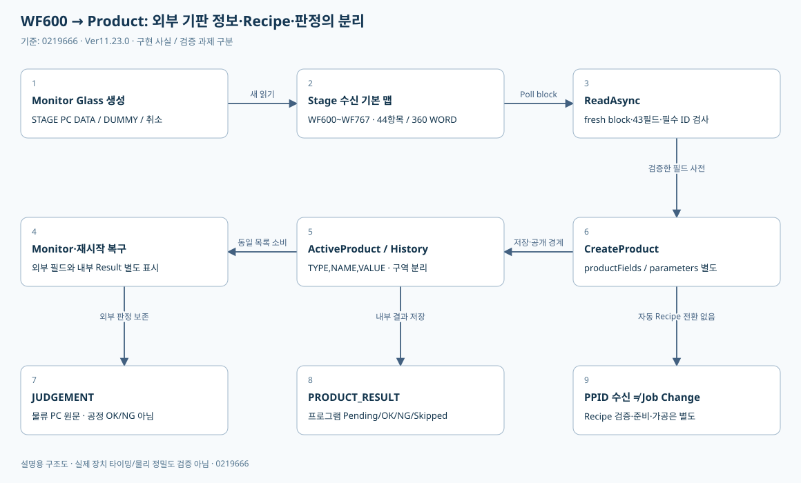
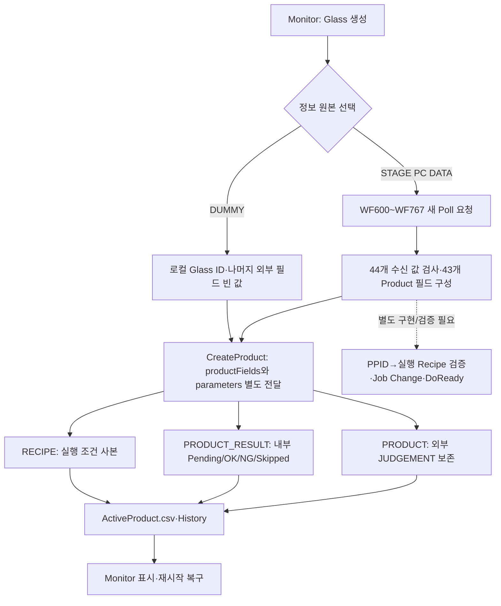

# 10. Stage Glass Data에서 Product까지: WF600·PPID·공정 판정의 분리

> 원본 `kjuws10-rgb/A3Drilling/master` · `0219666f9053b907d96d7e0aa7d0c6c1be3a73d4` · Ver11.23.0. 비교 기준은 `334b3599651b2e8e0181fd4459bafaf3cddafff3`이다. 실제 함수와 변경 diff를 정적으로 추적했다. 장비·PLC·벤더 DLL·시뮬레이터·가공 프로그램을 실행한 결과가 아니다.

**이번 변경은 물류 PC가 전달한 기판 정보를 Product에 넣는 통로를 추가한 것이다. PPID를 받았다는 것만으로 가공 Recipe 선택이나 Auto Job Change가 끝나는 것은 아니다.** Recipe 조건 사본, 외부 기판 정보, 프로그램 내부 공정 판정을 서로 구분해야 한다.

## 1. 새 생산자·소비자를 먼저 구분하기

| 역할 | 실제 코드 | 전달하는 내용 |
|---|---|---|
| 필드 정의 생산자 | `CStageGlassDataMap.Specs/CreateFields` | 이름·자료형·Word 길이·연속 주소·Product 이름 |
| JHMI 기본 맵 생산자 | `CMelsecMapFile.CreateStageGlassDataRows` | MELSEC 0, IN/R, Scale 1, Poll 1000 ms |
| 통신·캐시 생산자 | `CMelsec.RefreshCachedValueAsync/GetCachedSnapshot` | 실제 읽기 시도 결과·캐시 상태·갱신 시각 |
| 조립·검증 | `CStageGlassDataMap.ReadAsync` | 44개 수신 항목을 검사한 43개 문자열 필드 |
| UI 소비자 | `CMenuMonitor.CreateGlass` | STAGE/DUMMY 분기, 10초 읽기 제한, Product 생성 요청 |
| 상태 소비자 | `CProductManager.CreateProduct/CreateProductInfo` | 외부 정보와 Recipe 조건을 분리해 새 Product 구성 |
| 영속화 소비자 | `CProductFile` | `TYPE,NAME,VALUE` 형식의 PRODUCT/RECIPE 구역 분리 |
| 표시 소비자 | `CMenuMonitor.ApplyProductDetails` | Stage 필드 목록 + 별도 내부 공정 상태·결과 |

근거: [필드·주소 정의](https://github.com/kjuws10-rgb/A3Drilling/blob/0219666f9053b907d96d7e0aa7d0c6c1be3a73d4/Drilling.Common/Interface/Melsec/CStageGlassDataMap.cs#L5-L84), [기본 맵 생성](https://github.com/kjuws10-rgb/A3Drilling/blob/0219666f9053b907d96d7e0aa7d0c6c1be3a73d4/Drilling.File/JHMI/CMelsecMapFile.cs#L322-L343), [Product 생성 호출](https://github.com/kjuws10-rgb/A3Drilling/blob/0219666f9053b907d96d7e0aa7d0c6c1be3a73d4/Drilling.UI/Menu/Menus/CMenuMonitor.cs#L4429-L4496).

## 2. 43개 Product 필드와 44개 MELSEC 항목

코드는 `BaseWordAddress=0xF600`에서 시작해 각 필드의 Word 길이만큼 주소를 증가시킨다. 정의를 합산하면 **360 WORD = 720 byte**, 마지막 주소는 **WF767**이다. 아래는 실행 기록이 아닌 소스 정의의 구조이다. 실제 기판 ID·측정 레코드는 이 문서에 복제하지 않는다.

| 필드 | 코드 자료형·길이 | 해석 경계 |
|---|---|---|
| H_GLASSID, E_GLASSID, LOTID, BATCHID, JOBID | 각각 STRING 8 WORD | ASCII 최대 16 byte; H_GLASSID는 필수 |
| PORTID | STRING 2 WORD | 최대 4 byte |
| SLOTNO | STRING 1 WORD | 최대 2 byte |
| PRODUCT_TYPE, PRODUCT_KIND | 각각 STRING 2 WORD | 코드 문자열이며 내부 enum으로 강제 변환하지 않음 |
| PRODUCTID, RUNSPECID | 각각 STRING 8 WORD | 외부 식별자 |
| LAYERID, STEPID | 각각 STRING 4 WORD | 외부 식별자 |
| PPID, FLOWID | 각각 STRING 10 WORD | 최대 20 byte; Recipe 실행 검증은 별도 |
| GLASS_SIZE | WORD 2, SplitWords | `_1`, `_2` 두 수신 항목 → 쉼표로 결합한 한 필드 |
| GLASS_THICKNESS, GLASS_STATE | 각각 WORD 1 | 0~65535 정수의 문자열 표현 |
| GLASS_ORDER | STRING 2 WORD | 순서 코드 문자열 |
| COMMENT | STRING 8 WORD | ASCII 문자열 |
| USE_COUNT, JUDGEMENT, REASON_CODE | 각각 STRING 2 WORD | Stage가 제공한 값; 내부 공정 결과와 구분 |
| INS_FLAG, ENC_FLAG, PRERUN_FLAG, TURN_DIR, FLIP_STATE | 각각 STRING 1 WORD | 외부 플래그 문자열 |
| WORK_STATE | STRING 2 WORD | 외부 상태 문자열 |
| MULTI_USE, PAIR_GLASSID | 각각 STRING 8 WORD | 외부 정보 |
| PAIR_PPID | STRING 10 WORD | 연결 PPID 문자열 |
| OPTIONNAME1~5, OPTIONVALUE1~5 | 각각 STRING 20 WORD | 사용자 옵션 10개, 각각 최대 40 byte |
| ETC | STRING 16 WORD | 최대 32 byte |

필드 수가 43인데 맵 항목이 44인 이유는 `GLASS_SIZE` 한 필드만 두 WORD로 나누어 읽기 때문이다. `ST_STAGE_GLASS_DATA_MAP_FIELD.ComponentIndex`가 순서를 보존한다. `FormatValue`는 `InvariantCulture`로 숫자를 문자열로 바꾸고, `ReadAsync`는 같은 Product 이름의 구성 항목을 `","`로 연결한다. **GLASS_SIZE/THICKNESS를 mm로 환산하거나 축 방향을 결정하는 코드는 이 경로에 없다.** 고객 규격의 단위·Word 순서·문자열 길이를 별도로 확인해야 한다.

근거: [전체 Specs·공개 목록](https://github.com/kjuws10-rgb/A3Drilling/blob/0219666f9053b907d96d7e0aa7d0c6c1be3a73d4/Drilling.Common/Interface/Melsec/CStageGlassDataMap.cs#L26-L84), [주소 증가·SplitWords·문자열 조립](https://github.com/kjuws10-rgb/A3Drilling/blob/0219666f9053b907d96d7e0aa7d0c6c1be3a73d4/Drilling.Common/Interface/Melsec/CStageGlassDataMap.cs#L105-L157).

`CMelsecMapFile.EnsureFile`은 `JHMI_MELSEC_MAP.csv`가 이미 있으면 그대로 반환한다. 따라서 실행 파일만 교체했다고 기존 현장 맵에 새 44개 항목이 자동 추가되는 것은 아니다. 이번 Git의 맵 정의 변경과 현장 적용 파일을 별도로 대조해야 한다. [기존 파일 보존 경계](https://github.com/kjuws10-rgb/A3Drilling/blob/0219666f9053b907d96d7e0aa7d0c6c1be3a73d4/Drilling.File/JHMI/CMelsecMapFile.cs#L101-L111).

## 3. ReadAsync의 성공·실패 조건

1. 호출 시작과 새 읽기 요청에서 취소를 확인한다.
2. 첫 필드 `STAGE_GLASS_H_GLASSID`의 Poll Block을 새로 읽도록 `RefreshCachedValueAsync`를 기다린다.
3. 필요한 44개 ID의 캐시를 `_pollLock` 안에서 사전으로 복사한다. 이 사전 취득 자체는 추가 장치 읽기를 시작하지 않는다.
4. 한 항목이라도 없음·IsValid false·Value null이면 예외를 낸다. 메시지는 첫 다섯 항목까지만 요약하지만 나머지 항목도 실패 검사 대상이다.
5. 43개 필드를 조립한 뒤 H_GLASSID가 공백이면 생성하지 않는다. LOTID·PPID의 비공백을 같은 수준으로 강제하지는 않는다.
6. `ReadAt`은 유효 항목의 UpdatedAt 중 최댓값이다. 이것을 PLC의 거래 번호나 전체 필드의 동일 시각 증거로 해석하면 안 된다.

기본 맵은 같은 MELSEC 장치의 연속 W 주소·동일 Poll 간격이고, 720 byte는 코드의 단일 전송 상한 1920 byte 이내다. 따라서 기본 구성이 유지되면 같은 Poll Block으로 합쳐질 수 있다. **사용자 맵을 다른 장치·주소·간격으로 바꾸면 첫 필드 새로 읽기만으로 다른 모든 필드도 새 샘플이 되었다고 단정할 수 없다.** ReadAsync에는 모든 항목 UpdatedAt의 일치나 별도 Glass 거래 번호를 검사하는 조건이 없다. 또한 단일 통신 읽기와 물류 PC의 다중 필드 갱신 트랜잭션 일관성은 다르다.

근거: [ReadAsync 전체 검사](https://github.com/kjuws10-rgb/A3Drilling/blob/0219666f9053b907d96d7e0aa7d0c6c1be3a73d4/Drilling.Common/Interface/Melsec/CStageGlassDataMap.cs#L87-L123), [선택 캐시·읽기 갱신 대기](https://github.com/kjuws10-rgb/A3Drilling/blob/0219666f9053b907d96d7e0aa7d0c6c1be3a73d4/Drilling.Common/Interface/Melsec/CMelsec.cs#L2551-L2640), [Poll Block 합침](https://github.com/kjuws10-rgb/A3Drilling/blob/0219666f9053b907d96d7e0aa7d0c6c1be3a73d4/Drilling.Common/Interface/Melsec/CMelsec.cs#L2693-L2722).

## 4. Monitor에서 STAGE PC DATA와 DUMMY를 선택할 때

`ShowGlassDataSourceChoice`는 STAGE PC DATA/DUMMY/취소를 구분한다. 창 닫기나 취소를 DUMMY 생성으로 바꾸지 않는다. CreateGlass는 Monitor 쓰기 허용 조건을 먼저 검사하고, 현재 Product가 Completed가 아니면 새 Product 생성을 거부한다.

- **STAGE PC DATA**: 10초 CancellationTokenSource로 ReadAsync를 기다린다. Glass ID·Lot ID·PPID·43개 외부 필드가 새 Product에 들어간다. 읽기/검증 실패는 생성 실패 안내로 끝난다.
- **DUMMY**: 실제/SIM 상태에 따라 `DUMMY_...` 또는 `SIM_...` 로컬 ID만 만든다. Lot·PPID·외부 필드는 빈 값이며 현재 선택한 Recipe의 이름을 몰래 채우지 않는다.
- **두 경로 공통**: `CreateProduct`에 전달하는 `parameters`와 `headPointCounts`는 빈 사전이다. 이 버튼은 실행 Recipe 준비·Shot 계획·Head 배정·가공 시작 버튼이 아니다.

근거: [원본 선택 대화상자](https://github.com/kjuws10-rgb/A3Drilling/blob/0219666f9053b907d96d7e0aa7d0c6c1be3a73d4/Drilling.UI/Popup/CRecipeConfirmDialog.xaml.cs#L51-L73), [Monitor 생성 분기](https://github.com/kjuws10-rgb/A3Drilling/blob/0219666f9053b907d96d7e0aa7d0c6c1be3a73d4/Drilling.UI/Menu/Menus/CMenuMonitor.cs#L4429-L4496).

## 5. Product 정보와 Recipe 조건의 분리

`CreateProduct`의 마지막 선택 매개변수 `productFields`가 새로 생겼다. 전달하면 외부 정보의 입력으로 사용하고, 생략하면 기존 호출 호환을 위해 `parameters`에서 외부 필드를 찾는다. 하지만 `ST_PRODUCT_RECIPE_DATA`에는 계속 **parameters의 별도 사본**을 넣는다. 두 사전은 같은 의미가 아니다.

`HostWritableProductFieldNames`는 Stage 43개 이름에서 만들고, `ProductFieldNames`는 그 목록에 PROCESS_ID/PRODUCT_STATE/PRODUCT_RESULT/CREATED_AT/STARTED_AT/COMPLETED_AT/PROCESS_STEP을 더한다. 외부 입력이 내부 상태·공정 결과·생성 시각을 덮어쓰지 못하도록 CreateProductInfo가 내부 항목을 다시 설정한다. PPID 인자가 비어 있지 않을 때만 외부 사전의 PPID를 그 인자로 덮는다.

`CreateProduct`는 `_updateGate`로 직렬화하고, ActiveProduct 로드 실패 기록이 있거나 기존 미완료 Product가 있으면 새 생성을 거부한다. 성공 후 저장·공개·History 경계는 [기존 Product 생명주기](04-product-and-station-lifecycle.md)를 따른다.

근거: [CreateProduct의 새 매개변수·스냅샷](https://github.com/kjuws10-rgb/A3Drilling/blob/0219666f9053b907d96d7e0aa7d0c6c1be3a73d4/Drilling.Common/Product/CProductManager.cs#L129-L200), [필드 허용 목록·내부 상태 설정](https://github.com/kjuws10-rgb/A3Drilling/blob/0219666f9053b907d96d7e0aa7d0c6c1be3a73d4/Drilling.Common/Product/CProductManager.cs#L823-L878).

## 6. JUDGEMENT와 PRODUCT_RESULT를 혼동하지 않기

| 이름 | 이번 Commit에서의 의미 | 생성/전이 방식 |
|---|---|---|
| JUDGEMENT | 물류 PC가 전달한 외부 판정 문자열 | productFields에서 보관 |
| PRODUCT_RESULT | LD 프로그램의 내부 공정 결과 | 생성 시 PENDING, 상태 전이에서 OK/NG/SKIPPED 등 |
| PRODUCT_STATE | 내부 공정 상태 | Created/Running/Completed/Stopped/Error 등 |

`ST_PRODUCT_DATA.Result`는 PRODUCT_RESULT가 있으면 그것을 읽고, 비어 있으면 이전 ActiveProduct 호환을 위해 JUDGEMENT를 읽는다. **새 외부 JUDGEMENT가 곧 레이저 가공의 OK/NG라는 뜻은 아니다.** Monitor도 두 이름을 별도 항목으로 표시한다.

근거: [상태 쓰기와 이름 목록](https://github.com/kjuws10-rgb/A3Drilling/blob/0219666f9053b907d96d7e0aa7d0c6c1be3a73d4/Drilling.Common/Product/CProductManager.cs#L844-L878), [이전 결과 필드 읽기 호환](https://github.com/kjuws10-rgb/A3Drilling/blob/0219666f9053b907d96d7e0aa7d0c6c1be3a73d4/Drilling.Common/Product/CProductManager.cs#L1050-L1058), [Monitor 별도 결과 표시](https://github.com/kjuws10-rgb/A3Drilling/blob/0219666f9053b907d96d7e0aa7d0c6c1be3a73d4/Drilling.UI/Menu/Menus/CMenuMonitor.cs#L4613-L4630).

## 7. ActiveProduct CSV의 보존 구역

헤더 `TYPE,NAME,VALUE` 자체는 바뀌지 않는다. 다만 PRODUCT 구역의 이름 목록이 Stage 공통 정의와 내부 추가 필드로 통일된다. LoadCompactActive의 reservedNames와 저장 시 IsCompactProductCoreName도 같은 ProductFieldNames를 사용하므로, 외부 Glass 필드를 Recipe 조건으로 재분류하거나 중복 저장하지 않도록 한다. 기존 파일에 추가 필드가 없다면 빈 문자열로 정규화한다.

PRODUCT_RESULT가 없는 구형 파일의 Result fallback과 새 파일에 JUDGEMENT/PRODUCT_RESULT가 함께 있는 경우를 구분해 round-trip 확인해야 한다. 이 변경은 ReviewResult CSV·ReviewOffset CSV의 헤더 변경을 의미하지 않는다. 추적된 운영/보정 CSV가 많이 늘어난 것과 코드의 파일 형식 변경도 구분한다.

근거: [compact 로드·구역 분리](https://github.com/kjuws10-rgb/A3Drilling/blob/0219666f9053b907d96d7e0aa7d0c6c1be3a73d4/Drilling.File/Product/CProductFile.cs#L42-L92), [Product/Recipe 저장](https://github.com/kjuws10-rgb/A3Drilling/blob/0219666f9053b907d96d7e0aa7d0c6c1be3a73d4/Drilling.File/Product/CProductFile.cs#L100-L134), [공통 Core 이름 판정](https://github.com/kjuws10-rgb/A3Drilling/blob/0219666f9053b907d96d7e0aa7d0c6c1be3a73d4/Drilling.File/Product/CProductFile.cs#L386-L390).

## 8. MELSEC 그룹 표시와 SIM 입력

Monitor의 GROUP ComboBox는 `SelectedMelsecGroupOption`에 선택값을 보관한다. REFRESH 명령이 유효 그룹인지 검사한 뒤 `_selectedMelsecGroup`에 적용하고 PollingContext 갱신·RefreshMelsecNow·화면 재구성을 요청한다. 선택 대기 값과 실제 적용 필터를 구분해야 한다. 전체 맵 배열로 그룹/개수를 만들고 표시 행은 선택 그룹으로 제한한다.

SIM 화면은 STRING과 WORD를 값 입력 대상으로 구분한다. STRING은 ASCII·최대 `Length*2` byte, WORD는 0~65535 정수만 허용한다. `SetStageGlassDataSimulationValue`는 해당 MELSEC 장치가 SIMULATION일 때만 WriteSimulationValue를 호출한다. 실제 PLC에 Glass Data를 쓰는 신규 API가 아니다. 실패는 경고로 표시하며 `_pollLock`과 해당 Poll Block 갱신 요청을 사용한다.

근거: [그룹 선택 적용](https://github.com/kjuws10-rgb/A3Drilling/blob/0219666f9053b907d96d7e0aa7d0c6c1be3a73d4/Drilling.UI/Menu/Menus/CMenuMonitor.cs#L2912-L2941), [그룹/행 목록](https://github.com/kjuws10-rgb/A3Drilling/blob/0219666f9053b907d96d7e0aa7d0c6c1be3a73d4/Drilling.UI/Menu/Menus/CMenuMonitor.cs#L4283-L4355), [그룹 ComboBox와 REFRESH](https://github.com/kjuws10-rgb/A3Drilling/blob/0219666f9053b907d96d7e0aa7d0c6c1be3a73d4/Drilling.UI/Views/CMonitorView.xaml#L2926-L2986), [SIM 전용 값 설정](https://github.com/kjuws10-rgb/A3Drilling/blob/0219666f9053b907d96d7e0aa7d0c6c1be3a73d4/Drilling.Common/Interface/Melsec/CMelsec.cs#L3060-L3097), [SIM 행/문자열 입력](https://github.com/kjuws10-rgb/A3Drilling/blob/0219666f9053b907d96d7e0aa7d0c6c1be3a73d4/Drilling.UI/Popup/CMelsecStageSimulationDialog.xaml.cs#L254-L367), [입력 종류 XAML 연결](https://github.com/kjuws10-rgb/A3Drilling/blob/0219666f9053b907d96d7e0aa7d0c6c1be3a73d4/Drilling.UI/Popup/CMelsecStageSimulationDialog.xaml#L83-L104).

## 9. 아직 확인해야 하는 경계와 가상 검증 시나리오

이 목록은 앞으로 수행할 시험이며 이번 문서 작업에서 실행한 결과가 아니다.

1. 기본 44개 맵의 장치/주소/타입/길이/Poll 간격이 실제 고객 Spec0.13과 일치하는지 독립 규격으로 대조한다. 코드 주석의 Spec 번호만으로 규격 검증 완료라고 하지 않는다.
2. 모든 필드가 같은 새 샘플인지, 읽는 도중 Stage PC가 Glass 데이터를 바꾸는 경우 이전/새 기판이 섞이지 않는지 확인한다. 필요하다면 업무상 유효/완료 handshake나 버전 식별자를 별도 합의한다.
3. H_GLASSID 공백, 일부 캐시 invalid/stale, 통신 정지, 10초 취소에서 Product 생성과 기존 Active 파일이 유지되는지 확인한다.
4. ASCII 최대 길이·비ASCII·WORD 음수/65536·GLASS_SIZE 두 값 순서를 합성 입력으로 검사한다. 실제 운전 레코드를 문서/공유 저장소에 복제하지 않는다.
5. DUMMY/취소/완료 Glass 대체/미완료 Glass 생성 거부를 구분한다. DUMMY의 빈 PPID·빈 Recipe 조건을 유효한 가공 준비로 오인하지 않는다.
6. 구형 JUDGEMENT-only 파일과 새 두 판정 필드 파일을 저장·재로드해 외부 판정과 내부 Result가 분리되는지 확인한다.
7. 수신 PPID와 실행 Recipe/좌표·보정 파일·Job Change 요구가 다를 때 자동 실행하지 않도록 별도 연결 사양을 확인한다. 본 변경에는 그 전환 로직이 추가되지 않았다.

연관 상세장: [Product·Station](04-product-and-station-lifecycle.md), [장치 인터페이스](05-device-interfaces-and-drivers.md), [ReviewResult·Product 연결](../review/05_결과_Revision_Product_연결.md), [Recipe·CSV](02-recipe-settings-and-csv.md).

## 10. Stage 정보 저장과 가공 결과 연결은 별도 경계

Stage PC DATA는 외부 필드를 Product에 보관하는 입력 경로다. Monitor의 Glass 생성은 `CreateProduct`의 Process ID에 빈 문자열을 전달한다. 반면 Root의 가공 준비는 새 `SCAN-...-GUID` Process ID를 만들고 기존 Product에서는 Glass ID·Lot ID만 재사용한다. `GetCurrentProcessProductId`는 Product와 ProcessModel의 Process ID가 일치할 때만 기판 ID를 반환하며, 완료·정지 등의 Product 갱신은 이 ID가 없으면 저장 없이 반환하는 직접 경로가 있다. [Monitor Product 생성의 빈 Process ID](https://github.com/kjuws10-rgb/A3Drilling/blob/0219666f9053b907d96d7e0aa7d0c6c1be3a73d4/Drilling.UI/Menu/Menus/CMenuMonitor.cs#L4480-L4488) [새 SCAN Process ID와 기존 Glass/Lot만 재사용](https://github.com/kjuws10-rgb/A3Drilling/blob/0219666f9053b907d96d7e0aa7d0c6c1be3a73d4/Drilling.UI/CRootView.cs#L1641-L1653) [Process ID 일치 검사와 완료/정지 Product 갱신의 null 반환 경계](https://github.com/kjuws10-rgb/A3Drilling/blob/0219666f9053b907d96d7e0aa7d0c6c1be3a73d4/Drilling.Common/Station/CStationProcess.cs#L1415-L1516)

이는 `0219666`의 추적 가능한 C# 직접 호출 경로에서 확인한 기존 연결 공백이다. 이번 Stage 정보 입력 추가 때문에 새로 생긴 회귀라고 단정하지 않으며, 다른 런타임 호스트·Reflection 연결의 부재나 고객 설비에서 실제로 어떤 결과가 발생하는지까지 검증한 것은 아니다. Stage Glass 정보 저장 성공을 가공 상태·결과의 Product 연결 완료로 취급하지 말고 별도 확인해야 한다.
