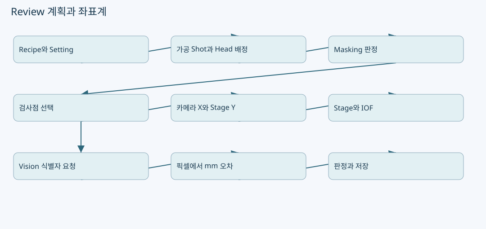
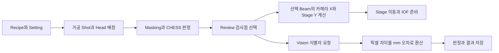

# Review 계획과 좌표계: 설계 Shot이 카메라 측정점이 되는 과정




원본: `kjuws10-rgb/A3Drilling` · `master` · `5aee8e58439c9b455cae7c9593c9be986c3e682e`

이 장의 **코드 확인**은 해당 Commit의 실제 함수 본문을 정적으로 추적한 사실입니다. **해설**은 그 구조를 이해하기 위한 설명이며, **검증 과제**는 앞으로 실행할 시험입니다. 실장비의 부호·광학 상태·통신 타이밍·정밀도가 검증되었다는 뜻은 아닙니다. 예시 숫자는 설명용 가상값입니다.

## 1. 처음 읽는 사람을 위한 핵심

Review 좌표는 한 함수가 Recipe의 X/Y를 그대로 Vision에 보내는 구조가 아닙니다. 먼저 **어느 Cell의 어느 Shot을 어느 Head가 가공하는지** 정하고, 해당 Shot에서 선택한 Beam의 위치를 더해 **카메라 X와 Stage Y 목표 위치**를 만듭니다. 이 목표 위치는 Stage 이동과 IOF 준비에 쓰입니다. Vision에는 별도의 식별자 요청을 보내며, Vision이 반환한 픽셀 차이를 mm 오차로 바꿉니다. 이 구분을 지켜야 CSV를 통신 패킷으로 오해하지 않습니다. [CReviewManager.cs:151–193](https://github.com/kjuws10-rgb/A3Drilling/blob/5aee8e58439c9b455cae7c9593c9be986c3e682e/Drilling.Common/Review/CReviewManager.cs#L151-L193) [CReviewManager.cs:1964–1994](https://github.com/kjuws10-rgb/A3Drilling/blob/5aee8e58439c9b455cae7c9593c9be986c3e682e/Drilling.Common/Review/CReviewManager.cs#L1964-L1994)



그림의 경로는 실제 호출 책임을 묶어 표현한 것입니다. Stage와 Vision은 서로 다른 수신자이며, 그림은 물리적 동시 실행 순서를 보장하는 타이밍 차트가 아닙니다.

## 2. 먼저 열어야 할 코드

| 진입점 | 입력 / 출력 | 읽어야 하는 이유 |
|---|---|---|
| `CreatePlanCore` | Recipe, Beam, 선택 방식, Shift → `ST_REVIEW_PLAN` | 일반 Review 계획의 공통 생성 경계. [CReviewManager.cs:456–507](https://github.com/kjuws10-rgb/A3Drilling/blob/5aee8e58439c9b455cae7c9593c9be986c3e682e/Drilling.Common/Review/CReviewManager.cs#L456-L507) |
| `BuildShotPoints` | Cell별 설계 패턴, Head 배정 → Point 목록 | 설계 위치·Head·선택 상태·제외 사유가 한 점에 결합된다. [CReviewManager.cs:634–730](https://github.com/kjuws10-rgb/A3Drilling/blob/5aee8e58439c9b455cae7c9593c9be986c3e682e/Drilling.Common/Review/CReviewManager.cs#L634-L730) |
| `CreateShotBeamPositionCalculator` | Recipe, Stage 방향, Shift → 계산 delegate | AUTO 등에서 각 Shot의 Beam 위치를 나중에 계산한다. [CReviewManager.cs:151–193](https://github.com/kjuws10-rgb/A3Drilling/blob/5aee8e58439c9b455cae7c9593c9be986c3e682e/Drilling.Common/Review/CReviewManager.cs#L151-L193) |
| `CalculateReviewTarget` | AK 상대 Shot, 카메라 AK, Beam local offset, Cell 회전, Stage 방향 → 목표 | 실제 좌표식을 확인할 곳. [CReviewManager.cs:954–974](https://github.com/kjuws10-rgb/A3Drilling/blob/5aee8e58439c9b455cae7c9593c9be986c3e682e/Drilling.Common/Review/CReviewManager.cs#L954-L974) |
| `CAutoFineReviewCoordinator.BuildPlan` | 동결한 자동검사 입력 → Fine line 계획 | AUTO는 별도 조건과 제외 규칙을 갖는다. [CAutoFineReviewCoordinator.cs:201–286](https://github.com/kjuws10-rgb/A3Drilling/blob/5aee8e58439c9b455cae7c9593c9be986c3e682e/Drilling.Common/Review/CAutoFineReviewCoordinator.cs#L201-L286) |

## 3. 좌표 이름을 분리해서 읽기

| 데이터 | 이 장에서의 뜻 | 주의할 점 |
|---|---|---|
| `DesignX/DesignY` | 설계 패턴에서 생성한 Shot 중심 | 카메라 실제 측정값이 아니다. |
| `BeamOffsetGx/Gy`, 선택 Beam local offset | 한 Shot 내 선택 Beam의 설계 위치 차이 | Cell 회전 후 카메라/Stage 목표로 옮긴다. |
| `ReviewTargetX` | Review 카메라 축의 목표 X | Scanner Gx와 같은 이름의 좌표로 취급하면 안 된다. |
| `ReviewTargetY` / `StageY` | Review 측정에 필요한 Stage Y 목표 | Stage 방향 부호가 적용된다. |
| `ErrorX/ErrorY` | 측정 결과에서 얻은 오차 | raw Vision 축과 flip 변환 후 축을 섞지 않는다. |
| `HeadNo, CellNo, ShotNo, BeamNo, ShotKey` | 점의 소속과 식별자 | 위치가 비슷해도 다른 식별자는 다른 검사점이다. |

표의 구성은 `BuildShotPoints`의 Point 생성 필드와 목표 계산기를 기준으로 합니다. 특히 `ST_REVIEW_BEAM_POSITION(beamNo, target.Y, target.X)`라는 생성자 호출은 인수 순서가 직관적 X/Y 순서와 다릅니다. 이후 사용처가 읽는 **이름 붙은 속성**까지 확인해야 합니다. [CReviewManager.cs:174–193](https://github.com/kjuws10-rgb/A3Drilling/blob/5aee8e58439c9b455cae7c9593c9be986c3e682e/Drilling.Common/Review/CReviewManager.cs#L174-L193) [CReviewManager.cs:695–730](https://github.com/kjuws10-rgb/A3Drilling/blob/5aee8e58439c9b455cae7c9593c9be986c3e682e/Drilling.Common/Review/CReviewManager.cs#L695-L730) [CAutoFineReviewCoordinator.cs:267–276](https://github.com/kjuws10-rgb/A3Drilling/blob/5aee8e58439c9b455cae7c9593c9be986c3e682e/Drilling.Common/Review/CAutoFineReviewCoordinator.cs#L267-L276)

## 4. 목표 위치 계산을 한 단계씩 풀어보기

`CreateShotBeamPositionCalculator`는 Recipe를 dictionary로 만들고 Pixel 크기, AK margin, Review 카메라의 AK 기준 위치를 읽습니다. Cell별 패턴 계산 결과는 `ConcurrentDictionary`에 보관하므로 같은 Cell을 반복 계산할 때 layout을 매번 새로 만들지 않습니다. Cell의 `CELLn_ROTATION`은 Beam local offset을 회전시키는 데 쓰입니다. [CReviewManager.cs:151–184](https://github.com/kjuws10-rgb/A3Drilling/blob/5aee8e58439c9b455cae7c9593c9be986c3e682e/Drilling.Common/Review/CReviewManager.cs#L151-L184)

코드의 순서를 수식으로 옮기면 다음과 같습니다. 이 수식의 부호는 소스 그대로이며, 장비별 축 방향을 임의로 추정한 것이 아닙니다. [CReviewManager.cs:179–193](https://github.com/kjuws10-rgb/A3Drilling/blob/5aee8e58439c9b455cae7c9593c9be986c3e682e/Drilling.Common/Review/CReviewManager.cs#L179-L193) [CReviewManager.cs:954–974](https://github.com/kjuws10-rgb/A3Drilling/blob/5aee8e58439c9b455cae7c9593c9be986c3e682e/Drilling.Common/Review/CReviewManager.cs#L954-L974)

```text
shotAK_X = DesignX − AK_MARGIN_X + shiftOffsetX
shotAK_Y = DesignY − AK_MARGIN_Y + shiftOffsetY
(beamX, beamY) = RotateLocalOffset(localBeamX, localBeamY, CellRotation)

ReviewX = REVIEW_CAMERA_ALIGN_KEY_POS_X + shotAK_X + beamX
StageY  = REVIEW_CAMERA_ALIGN_KEY_POS_Y
          + StageScanDirectionY × (shotAK_Y + beamY)
```

**해설:** AK margin은 설계 원점과 Align Key 기준의 차이를 옮기는 역할입니다. Stage 방향은 Y 이동의 부호를 바꾸는 별도 값입니다. Cell 회전은 Beam의 상대 위치를 회전시킵니다. 이 셋은 서로 다른 변환이므로 “Y가 반대로 보인다”는 이유만으로 Vision Flip이나 Head Flip을 추가하면 이중 반전이 생길 수 있습니다. 실제 Vision Flip 순서는 별도 함수에 명시되어 있습니다. [CReviewManager.cs:964–974](https://github.com/kjuws10-rgb/A3Drilling/blob/5aee8e58439c9b455cae7c9593c9be986c3e682e/Drilling.Common/Review/CReviewManager.cs#L964-L974) [CReviewManager.cs:3486–3512](https://github.com/kjuws10-rgb/A3Drilling/blob/5aee8e58439c9b455cae7c9593c9be986c3e682e/Drilling.Common/Review/CReviewManager.cs#L3486-L3512)

### 설명용 계산 예시

가상 입력이 `Design=(60,50) mm`, `AK margin=(55,45) mm`, `cameraAK=(100,200) mm`, 회전 후 Beam offset `(0.2,−0.1) mm`, Shift `(0,0)`, Stage 방향 `−1`이면 Review 목표는 `(105.2,195.1)`입니다. 이는 위 수식을 손으로 확인하기 위한 예시이며 현재 Recipe나 설비의 실측값이 아닙니다. 이 결과가 Scanner 명령 `(Gx,Gy)`와 같다는 결론은 내릴 수 없습니다.

## 5. Head 배정과 제외 상태가 좌표보다 먼저 필요한 이유

일반 계획은 runtime parameters로 만든 가공 Shot 계획에서 `(CellNo, CellShotNo)`별 Head를 가져옵니다. Review 화면이 독자적으로 Head 번호를 임의 할당하는 구조로 설명하면 안 됩니다. Masking/CHESS 제외는 `ShouldSkipLaser`로 결정되며 해당 Point에 제외 사유도 남길 수 있습니다. [CReviewManager.cs:456–525](https://github.com/kjuws10-rgb/A3Drilling/blob/5aee8e58439c9b455cae7c9593c9be986c3e682e/Drilling.Common/Review/CReviewManager.cs#L456-L525)

`BuildShotPoints`는 Head가 있고 제외되지 않은 점만 `Use`로 만들 수 있습니다. 좌표가 계산되어 화면에 존재한다는 사실과 이번 검사에서 사용한다는 사실은 다릅니다. 제외된 Shot이 맵에 보여도 자동 보정 대상에 포함된다는 뜻은 아닙니다. [CReviewManager.cs:695–730](https://github.com/kjuws10-rgb/A3Drilling/blob/5aee8e58439c9b455cae7c9593c9be986c3e682e/Drilling.Common/Review/CReviewManager.cs#L695-L730) [CMenuCorrection.ReviewData.Offset.cs:263–268](https://github.com/kjuws10-rgb/A3Drilling/blob/5aee8e58439c9b455cae7c9593c9be986c3e682e/Drilling.UI/Menu/Menus/CMenuCorrection.ReviewData.Offset.cs#L263-L268)

## 6. AUTO FINE에서 별도로 동결하는 내용

AUTO 계획은 매 실행마다 입력을 잡아 Recipe와 Setting을 합친 뒤, 사용할 dictionary를 동결합니다. 일반 AUTO Fine은 Setting이 Recipe의 같은 키를 덮고, ZeroLine Follow-up은 이미 동결된 키를 보존하는 분기가 있습니다. `SHIFT_OFFSET_X/Y`는 이 경로에서 명시적으로 `0.000000`으로 설정됩니다. 가공 AUTO 요청 준비 쪽도 Manual MOF Shift를 0으로 만듭니다. 따라서 **현재 코드에서 AUTO가 수동 Shift를 그대로 계승한다는 설명은 맞지 않습니다.** [CAutoFineReviewCoordinator.cs:209–224](https://github.com/kjuws10-rgb/A3Drilling/blob/5aee8e58439c9b455cae7c9593c9be986c3e682e/Drilling.Common/Review/CAutoFineReviewCoordinator.cs#L209-L224) [CStationProcess.cs:3983–3994](https://github.com/kjuws10-rgb/A3Drilling/blob/5aee8e58439c9b455cae7c9593c9be986c3e682e/Drilling.Common/Station/CStationProcess.cs#L3983-L3994)

AUTO는 Beam11을 기준으로 선택하고, 선택된 line의 점마다 계산기를 호출해 `ReviewX/StageY`를 채웁니다. 줄마다 진행 방향을 번갈아 바꾸는 정렬이 있습니다. 이는 점 순서의 snake 정렬이지, 임의의 Masking 형상을 우회하는 2차원 경로 탐색을 의미하지 않습니다. [CAutoFineReviewCoordinator.cs:234–276](https://github.com/kjuws10-rgb/A3Drilling/blob/5aee8e58439c9b455cae7c9593c9be986c3e682e/Drilling.Common/Review/CAutoFineReviewCoordinator.cs#L234-L276)

## 7. 실행과 저장 경계에서 다시 하는 검증

1. 계획 생성 때 Beam 범위, 유효 layout, 유한한 목표좌표를 확인합니다. NaN/Infinity가 이동 명령까지 내려가지 않게 하는 경계입니다. [CReviewManager.cs:151–193](https://github.com/kjuws10-rgb/A3Drilling/blob/5aee8e58439c9b455cae7c9593c9be986c3e682e/Drilling.Common/Review/CReviewManager.cs#L151-L193)
2. Fine 실행은 중복 실행을 막는 sequence lock을 잡고 Stage motion 소유권을 엽니다. 실제 Vision 상태인데 외부 simulationMeasurement를 주는 것은 거부합니다. [CReviewManager.cs:2521–2569](https://github.com/kjuws10-rgb/A3Drilling/blob/5aee8e58439c9b455cae7c9593c9be986c3e682e/Drilling.Common/Review/CReviewManager.cs#L2521-L2569)
3. AUTO 결과 저장 전에는 Recipe ID, 검사점 개수, `(ShotKey, Head, Cell, Shot, Beam)`의 집합을 다시 확인합니다. 재시도로 순서가 뒤집힐 수 있으므로 배열 위치만 비교하지 않습니다. [CAutoFineReviewCoordinator.cs:169–196](https://github.com/kjuws10-rgb/A3Drilling/blob/5aee8e58439c9b455cae7c9593c9be986c3e682e/Drilling.Common/Review/CAutoFineReviewCoordinator.cs#L169-L196)
4. 정상 검사로 끝나지 않았거나 결과 파일 저장 오류가 있으면 자동 보정 저장으로 진행하지 않습니다. 화면에 숫자가 보이는 것만으로 보정이 완료된 것이 아닙니다. [CAutoFineReviewCoordinator.cs:43–75](https://github.com/kjuws10-rgb/A3Drilling/blob/5aee8e58439c9b455cae7c9593c9be986c3e682e/Drilling.Common/Review/CAutoFineReviewCoordinator.cs#L43-L75)

## 8. 코드에 주석을 달 때 설명해야 할 부분

| 코드 구간 | 필요한 주석의 내용 |
|---|---|
| 목표 계산 인수 | “설계 절대좌표를 AK 상대거리로 옮긴 다음 선택 Beam local offset을 더한다.” |
| tuple/record 인수 | “이 반환 타입은 StageY와 ReviewX의 인수 순서가 X/Y 직관과 다르므로 사용 속성으로 확인한다.” |
| AUTO Shift 0 | “사용자 수동 MOF Shift와 AUTO 요청을 분리하는 현재 정책이다. 요구 변경 시 가공과 Review 양쪽을 함께 변경해야 한다.” |
| Identity 검증 | “역방향 재시도에서도 점 소속을 보존하기 위해 순서 대신 식별자를 비교한다.” |

이 표는 **문서 주석 제안**입니다. 원본 소스에 주석을 추가하거나 코드를 변경하지 않았습니다.

## 9. 검증 과제

| 시험 입력 | 관찰할 값 | 기대 기준 / 실패 신호 |
|---|---|---|
| Cell 회전 0°/90°/180° | local Beam offset과 최종 목표 | 같은 Shot 중심에 대해 Beam 상대위치만 회전하며 수식과 일치. |
| Stage 방향 ±1 | ReviewX, StageY | X는 동일하고 Y 상대거리의 부호가 소스 수식대로 바뀐다. |
| 수동 Shift 1 mm 후 일반 계획 / AUTO 계획 | Plan metadata와 실제 목표 | 일반 계획의 명시적 인수와 AUTO 0 동결 정책을 구분한다. |
| Head 미배정 Shot | HeadNo, Use, 제외 사유 | 좌표 존재와 검사 사용 여부가 구분된다. |
| 결과 두 점의 순서만 교환 | Identity 검증 | 동일 집합은 허용할 수 있으나 누락·중복·다른 Beam 치환은 거부한다. |
| 목표 NaN/Infinity | 예외와 Stage 요청 발생 여부 | 이동 전 거부되어야 한다. |

위 시험은 제안이며 이 문서 작성 과정에서 장비 이동이나 Vision 측정을 실행하지 않았습니다.
