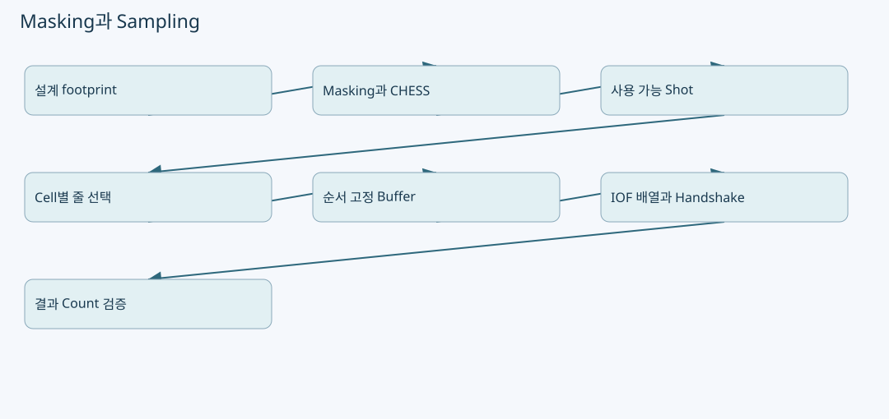
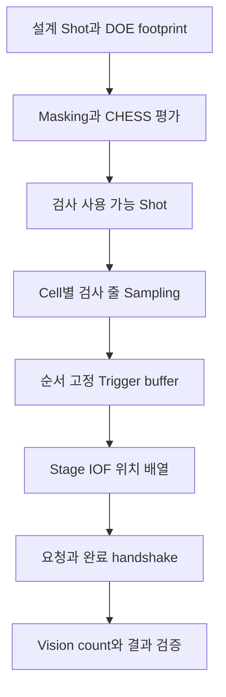

# Masking·Sampling·IOF: 검사점 제외와 실제 이동을 구별하기

원본: `kjuws10-rgb/A3Drilling` · `master` · `5aee8e58439c9b455cae7c9593c9be986c3e682e`

이 장의 **코드 확인**은 해당 Commit의 실제 함수 본문을 정적으로 추적한 사실입니다. **해설**은 그 구조를 이해하기 위한 설명이며, **검증 과제**는 앞으로 실행할 시험입니다. 실장비의 부호·광학 상태·통신 타이밍·정밀도가 검증되었다는 뜻은 아닙니다. 예시 숫자는 설명용 가상값입니다.

## 1. 서로 다른 세 가지 문제

**Masking 판정**은 어느 설계 Shot이 사용 금지 영역과 겹치는지 정하는 문제입니다. **Sampling**은 사용 가능한 Shot 중 어느 줄·점을 검사할지 고르는 문제입니다. **IOF 준비**는 선택된 순서의 위치를 Stage에 넘겨 Trigger 동작을 준비하는 문제입니다. 세 기능의 입력과 출력이 다르므로 “Masking 반영됨”이라는 한 문장만으로 실제 경로가 마스크를 물리적으로 지나지 않는다고 판단하면 안 됩니다. [CShotCoordinatePlanBuilder.cs:853–910](https://github.com/kjuws10-rgb/A3Drilling/blob/5aee8e58439c9b455cae7c9593c9be986c3e682e/Drilling.Common/Recipe/CShotCoordinatePlanBuilder.cs#L853-L910) [CReviewRulePlanBuilder.cs:361–401](https://github.com/kjuws10-rgb/A3Drilling/blob/5aee8e58439c9b455cae7c9593c9be986c3e682e/Drilling.Common/Review/CReviewRulePlanBuilder.cs#L361-L401) [CStageReviewSequences.cs:742–805](https://github.com/kjuws10-rgb/A3Drilling/blob/5aee8e58439c9b455cae7c9593c9be986c3e682e/Drilling.Common/Station/CStageReviewSequences.cs#L742-L805)

## 2. Masking이 참조하는 기준 좌표

`CRecipeShotMaskingPlan.Build`는 모델별 Pixel 크기, ProcessPitch, 분기 수, Masking hole, edge 조건을 준비합니다. 코드 상수는 모델 최대 5종, hole 최대 3개입니다. 그룹 피치와 Beam 피치는 `groupPitch = pixelSize × ProcessPitch`, `beamPitch = groupPitch / splitBeamCount`로 계산합니다. 이 수치는 실제 광학 측정 피치가 아니라 Recipe에서 구성한 footprint입니다. [CShotCoordinatePlanBuilder.cs:788–850](https://github.com/kjuws10-rgb/A3Drilling/blob/5aee8e58439c9b455cae7c9593c9be986c3e682e/Drilling.Common/Recipe/CShotCoordinatePlanBuilder.cs#L788-L850)

`EvaluateShot`의 핵심은 **설계 좌표 기준 불변성**입니다. Recipe/Default/FirstBeam/Align/Review/Shift의 보정값이나 Head flip을 바꿨다고 동일 Shot의 Masking 결과가 달라지면 안 된다는 주석이 있습니다. local 중심은 `GroupColumn × GroupPitch`, `GroupRow × GroupPitch`입니다. 각 Beam을 작은 사각 footprint로 만들고 hole과의 교차 또는 edge 이탈을 검사합니다. [CShotCoordinatePlanBuilder.cs:853–910](https://github.com/kjuws10-rgb/A3Drilling/blob/5aee8e58439c9b455cae7c9593c9be986c3e682e/Drilling.Common/Recipe/CShotCoordinatePlanBuilder.cs#L853-L910)

| 입력 | 실제 사용 목적 | 혼동하면 안 되는 것 |
|---|---|---|
| `SPLITED_BEAM_COUNT` | 가로·세로 Beam 격자 루프 수 | 전체 Beam 총 개수와 혼동 금지. 4라면 루프는 4×4. |
| `MODELn_MASKING_HOLE_NUMBER` 및 위치·크기 | hole 사각형 목록 | 카메라가 실시간 검출한 결함 맵이 아니다. |
| edge offset | 유효 가공 가장자리 범위 | Stage travel soft limit가 아니다. |
| `CHESS` / `CHESS_TYPE` | 그룹 row/column의 주기적인 사용 여부 | Masking hole과는 별도 제외 이유다. |
| `BeamNumbers` | 마스크와 겹친 Beam 번호 목록 | 이번 Review에서 고른 Beam11 하나만의 결과가 아니다. |

필드의 계산 근거는 모델 구성과 Beam 루프, CHESS 판정입니다. [CShotCoordinatePlanBuilder.cs:813–850](https://github.com/kjuws10-rgb/A3Drilling/blob/5aee8e58439c9b455cae7c9593c9be986c3e682e/Drilling.Common/Recipe/CShotCoordinatePlanBuilder.cs#L813-L850) [CShotCoordinatePlanBuilder.cs:881–947](https://github.com/kjuws10-rgb/A3Drilling/blob/5aee8e58439c9b455cae7c9593c9be986c3e682e/Drilling.Common/Recipe/CShotCoordinatePlanBuilder.cs#L881-L947)

## 3. 한 Beam이라도 겹치면 Shot 사용은 어떻게 되는가

`ST_RECIPE_SHOT_MASKING_RESULT.IsMasked`는 `BeamNumbers.Count > 0`이고, `ShouldSkipLaser`는 `IsMasked || IsChessSkipped`입니다. AUTO Review 계획은 이 값이 참인 Shot을 사용하지 않습니다. 따라서 현재 이 경로의 Review 제외 기준은 “검사 Beam11의 중심만 hole 밖이면 허용”이 아니라 **Shot footprint 평가 결과 전체**입니다. [CShotCoordinatePlanBuilder.cs:767–785](https://github.com/kjuws10-rgb/A3Drilling/blob/5aee8e58439c9b455cae7c9593c9be986c3e682e/Drilling.Common/Recipe/CShotCoordinatePlanBuilder.cs#L767-L785) [CAutoFineReviewCoordinator.cs:224–244](https://github.com/kjuws10-rgb/A3Drilling/blob/5aee8e58439c9b455cae7c9593c9be986c3e682e/Drilling.Common/Review/CAutoFineReviewCoordinator.cs#L224-L244)

**검토 포인트:** HIAA/Round라는 현장 용어 자체가 임의 원형 path solver를 뜻하지 않습니다. 현재 검토한 evaluator는 모델 hole 사각형과 edge 구성을 이용합니다. 현장에 필요한 곡선 경계가 해당 Recipe 표현으로 충분한지, 실제 Masking 도형이 어떤 키로 전달되는지는 별도 설계 확인이 필요합니다. 원·곡선 장애물을 정확히 따라 피해가는 알고리즘이 구현되었다고 확대 설명하지 않습니다. [CShotCoordinatePlanBuilder.cs:928–974](https://github.com/kjuws10-rgb/A3Drilling/blob/5aee8e58439c9b455cae7c9593c9be986c3e682e/Drilling.Common/Recipe/CShotCoordinatePlanBuilder.cs#L928-L974)

잘못된 hole 크기나 유한하지 않은 값은 `BuildModel`에서 건너뛰는 분기가 있습니다. 데이터 오입력으로 의도한 마스크가 사라지는 상황을 잡으려면 UI 또는 Recipe 검증에서 별도 오류 표시가 필요한지 검토해야 합니다. “무시됨”은 “안전하게 전부 차단됨”과 다릅니다. [CShotCoordinatePlanBuilder.cs:928–947](https://github.com/kjuws10-rgb/A3Drilling/blob/5aee8e58439c9b455cae7c9593c9be986c3e682e/Drilling.Common/Recipe/CShotCoordinatePlanBuilder.cs#L928-L947)

## 4. FINE 줄 선택의 실제 단위

`BuildFineFromCellSource`는 Head가 배정된 점이 있는 Cell별 범위를 만듭니다. 줄 수는 해당 범위의 row 수와 최대 7줄 사이에서 제한됩니다. 한 줄이면 중앙, 여러 줄이면 최소·최대 Y 사이에 균등한 목표 Y를 잡고, 가까운 row 및 인접 row 후보를 확인합니다. 선택한 row에서 Head가 있고 좌표가 유한한 점을 모은 뒤 ShotKey 중복을 제거합니다. [CReviewRulePlanBuilder.cs:361–401](https://github.com/kjuws10-rgb/A3Drilling/blob/5aee8e58439c9b455cae7c9593c9be986c3e682e/Drilling.Common/Review/CReviewRulePlanBuilder.cs#L361-L401)

**해설:** 이는 row Sampling입니다. “첫 줄이 막혔으면 다음 유효 row로 바꾸는가”, “마스크를 모두 피하면서 세 줄의 높이 간격을 최적화하는가”, “선택 Beam만 유효한 점을 허용하는가”는 서로 다른 요구입니다. 이 함수 하나를 보고 세 요구가 모두 충족되었다고 판단할 수 없습니다. AUTO 계획은 나중에 `Use` 점과 선택 키를 결합하고 실제 line을 만듭니다. [CAutoFineReviewCoordinator.cs:244–281](https://github.com/kjuws10-rgb/A3Drilling/blob/5aee8e58439c9b455cae7c9593c9be986c3e682e/Drilling.Common/Review/CAutoFineReviewCoordinator.cs#L244-L281)

## 5. IOF에 보내는 위치는 Vision의 1001 식별자와 다르다

`CStageReviewSequences.PrepareIof`의 입력은 **순서가 있는 `ST_STAGE_IOF_POINT` 목록**입니다. 빈 배열, 비유한 X/Y, 일반 IOF 500점 초과를 거부합니다. zero-line은 점 수가 2 또는 4여야 합니다. Review X 전용 motion owner가 IOF buffer를 쓰는 것도 금지합니다. [CStageReviewSequences.cs:742–761](https://github.com/kjuws10-rgb/A3Drilling/blob/5aee8e58439c9b455cae7c9593c9be986c3e682e/Drilling.Common/Station/CStageReviewSequences.cs#L742-L761)

| 준비 단계 | 코드가 하는 일 | 왜 필요한가 |
|---|---|---|
| 사전 상태 확인 | 이전 Start/ACK가 0인지, Stage가 정지인지 확인 | 직전 요청 완료 비트가 남은 상태를 새 요청의 응답으로 오인하지 않기 위해. |
| 설정·개수 기록 | 일반/zero-line 설정과 별도 count key 기록 | 같은 배열을 다른 의미로 읽지 않게 한다. |
| 배열 구성 | 일반은 `points.Select(p => p.X)`, zero-line은 `p.Y` | **zero-line을 `[Y…][X…]`로 묶는 옛 방식이 아니다.** |
| Route 검증 | `IOF_POS_ARRAY_1`의 Double 타입과 용량 확인 | WORD 정수 배열로 잘못 쓰거나 용량을 넘지 않게 한다. |
| readback | 기록 값과 읽은 값의 오차가 `0.000051`보다 크면 실패 | 쓰기 함수 호출 성공과 실제 데이터 확인을 구분한다. |
| Start 요청 | 동결한 계획을 소유 상태로 보관하고 요청·완료 wait | 그 시도의 순서와 데이터가 끝까지 같은지 보장한다. |

표의 논리 이름과 검증 수치는 소스의 현재 구현 기준입니다. 실제 현장 주소는 해당 버전의 MELSEC map과 장비 사양을 같이 확인해야 합니다. 소스 주석에는 요청 `W8238`, 완료 `WC13C`, ACK `W823A`가 나오지만 주소 고정 사실을 모든 설비에 일반화하지 않습니다. [CStageReviewSequences.cs:753–805](https://github.com/kjuws10-rgb/A3Drilling/blob/5aee8e58439c9b455cae7c9593c9be986c3e682e/Drilling.Common/Station/CStageReviewSequences.cs#L753-L805)

## 6. 재시도 때 배열과 결과를 맞추는 방법

Fine flying은 시도마다 새 `triggerBuffer`를 만듭니다. 해당 배열로 IOF를 준비하고, 같은 순서로 `FLYING_READY`를 전송한 뒤 끝점으로 이동합니다. `FLYING_MOVE_DONE`의 count mismatch가 발생하면 허용된 조건에서 순서를 뒤집어 재시도합니다. 이때 실패 시도의 `1003`을 요청하지 않는 분기가 있습니다. [CReviewManager.cs:2651–2702](https://github.com/kjuws10-rgb/A3Drilling/blob/5aee8e58439c9b455cae7c9593c9be986c3e682e/Drilling.Common/Review/CReviewManager.cs#L2651-L2702)

수신 결과 개수는 그 시도의 frozen buffer 개수와 일치해야 합니다. 측정 결과를 현재 화면 정렬이나 Recipe 전체 목록에 순서대로 붙이면 재시도 후 다른 Shot에 오차를 넣을 수 있습니다. 저장 전에는 coordinator가 식별자 집합을 다시 검증합니다. [CReviewManager.cs:2705–2736](https://github.com/kjuws10-rgb/A3Drilling/blob/5aee8e58439c9b455cae7c9593c9be986c3e682e/Drilling.Common/Review/CReviewManager.cs#L2705-L2736) [CAutoFineReviewCoordinator.cs:169–196](https://github.com/kjuws10-rgb/A3Drilling/blob/5aee8e58439c9b455cae7c9593c9be986c3e682e/Drilling.Common/Review/CAutoFineReviewCoordinator.cs#L169-L196)

## 7. 원하는 개선사항을 검증 가능한 요구로 바꾸기

| 요구 | 현재 확인한 근거 | 추가로 확인할 기준 |
|---|---|---|
| Masking 영역에서는 Trigger 미발생 | 사용 점 제외·IOF buffer 경로 존재 | 실제 최종 buffer에 제외 Shot이 없는지 확인. |
| Stage 경로 자체도 Masking 구간 회피 | 점 선택과 직선 이동만으로는 입증 불가 | 시작점~끝점 선분·전환 구간·Trigger window를 함께 기록. |
| 첫/중앙/마지막 줄이 막히면 유효 줄 대체 | row 선택과 Use 필터를 조합해 확인해야 함 | 줄별 예정/선택/제외 점 수와 대체 이유를 표시. |
| 모든 대상이 마스크인 Cell | 빈 line 또는 전체 검사점 부족 가능 | 조용히 성공하지 않고 명확한 불가 사유를 내야 함. |
| Trigger count 누락 | 1002 NCK 분기 있음 | 허용 재시도 횟수와 전체 보정 미적용을 확인. |

## 8. 권장 시험표 — 아직 실행하지 않은 검증 과제

1. 단일 Shot의 첫 Beam footprint만 hole에 걸리게 만든 가상 Recipe로 `BeamNumbers`, `ShouldSkipLaser`, 최종 `Use`를 순서대로 확인합니다. Beam11이 멀쩡해도 Shot 제외가 되는 현재 정책을 확인하는 시험입니다.
2. 보정값을 크게 바꾸되 설계 패턴은 유지합니다. Masking 결과는 같아야 하고 Scanner 최종 좌표만 바뀌어야 합니다.
3. 첫 줄 전체를 가리고 중앙·끝줄은 남긴 뒤 요청 줄 수와 실제 선택 줄 수, 검사점 수를 기록합니다. 요구한 세 줄이 유지되지 않는다면 자동 대체 정책을 별도로 정의합니다.
4. 500점과 501점, zero-line 2/4/3점, readback 오차 경계값을 시험합니다. 실장비 없이 mock route로 먼저 검증할 수 있습니다.
5. 정방향 첫 시도 count mismatch 후 역방향 재시도를 만들고, 각 ShotKey가 정확히 자기 결과를 받는지 확인합니다.
6. Stage의 실제 이동 경로를 검증할 때는 Trigger off만 보고 통과시키지 말고 encoder 경로와 유효 Trigger 위치를 함께 비교합니다.

마지막 6번은 물리 동작 평가가 필요한 항목이며, 이 문서에서 안전성이나 현장 통과를 판정하지 않았습니다.
