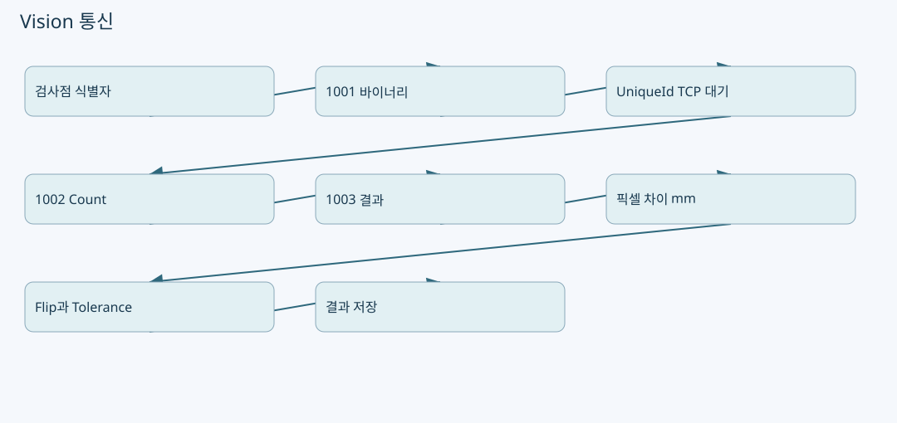

# Vision 통신: 1001 식별자 패킷, 1003 수신값, 픽셀→mm 오차




원본: `kjuws10-rgb/A3Drilling` · `master` · `5aee8e58439c9b455cae7c9593c9be986c3e682e`

이 장의 **코드 확인**은 해당 Commit의 실제 함수 본문을 정적으로 추적한 사실입니다. **해설**은 그 구조를 이해하기 위한 설명이며, **검증 과제**는 앞으로 실행할 시험입니다. 실장비의 부호·광학 상태·통신 타이밍·정밀도가 검증되었다는 뜻은 아닙니다. 예시 숫자는 설명용 가상값입니다.

## 1. 자주 생기는 오해부터 바로잡기

`ReviewResult.csv`나 `PROCESS_COORDINATES.csv`는 파일 저장 형식입니다. 실제 Vision TCP 전송은 `CVisionComm.Execute → ParseRequest → SendRequest → SendPacket → CVisionProtocol.Encode → NetworkStream.WriteAsync` 경로입니다. 가공·Review 좌표가 파일에 저장된다는 사실은 해당 CSV 행을 Vision에 그대로 보낸다는 근거가 되지 않습니다. [CVisionComm.cs:93–123](https://github.com/kjuws10-rgb/A3Drilling/blob/5aee8e58439c9b455cae7c9593c9be986c3e682e/Drilling.Common/Interface/Vision/CVisionComm.cs#L93-L123) [CVisionComm.cs:272–337](https://github.com/kjuws10-rgb/A3Drilling/blob/5aee8e58439c9b455cae7c9593c9be986c3e682e/Drilling.Common/Interface/Vision/CVisionComm.cs#L272-L337)

실제 좌표 이동 연결은 `CReviewStageMotion.MoveAndWait`에서 `ReviewTargetX/Y`를 Stage session으로 넘기며, Flying 준비는 같은 값으로 `ST_STAGE_IOF_POINT` 배열을 만듭니다. 이 경로와 TCP의 식별자 payload는 서로 다른 출력입니다. [CReviewManager.cs:2408–2411](https://github.com/kjuws10-rgb/A3Drilling/blob/5aee8e58439c9b455cae7c9593c9be986c3e682e/Drilling.Common/Review/CReviewManager.cs#L2408-L2411)


## 2. 실제 코드 경계를 찾는 순서

| 위치 | 책임 | 개발할 때 확인할 질문 |
|---|---|---|
| `CReviewManager.CreateFlyingReadyCommand` | Point를 Vision 검색 식별자로 직렬화하기 전 command 구성 | 어떤 Cell/Beam/row/column/Head를 요청하는가? [CReviewManager.cs:1964–1994](https://github.com/kjuws10-rgb/A3Drilling/blob/5aee8e58439c9b455cae7c9593c9be986c3e682e/Drilling.Common/Review/CReviewManager.cs#L1964-L1994) |
| `CVisionComm.Execute` | 문자열 명령을 packet으로 바꾸고 송수신 | UniqueId, line capacity를 언제 정하는가? [CVisionComm.cs:93–123](https://github.com/kjuws10-rgb/A3Drilling/blob/5aee8e58439c9b455cae7c9593c9be986c3e682e/Drilling.Common/Interface/Vision/CVisionComm.cs#L93-L123) |
| `CVisionProtocol.CreateFlyingReady` | 헤더 외 body layout 구성 | 사용 slot과 미사용 slot을 어떻게 채우는가? [CVisionComm.cs:576–594](https://github.com/kjuws10-rgb/A3Drilling/blob/5aee8e58439c9b455cae7c9593c9be986c3e682e/Drilling.Common/Interface/Vision/CVisionComm.cs#L576-L594) |
| `SendRequest` | 응답 Task, timeout, command 검증 | 다른 요청의 응답을 받을 수 없는가? [CVisionComm.cs:272–308](https://github.com/kjuws10-rgb/A3Drilling/blob/5aee8e58439c9b455cae7c9593c9be986c3e682e/Drilling.Common/Interface/Vision/CVisionComm.cs#L272-L308) |
| `SendPacket` / `ReadPacket` | 네트워크 byte 송수신 | partial read, 쓰기 동시성, 길이 검증을 처리하는가? [CVisionComm.cs:311–337](https://github.com/kjuws10-rgb/A3Drilling/blob/5aee8e58439c9b455cae7c9593c9be986c3e682e/Drilling.Common/Interface/Vision/CVisionComm.cs#L311-L337) |
| `CreateVisionMeasurement` | 응답 숫자 해석과 mm 오차 생성 | found 신호와 tolerance 판정이 같은 것인가? [CReviewManager.cs:2173–2197](https://github.com/kjuws10-rgb/A3Drilling/blob/5aee8e58439c9b455cae7c9593c9be986c3e682e/Drilling.Common/Review/CReviewManager.cs#L2173-L2197) |

## 3. 16바이트 공통 헤더

현재 `CVisionProtocol.HeaderSize`는 16이고, 인코더가 아래 순서로 Int32를 기록합니다. Int32는 little-endian reader와 대응합니다. 헤더의 DataLength와 실제 body 길이가 다르면 전송 전에 예외가 납니다. [CVisionComm.cs:558–559](https://github.com/kjuws10-rgb/A3Drilling/blob/5aee8e58439c9b455cae7c9593c9be986c3e682e/Drilling.Common/Interface/Vision/CVisionComm.cs#L558-L559) [CVisionComm.cs:643–667](https://github.com/kjuws10-rgb/A3Drilling/blob/5aee8e58439c9b455cae7c9593c9be986c3e682e/Drilling.Common/Interface/Vision/CVisionComm.cs#L643-L667) [CVisionComm.cs:984–985](https://github.com/kjuws10-rgb/A3Drilling/blob/5aee8e58439c9b455cae7c9593c9be986c3e682e/Drilling.Common/Interface/Vision/CVisionComm.cs#L984-L985)

| byte offset | 크기 | 필드 | 뜻 |
|---:|---:|---|---|
| 0 | 4 | Command | 예: Flying Ready 1001 |
| 4 | 4 | DataLength | body byte 수; 전체 packet 길이가 아니다. |
| 8 | 4 | UniqueId | 요청과 응답을 연결하는 ID |
| 12 | 4 | ErrorCode | 통신 응답의 오류 코드 |
| 16 | DataLength | Body | command마다 다른 구조 |

`ReadPacket`은 헤더를 정확한 byte 수만큼 읽고 DataLength를 해석한 다음 body를 다시 정확히 읽습니다. TCP에서 한 번의 `ReadAsync`가 한 packet과 일치한다는 가정을 하지 않습니다. 이는 패킷이 두 번에 나눠 들어오는 상황을 다루기 위한 기본 경계입니다. [CVisionComm.cs:329–337](https://github.com/kjuws10-rgb/A3Drilling/blob/5aee8e58439c9b455cae7c9593c9be986c3e682e/Drilling.Common/Interface/Vision/CVisionComm.cs#L329-L337)

## 4. 1001 Flying Ready는 mm X/Y 배열이 아니다

`ST_VISION_MARK_SEARCH`는 여섯 정수 `Cell, Doe, Line, IndexX, IndexY, Head`입니다. 레코드 크기는 24바이트입니다. `Doe` 필드에는 Review command builder가 `point.BeamNo`를 넣습니다. 현재 builder는 ShotNo를 PixelCountX로 나눠 1기반 row/column을 만들고 `Line`과 `IndexY` 양쪽에 row index를 넣습니다. 이를 mm좌표라고 설명하면 payload와 Stage 이동을 동시에 잘못 이해하게 됩니다. [CVisionComm.cs:530–548](https://github.com/kjuws10-rgb/A3Drilling/blob/5aee8e58439c9b455cae7c9593c9be986c3e682e/Drilling.Common/Interface/Vision/CVisionComm.cs#L530-L548) [CReviewManager.cs:1987–1994](https://github.com/kjuws10-rgb/A3Drilling/blob/5aee8e58439c9b455cae7c9593c9be986c3e682e/Drilling.Common/Review/CReviewManager.cs#L1987-L1994) [CVisionComm.cs:955–975](https://github.com/kjuws10-rgb/A3Drilling/blob/5aee8e58439c9b455cae7c9593c9be986c3e682e/Drilling.Common/Interface/Vision/CVisionComm.cs#L955-L975)

| body 내 위치 | 내용 | 설명 |
|---|---|---|
| 0..3 | InspectionType Int32 | 검사 유형 |
| 4..7 | 검색 점 수 Int32 | 유효 search 레코드 수 |
| 8부터 | 24바이트 × 설정된 line capacity | 각 slot의 six-int 식별자 |

Body 배열 크기는 `8 + maxHoleCountPerLine × 24`이고 전체를 `0xFF`로 채운 후 유효 슬롯을 기록합니다. 미사용 슬롯을 0좌표로 보는 것은 틀립니다. 이 구조의 정확한 capacity는 해당 실행 옵션과 상대 Vision 사양을 함께 확인해야 합니다. [CVisionComm.cs:576–594](https://github.com/kjuws10-rgb/A3Drilling/blob/5aee8e58439c9b455cae7c9593c9be986c3e682e/Drilling.Common/Interface/Vision/CVisionComm.cs#L576-L594)

한 레코드의 상대 byte 배치는 `Cell +0`, `Doe +4`, `Line +8`, `IndexX +12`, `IndexY +16`, `Head +20`입니다. 신규 필드를 추가하면 단순히 C# record에 속성만 더할 것이 아니라 packet 길이·reader·writer·상대 장치 map을 모두 맞춰야 합니다. [CVisionComm.cs:955–975](https://github.com/kjuws10-rgb/A3Drilling/blob/5aee8e58439c9b455cae7c9593c9be986c3e682e/Drilling.Common/Interface/Vision/CVisionComm.cs#L955-L975)

## 5. 1001 → 이동 → 1002 → 1003 순서와 실패 처리

Fine flying의 한 시도는 새 frozen buffer로 IOF를 준비하고 실제 Vision일 때 keep-alive와 FlyingReady를 보냅니다. 끝점 이동이 끝난 다음 `FLYING_MOVE_DONE`을 보냅니다. count mismatch는 `CFlyingCountMismatchException`으로 분리하며, 허용된 재시도 조건에서 점 순서를 반대로 바꿉니다. count mismatch 시도의 1003을 요청하지 않는 주석이 있어, 이전 시도 결과를 잘못 소비하지 않도록 되어 있습니다. [CReviewManager.cs:2651–2702](https://github.com/kjuws10-rgb/A3Drilling/blob/5aee8e58439c9b455cae7c9593c9be986c3e682e/Drilling.Common/Review/CReviewManager.cs#L2651-L2702)

1003의 측정 개수는 frozen buffer 개수와 일치해야 하고 해당 buffer 순서에 결과를 붙입니다. 다음 줄 선이동과 응답 수신이 일부 겹치는 최적화 분기가 있으므로 UI 표시 순서만으로 물리 Trigger 순서를 추정하지 않아야 합니다. [CReviewManager.cs:2705–2736](https://github.com/kjuws10-rgb/A3Drilling/blob/5aee8e58439c9b455cae7c9593c9be986c3e682e/Drilling.Common/Review/CReviewManager.cs#L2705-L2736)

`SendRequest`는 UniqueId별 pending Task를 등록하고 연결된 cancellation token에 timeout을 추가합니다. 응답 Command가 요청과 다르거나 ErrorCode가 0이 아니면 실패합니다. finally에서 pending을 제거합니다. 반면 “정상 header 수신”과 “표적 찾기 성공”은 별개입니다. [CVisionComm.cs:272–308](https://github.com/kjuws10-rgb/A3Drilling/blob/5aee8e58439c9b455cae7c9593c9be986c3e682e/Drilling.Common/Interface/Vision/CVisionComm.cs#L272-L308)

## 6. 수신 숫자를 mm 오차로 바꾸기

`ST_VISION_MARK_FIND`는 `Result`와 `TargetMarkX/Y`, `HoleX/Y`를 포함합니다. `CreateVisionMeasurement`에서 `nResult == 0`을 found로 봅니다. 코드 주석은 1000/1003/1010에 대해 0이 found라고 명시합니다. `1=OK`라는 문서가 남아 있다면 현행 구현 및 상대 프로토콜과 불일치 여부를 확인해야 합니다. [CVisionComm.cs:543–547](https://github.com/kjuws10-rgb/A3Drilling/blob/5aee8e58439c9b455cae7c9593c9be986c3e682e/Drilling.Common/Interface/Vision/CVisionComm.cs#L543-L547) [CReviewManager.cs:2173–2184](https://github.com/kjuws10-rgb/A3Drilling/blob/5aee8e58439c9b455cae7c9593c9be986c3e682e/Drilling.Common/Review/CReviewManager.cs#L2173-L2184)

소스의 실제 변환식은 다음과 같습니다. `cameraResolution` 단위는 함수 검증문에 **mm/pixel**로 명시되어 있습니다. [CReviewManager.cs:2187–2197](https://github.com/kjuws10-rgb/A3Drilling/blob/5aee8e58439c9b455cae7c9593c9be986c3e682e/Drilling.Common/Review/CReviewManager.cs#L2187-L2197)

```text
factor = CameraResolution(mm/pixel) × nResolution
rawErrorX_mm = factor × (TargetMarkX − HoleX)
rawErrorY_mm = factor × (TargetMarkY − HoleY)
```

`nResolution <= 0`, CameraResolution 비양수/비유한, 수신 픽셀 비유한, 환산값 비유한은 거부합니다. `nResolution`을 임의의 µm 단위로 해석하거나 `Hole−Target`으로 뒤집으면 보정 방향이 달라집니다. Stage 방향이나 Head Flip을 이 단계에서 추가로 적용하면 원래 경계를 무너뜨립니다. [CReviewManager.cs:2187–2197](https://github.com/kjuws10-rgb/A3Drilling/blob/5aee8e58439c9b455cae7c9593c9be986c3e682e/Drilling.Common/Review/CReviewManager.cs#L2187-L2197)

설명용 예로 CameraResolution이 `0.001 mm/pixel`, nResolution이 2, Target−Hole가 `(3,−2) pixel`이면 raw error는 `(0.006,−0.004) mm`입니다. 실제 장비 설정값을 인용한 예가 아닙니다.

## 7. found, geometric OK, 보정 가능은 서로 다르다

`ApplyMeasurementError`는 raw mm 오차에 `VisionErrorToStageOffset`을 적용한 값으로 tolerance를 확인합니다. 먼저 X/Y swap, 다음 X 부호 반전, 다음 Y 부호 반전을 적용합니다. 찾기 상태도 정상이어야 하고 `abs(X)<=TolX && abs(Y)<=TolY`여야 최종 OK입니다. `ErrorX/Y`에는 함수 인수의 raw 오차가 저장됩니다. [CReviewManager.cs:2147–2158](https://github.com/kjuws10-rgb/A3Drilling/blob/5aee8e58439c9b455cae7c9593c9be986c3e682e/Drilling.Common/Review/CReviewManager.cs#L2147-L2158) [CReviewManager.cs:3486–3505](https://github.com/kjuws10-rgb/A3Drilling/blob/5aee8e58439c9b455cae7c9593c9be986c3e682e/Drilling.Common/Review/CReviewManager.cs#L3486-L3505)

따라서 다음 네 상태를 구분해 설명해야 합니다.

1. TCP 응답 성공: header와 UniqueId/Command가 정상이다.
2. Vision found: nResult가 0이다.
3. Review OK: 변환 후 X/Y가 tolerance 안이다.
4. 보정 적용 완료: 결과 전체의 정합성·NG 여부·중복 적용·파일 저장을 통과했다.

1번만 성공했는데 “검사 OK”로 표시하거나 3번 성공을 “보정값이 이미 적용됨”으로 표시하면 작업자가 중복 적용할 수 있습니다. 자동 보정 저장은 별도 coordinator에서 수행합니다. [CAutoFineReviewCoordinator.cs:94–149](https://github.com/kjuws10-rgb/A3Drilling/blob/5aee8e58439c9b455cae7c9593c9be986c3e682e/Drilling.Common/Review/CAutoFineReviewCoordinator.cs#L94-L149)

## 8. 추가 개발 시 필요한 주석과 로그

| 위치 | 반드시 남길 의미 |
|---|---|
| 1001 record 생성 | six-int는 검색 식별자이며 mm 이동 좌표가 아님 |
| 순서 반전 retry | 현재 attempt의 buffer와 결과만 서로 결합 |
| 픽셀 환산 | Target−Hole, mm/pixel, Resolution 곱, 아직 Vision Flip 전 |
| tolerance 판정 | found 여부와 오차 기준을 모두 만족해야 OK |
| CSV 저장 | 통신 packet 사본이 아니라 후처리·이력 artifact |

## 9. 검증 과제

| 수준 | 시험 | 통과 기준 |
|---|---|---|
| Pure unit | 알려진 six-int를 인코딩 후 디코딩 | 24바이트 각 위치와 값이 동일 |
| Pure unit | 1001 capacity 3, 유효 2점 | body 80바이트, 남는 24바이트는 0xFF |
| Fake TCP | 헤더를 여러 조각으로 나눠 수신 | packet 1개로 정상 복원, 다음 packet과 섞이지 않음 |
| Fake TCP | UniqueId 다름 / Command 다름 / ErrorCode≠0 | 정상 측정으로 처리되지 않음 |
| Pure unit | Resolution0, CameraResolutionNaN | 좌표 적용 전에 명확한 예외 |
| Pure unit | tolerance 경계 ±값, found0/1 | found와 경계 포함 비교가 코드대로 동작 |
| Integration simulation | 1002 NCK 후 retry | 실패 attempt의1003 미요청, 역방향 buffer로 새 시도 |

이 시험표는 실행 계획입니다. 작성 시 실제 TCP 서버·카메라·Stage를 구동하지 않았습니다.
