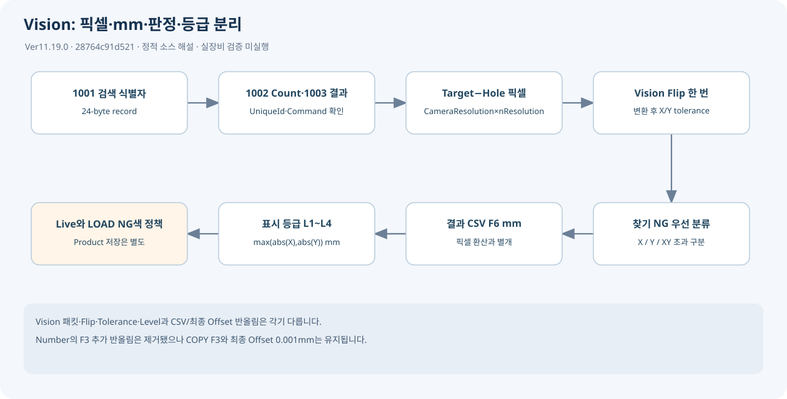

# Vision 통신: 1001 식별자 패킷, 1003 수신값, 픽셀→mm 오차




원본: `kjuws10-rgb/A3Drilling` · `master` · `334b3599651b2e8e0181fd4459bafaf3cddafff3`

현재 재검토: **11.19.0 / 2026-11-20**, 비교 기준 11.17.0(`96e22cd027c84bf302b23f2949b98985d7f301bb`). 11.18/11.19 두 Commit의 변경과 이전부터 남아 있는 경계를 함께 확인했습니다. 아래 변경 항목과 기존 잔건을 구분합니다. 파일·함수·호출 경계의 정적 확인이며 장비 실행 시험 결과가 아닙니다.

이 장의 **코드 확인**은 해당 Commit의 실제 함수 본문을 정적으로 추적한 사실입니다. **해설**은 그 구조를 이해하기 위한 설명이며, **검증 과제**는 앞으로 실행할 시험입니다. 실장비의 부호·광학 상태·통신 타이밍·정밀도가 검증되었다는 뜻은 아닙니다. 예시 숫자는 설명용 가상값입니다.

## 1. 자주 생기는 오해부터 바로잡기

`ReviewResult.csv`나 `PROCESS_COORDINATES.csv`는 파일 저장 형식입니다. 실제 Vision TCP 전송은 `CVisionComm.Execute → ParseRequest → SendRequest → SendPacket → CVisionProtocol.Encode → NetworkStream.WriteAsync` 경로입니다. 가공·Review 좌표가 파일에 저장된다는 사실은 해당 CSV 행을 Vision에 그대로 보낸다는 근거가 되지 않습니다. [CVisionComm.cs:93–123](https://github.com/kjuws10-rgb/A3Drilling/blob/334b3599651b2e8e0181fd4459bafaf3cddafff3/Drilling.Common/Interface/Vision/CVisionComm.cs#L93-L123) [CVisionComm.cs:275–342](https://github.com/kjuws10-rgb/A3Drilling/blob/334b3599651b2e8e0181fd4459bafaf3cddafff3/Drilling.Common/Interface/Vision/CVisionComm.cs#L275-L342)

실제 좌표 이동 연결은 `CReviewStageMotion.MoveAndWait`에서 `ReviewTargetX/Y`를 Stage session으로 넘기며, Flying 준비는 같은 값으로 `ST_STAGE_IOF_POINT` 배열을 만듭니다. 이 경로와 TCP의 식별자 payload는 서로 다른 출력입니다. [CReviewManager.cs:2599–2602](https://github.com/kjuws10-rgb/A3Drilling/blob/334b3599651b2e8e0181fd4459bafaf3cddafff3/Drilling.Common/Review/CReviewManager.cs#L2599-L2602)


## 2. 실제 코드 경계를 찾는 순서

| 위치 | 책임 | 개발할 때 확인할 질문 |
|---|---|---|
| `CReviewManager.CreateFlyingReadyCommand` | Point를 Vision 검색 식별자로 직렬화하기 전 command 구성 | 어떤 Cell/Beam/row/column/Head를 요청하는가? [CReviewManager.cs:2124–2154](https://github.com/kjuws10-rgb/A3Drilling/blob/334b3599651b2e8e0181fd4459bafaf3cddafff3/Drilling.Common/Review/CReviewManager.cs#L2124-L2154) |
| `CVisionComm.Execute` | 문자열 명령을 packet으로 바꾸고 송수신 | UniqueId, line capacity를 언제 정하는가? [CVisionComm.cs:93–123](https://github.com/kjuws10-rgb/A3Drilling/blob/334b3599651b2e8e0181fd4459bafaf3cddafff3/Drilling.Common/Interface/Vision/CVisionComm.cs#L93-L123) |
| `CVisionProtocol.CreateFlyingReady` | 헤더 외 body layout 구성 | 사용 slot과 미사용 slot을 어떻게 채우는가? [CVisionComm.cs:581–599](https://github.com/kjuws10-rgb/A3Drilling/blob/334b3599651b2e8e0181fd4459bafaf3cddafff3/Drilling.Common/Interface/Vision/CVisionComm.cs#L581-L599) |
| `SendRequest` | 응답 Task, timeout, command 검증 | 다른 요청의 응답을 받을 수 없는가? [CVisionComm.cs:275–312](https://github.com/kjuws10-rgb/A3Drilling/blob/334b3599651b2e8e0181fd4459bafaf3cddafff3/Drilling.Common/Interface/Vision/CVisionComm.cs#L275-L312) |
| `SendPacket` / `ReadPacket` | 네트워크 byte 송수신 | partial read, 쓰기 동시성, 길이 검증을 처리하는가? [CVisionComm.cs:315–342](https://github.com/kjuws10-rgb/A3Drilling/blob/334b3599651b2e8e0181fd4459bafaf3cddafff3/Drilling.Common/Interface/Vision/CVisionComm.cs#L315-L342) |
| `CreateVisionMeasurement` | 응답 숫자 해석과 mm 오차 생성 | found 신호와 tolerance 판정이 같은 것인가? [CReviewManager.cs:2359–2386](https://github.com/kjuws10-rgb/A3Drilling/blob/334b3599651b2e8e0181fd4459bafaf3cddafff3/Drilling.Common/Review/CReviewManager.cs#L2359-L2386) |

## 3. 16바이트 공통 헤더

현재 `CVisionProtocol.HeaderSize`는 16이고, 인코더가 아래 순서로 Int32를 기록합니다. Int32는 little-endian reader와 대응합니다. 헤더의 DataLength와 실제 body 길이가 다르면 전송 전에 예외가 납니다. [CVisionComm.cs:563–564](https://github.com/kjuws10-rgb/A3Drilling/blob/334b3599651b2e8e0181fd4459bafaf3cddafff3/Drilling.Common/Interface/Vision/CVisionComm.cs#L563-L564) [CVisionComm.cs:648–672](https://github.com/kjuws10-rgb/A3Drilling/blob/334b3599651b2e8e0181fd4459bafaf3cddafff3/Drilling.Common/Interface/Vision/CVisionComm.cs#L648-L672) [CVisionComm.cs:989–990](https://github.com/kjuws10-rgb/A3Drilling/blob/334b3599651b2e8e0181fd4459bafaf3cddafff3/Drilling.Common/Interface/Vision/CVisionComm.cs#L989-L990)

| byte offset | 크기 | 필드 | 뜻 |
|---:|---:|---|---|
| 0 | 4 | Command | 예: Flying Ready 1001 |
| 4 | 4 | DataLength | body byte 수; 전체 packet 길이가 아니다. |
| 8 | 4 | UniqueId | 요청과 응답을 연결하는 ID |
| 12 | 4 | ErrorCode | 통신 응답의 오류 코드 |
| 16 | DataLength | Body | command마다 다른 구조 |

`ReadPacket`은 헤더를 정확한 byte 수만큼 읽고 DataLength를 해석한 다음 body를 다시 정확히 읽습니다. TCP에서 한 번의 `ReadAsync`가 한 packet과 일치한다는 가정을 하지 않습니다. 이는 패킷이 두 번에 나눠 들어오는 상황을 다루기 위한 기본 경계입니다. [CVisionComm.cs:333–342](https://github.com/kjuws10-rgb/A3Drilling/blob/334b3599651b2e8e0181fd4459bafaf3cddafff3/Drilling.Common/Interface/Vision/CVisionComm.cs#L333-L342)

## 4. 1001 Flying Ready는 mm X/Y 배열이 아니다

`ST_VISION_MARK_SEARCH`는 여섯 정수 `Cell, Doe, Line, IndexX, IndexY, Head`입니다. 레코드 크기는 24바이트입니다. `Doe` 필드에는 Review command builder가 `point.BeamNo`를 넣습니다. 현재 builder는 ShotNo를 PixelCountX로 나눠 1기반 row/column을 만들고 `Line`과 `IndexY` 양쪽에 row index를 넣습니다. 이를 mm좌표라고 설명하면 payload와 Stage 이동을 동시에 잘못 이해하게 됩니다. [CVisionComm.cs:535–553](https://github.com/kjuws10-rgb/A3Drilling/blob/334b3599651b2e8e0181fd4459bafaf3cddafff3/Drilling.Common/Interface/Vision/CVisionComm.cs#L535-L553) [CReviewManager.cs:2147–2154](https://github.com/kjuws10-rgb/A3Drilling/blob/334b3599651b2e8e0181fd4459bafaf3cddafff3/Drilling.Common/Review/CReviewManager.cs#L2147-L2154) [CVisionComm.cs:960–980](https://github.com/kjuws10-rgb/A3Drilling/blob/334b3599651b2e8e0181fd4459bafaf3cddafff3/Drilling.Common/Interface/Vision/CVisionComm.cs#L960-L980)

| body 내 위치 | 내용 | 설명 |
|---|---|---|
| 0..3 | InspectionType Int32 | 검사 유형 |
| 4..7 | 검색 점 수 Int32 | 유효 search 레코드 수 |
| 8부터 | 24바이트 × 설정된 line capacity | 각 slot의 six-int 식별자 |

Body 배열 크기는 `8 + maxHoleCountPerLine × 24`이고 전체를 `0xFF`로 채운 후 유효 슬롯을 기록합니다. 미사용 슬롯을 0좌표로 보는 것은 틀립니다. 이 구조의 정확한 capacity는 해당 실행 옵션과 상대 Vision 사양을 함께 확인해야 합니다. [CVisionComm.cs:581–599](https://github.com/kjuws10-rgb/A3Drilling/blob/334b3599651b2e8e0181fd4459bafaf3cddafff3/Drilling.Common/Interface/Vision/CVisionComm.cs#L581-L599)

한 레코드의 상대 byte 배치는 `Cell +0`, `Doe +4`, `Line +8`, `IndexX +12`, `IndexY +16`, `Head +20`입니다. 신규 필드를 추가하면 단순히 C# record에 속성만 더할 것이 아니라 packet 길이·reader·writer·상대 장치 map을 모두 맞춰야 합니다. [CVisionComm.cs:960–980](https://github.com/kjuws10-rgb/A3Drilling/blob/334b3599651b2e8e0181fd4459bafaf3cddafff3/Drilling.Common/Interface/Vision/CVisionComm.cs#L960-L980)

## 5. 1001 → 이동 → 1002 → 1003 순서와 실패 처리

Fine flying의 한 시도는 새 frozen buffer로 IOF를 준비하고 실제 Vision일 때 keep-alive와 FlyingReady를 보냅니다. 끝점 이동이 끝난 다음 `FLYING_MOVE_DONE`을 보냅니다. count mismatch는 `CFlyingCountMismatchException`으로 분리하며, 허용된 재시도 조건에서 점 순서를 반대로 바꿉니다. count mismatch 시도의 1003을 요청하지 않는 주석이 있어, 이전 시도 결과를 잘못 소비하지 않도록 되어 있습니다. [CReviewManager.cs:2844–2895](https://github.com/kjuws10-rgb/A3Drilling/blob/334b3599651b2e8e0181fd4459bafaf3cddafff3/Drilling.Common/Review/CReviewManager.cs#L2844-L2895)

1003의 측정 개수는 frozen buffer 개수와 일치해야 하고 해당 buffer 순서에 결과를 붙입니다. 다음 줄 선이동과 응답 수신이 일부 겹치는 최적화 분기가 있으므로 UI 표시 순서만으로 물리 Trigger 순서를 추정하지 않아야 합니다. [CReviewManager.cs:2898–2929](https://github.com/kjuws10-rgb/A3Drilling/blob/334b3599651b2e8e0181fd4459bafaf3cddafff3/Drilling.Common/Review/CReviewManager.cs#L2898-L2929)

`SendRequest`는 UniqueId별 pending Task를 등록하고 연결된 cancellation token에 timeout을 추가합니다. 응답 Command가 요청과 다르거나 ErrorCode가 0이 아니면 실패합니다. finally에서 pending을 제거합니다. 반면 “정상 header 수신”과 “표적 찾기 성공”은 별개입니다. [CVisionComm.cs:275–312](https://github.com/kjuws10-rgb/A3Drilling/blob/334b3599651b2e8e0181fd4459bafaf3cddafff3/Drilling.Common/Interface/Vision/CVisionComm.cs#L275-L312)

## 6. 수신 숫자를 mm 오차로 바꾸기

`ST_VISION_MARK_FIND`는 `Result`와 `TargetMarkX/Y`, `HoleX/Y`를 포함합니다. `CreateVisionMeasurement`에서 `nResult == 0`을 found로 봅니다. 코드 주석은 1000/1003/1010에 대해 0이 found라고 명시합니다. `1=OK`라는 문서가 남아 있다면 현행 구현 및 상대 프로토콜과 불일치 여부를 확인해야 합니다. [CVisionComm.cs:548–552](https://github.com/kjuws10-rgb/A3Drilling/blob/334b3599651b2e8e0181fd4459bafaf3cddafff3/Drilling.Common/Interface/Vision/CVisionComm.cs#L548-L552) [CReviewManager.cs:2359–2372](https://github.com/kjuws10-rgb/A3Drilling/blob/334b3599651b2e8e0181fd4459bafaf3cddafff3/Drilling.Common/Review/CReviewManager.cs#L2359-L2372)

소스의 실제 변환식은 다음과 같습니다. `cameraResolution` 단위는 함수 검증문에 **mm/pixel**로 명시되어 있습니다. [CReviewManager.cs:2375–2386](https://github.com/kjuws10-rgb/A3Drilling/blob/334b3599651b2e8e0181fd4459bafaf3cddafff3/Drilling.Common/Review/CReviewManager.cs#L2375-L2386)

```text
factor = CameraResolution(mm/pixel) × nResolution
rawErrorX_mm = factor × (TargetMarkX − HoleX)
rawErrorY_mm = factor × (TargetMarkY − HoleY)
```

`nResolution <= 0`, CameraResolution 비양수/비유한, 수신 픽셀 비유한, 환산값 비유한은 거부합니다. `nResolution`을 임의의 µm 단위로 해석하거나 `Hole−Target`으로 뒤집으면 보정 방향이 달라집니다. Stage 방향이나 Head Flip을 이 단계에서 추가로 적용하면 원래 경계를 무너뜨립니다. [CReviewManager.cs:2375–2386](https://github.com/kjuws10-rgb/A3Drilling/blob/334b3599651b2e8e0181fd4459bafaf3cddafff3/Drilling.Common/Review/CReviewManager.cs#L2375-L2386)

설명용 예로 CameraResolution이 `0.001 mm/pixel`, nResolution이 2, Target−Hole가 `(3,−2) pixel`이면 raw error는 `(0.006,−0.004) mm`입니다. 실제 장비 설정값을 인용한 예가 아닙니다.

## 7. found, geometric OK, 보정 가능은 서로 다르다

`ApplyMeasurementError`는 raw mm 오차에 `VisionErrorToStageOffset`을 적용한 값으로 tolerance를 확인합니다. 먼저 X/Y swap, 다음 X 부호 반전, 다음 Y 부호 반전을 적용합니다. 찾기 상태도 정상이어야 하고 `abs(X)<=TolX && abs(Y)<=TolY`여야 최종 OK입니다. `ErrorX/Y`에는 함수 인수의 raw 오차가 저장됩니다. [CReviewManager.cs:2312–2344](https://github.com/kjuws10-rgb/A3Drilling/blob/334b3599651b2e8e0181fd4459bafaf3cddafff3/Drilling.Common/Review/CReviewManager.cs#L2312-L2344) [CReviewManager.cs:3687–3707](https://github.com/kjuws10-rgb/A3Drilling/blob/334b3599651b2e8e0181fd4459bafaf3cddafff3/Drilling.Common/Review/CReviewManager.cs#L3687-L3707)

따라서 다음 네 상태를 구분해 설명해야 합니다.

1. TCP 응답 성공: header와 UniqueId/Command가 정상이다.
2. Vision found: nResult가 0이다.
3. Review OK: 변환 후 X/Y가 tolerance 안이다.
4. 보정 적용 완료: 결과 전체의 정합성·NG 여부·중복 적용·파일 저장을 통과했다.

1번만 성공했는데 “검사 OK”로 표시하거나 3번 성공을 “보정값이 이미 적용됨”으로 표시하면 작업자가 중복 적용할 수 있습니다. 자동 보정 저장은 별도 coordinator에서 수행합니다. [CAutoFineReviewCoordinator.cs:95–151](https://github.com/kjuws10-rgb/A3Drilling/blob/334b3599651b2e8e0181fd4459bafaf3cddafff3/Drilling.Common/Review/CAutoFineReviewCoordinator.cs#L95-L151)

## 8. 추가 개발 시 필요한 주석과 로그

| 위치 | 반드시 남길 의미 |
|---|---|
| 1001 record 생성 | six-int는 검색 식별자이며 mm 이동 좌표가 아님 |
| 순서 반전 retry | 현재 attempt의 buffer와 결과만 서로 결합 |
| 픽셀 환산 | Target−Hole, mm/pixel, Resolution 곱, 아직 Vision Flip 전 |
| tolerance 판정 | found 여부와 오차 기준을 모두 만족해야 OK |
| CSV 저장 | 통신 packet 사본이 아니라 후처리·이력 artifact |

## 9. 검증 과제

| 수준 | 시험 | 통과 기준 |
|---|---|---|
| Pure unit | 알려진 six-int를 인코딩 후 디코딩 | 24바이트 각 위치와 값이 동일 |
| Pure unit | 1001 capacity 3, 유효 2점 | body 80바이트, 남는 24바이트는 0xFF |
| Fake TCP | 헤더를 여러 조각으로 나눠 수신 | packet 1개로 정상 복원, 다음 packet과 섞이지 않음 |
| Fake TCP | UniqueId 다름 / Command 다름 / ErrorCode≠0 | 정상 측정으로 처리되지 않음 |
| Pure unit | Resolution0, CameraResolutionNaN | 좌표 적용 전에 명확한 예외 |
| Pure unit | tolerance 경계 ±값, found0/1 | found와 경계 포함 비교가 코드대로 동작 |
| Integration simulation | 1002 NCK 후 retry | 실패 attempt의1003 미요청, 역방향 buffer로 새 시도 |

이 시험표는 실행 계획입니다. 작성 시 실제 TCP 서버·카메라·Stage를 구동하지 않았습니다.

## 10. 11.13.0은 NG 원인과 Vision 결과 코드를 따로 보존한다

이번 변경은 수신 패킷의 좌표 단위를 바꾸지 않습니다. CreateVisionMeasurement가 Vision의 nResult를 VisionResultCode로 보관하고, nResult≠0이면 VISION_FIND_NG를 붙입니다. ApplyMeasurementError는 Flip 후 tolerance를 비교하여 최종 판정과 원인을 만듭니다. [CReviewManager.cs:2312–2345](https://github.com/kjuws10-rgb/A3Drilling/blob/334b3599651b2e8e0181fd4459bafaf3cddafff3/Drilling.Common/Review/CReviewManager.cs#L2312-L2345) [CReviewManager.cs:2359–2386](https://github.com/kjuws10-rgb/A3Drilling/blob/334b3599651b2e8e0181fd4459bafaf3cddafff3/Drilling.Common/Review/CReviewManager.cs#L2359-L2386)

| 입력 조건 | 최종 JUDGE | NG_REASON |
|---|---|---|
| 찾기 정상 + X/Y 허용범위 이내 | OK | 빈 값 |
| Vision 찾기 실패 | NG | VISION_FIND_NG 또는 전달된 측정 원인 |
| 찾기 정상 + X만 초과 | NG | TOLERANCE_X_NG |
| 찾기 정상 + Y만 초과 | NG | TOLERANCE_Y_NG |
| 찾기 정상 + X/Y 모두 초과 | NG | TOLERANCE_XY_NG |

찾기 실패가 있으면 tolerance 분류보다 찾기 실패 원인을 우선합니다. tolerance 경계는 초과(>) 여부로 판정하므로 정확히 경계인 정상 찾기 값은 OK입니다. 통신 실패·잘못된 패킷으로 예외가 발생하는 경우와, 유효 응답에서 찾기 NG가 나오는 경우를 구분해야 합니다. 새 요약은 State가 Ok/Ng인 완료 측정점만 집계하고 Vision 코드별 개수와 첫 NG 식별자를 포함합니다. WAIT·SKIP·통신 실패 전의 점은 완료 측정점 수에 자동 포함되지 않습니다. [CReviewManager.cs:1129–1169](https://github.com/kjuws10-rgb/A3Drilling/blob/334b3599651b2e8e0181fd4459bafaf3cddafff3/Drilling.Common/Review/CReviewManager.cs#L1129-L1169) [CReviewManager.cs:4093–4130](https://github.com/kjuws10-rgb/A3Drilling/blob/334b3599651b2e8e0181fd4459bafaf3cddafff3/Drilling.Common/Review/CReviewManager.cs#L4093-L4130)

P2P/IOF/FINE 실행 로그와 AUTO 결과 문구에서 NG 요약을 사용할 수 있습니다. AUTO의 전체 NG 차단 정책은 유지되며, 원인 표시가 늘었다고 NG인 Shot만 빼고 나머지를 자동 적용하는 것으로 바뀌지 않습니다. [CAutoFineReviewCoordinator.cs:43–77](https://github.com/kjuws10-rgb/A3Drilling/blob/334b3599651b2e8e0181fd4459bafaf3cddafff3/Drilling.Common/Review/CAutoFineReviewCoordinator.cs#L43-L77) [CAutoFineReviewCoordinator.cs:95–122](https://github.com/kjuws10-rgb/A3Drilling/blob/334b3599651b2e8e0181fd4459bafaf3cddafff3/Drilling.Common/Review/CAutoFineReviewCoordinator.cs#L95-L122)

**저장 경계:** ALL/ONE LINE·ONE SHOT·FINE·ROUGH의 결과 writer에는 VISION_RESULT_CODE/NG_REASON 열이 추가되었습니다. 반면 재검사 Revision은 받은 update에 이 원시 코드가 없어 해당 행의 코드를 빈 값으로 바꾸고 NG는 REINSPECTION_NG로 기록합니다. 수동 EDIT는 코드 빈 값과 RESULT_EDIT를 기록합니다. 재검사 후에도 원래 NG 원인이 그대로 남는다고 읽으면 안 됩니다. 열이 없는 Legacy CSV에는 새 열을 추가하지 않으므로 기록 범위가 더 좁습니다. [CReviewResultFile.cs:352–403](https://github.com/kjuws10-rgb/A3Drilling/blob/334b3599651b2e8e0181fd4459bafaf3cddafff3/Drilling.File/ReviewResult/CReviewResultFile.cs#L352-L403) [CReviewResultFile.cs:534–573](https://github.com/kjuws10-rgb/A3Drilling/blob/334b3599651b2e8e0181fd4459bafaf3cddafff3/Drilling.File/ReviewResult/CReviewResultFile.cs#L534-L573) [CReviewResultFile.cs:1027–1080](https://github.com/kjuws10-rgb/A3Drilling/blob/334b3599651b2e8e0181fd4459bafaf3cddafff3/Drilling.File/ReviewResult/CReviewResultFile.cs#L1027-L1080)

추가 시험은 nResult 실패+큰 오차, 찾기 성공+X/Y 각각 경계, 재시도 시작 전 이전 원인 초기화, CSV 저장/재로드, 재검사 후 코드 소실, 수정 후 RESULT_EDIT, Active Product 재시작 복원입니다. 이는 정적 분석에서 만든 시험 계획이며 카메라 프로토콜 실연동 합격 결과가 아닙니다.

## 11. 11.17.0 L1~L4는 Vision 패킷이나 품질판정이 아니다

Vision raw 오차는 `CameraResolution(mm/pixel) × nResolution × (Target−Hole)`입니다. Vision Flip은 X/Y swap 뒤 각각 부호 반전을 한 번 적용하며 found와 변환 후 tolerance로 Judge/NgReason을 정합니다. 새 색 등급은 이후 별도 계산 `m=max(abs(ResultX),abs(ResultY))`이며 반경 `sqrt(X²+Y²)`가 아닙니다. [CReviewManager.cs:2321–2387](https://github.com/kjuws10-rgb/A3Drilling/blob/334b3599651b2e8e0181fd4459bafaf3cddafff3/Drilling.Common/Review/CReviewManager.cs#L2321-L2387) [CReviewManager.cs:3687–3708](https://github.com/kjuws10-rgb/A3Drilling/blob/334b3599651b2e8e0181fd4459bafaf3cddafff3/Drilling.Common/Review/CReviewManager.cs#L3687-L3708) [CReviewResultLevelSettings.cs:23–54](https://github.com/kjuws10-rgb/A3Drilling/blob/334b3599651b2e8e0181fd4459bafaf3cddafff3/Drilling.Common/Review/CReviewResultLevelSettings.cs#L23-L54)

| 등급 | 기본 mm 경계 | 기본 색 | 주의 |
|---|---|---|---|
| L1 | m≤0.010 | #22C55E | 10µm 이하 표시, 품질 OK 증명 아님 |
| L2 | 0.010<m≤0.020 | #84CC16 | 상한 경계 포함 |
| L3 | 0.020<m≤0.030 | #F59E0B | tolerance와 독립 |
| L4 | m>0.030 또는 비유한 | #EF4444 | 오류·미측정 정책 별도 확인 |

설정은 OPTION의 REVIEW_LEVEL1~3_MAX(mm), LEVEL1~4_COLOR(#RRGGBB)입니다. 양수·유한·L1<L2<L3 및 색 형식을 저장 경계에서 검사하고 키 없는 옛 설정은 기본값을 씁니다. 결과 CSV에 등급 snapshot을 추가한 것이 아니라 현재 설정으로 계산하므로 같은 CSV도 설정 변경 후 다른 색으로 보일 수 있습니다. [CReviewResultLevelSettings.cs:60–87](https://github.com/kjuws10-rgb/A3Drilling/blob/334b3599651b2e8e0181fd4459bafaf3cddafff3/Drilling.Common/Review/CReviewResultLevelSettings.cs#L60-L87) [CReviewResultLevelSettings.cs:114–165](https://github.com/kjuws10-rgb/A3Drilling/blob/334b3599651b2e8e0181fd4459bafaf3cddafff3/Drilling.Common/Review/CReviewResultLevelSettings.cs#L114-L165) [CSettingFile.cs:238–274](https://github.com/kjuws10-rgb/A3Drilling/blob/334b3599651b2e8e0181fd4459bafaf3cddafff3/Drilling.File/JHMI/CSettingFile.cs#L238-L274)

**새 변경의 표시정책 차이:** live Review는 VisionFind NG의 등급을 숨기지만 REVIEW DATA는 로드된 모든 행 ErrorX/Y로 등급을 만듭니다. 표시 DTO에 NgReason/ResultSource를 넘기지 않습니다. 찾아내지 못한 NG 또는 미측정 행에 숫자0이 있으면 로드 화면에서 L1색일 수 있습니다. Judge는 별도로 남으므로 색이 품질 판정을 바꿨다고 단정하지 않습니다. 운영자가 초록색을 합격으로 오해하지 않도록 NG/미측정/EDITED 정책을 비교해야 합니다. [CMenuReview.cs:4980–5024](https://github.com/kjuws10-rgb/A3Drilling/blob/334b3599651b2e8e0181fd4459bafaf3cddafff3/Drilling.UI/Menu/Menus/CMenuReview.cs#L4980-L5024) [CMenuCorrection.ReviewData.Display.cs:274–300](https://github.com/kjuws10-rgb/A3Drilling/blob/334b3599651b2e8e0181fd4459bafaf3cddafff3/Drilling.UI/Menu/Menus/CMenuCorrection.ReviewData.Display.cs#L274-L300)

시험은 동일 NG/0값 파일을 live·최근결과LOAD·REVIEW DATA에서 비교하고 임계값±0.000001mm, 비유한 입력, 잘못된 색, 설정 변경 후 재LOAD를 나눕니다. 통신 포맷 변경 없이 표시 단계가 추가된 것이므로 새 색만으로 패킷·실측 오류를 추정하면 안 됩니다.

## 13. 통신 단위와 결과 파일 정밀도는 다릅니다

Vision 수신의 `Target−Hole`은 pixel 차이이고 `CameraResolution(mm/pixel) × nResolution`을 한 번 곱해 mm로 만듭니다. Flip·Tolerance·Level은 그 다음 책임입니다. 이번 CVisionComm 변경은 연결·UniqueId·프레임·Timeout 설명 주석이며 패킷 구조·nResult=0의 OK 의미를 바꾸지 않았습니다. [CReviewManager.cs:2376–2391](https://github.com/kjuws10-rgb/A3Drilling/blob/334b3599651b2e8e0181fd4459bafaf3cddafff3/Drilling.Common/Review/CReviewManager.cs#L2376-L2391) [CVisionComm.cs:275–299](https://github.com/kjuws10-rgb/A3Drilling/blob/334b3599651b2e8e0181fd4459bafaf3cddafff3/Drilling.Common/Interface/Vision/CVisionComm.cs#L275-L299)

`CReviewResultFile.Number`가 소수3자리 반올림에서 `FormatDouble`로 바뀌어 소수6자리 mm를 기록합니다. 예를 들어 합성 0.000600mm는 과거0.001mm가 아니라0.000600mm로 남습니다. 네트워크 해상도가 좋아진 것이 아니라 CSV 직렬화 단계의 추가 반올림이 줄어든 것입니다. F6는 임의 정밀도 보존도 아니며 최종 보정값의0.001mm 반올림과 UI COPY F3는 남습니다. [CReviewResultFile.cs:719–722](https://github.com/kjuws10-rgb/A3Drilling/blob/334b3599651b2e8e0181fd4459bafaf3cddafff3/Drilling.File/ReviewResult/CReviewResultFile.cs#L719-L722) [CReviewResultFile.cs:1328–1328](https://github.com/kjuws10-rgb/A3Drilling/blob/334b3599651b2e8e0181fd4459bafaf3cddafff3/Drilling.File/ReviewResult/CReviewResultFile.cs#L1328-L1328) [CMenuCorrection.ReviewData.Edit.cs:665–666](https://github.com/kjuws10-rgb/A3Drilling/blob/334b3599651b2e8e0181fd4459bafaf3cddafff3/Drilling.UI/Menu/Menus/CMenuCorrection.ReviewData.Edit.cs#L665-L666) [CShotCoordinatePlanBuilder.cs:663–674](https://github.com/kjuws10-rgb/A3Drilling/blob/334b3599651b2e8e0181fd4459bafaf3cddafff3/Drilling.Common/Recipe/CShotCoordinatePlanBuilder.cs#L663-L674)

독립 순수함수 시험에서는 기존값0.000600 + 새 오차0.000600mm의 최종값이 live와 현재 파일 모두0.001mm이고, 예전 F3 경로의0.002mm 차이를 재현했습니다. 이것은 합성 계산 회귀이며 카메라 해상도·광학 정밀도·실제5µm 성능 합격 시험이 아닙니다.
