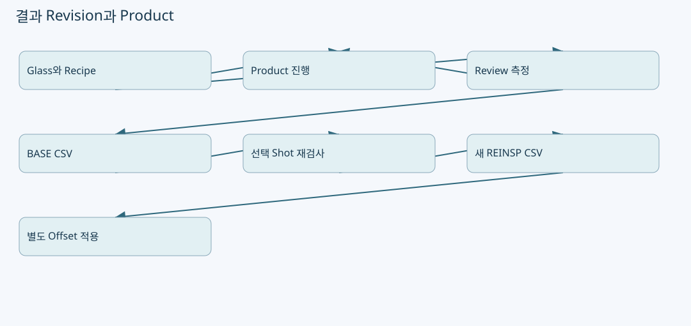
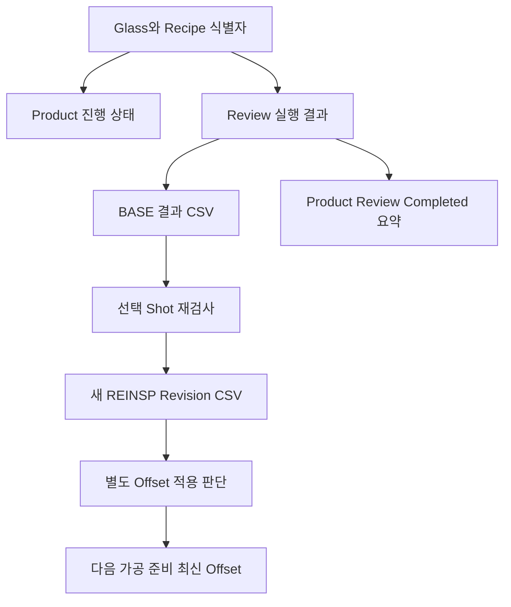

# ReviewResult·재검사 Revision·Product 이력의 결합

원본: `kjuws10-rgb/A3Drilling` · `master` · `5aee8e58439c9b455cae7c9593c9be986c3e682e`

이 장의 **코드 확인**은 해당 Commit의 실제 함수 본문을 정적으로 추적한 사실입니다. **해설**은 그 구조를 이해하기 위한 설명이며, **검증 과제**는 앞으로 실행할 시험입니다. 실장비의 부호·광학 상태·통신 타이밍·정밀도가 검증되었다는 뜻은 아닙니다. 예시 숫자는 설명용 가상값입니다.

## 1. 세 종류의 이력이 별도로 존재한다

이 프로젝트에서 측정 결과 파일, 보정 snapshot, Product 진행 상태는 다른 자료입니다. ReviewResult는 측정 수치와 판정을 저장합니다. ReviewOffset은 다음 가공에 쓸 보정값을 저장합니다. Product는 현재 Glass/공정의 Review가 Running/Completed인지와 결과 요약을 관리합니다. 파일 하나가 존재한다고 나머지 두 상태가 자동으로 동일하다고 추정하면 안 됩니다. [CReviewResultFile.cs:135–209](https://github.com/kjuws10-rgb/A3Drilling/blob/5aee8e58439c9b455cae7c9593c9be986c3e682e/Drilling.File/ReviewResult/CReviewResultFile.cs#L135-L209) [CAutoFineReviewCoordinator.cs:121–166](https://github.com/kjuws10-rgb/A3Drilling/blob/5aee8e58439c9b455cae7c9593c9be986c3e682e/Drilling.Common/Review/CAutoFineReviewCoordinator.cs#L121-L166) [CProductManager.cs:444–506](https://github.com/kjuws10-rgb/A3Drilling/blob/5aee8e58439c9b455cae7c9593c9be986c3e682e/Drilling.Common/Product/CProductManager.cs#L444-L506)

그림의 Product 화살표는 데이터 책임을 구분한 것입니다. 수동 재검사 Revision을 만들 때 자동으로 과거 Product 요약도 수정되는지 여부는 이 장에서 확인한 파일 함수만으로 보장하지 않습니다.

## 2. 재검사의 UI 입력이 모이는 곳

`SaveReinspectionResult`는 완료된 재검사 항목만 모읍니다. 각 update에는 `CellNo`, `ShotKey`, `ShotName`, 원래 Beam, 실제 재검사 Beam, raw 결과 X/Y, 변환된 결과 X/Y, 상태가 들어갑니다. 사용자가 다른 Beam으로 재검사했을 때 원래 row와 실제 사용 Beam을 구분하는 이유입니다. 완료 update가 없으면 저장을 거부하고 BASE 파일명과 갱신 Shot 수를 확인한 뒤 파일 writer를 호출합니다. [CMenuCorrection.ReviewData.Reinspection.cs:337–393](https://github.com/kjuws10-rgb/A3Drilling/blob/5aee8e58439c9b455cae7c9593c9be986c3e682e/Drilling.UI/Menu/Menus/CMenuCorrection.ReviewData.Reinspection.cs#L337-L393)

| 값 | 구분 목적 |
|---|---|
| SourceBeamNo | BASE 결과에서 어떤 측정 행을 바꾸려는지 찾는 단서 |
| BeamNo | 이번 재검사에 실제 선택한 Beam |
| RawResultX/Y | 수신 오차가 어떤 방향이었는지 추적 |
| ResultX/Y | 변환 후 후처리할 오차 |
| Judge/State | 완료 OK인지 완료 NG인지 구분 |

UI 저장은 새 파일 경로를 받으면 unsaved 상태를 해제합니다. 취소와 일반 예외는 별도로 표시합니다. 저장 버튼을 눌렀다는 조작 이력만으로 파일이 생성되었다고 판단하지 말고 성공 경로와 실제 파일명까지 확인해야 합니다. [CMenuCorrection.ReviewData.Reinspection.cs:383–409](https://github.com/kjuws10-rgb/A3Drilling/blob/5aee8e58439c9b455cae7c9593c9be986c3e682e/Drilling.UI/Menu/Menus/CMenuCorrection.ReviewData.Reinspection.cs#L383-L409)

## 3. BASE 파일을 덮어쓰지 않는 Revision 생성

`SaveReinspectionRevision`은 source file 존재, header 존재, row 존재를 먼저 확인합니다. `BEAM1_JUDGE` header를 가진 BEAM INSPECTION 결과는 이 재검사 writer로 저장할 수 없습니다. 즉 어떤 결과 타입이든 같은 Revision 함수에 넣을 수 있는 구조가 아닙니다. [CReviewResultFile.cs:135–173](https://github.com/kjuws10-rgb/A3Drilling/blob/5aee8e58439c9b455cae7c9593c9be986c3e682e/Drilling.File/ReviewResult/CReviewResultFile.cs#L135-L173)

BASE 행을 dictionary로 복사한 뒤 update마다 검증하고 대상 행을 찾습니다. 같은 BASE row를 두 번 바꾸려 하면 `updatedRowIndexes`가 중복을 차단합니다. 기존 `SAVED_AT` 열이 있으면 Revision 시각 표현을 갱신합니다. `5aee8e58` 기준 함수는 기존 파일을 직접 overwrite하는 대신 새 고유 CSV를 만듭니다. [CReviewResultFile.cs:175–209](https://github.com/kjuws10-rgb/A3Drilling/blob/5aee8e58439c9b455cae7c9593c9be986c3e682e/Drilling.File/ReviewResult/CReviewResultFile.cs#L175-L209)

새 파일 stem은 기존 stem에서 마지막 `_REINSP_` 구간을 잘라내고 `_REINSP_yyyyMMdd_HHmmss_fff`를 붙입니다. Revision을 여러 번 만들 때 파일명에 `_REINSP_`가 끝없이 중첩되지 않도록 한 처리입니다. 원본 BASE의 행 구조를 유지하되 바뀐 행의 측정 열만 갱신하는 방식입니다. [CReviewResultFile.cs:198–209](https://github.com/kjuws10-rgb/A3Drilling/blob/5aee8e58439c9b455cae7c9593c9be986c3e682e/Drilling.File/ReviewResult/CReviewResultFile.cs#L198-L209)

## 4. 어떤 열을 어떻게 갱신하는가

`ApplyReinspectionUpdate`는 BASE에 **존재하는 열만** 갱신합니다. 아래 이름들은 저장 형식의 호환 열이며, 무조건 모든 결과 CSV에 동시에 존재한다는 뜻은 아닙니다. 좌표 열은 X와 Y가 한 쌍으로 있어야 하며 한쪽만 있으면 실패합니다. 갱신할 좌표 쌍이 하나도 없으면 저장할 수 없습니다. [CReviewResultFile.cs:293–338](https://github.com/kjuws10-rgb/A3Drilling/blob/5aee8e58439c9b455cae7c9593c9be986c3e682e/Drilling.File/ReviewResult/CReviewResultFile.cs#L293-L338)

| 열 묶음 | 들어가는 update 값 | 의미 |
|---|---|---|
| `RECV_TARGET_MINUS_HOLE_X/Y`, `RECV_X/Y` | RawResultX/Y | raw 방향 오차 |
| `VISION_FLIP_CONVERT_X/Y`, `CONVERTED_X/Y`, `ERROR_X/Y` | ResultX/Y | 변환된 오차 |
| `BEAM_NO` | BeamNo | 재검사 Beam |
| `JUDGE`, `STATE` | Judge 대문자 | 재검사 판정 |
| `RESULT_SOURCE` | MEASURED | 직접 측정으로 갱신된 행임을 표시 |

**해설:** result CSV의 `ERROR_X/Y`를 모든 코드 경로에서 raw Vision 축이라고 간주하면 안 됩니다. 이 Revision writer는 ResultX/Y를 넣습니다. 결과를 load해 보정할 때 어느 경로에서 flip이 이미 적용되었는지 확인해야 합니다. UI FINE/AUTO delta builder가 `EN_VISION_FLIP_TYPE.Normal`을 전달하는 것도 파일의 변환 후 오차를 다시 flip하지 않기 위한 읽기 관점에서 검토해야 할 연결점입니다. [CReviewResultFile.cs:301–305](https://github.com/kjuws10-rgb/A3Drilling/blob/5aee8e58439c9b455cae7c9593c9be986c3e682e/Drilling.File/ReviewResult/CReviewResultFile.cs#L301-L305) [CMenuCorrection.ReviewData.Offset.cs:433–458](https://github.com/kjuws10-rgb/A3Drilling/blob/5aee8e58439c9b455cae7c9593c9be986c3e682e/Drilling.UI/Menu/Menus/CMenuCorrection.ReviewData.Offset.cs#L433-L458)

## 5. 측정 행과 보간 행을 구별하는 이유

UI Offset 적용의 `MeasuredRows`는 결과 중 `ResultSource` metadata가 하나라도 있으면 `MEASURED` 행만 사용합니다. metadata가 전혀 없는 Legacy 결과에서는 Judge가 OK 또는 NG인 행을 fallback으로 선택합니다. 이미 보간해 표시한 행을 다시 실측 anchor로 넣으면 보간 결과를 실측처럼 재활용하게 되기 때문에 source 역할을 구분하는 것이 중요합니다. [CMenuCorrection.ReviewData.Offset.cs:461–466](https://github.com/kjuws10-rgb/A3Drilling/blob/5aee8e58439c9b455cae7c9593c9be986c3e682e/Drilling.UI/Menu/Menus/CMenuCorrection.ReviewData.Offset.cs#L461-L466)

새 Revision에서 source를 MEASURED로 바꾸는 행과, 미수정된 BASE 행의 기존 source 상태가 함께 남을 수 있습니다. “Revision 파일 전체가 이번에 새로 촬영한 결과”라고 해석하면 안 됩니다. 어떤 Shot이 이번 재검사로 바뀌었는지 update 목록과 원본 연결을 함께 보아야 합니다. [CReviewResultFile.cs:175–195](https://github.com/kjuws10-rgb/A3Drilling/blob/5aee8e58439c9b455cae7c9593c9be986c3e682e/Drilling.File/ReviewResult/CReviewResultFile.cs#L175-L195) [CReviewResultFile.cs:311–314](https://github.com/kjuws10-rgb/A3Drilling/blob/5aee8e58439c9b455cae7c9593c9be986c3e682e/Drilling.File/ReviewResult/CReviewResultFile.cs#L311-L314)

## 6. Product Review 상태의 정확한 책임

`SetReviewRunning`은 지정 Product의 Review.State를 Running으로 바꾸고 PersistAndLog를 호출합니다. `SetReviewProgress`는 진행 중 snapshot을 Active 저장소에 쓰고 `_current`를 갱신합니다. `SetReviewCompleted`는 Completed, SavedAt, Results의 복사본을 만들고 완료 로그와 함께 저장합니다. 각 함수는 `_updateGate` 안에서 실행됩니다. [CProductManager.cs:444–506](https://github.com/kjuws10-rgb/A3Drilling/blob/5aee8e58439c9b455cae7c9593c9be986c3e682e/Drilling.Common/Product/CProductManager.cs#L444-L506)

| 이벤트 | Product 필드 | 다른 자료와의 차이 |
|---|---|---|
| Review 시작 | State=Running | 결과 CSV 완성 전 상태 |
| 진행 갱신 | Running + 진행 Results | 중간 snapshot, 최종 보정 아님 |
| Review 완료 | Completed + SavedAt + Results | Product 요약 완료, Offset 파일 생성과 동일 함수 아님 |
| 재검사 Revision 저장 | ReviewResult 새 파일 | 이 파일 writer 자체는 Product 상태를 수정하지 않음 |

Product 관리자는 시작 시 중단된 진행 상태를 복구하는 경로를 갖지만, 이는 저장 상태의 정리와 이력 처리입니다. 그 사실만으로 Stage가 물리적으로 원점에 복귀했다거나 미완료 가공을 이어서 실행할 수 있다고 결론내려서는 안 됩니다. [CProductManager.cs:25–121](https://github.com/kjuws10-rgb/A3Drilling/blob/5aee8e58439c9b455cae7c9593c9be986c3e682e/Drilling.Common/Product/CProductManager.cs#L25-L121)

## 7. 파일 간 연결을 디버깅하는 순서

1. **대상 고정:** GlassId, RecipeId, RunId와 화면에서 연 BASE 파일명을 먼저 확인합니다. 서로 다른 Glass 결과를 비슷한 timestamp만 보고 결합하지 않습니다.
2. **측정 결과:** 실행이 Completed인지, `ResultFilePath`가 있고 `ResultSaveError`가 없는지 봅니다. [CAutoFineReviewCoordinator.cs:43–75](https://github.com/kjuws10-rgb/A3Drilling/blob/5aee8e58439c9b455cae7c9593c9be986c3e682e/Drilling.Common/Review/CAutoFineReviewCoordinator.cs#L43-L75)
3. **행 정합성:** 요구한 검사점과 결과의 식별자 집합·개수가 일치하는지 확인합니다. [CAutoFineReviewCoordinator.cs:169–196](https://github.com/kjuws10-rgb/A3Drilling/blob/5aee8e58439c9b455cae7c9593c9be986c3e682e/Drilling.Common/Review/CAutoFineReviewCoordinator.cs#L169-L196)
4. **Revision:** 재검사 대상이 몇 개인지, 어떤 Beam을 썼는지, 새 파일명이 무엇인지 확인합니다. [CMenuCorrection.ReviewData.Reinspection.cs:344–396](https://github.com/kjuws10-rgb/A3Drilling/blob/5aee8e58439c9b455cae7c9593c9be986c3e682e/Drilling.UI/Menu/Menus/CMenuCorrection.ReviewData.Reinspection.cs#L344-L396)
5. **보정:** 해당 source 파일에서 Offset을 적용한 적이 있는지, Current/Delta/Final이 무엇인지, 새 Offset snapshot이 무엇인지 봅니다. [CMenuCorrection.ReviewData.Offset.cs:299–331](https://github.com/kjuws10-rgb/A3Drilling/blob/5aee8e58439c9b455cae7c9593c9be986c3e682e/Drilling.UI/Menu/Menus/CMenuCorrection.ReviewData.Offset.cs#L299-L331) [CReviewOffsetFile.cs:145–211](https://github.com/kjuws10-rgb/A3Drilling/blob/5aee8e58439c9b455cae7c9593c9be986c3e682e/Drilling.File/ReviewOffset/CReviewOffsetFile.cs#L145-L211)
6. **다음 가공:** 준비 parameter에 load된 Offset 파일명과 시각을 확인합니다. 과거 Product가 Completed라는 사실만 보지 않습니다. [CStationProcess.cs:1546–1560](https://github.com/kjuws10-rgb/A3Drilling/blob/5aee8e58439c9b455cae7c9593c9be986c3e682e/Drilling.Common/Station/CStationProcess.cs#L1546-L1560)

## 8. 주석과 Offline Studio 검색어 설계

이 장은 “Review 좌표를 Vision에 전달”이라는 질문을 결과 CSV 작성 함수로만 답하는 오류를 줄이기 위한 보조 문서이기도 합니다. 검색 시 다음 책임을 구분해야 합니다.

| 질문 표현 | 우선 찾을 symbol | 이 장의 연결 |
|---|---|---|
| 좌표 계산 | `CalculateReviewTarget` | 카메라/Stage 목표, 통신 식별자와 구분 |
| Vision 전송 | `CVisionComm.SendPacket` | 실제 TCP byte write 경계 |
| 측정 결과 저장 | `CReviewResultFile.Save...` | 측정 artifact |
| 재검사 저장 | `SaveReinspectionRevision` | BASE 보존, 새 Revision |
| Offset 적용 | `SaveNewFromSource`, `BuildOffsetApplyPlan` | 누적값과 source 이력 |
| Product 완료 | `SetReviewCompleted` | Glass 진행 요약 |

## 9. 검증 과제

| 시험 | 기대 기준 |
|---|---|
| BASE 없는 파일 / header 없음 / rows 없음 | Revision 생성 전 명확한 오류 |
| BEAM INSPECTION 결과를 재검사 writer에 입력 | 허용하지 않음 |
| 한 row를 두 update가 지정 | 중복 row 갱신 거부 |
| X열만 있고 Y열 없는 Legacy CSV | 부분 좌표 저장 거부 |
| 다른 Beam으로 재측정 | source row 식별은 정확하고 BEAM_NO는 새 Beam으로 갱신 |
| Revision의 Revision 저장 | 중첩 suffix 없이 새 고유 파일, 기존 두 파일 유지 |
| MEASURED와 보간 행 혼합 | 실측 anchor만 보정 입력으로 선택 |
| Product progress 중 저장 예외 | 완료로 오인하지 않고 실제 저장 실패 드러남 |
| UI에서 결과만 확인 후 닫기 | Offset 최신 파일이 바뀌지 않음 |

검증 방법은 synthetic CSV와 가짜 Product 저장소를 이용한 단위·통합시험을 우선 권장합니다. 현장 파일의 실제 측정 행은 이 문서에 복제하지 않았습니다.
